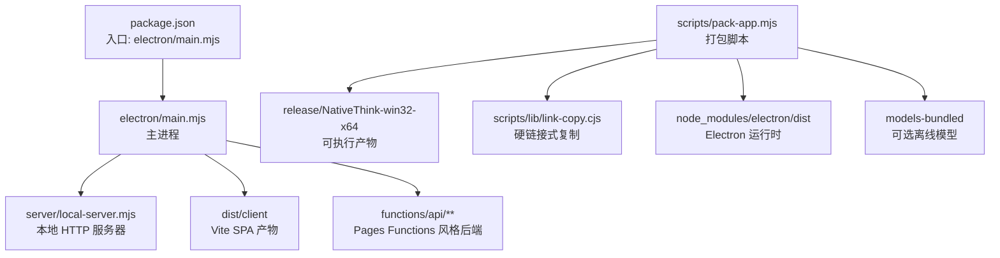
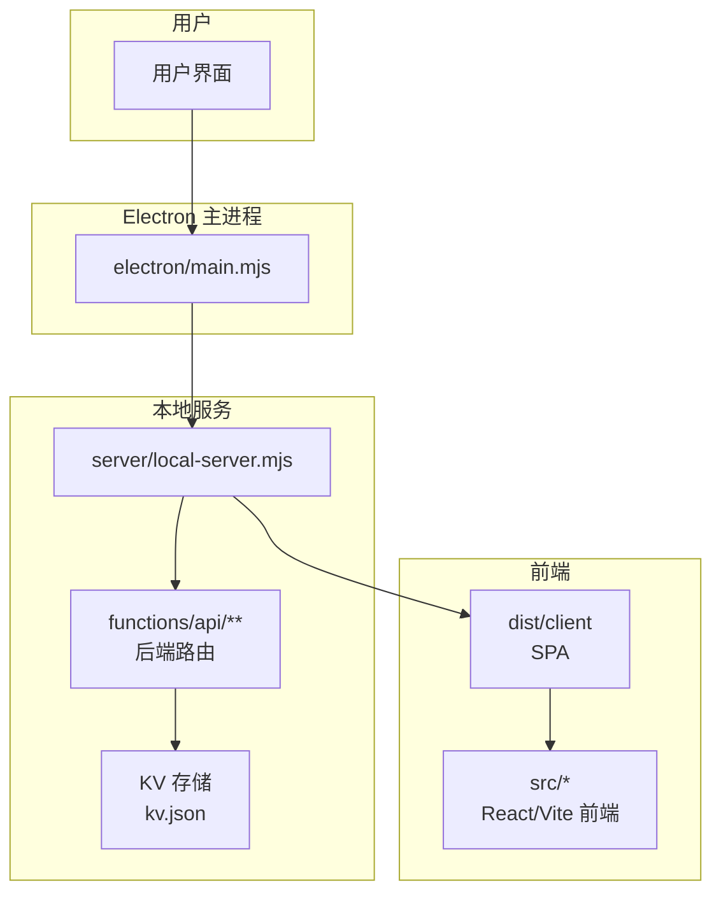
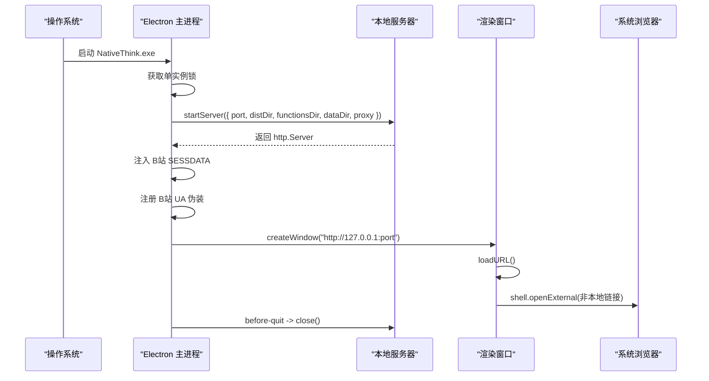
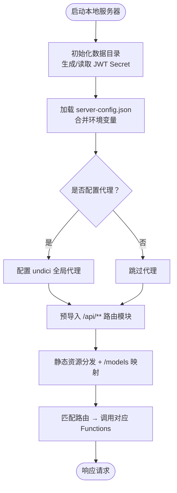
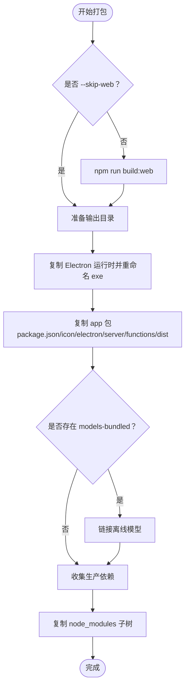
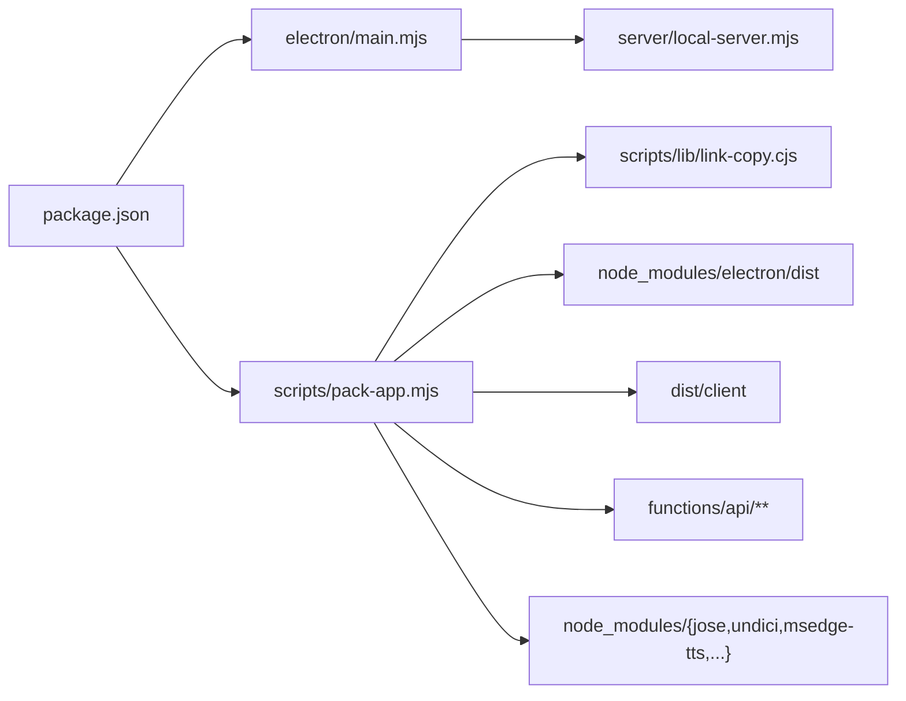

# Electron 桌面应用打包

<cite>
**本文引用的文件**   
- [electron/main.mjs](file://electron/main.mjs)
- [scripts/pack-app.mjs](file://scripts/pack-app.mjs)
- [server/local-server.mjs](file://server/local-server.mjs)
- [package.json](file://package.json)
- [scripts/lib/link-copy.cjs](file://scripts/lib/link-copy.cjs)
- [src/lib/app-env.ts](file://src/lib/app-env.ts)
</cite>

## 目录
1. [简介](#简介)
2. [项目结构](#项目结构)
3. [核心组件](#核心组件)
4. [架构总览](#架构总览)
5. [详细组件分析](#详细组件分析)
6. [依赖关系分析](#依赖关系分析)
7. [跨平台构建差异](#跨平台构建差异)
8. [性能与优化](#性能与优化)
9. [安全与权限](#安全与权限)
10. [调试指南](#调试指南)
11. [常见问题排查](#常见问题排查)
12. [结论](#结论)

## 简介
NativeThink 的桌面版是一个基于 Electron 的本地应用：主进程启动一个内嵌 Node.js HTTP 服务器，托管 Vite 构建出的单页应用（SPA），并通过 Cloudflare Pages Functions 风格的 `functions/api/**` 提供零外部依赖的后端能力。数据落盘在 Chromium profile 和 `userData/data/kv.json`，因此默认具备离线能力；同时支持 B站登录态注入、系统代理探测、UA 伪装等桌面场景适配。

打包脚本 `scripts/pack-app.mjs` 面向 Windows 构建一个“可移植”的 `NativeThink-win32-x64` 产物：复制 Electron 运行时、应用源码、Web 产物、函数路由以及后端运行所需的最小依赖子树，并使用硬链接加速大体积资源拷贝。

## 项目结构
与 Electron 桌面打包直接相关的仓库结构如下：

**图示来源**
- [package.json:1-20](file://package.json#L1-L20)
- [electron/main.mjs:1-30](file://electron/main.mjs#L1-L30)
- [server/local-server.mjs:1-30](file://server/local-server.mjs#L1-L30)
- [scripts/pack-app.mjs:1-25](file://scripts/pack-app.mjs#L1-L25)
- [scripts/lib/link-copy.cjs:1-20](file://scripts/lib/link-copy.cjs#L1-L20)

**章节来源**
- [package.json:1-20](file://package.json#L1-L20)
- [electron/main.mjs:1-30](file://electron/main.mjs#L1-L30)
- [scripts/pack-app.mjs:1-25](file://scripts/pack-app.mjs#L1-L25)

## 核心组件
- **主进程入口**：`electron/main.mjs` 负责 Electron 应用生命周期、单实例锁、窗口创建、URL 加载、外部链接处理、B站 Cookie 注入、UA 改写、本地服务启动。
- **本地服务器**：`server/local-server.mjs` 将 `functions/api/**` 适配为普通 Node HTTP 路由，并提供 KV 模拟、JWT Secret 管理、静态资源分发、WASM 隔离头、代理转发。
- **打包脚本**：`scripts/pack-app.mjs` 负责 Web 构建、输出目录清理、Electron 运行时拷贝、应用资源组装、依赖收集与拷贝、可选离线模型链接。
- **硬链接工具**：`scripts/lib/link-copy.cjs` 优先使用硬链接复制大目录，失败时回退到真实拷贝。
- **环境识别**：`src/lib/app-env.ts` 提供前端侧的平台判断（android/ios/desktop/web）。

**章节来源**
- [electron/main.mjs:1-176](file://electron/main.mjs#L1-L176)
- [server/local-server.mjs:1-120](file://server/local-server.mjs#L1-L120)
- [scripts/pack-app.mjs:1-108](file://scripts/pack-app.mjs#L1-L108)
- [scripts/lib/link-copy.cjs:1-83](file://scripts/lib/link-copy.cjs#L1-L83)
- [src/lib/app-env.ts:1-29](file://src/lib/app-env.ts#L1-L29)

## 架构总览
下图展示 Electron 主进程、本地服务器、前端 SPA 及函数路由之间的关系：

**图示来源**
- [electron/main.mjs:90-176](file://electron/main.mjs#L90-L176)
- [server/local-server.mjs:120-200](file://server/local-server.mjs#L120-L200)

## 详细组件分析

### 主进程入口 `electron/main.mjs`
职责包括：
- 引入 Electron API、Node 模块和本地服务器。
- 读取 `userData/data/server-config.json` 中的 B站 SESSDATA 等配置。
- 使用 `requestSingleInstanceLock` 保证单实例；重复启动聚焦已有窗口。
- 动态寻找空闲端口（默认 31745）并启动本地服务器。
- 根据系统代理设置或 PAC 自动推断代理地址，传给本地服务器。
- 向 `session.defaultSession.cookies` 注入 B站 `SESSDATA`，使嵌入播放器获得高清与 AI 字幕。
- 对 B站相关域名进行 UA 与 Referer 伪装，避免 CDN 防盗链。
- 创建 `BrowserWindow`，启用 `contextIsolation`、禁用 `nodeIntegration`，仅加载 `http://127.0.0.1:port`。
- 拦截非 localhost 的外部链接跳转至系统浏览器。
- 监听 `activate`、`window-all-closed`、`before-quit` 完成生命周期收尾。

关键实现要点：
- 安全首选项：启用上下文隔离、禁用 Node 集成、关闭拼写检查。
- 窗口行为：最小尺寸限制、隐藏菜单栏、首次 ready-to-show 再显示。
- 网络兼容：通过 `webRequest.onBeforeSendHeaders` 针对 B站域名单改请求头，避免影响全局 UA。
- 生命周期：退出前关闭本地服务器，防止端口残留。

**图示来源**
- [electron/main.mjs:31-176](file://electron/main.mjs#L31-L176)

**章节来源**
- [electron/main.mjs:1-176](file://electron/main.mjs#L1-L176)

### 本地服务器 `server/local-server.mjs`
职责包括：
- 暴露 `startServer(opts)` 以端口、dist 目录、函数目录、数据目录、代理为参数。
- 使用 JSON 文件模拟 Cloudflare KV（`data/kv.json`），带写入防抖。
- 生成或读取 JWT Secret（`data/jwt-secret.txt`，权限 0o600）。
- 从 `process.env` 和 `server-config.json` 合并 AI Key、飞书 Webhook、B站 Cookie。
- 预导入所有 `/api/**` 路由模块，首次访问时懒解析。
- 静态资源分发，包含 HTML history fallback、`.wasm` MIME、内置模型路径 `/models/**`。
- 当检测到代理时，通过 `undici.ProxyAgent` 设置全局 Dispatcher。
- 为 WASM 和多线程推理添加 COOP/COEP 响应头，提升离线小模型性能。

关键实现要点：
- 路由表集中维护，新增后端功能需同时更新路由映射。
- KV 写入防抖降低高频接口写盘压力。
- 代理检测只在可用时生效，失败不阻断启动。
- 安全注意：AI Key 等敏感信息优先来自环境变量，其次才读配置文件。

**图示来源**
- [server/local-server.mjs:120-200](file://server/local-server.mjs#L120-L200)

**章节来源**
- [server/local-server.mjs:1-200](file://server/local-server.mjs#L1-L200)

### 打包脚本 `scripts/pack-app.mjs`
职责包括：
- 构建或复用 Web 产物（由 `npm run build:web` 产出 `dist/client`）。
- 清理输出目录 `release/NativeThink-win32-x64`。
- 复制 Electron 运行时并重命名主程序为 `NativeThink.exe`。
- 复制 `package.json`、`icon.ico`、`electron`、`server`、`functions`、`dist/client`。
- 若存在 `models-bundled`，则链接离线模型。
- 通过 `collectDeps` 递归收集 `jose`、`undici`、`msedge-tts` 的生产依赖子树，复制到 `resources/app/node_modules`。
- 使用 `link-copy.cjs` 的 `copyTree` 实现硬链接优先的大目录复制。

关键流程：

**图示来源**
- [scripts/pack-app.mjs:1-108](file://scripts/pack-app.mjs#L1-L108)

**章节来源**
- [scripts/pack-app.mjs:1-108](file://scripts/pack-app.mjs#L1-L108)
- [scripts/lib/link-copy.cjs:1-83](file://scripts/lib/link-copy.cjs#L1-L83)

### 前端环境识别 `src/lib/app-env.ts`
该模块提供统一的前端平台判断逻辑：
- 若 Capacitor 原生桥存在且平台为 android/ios，返回原生平台。
- 否则根据 UA 判断 Electron（desktop）或 web。
- 桌面端 UA 中包含 `Electron` 或 `NativeThink/` 会被识别为 desktop。

这个判断被 TTS 等模块用于区分浏览器语音合成与本地服务语音能力。

**章节来源**
- [src/lib/app-env.ts:1-29](file://src/lib/app-env.ts#L1-L29)

## 依赖关系分析
Electron 桌面构建的核心依赖关系如下：

**图示来源**
- [package.json:1-20](file://package.json#L1-L20)
- [electron/main.mjs:1-20](file://electron/main.mjs#L1-L20)
- [server/local-server.mjs:1-20](file://server/local-server.mjs#L1-L20)
- [scripts/pack-app.mjs:1-25](file://scripts/pack-app.mjs#L1-L25)

**章节来源**
- [package.json:1-20](file://package.json#L1-L20)
- [electron/main.mjs:1-20](file://electron/main.mjs#L1-L20)
- [scripts/pack-app.mjs:1-25](file://scripts/pack-app.mjs#L1-L25)

## 跨平台构建差异
当前仓库中可见的打包脚本明确标注为 Windows 打包：

- **Windows**
  - 输出目录固定为 `release/NativeThink-win32-x64`。
  - Electron 运行时主程序重命名为 `NativeThink.exe`。
  - 图标文件名使用 `icon.ico`。
  - 脚本未包含 macOS `.app` 或 Linux AppImage/Deb 的构建逻辑。
  - 未包含代码签名、安装包签名、自动更新（如 AutoUpdater/Squirrel/Electron Forge updater）集成。

- **macOS**
  - 需要额外构建步骤：生成 `.dmg` 或 `.app`、配置开发者证书、公证（Notarization）、可选代码签名。
  - 如需自动更新，应集成 Electron 官方 updater 或使用第三方方案。
  - 系统权限方面，TTS、麦克风、屏幕录制等需遵循 macOS 权限策略。

- **Linux**
  - 需要打包为 AppImage、Snap、Flatpak 或 Deb/RPM。
  - 代码签名通常不适用，但可通过发行渠道签名增强信任。
  - 系统权限处理依赖桌面环境（Wayland/X11、PulseAudio/PipeWire）。

本仓库目前仅提供 Windows 可移植包构建；若扩展多平台，应在 `scripts/pack-app.mjs` 基础上增加平台分支，或迁移到 Electron Forge/Electron Builder。

**章节来源**
- [scripts/pack-app.mjs:1-20](file://scripts/pack-app.mjs#L1-L20)

## 性能与优化
- **硬链接复制**：`scripts/lib/link-copy.cjs` 优先使用硬链接复制 Electron 运行时和离线模型，显著减少打包时间；仅在跨卷或权限不足时回退真实拷贝。
- **WASM 隔离头**：本地服务器为静态资源添加 `Cross-Origin-Opener-Policy: same-origin` 与 `Cross-Origin-Embedder-Policy: credentialless`，帮助浏览器启用 SharedArrayBuffer 和多线程 WASM，加速离线模型加载与推理。
- **按需代理**：仅当检测到系统代理时才启用 `undici.ProxyAgent`，避免不必要的开销。
- **路由懒导入**：后端路由模块预导入但首次访问时才真正解析，减少冷启动延迟。
- **KV 写入防抖**：频繁写入 KV 时通过定时器合并落盘，降低磁盘抖动。
- **窗口最小化与懒显示**：窗口 `show: false`，直到 `ready-to-show` 再显示，减少白屏闪烁。

**章节来源**
- [scripts/lib/link-copy.cjs:1-83](file://scripts/lib/link-copy.cjs#L1-L83)
- [server/local-server.mjs:1-60](file://server/local-server.mjs#L1-L60)
- [server/local-server.mjs:120-200](file://server/local-server.mjs#L120-L200)
- [electron/main.mjs:50-120](file://electron/main.mjs#L50-L120)

## 安全与权限
- **渲染进程安全**
  - 启用 `contextIsolation: true`。
  - 禁用 `nodeIntegration: false`。
  - 外部链接仅允许非 localhost 的 http/https 跳转至系统浏览器。
  - 未使用 preload 脚本暴露 Node API，避免直接开放原生能力。

- **本地服务安全**
  - JWT Secret 生成后以 0o600 权限写入文件。
  - AI Key、飞书 Webhook、B站 Cookie 优先来自环境变量，其次才读配置文件。
  - 代理配置失败不会阻断服务启动。

- **系统与隐私**
  - B站 SESSDATA 注入仅限 Electron 会话 cookie，不影响系统其他浏览器。
  - UA 伪装仅对 B站相关域名生效，避免破坏 Electron UA 的用途（例如前端通过 UA 判断是否跳过损坏的 SpeechSynthesis）。

- **权限建议**
  - 如需麦克风、摄像头、文件系统读写、通知、自动更新，应在主进程中显式申请并最小化授权范围。
  - 桌面版应限制 IPC 通道，只暴露必要能力给渲染进程。

**章节来源**
- [electron/main.mjs:50-120](file://electron/main.mjs#L50-L120)
- [server/local-server.mjs:100-160](file://server/local-server.mjs#L100-L160)

## 调试指南
- **开发模式标识**
  - 主进程通过 `NATIVETHINK_DEV` 环境变量判断开发模式（当前入口未使用该变量改变行为，但可作为后续开关）。
  - 前端可通过 `src/lib/app-env.ts` 的 `platformTag()` 判断 desktop 环境。

- **调试入口**
  - 使用 `npm run app:start` 启动 Electron。
  - 使用 `npm run package:desktop` 触发已构建 Web 产物的打包流程。
  - 使用 `npm run app:build` 完整执行打包脚本。

- **日志位置**
  - 主进程控制台输出代理检测、B站 SESSDATA 注入、远程请求代理等日志。
  - 本地服务器输出代理配置、路由加载等日志。

- **常见调试手段**
  - 检查 `userData/data/kv.json` 确认 KV 数据持久化。
  - 检查 `userData/data/jwt-secret.txt` 确认 JWT Secret 已生成。
  - 检查 `userData/data/server-config.json` 确认 B站 SESSDATA 和其他服务端密钥。
  - 若 B站播放异常，检查 UA 伪装和 Referer 是否命中目标域名。

**章节来源**
- [electron/main.mjs:10-25](file://electron/main.mjs#L10-L25)
- [electron/main.mjs:120-176](file://electron/main.mjs#L120-L176)
- [src/lib/app-env.ts:10-29](file://src/lib/app-env.ts#L10-L29)

## 常见问题排查
- **端口冲突**
  - 现象：启动时报端口占用。
  - 原因：默认端口 31745 已被占用。
  - 解决：确保端口释放，或修改主进程初始端口并同步前端请求地址。

- **B站无法播放或无高清字幕**
  - 现象：嵌入播放器加载失败或画质受限。
  - 原因：缺少 SESSDATA 或 UA/Referer 不被接受。
  - 解决：在 `userData/data/server-config.json` 配置 `bilibiliSessdata`，确认主进程成功注入 cookie。

- **代理不可用**
  - 现象：维基百科或 TTS 请求失败。
  - 原因：系统代理未被正确解析，或 `NATIVETHINK_PROXY` 配置错误。
  - 解决：设置 `NATIVETHINK_PROXY=http://...`，或确保 PAC 能返回有效 PROXY。

- **打包速度慢**
  - 现象：每次打包耗时很长。
  - 原因：Electron 运行时和离线模型体积大。
  - 解决：保持 `scripts/lib/link-copy.cjs` 的硬链接逻辑；在同一卷上多次打包可大幅提速。

- **缺失依赖**
  - 现象：运行时提示找不到 `jose`、`undici`、`msedge-tts`。
  - 原因：`collectDeps` 未覆盖某个新依赖。
  - 解决：在打包脚本的 entries 列表中添加新依赖，并确保其依赖子树可被递归收集。

- **图标缺失**
  - 现象：应用图标未显示。
  - 原因：根目录缺少 `icon.ico`。
  - 解决：放置 `icon.ico`，打包脚本会将其复制到 `resources/app/icon.ico`。

**章节来源**
- [electron/main.mjs:31-120](file://electron/main.mjs#L31-L120)
- [scripts/pack-app.mjs:20-108](file://scripts/pack-app.mjs#L20-L108)
- [scripts/lib/link-copy.cjs:1-83](file://scripts/lib/link-copy.cjs#L1-L83)

## 结论
NativeThink 的 Electron 桌面版本采用“主进程 + 本地服务器 + 前端 SPA”的清晰分层：主进程专注 Electron 生命周期与原生能力边界，本地服务器复用现有后端路由并以 KV 文件模拟云端状态，前端保持与网页版一致的构建产物。打包脚本围绕 Windows 可移植包设计，利用硬链接优化大资源复制，并在运行时通过代理、UA 伪装、Cookie 注入等方式增强可用性。

若未来需要多平台发布、安装包签名、自动更新、更严格的 IPC 能力暴露，建议在现有主进程基础上扩展平台分支，并引入 Electron 生态的打包与更新工具链。