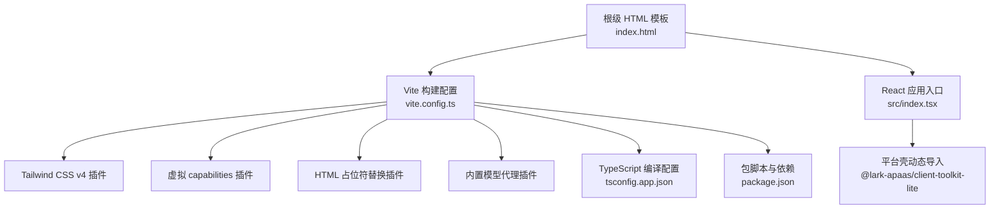
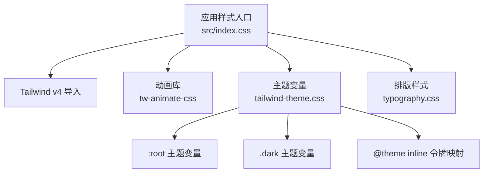
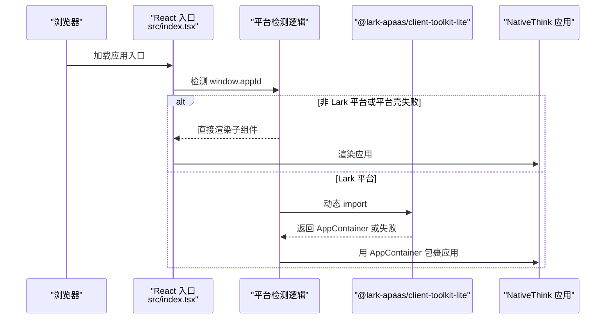
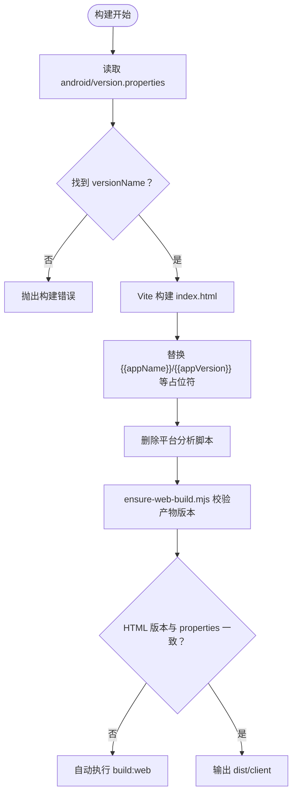
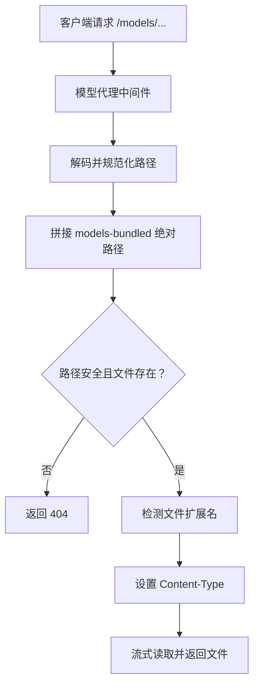
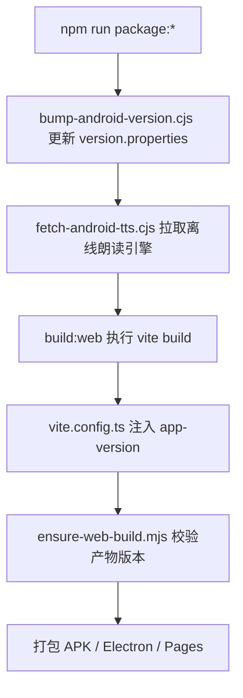
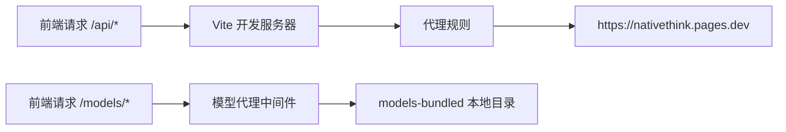
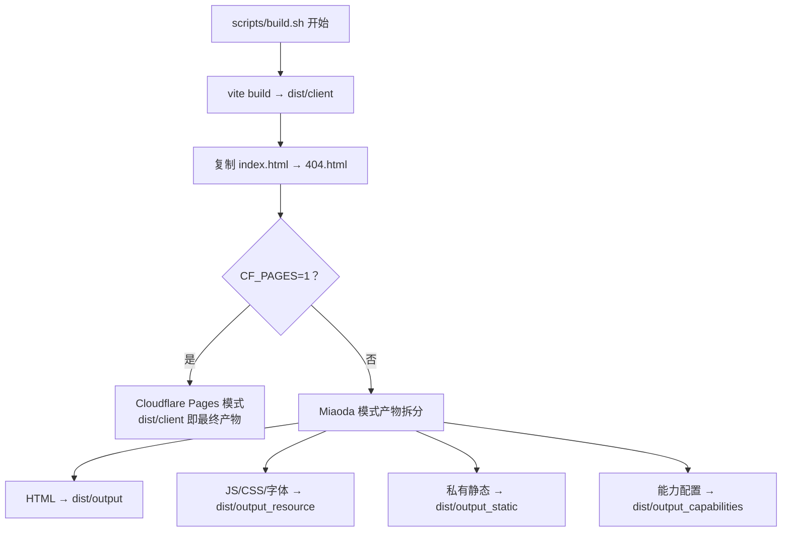
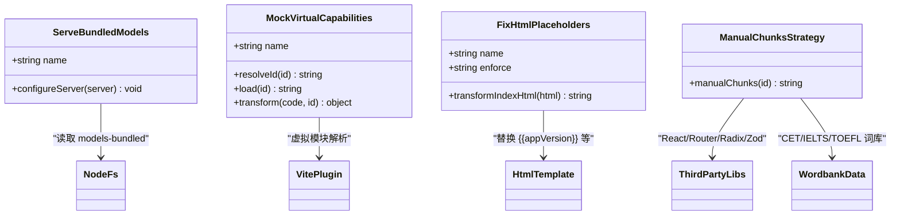

# Vite 构建配置

<cite>
**本文引用的文件**   
- [vite.config.ts](file://vite.config.ts)
- [package.json](file://package.json)
- [tsconfig.app.json](file://tsconfig.app.json)
- [index.html](file://index.html)
- [src/index.tsx](file://src/index.tsx)
- [scripts/build.sh](file://scripts/build.sh)
- [scripts/ensure-web-build.mjs](file://scripts/ensure-web-build.mjs)
- [src/index.css](file://src/index.css)
- [src/tailwind-theme.css](file://src/tailwind-theme.css)
</cite>

## 目录
1. [简介](#简介)
2. [项目结构与入口](#项目结构与入口)
3. [核心构建配置总览](#核心构建配置总览)
4. [Tailwind CSS v4 插件集成](#tailwind-css-v4-插件集成)
5. [虚拟 capabilities 注入与平台依赖解耦](#虚拟-capabilities-注入与平台依赖解耦)
6. [HTML 模板占位符替换与产物校验](#html-模板占位符替换与产物校验)
7. [models-bundled 代理与开发期离线模型](#models-bundled-代理与开发期离线模型)
8. [版本信息注入机制](#版本信息注入机制)
9. [TypeScript 编译选项与路径别名](#typescript-编译选项与路径别名)
10. [开发服务器设置](#开发服务器设置)
11. [生产环境优化与 manualChunks 分包策略](#生产环境优化与-manualchunks-分包策略)
12. [构建产物结构](#构建产物结构)
13. [自定义插件扩展点](#自定义插件扩展点)
14. [性能优化建议](#性能优化建议)
15. [常见构建问题排查](#常见构建问题排查)
16. [结论](#结论)

## 简介
NativeThink 是一个基于 React、Vite 和 Tailwind CSS v4 的英语学习应用，同时面向 Web（Cloudflare Pages）、Electron 桌面端以及 Capacitor Android 应用。其 Vite 构建配置不仅负责打包前端资源，还承担了以下职责：

- 集成 Tailwind CSS v4 并加载自定义主题变量。
- 在构建期把平台无关的 `virtual:capabilities` 虚拟模块替换为空实现，从而避免非 Lark 平台引入重型运行时依赖。
- 动态加载 `@lark-apaas/client-toolkit-lite`，让 Miaoda/Lark 平台的 AppContainer 只在真正需要时请求。
- 替换 HTML 模板中的 `{{appName}}`、`{{appVersion}}` 等占位符，并清理仅适用于特定平台的分析脚本。
- 从 `android/version.properties` 读取版本号，拒绝版本链断裂的构建。
- 通过 `manualChunks` 将 React、React Router、Radix UI、Lucide、Zod、date-fns 等第三方库与词库数据拆成独立 chunk。
- 在开发服务器中提供 `/models` 代理以访问 `models-bundled` 下的 ONNX 模型，并为 API 请求转发到 Cloudflare Pages。
- 配合 Shell 脚本完成多平台产物拆分、能力清单复制和 SPA 兜页生成。

## 项目结构与入口
项目的 Web 构建入口是根级 `index.html`，由 Vite 直接处理；React 应用入口是 `src/index.tsx`。Vite 配置文件位于仓库根目录，使用 Node.js 文件系统读取外部元数据，并通过自定义插件扩展默认行为。

**图表来源**
- [vite.config.ts:1-246](file://vite.config.ts#L1-L246)
- [index.html:1-50](file://index.html#L1-L50)
- [src/index.tsx:1-123](file://src/index.tsx#L1-L123)

**章节来源**
- [index.html:1-50](file://index.html#L1-L50)
- [src/index.tsx:1-123](file://src/index.tsx#L1-L123)
- [vite.config.ts:1-246](file://vite.config.ts#L1-L246)

## 核心构建配置总览
`vite.config.ts` 导出的默认配置包含以下关键部分：

| 配置项 | 作用 | 关键值或行为 |
|---|---|---|
| `base` | 控制静态资源基础路径 | 优先使用 `CLIENT_BASE_PATH`，否则为 `/` |
| `define` | 注入客户端全局常量 | `process.env.CLIENT_BASE_PATH`、`__FACTORY_API_KEY__` |
| `plugins` | 注册 Tailwind、虚拟模块、HTML 替换、模型代理等插件 | 按顺序执行 |
| `resolve.alias` | 定义 TypeScript 与打包器路径别名 | `@` → `src`，`@shared` → `shared` |
| `server.headers` | 设置跨域隔离头，支持多线程 WASM | `Cross-Origin-Opener-Policy`、`Cross-Origin-Embedder-Policy` |
| `server.watch.ignored` | 忽略大目录以避免 EBUSY 和 dev server 崩溃 | android、release、dist、models-bundled、logs、apk |
| `server.proxy` | 开发期 API 转发 | 多个 `/api/*` 路由转发至 `https://nativethink.pages.dev` |
| `build.sourcemap` | 是否生成 sourcemap | `false` |
| `build.rolldownOptions.output.manualChunks` | 手动分包策略 | 按第三方库、词库数据拆分 |

**章节来源**
- [vite.config.ts:1-246](file://vite.config.ts#L1-L246)

## Tailwind CSS v4 插件集成
项目使用 Tailwind CSS v4，并在 `src/index.css` 中通过 `@import "tailwindcss"` 启用。该样式文件还引入了动画库、自定义主题变量和排版样式：

- `@import "tailwindcss"`：启用 Tailwind v4 构建管线。
- `@custom-variant dark`：声明暗色模式选择器。
- `@import "tw-animate-css"`：引入轻量动画工具。
- `@import "./tailwind-theme.css"`：加载品牌色、明暗主题变量和字体族。
- `@import "./typography.css"`：加载文章阅读器的排版样式。

`tailwind-theme.css` 定义了完整的 CSS 变量体系，包括背景、前景、主色、辅助色、阴影、圆角、间距和字体族，并在 `:root` 与 `.dark` 下分别提供浅色与深色主题。`@theme inline` 将设计令牌映射到 Tailwind 可识别的 `--color-*` 变量，使业务组件可以直接使用语义化颜色类。

**图表来源**
- [src/index.css:1-200](file://src/index.css#L1-L200)
- [src/tailwind-theme.css:1-200](file://src/tailwind-theme.css#L1-L200)

**章节来源**
- [src/index.css:1-200](file://src/index.css#L1-L200)
- [src/tailwind-theme.css:1-200](file://src/tailwind-theme.css#L1-L200)
- [vite.config.ts:1-50](file://vite.config.ts#L1-L50)

## 虚拟 capabilities 注入与平台依赖解耦
项目存在两条运行路径：

1. **非 Lark 平台**：Cloudflare Pages、Capacitor APK、Electron 桌面端。
2. **Lark/Miaoda 平台**：通过 `@lark-apaas/client-toolkit-lite` 提供的 `AppContainer` 包裹应用。

为了不让非 Lark 平台首屏加载平台运行时及其传递依赖，项目做了两层解耦：

### 构建期虚拟模块
`mockVirtualCapabilities` 插件拦截 `virtual:capabilities` 虚拟模块，将其解析为 `'\0virtual:capabilities'`，并返回一个导出空对象的模块。对包含动态 import 的代码，插件会把 `import('virtual:capabilities')` 替换为 `Promise.resolve({ default: {} })`，从而在不修改业务代码的前提下让虚拟模块在非 Lark 环境中安全降级。

### 运行期动态导入
`src/index.tsx` 中的 `SafeShell` 组件会在检测到平台环境后，通过 `useEffect` 动态 `import("@lark-apaas/client-toolkit-lite")`。如果动态导入成功且存在 `AppContainer`，则用其包裹应用；如果失败，则标记容器不可用并回退为普通渲染。这样既避免了同步 require 导致的入口 chunk 膨胀，也保留了平台套壳能力。

**图表来源**
- [src/index.tsx:40-100](file://src/index.tsx#L40-L100)
- [vite.config.ts:52-85](file://vite.config.ts#L52-L85)

**章节来源**
- [src/index.tsx:40-100](file://src/index.tsx#L40-L100)
- [vite.config.ts:52-85](file://vite.config.ts#L52-L85)
- [package.json:1-130](file://package.json#L1-L130)

## HTML 模板占位符替换与产物校验
`fixHtmlPlaceholders` 插件在 `transformIndexHtml` 钩子中执行，优先级为 `post`，确保它在其他可能修改标题或应用名的插件之后运行。它主要做两件事：

1. 替换模板占位符：
   - `{{appName}}` → `NativeThink`
   - `{{appDescription}}` → `英语母语思维训练`
   - `{{appAvatar}}` → `/favicon.svg`
   - `{{appVersion}}` → 从 `android/version.properties` 读取的版本号
2. 删除仅适用于 Miaoda 平台的分析脚本，包括错误监控、事件收集、性能监控和平台运行时注入。这些脚本在 Cloudflare Pages 或 GitHub Pages 上无价值，还会显著拖慢移动端加载。

`index.html` 中保留 `<meta name="app-version" content="{{appVersion}}" />`，作为构建产物的唯一版本标记。`scripts/ensure-web-build.mjs` 会读取该 meta 标签，并与 `android/version.properties` 对比；如果不一致或缺失，则自动触发重建。

**图表来源**
- [vite.config.ts:87-145](file://vite.config.ts#L87-L145)
- [index.html:1-50](file://index.html#L1-L50)
- [scripts/ensure-web-build.mjs:1-93](file://scripts/ensure-web-build.mjs#L1-L93)

**章节来源**
- [vite.config.ts:87-145](file://vite.config.ts#L87-L145)
- [index.html:1-50](file://index.html#L1-L50)
- [scripts/ensure-web-build.mjs:1-93](file://scripts/ensure-web-build.mjs#L1-L93)

## models-bundled 代理与开发期离线模型
开发期间，应用可能需要加载 `models-bundled` 目录下的 ONNX 模型文件。为了避免在开发服务器中额外部署这些二进制文件，`serveBundledModels` 插件通过 Express 中间件把 `/models` 请求映射到工作区根目录的 `models-bundled` 子目录。

其行为包括：

- 解码 URL 路径并去除前导斜杠。
- 拼接绝对路径，防止路径穿越。
- 检查目标文件是否存在且为普通文件。
- 根据扩展名设置 Content-Type：`.json`、`.onnx`、`.txt` 和其他类型。
- 通过流式读取管道响应模型文件。

**图表来源**
- [vite.config.ts:7-35](file://vite.config.ts#L7-L35)

**章节来源**
- [vite.config.ts:7-35](file://vite.config.ts#L7-L35)

## 版本信息注入机制
版本信息来自 `android/version.properties` 中的 `versionName`。构建启动时会尝试读取该文件；如果读取失败，说明当前工程不是安卓工程，或者版本链断裂，此时会直接抛出错误并终止构建。这是有意为之的设计：宁可拒绝构建，也不要把默认的 `1.0.0` 或空版本混入产物。

`package.json` 中的脚本也参与了版本管理：

- `version:apk-bump`：调用 `scripts/bump-android-version.cjs` 更新 `android/version.properties`。
- `package:apk`：先 bump 版本，再拉取 TTS 资产，再执行 web 构建，再拷贝 Capator 资源，再打 APK。
- `package:desktop`：确保 web 构建已就绪后再打包桌面端。
- `package:all`：并行打包移动端和桌面端。

**图表来源**
- [package.json:1-130](file://package.json#L1-L130)
- [vite.config.ts:118-145](file://vite.config.ts#L118-L145)
- [scripts/ensure-web-build.mjs:1-93](file://scripts/ensure-web-build.mjs#L1-L93)

**章节来源**
- [package.json:1-130](file://package.json#L1-L130)
- [vite.config.ts:118-145](file://vite.config.ts#L118-L145)
- [scripts/ensure-web-build.mjs:1-93](file://scripts/ensure-web-build.mjs#L1-L93)

## TypeScript 编译选项与路径别名
`tsconfig.app.json` 继承自 `@lark-apaas/coding-presets-react/lib/tsconfig/tsconfig.app.json`，并在此基础上扩展了以下配置：

| 配置项 | 值 | 说明 |
|---|---|---|
| `extends` | `@lark-apaas/coding-presets-react/lib/tsconfig/tsconfig.app.json` | 复用团队 React + Vite 的 TS 基线配置 |
| `tsBuildInfoFile` | `./node_modules/.tmp/tsconfig.app.tsbuildinfo` | 增量编译缓存文件 |
| `baseUrl` | `.` | 相对根目录解析模块 |
| `paths.@/*` | `./src/*` | 允许从 `@/` 导入 src 下的模块 |
| `paths.@shared/*` | `./shared/*` | 允许从 `@shared/` 导入共享能力描述和资源 |
| `include` | `src` | 只编译源码目录 |
| `exclude` | `src/components/ui` | 排除 Radix UI 生成的组件目录 |

`vite.config.ts` 中的 `resolve.alias` 与 `tsconfig.app.json` 中的 `paths` 保持一致，避免 TypeScript 和 Vite 解析结果不一致。

**章节来源**
- [tsconfig.app.json:1-13](file://tsconfig.app.json#L1-L13)
- [vite.config.ts:150-160](file://vite.config.ts#L150-L160)

## 开发服务器设置
开发服务器的配置重点在于跨域隔离、文件监听安全和 API 代理。

### 跨域隔离
- `Cross-Origin-Opier-Policy: same-origin`：允许同一页面内 Worker 共享内存，这对多线程 WASM 很重要。
- `Cross-Origin-Embedder-Policy: credentialless`：允许加载跨源图片、音频等资源，同时不要求携带凭据。

### 文件监听忽略
开发服务器会忽略以下目录，避免 Android 工程中 880MB 级别的模型文件导致 EBUSY 错误或 dev server 崩溃：

- `android/**`
- `release/**`
- `dist/**`
- `models-bundled/**`
- `logs/**`
- `*.apk`

### API 代理
开发期所有 `/api/*` 请求都转发到 `https://nativethink.pages.dev`，包括语音合成、认证、数据同步、AI、插图、古腾堡、维基百科和 Bilibili 相关接口。

**图表来源**
- [vite.config.ts:146-200](file://vite.config.ts#L146-L200)

**章节来源**
- [vite.config.ts:146-200](file://vite.config.ts#L146-L200)

## 生产环境优化与 manualChunks 分包策略
生产构建关闭 sourcemap，并通过 `rolldownOptions.output.manualChunks` 控制分包。分包策略分为两类：第三方 vendor chunk 和业务数据 chunk。

### 第三方 vendor chunk
| chunk 名称 | 覆盖范围 | 设计原因 |
|---|---|---|
| `vendor-react` | `react`、`react-dom` | 每个页面都会加载的核心库 |
| `vendor-router` | `react-router`、`@remix-run` | 路由导航依赖 |
| `vendor-radix` | `@radix-ui/*` | UI 基础组件集合 |
| `vendor-icons` | `lucide-react` | 图标库 |
| `vendor-date` | `date-fns` | 日期工具 |
| `vendor-zod` | `zod` | 类型校验库 |

### 故意不单独拆分的库
注释明确说明：

- `framer-motion`：全站只有词汇页和学习记录页的两个组件使用，并通过懒加载引入。强制拆分会让入口静态依赖该 chunk，增加首屏体积。
- `recharts`、`d3`：只有进度页面使用，强制拆分反而让每条路由首屏多拉约 111KB gzip。
- `react-markdown`：只有五个页面使用，强制拆分会让入口静态依赖渲染器 chunk。

### 词库数据 chunk
词库数据按考试类别拆分，例如 CET-4、CET-6、IELTS、TOEFL、考研、高考、专业词汇等。这样用户进入某个功能时，只加载所需的数据集，而不是把所有词库打包进入口。

```mermaid
flowchart TD
    Entry["入口 bundle"] --> VendorReact["vendor-react"]
    Entry --> VendorRouter["vendor-router"]
    Entry --> VendorRadix["vendor-radix"]
    Entry --> VendorIcons["vendor-icons"]
    Entry --> VendorDate["vendor-date"]
    Entry --> VendorZod["vendor-zod"]
    LazyPage["按需页面"] --> Charts["recharts 图表"]
    LazyPage --> Markdown["react-markdown 渲染器"]
    LazyPage --> Motion["framer-motion 动画"]
    VocabularyModule["词汇模块"] --> WordbankCet4["wordbank-cet4"]
    VocabularyModule --> WordbankCet6["wordbank-cet6"]
    VocabularyModule --> WordbankIelts["wordbank-ielts"]
    VocabularyModule --> WordbankToefl["wordbank-toefl"]
    VocabularyModule --> WordbankAdvanced["wordbank-advanced"]
```

**图表来源**
- [vite.config.ts:201-246](file://vite.config.ts#L201-L246)

**章节来源**
- [vite.config.ts:201-246](file://vite.config.ts#L201-L246)

## 构建产物结构
`scripts/build.sh` 是实际执行的构建脚本，它根据环境变量决定最终输出结构。

### 环境变量
| 变量 | 作用 |
|---|---|
| `CLIENT_BASE_PATH` | 由 `MIAODA_APP_ID` 推导，格式为 `/app/<appId>`；未设置时为空，最终被 Vite 解释为 `/` |
| `ASSETS_CDN_PATH` | 资源 CDN 前缀，默认为 `/` |
| `STATIC_ASSETS_BASE_URL` | 静态资源 CDN 前缀 |
| `NODE_ENV` | 默认 `production` |
| `CF_PAGES` | 设置为 `1` 时跳过 Miaoda 产物拆分，直接使用 `dist/client` |

### 构建步骤
1. 清理 `dist` 目录。
2. 执行 `vite build --outDir dist/client --emptyOutDir`。
3. 复制 `index.html` 为 `404.html`，用于 SPA 路由兜底。
4. 如果是 Cloudflare Pages 模式，直接退出。
5. 否则继续 Miaoda 模式产物拆分：
   - HTML 和 `routes.json` → `dist/output/`
   - JS/CSS/字体等资源 → `dist/output_resource/`
   - 私有静态资源 → `dist/output_static/`
   - 能力配置 → `dist/output_capabilities/`

**图表来源**
- [scripts/build.sh:1-69](file://scripts/build.sh#L1-L69)
- [package.json:1-130](file://package.json#L1-L130)

**章节来源**
- [scripts/build.sh:1-69](file://scripts/build.sh#L1-L69)
- [package.json:1-130](file://package.json#L1-L130)

## 自定义插件扩展点
`vite.config.ts` 中实现了四个自定义插件，适合作为后续扩展参考：

| 插件名称 | 钩子 | 职责 | 可扩展方向 |
|---|---|---|---|
| `serve-bundled-models` | `configureServer` | 开发期代理 `/models` | 新增支持的扩展名、添加鉴权或缓存头 |
| `mock-virtual-capabilities` | `resolveId`、`load`、`transform` | 将 `virtual:capabilities` 替换为空对象 | 扩展更多虚拟模块、按环境切换实现 |
| `fix-html-placeholders` | `transformIndexHtml` | 替换模板占位符、删除平台脚本 | 新增占位符、按部署目标裁剪 HTML |
| `manualChunks` | `output.manualChunks` | 分包策略 | 新增页面级或功能级 chunk |

**图表来源**
- [vite.config.ts:7-35](file://vite.config.ts#L7-L35)
- [vite.config.ts:52-85](file://vite.config.ts#L52-L85)
- [vite.config.ts:87-115](file://vite.config.ts#L87-L115)
- [vite.config.ts:201-246](file://vite.config.ts#L201-L246)

**章节来源**
- [vite.config.ts:7-35](file://vite.config.ts#L7-L35)
- [vite.config.ts:52-85](file://vite.config.ts#L52-L85)
- [vite.config.ts:87-115](file://vite.config.ts#L87-L115)
- [vite.config.ts:201-246](file://vite.config.ts#L201-L246)

## 性能优化建议
基于现有配置和项目特点，可以总结以下性能优化要点：

1. **保持动态导入平台依赖**  
   `@lark-apaas/client-toolkit-lite` 已在 `src/index.tsx` 中使用动态导入。若未来发现其他平台相关依赖被打包进入口，应改用动态 import 或条件分支。

2. **谨慎使用 manualChunks**  
   项目已经证明，对 framer-motion、recharts、react-markdown 这类仅在少量页面使用的库，强制拆分反而会让入口静态依赖它们。新增大型依赖时，应先观察是否已被懒加载页面自然拆分，再决定是否加入 `manualChunks`。

3. **继续利用 CSS 变量主题**  
   Tailwind v4 的 `@theme inline` 与 CSS 变量结合，可以在不重复打包主题的情况下支持明暗模式。新增颜色时应优先定义 CSS 变量，再通过 Tailwind 语义类使用。

4. **关注移动端首屏体积**  
   脚本注释中记录了多次实测数据，例如去掉某些 manualChunks 后首屏必需 JS 从约 237.7KB 降到 198.1KB gzip。建议在新功能上线前运行体积验证脚本，避免回归。

5. **合理使用 sourcemap**  
   生产构建关闭 sourcemap，有利于减少产物体积。调试问题时可在本地临时开启，但不应提交到生产环境。

6. **区分静态资源与代码资源**  
   `scripts/build.sh` 已经把 HTML、资源文件和私有静态资源分开输出。新增加的静态资源应尽量放在 `public` 或 `shared/static`，避免进入 JS/CSS 构建管线。

## 常见构建问题排查
以下是基于配置和脚本可推断的常见问题及解决方案：

| 现象 | 可能原因 | 排查与解决 |
|---|---|---|
| 构建报错找不到 `android/version.properties` 的 `versionName` | 非安卓工程或未执行版本 bump | 执行 `npm run version:apk-bump`，或在安卓工程中保证 `version.properties` 存在 |
| 产物中没有 `app-version` 标记 | HTML 占位符未被替换或使用了旧管线产物 | 重新执行 `npm run build:web`；不要手动修改 `{{appVersion}}` |
| `package:apk` 打出上一版代码 | `dist/client` 没有随源码更新 | `scripts/ensure-web-build.mjs` 会自动重建；若仍失败，检查 git 状态和 `version.properties` |
| 开发服务器频繁崩溃 | 监听到 android、release、dist、models-bundled 等大目录 | 确认 `server.watch.ignored` 已生效，不要手动添加这些目录到 watch 列表 |
| 开发期 `/api/*` 请求 404 | 代理未配置或目标地址不可达 | 检查 `server.proxy` 配置和目标域名 `https://nativethink.pages.dev` |
| 开发期 `/models/*` 请求 404 | `models-bundled` 目录不存在或路径不安全 | 确认模型文件位于仓库根目录的 `models-bundled` 下，且路径未包含 `..` |
| 移动端 TTS 只能联网合成 | 未拉取离线朗读引擎资产 | 执行 `npm run package:apk` 或手动运行 `scripts/fetch-android-tts.cjs` |
| 平台壳不生效 | `@lark-apaas/client-toolkit-lite` 未正确动态导入 | 检查 `src/index.tsx` 的动态 import 和 `window.appId` 检测逻辑 |
| 词库数据全部打包进入口 | 词库文件未被懒加载或 manualChunks 配置缺失 | 检查词库文件的 import 方式，确认 `data/*.ts` 匹配规则仍在 `manualChunks` 中 |

**章节来源**
- [vite.config.ts:118-246](file://vite.config.ts#L118-L246)
- [scripts/build.sh:1-69](file://scripts/build.sh#L1-L69)
- [scripts/ensure-web-build.mjs:1-93](file://scripts/ensure-web-build.mjs#L1-L93)
- [src/index.tsx:40-100](file://src/index.tsx#L40-L100)

## 结论
NativeThink 的 Vite 构建配置是一个围绕“平台无关构建”和“移动端首屏体验”设计的中等复杂度工程方案。它没有简单依赖现成脚手架，而是通过自定义插件、脚本和分包策略，把以下问题统一到构建阶段解决：

- Tailwind CSS v4 的主题变量通过 CSS 层注入，不污染业务代码。
- 平台依赖通过虚拟模块和动态 import 解耦，避免非 Lark 平台承担运行时成本。
- HTML 占位符和版本号在构建期注入，并由独立脚本校验产物一致性。
- 开发服务器同时处理 API 代理和离线模型代理，降低本地调试门槛。
- `manualChunks` 经过实测权衡，只对真正适合静态依赖的第三方库进行拆分，而对低频功能库采用懒加载。

对于后续维护者，最重要的原则是：**新增大型依赖时优先评估是否会被懒加载页面自然拆分，不要把“能拆就拆”当作默认动作；任何影响首屏体积的改动都应通过体积验证脚本和真实设备测试确认。**