# 构建系统与部署

<cite>
**本文引用的文件**
- [package.json](file://package.json)
- [vite.config.ts](file://vite.config.ts)
- [wrangler.toml](file://wrangler.toml)
- [capacitor.config.json](file://capacitor.config.json)
- [electron/main.mjs](file://electron/main.mjs)
- [scripts/build.sh](file://scripts/build.sh)
- [scripts/pack-app.mjs](file://scripts/pack-app.mjs)
- [scripts/bump-android-version.cjs](file://scripts/bump-android-version.cjs)
- [scripts/verify-bundle-budget.mjs](file://scripts/verify-bundle-budget.mjs)
- [scripts/android-copy-models.cjs](file://scripts/android-copy-models.cjs)
- [scripts/ensure-web-build.mjs](file://scripts/ensure-web-build.mjs)
- [android/version.properties](file://android/version.properties)
- [android/app/build.gradle](file://android/app/build.gradle)
- [android/variables.gradle](file://android/variables.gradle)
- [server/local-server.mjs](file://server/local-server.mjs)
</cite>

## 目录
1. [简介](#简介)
2. [项目结构与构建总览](#项目结构与构建总览)
3. [Vite 构建配置详解](#vite-构建配置详解)
4. [Cloudflare Pages 部署配置](#cloudflare-pages-部署配置)
5. [Electron 桌面应用打包流程](#electron-桌面应用打包流程)
6. [Capacitor Android 打包流程](#capacitor-android-打包流程)
7. [构建脚本体系](#构建脚本体系)
8. [Bundle 预算校验与性能监控](#bundle-预算校验与性能监控)
9. [持续集成建议](#持续集成建议)
10. [故障排查](#故障排查)
11. [结论](#结论)

## 简介
NativeThink 是一个多端学习应用，核心前端基于 React + Vite + Tailwind CSS，Web 产物同时用于 Cloudflare Pages、Electron 桌面版和 Capacitor Android 应用。项目的构建系统围绕以下目标设计：
- Web 产物统一产出到 `dist/client`，作为所有平台共享的静态资源。
- 通过 Vite 插件注入虚拟能力、HTML 模板变量和版本信息。
- 使用手动分包策略控制首屏体积，并通过独立脚本做 Bundle 预算校验。
- 通过 `wrangler.toml` 把 Cloudflare KV 绑定到函数运行时。
- 通过 Electron main 进程复用同一套 Functions API，实现离线本地运行。
- 通过 Capacitor 将 Web 产物打包为 Android APK，并自动管理版本号。

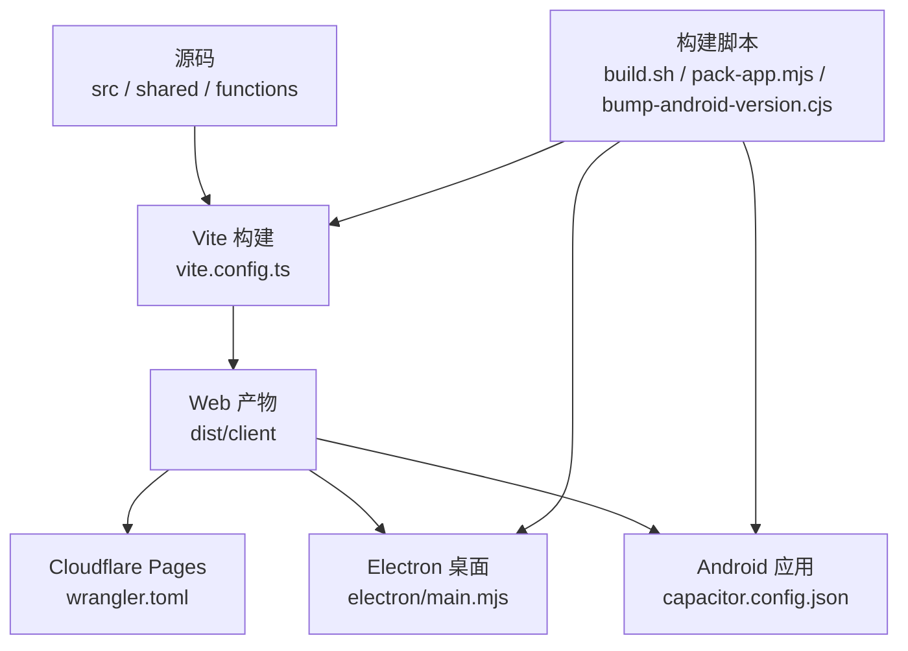

**图表来源**
- [vite.config.ts:1-246](file://vite.config.ts#L1-L246)
- [wrangler.toml:1-9](file://wrangler.toml#L1-L9)
- [electron/main.mjs:1-176](file://electron/main.mjs#L1-L176)
- [capacitor.config.json:1-11](file://capacitor.config.json#L1-L11)
- [scripts/build.sh:1-69](file://scripts/build.sh#L1-L69)
- [scripts/pack-app.mjs:1-108](file://scripts/pack-app.mjs#L1-L108)
- [scripts/bump-android-version.cjs:1-27](file://scripts/bump-android-version.cjs#L1-L27)

**章节来源**
- [package.json:1-130](file://package.json#L1-L130)

## 项目结构与构建总览
NativeThink 的构建入口是 `package.json` 中的 npm scripts，而真正的构建编排集中在 `scripts/build.sh` 和 `vite.config.ts`：
- `npm run build` 调用 `scripts/build.sh`。
- `scripts/build.sh` 清理 `dist`，设置环境变量，然后调用 Vite 构建。
- Vite 输出 SPA 到 `dist/client`，并在 Cloudflare Pages 模式下直接使用该目录作为部署目录。
- 非 Cloudflare Pages 模式（Miaoda）下，脚本还会拆分 HTML、静态资源、私有静态资源和 capability 配置。

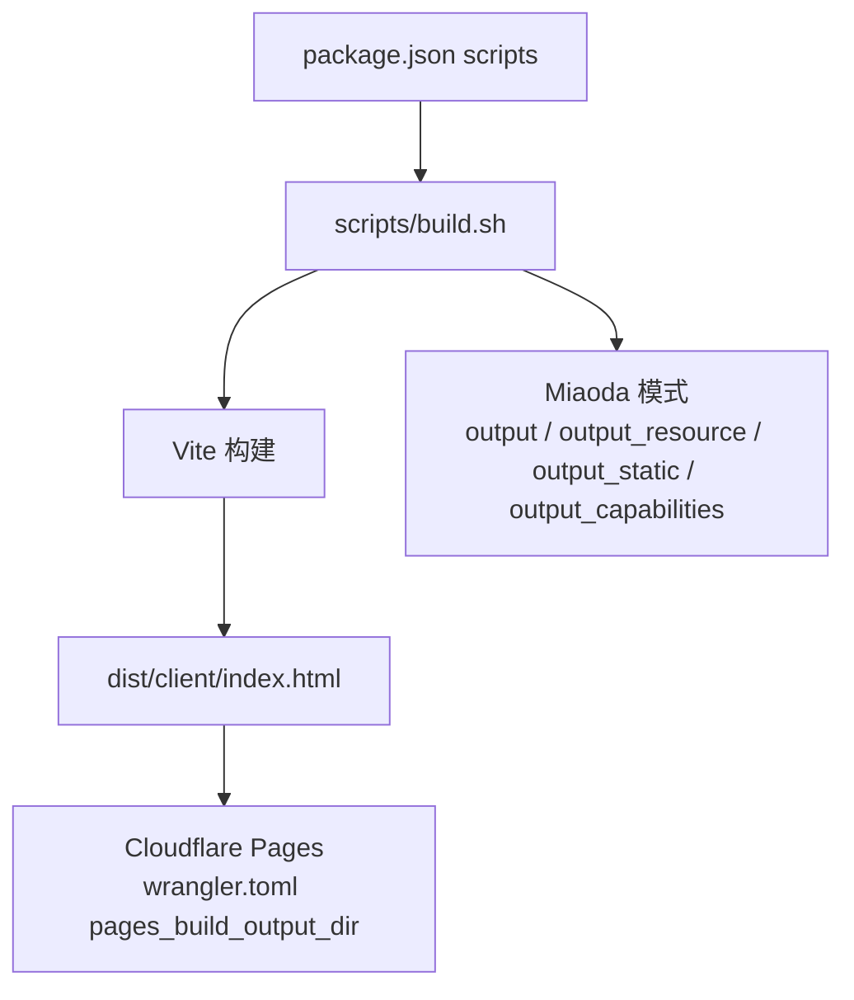

**图表来源**
- [package.json:6-40](file://package.json#L6-L40)
- [scripts/build.sh:1-69](file://scripts/build.sh#L1-L69)
- [wrangler.toml:1-9](file://wrangler.toml#L1-L9)

**章节来源**
- [package.json:6-40](file://package.json#L6-L40)
- [scripts/build.sh:1-69](file://scripts/build.sh#L1-L69)

## Vite 构建配置详解
### Tailwind CSS 集成
Vite 配置通过 `@tailwindcss/vite` 启用 Tailwind CSS。该插件会参与 Vite 的模块解析、样式处理和构建优化。项目中还引入了 `tailwindcss`、`@tailwindcss/typography`、`tw-animate-css` 等依赖，说明 Tailwind 不仅是基础样式框架，也承担排版和动画扩展职责。

Tailwind 的集成点位于 Vite plugins 数组中，且配合自定义插件链执行：
- Tailwind 插件先处理 CSS。
- 后续自定义插件在 `post` 阶段替换 HTML 模板占位符。

**章节来源**
- [vite.config.ts:1-12](file://vite.config.ts#L1-L12)
- [package.json:60-120](file://package.json#L60-L120)

### 虚拟 capabilities 注入
Vite 配置定义了一个名为 `mock-virtual-capabilities` 的插件，用于解决 Cloudflare Pages 环境下 `virtual:capabilities` 虚拟模块不可用的问题：
- 当解析器遇到 `virtual:capabilities` 时，返回内部虚拟模块标识。
- 加载阶段返回空对象导出。
- 对动态导入进行代码转换，将其替换为可解析的 Promise 形式。

这个设计允许前端代码以统一方式访问能力配置，而在非原生平台或 Pages 环境中退化为空能力集，避免运行时错误。

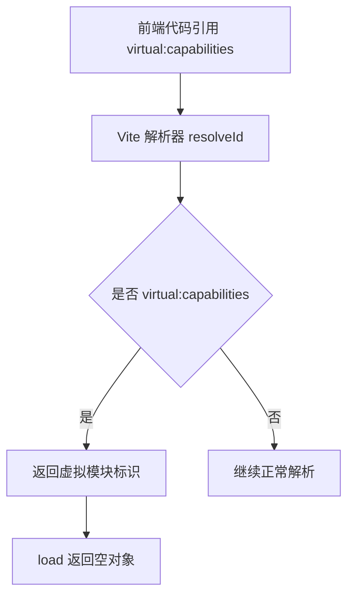

**图表来源**
- [vite.config.ts:35-68](file://vite.config.ts#L35-L68)

**章节来源**
- [vite.config.ts:35-68](file://vite.config.ts#L35-L68)

### HTML 模板替换
`fixHtmlPlaceholders` 插件在 `post` 阶段处理 `index.html`，主要完成两件事：
1. 替换应用名称、描述、头像和版本号占位符。
2. 移除仅适用于特定平台（如 MiaoDa/Lark 平台）的分析、埋点和性能监控脚本，以减少移动端首屏加载开销。

版本注入逻辑优先读取 `android/version.properties` 中的 `versionName`；如果失败则抛出构建错误，防止“版本链断裂”时继续生成无法追踪的版本产物。

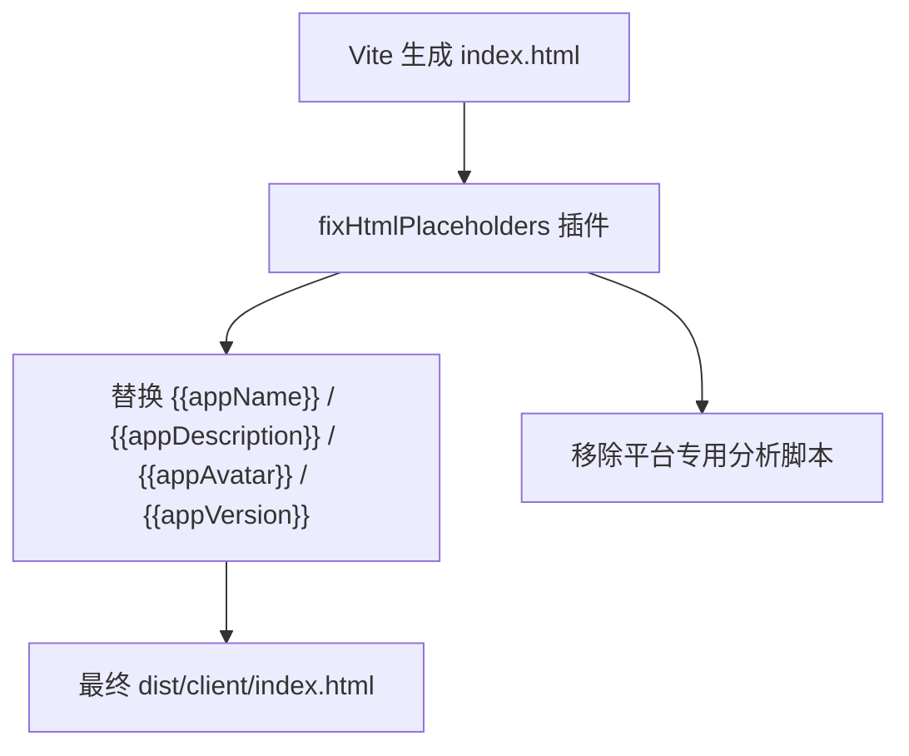

**图表来源**
- [vite.config.ts:70-118](file://vite.config.ts#L70-L118)

**章节来源**
- [vite.config.ts:70-118](file://vite.config.ts#L70-L118)

### models-bundled 代理
Vite 开发服务器通过 `serveBundledModels` 中间件暴露 `/models` 路径，映射到仓库根目录下的 `models-bundled` 文件夹。其安全规则包括：
- 解码 URL 路径。
- 禁止路径穿越（必须位于 `models-bundled` 目录下）。
- 检查文件存在性。
- 根据扩展名设置 Content-Type。
- 流式返回 `.onnx`、`.json`、`.txt` 等模型文件。

这使得前端在开发和生产本地模式中都能通过 `/models/*` 加载内置离线小模型。

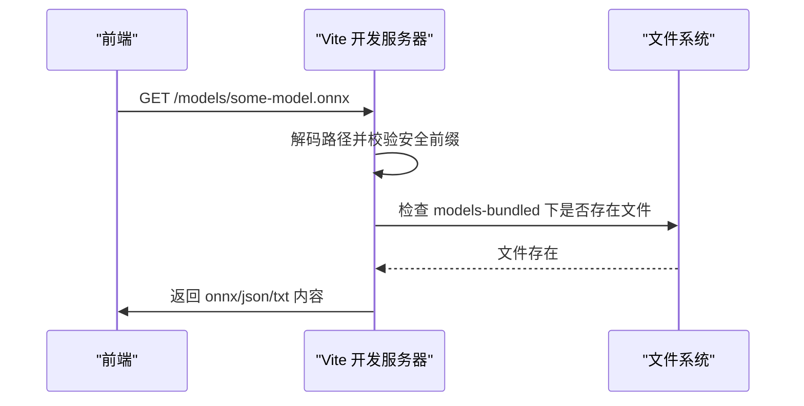

**图表来源**
- [vite.config.ts:14-33](file://vite.config.ts#L14-L33)

**章节来源**
- [vite.config.ts:14-33](file://vite.config.ts#L14-L33)

### 版本注入与构建期断言
版本来源优先级如下：
1. 读取 `android/version.properties` 中的 `versionName`。
2. 如果读取失败，Vite 构建直接报错，提示“版本链断裂，拒绝构建”。
3. 版本号被注入到 HTML 的 `<meta name="app-version">` 中。
4. `scripts/ensure-web-build.mjs` 会在打包 APK 或桌面应用前校验 `dist/client/index.html` 中的版本是否与 `version.properties` 一致。

这种设计确保安装包、网页反馈、构建日志中的版本号具有单一可信来源。

**章节来源**
- [vite.config.ts:120-140](file://vite.config.ts#L120-L140)
- [scripts/ensure-web-build.mjs:1-93](file://scripts/ensure-web-build.mjs#L1-L93)
- [android/version.properties:1-2](file://android/version.properties#L1-L2)

### manualChunks 分包策略
Vite 的 `manualChunks` 采用“有选择的强制拆分 + 谨慎的不拆分”策略：

| 分组 | 包含内容 | 目的 |
|---|---|---|
| `vendor-react` | React 核心和 ReactDOM | 公共 UI 框架稳定复用 |
| `vendor-router` | React Router 及 Remix Run 相关依赖 | 路由逻辑独立缓存 |
| `vendor-radix` | Radix UI 组件库 | 基础 UI 原子组件 |
| `vendor-icons` | Lucide React 图标库 | 图标按需缓存 |
| `vendor-date` | date-fns 日期工具 | 小型工具库独立 |
| `vendor-zod` | Zod 校验库 | 校验逻辑独立 |
| `wordbank-*` | 各词书数据模块 | 按考试类别懒加载 |
| 未强制分组的 recharts / react-markdown | 图表和 Markdown 渲染器 | 避免成为入口静态依赖 |

关键设计决策是：**不强制为 recharts、d3、react-markdown 创建单独 chunk**。因为注释和预算脚本指出，强制分组反而会让这些大依赖变成入口静态依赖，导致每个路由首屏都下载它们。正确的做法是让它们在真正使用的页面中被懒加载。

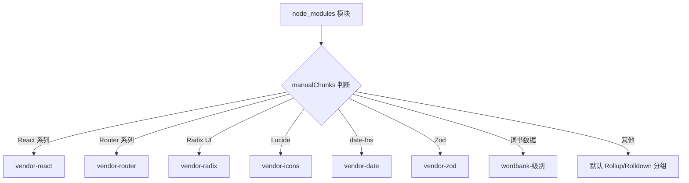

**图表来源**
- [vite.config.ts:201-246](file://vite.config.ts#L201-L246)

**章节来源**
- [vite.config.ts:190-246](file://vite.config.ts#L190-L246)

## Cloudflare Pages 部署配置
### wrangler.toml 结构
`wrangler.toml` 定义了 Cloudflare Pages 的基本部署参数：
- `name = "nativethink"`：Pages 项目名称。
- `compatibility_date = "2024-12-01"`：Workers/Pages 兼容性日期。
- `pages_build_output_dir = "dist/client"`：指定 Vite 构建输出目录为 Pages 部署目录。
- `[[kv_namespaces]]`：绑定 KV namespace，binding 名称为 `KV`，id 指向实际 KV 空间。

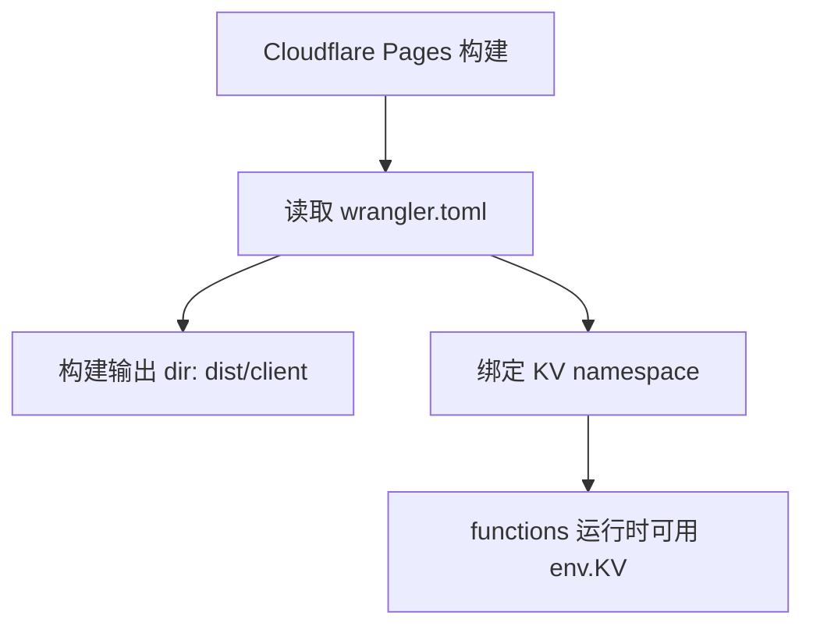

**图表来源**
- [wrangler.toml:1-9](file://wrangler.toml#L1-L9)

### KV Namespace 绑定
KV binding 的名称是 `KV`，这意味着后端函数通过环境变量或绑定上下文访问 KV 实例。结合 `server/local-server.mjs` 的实现，Electron 本地模式会用一个 JSON 文件模拟同样的 KV 接口，使本地开发与云端行为保持一致。

**章节来源**
- [wrangler.toml:1-9](file://wrangler.toml#L1-L9)
- [server/local-server.mjs:1-731](file://server/local-server.mjs#L1-L731)

### 环境变量管理
从 Cloudflare Pages 角度看，`wrangler.toml` 只声明了 KV 绑定。其他环境变量（例如 AI Key、飞书 webhook、JWT secret）在本地 Electron 模式下由 `server/local-server.mjs` 从进程环境或 `dataDir/server-config.json` 读取。对于 Cloudflare 侧，环境变量通常由 Pages/KV/Secrets 管理界面注入，而本仓库没有提供额外的 `.env` 示例。

需要注意：
- KV ID 已硬编码在 `wrangler.toml` 中，适合单团队单环境场景。
- 多环境部署应区分不同 KV namespace ID，或通过 CI 注入 `wrangler.toml`。
- 敏感密钥不应提交到仓库，应通过平台 Secret 机制管理。

**章节来源**
- [wrangler.toml:1-9](file://wrangler.toml#L1-L9)
- [server/local-server.mjs:1-200](file://server/local-server.mjs#L1-L200)

## Electron 桌面应用打包流程
### main.mjs 入口职责
`electron/main.mjs` 是 Electron 主进程入口，主要职责包括：
1. 单实例锁，防止重复启动。
2. 查找空闲端口，默认从 31745 开始。
3. 启动本地 HTTP 服务器，复用 `server/local-server.mjs`。
4. 加载 `dist/client` 中的 SPA。
5. 注入 Bilibili SESSDATA，使嵌入播放器可登录。
6. 针对 bilibili 域名重写 User-Agent 和 Referer，绕过 UA 和防盗链限制。
7. 外部链接在非本地地址时打开系统浏览器。

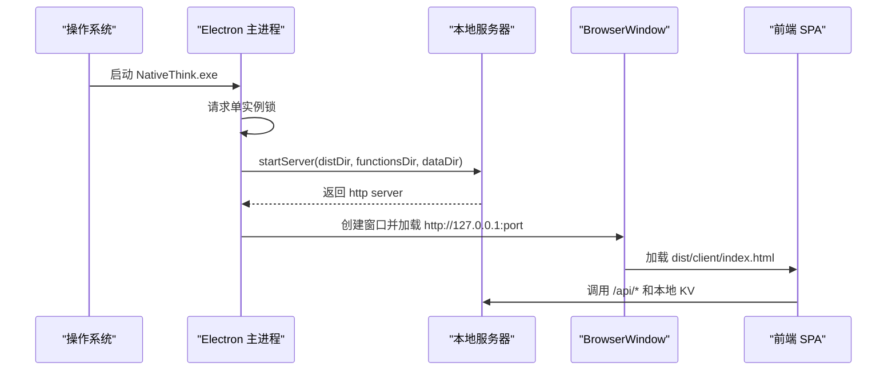

**图表来源**
- [electron/main.mjs:1-176](file://electron/main.mjs#L1-L176)
- [server/local-server.mjs:1-200](file://server/local-server.mjs#L1-L200)

### 安装包生成
`scripts/pack-app.mjs` 负责生成 Windows 便携版桌面应用，输出目录为 `release/NativeThink-win32-x64`：
1. 可选跳过 web 构建（`--skip-web`）。
2. 清空并准备输出目录。
3. 复制 Electron 运行时，并重命名 `electron.exe` 为 `NativeThink.exe`。
4. 复制 `electron`、`server`、`functions`、`dist/client` 到 `resources/app`。
5. 可选链接 `models-bundled` 离线模型。
6. 收集并复制本地服务器所需的生产依赖：`jose`、`undici`、`msedge-tts` 及其传递依赖。
7. 保留 `package.json`，便于 Electron 识别应用元信息。

该脚本不是传统意义上的 `electron-packager` 封装，而是手动组装可执行目录，从而更精确控制包内文件和体积。

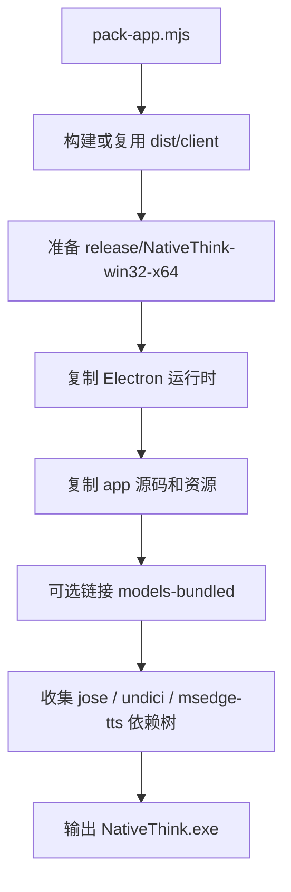

**图表来源**
- [scripts/pack-app.mjs:1-108](file://scripts/pack-app.mjs#L1-L108)
- [electron/main.mjs:1-176](file://electron/main.mjs#L1-L176)

**章节来源**
- [electron/main.mjs:1-176](file://electron/main.mjs#L1-L176)
- [scripts/pack-app.mjs:1-108](file://scripts/pack-app.mjs#L1-L108)

## Capacitor Android 打包流程
### 包名与 Capacitor 配置
`capacitor.config.json` 定义了 Capacitor 的核心元信息：
- `appId`: `com.nativethink.app`
- `appName`: `NativeThink`
- `webDir`: `dist/client`
- Android 混合内容策略禁用。
- 开发服务器 scheme 设为 HTTPS。

这与 `android/app/build.gradle` 中的 `applicationId` 和 `namespace` 保持一致，避免安装冲突。

**章节来源**
- [capacitor.config.json:1-11](file://capacitor.config.json#L1-L11)
- [android/app/build.gradle:1-30](file://android/app/build.gradle#L1-L30)

### APK 生成过程
`package:apk` 的执行顺序如下：
1. 执行 `version:apk-bump`，自增 `versionCode` 和 `versionName.patch`。
2. 执行 `ensure-web-build.mjs`，确保 `dist/client` 与源码和版本号一致。
3. 检查 TTS 语音资源。
4. 执行 `capacitor copy android`，将 `dist/client` 复制到 Android 工程。
5. 执行 `android-copy-models.cjs`，将 `models-bundled` 硬链接到 `assets/public/models`。
6. 进入 `android` 目录执行 Gradle debug 构建。
7. 将生成的 `app-debug.apk` 复制到 `release/NativeThink-mobile-debug.apk`。

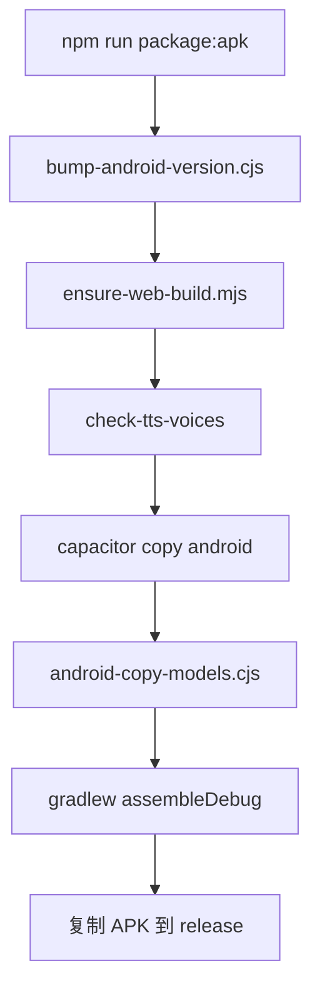

**图表来源**
- [package.json:20-40](file://package.json#L20-L40)
- [scripts/bump-android-version.cjs:1-27](file://scripts/bump-android-version.cjs#L1-L27)
- [scripts/ensure-web-build.mjs:1-93](file://scripts/ensure-web-build.mjs#L1-L93)
- [scripts/android-copy-models.cjs:1-23](file://scripts/android-copy-models.cjs#L1-L23)

### 版本管理
`scripts/bump-android-version.cjs` 的行为如下：
- 每次运行都将 `versionCode` 加一。
- `versionName` 保持 major.minor 不变，patch 每次加一。
- 若 `version.properties` 不存在，则从 `1` 和 `2.0.0` 开始。
- 输出新的 `versionCode` 和 `versionName`。

当前仓库中的版本状态为 `versionCode=147`、`versionName=2.0.102`，说明这是一个长期迭代产物。

Android Gradle 配置从 `version.properties` 读取这两个字段，并将其映射到 `defaultConfig.versionCode` 和 `versionName`。

**章节来源**
- [scripts/bump-android-version.cjs:1-27](file://scripts/bump-android-version.cjs#L1-L27)
- [android/version.properties:1-2](file://android/version.properties#L1-L2)
- [android/app/build.gradle:1-20](file://android/app/build.gradle#L1-L20)

### ABI 与签名
Gradle 配置中还体现了两个重要发布策略：
1. **ABI 过滤**：默认只打包 `arm64-v8a` 和 `armeabi-v7a`，模拟器模式可切换为 `x86_64`，避免安装包无意义膨胀约 42MB。
2. **固定签名**：如果存在 `keystore.properties`，debug 和 release 都使用同一份签名，这样覆盖安装不会要求卸载，用户数据得以保留。

**章节来源**
- [android/app/build.gradle:20-95](file://android/app/build.gradle#L20-L95)
- [android/variables.gradle:1-16](file://android/variables.gradle#L1-L16)

## 构建脚本体系
### scripts/build.sh
这是主构建脚本，负责：
- 设置 `MSYS_NO_PATHCONVERSION` 修复 Git Bash 路径问题。
- 设置 `CLIENT_BASE_PATH`、`ASSETS_CDN_PATH`、`STATIC_ASSETS_BASE_URL`、`NODE_ENV`。
- 删除旧 `dist`。
- 调用 Vite 构建到 `dist/client`。
- 复制 `index.html` 为 `404.html`，支持 SPA 路由。
- 如果是 Cloudflare Pages 模式，直接退出，不再拆分。
- 否则按 Miaoda 模式拆分 HTML、静态资源、私有静态资源、capability 配置。

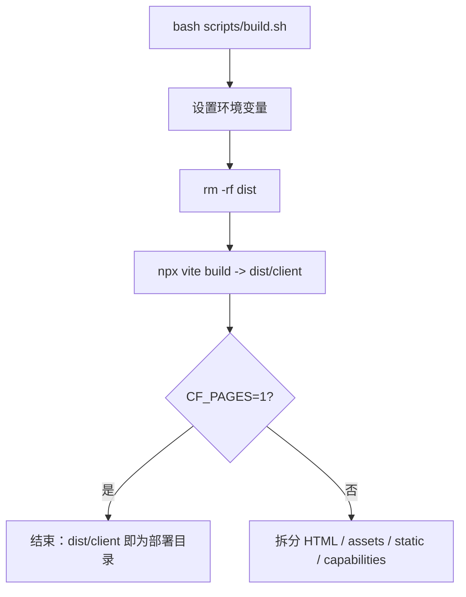

**图表来源**
- [scripts/build.sh:1-69](file://scripts/build.sh#L1-L69)

**章节来源**
- [scripts/build.sh:1-69](file://scripts/build.sh#L1-L69)

### scripts/pack-app.mjs
桌面打包脚本，重点行为已在上一节说明。它强调：
- 使用硬链接复制 Electron 运行时和离线模型，减少拷贝时间。
- 通过递归遍历依赖树，只复制本地服务器实际需要的 node_modules。
- 支持 `--skip-web`，以便 CI 或组合任务复用已有 web 产物。

**章节来源**
- [scripts/pack-app.mjs:1-108](file://scripts/pack-app.mjs#L1-L108)

### scripts/bump-android-version.cjs
Android 版本递增脚本，已在上一节说明。它是 `package:apk` 的前置步骤，保证每次 APK 都有唯一递增的 `versionCode`。

**章节来源**
- [scripts/bump-android-version.cjs:1-27](file://scripts/bump-android-version.cjs#L1-L27)

### scripts/ensure-web-build.mjs
该脚本是版本一致性守护程序，触发重建的条件包括：
- `dist/client/index.html` 不存在。
- 受跟踪源码比产物新。
- 产物中没有 `app-version` meta。
- 产物中的版本与 `android/version.properties` 不一致。

一旦触发，它会重新执行 `npm run build:web`，并再次验证；如果仍不一致则失败。

**章节来源**
- [scripts/ensure-web-build.mjs:1-93](file://scripts/ensure-web-build.mjs#L1-L93)

### scripts/android-copy-models.cjs
该脚本在 `capacitor copy` 之后执行，将 `models-bundled` 同步到 Android `assets/public/models`。它优先使用硬链接，避免 880MB 模型造成显著 I/O 延迟；如果不可用则退回真实拷贝。

**章节来源**
- [scripts/android-copy-models.cjs:1-23](file://scripts/android-copy-models.cjs#L1-L23)

## Bundle 预算校验与性能监控
### verify-bundle-budget.mjs 的作用
`scripts/verify-bundle-budget.mjs` 是一个从构建产物反推首屏必需 JS 的预算守卫，而不是简单统计全部包大小。它的核心逻辑是：
1. 读取 `dist/client/index.html`，提取 `modulepreload` 和入口 chunk。
2. 递归解析入口 chunk 的静态 import，得到“首屏必需集合”。
3. 计算该集合的 gzip 总大小。
4. 断言首屏不下载图表库、Markdown 渲染器、词书数据、书籍正文等大体积非必要资源。
5. 断言首屏必需 JS gzip 不超过 600KB。
6. 反向确认图表库和 Markdown 渲染器仍在产物中，只是按需加载，避免误报“功能缺失”。
7. 额外检查平台 SDK `@lark-apaas/client-toolkit-lite` 没有被静态 import，只允许动态加载。

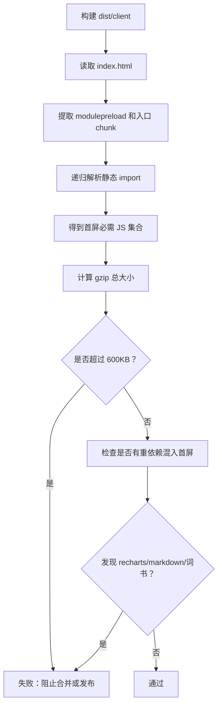

**图表来源**
- [scripts/verify-bundle-budget.mjs:1-111](file://scripts/verify-bundle-budget.mjs#L1-L111)

### 预算与分包的关系
Vite 的 `manualChunks` 和 `verify-bundle-budget.mjs` 共同构成预算治理：
- `manualChunks` 控制常见第三方库和数据模块的拆分方式。
- 预算脚本从产物角度验证“拆出去”的策略是否真的生效。
- 如果未来有人把大型依赖改回静态 import，预算脚本会捕获问题。

**章节来源**
- [scripts/verify-bundle-budget.mjs:1-111](file://scripts/verify-bundle-budget.mjs#L1-L111)
- [vite.config.ts:190-246](file://vite.config.ts#L190-L246)

## 持续集成建议
虽然仓库未提供 GitHub Actions、GitLab CI 或 Jenkins 配置文件，但可以从现有脚本和部署目标推导合理的 CI 流水线。

### 推荐阶段
| 阶段 | 命令 | 目的 |
|---|---|---|
| 依赖安装 | `npm ci` | 锁定依赖安装 |
| 类型检查 | `npm run typecheck` | TypeScript 编译检查 |
| Lint | `npm run lint` | ESLint 与类型检查并行 |
| Web 构建 | `npm run build:web` | 生成 `dist/client` |
| Bundle 预算 | `npm run verify:bundle-budget` | 防止首屏体积回归 |
| Android 构建 | `npm run package:apk` | 验证 Android 打包链路 |
| 桌面构建 | `npm run package:desktop` | 验证 Electron 打包链路 |
| Cloudflare 部署 | `npx wrangler pages deploy dist/client` | 部署 Web 产物 |

### 环境变量与密钥
CI 中应注入：
- `CF_PAGES=1`：让 `build.sh` 走 Cloudflare Pages 模式。
- Cloudflare KV namespace ID，或替换 `wrangler.toml`。
- Cloudflare API token，用于 `wrangler` 部署。
- Android keystore 凭据，用于签名 APK。
- AI Key、JWT secret 等后端密钥，按平台最佳实践注入，不写死到仓库。

### 缓存策略
CI 应缓存：
- `node_modules`
- Gradle 缓存
- `android/.gradle`
- `dist/client`（可选，用于快速预览）

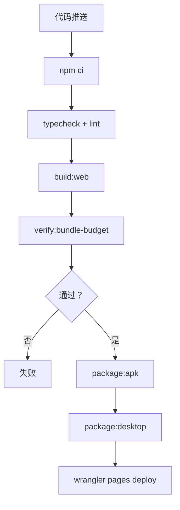

[No sources needed since this section provides general guidance]

## 故障排查
### 构建时报“读不到 android/version.properties 的 versionName”
原因：
- 非 Android 工程环境。
- `android/version.properties` 不存在或格式不符合预期。
- 版本号未通过 `version:apk-bump` 写入。

解决：
- 先运行 `npm run version:apk-bump`。
- 检查 `android/version.properties` 是否存在 `versionName`。
- 如果是纯 Web 构建，考虑在 CI 中预置最小版本文件或调整构建条件。

**章节来源**
- [vite.config.ts:120-140](file://vite.config.ts#L120-L140)
- [scripts/bump-android-version.cjs:1-27](file://scripts/bump-android-version.cjs#L1-L27)

### APK 包内版本与网页版本不一致
原因：
- 修改源码后直接执行 `package:apk`，但没有重新构建 web。
- 多次执行 `version:apk-bump` 导致 `version.properties` 更新，但 `dist/client/index.html` 中的版本仍是上一次构建结果。

解决：
- 不要跳过 `ensure-web-build.mjs`；它会自动检测并重建。
- 使用 `npm run package:apk`，不要手动拼接命令漏掉前置步骤。
- 如果确实需要复用旧产物，先同步 `version.properties` 与 `dist/client` 中的版本。

**章节来源**
- [scripts/ensure-web-build.mjs:1-93](file://scripts/ensure-web-build.mjs#L1-L93)

### Android 包体过大
可能原因：
- 包含了模拟器 ABI：x86/x86_64。
- 重复复制了完整 `node_modules`。
- 内置了不必要的模型或数据。

解决：
- 确认默认 ABI 为 `arm64-v8a` 和 `armeabi-v7a`。
- 只在模拟器构建时设置 `NT_EMU=1`。
- 使用 `scripts/android-copy-models.cjs` 的硬链接模式。
- 使用 `scripts/pack-app.mjs` 的依赖树收集逻辑，避免打包多余 node_modules。

**章节来源**
- [android/app/build.gradle:20-50](file://android/app/build.gradle#L20-L50)
- [scripts/android-copy-models.cjs:1-23](file://scripts/android-copy-models.cjs#L1-L23)
- [scripts/pack-app.mjs:60-108](file://scripts/pack-app.mjs#L60-L108)

### 首屏体积超标
可能原因：
- 新增静态 import 大依赖。
- 将图表库、Markdown 渲染器、词书数据改为入口静态依赖。
- 引入平台 SDK 静态 import。

解决：
- 运行 `npm run verify:bundle-budget`。
- 将大依赖改为懒加载或动态 import。
- 检查 `vite.config.ts` 的 `manualChunks` 是否意外扩大了入口依赖。

**章节来源**
- [scripts/verify-bundle-budget.mjs:1-111](file://scripts/verify-bundle-budget.mjs#L1-L111)
- [vite.config.ts:190-246](file://vite.config.ts#L190-L246)

### Cloudflare Pages 部署后功能异常
可能原因：
- KV namespace ID 未正确绑定。
- 环境变量未注入。
- 构建输出目录不是 `dist/client`。

解决：
- 检查 `wrangler.toml` 中的 KV binding。
- 确认 Pages 项目使用 `dist/client` 作为构建输出。
- 在 Cloudflare 控制台注入必要的环境变量。

**章节来源**
- [wrangler.toml:1-9](file://wrangler.toml#L1-L9)

## 结论
NativeThink 的构建系统以 `dist/client` 为核心产物，围绕 Vite、Tailwind、Cloudflare Pages、Electron 和 Capacitor 形成一条可复用的多端交付链路。其关键优势在于：
- 版本来源单一，由 `android/version.properties` 驱动 HTML、APK 和构建日志。
- 分包策略兼顾稳定性和首屏体积，并通过产物级预算脚本做回归保护。
- Cloudflare KV 与 Electron 本地 KV 模拟保持行为一致。
- Android 版本递增和 ABI 过滤降低升级成本和包体膨胀风险。
- 构建脚本明确分工：`build.sh` 负责 Web，`pack-app.mjs` 负责桌面，`bump-android-version.cjs` 负责 Android 版本。

在实际工程中，建议将 CI 补全，把 `verify:bundle-budget`、`package:apk`、`package:desktop` 和 Cloudflare 部署纳入自动化流水线，并严格管理 KV ID、AI Key、JWT secret 和 Android keystore。