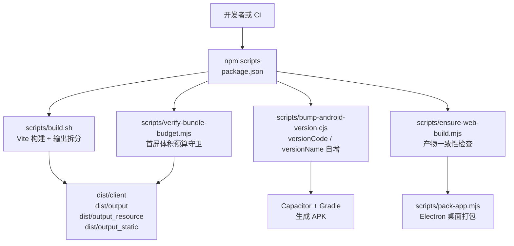
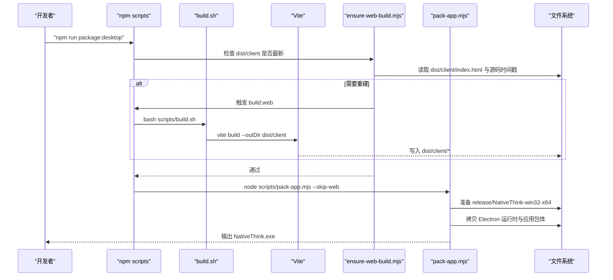
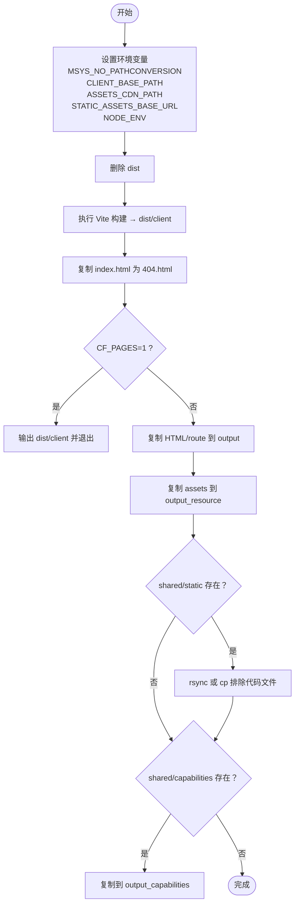
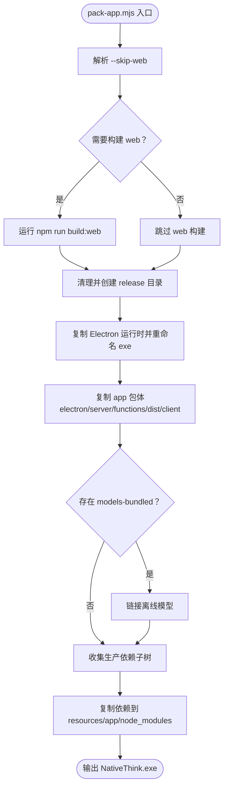
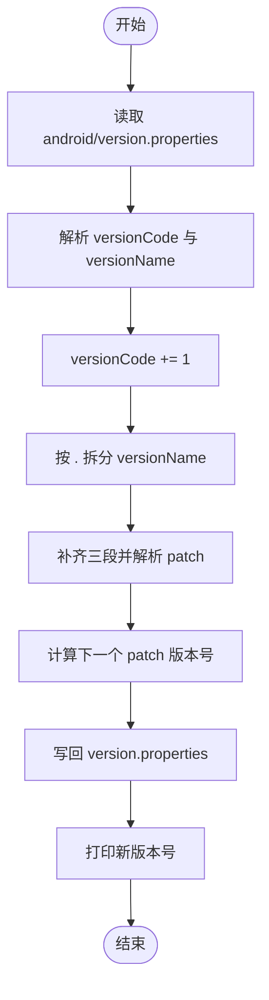
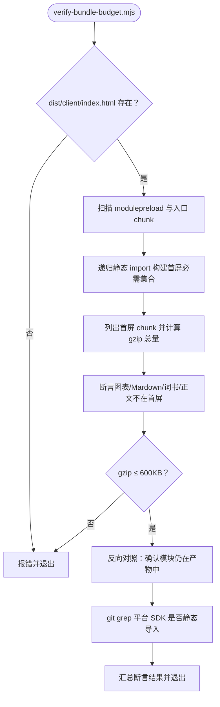
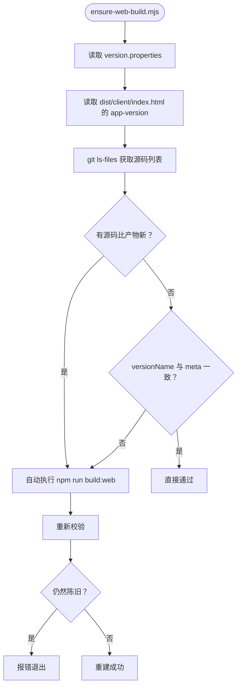
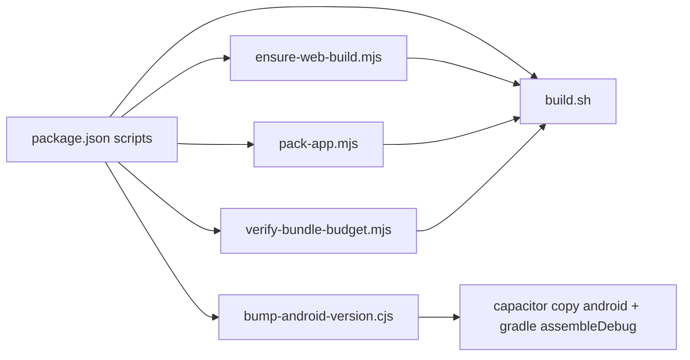

# 构建脚本体系

<cite>
**本文引用的文件**   
- [scripts/build.sh](file://scripts/build.sh)
- [scripts/pack-app.mjs](file://scripts/pack-app.mjs)
- [scripts/bump-android-version.cjs](file://scripts/bump-android-version.cjs)
- [scripts/verify-bundle-budget.mjs](file://scripts/verify-bundle-budget.mjs)
- [scripts/ensure-web-build.mjs](file://scripts/ensure-web-build.mjs)
- [package.json](file://package.json)
</cite>

## 目录
1. [引言](#引言)
2. [项目结构与脚本总览](#项目结构与脚本总览)
3. [核心组件](#核心组件)
4. [架构总览](#架构总览)
5. [详细组件分析](#详细组件分析)
6. [依赖关系分析](#依赖关系分析)
7. [性能与体积预算](#性能与体积预算)
8. [错误处理与健壮性](#错误处理与健壮性)
9. [CI/CD 集成指南](#cicd-集成指南)
10. [自定义脚本编写规范](#自定义脚本编写规范)
11. [故障排查](#故障排查)
12. [结论](#结论)

## 引言
NativeThink 的构建脚本体系围绕四个目标组织：  
- 把 React/Vite 前端产物按部署平台拆分到 `dist/output`、`dist/output_resource`、`dist/output_static`。  
- 在桌面端打包出可独立运行的 Electron 应用。  
- 在 Android 端每次构建时递增版本号，避免安装失败。  
- 用脚本守卫首屏体积，防止图表库、Markdown 渲染器、词书数据被意外拉入首屏。

本文件从构建流程、参数解析、版本算法、Bundle 监控、辅助校验脚本五个维度展开，并给出 CI/CD 集成建议与自定义脚本规范。

## 项目结构与脚本总览
构建脚本集中在 `scripts/` 目录，由根 `package.json` 的 npm scripts 编排调用。主入口是 `scripts/build.sh`；Android 和桌面打包分别走 `bump-android-version.cjs`、`ensure-web-build.mjs`、`pack-app.mjs`；体积守卫由 `verify-bundle-budget.mjs` 负责。

**图表来源**
- [package.json:6-50](file://package.json#L6-L50)
- [scripts/build.sh:1-69](file://scripts/build.sh#L1-L69)
- [scripts/pack-app.mjs:1-108](file://scripts/pack-app.mjs#L1-L108)
- [scripts/bump-android-version.cjs:1-27](file://scripts/bump-android-version.cjs#L1-L27)
- [scripts/ensure-web-build.mjs:1-93](file://scripts/ensure-web-build.mjs#L1-L93)
- [scripts/verify-bundle-budget.mjs:1-111](file://scripts/verify-bundle-budget.mjs#L1-L111)

**章节来源**
- [package.json:6-50](file://package.json#L6-L50)

## 核心组件
- **主构建脚本 `build.sh`**：清理旧产物、设置环境变量、执行 Vite 构建、复制 SPA 路由兜页、按部署模式拆分 HTML/资源/静态资产/Capabilities。  
- **桌面打包脚本 `pack-app.mjs`**：跳过或重建 web、准备 Electron 运行时、拷贝应用包体、收集生产依赖子树、可选链接离线模型。  
- **Android 版本脚本 `bump-android-version.cjs`**：解析 `android/version.properties`，递增 `versionCode`，按 `major.minor.patch` 规则递增 `versionName`。  
- **Bundle 预算脚本 `verify-bundle-budget.mjs`**：从构建产物反推首屏必需 chunk，断言禁止进入首屏的模块集合，并校验 gzip 总量阈值。  
- **Web 构建保障脚本 `ensure-web-build.mjs`**：检测源码时间戳与 `app-version` meta，不一致则自动重建 web 产物。

**章节来源**
- [scripts/build.sh:1-69](file://scripts/build.sh#L1-L69)
- [scripts/pack-app.mjs:1-108](file://scripts/pack-app.mjs#L1-L108)
- [scripts/bump-android-version.cjs:1-27](file://scripts/bump-android-version.cjs#L1-L27)
- [scripts/verify-bundle-budget.mjs:1-111](file://scripts/verify-bundle-budget.mjs#L1-L111)
- [scripts/ensure-web-build.mjs:1-93](file://scripts/ensure-web-build.mjs#L1-L93)

## 架构总览
下图展示一次典型“先 web 构建、再桌面打包”的控制流。

**图表来源**
- [package.json:12-20](file://package.json#L12-L20)
- [scripts/ensure-web-build.mjs:72-93](file://scripts/ensure-web-build.mjs#L72-L93)
- [scripts/build.sh:15-69](file://scripts/build.sh#L15-L69)
- [scripts/pack-app.mjs:33-108](file://scripts/pack-app.mjs#L33-L108)

## 详细组件分析

### 主构建脚本 `scripts/build.sh`
`build.sh` 是仓库的通用构建入口，职责包括环境准备、Vite 构建、SPA 路由兜页、多路径输出拆分。

- **环境变量与平台适配**  
  - 设置 `MSYS_NO_PATHCONVERSION=1`，缓解 Windows Git Bash 的路径转换问题。  
  - 根据 `MIAODA_APP_ID` 注入 `CLIENT_BASE_PATH`，根据 `MIAODA_RESOURCE_CDN_PREFIX`、`MIAODA_STATIC_CDN_PREFIX` 注入资源 CDN 路径。  
  - 默认 `NODE_ENV=production`。

- **构建流程**  
  1. 删除旧 `dist`。  
  2. 调用 `npx vite build`，输出到 `dist/client`。  
  3. 复制 `index.html` 为 `404.html`，供 Cloudflare Pages 等 SPA 使用。  
  4. 若 `CF_PAGES=1`，直接退出，认为 `dist/client` 已是最终部署目录。  
  5. 将顶层 HTML 与 `routes.json` 复制到 `dist/output`。  
  6. 若存在 `dist/client/assets`，整体复制到 `dist/output_resource`。  
  7. 若存在 `shared/static`，优先使用 `rsync` 排除 TypeScript/JS 源文件，否则回退到 `cp` 后删除可疑扩展名。  
  8. 若存在 `shared/capabilities`，复制到 `dist/output_capabilities`。

- **复杂度与性能特征**  
  - 主要成本来自 Vite 构建；脚本本身是顺序 Shell 流程，I/O 密集但逻辑简单。  
  - `rsync` 分支用于减少静态资源中误传源码的风险，提升产物清洁度。

**图表来源**
- [scripts/build.sh:1-69](file://scripts/build.sh#L1-L69)

**章节来源**
- [scripts/build.sh:1-69](file://scripts/build.sh#L1-L69)

### 桌面打包脚本 `scripts/pack-app.mjs`
该脚本负责组装 Windows 桌面版 `release/NativeThink-win32-x64/NativeThink.exe`。

- **参数解析**  
  - 支持 `--skip-web`：当外部已经构建好 `dist/client` 时跳过重复 web 构建。  
  - 其余参数未使用，通过 `process.argv.includes('--skip-web')` 判断。

- **构建与目录准备**  
  - 非 skip 模式执行 `npm run build:web`。  
  - 清理 `release/NativeThink-win32-x64`，创建 `resources/app`。

- **Electron 运行时复制**  
  - 使用 `./lib/link-copy.cjs` 提供的 `copyTree` 复制 `node_modules/electron/dist`。  
  - 重命名 `electron.exe` 为 `NativeThink.exe`。

- **应用包体组装**  
  - 复制 `package.json`、可选 `icon.ico`。  
  - 复制 `electron`、`server`、`functions` 目录。  
  - 复制 `dist/client` 作为桌面内嵌 web 产物。  
  - 若存在 `models-bundled`，链接离线模型目录。

- **生产依赖子树收集**  
  - 以 `jose`、`undici`、`msedge-tts` 为种子，递归遍历其 `dependencies`，收集完整依赖树。  
  - 忽略 scoped packages 内部名称，只保留 `@scope` 开头节点以避免误复制整个 scope。  
  - 把收集到的依赖逐个复制到 `resources/app/node_modules`。

- **错误处理**  
  - 依赖缺失会打印警告并跳过，不中断打包。  
  - 所有外部命令通过封装函数执行，继承父进程 stdio。

**图表来源**
- [scripts/pack-app.mjs:1-108](file://scripts/pack-app.mjs#L1-L108)

**章节来源**
- [scripts/pack-app.mjs:1-108](file://scripts/pack-app.mjs#L1-L108)

### Android 版本管理脚本 `scripts/bump-android-version.cjs`
该脚本保证每次打 APK 时 Android 版本号严格递增，避免覆盖安装失败。

- **输入文件**  
  - `android/version.properties`，包含 `versionCode` 与 `versionName`。

- **版本号解析**  
  - 如果文件存在，正则提取现有 `versionCode` 和 `versionName`；不存在则默认 `versionCode=1`、`versionName=2.0.0`。

- **增量更新规则**  
  - `versionCode` 始终加一。  
  - `versionName` 拆成三段，不足补零；patch 段取数值，若非法则重置为 1；最终形如 `major.minor.patch+1`。  
  - major/minor 由开发者手动修改，脚本沿用。

- **输出行为**  
  - 重写 `android/version.properties`。  
  - 打印新 `versionCode` 与 `versionName`。

**图表来源**
- [scripts/bump-android-version.cjs:1-27](file://scripts/bump-android-version.cjs#L1-L27)

**章节来源**
- [scripts/bump-android-version.cjs:1-27](file://scripts/bump-android-version.cjs#L1-L27)

### Bundle 体积守卫脚本 `scripts/verify-bundle-budget.mjs`
该脚本从实际构建产物出发，判断首屏是否下载了不应加载的模块，并限制 gzip 总量。

- **前置条件**  
  - 要求 `dist/client/index.html` 已存在；否则直接报错退出。

- **首屏必需集合推导**  
  - 从 `index.html` 中提取所有 `modulepreload` 引用的 JS 文件名。  
  - 找到以 `index-` 开头的入口 chunk。  
  - 对入口 chunk 及其静态依赖递归扫描，加入首屏必需集合。  
  - 动态 import、Vite preload 映射中的 chunk 不计入首屏必需。

- **禁止进入首屏的规则**  
  - 图表相关：匹配 `charts`、`ProgressCharts`、`recharts`、`d3-`。  
  - Markdown 相关：匹配 `markdown`、`micromark`、`mdast`、`unified`、`lib-`。  
  - 词书数据：匹配 `wordbank-<level>-*.js`，其中 level 包括中考、高考、四六级、雅思、托福、考研、专业、高级等。  
  - 语料正文：匹配 `books-`、`scp`、`reading`。

- **预算阈值**  
  - 统计首屏必需 chunk 的 gzip 总和，默认阈值为 600KB。  
  - 超过阈值即视为回归。

- **反向对照**  
  - 确认图表库与 Markdown 渲染器仍存在于产物中，只是按需加载，避免误报“模块被删除”。

- **源码级卫生检查**  
  - 使用 `git grep` 查找 `@lark-apaas/client-toolkit-lite` 引用点。  
  - 断言这些引用点不是静态 `import` 或具名导出，只能动态加载。

**图表来源**
- [scripts/verify-bundle-budget.mjs:1-111](file://scripts/verify-bundle-budget.mjs#L1-L111)

**章节来源**
- [scripts/verify-bundle-budget.mjs:1-111](file://scripts/verify-bundle-budget.mjs#L1-L111)

### Web 构建保障脚本 `scripts/ensure-web-build.mjs`
该脚本用于在打包 APK 或桌面包前，确保 `dist/client` 与当前源码及 Android 版本号一致。

- **触发重建的两个条件**  
  1. 有受 Git 跟踪的源码文件比 `dist/client/index.html` 更新。  
  2. `android/version.properties` 的 `versionName` 与 `dist/client/index.html` 中 `<meta name="app-version">` 不一致。

- **源码新鲜度检测**  
  - 使用 `git ls-files` 列出 `src`、`functions`、`electron`、`server`、`index.html`、`vite.config.ts`、`public`。  
  - 过滤 `.ts`、`.tsx`、`.js`、`.mjs`、`.cjs`、`.css`、`.html`、`.json`。  
  - 比较最新源码时间与 `dist/client/index.html` 时间。

- **版本号检测**  
  - 从 `android/version.properties` 读 `versionName`。  
  - 从 `dist/client/index.html` 正则提取 `app-version` meta。  
  - 找不到 meta 或两者不一致都视为陈旧。

- **自动修复策略**  
  - 如果陈旧，执行 `npm run build:web`。  
  - 重建后再次校验，仍不一致则报错退出。

**图表来源**
- [scripts/ensure-web-build.mjs:1-93](file://scripts/ensure-web-build.mjs#L1-L93)

**章节来源**
- [scripts/ensure-web-build.mjs:1-93](file://scripts/ensure-web-build.mjs#L1-L93)

## 依赖关系分析
构建脚本之间的依赖关系如下：

**图表来源**
- [package.json:6-50](file://package.json#L6-L50)
- [scripts/build.sh:1-69](file://scripts/build.sh#L1-L69)
- [scripts/pack-app.mjs:1-108](file://scripts/pack-app.mjs#L1-L108)
- [scripts/bump-android-version.cjs:1-27](file://scripts/bump-android-version.cjs#L1-L27)
- [scripts/ensure-web-build.mjs:1-93](file://scripts/ensure-web-build.mjs#L1-L93)
- [scripts/verify-bundle-budget.mjs:1-111](file://scripts/verify-bundle-budget.mjs#L1-L111)

**章节来源**
- [package.json:6-50](file://package.json#L6-L50)

## 性能与体积预算
- **构建阶段**  
  - `build.sh` 的核心耗时在 Vite 构建；后续复制和拆分是线性 I/O，通常远快于编译。  
  - `pack-app.mjs` 的 Electron 运行时和可选离线模型可能带来大量文件复制，因此使用 `link-copy.cjs` 优化。

- **首屏体积预算**  
  - `verify-bundle-budget.mjs` 的预算阈值为 600KB gzip，基于历史实测值预留一定余量。  
  - 禁止首屏加载图表库、Markdown 渲染器、词书数据、书籍正文，强制懒加载。  
  - 新增功能时应优先评估是否会被静态导入进入口 chunk；若必须引入，应改为动态 import 或按需 chunk。

- **优化建议**  
  - 不要把大型第三方库放入 `manualChunks` 入口组，除非它确实属于首屏。  
  - 词书、阅读正文、视频素材等大数据尽量保持按需加载。  
  - 如果预算持续逼近阈值，应增加分块粒度、移除未使用依赖、开启 Tree Shaking 并复查 Vite 配置。

[本节为通用性能指导，不直接分析具体代码行]

## 错误处理与健壮性
- **Shell 脚本**  
  - `build.sh` 使用 `set -e`，任何命令失败立即终止。  
  - 工具缺失时使用 `command -v rsync` 判断，并提供 `cp` 回退逻辑。

- **Node 脚本**  
  - `pack-app.mjs` 对缺失依赖打印警告但不中断；对外部命令统一封装执行。  
  - `ensure-web-build.mjs` 在 git 不可用时降级为仅版本号校验。  
  - `verify-bundle-budget.mjs` 在缺少 `dist/client` 时直接拒绝通过，避免“没构建也算通过”的假阳性。  
  - `bump-android-version.cjs` 对非法 patch 数字进行容错，默认回到 1。

- **最佳实践**  
  - 对外部命令统一封装，继承 stdio 以便调试。  
  - 对关键产物做存在性检查，而不是假设构建一定成功。  
  - 对版本号、文件名、正则表达式做最小化断言，失败时输出明确原因。

**章节来源**
- [scripts/build.sh:1-69](file://scripts/build.sh#L1-L69)
- [scripts/pack-app.mjs:1-108](file://scripts/pack-app.mjs#L1-L108)
- [scripts/ensure-web-build.mjs:1-93](file://scripts/ensure-web-build.mjs#L1-L93)
- [scripts/verify-bundle-budget.mjs:1-111](file://scripts/verify-bundle-budget.mjs#L1-L111)
- [scripts/bump-android-version.cjs:1-27](file://scripts/bump-android-version.cjs#L1-L27)

## CI/CD 集成指南
推荐在 CI 流水线中按阶段执行以下任务：

| 阶段 | 命令 | 目的 |
|---|---|---|
| 依赖安装 | `npm ci` | 使用 lockfile 精确还原依赖 |
| 类型检查 | `npm run typecheck` | 提前发现 TS 类型错误 |
| Lint | `npm run lint` | 结合 ESLint 与类型检查 |
| Web 构建 | `npm run build:web` | 产出 `dist/client` |
| Bundle 预算 | `npm run verify:bundle-budget` | 阻止首屏体积回归 |
| Android 打包 | `npm run package:apk` | 递增版本、校验 TTS、生成 debug APK |
| Desktop 打包 | `npm run package:desktop` | 复用 web 产物并打包 Electron |
| 全平台打包 | `npm run package:all` | 并行构建 APK 与桌面包 |

建议的 CI 约束：
- `verify:bundle-budget` 失败应直接中断流水线。  
- Android 打包前先跑 `version:apk-bump`，避免同一版本多次安装冲突。  
- 桌面打包使用 `--skip-web`，避免重复构建。  
- 缓存 `node_modules` 与 `dist/client`（注意区分不同 Node 版本与构建参数）。  
- 在 Windows Runner 上运行 `pack-app.mjs`，因为当前桌面打包脚本针对 win32-x64。

**章节来源**
- [package.json:6-50](file://package.json#L6-L50)

## 自定义脚本编写规范
为新构建脚本遵循以下约定：

- **入口位置**  
  - 放在 `scripts/` 下，按用途命名，例如 `verify-*.mjs`、`gen-*.cjs`、`package-*.sh`。  
  - 如果是 shell 脚本，首行保留 `#!/bin/bash` 并使用 `set -e`。

- **路径处理**  
  - 使用相对 `ROOT` 目录的路径，不要硬编码绝对路径。  
  - 在 Node 脚本中使用 `fileURLToPath(import.meta.url)` 或 `__dirname` 定位仓库根。

- **参数解析**  
  - 使用显式标志，例如 `--skip-web`、`--force`，避免隐式位置参数。  
  - 对未知参数至少打印用法提示。

- **错误处理**  
  - 对缺失产物、缺失工具、Git 不可用、权限不足等情况做明确判断。  
  - 失败时返回非零退出码，让 CI 能感知。  
  - 日志要区分 info、warn、error，便于在终端或 CI 日志中检索。

- **幂等性与可恢复性**  
  - 可重试操作应幂等；清理操作应先判断是否存在。  
  - 中间产物损坏时可安全重试，不需要整条流水线回滚。

- **与构建管线解耦**  
  - 自定义脚本不应耦合具体 UI 实现细节。  
  - 如需读取构建产物，应通过稳定结构（如 `dist/client/index.html`、`android/version.properties`）访问。

- **测试与验证**  
  - 复杂逻辑应配套最小测试用例，或在 `scripts/verify-all.mjs` 中注册。  
  - 对正则、版本号、路径拼接等边界情况单独验证。

[本节为通用规范，不直接分析具体代码行]

## 故障排查
- **Windows 路径异常**  
  - 现象：Git Bash 下路径被错误转换，导致 Vite 或脚本找不到目录。  
  - 解决：确保通过 `bash scripts/build.sh` 执行，脚本会自动设置 `MSYS_NO_PATHCONVERSION=1`。

- **Cloudflare Pages 模式未生效**  
  - 现象：期望直接部署 `dist/client`，却看到拆分后的 output 目录。  
  - 解决：在环境变量中设置 `CF_PAGES=1`。

- **缺少 rsync**  
  - 现象：静态资源复制变慢或行为不符合预期。  
  - 解决：安装 rsync；脚本会回退到 `cp` 并尝试删除可疑扩展名。

- **APK 安装失败提示版本不升级**  
  - 现象：覆盖安装被系统拒绝。  
  - 解决：确保每次打包前执行 `npm run version:apk-bump`，让 `versionCode` 和 `versionName` 递增。

- **桌面包里没有新版 web 代码**  
  - 现象：改完前端后直接打桌面包，内容仍是旧版本。  
  - 解决：使用 `npm run package:desktop`，它会先跑 `ensure-web-build.mjs`；或手动先执行 `npm run build:web`。

- **Bundle 预算报警**  
  - 现象：`verify:bundle-budget` 失败。  
  - 解决：检查是否新增了静态 import 的大型库；将图表、Markdown、词书数据改为按需加载；调整预算阈值需充分评估回归影响。

- **HTML 里找不到 `app-version`**  
  - 现象：`ensure-web-build.mjs` 认为产物陈旧，反复重建。  
  - 解决：确认构建管线已将版本号注入 `dist/client/index.html` 的 meta；若为旧产物，删除 `dist/client` 后重新构建。

**章节来源**
- [scripts/build.sh:1-69](file://scripts/build.sh#L1-L69)
- [scripts/ensure-web-build.mjs:1-93](file://scripts/ensure-web-build.mjs#L1-L93)
- [scripts/verify-bundle-budget.mjs:1-111](file://scripts/verify-bundle-budget.mjs#L1-L111)
- [scripts/bump-android-version.cjs:1-27](file://scripts/bump-android-version.cjs#L1-L27)

## 结论
NativeThink 的构建脚本体系以 `build.sh` 为中心，向上由 `package.json` 编排，向下支撑 Web、Android、Desktop 三条发布路径。`pack-app.mjs` 负责桌面端可执行产物组装，`bump-android-version.cjs` 守护 Android 版本单调递增，`verify-bundle-budget.mjs` 从产物侧反查首屏依赖并限制体积，`ensure-web-build.mjs` 弥补“打包不重建 web”的历史隐患。

这套体系的优势在于：
- 构建流程清晰，每个脚本职责单一。  
- 版本管理自动化，降低人工失误。  
- 体积守卫基于真实产物，能有效拦截懒加载退化。  
- 对 Windows、Cloudflare Pages、Miaoda 等平台差异提供环境变量开关。

未来改进方向包括：
- 将更多重复逻辑抽取为共享模块。  
- 为关键脚本补充单元测试或沙盒测试。  
- 在 CI 中记录每次构建的 bundle 大小趋势，形成可视化预算看板。  
- 逐步把 shell 与 Node 脚本统一为更一致的 CLI 风格。