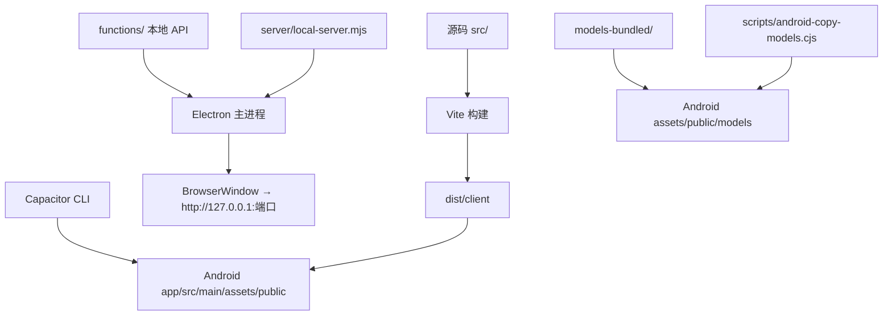
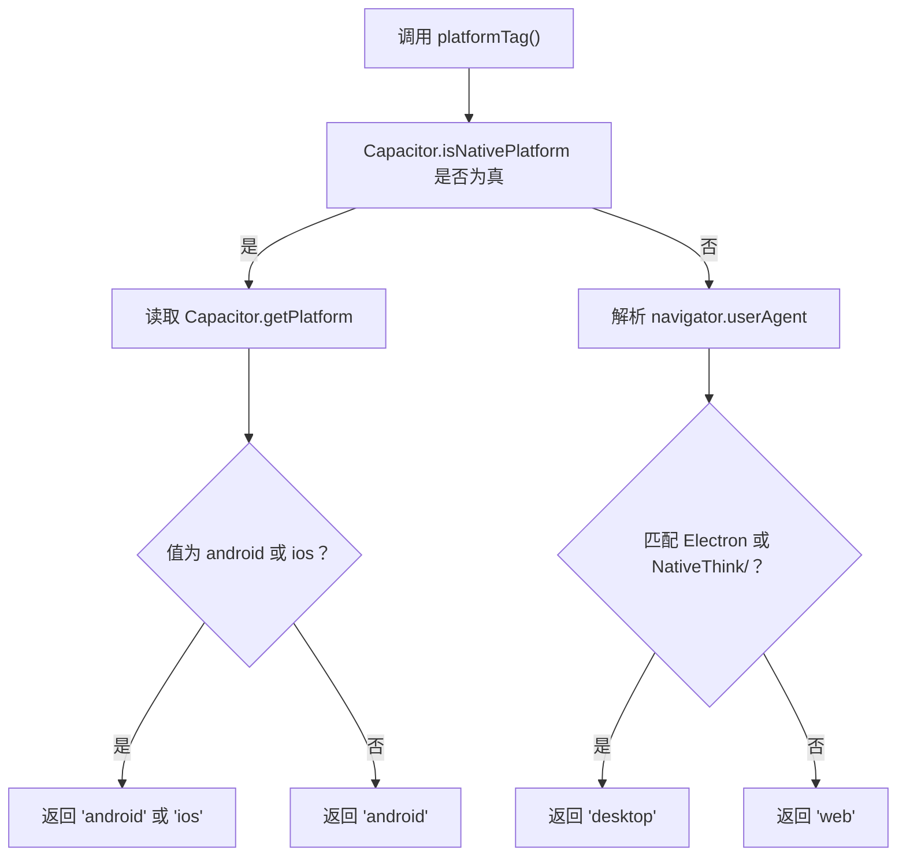
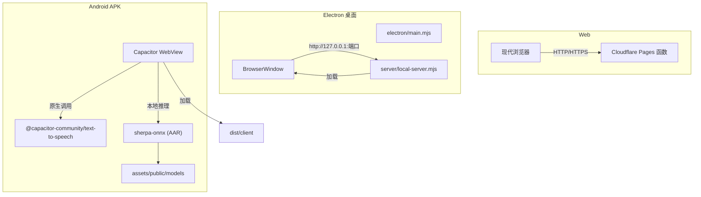
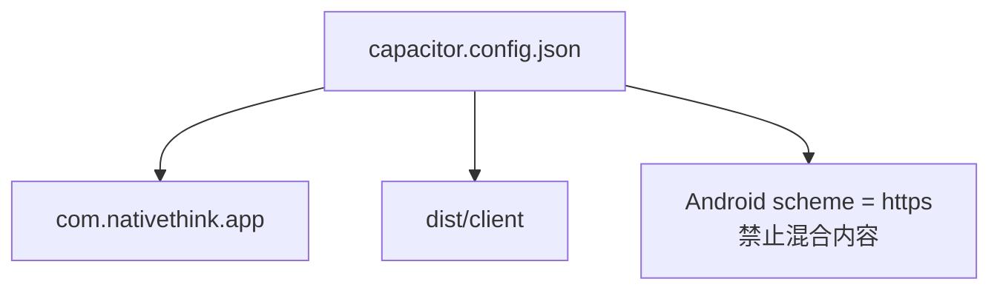
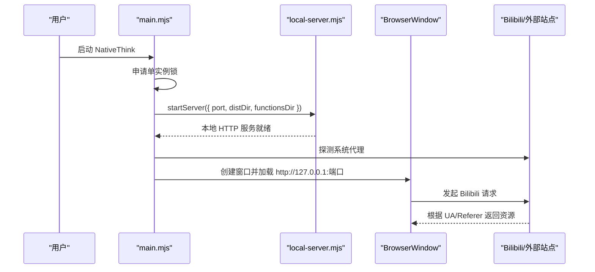
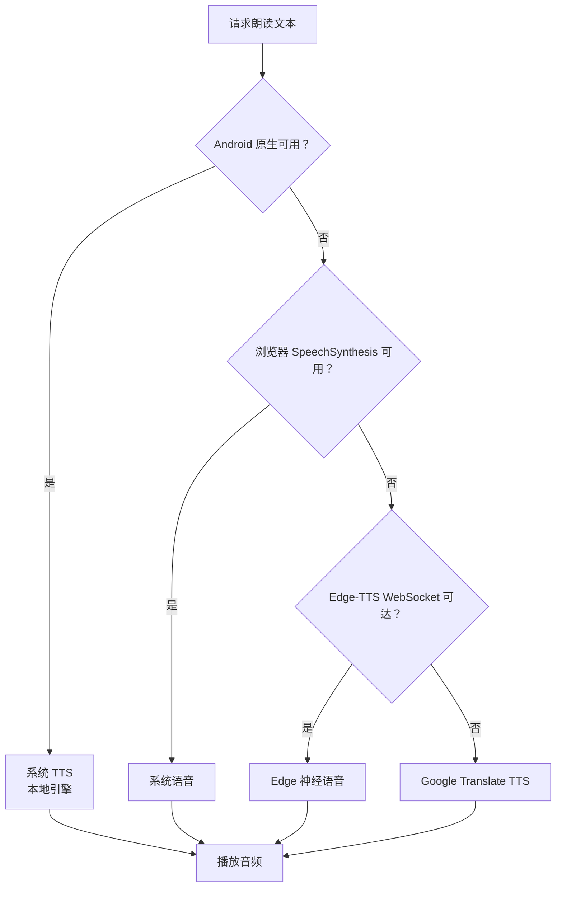
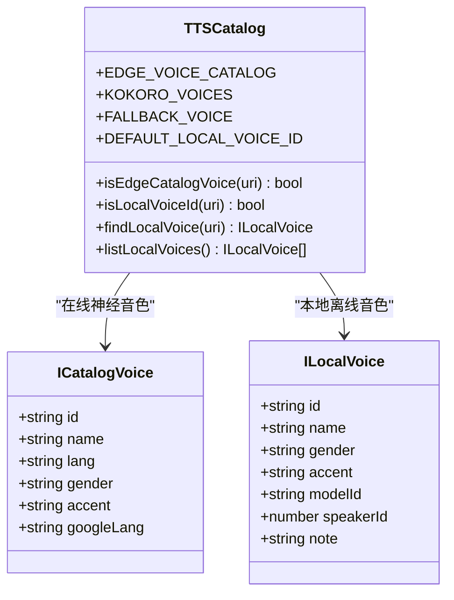
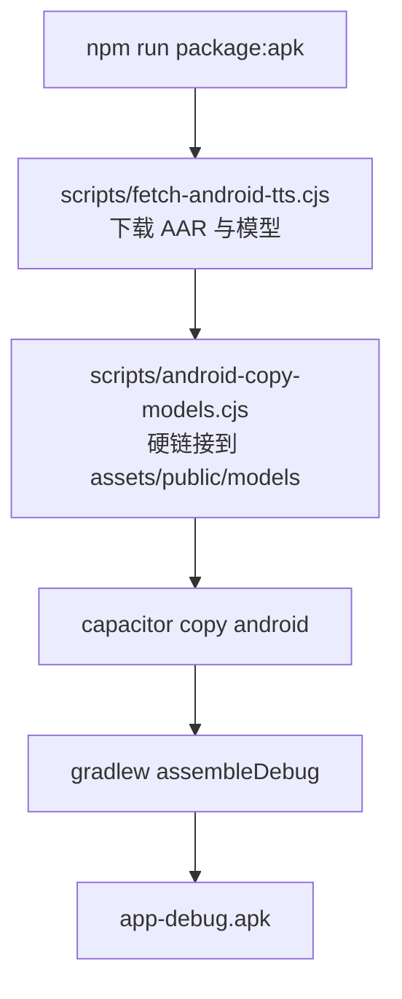
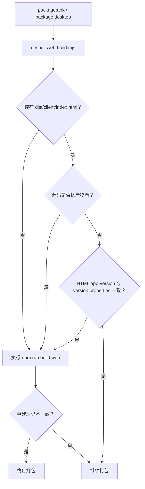
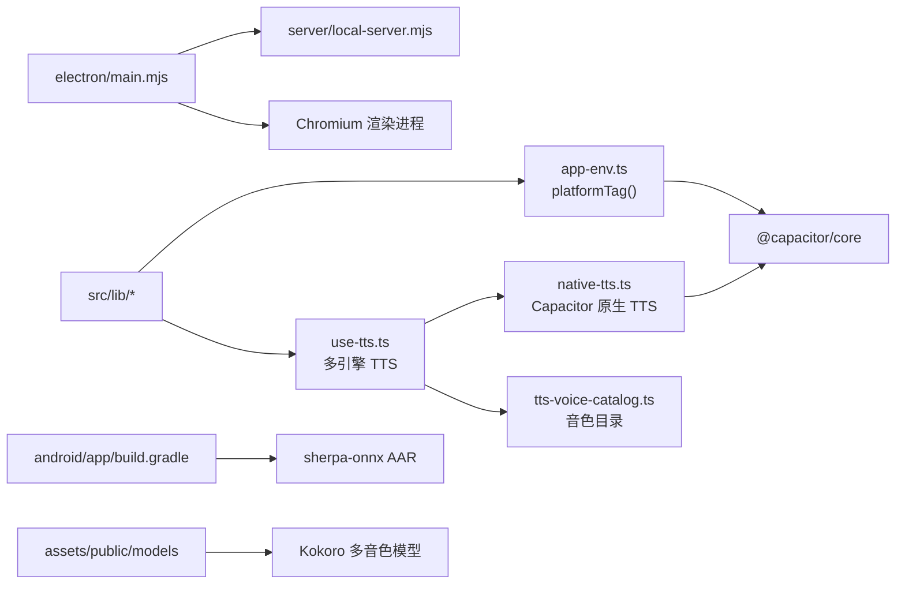

# 三形态共享边界

<cite>
**本文引用的文件**   
- [capacitor.config.json](file://capacitor.config.json)
- [electron/main.mjs](file://electron/main.mjs)
- [src/lib/app-env.ts](file://src/lib/app-env.ts)
- [src/lib/native-tts.ts](file://src/lib/native-tts.ts)
- [src/lib/use-tts.ts](file://src/lib/use-tts.ts)
- [src/lib/tts-voice-catalog.ts](file://src/lib/tts-voice-catalog.ts)
- [vite.config.ts](file://vite.config.ts)
- [package.json](file://package.json)
- [scripts/build.sh](file://scripts/build.sh)
- [scripts/ensure-web-build.mjs](file://scripts/ensure-web-build.mjs)
- [scripts/pack-app.mjs](file://scripts/pack-app.mjs)
- [scripts/android-copy-models.cjs](file://scripts/android-copy-models.cjs)
- [scripts/fetch-android-tts.cjs](file://scripts/fetch-android-tts.cjs)
- [android/app/build.gradle](file://android/app/build.gradle)
</cite>

## 目录
1. [引言](#引言)
2. [项目结构与共享产物](#项目结构与共享产物)
3. [核心运行边界](#核心运行边界)
4. [架构总览](#架构总览)
5. [详细组件分析](#详细组件分析)
6. [依赖与平台关系](#依赖与平台关系)
7. [性能与资源优化](#性能与资源优化)
8. [故障排查指南](#故障排查指南)
9. [结论](#结论)

## 引言
NativeThink 采用“一份前端代码，三份运行时外壳”的发布模型：同一份 `dist/client` 同时作为 Web 站点、Electron 桌面应用和 Android APK 的网页层。三者通过 Capacitor（Android）、Electron（桌面）和浏览器（Web）接入原生能力，并通过 `app-env.ts` 的平台检测机制决定运行时行为。

本文聚焦三形态的共享边界：哪些能力是跨平台一致的，哪些需要通过原生桥或后端代理实现，以及构建与打包管线如何保证 `dist/client` 在三处保持一致。

## 项目结构与共享产物

**图示来源**
- [vite.config.ts:1-200](file://vite.config.ts#L1-L200)
- [electron/main.mjs:1-176](file://electron/main.mjs#L1-L176)
- [capacitor.config.json:1-11](file://capacitor.config.json#L1-L11)
- [scripts/android-copy-models.cjs:1-23](file://scripts/android-copy-models.cjs#L1-L23)

### 关键产出路径
| 阶段 | 输入 | 输出 | 用途 |
|---|---|---|---|
| Vite 构建 | `src/`、`public/`、`vite.config.ts` | `dist/client/` | 三形态共享的前端包 |
| Electron 打包 | `dist/client` + `electron/` + `server/` + `functions/` | `release/NativeThink-win32-x64/` | 桌面安装包 |
| Android 打包 | `dist/client` + `models-bundled/` + Capacitor | `android/app/build/outputs/apk/debug/app-debug.apk` | 移动端安装包 |
| Cloudflare Pages | `dist/client` | 静态站点 | Web 部署 |

**章节来源**
- [vite.config.ts:1-200](file://vite.config.ts#L1-L200)
- [scripts/build.sh:1-69](file://scripts/build.sh#L1-L69)
- [package.json:1-130](file://package.json#L1-L130)

## 核心运行边界
### 平台检测与特性探测
`app-env.ts` 提供单一入口 `platformTag()`，按以下顺序判定：
1. 若 Capacitor 原生桥存在且返回原生平台，则返回 `android` 或 `ios`；
2. 否则检查 `navigator.userAgent` 中是否包含 `Electron` 或 `NativeThink/`，返回 `desktop`；
3. 兜底为 `web`。

该设计优先区分“原生壳”，避免 Capacitor WebView 的 UA 被误判为桌面端。异常时一律降级为 `web`，确保业务代码不会因为环境探测失败而崩溃。

**图示来源**
- [src/lib/app-env.ts:1-29](file://src/lib/app-env.ts#L1-L29)

**章节来源**
- [src/lib/app-env.ts:1-29](file://src/lib/app-env.ts#L1-L29)

### 原生桥 vs Web API 划分
| 能力类别 | Web | Electron 桌面 | Android APK | 实现方式 |
|---|---:|---:|---:|---|
| 基础 UI 与路由 | ✅ | ✅ | ✅ | React + React Router |
| 本地存储 | ✅ | ✅ | ✅ | IndexedDB / localStorage / Capacitor SafeStorage |
| 系统 TTS | 部分 | 不稳定 | 需插件 | `use-tts.ts` 多引擎降级 |
| 离线语音合成 | ❌ | 可选 | 可选 | Sherpa-onnx + Kokoro/Piper |
| 网络 TTS | 可选 | 可选 | 可选 | Edge-TTS WebSocket 或云端函数 |
| 文件系统 | 受限 | 受控 | 受限 | 不直接暴露沙箱 FS；需要时走原生桥或服务端 |
| 媒体播放 | ✅ | ✅ | ✅ | HTMLMediaElement + WebView |
| 音视频采集 | 条件支持 | 条件支持 | 条件支持 | 浏览器 API + 权限 |
| 外部链接 | 浏览器处理 | Electron 白名单控制 | WebView 控制 | `shell.openExternal` / Capacitor 配置 |

**章节来源**
- [src/lib/use-tts.ts:1-200](file://src/lib/use-tts.ts#L1-L200)
- [src/lib/native-tts.ts:1-199](file://src/lib/native-tts.ts#L1-L199)
- [electron/main.mjs:1-176](file://electron/main.mjs#L1-L176)

## 架构总览

**图示来源**
- [electron/main.mjs:1-176](file://electron/main.mjs#L1-L176)
- [capacitor.config.json:1-11](file://capacitor.config.json#L1-L11)
- [android/app/build.gradle:1-95](file://android/app/build.gradle#L1-L95)
- [scripts/android-copy-models.cjs:1-23](file://scripts/android-copy-models.cjs#L1-L23)

## 详细组件分析

### Capacitor 配置：包名、Web 目录与 Scheme
`capacitor.config.json` 定义了三件事：
- **应用身份**：`appId = com.nativethink.app`，用于 Android 包名和应用数据隔离；
- **网页根目录**：`webDir = dist/client`，Capacitor 打包时将 `dist/client` 注入 Android assets；
- **安全策略**：禁止混合内容，并将 Android WebView scheme 设为 `https`，避免部分站点拒绝非 HTTPS 页面。

**图示来源**
- [capacitor.config.json:1-11](file://capacitor.config.json#L1-L11)

**章节来源**
- [capacitor.config.json:1-11](file://capacitor.config.json#L1-L11)
- [android/app/build.gradle:1-95](file://android/app/build.gradle#L1-L95)

### Electron 主进程入口的作用
`electron/main.mjs` 承担四个职责：
1. **单实例与窗口管理**：防止重复启动；隐藏菜单栏；最小化后恢复焦点；
2. **本地服务启动**：复用与 Cloudflare 相同的后端代码，绑定动态端口，把 `dist/client` 作为静态资源目录；
3. **网络适配**：自动探测系统代理；对 Bilibili 请求伪装 Chrome UA 并设置 Referer；
4. **会话注入**：从本地数据目录读取 Bilibili `SESSDATA`，注入 Chromium session cookie，使内嵌播放器可登录高清视频和 AI 字幕。

**图示来源**
- [electron/main.mjs:1-176](file://electron/main.mjs#L1-L176)

**章节来源**
- [electron/main.mjs:1-176](file://electron/main.mjs#L1-L176)

### TTS 多引擎降级链
TTS 是典型的“平台差异最大”的能力。`use-tts.ts` 实现了四层优先级：

1. **原生 TTS（Android）**：通过 `native-tts.ts` 调用系统 TextToSpeech；
2. **浏览器 SpeechSynthesis（桌面/部分 Web）**：延迟低，但 Electron 上常无声；
3. **Edge-TTS WebSocket**：直连 Bing 语音服务，质量高但可能受网络限制；
4. **Google Translate TTS URL**：最后兜底，语言变体有限。

**图示来源**
- [src/lib/use-tts.ts:1-200](file://src/lib/use-tts.ts#L1-L200)
- [src/lib/native-tts.ts:1-199](file://src/lib/native-tts.ts#L1-L199)

**章节来源**
- [src/lib/use-tts.ts:1-200](file://src/lib/use-tts.ts#L1-L200)
- [src/lib/native-tts.ts:1-199](file://src/lib/native-tts.ts#L1-L199)

### 离线语音音色目录与默认策略
`tts-voice-catalog.ts` 维护两类音色：
- **在线神经音色**：以 `srv:edge:` 前缀标识，对应 Edge TTS 的真实语音名；
- **本地离线音色**：Kokoro int8 多语模型与 Piper Lessac，通过 `kokoro:` 和 `piper:` 前缀标识。

默认音色选择 Lessac，因为实测 RTF 远低于 Kokoro，长文朗读不会掉帧。Kokoro 音色音质更好，但适合短句或显式选择。

**图示来源**
- [src/lib/tts-voice-catalog.ts:1-162](file://src/lib/tts-voice-catalog.ts#L1-L162)

**章节来源**
- [src/lib/tts-voice-catalog.ts:1-162](file://src/lib/tts-voice-catalog.ts#L1-L162)

### Android 资源管理与模型注入
Android 侧的离线能力依赖两层资源：
1. **Sherpa-onnx AAR**：由 `scripts/fetch-android-tts.cjs` 从 HuggingFace Mirror 拉取，放入 `android/app/libs/`；
2. **模型与音色**：Kokoro 多音色模型与 Piper 英文音色放在 `assets/public/models`，由 `scripts/android-copy-models.cjs` 在 `capacitor copy` 之后用硬链接快速同步。

**图示来源**
- [scripts/fetch-android-tts.cjs:1-200](file://scripts/fetch-android-tts.cjs#L1-L200)
- [scripts/android-copy-models.cjs:1-23](file://scripts/android-copy-models.cjs#L1-L23)
- [android/app/build.gradle:1-95](file://android/app/build.gradle#L1-L95)

**章节来源**
- [scripts/fetch-android-tts.cjs:1-200](file://scripts/fetch-android-tts.cjs#L1-L200)
- [scripts/android-copy-models.cjs:1-23](file://scripts/android-copy-models.cjs#L1-L23)
- [android/app/build.gradle:1-95](file://android/app/build.gradle#L1-L95)

### 构建与版本一致性保障
`scripts/ensure-web-build.mjs` 是防止“旧产物打入新包”的关键守卫：
- 若 `dist/client/index.html` 不存在；
- 若有跟踪源码比产物更新；
- 若 `android/version.properties` 中的 `versionName` 与 HTML 内 `app-version` 不一致；

则自动执行 `npm run build:web`，并在二次校验失败时中止打包。

**图示来源**
- [scripts/ensure-web-build.mjs:1-93](file://scripts/ensure-web-build.mjs#L1-L93)

**章节来源**
- [scripts/ensure-web-build.mjs:1-93](file://scripts/ensure-web-build.mjs#L1-L93)

## 依赖与平台关系

**图示来源**
- [src/lib/app-env.ts:1-29](file://src/lib/app-env.ts#L1-L29)
- [src/lib/use-tts.ts:1-200](file://src/lib/use-tts.ts#L1-L200)
- [src/lib/native-tts.ts:1-199](file://src/lib/native-tts.ts#L1-L199)
- [src/lib/tts-voice-catalog.ts:1-162](file://src/lib/tts-voice-catalog.ts#L1-L162)
- [electron/main.mjs:1-176](file://electron/main.mjs#L1-L176)
- [android/app/build.gradle:1-95](file://android/app/build.gradle#L1-L95)

**章节来源**
- [package.json:1-130](file://package.json#L1-L130)
- [vite.config.ts:1-200](file://vite.config.ts#L1-L200)

## 性能与资源优化
### Web 构建优化
- Vite 使用 `manualChunks` 将 React、React Router 等第三方库拆出独立 chunk；
- 开发服务器启用 COOP/COEP 响应头，允许多线程 WASM 加载离线模型；
- 构建脚本剥离 Miaoda 平台专属的埋点脚本，减少移动端首屏体积；
- dev proxy 将所有 `/api/*` 转发到 Cloudflare Pages 函数，统一开发体验。

### Android 资源优化
- 仅打包 `arm64-v8a` 与 `armeabi-v7a` ABI，模拟器调试时可切换为 `x86_64`；
- 离线模型通过硬链接复制到 assets，避免每次复制 880MB 数据；
- Sherpa-onnx AAR 静态链接 ONNX Runtime，避免符号冲突；
- Kokoro 模型与 Piper 音色复用同一份 espeak 数据，减少冗余。

### Electron 进程优化
- 主进程禁用 NodeIntegration 并开启 contextIsolation，降低渲染进程攻击面；
- 本地服务监听 `127.0.0.1`，不对外暴露；
- 对 Bilibili 的请求只改写 UA 和 Referer，不全局修改所有请求头，避免影响自身 API 调用；
- 自动探测 PAC 代理，适配 Clash 等系统代理环境。

[本节为通用优化建议，不直接分析具体代码行]

## 故障排查指南

### 问题：APK 里没有离线模型
**现象**：Android 安装成功但无法离线朗读。  
**原因**：`scripts/android-copy-models.cjs` 依赖 `capacitor copy android` 先执行；如果 assets 尚未生成，脚本会跳过。  
**排查步骤**：
1. 确认 `android/app/src/main/assets/public/models` 是否存在；
2. 确认 `models-bundled/` 中存在 Kokoro/Piper 模型；
3. 重新执行 `npm run package:apk`，让脚本自动补全构建。

**章节来源**
- [scripts/android-copy-models.cjs:1-23](file://scripts/android-copy-models.cjs#L1-L23)
- [scripts/fetch-android-tts.cjs:1-200](file://scripts/fetch-android-tts.cjs#L1-L200)

### 问题：桌面版朗读无声
**现象**：Electron 中点击朗读无声音，也不报错。  
**原因**：Electron 内置 Chromium 通常没有 SAPI 语音映射，`SpeechSynthesis` 可能“静默成功”。  
**排查步骤**：
1. 检查 `use-tts.ts` 是否进入 Edge-TTS 或云端回退路径；
2. 检查网络是否能连通 Edge-TTS WebSocket；
3. 如必须用系统语音，需在 Windows 设置中添加英语语音包。

**章节来源**
- [src/lib/use-tts.ts:1-200](file://src/lib/use-tts.ts#L1-L200)

### 问题：Android 语音列表为空
**现象**：设置页显示“没有朗读声音”。  
**原因**：WebView 的 `speechSynthesis` 几乎不可用；系统 TTS 未安装英语本地音色。  
**排查步骤**：
1. 使用 `native-tts.ts` 的 `listNativeEnglishVoices()` 查询系统引擎；
2. 调用 `openNativeTtsInstall()` 引导用户安装系统 TTS 包；
3. 若仍无本地音色，考虑启用 Sherpa-onnx 离线引擎。

**章节来源**
- [src/lib/native-tts.ts:1-199](file://src/lib/native-tts.ts#L1-L199)

### 问题：打包产物与源码不一致
**现象**：修复已生效的代码却装上了旧版本。  
**原因**：`package:apk` 只做 `capacitor copy`，不重建 web；`ensure-web-build.mjs` 未触发。  
**排查步骤**：
1. 查看 `dist/client/index.html` 是否存在；
2. 检查 `android/version.properties` 与 HTML 内 `app-version` 是否一致；
3. 手动执行 `npm run build:web` 后再打包。

**章节来源**
- [scripts/ensure-web-build.mjs:1-93](file://scripts/ensure-web-build.mjs#L1-L93)

## 平台能力矩阵
| 功能 | Web | Electron 桌面 | Android APK | 备注 |
|---|---:|---:|---:|---|
| 基础界面 | ✅ | ✅ | ✅ | React SPA |
| 路由 | ✅ | ✅ | ✅ | React Router |
| 在线词典与词库 | ✅ | ✅ | ✅ | 本地 JSON + 云端 |
| 阅读与笔记 | ✅ | ✅ | ✅ | IndexedDB |
| 系统 TTS | 条件 | 不稳定 | 需插件 | Android 必须走系统或离线引擎 |
| Edge-TTS 在线语音 | 条件 | 条件 | 条件 | 依赖网络可达性 |
| Google TTS 兜底 | 条件 | 条件 | 条件 | 最后回退通道 |
| Sherpa-onnx 离线推理 | ❌ | 可选 | 可选 | 需提前下载模型 |
| Kokoro 多音色 | ❌ | 可选 | 可选 | 模型较大，约 100MB+ |
| Piper Lessac 兜底 | ❌ | 可选 | 可选 | RTF 最低，默认音色 |
| 文件系统访问 | 受限 | 受控 | 受限 | 不建议直接操作沙箱 FS |
| 外部链接打开 | 浏览器 | Electron 白名单 | WebView 控制 | 桌面端排除 localhost |
| 代理与网络 | 浏览器代理 | Electron 自动探测 | 系统代理 | Electron 支持 PAC 探测 |
| 本地 API 服务 | 云端函数 | 内置 local-server | 云端函数 | 桌面端可完全离线运行后端 |
| 应用身份 | 域名隔离 | userData 目录 | `com.nativethink.app` | 数据互不干扰 |
| 版本号 | 构建注入 | 同 Web | Android version.properties | ensure-web-build 校验一致性 |

[本节为汇总说明，不直接分析具体代码行]

## 结论
NativeThink 的三形态共享边界可以概括为一句话：**`dist/client` 是共享内核，Capacitor 和 Electron 是不同外壳，`app-env.ts` 是运行时开关，TTS 与模型资源是主要差异化点。**

- Web 形态依赖浏览器能力和 Cloudflare 函数；
- Electron 形态通过本地 server 提供完整离线后端，并对 Bilibili 等外部资源做 UA 伪装；
- Android 形态通过 Capacitor 接入系统 TTS，并通过 Sherpa-onnx 与 Kokoro/Piper 模型实现“真离线”朗读；
- 构建管线通过 `ensure-web-build.mjs` 和 `android-copy-models.cjs` 保证产物、版本与资源的一致性。

只要新增能力遵循“优先 Web API，其次原生桥，最后云端回退”的原则，就能继续维持这份共享边界不被破坏。