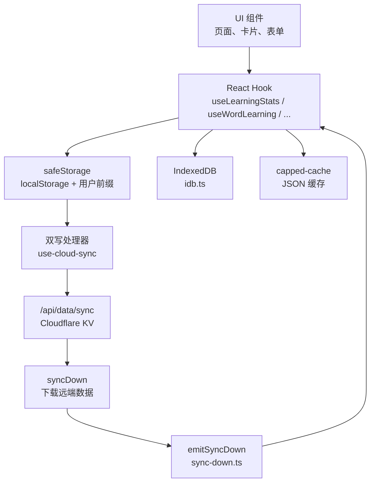
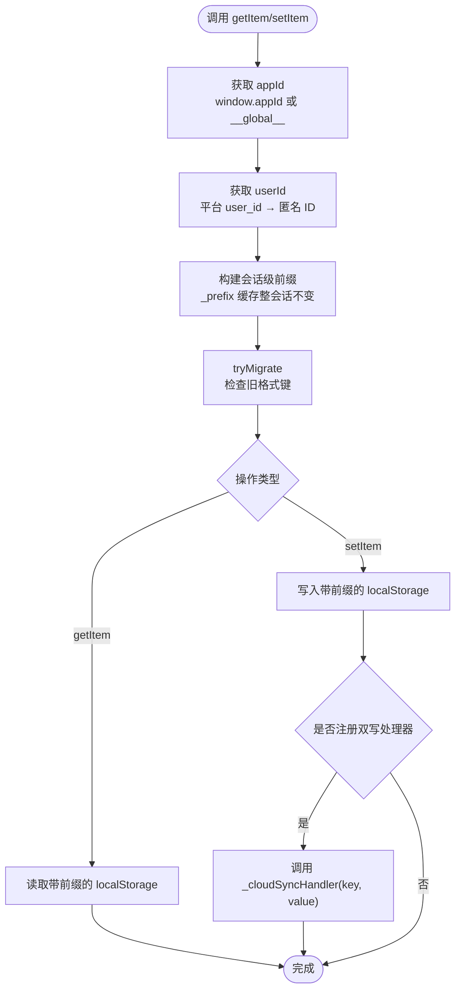
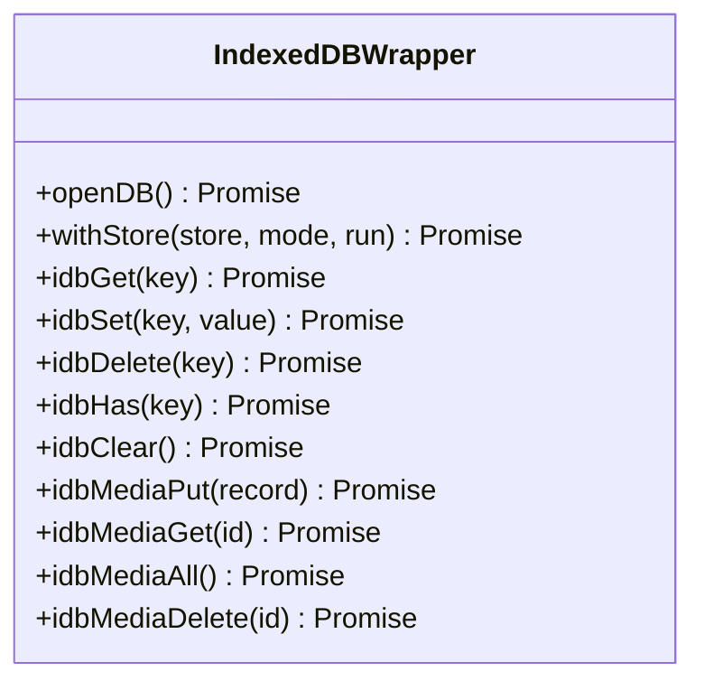
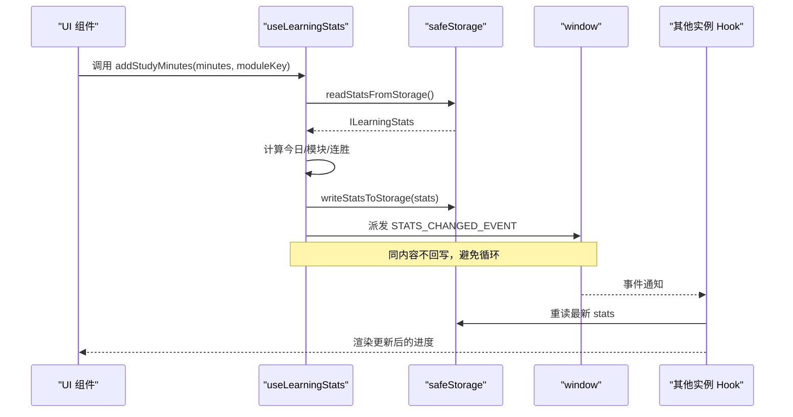
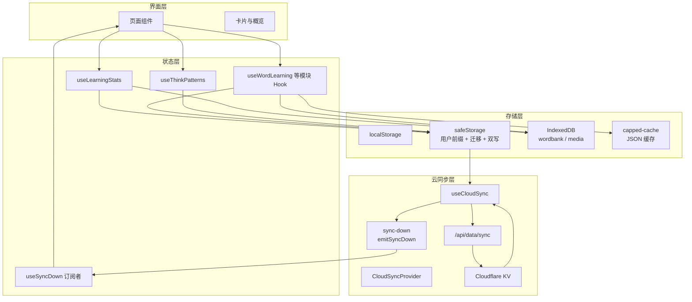
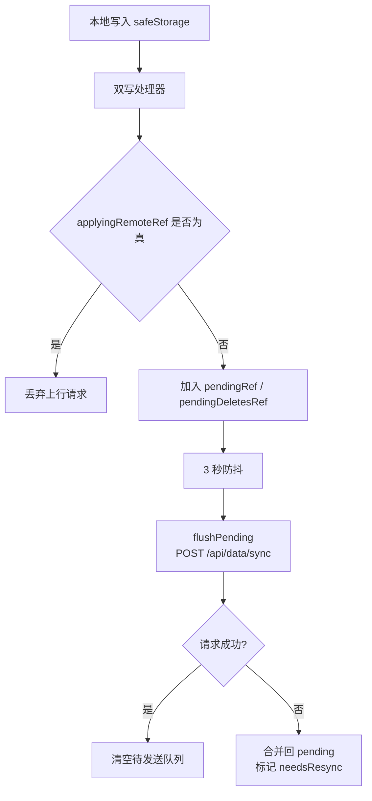
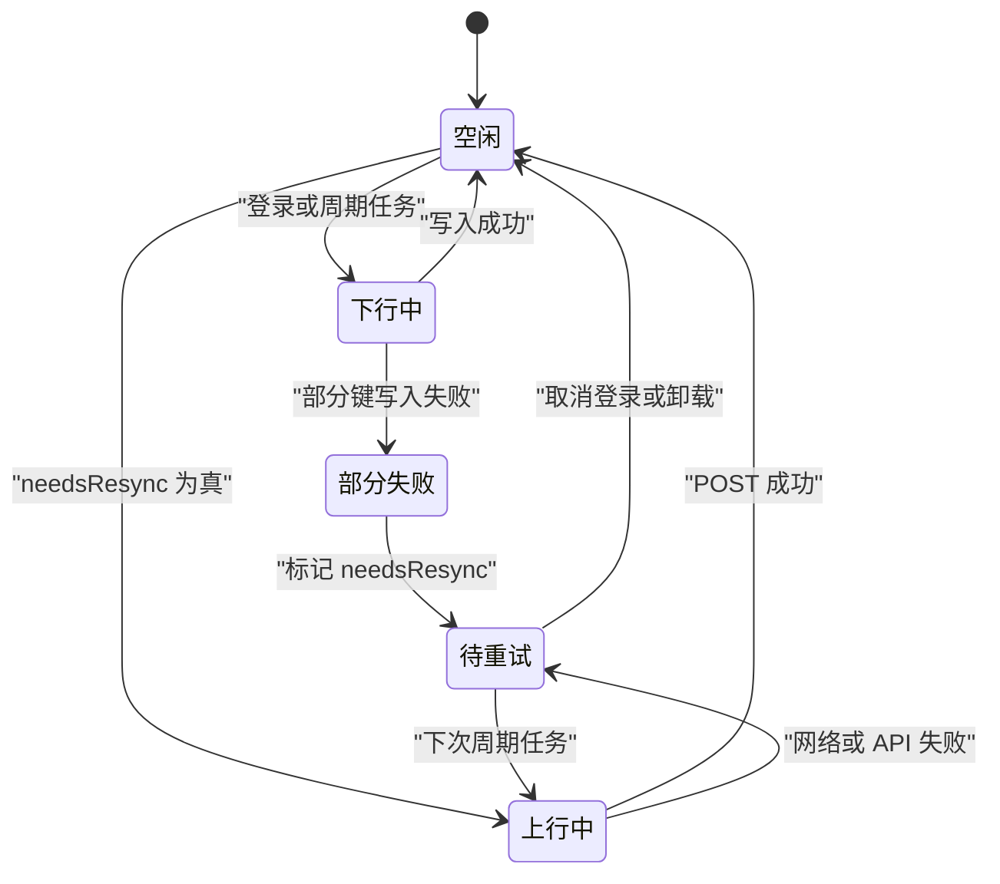
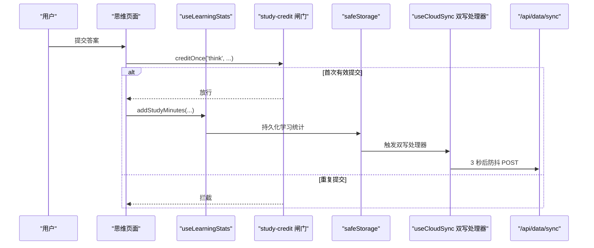
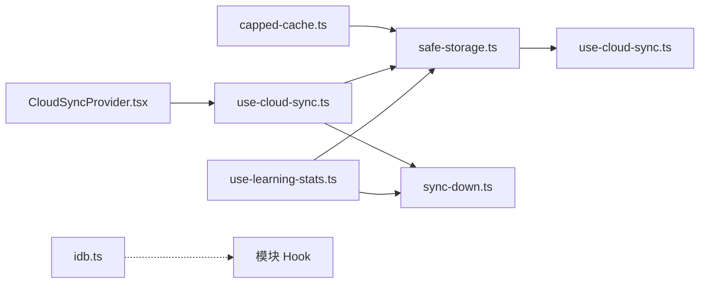

# 数据流设计

<cite>
**本文引用的文件**   
- [safe-storage.ts](file://src/lib/safe-storage.ts)
- [idb.ts](file://src/lib/idb.ts)
- [use-learning-stats.ts](file://src/lib/use-learning-stats.ts)
- [use-cloud-sync.ts](file://src/lib/use-cloud-sync.ts)
- [sync-down.ts](file://src/lib/sync-down.ts)
- [CloudSyncProvider.tsx](file://src/components/CloudSyncProvider.tsx)
- [capped-cache.ts](file://src/lib/capped-cache.ts)
- [storage-and-stats.md](file://docs/modules/storage-and-stats.md)
- [cloud-sync.md](file://docs/modules/cloud-sync.md)
- [think-in-english.md](file://docs/modules/think-in-english.md)
</cite>

## 目录

1. [引言](#引言)
2. [项目结构](#项目结构)
3. [核心组件](#核心组件)
4. [架构总览](#架构总览)
5. [详细组件分析](#详细组件分析)
6. [依赖关系分析](#依赖关系分析)
7. [性能考虑](#性能考虑)
8. [故障排查指南](#故障排查指南)
9. [结论](#结论)

## 引言

NativeThink 的数据层采用“本地优先”策略：用户学习数据以 `localStorage` 为权威源，通过 `safeStorage` 做带用户前缀的安全封装；大容量、不可重算或体积较大的缓存走 IndexedDB。云同步是“可选增强”，不改变本机数据的权威性。

本设计文档围绕以下目标展开：

- 明确 localStorage 与 IndexedDB 的职责边界。
- 解释学习统计的持久化、多实例广播和跨零点行为。
- 描述云同步的两条上行通道、下行落地与回声抑制机制。
- 给出从 UI 到 Hook 再到存储层的完整数据流向。
- 讨论批量写入、容量封顶、内存缓存失效和错误降级。

需要特别说明的是：当前代码库并没有实现一个显式的“Idle→Syncing→Conflict→Merging”四状态机。云同步更接近两条并行路径：**增量双写**（本地每次写入经防抖后 POST）和**全量补推**（登录时或周期任务触发），后端 KV 是覆盖式写入，没有冲突解决与合并阶段。

## 项目结构

与数据流直接相关的代码集中在 `src/lib` 下的几个模块：

| 文件 | 职责 | 关键概念 |
|---|---|---|
| `safe-storage.ts` | localStorage 安全封装、键前缀、迁移、双写钩子 | 应用前缀、用户前缀、匿名 ID、迁移键、`setCloudSyncHandler` |
| `idb.ts` | IndexedDB 封装，词库 KV 与视频媒体 store | `wordbank`、`media`、`idbGet/Set/Delete`、`idbMediaPut` |
| `use-learning-stats.ts` | 学习时长、连胜、模块进度、日历 | 权威读取、事件广播、跨零点、模块白名单 |
| `use-cloud-sync.ts` | 登录态驱动的上下行、增量双写、失败重试 | `syncUp`、`syncDown`、`flushPending`、回声守卫 |
| `sync-down.ts` | 统一的下行落地通知订阅器 | `onSyncDown`、`emitSyncDown`、`useSyncDown` |
| `CloudSyncProvider.tsx` | 把云同步接入认证生命周期 | 登录拉取再推送、5 分钟轮询、可见性节流 |
| `capped-cache.ts` | JSON 缓存读写、空间不足提示、FIFO 封顶 | `persistJson`、`cappedPut`、`appendCapped`、`warnStorageFull` |

**图表来源**
- [use-learning-stats.ts:1-40](file://src/lib/use-learning-stats.ts#L1-L40)
- [safe-storage.ts:160-200](file://src/lib/safe-storage.ts#L160-L200)
- [idb.ts:1-40](file://src/lib/idb.ts#L1-L40)
- [use-cloud-sync.ts:1-40](file://src/lib/use-cloud-sync.ts#L1-L40)
- [sync-down.ts:1-49](file://src/lib/sync-down.ts#L1-L49)
- [CloudSyncProvider.tsx:1-61](file://src/components/CloudSyncProvider.tsx#L1-L61)

**章节来源**
- [storage-and-stats.md:1-20](file://docs/modules/storage-and-stats.md#L1-L20)
- [cloud-sync.md:1-20](file://docs/modules/cloud-sync.md#L1-L20)

## 核心组件

### safeStorage：带用户隔离的 localStorage 封装

`safeStorage` 不是简单的 `window.localStorage` 代理，它负责三件事：

1. **键前缀隔离**：根据平台 `appId` 和用户 `userId` 生成 `__miaoda_<appId>_<userId>__:<key>`，独立运行时退化为基于匿名 ID 的全局前缀。
2. **历史迁移**：从旧格式 `__miaoda_<appId>__:<key>` 搬迁到新格式，并用已迁移集合去重。
3. **双写钩子**：登录后注册 `_cloudSyncHandler`，每次 `setItem` 或 `removeItem` 都尝试把变更通知给云同步模块。

键解析顺序如下：

**图表来源**
- [safe-storage.ts:25-44](file://src/lib/safe-storage.ts#L25-L44)
- [safe-storage.ts:60-100](file://src/lib/safe-storage.ts#L60-L100)
- [safe-storage.ts:120-140](file://src/lib/safe-storage.ts#L120-L140)
- [safe-storage.ts:160-200](file://src/lib/safe-storage.ts#L160-L200)

重要行为：

- `getItem` 会先尝试迁移旧键，然后返回带前缀的值。
- `setItem` 捕获配额满等异常，返回 `true` 或 `false`，让调用方知道写入是否真正落盘。
- `removeItem` 同时清理新旧格式键，并通过双写处理器传播删除，避免云端残留数据被后续下行重新拉回。
- 匿名 ID 有自愈逻辑：引导键丢失时能从已有键名反解恢复，防止历史数据“隐身”。

**章节来源**
- [safe-storage.ts:1-216](file://src/lib/safe-storage.ts#L1-L216)
- [storage-and-stats.md:20-55](file://docs/modules/storage-and-stats.md#L20-L55)

### IndexedDB：大容量缓存与媒体资产

`idb.ts` 提供两个对象存储：

| 存储 | keyPath | 用途 |
|---|---|---|
| `wordbank` | `key` | 词库缓存、书籍全文、译文等 KV 型数据 |
| `media` | `id` | 视频精听元数据、字幕与媒体 blob |

关键特性：

- 数据库打开后会话内单例，避免重复创建。
- `withStore` 包装事务，以 `tx.oncomplete` 作为提交成功信号。
- media 操作全部走独立 store，避免词库缓存清理误删用户导入的视频。
- `idbMediaAll` 使用游标逐条收集轻量索引，不把几百 MB blob 一次性拉进内存。
- 所有失败分支尽量返回空值或 false，而不是抛出异常打断 UI。

**图表来源**
- [idb.ts:1-213](file://src/lib/idb.ts#L1-L213)

**章节来源**
- [idb.ts:1-213](file://src/lib/idb.ts#L1-L213)
- [storage-and-stats.md:90-110](file://docs/modules/storage-and-stats.md#L90-L110)

### 学习统计 Hook：权威本地源与多实例广播

`use-learning-stats.ts` 维护两类数据：

| 键 | 含义 |
|---|---|
| `__nativethink_learning_stats` | 连续天数、每日目标、今日时长、模块进度、累计天数、最后学习日期 |
| `__nativ8ncalendar` | 最近 30 天的打卡记录，包含日期、是否打卡、分钟数、涉及模块 |

核心规则：

- 权威读取始终来自 storage，而不是 React state。这样多个 tab 或组件实例之间不会因为内存过期互相覆盖。
- 写入后派发 `STATS_CHANGED_EVENT`，其他实例收到事件后重读 storage。
- 模块进度只允许白名单中的键，新增模块必须同步类型定义与前端展示。
- 一次计时可能影响四个地方：今日分钟数、进度环、日历打卡、连胜与累计天数。因此仓库用 `study-credit.ts` 的闸门保证同一动作不重复计费。
- 跨零点时重置今日时长，并根据昨天是否学习决定连胜增减。

**图表来源**
- [use-learning-stats.ts:1-40](file://src/lib/use-learning-stats.ts#L1-L40)
- [use-learning-stats.ts:200-326](file://src/lib/use-learning-stats.ts#L200-L326)

**章节来源**
- [use-learning-stats.ts:1-326](file://src/lib/use-learning-stats.ts#L1-L326)
- [storage-and-stats.md:55-90](file://docs/modules/storage-and-stats.md#L55-L90)
- [think-in-english.md:60-85](file://docs/modules/think-in-english.md#L60-L85)

### 云同步 Hook：增量双写与全量补推

`use-cloud-sync.ts` 暴露三个主要能力：

| 方法 | 作用 |
|---|---|
| `syncUp` | 扫描当前用户的 `safeStorage` 前缀，把 `__nativethink_*` 键上传至 `/api/data/sync` |
| `syncDown` | 从 `/api/data/sync` 拉取远端数据，逐个写入 `safeStorage`，然后派发下行事件 |
| `registerCloudWrite` | 注册 `safeStorage` 的双写处理器，将本地写入缓冲并 3 秒防抖后 POST |

两条上行通道的区别很重要：

| 通道 | 触发方式 | 键过滤 |
|---|---|---|
| 增量双写 | `safeStorage.setItem` | 不过滤键名前缀，任何经 safeStorage 的写入都会进入 pending |
| 全量补推 | `syncUp` 扫描 localStorage | 仅处理本用户前缀且键名为 `__nativethink_*` |

这意味着：如果某个业务键经过 safeStorage，即使没有 `__nativethink_` 前缀，也会通过增量双写上云；但全量补推不会把它补回去。

**章节来源**
- [use-cloud-sync.ts:1-191](file://src/lib/use-cloud-sync.ts#L1-L191)
- [cloud-sync.md:1-40](file://docs/modules/cloud-sync.md#L1-L40)

### 下行广播中心：单一出口

`sync-down.ts` 把“云数据已经落到 storage，请各 Hook 重读”这件事收成一个纯订阅模型：

- `onSyncDown(cb, target)` 在目标事件源上注册监听，返回退订函数。
- `emitSyncDown()` 由 `use-cloud-sync` 在下行成功后调用。
- `useSyncDown(cb)` 是 React Hook 适配层，闭包变化不会导致频繁退订订阅。
- 单个订阅者抛错不会影响其它订阅者。

目前已有约 15 个订阅者，包括收藏、学习统计、拼写句子库、单词学习、短语学习、自定义词汇、笔记、闪卡历史、句子复习、成就、自定义场景、TTS 设置、拼写学习、纠错笔记、思维模式等。

**章节来源**
- [sync-down.ts:1-49](file://src/lib/sync-down.ts#L1-L49)
- [cloud-sync.md:40-64](file://docs/modules/cloud-sync.md#L40-L64)

### 云同步 Provider：认证生命周期绑定

`CloudSyncProvider.tsx` 不负责具体同步逻辑，只负责时机：

| 时机 | 行为 |
|---|---|
| 登录成功 | 先 `syncDown`，再 `syncUp`，然后注册增量双写 |
| 每 5 分钟 | `syncDown`，仅在 `needsResync()` 为真时 `syncUp` |
| 页面可见 | 最多每分钟触发一次 `syncDown` |
| 登出 | 注销双写处理器并清空定时器 |

**章节来源**
- [CloudSyncProvider.tsx:1-61](file://src/components/CloudSyncProvider.tsx#L1-L61)
- [cloud-sync.md:10-25](file://docs/modules/cloud-sync.md#L10-L25)

### 容量封顶缓存：可重算与不可重算数据分离

`capped-cache.ts` 区分三类缓存策略：

| API | 适用数据 | 行为 |
|---|---|---|
| `persistJson` | 任意 JSON | 返回是否成功写入 |
| `cappedPut` | AI 派生、可重算 | FIFO 淘汰最旧条目 |
| `appendCapped` | 用户创作、不可重算 | 不裁剪已有项，超出上限只拒绝新增 |
| `trimOldest` | 滚动窗口历史 | 保最新，按条数和字节双重封顶 |

空间不足时会触发 60 秒去抖的用户提示，引导用户清理学习数据。

**章节来源**
- [capped-cache.ts:1-114](file://src/lib/capped-cache.ts#L1-L114)
- [storage-and-stats.md:95-138](file://docs/modules/storage-and-stats.md#L95-L138)

## 架构总览

下图展示了 NativeThink 从 UI 到存储层的主要数据流：

**图表来源**
- [use-learning-stats.ts:1-40](file://src/lib/use-learning-stats.ts#L1-L40)
- [use-cloud-sync.ts:1-191](file://src/lib/use-cloud-sync.ts#L1-L191)
- [sync-down.ts:1-49](file://src/lib/sync-down.ts#L1-L49)
- [CloudSyncProvider.tsx:1-61](file://src/components/CloudSyncProvider.tsx#L1-L61)
- [safe-storage.ts:160-200](file://src/lib/safe-storage.ts#L160-L200)
- [idb.ts:1-40](file://src/lib/idb.ts#L1-L40)
- [capped-cache.ts:1-40](file://src/lib/capped-cache.ts#L1-L40)

## 详细组件分析

### 本地优先的数据策略

本地优先意味着：

1. 用户打开页面时，首先读取本地 storage，即使网络不可用也能工作。
2. 云同步失败不会破坏本机数据；只有本地写入本身失败才会表现为“没存进去”。
3. 换设备时，云同步只是帮助恢复数据，不是数据来源。
4. 大体积或可重建数据优先走 IndexedDB，避免挤爆 localStorage 配额。

实际分工：

| 数据类型 | 存储位置 | 原因 |
|---|---|---|
| 学习统计、模块进度、日历 | localStorage via safeStorage | 小对象、高频读写、需跨实例同步 |
| 单词复习进度、断点、收藏、笔记 | localStorage via safeStorage | 用户状态，需要云同步 |
| 词库缓存、书籍全文、译文 | IndexedDB | 体积大，可离线复用 |
| AI 例句、搭配翻译、深度解析 | capped-cache + safeStorage | 可重算，FIFO 封顶 |
| 自建题目、自定义语块、跟读材料 | capped-cache + safeStorage | 不可重算，不裁剪已有项 |
| API Key | 裸 localStorage | 故意不上云 |

**章节来源**
- [storage-and-stats.md:1-20](file://docs/modules/storage-and-stats.md#L1-L20)
- [storage-and-stats.md:90-138](file://docs/modules/storage-and-stats.md#L90-L138)

### 多实例广播与回声抑制

多实例广播的核心是“storage 权威 + 事件驱动重读”：

- 任一实例写入后派发事件。
- 其他实例收到事件后重新从 safeStorage 读取。
- 重读结果如果与当前 state 相同，则不回写 storage，避免触发新一轮双写。

回声抑制出现在两个层面：

1. **学习统计内部**：同内容不回写，防止 `notifyChanged` 引发自身重读再写。
2. **云同步层**：`syncDown` 写入时使用 `applyingRemoteRef.current` 标记，双写处理器遇到该标记直接跳过，防止刚下载的云端数据又被 POST 回云端。

**图表来源**
- [use-cloud-sync.ts:20-60](file://src/lib/use-cloud-sync.ts#L20-L60)
- [use-cloud-sync.ts:90-110](file://src/lib/use-cloud-sync.ts#L90-L110)
- [safe-storage.ts:160-200](file://src/lib/safe-storage.ts#L160-L200)

**章节来源**
- [use-cloud-sync.ts:1-191](file://src/lib/use-cloud-sync.ts#L1-L191)
- [use-learning-stats.ts:200-326](file://src/lib/use-learning-stats.ts#L200-L326)

### 云同步状态与行为说明

虽然代码中没有显式 Idle→Syncing→Syncing→Conflict→Merging 的状态机，但现有行为可以归纳如下：

| 阶段 | 代码对应 | 说明 |
|---|---|---|
| 空闲 | `isAuthenticated` 为假或未登录 | 不执行同步 |
| 登录 | `CloudSyncProvider` 中登录回调 | 先下行再上行，注册双写 |
| 同步中 | `setSyncing(true/false)` | 表示当前 syncUp/syncDown 是否在执行 |
| 上行失败 | `flushPending.catch` | 保留 pending 并重试，标记 `needsResync` |
| 下行失败 | `syncDown catch` | 不影响本机数据，只提示暂未取回 |
| 单项写入失败 | `dropped > 0` | 可能是存储空间已满，标记需要补推 |
| 冲突 | 无显式冲突处理 | KV 是覆盖式写入，后写者赢 |
| 合并 | 无显式合并阶段 | 双写处理器对同键覆盖，pending 中后者覆盖前者 |

**图表来源**
- [use-cloud-sync.ts:20-110](file://src/lib/use-cloud-sync.ts#L20-L110)
- [CloudSyncProvider.tsx:15-61](file://src/components/CloudSyncProvider.tsx#L15-L61)

**章节来源**
- [cloud-sync.md:1-64](file://docs/modules/cloud-sync.md#L1-L64)
- [use-cloud-sync.ts:1-191](file://src/lib/use-cloud-sync.ts#L1-L191)

### 数据流向图：UI → Hook → 存储

以“思维训练提交答案”为例，典型路径如下：

**图表来源**
- [think-in-english.md:60-85](file://docs/modules/think-in-english.md#L60-L85)
- [use-learning-stats.ts:240-326](file://src/lib/use-learning-stats.ts#L240-L326)
- [safe-storage.ts:160-200](file://src/lib/safe-storage.ts#L160-L200)
- [use-cloud-sync.ts:90-110](file://src/lib/use-cloud-sync.ts#L90-L110)

### 错误处理与降级方案

系统有多层降级：

| 场景 | 处理方式 |
|---|---|
| localStorage 不可用或配额满 | `safeStorage.setItem` 返回 false，上层可判断并提示 |
| IndexedDB 不可用 | idb 方法返回 null 或 false，不调用方崩溃 |
| 云同步网络失败 | 保留 pending 重试，用户看到去抖提示 |
| 下行个别键写入失败 | 记录 dropped 数量，标记需要补推 |
| storage 解析失败 | 回退默认值或空结构 |
| 单个订阅者抛错 | 不影响其它订阅者 |
| API Key 不存在或 AI 失败 | 思维训练回落自评，不计撤销真实投入 |

**章节来源**
- [safe-storage.ts:160-200](file://src/lib/safe-storage.ts#L160-L200)
- [idb.ts:1-213](file://src/lib/idb.ts#L1-L213)
- [use-cloud-sync.ts:20-110](file://src/lib/use-cloud-sync.ts#L20-L110)
- [sync-down.ts:1-49](file://src/lib/sync-down.ts#L1-L49)
- [think-in-english.md:60-85](file://docs/modules/think-in-english.md#L60-L85)

## 依赖关系分析

**图表来源**
- [safe-storage.ts:160-200](file://src/lib/safe-storage.ts#L160-L200)
- [use-learning-stats.ts:1-40](file://src/lib/use-learning-stats.ts#L1-L40)
- [use-cloud-sync.ts:1-40](file://src/lib/use-cloud-sync.ts#L1-L40)
- [sync-down.ts:1-49](file://src/lib/sync-down.ts#L1-L49)
- [CloudSyncProvider.tsx:1-61](file://src/components/CloudSyncProvider.tsx#L1-L61)
- [capped-cache.ts:1-40](file://src/lib/capped-cache.ts#L1-L40)
- [idb.ts:1-40](file://src/lib/idb.ts#L1-L40)

耦合特点：

- `safeStorage` 是大多数业务 Hook 的共同依赖，属于高内聚基础能力。
- `sync-down.ts` 是唯一下行广播出口，降低事件名分散带来的维护风险。
- `use-cloud-sync.ts` 同时依赖 `safeStorage` 和 `sync-down`，是存储层与云端的桥梁。
- `CloudSyncProvider.tsx` 只依赖认证状态和 `useCloudSync`，职责清晰。

**章节来源**
- [storage-and-stats.md:90-138](file://docs/modules/storage-and-stats.md#L90-L138)
- [cloud-sync.md:1-64](file://docs/modules/cloud-sync.md#L1-L64)

## 性能考虑

### 缓存策略

- 小体积、高频、需要同步的用户状态走 safeStorage。
- 大体积数据走 IndexedDB，避免阻塞主线程和挤占 localStorage。
- AI 派生缓存用 capped-cache 的 FIFO 策略，避免无限增长。
- 用户创作数据用 appendCapped，绝不替用户删除已有作品。
- 滚动历史用 trimOldest，同时限制条数和字节大小。

### 批量操作

- 云同步增量写入使用 pending 缓冲，3 秒防抖后再合并 POST。
- 删除与新增同键会抵消，避免重复上传。
- 全量补推只在登录首次或 `needsResync` 为真时执行，不再无条件每 5 分钟上传全部数据。

### 内存管理

- IndexedDB 的 media 列表使用游标遍历，不把整个媒体库加载进内存。
- 模块级缓存如自定义词汇、笔记、闪卡历史在云同步后主动作废，避免陈旧内存覆盖云端新值。
- 学习统计重读后若内容与 state 一致，不回写 storage，减少重复 IO。

### 并发与竞态

- 长任务结束后应使用函数式 setState，避免写入陈旧快照。
- 多个异步写路径需要通过守卫标志位互斥，特别是“挂载即写”的场景。
- 云同步下行期间禁止双写上行，防止回声。

**章节来源**
- [idb.ts:40-120](file://src/lib/idb.ts#L40-L120)
- [capped-cache.ts:1-114](file://src/lib/capped-cache.ts#L1-L114)
- [use-cloud-sync.ts:20-110](file://src/lib/use-cloud-sync.ts#L20-L110)
- [storage-and-stats.md:95-138](file://docs/modules/storage-and-stats.md#L95-L138)

## 故障排查指南

### 现象：刷新后学习数据消失

可能原因：

1. 浏览器隐私模式或 WebView 清掉了 localStorage。
2. 匿名用户 ID 引导键丢失，历史数据“隐身”。
3. 平台登录后前缀变化，但会话内前缀缓存未刷新。
4. 存储空间已满，`safeStorage.setItem` 静默失败。

排查建议：

- 确认数据是否走 safeStorage。
- 检查浏览器 localStorage 中是否存在带 `__miaoda_` 前缀的键。
- 查看 `safeStorage.setItem` 返回值。
- 如果是重装 APK 后丢失，优先使用导出备份或云同步。

**章节来源**
- [safe-storage.ts:25-44](file://src/lib/safe-storage.ts#L25-L44)
- [storage-and-stats.md:20-55](file://docs/modules/storage-and-stats.md#L20-L55)
- [storage-and-stats.md:130-138](file://docs/modules/storage-and-stats.md#L130-L138)

### 现象：换设备后进度没同步

可能原因：

1. 数据没有经过 safeStorage，而是裸 localStorage。
2. 数据在 IndexedDB，而 IndexedDB 不同步。
3. 键没有 `__nativethink_` 前缀，全量补推漏掉，但增量双写可能仍已上传。
4. 用户未登录，或登录前后前缀发生变化。

排查建议：

- 确认数据来源：safeStorage、localStorage、还是 IndexedDB。
- 确认是否登录并触发过 `syncDown`。
- 检查 `/api/data/sync` 的上行负载。
- 注意 API Key 是故意裸 localStorage 存储，不上云。

**章节来源**
- [storage-and-stats.md:100-130](file://docs/modules/storage-and-stats.md#L100-L130)
- [cloud-sync.md:20-40](file://docs/modules/cloud-sync.md#L20-L40)
- [cloud-sync.md:55-64](file://docs/modules/cloud-sync.md#L55-L64)

### 现象：登录后周期性大量上传

可能原因：

- 回声抑制被破坏，导致下行写入再次触发双写处理器。
- 订阅者在云同步回调中读到陈旧缓存，把旧值写回 storage，再上行。
- `needsResync` 引用不稳定，导致周期任务频繁重建。

排查建议：

- 检查 `applyingRemoteRef` 是否正确包裹下行写入。
- 检查订阅者是否在回调中作废模块缓存。
- 检查 provider 中 `needsResync` 是否来自稳定引用。

**章节来源**
- [use-cloud-sync.ts:20-110](file://src/lib/use-cloud-sync.ts#L20-L110)
- [cloud-sync.md:40-55](file://docs/modules/cloud-sync.md#L40-L55)

### 现象：存储空间不足

可能原因：

- AI 例句、自定义语料、拼写句子库等累积过多。
- 用户未清理旧数据。
- 某些 ROM 的 WebView 对 localStorage 配额更严格。

处理建议：

- 使用 capped-cache 的封顶 API。
- 显示 `warnStorageFull` 提示，引导用户清理学习数据。
- 对不可重算数据使用 appendCapped，不裁剪已有项。
- 重要数据走云同步或导出备份。

**章节来源**
- [capped-cache.ts:1-114](file://src/lib/capped-cache.ts#L1-L114)
- [storage-and-stats.md:110-138](file://docs/modules/storage-and-stats.md#L110-L138)

## 结论

NativeThink 的数据流设计以本地存储为核心，cloud sync 作为辅助恢复手段。其关键设计原则是：

1. **本地优先**：功能可用性不依赖网络。
2. **存储分层**：localStorage 放用户状态，IndexedDB 放大体积数据。
3. **权威源唯一**：storage 是 truth source，UI 通过 hook 订阅并重读。
4. **广播而非共享引用**：多实例通过事件重读，避免陈旧内存覆盖。
5. **回声抑制**：下行写入期间禁止双写上行。
6. **失败可见**：存储空间不足和网络失败都有去抖提示。
7. **容量可控**：AI 缓存 FIFO 淘汰，用户数据不裁剪，滚动历史双封顶。

需要注意的是，当前实现并不存在显式的 Conflict→Merging 云同步状态机。真正的冲突语义是“后写者胜”，因此跨设备并行编辑仍然存在数据覆盖风险。未来若需要更强的多端一致性，应在 KV 层引入版本戳、操作日志或三方合并策略，但目前系统的正确预期是：云同步用于换设备恢复，而不是实时协作。