# 整体架构概览

<cite>
**本文引用的文件**   
- [src/index.tsx](file://src/index.tsx)
- [src/app.tsx](file://src/app.tsx)
- [vite.config.ts](file://vite.config.ts)
- [wrangler.toml](file://wrangler.toml)
- [capacitor.config.json](file://capacitor.config.json)
- [package.json](file://package.json)
- [scripts/build.sh](file://scripts/build.sh)
- [src/lib/api-client.ts](file://src/lib/api-client.ts)
- [src/lib/auth-provider.tsx](file://src/lib/auth-provider.tsx)
- [src/lib/safe-storage.ts](file://src/lib/safe-storage.ts)
- [src/lib/idb.ts](file://src/lib/idb.ts)
- [src/lib/use-cloud-sync.ts](file://src/lib/use-cloud-sync.ts)
- [src/components/CloudSyncProvider.tsx](file://src/components/CloudSyncProvider.tsx)
- [functions/api/data/sync.js](file://functions/api/data/sync.js)
- [functions/api/auth/me.js](file://functions/api/auth/me.js)
</cite>

## 目录

1. [引言](#引言)
2. [项目结构](#项目结构)
3. [核心组件](#核心组件)
4. [系统架构总览](#系统架构总览)
5. [应用启动流程](#应用启动流程)
6. [路由注册机制](#路由注册机制)
7. [构建与多形态产物](#构建与多形态产物)
8. [本地存储优先的数据策略](#本地存储优先的数据策略)
9. [认证与 Cloudflare KV 同步](#认证与-cloudflare-kv-同步)
10. [依赖关系分析](#依赖关系分析)
11. [性能与可维护性要点](#性能与可维护性要点)
12. [故障排查指南](#故障排查指南)
13. [结论](#结论)

## 引言

NativeThink 是一个面向英语母语思维训练的 React 单页应用。它采用“前端 SPA + Cloudflare Pages Functions 后端 + 本地存储优先”的三层架构，同时为浏览器、Electron 桌面端和 Capacitor APK 提供同一份 Web 产物。

核心设计原则如下：

- **前端是唯一的运行界面**：React + Vite 构建出的静态资源在三种宿主中复用。
- **本地数据是第一优先级**：用户学习进度、词汇、笔记等数据默认落在浏览器 `localStorage` 或 `IndexedDB`；云端只作为备份和多设备同步层。
- **认证与同步走 Cloudflare KV**：登录态通过 JWT 传递，KV 命名空间按用户隔离键名，避免跨用户数据泄漏。
- **容错优先**：原生 TTS 引擎崩溃会降级，全局错误边界保护页面，云同步失败仅提示并保留本机数据。

## 项目结构

仓库采用按职责分层的组织方式：

| 目录 | 职责 | 关键产物 |
|---|---|---|
| `src/` | React 前端源码 | SPA 入口、路由、页面、状态 Provider、工具库 |
| `functions/` | Cloudflare Pages Functions 后端 | 认证、数据同步、AI、TTS、外部数据接口 |
| `android/` | Capacitor Android 工程 | APK 打包所需 Gradle 配置与原生桥接 |
| `electron/` | Electron 主进程入口 | 桌面端包装逻辑 |
| `scripts/` | 构建、数据生成、验证脚本 | 统一打包、版本管理、APK 打包 |
| `shared/` | 跨平台共享能力与静态资源 | 能力声明、离线文档、图片等 |
| `public/` | 公共静态资源 | 内置书籍文本、字体、翻译资源 |
| `server/` | 本地开发辅助服务 | 本地 API 模拟与服务 |
| `docs/` | 项目文档与研究资料 | 模块说明、研究方案、迁移记录 |

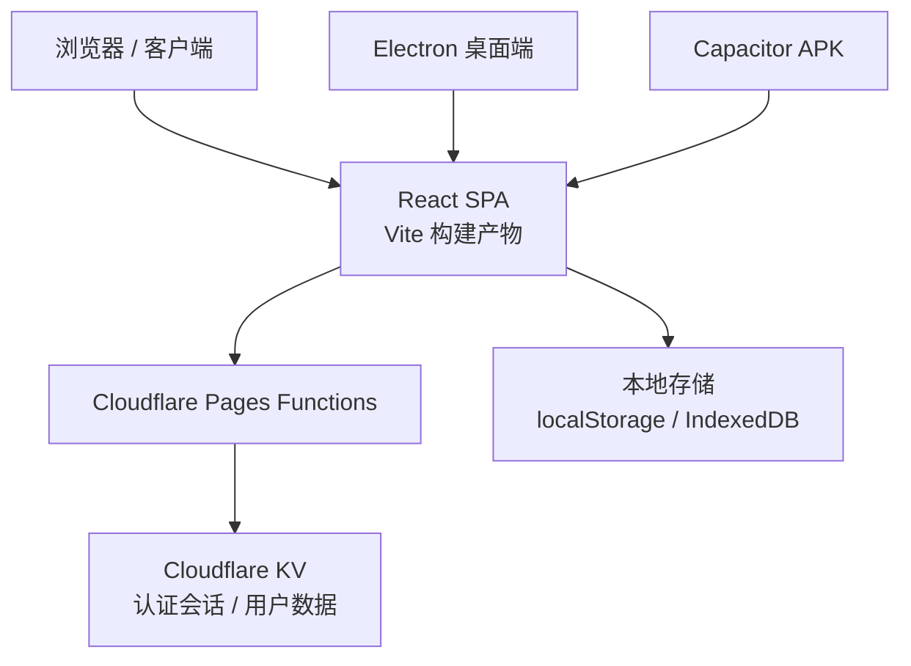

**图示来源**
- [package.json:1-130](file://package.json#L1-L130)
- [capacitor.config.json:1-11](file://capacitor.config.json#L1-L11)
- [wrangler.toml:1-9](file://wrangler.toml#L1-L9)

**章节来源**
- [package.json:1-130](file://package.json#L1-L130)
- [capacitor.config.json:1-11](file://capacitor.config.json#L1-L11)
- [wrangler.toml:1-9](file://wrangler.toml#L1-L9)

## 核心组件

### 前端运行时层

| 组件 | 作用 | 关键行为 |
|---|---|---|
| `src/index.tsx` | 应用根入口 | 健康检查、涟漪事件委托、主题初始化、Provider 树挂载 |
| `src/app.tsx` | 路由装配层 | 13 个业务页面的懒加载与 ErrorBoundary 隔离 |
| `src/lib/auth-provider.tsx` | 认证上下文 | 登录、注册、登出、Token 持久化、会话校验 |
| `src/lib/api-client.ts` | 网络请求封装 | Bearer Token、超时、异常 JSON 解析 |
| `src/lib/safe-storage.ts` | 安全存储封装 | 按 appId/userId 前缀隔离 localStorage，支持云同步回调 |
| `src/lib/idb.ts` | IndexedDB 缓存 | 词库与视频精听媒体缓存 |
| `src/lib/use-cloud-sync.ts` | 双向同步 Hook | 本地到 KV 的上行、KV 到本地的下行、去抖合并 |
| `src/components/CloudSyncProvider.tsx` | 同步生命周期 | 登录时拉取再推送、每 5 分钟轮询、可见性变化触发 |

### 后端函数层

| 接口 | 路径 | 职责 |
|---|---|---|
| `/api/auth/login` | 登录 | 创建会话并返回 JWT |
| `/api/auth/register` | 注册 | 注册用户并返回 JWT |
| `/api/auth/me` | 当前用户 | 校验 Token 后返回用户信息 |
| `/api/data/sync` | 数据同步 | 批量上传/下载用户数据到 KV |
| 其他 API | `/api/*` | AI、TTS、B站字幕、维基、古腾堡等扩展功能 |

**章节来源**
- [src/index.tsx:1-123](file://src/index.tsx#L1-L123)
- [src/app.tsx:1-66](file://src/app.tsx#L1-L66)
- [src/lib/auth-provider.tsx:1-86](file://src/lib/auth-provider.tsx#L1-L86)
- [src/lib/api-client.ts:1-82](file://src/lib/api-client.ts#L1-L82)
- [src/lib/safe-storage.ts:1-200](file://src/lib/safe-storage.ts#L1-L200)
- [src/lib/idb.ts:1-200](file://src/lib/idb.ts#L1-L200)
- [src/lib/use-cloud-sync.ts:1-191](file://src/lib/use-cloud-sync.ts#L1-L191)
- [src/components/CloudSyncProvider.tsx:1-61](file://src/components/CloudSyncProvider.tsx#L1-L61)
- [functions/api/data/sync.js:1-63](file://functions/api/data/sync.js#L1-L63)
- [functions/api/auth/me.js:1-22](file://functions/api/auth/me.js#L1-L22)

## 系统架构总览

NativeThink 的整体系统由三个层次构成：

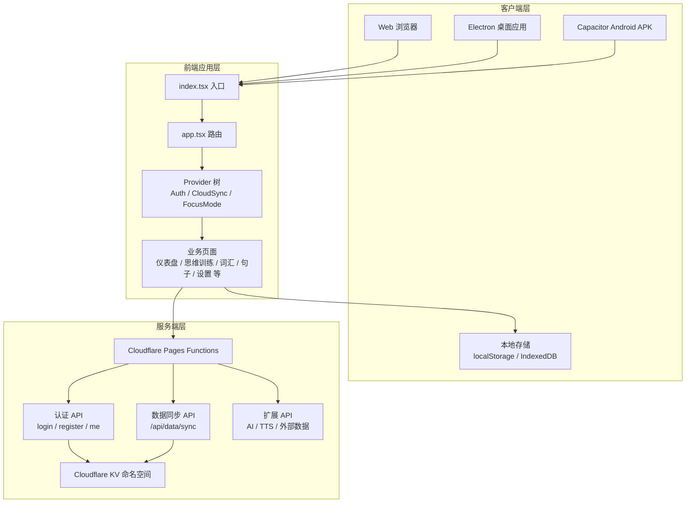

**图示来源**
- [src/index.tsx:1-123](file://src/index.tsx#L1-L123)
- [src/app.tsx:1-66](file://src/app.tsx#L1-L66)
- [src/lib/auth-provider.tsx:1-86](file://src/lib/auth-provider.tsx#L1-L86)
- [src/lib/use-cloud-sync.ts:1-191](file://src/lib/use-cloud-sync.ts#L1-L191)
- [functions/api/data/sync.js:1-63](file://functions/api/data/sync.js#L1-L63)
- [functions/api/auth/me.js:1-22](file://functions/api/auth/me.js#L1-L22)

## 应用启动流程

应用启动由 `src/index.tsx` 承担，其执行顺序对用户体验和稳定性非常关键：

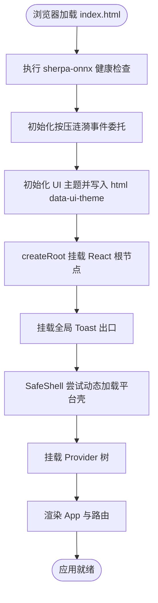

**图示来源**
- [src/index.tsx:1-123](file://src/index.tsx#L1-L123)

具体步骤如下：

1. **sherpa-onnx 健康检查**  
   内置朗读引擎基于原生代码，一旦崩溃可能直接终止进程。启动时会检查上次是否崩溃，若发现异常则自动停用该引擎，回退到系统或云端 TTS，避免反复闪退。

2. **涟漪事件委托初始化**  
   应用在全站约 306 处裸按钮上实现按压反馈。通过一处事件委托覆盖整个文档，而不是在每个按钮上绑定监听，从而减少内存占用并保持交互一致性。

3. **主题初始化**  
   在 React 挂载之前就把 `data-ui-theme` 写入 `<html>`，防止首帧出现默认主题闪烁。

4. **Platform Shell 安全外壳**  
   在非 miaoda 平台环境（Web、APK、Electron）直接渲染子树；在 miaoda 平台环境中动态导入 `@lark-apaas/client-toolkit-lite`，避免把平台 SDK 及其庞大依赖压入入口 chunk。

5. **Provider 树挂载**  
   依次挂载全局 Toast、庆祝动效层、专注模式、认证、云同步，最后用全局 `ErrorBoundary` 包裹 `App`。

6. **错误兜底**  
   全局错误边界提供一个无第三方依赖的简易错误页，包含刷新重试按钮。

**章节来源**
- [src/index.tsx:1-123](file://src/index.tsx#L1-L123)

## 路由注册机制

`src/app.tsx` 使用 React Router 注册 13 个业务页面，全部采用 `React.lazy` 动态导入：

| 路由 | 页面 | 用途 |
|---|---|---|
| `/` | DashboardPage | 仪表盘与学习概览 |
| `/think` | ThinkInEnglishPage | 母语思维训练 |
| `/chunks` | ChunkTrainingPage | 语块训练 |
| `/conversation` | ConversationPage | AI 对话 |
| `/shadowing` | ShadowingPage | 影子跟读 |
| `/articles` | ArticlePage | 文章阅读 |
| `/vocabulary` | DeepVocabularyPage | 词汇深度 |
| `/writing` | WritingPage | 写作练习 |
| `/progress` | ProgressPage | 学习记录 |
| `/favorites` | FavoritesPage | 我的收藏 |
| `/sentences` | SentenceLabPage | 句子学习 |
| `/spelling` | SpellingPage | 句子拼写 |
| `/video` | VideoLabPage | 视频精听 |
| 未匹配 | NotFoundPage | 404 占位 |

每个页面都包裹在自己的 `ErrorBoundary` 中，这样某个页面加载或渲染失败不会导致整个应用白屏。

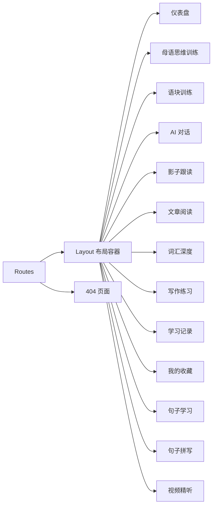

**图示来源**
- [src/app.tsx:1-66](file://src/app.tsx#L1-L66)

关键点：

- 所有页面都是懒加载，只有进入对应路由时才下载页面代码。
- 未匹配路由使用 `Suspense` 配合骨架占位，再套一层 `ErrorBoundary`。
- 每个页面级错误边界显示中文页面名称，便于用户定位问题。
- 外层还有一个全局 `ErrorBoundary`，用于捕获 Provider 或应用初始化阶段的异常。

**章节来源**
- [src/app.tsx:1-66](file://src/app.tsx#L1-L66)

## 构建与多形态产物

### 构建产物

Vite 构建输出到 `dist/client`，并通过 `scripts/build.sh` 处理不同部署目标：

| 部署形态 | 产物位置 | 说明 |
|---|---|---|
| Cloudflare Pages | `dist/client/` | SPA 路由需要 `404.html` 指向 `index.html` |
| Miaoda 平台 | `dist/output/` + `dist/output_resource/` + `dist/output_static/` | HTML、静态资源、私有静态资源拆分 |
| Capacitor APK | `dist/client/` | 由 `capacitor.config.json` 的 `webDir` 指定 |
| Electron 桌面 | `dist/client/` | 主进程加载本地静态资源 |

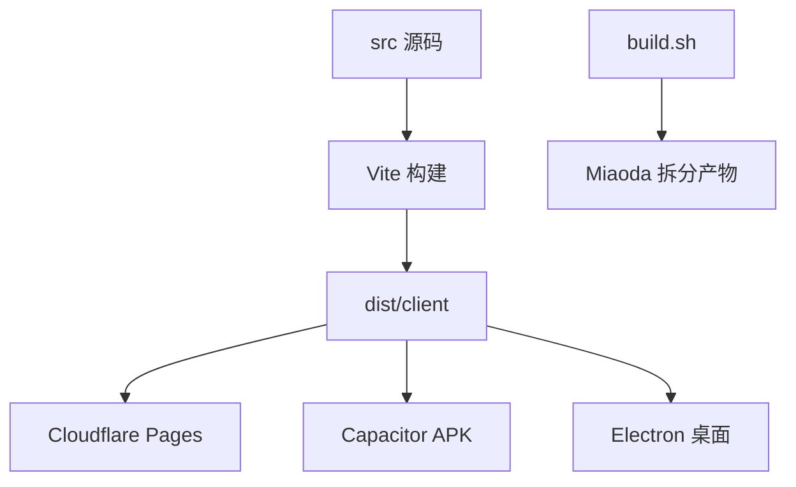

**图示来源**
- [vite.config.ts:1-200](file://vite.config.ts#L1-L200)
- [scripts/build.sh:1-69](file://scripts/build.sh#L1-L69)
- [capacitor.config.json:1-11](file://capacitor.config.json#L1-L11)
- [package.json:1-130](file://package.json#L1-L130)

### 环境变量与基础路径

- `CLIENT_BASE_PATH` 决定 Vite `base`：miaoda 平台下为 `/app/<appId>`，Cloudflare Pages 下为 `/`。
- `CF_PAGES=1` 跳过 miaoda 产物拆分，直接把 `dist/client` 作为最终部署目录。
- 工厂内置 API Key 从 `scripts/.apikey` 注入，构建期替换到客户端常量。
- 版本号优先读取 `android/version.properties`，否则退回 `package.json`。

### 开发代理

`vite.config.ts` 将 `/api/*` 代理到 `https://nativethink.pages.dev`，包括认证、数据同步、AI、TTS、B站字幕、维基百科、古腾堡等资源。

**章节来源**
- [vite.config.ts:1-200](file://vite.config.ts#L1-L200)
- [scripts/build.sh:1-69](file://scripts/build.sh#L1-L69)
- [capacitor.config.json:1-11](file://capacitor.config.json#L1-L11)
- [package.json:1-130](file://package.json#L1-L130)

## 本地存储优先的数据策略

NativeThink 的数据策略是：**本地读写永远优先，云端只做备份与同步**。

### 存储分层

| 层级 | 技术 | 用途 |
|---|---|---|
| 第一层 | `localStorage` | 轻量配置、用户偏好、短期状态 |
| 第二层 | `safe-storage` | 带 appId/userId 前缀的 `localStorage` 封装 |
| 第三层 | `IndexedDB` | 大体积词库缓存、视频精听媒体与字幕 |
| 第四层 | Cloudflare KV | 多设备同步备份 |

### safe-storage 的关键特性

- **密钥前缀隔离**：格式为 `__miaoda_<appId>_<userId>__:<key>`，保证同域下不同应用、不同用户互不干扰。
- **匿名身份恢复**：如果引导键丢失，会从既有键名中恢复匿名 ID，避免历史数据看起来像被清空。
- **云同步回调钩子**：每次 `setItem` 或 `removeItem` 成功后，可触发注册的云同步处理器。
- **返回值明确化**：`setItem` 返回是否真正写入，让调用方区分“存下了”和“因配额满静默丢了”。

### IndexedDB 数据模型

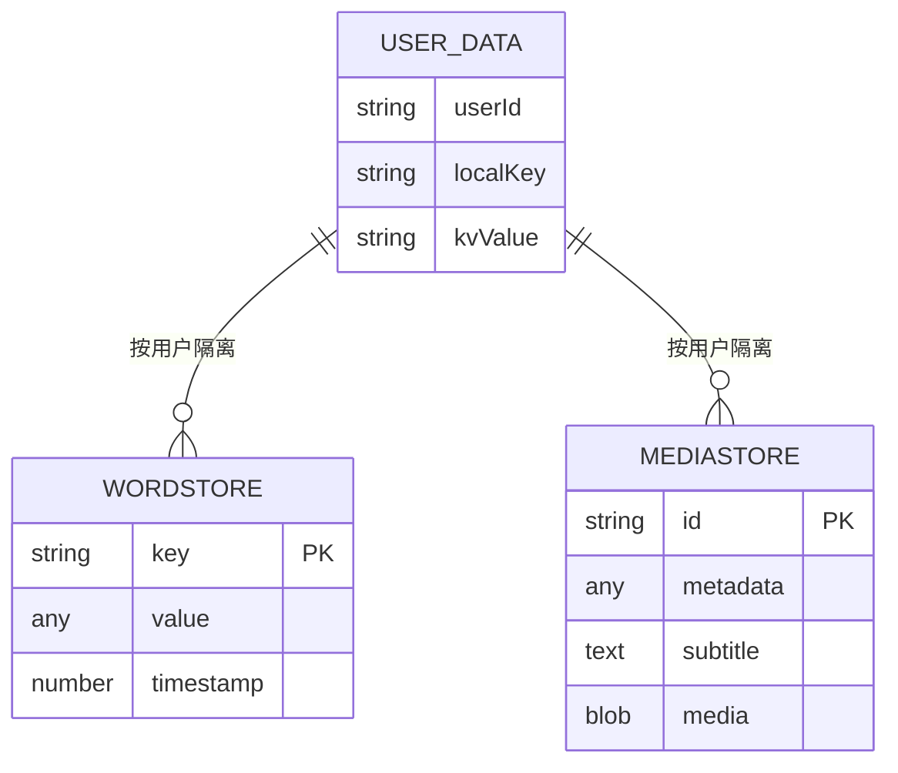

**图示来源**
- [src/lib/idb.ts:1-200](file://src/lib/idb.ts#L1-L200)
- [src/lib/safe-storage.ts:1-200](file://src/lib/safe-storage.ts#L1-L200)

**章节来源**
- [src/lib/safe-storage.ts:1-200](file://src/lib/safe-storage.ts#L1-L200)
- [src/lib/idb.ts:1-200](file://src/lib/idb.ts#L1-L200)

## 认证与 Cloudflare KV 同步

### 认证流程

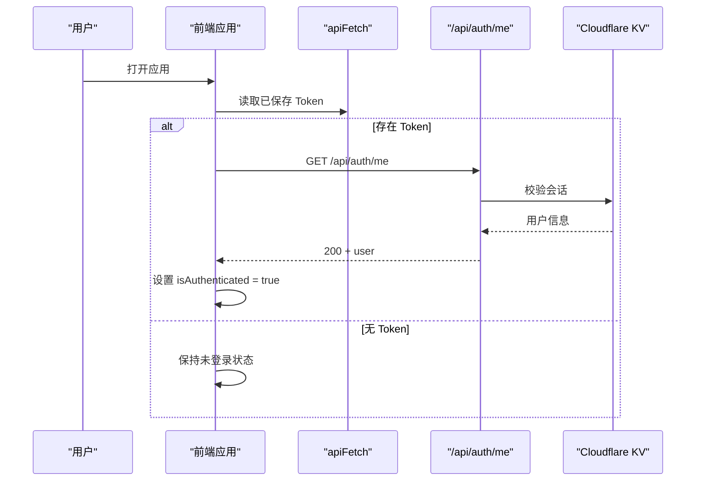

**图示来源**
- [src/lib/auth-provider.tsx:1-86](file://src/lib/auth-provider.tsx#L1-L86)
- [functions/api/auth/me.js:1-22](file://functions/api/auth/me.js#L1-L22)

### 数据同步流程

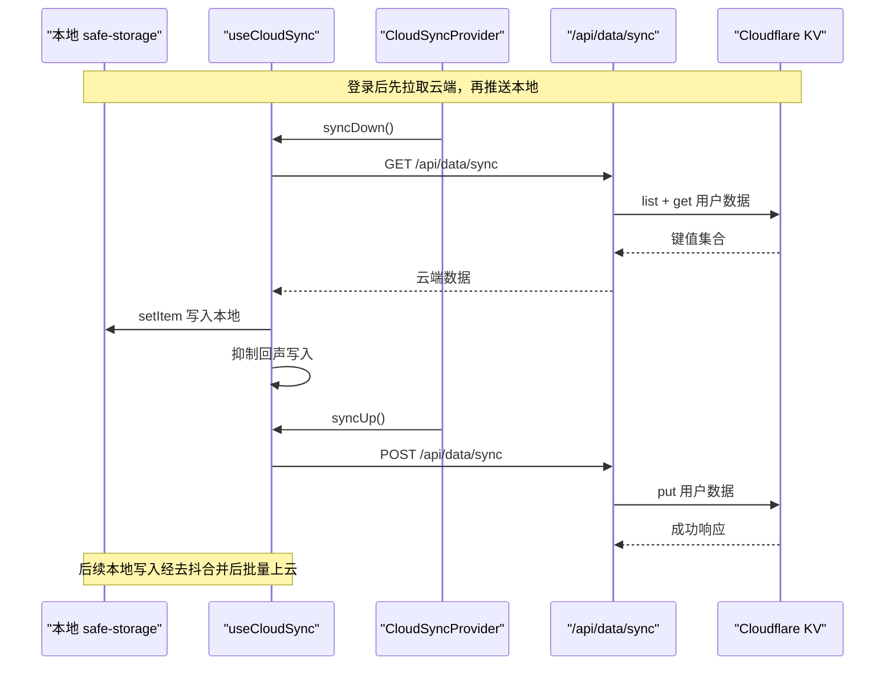

**图示来源**
- [src/lib/use-cloud-sync.ts:1-191](file://src/lib/use-cloud-sync.ts#L1-L191)
- [src/components/CloudSyncProvider.tsx:1-61](file://src/components/CloudSyncProvider.tsx#L1-L61)
- [functions/api/data/sync.js:1-63](file://functions/api/data/sync.js#L1-L63)

### 同步策略细节

| 行为 | 策略 |
|---|---|
| 登录时同步 | 先 `syncDown` 拉取云端，再 `syncUp` 推送本地缺失项 |
| 本地写入 | 通过 `setCloudSyncHandler` 注册双写回调 |
| 上行合并 | 3 秒去抖，upsert 与 delete 合并，删除后重新写入保留 upsert |
| 下行写入 | 设置 `applyingRemoteRef` 抑制回声，避免刚下载的云端数据又推回去 |
| 周期轮询 | 每 5 分钟拉取云端，仅在有过失败或未落云写入时补推 |
| 可见性变化 | 回到前台最多每分钟触发一次下行 |
| 离线恢复 | 失败时把待写入数据合并回 pending，下次可用时重试 |

### KV 数据模型

KV 中按用户隔离数据键：

- 键前缀由 `userDataKey(session.userId, key)` 生成。
- 上传时逐条 `put` upsert 对象，逐条 `delete` 删除数组中的键。
- 下载时先 `list({ prefix })`，再逐个 `get` 还原键值映射。
- 如果 KV 绑定未配置，接口返回 500 并提示“存储服务未配置”。

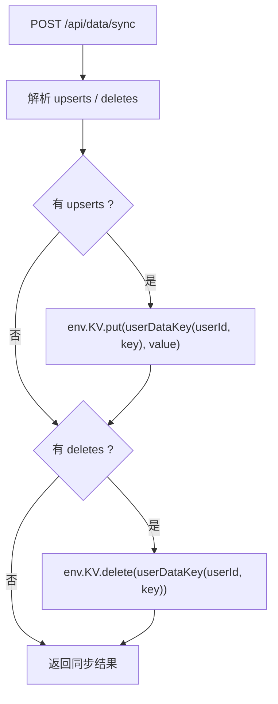

**图示来源**
- [functions/api/data/sync.js:1-63](file://functions/api/data/sync.js#L1-L63)

**章节来源**
- [src/lib/auth-provider.tsx:1-86](file://src/lib/auth-provider.tsx#L1-L86)
- [src/lib/api-client.ts:1-82](file://src/lib/api-client.ts#L1-L82)
- [src/lib/use-cloud-sync.ts:1-191](file://src/lib/use-cloud-sync.ts#L1-L191)
- [src/components/CloudSyncProvider.tsx:1-61](file://src/components/CloudSyncProvider.tsx#L1-L61)
- [functions/api/auth/me.js:1-22](file://functions/api/auth/me.js#L1-L22)
- [functions/api/data/sync.js:1-63](file://functions/api/data/sync.js#L1-L63)
- [wrangler.toml:1-9](file://wrangler.toml#L1-L9)

## 依赖关系分析

### 前端内部依赖

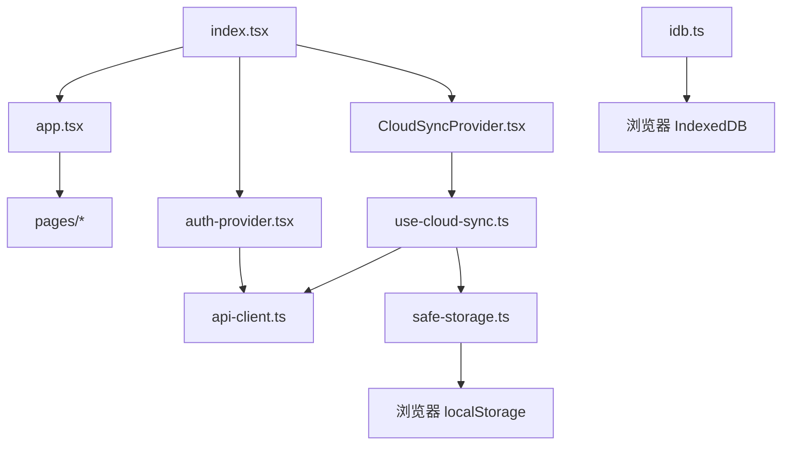

**图示来源**
- [src/index.tsx:1-123](file://src/index.tsx#L1-L123)
- [src/app.tsx:1-66](file://src/app.tsx#L1-L66)
- [src/lib/auth-provider.tsx:1-86](file://src/lib/auth-provider.tsx#L1-L86)
- [src/lib/use-cloud-sync.ts:1-191](file://src/lib/use-cloud-sync.ts#L1-L191)
- [src/lib/safe-storage.ts:1-200](file://src/lib/safe-storage.ts#L1-L200)
- [src/lib/idb.ts:1-200](file://src/lib/idb.ts#L1-L200)

### 前后端通信依赖

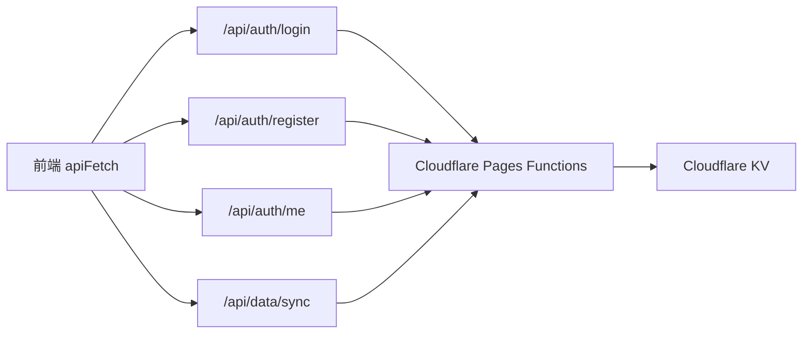

**图示来源**
- [src/lib/api-client.ts:1-82](file://src/lib/api-client.ts#L1-L82)
- [functions/api/auth/me.js:1-22](file://functions/api/auth/me.js#L1-L22)
- [functions/api/data/sync.js:1-63](file://functions/api/data/sync.js#L1-L63)

**章节来源**
- [src/index.tsx:1-123](file://src/index.tsx#L1-L123)
- [src/app.tsx:1-66](file://src/app.tsx#L1-L66)
- [src/lib/api-client.ts:1-82](file://src/lib/api-client.ts#L1-L82)

## 性能与可维护性要点

### 构建优化

- React 和 React Router 被拆成独立 vendor chunk，减少重复加载。
- miaoda 平台专属的 `@lark-apaas/client-toolkit-lite` 改为动态 import，非平台环境不进入入口包。
- Vite dev server 忽略 `android/`、`release/`、`models-bundled/` 等大目录，避免热更新阻塞。
- 开发模式下启用 COOP/COEP 头，有利于多线程 WASM 和本地小模型并行推理。

### 同步性能

- 本地写入通过 3 秒去抖批量上云，避免每条变更都发起一次网络请求。
- 下行写入期间禁用双写回调，消除“回声同步”导致的无效往返。
- 周期同步只在确有未落云写入时补推，避免无条件整份上传。
- 同步失败提示限制频率，避免后台任务频繁弹出 toast。

### 可维护性

- 每个页面独立 ErrorBoundary，故障隔离粒度细。
- 全局错误边界提供无依赖兜底页，适合 Electron、APK 等受限环境。
- safe-storage 将用户隔离逻辑集中管理，新增页面无需关心前缀规则。
- 同步逻辑集中在 `use-cloud-sync.ts`，生命周期由 `CloudSyncProvider.tsx` 统一管理。

[本节为通用指导，不直接分析具体代码片段]

## 故障排查指南

### 启动阶段问题

| 现象 | 可能原因 | 排查方向 |
|---|---|---|
| 应用启动后立即闪退 | sherpa-onnx 原生引擎崩溃 | 检查健康检查是否自动停用内置引擎 |
| 按钮没有按压效果 | 涟漪事件委托未初始化 | 确认 `initPressFx()` 在 `createRoot` 之前执行 |
| 首帧主题闪烁 | 主题未提前写入 | 确认 `initUiTheme()` 在 React 挂载前执行 |
| 平台壳加载失败 | miaoda SDK 动态导入失败 | 检查 `SafeShell` 是否回退到直接渲染 |

**章节来源**
- [src/index.tsx:1-123](file://src/index.tsx#L1-L123)

### 路由与页面问题

| 现象 | 可能原因 | 排查方向 |
|---|---|---|
| 某个页面白屏但其他页面正常 | 页面级 ErrorBoundary 捕获异常 | 查看页面级错误边界提示 |
| 未匹配路由不显示 404 | 路由未正确注册 | 检查 `app.tsx` 中 `*` 路由 |
| 首次进入页面卡顿 | 懒加载模块体积过大 | 检查页面依赖和分包策略 |

**章节来源**
- [src/app.tsx:1-66](file://src/app.tsx#L1-L66)

### 认证问题

| 现象 | 可能原因 | 排查方向 |
|---|---|---|
| 登录后仍显示未登录 | Token 未持久化或过期 | 检查 `api-client.ts` 中 Token 读取与设置 |
| `/api/auth/me` 返回未授权 | KV 中会话不存在或损坏 | 检查后端 `authenticate` 逻辑 |
| 离线时无法验证会话 | 网络不可达 | 前端会在 catch 中保持已有 token 状态 |

**章节来源**
- [src/lib/auth-provider.tsx:1-86](file://src/lib/auth-provider.tsx#L1-L86)
- [src/lib/api-client.ts:1-82](file://src/lib/api-client.ts#L1-L82)
- [functions/api/auth/me.js:1-22](file://functions/api/auth/me.js#L1-L22)

### 云同步问题

| 现象 | 可能原因 | 排查方向 |
|---|---|---|
| 登录后数据来回搬运 | 下行写入触发了双写回调 | 检查 `applyingRemoteRef` 是否生效 |
| 云端有数据但本地缺项 | 本地存储空间已满 | 查看下行写入 dropped 计数和警告提示 |
| 离线修改后未上云 | 网络失败，待写入仍在 pending | 检查去抖队列和网络恢复后的重试 |
| 同步接口返回 500 | KV 绑定未配置 | 检查 `wrangler.toml` 中 KV namespace |

**章节来源**
- [src/lib/use-cloud-sync.ts:1-191](file://src/lib/use-cloud-sync.ts#L1-L191)
- [src/components/CloudSyncProvider.tsx:1-61](file://src/components/CloudSyncProvider.tsx#L1-L61)
- [functions/api/data/sync.js:1-63](file://functions/api/data/sync.js#L1-L63)
- [wrangler.toml:1-9](file://wrangler.toml#L1-L9)

### 构建与部署问题

| 现象 | 可能原因 | 排查方向 |
|---|---|---|
| Cloudflare Pages 路由失效 | 缺少 `404.html` | 检查 `scripts/build.sh` 是否复制 index.html |
| APK 找不到 Web 资源 | `webDir` 配置不正确 | 检查 `capacitor.config.json` |
| 移动端跨域失败 | CORS 未配置 | 检查 Functions 的 CORS 中间件 |
| 版本链断裂 | 读不到 `version.properties` | 检查构建脚本报错信息 |

**章节来源**
- [scripts/build.sh:1-69](file://scripts/build.sh#L1-L69)
- [capacitor.config.json:1-11](file://capacitor.config.json#L1-L11)

## 结论

NativeThink 的架构以“前端 SPA + Cloudflare Pages Functions + 本地存储优先”为核心，形成清晰的分层：

- **前端层**负责 UI、路由、状态和与本地存储的交互；
- **后端层**只承担必要的认证、数据同步和扩展 API；
- **存储层**以本地为主，云端为辅，确保离线可用性和多设备一致性。

这套设计使同一份 React 应用能够同时服务于浏览器、Electron 和 Capacitor APK，同时通过 ErrorBoundary、健康检查、去抖同步和明确的错误提示提升鲁棒性。未来新增功能时，应遵循现有约定：页面懒加载、本地优先写入、云端异步同步、错误边界隔离。

[本节为总结性内容，不直接分析具体代码片段]