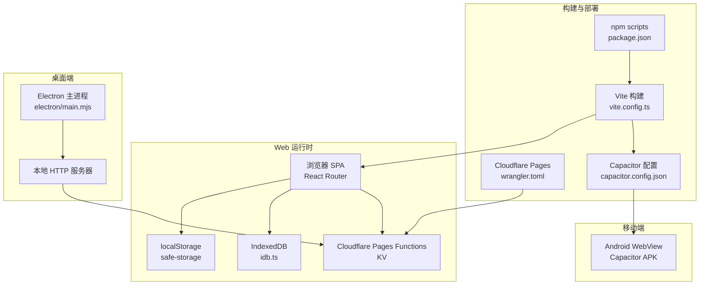
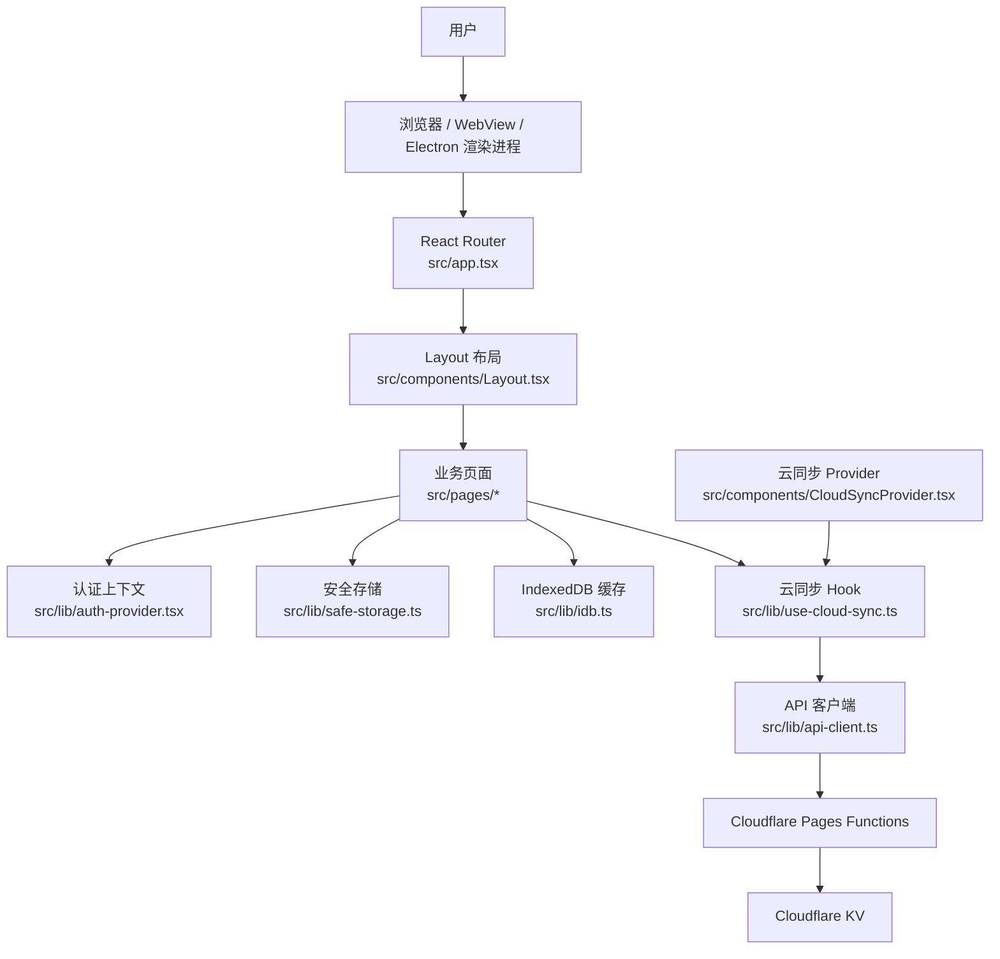
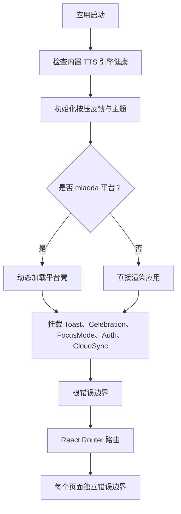
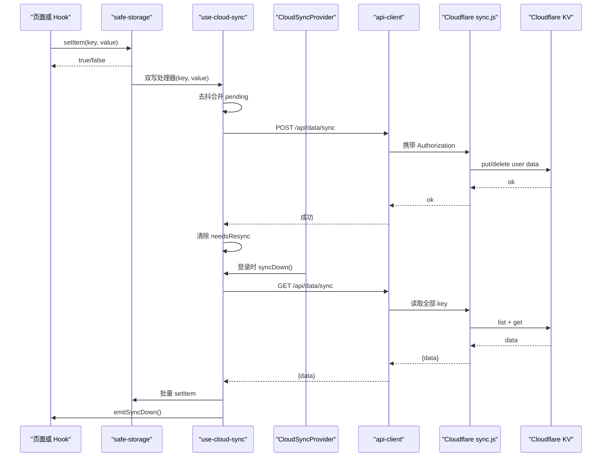
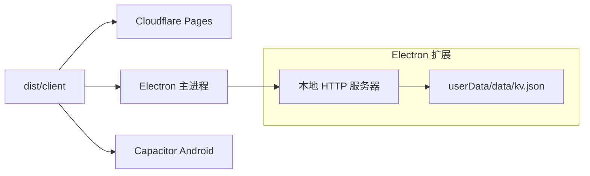
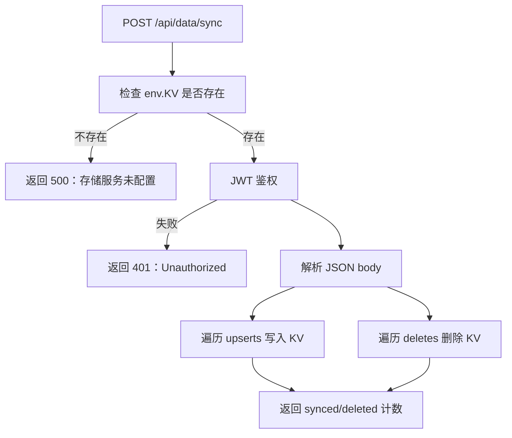
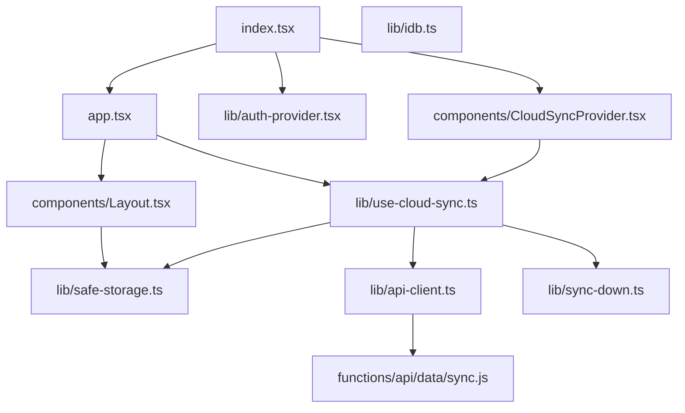

# 架构设计与核心概念

<cite>
**本文引用的文件**   
- [package.json](file://package.json)
- [vite.config.ts](file://vite.config.ts)
- [wrangler.toml](file://wrangler.toml)
- [capacitor.config.json](file://capacitor.config.json)
- [src/index.tsx](file://src/index.tsx)
- [src/app.tsx](file://src/app.tsx)
- [src/components/Layout.tsx](file://src/components/Layout.tsx)
- [src/lib/api-client.ts](file://src/lib/api-client.ts)
- [src/lib/auth-provider.tsx](file://src/lib/auth-provider.tsx)
- [src/lib/safe-storage.ts](file://src/lib/safe-storage.ts)
- [src/lib/idb.ts](file://src/lib/idb.ts)
- [src/lib/use-cloud-sync.ts](file://src/lib/use-cloud-sync.ts)
- [src/components/CloudSyncProvider.tsx](file://src/components/CloudSyncProvider.tsx)
- [src/lib/sync-down.ts](file://src/lib/sync-down.ts)
- [functions/api/data/sync.js](file://functions/api/data/sync.js)
- [functions/_lib/kv.js](file://functions/_lib/kv.js)
- [functions/_lib/auth.js](file://functions/_lib/auth.js)
- [electron/main.mjs](file://electron/main.mjs)
</cite>

## 目录
1. [引言](#引言)
2. [项目结构](#项目结构)
3. [核心组件](#核心组件)
4. [架构总览](#架构总览)
5. [详细组件分析](#详细组件分析)
6. [依赖关系分析](#依赖关系分析)
7. [性能与体积权衡](#性能与体积权衡)
8. [故障排查指南](#故障排查指南)
9. [结论](#结论)

## 引言
NativeThink 是一个以“母语思维”训练为核心的英语学习应用，采用 React SPA 前端、Cloudflare Pages Functions 后端和本地优先的数据策略。同一份 `dist/client` 产物通过三种载体运行：
- Web：部署到 Cloudflare Pages。
- Electron 桌面端：本地启动静态服务并复用同一套后端函数代码。
- Android：通过 Capacitor 把 Web 包嵌入原生 WebView。

应用的核心设计原则是：**浏览器本地存储（localStorage + IndexedDB）是权威数据源**；云端 KV 只是可选同步层，用于多设备一致性。前端按三层组织：pages（页面）、components（共享 UI 与业务上下文）、lib（Hook、工具、持久化与网络客户端）。

## 项目结构
仓库采用按职责分层的前端目录结构：
- `src/pages`：按功能划分的页面组件，如仪表盘、母语思维训练、句子学习、视频精听等。
- `src/components`：跨页面复用的 UI 组件和全局上下文提供者，如布局、侧边栏、云同步提供者、认证提供者。
- `src/lib`：横向能力实现，包括 API 客户端、认证状态、安全存储、IndexedDB 缓存、云同步 Hook、主题、TTS、ASR 等。
- `src/services`：对外部服务的封装，例如 AI 服务和语音识别服务。
- `functions`：Cloudflare Pages Functions，提供鉴权、AI、TTS、B站、维基百科、数据同步等 API。
- `electron`：Electron 主进程入口，负责窗口、代理、本地服务器和 B站会话注入。
- `android`：Capacitor 打包后的 Android 工程，`webDir` 指向 `dist/client`。
- `scripts`、`server`、`shared`：构建脚本、本地开发服务器、共享类型与能力定义。

**图示来源**
- [package.json:1-130](file://package.json#L1-L130)
- [vite.config.ts:1-200](file://vite.config.ts#L1-L200)
- [wrangler.toml:1-9](file://wrangler.toml#L1-L9)
- [capacitor.config.json:1-11](file://capacitor.config.json#L1-L11)

**章节来源**
- [package.json:1-130](file://package.json#L1-L130)
- [vite.config.ts:1-200](file://vite.config.ts#L1-L200)
- [wrangler.toml:1-9](file://wrangler.toml#L1-L9)
- [capacitor.config.json:1-11](file://capacitor.config.json#L1-L11)

## 核心组件
- **应用入口与安全外壳**：`src/index.tsx` 创建根节点、初始化主题与交互反馈、动态加载平台壳、挂载全局错误边界与 Toast 出口，然后渲染 `<App>`。
- **路由与页面隔离**：`src/app.tsx` 使用 React Router 懒加载各页面，并在每个路由下包裹独立错误边界，防止单个页面崩溃污染其他模块。
- **布局与模块视觉**：`src/components/Layout.tsx` 提供侧边栏、头部、底部导航、安全区域适配、模块强调色、Android TTS 提示，以及页面级错误边界。
- **认证上下文**：`src/lib/auth-provider.tsx` 管理用户、Token、登录、注册、登出与 Token 校验。
- **安全存储**：`src/lib/safe-storage.ts` 在 localStorage 之上增加 appId/userId 前缀、匿名 ID 恢复、旧键迁移、可插拔的云双写处理器。
- **IndexedDB 缓存**：`src/lib/idb.ts` 提供词库缓存和视频媒体库，避免大对象进入 localStorage。
- **API 客户端**：`src/lib/api-client.ts` 统一超时、鉴权头、JSON 解析错误处理。
- **云同步 Hook 与 Provider**：`src/lib/use-cloud-sync.ts` 与 `src/components/CloudSyncProvider.tsx` 组合完成登录下行、周期轮询、可见性变化同步、去抖批量上传、回声抑制。
- **Cloudflare 同步函数**：`functions/api/data/sync.js` 基于 JWT 鉴权，读写 KV namespace，支持 upsert 与 delete。
- **Electron 主进程**：`electron/main.mjs` 启动本地服务器、复用 functions 目录、注入 B站 Cookie、处理单实例和端口探测。

**章节来源**
- [src/index.tsx:1-123](file://src/index.tsx#L1-L123)
- [src/app.tsx:1-66](file://src/app.tsx#L1-L66)
- [src/components/Layout.tsx:1-155](file://src/components/Layout.tsx#L1-L155)
- [src/lib/auth-provider.tsx:1-86](file://src/lib/auth-provider.tsx#L1-L86)
- [src/lib/safe-storage.ts:1-200](file://src/lib/safe-storage.ts#L1-L200)
- [src/lib/idb.ts:1-200](file://src/lib/idb.ts#L1-L200)
- [src/lib/api-client.ts:1-82](file://src/lib/api-client.ts#L1-L82)
- [src/lib/use-cloud-sync.ts:1-191](file://src/lib/use-cloud-sync.ts#L1-L191)
- [src/components/CloudSyncProvider.tsx:1-61](file://src/components/CloudSyncProvider.tsx#L1-L61)
- [functions/api/data/sync.js:1-63](file://functions/api/data/sync.js#L1-L63)
- [electron/main.mjs:1-176](file://electron/main.mjs#L1-L176)

## 架构总览
NativeThink 的运行时由三层组成：

| 层级 | 职责 | 关键实现 |
|---|---|---|
| 表示层 | 页面路由、UI 组件、模块视觉、错误边界 | pages、components/Layout、app.tsx |
| 业务能力层 | 认证、云同步、TTS、ASR、词库、学习统计 | lib 下的 Hook 与服务 |
| 数据与集成层 | localStorage、IndexedDB、Cloudflare KV、外部 AI/TTS/B站 | safe-storage、idb、api-client、sync.js |

**图示来源**
- [src/app.tsx:1-66](file://src/app.tsx#L1-L66)
- [src/components/Layout.tsx:1-155](file://src/components/Layout.tsx#L1-L155)
- [src/lib/auth-provider.tsx:1-86](file://src/lib/auth-provider.tsx#L1-L86)
- [src/lib/safe-storage.ts:1-200](file://src/lib/safe-storage.ts#L1-L200)
- [src/lib/idb.ts:1-200](file://src/lib/idb.ts#L1-L200)
- [src/lib/use-cloud-sync.ts:1-191](file://src/lib/use-cloud-sync.ts#L1-L191)
- [src/components/CloudSyncProvider.tsx:1-61](file://src/components/CloudSyncProvider.tsx#L1-L61)
- [src/lib/api-client.ts:1-82](file://src/lib/api-client.ts#L1-L82)
- [functions/api/data/sync.js:1-63](file://functions/api/data/sync.js#L1-L63)

## 详细组件分析

### 应用初始化与错误隔离
应用初始化流程如下：
1. 检查内置 TTS 引擎健康状态，失败则自动降级到系统或云端朗读。
2. 初始化按压反馈与主题，确保首帧不闪回默认样式。
3. 检测是否运行在 miaoda 平台，若是则动态加载平台壳，否则直接渲染应用。
4. 挂载全局 Toast 出口与庆祝动画层。
5. 依次嵌套 FocusMode、AuthProvider、CloudSyncProvider。
6. 在最外层用 ErrorBoundary 捕获整个应用的渲染异常，并提供“刷新重试”。

每个页面路由也单独包裹错误边界，使某个模块崩溃不会拖垮其他页面。

**图示来源**
- [src/index.tsx:1-123](file://src/index.tsx#L1-L123)
- [src/app.tsx:1-66](file://src/app.tsx#L1-L66)

**章节来源**
- [src/index.tsx:1-123](file://src/index.tsx#L1-L123)
- [src/app.tsx:1-66](file://src/app.tsx#L1-L66)

### 三层组件分层模式
- **pages 层**：面向具体学习场景，如仪表盘、母语思维训练、语块训练、对话、影子跟读、文章阅读、词汇深度、写作、进度、收藏、句子学习、拼写、视频精听、设置。这些页面通过懒加载减少首屏体积。
- **components 层**：包含通用 UI 组件、布局、认证对话框、云同步提供者、帮助引导、用户菜单、流式文本、TTS 设置等。
- **lib 层**：承载横切能力，如 API 客户端、认证上下文、安全存储、IndexedDB、云同步 Hook、学习统计、短语学习、拼写学习、TTS、语音识别、AI 配置等。

这种分层让页面只关注业务展示，共享逻辑下沉到 Hook 和工具，便于测试和复用。

**章节来源**
- [src/app.tsx:1-66](file://src/app.tsx#L1-L66)
- [src/components/Layout.tsx:1-155](file://src/components/Layout.tsx#L1-L155)
- [src/lib/use-cloud-sync.ts:1-191](file://src/lib/use-cloud-sync.ts#L1-L191)

### 数据流设计：本地优先与可选云同步
本地优先意味着所有用户数据首先写入 `safeStorage`，它最终落在浏览器 localStorage 中，并按 appId 和 userId 加前缀隔离。云同步是可选增强：
- 未登录时，只有本地数据。
- 登录后，先拉取云端数据，再推送本地差异。
- 后续每次 `setItem` 或 `removeItem` 触发双写处理器，3 秒内合并去抖后批量 POST 到 `/api/data/sync`。
- 每 5 分钟轮询一次下行；页面恢复可见时再做节流下行。
- 下行写入时使用“应用中标记”，避免刚下载的云端数据被当作本地变更再次推回云端。
- 如果本地写入失败，调用方会收到 `false`，而不是静默丢失。
- 下行成功后，通过单一事件通知各数据 Hook 重读，避免陈旧内存态覆盖新值。

**图示来源**
- [src/lib/safe-storage.ts:1-200](file://src/lib/safe-storage.ts#L1-L200)
- [src/lib/use-cloud-sync.ts:1-191](file://src/lib/use-cloud-sync.ts#L1-L191)
- [src/components/CloudSyncProvider.tsx:1-61](file://src/components/CloudSyncProvider.tsx#L1-L61)
- [src/lib/api-client.ts:1-82](file://src/lib/api-client.ts#L1-L82)
- [functions/api/data/sync.js:1-63](file://functions/api/data/sync.js#L1-L63)

**章节来源**
- [src/lib/safe-storage.ts:1-200](file://src/lib/safe-storage.ts#L1-L200)
- [src/lib/use-cloud-sync.ts:1-191](file://src/lib/use-cloud-sync.ts#L1-L191)
- [src/components/CloudSyncProvider.tsx:1-61](file://src/components/CloudSyncProvider.tsx#L1-L61)
- [src/lib/sync-down.ts:1-49](file://src/lib/sync-down.ts#L1-L49)
- [functions/api/data/sync.js:1-63](file://functions/api/data/sync.js#L1-L63)

### 三形态共享边界：Web、Electron、Android
同一份 `dist/client` 通过不同容器运行：

| 形态 | 入口与配置 | 数据位置 | 特殊行为 |
|---|---|---|---|
| Web | Cloudflare Pages，`wrangler.toml` 指定 `pages_build_output_dir = dist/client` | 浏览器 localStorage、IndexedDB | 生产环境剥离平台埋点脚本，减小首屏体积 |
| Electron | `electron/main.mjs` 启动本地 HTTP 服务器并加载 `dist/client` | Chromium profile 中的 localStorage；KV 数据放在 userData/data/kv.json | 单实例、固定端口探测、B站 SESSDATA 注入、UA 伪装 |
| Android | `capacitor.config.json` 指定 `webDir: dist/client`，生成 APK | WebView 的 localStorage、IndexedDB | 使用 HTTPS scheme，禁用混合内容 |

**图示来源**
- [wrangler.toml:1-9](file://wrangler.toml#L1-L9)
- [capacitor.config.json:1-11](file://capacitor.config.json#L1-L11)
- [electron/main.mjs:1-176](file://electron/main.mjs#L1-L176)

**章节来源**
- [wrangler.toml:1-9](file://wrangler.toml#L1-L9)
- [capacitor.config.json:1-11](file://capacitor.config.json#L1-L11)
- [electron/main.mjs:1-176](file://electron/main.mjs#L1-L176)

### 后端同步接口与鉴权
Cloudflare 同步接口 `/api/data/sync` 的职责很明确：
- GET：返回当前用户的全部 app 数据。
- POST：接收 upserts 与 deletes，批量写入 KV。
- 鉴权：从 `Authorization: Bearer <token>` 中解析并验证 JWT。
- KV 命名：使用 `users:data:<userId>:<key>` 前缀隔离不同用户。
- 容错：缺少 KV binding 时返回 500；认证失败返回 401；JSON 解析失败返回 400。

**图示来源**
- [functions/api/data/sync.js:1-63](file://functions/api/data/sync.js#L1-L63)
- [functions/_lib/auth.js:1-8](file://functions/_lib/auth.js#L1-L8)
- [functions/_lib/kv.js:1-6](file://functions/_lib/kv.js#L1-L6)

**章节来源**
- [functions/api/data/sync.js:1-63](file://functions/api/data/sync.js#L1-L63)
- [functions/_lib/auth.js:1-8](file://functions/_lib/auth.js#L1-L8)
- [functions/_lib/kv.js:1-6](file://functions/_lib/kv.js#L1-L6)

## 依赖关系分析
前端模块的主要依赖方向如下：

**图示来源**
- [src/index.tsx:1-123](file://src/index.tsx#L1-L123)
- [src/app.tsx:1-66](file://src/app.tsx#L1-L66)
- [src/components/Layout.tsx:1-155](file://src/components/Layout.tsx#L1-L155)
- [src/lib/auth-provider.tsx:1-86](file://src/lib/auth-provider.tsx#L1-L86)
- [src/lib/safe-storage.ts:1-200](file://src/lib/safe-storage.ts#L1-L200)
- [src/lib/idb.ts:1-200](file://src/lib/idb.ts#L1-L200)
- [src/lib/api-client.ts:1-82](file://src/lib/api-client.ts#L1-L82)
- [src/lib/use-cloud-sync.ts:1-191](file://src/lib/use-cloud-sync.ts#L1-L191)
- [src/components/CloudSyncProvider.tsx:1-61](file://src/components/CloudSyncProvider.tsx#L1-L61)
- [src/lib/sync-down.ts:1-49](file://src/lib/sync-down.ts#L1-L49)
- [functions/api/data/sync.js:1-63](file://functions/api/data/sync.js#L1-L63)

耦合与内聚特点：
- 页面组件对 lib 的依赖是单向的：页面消费 Hook 和存储，不反向修改基础设施。
- 云同步逻辑集中在 `use-cloud-sync.ts` 和 `CloudSyncProvider.tsx`，其他模块通过 `safeStorage` 和 `emitSyncDown` 间接参与。
- API 客户端是网络层唯一入口，便于统一超时、鉴权和错误消息。
- 后端 KV 仅暴露两个操作：全量下载与批量 upsert/delete，避免复杂并发协议。

潜在风险：
- 云同步与 safeStorage 的双写回调需要严格区分“本地写入”和“云端下行写入”，否则会产生回声。
- 多设备同步没有冲突解决策略，后写入者覆盖前者；适合个人学习数据，不适合强一致协作数据。
- 未登录状态下 cloud sync handler 为空，避免误触双写。

**章节来源**
- [src/lib/use-cloud-sync.ts:1-191](file://src/lib/use-cloud-sync.ts#L1-L191)
- [src/lib/safe-storage.ts:1-200](file://src/lib/safe-storage.ts#L1-L200)
- [src/lib/api-client.ts:1-82](file://src/lib/api-client.ts#L1-L82)

## 性能与体积权衡
技术决策主要体现在以下方面：

| 决策 | 权衡 | 实现依据 |
|---|---|---|
| 本地优先 | 离线可用、延迟低、成本低；但多设备一致性较弱 | safeStorage 是权威数据源，cloud sync 是可选层 |
| 懒加载页面 | 首屏更快；但路由切换有加载成本 | app.tsx 使用 lazy 导入各页面 |
| 剥离平台埋点脚本 | 提升移动端加载速度 | vite.config.ts 中替换 HTML 时移除平台监控脚本 |
| 手动分包 vendor-react、vendor-router | 公共依赖可缓存；但需维护 chunk 规则 | vite.config.ts 中 manualChunks |
| IndexedDB 存媒体 | 避免 localStorage 配额不足 | idb.ts 单独 media store |
| 云同步去抖与节流 | 降低 KV 请求频率 | use-cloud-sync.ts 中 3 秒去抖、5 分钟轮询、60 秒可见性节流 |
| Electron 本地复用 functions | 开发体验一致；但需要额外启动本地服务器 | electron/main.mjs 启动 server/local-server.mjs |

为什么选择本地优先而非纯云端：
- 学习类应用强依赖离线可用性，尤其在弱网或移动场景。
- localStorage 和 IndexedDB 天然零成本，不需要数据库表结构维护。
- KV 更适合键值型学习数据，不适合复杂查询。
- 本地优先允许应用在没有网络时仍可练习、复习、录音、朗读。
- 云端主要承担“多设备记忆”的角色，而不是实时事务一致性。

**章节来源**
- [vite.config.ts:1-200](file://vite.config.ts#L1-L200)
- [src/app.tsx:1-66](file://src/app.tsx#L1-L66)
- [src/lib/idb.ts:1-200](file://src/lib/idb.ts#L1-L200)
- [src/lib/use-cloud-sync.ts:1-191](file://src/lib/use-cloud-sync.ts#L1-L191)

## 故障排查指南
常见问题与定位路径：

| 现象 | 可能原因 | 排查位置 |
|---|---|---|
| 登录后频繁重复上云 | 回声守卫失效，云端下行被当成本地写入 | use-cloud-sync.ts 中的 `applyingRemoteRef` |
| 云同步失败但无提示 | 后台同步未挂载 Toaster 或提示被去抖 | src/index.tsx 中 Toaster 挂载 |
| 某页面崩溃导致整个应用不可用 | 页面错误边界缺失或抛出时机过早 | src/app.tsx 中各路由 ErrorBoundary |
| 登录后看不到另一台设备的数据 | 下行未触发或 storage 配额满 | use-cloud-sync.ts 的 syncDown 与 dropped 计数 |
| 本地数据“消失” | 匿名 ID 丢失且未恢复 | safe-storage.ts 中的 recoverAnonIdFromStorage |
| 云端数据写不进本机 | 存储空间已满或隐私模式限制 | safe-storage.ts 的 setItem 返回值 |
| B站视频在 Electron 中无法播放 | UA 或 Referer 不匹配 | electron/main.mjs 中的 UA 伪装 |
| 开发环境 API 404 | Vite proxy 未正确转发 | vite.config.ts 中 server.proxy |
| 构建报版本链断裂 | android/version.properties 缺失 | vite.config.ts 中 appVersion 校验 |

建议排查步骤：
1. 确认是否已挂载 `<Toaster />`，否则 toast 静默。
2. 打开浏览器开发者工具，查看 `/api/data/sync` 的请求与响应。
3. 检查 localStorage 中是否有 `__miaoda_anon_id_v1` 和带 `__nativethink_` 前缀的键。
4. 检查 Cloudflare KV namespace 是否绑定到 wrangler.toml 中的 KV ID。
5. 在 Electron 中检查本地服务器端口是否被占用。
6. 对于 Android，检查 WebView 是否允许 HTTPS 混合内容以及系统 TTS 是否安装英语语音包。

**章节来源**
- [src/index.tsx:1-123](file://src/index.tsx#L1-L123)
- [src/lib/use-cloud-sync.ts:1-191](file://src/lib/use-cloud-sync.ts#L1-L191)
- [src/lib/safe-storage.ts:1-200](file://src/lib/safe-storage.ts#L1-L200)
- [vite.config.ts:1-200](file://vite.config.ts#L1-L200)
- [wrangler.toml:1-9](file://wrangler.toml#L1-L9)
- [electron/main.mjs:1-176](file://electron/main.mjs#L1-L176)

## 结论
NativeThink 的架构围绕“本地优先、可选同步、多端共享”展开。React SPA 负责表达层，Cloudflare Pages Functions 提供轻量后端，localStorage 与 IndexedDB 作为权威数据源，Cloudflare KV 作为可选多设备备份。三层组件分层让页面专注业务，Hook 和工具负责横切能力，错误边界保障用户体验不因局部崩溃而中断。

这一架构的优势是离线可用、部署简单、多端复用；代价是多设备同步缺乏冲突解决，且依赖浏览器存储语义。未来若需要更强一致性，可以在本地数据模型中加入版本号、时间戳或增量 diff，但应保持“本地始终可用”的第一原则。