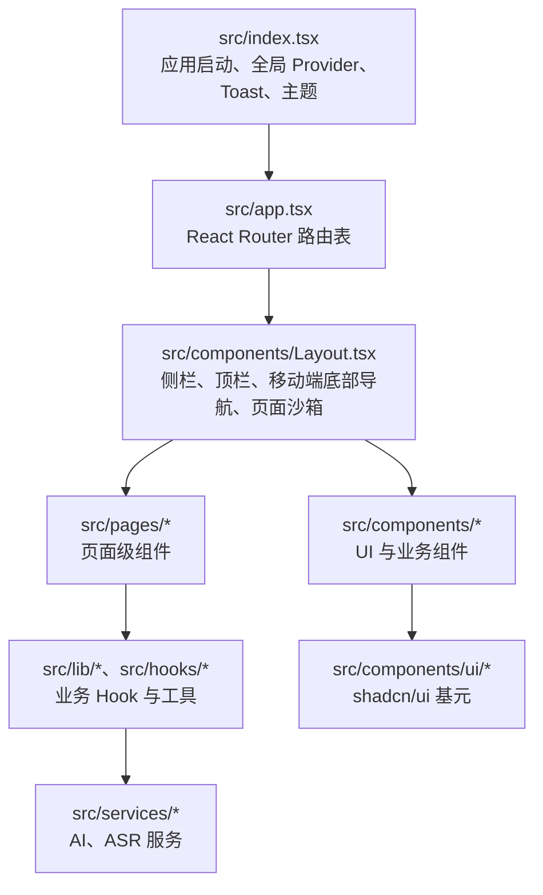
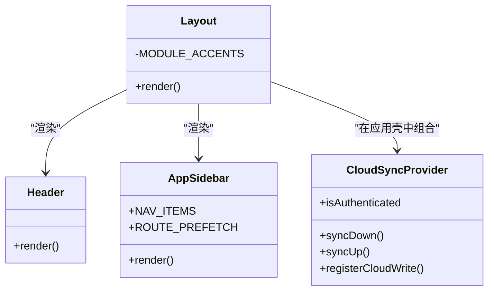
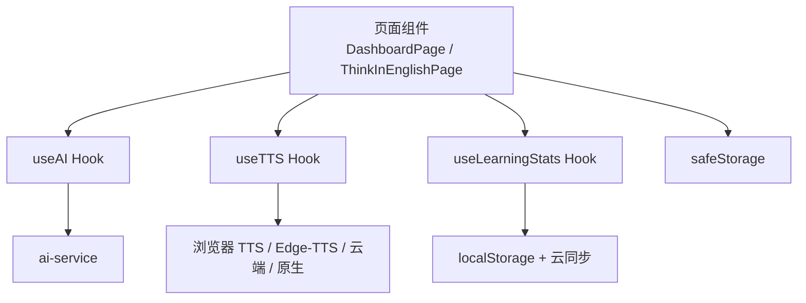
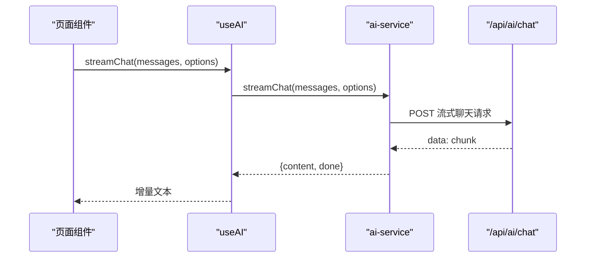
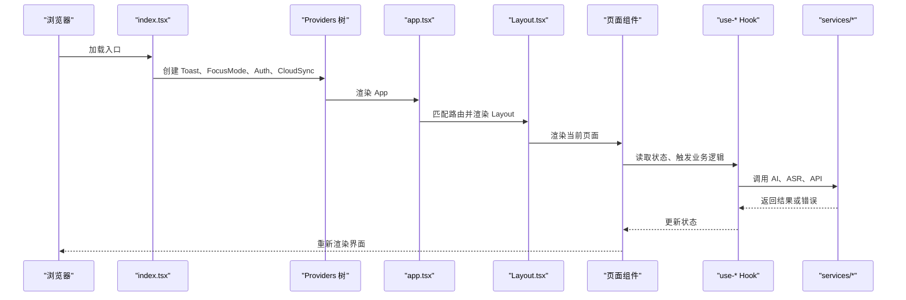
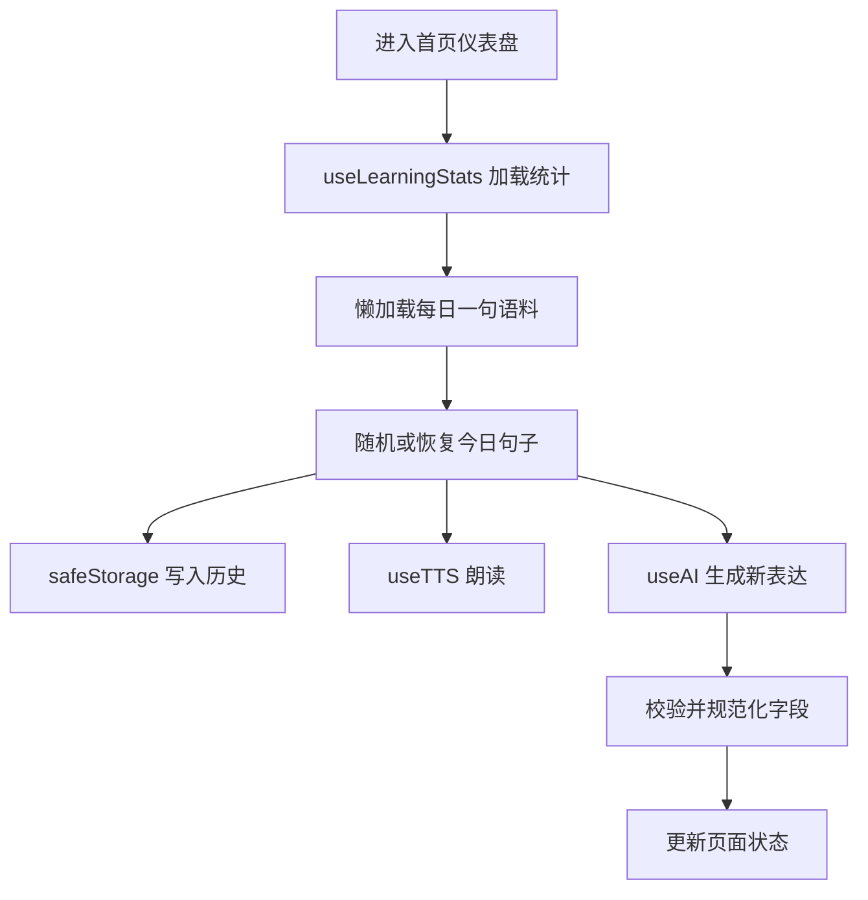
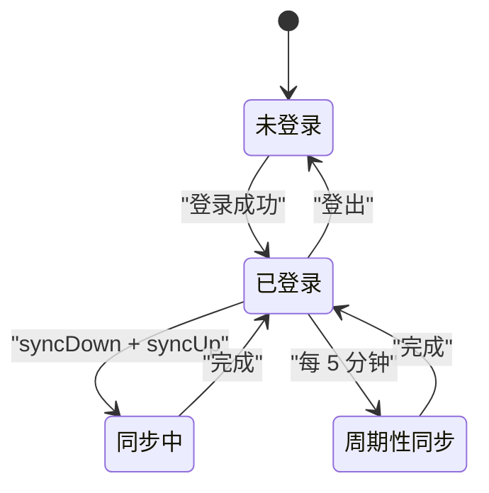
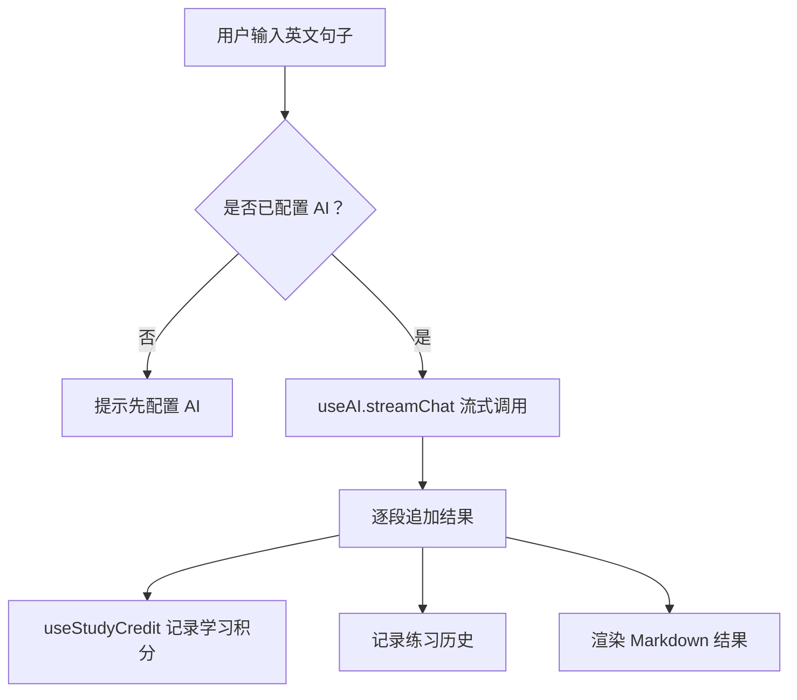
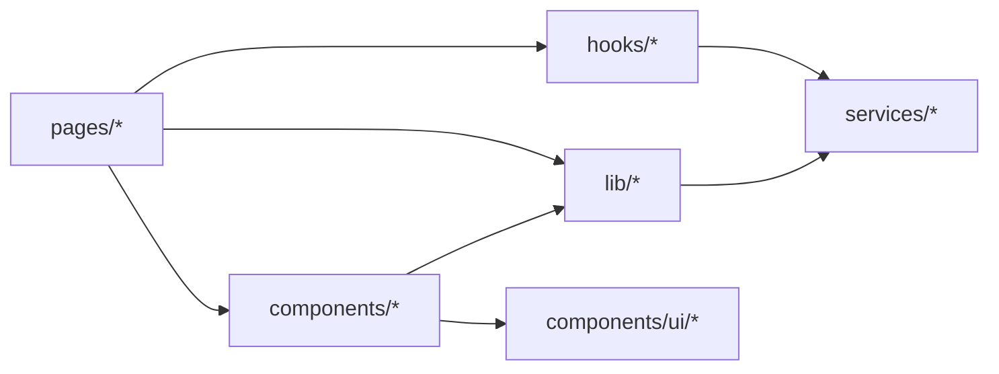

# 组件分层设计

<cite>
**本文引用的文件**   
- [index.tsx](file://src/index.tsx)
- [app.tsx](file://src/app.tsx)
- [README.md](file://README.md)
- [Layout.tsx](file://src/components/Layout.tsx)
- [Header.tsx](file://src/components/Header.tsx)
- [AppSidebar.tsx](file://src/components/AppSidebar.tsx)
- [CloudSyncProvider.tsx](file://src/components/CloudSyncProvider.tsx)
- [DashboardPage.tsx](file://src/pages/DashboardPage/DashboardPage.tsx)
- [ThinkInEnglishPage.tsx](file://src/pages/ThinkInEnglishPage/ThinkInEnglishPage.tsx)
- [auth-provider.tsx](file://src/lib/auth-provider.tsx)
- [focus-mode.tsx](file://src/lib/focus-mode.tsx)
- [use-learning-stats.ts](file://src/lib/use-learning-stats.ts)
- [use-tts.ts](file://src/lib/use-tts.ts)
- [safe-storage.ts](file://src/lib/safe-storage.ts)
- [api-client.ts](file://src/lib/api-client.ts)
- [use-ai.ts](file://src/hooks/use-ai.ts)
- [ai-service.ts](file://src/services/ai-service.ts)
- [asr-service.ts](file://src/services/asr-service.ts)
</cite>

## 目录
1. [引言](#引言)
2. [项目结构](#项目结构)
3. [核心组件与分层职责](#核心组件与分层职责)
4. [架构总览](#架构总览)
5. [详细组件分析](#详细组件分析)
6. [依赖关系分析](#依赖关系分析)
7. [性能考量](#性能考量)
8. [故障排查指南](#故障排查指南)
9. [结论](#结论)

## 引言
NativeThink 是一个面向英语学习者的 React 应用，涵盖母语思维训练、语块训练、AI 对话、影子跟读、词汇深度、句子学习、拼写、视频精听等模块。仓库采用清晰的四层组件架构：

| 层级 | 位置 | 主要职责 | 典型内容 |
|---|---|---|---|
| 页面层 | `src/pages` | 按功能域组织完整业务页面，组合 UI 组件、Hook、数据与服务 | DashboardPage、ThinkInEnglishPage、ConversationPage 等 |
| 共享组件层 | `src/components` | 可复用的布局、导航、基础 UI 和业务容器组件 | Layout、Header、AppSidebar、AuthDialog、TTSSettings |
| 逻辑层 | `src/lib`、`src/hooks` | 跨页面的业务 Hook、状态持久化、工具函数、能力封装 | useTTS、useLearningStats、useAI、safeStorage、utils |
| 服务层 | `src/services` | 外部系统调用抽象：AI 聊天、语音识别、配置 | ai-service、asr-service、ai-config |

这种分层的核心目的是：**页面只关心“这个功能怎么展示”，Hook 负责“状态从哪里来、怎么变”，服务层负责“如何调用外部 API”**，从而降低耦合、提高复用性，并让错误处理、重试、降级策略集中在更稳定的底层。

**章节来源**
- [README.md:10-65](file://README.md#L10-L65)

## 项目结构
仓库前端源码位于 `src/`，入口由 `index.tsx` 挂载根组件，`app.tsx` 集中声明路由，所有页面通过懒加载拆分代码包。

**图表来源**
- [index.tsx:1-123](file://src/index.tsx#L1-L123)
- [app.tsx:1-66](file://src/app.tsx#L1-L66)
- [Layout.tsx:1-155](file://src/components/Layout.tsx#L1-L155)

**章节来源**
- [index.tsx:1-123](file://src/index.tsx#L1-L123)
- [app.tsx:1-66](file://src/app.tsx#L1-L66)
- [README.md:10-65](file://README.md#L10-L65)

## 核心组件与分层职责

### 页面层：`src/pages`
页面组件是用户可见的功能入口，通常具备以下特征：
- 使用 React Router 的 `useNavigate`、`useLocation` 控制跳转和当前路径。
- 组合多个 `lib` 层的 Hook，例如 `useLearningStats`、`useTTS`、`useAI`、`useFavorites`。
- 管理页面自身临时状态，如输入框、加载态、结果缓存、AbortController。
- 通过 `toast` 或内联 UI 反馈错误，而不是直接调用网络请求。
- 把大体积静态数据（如每日一句语料）放在页面内懒加载，避免污染主包。

示例路径参考：
- 首页仪表盘：[DashboardPage.tsx:1-200](file://src/pages/DashboardPage/DashboardPage.tsx#L1-L200)
- 母语思维训练：[ThinkInEnglishPage.tsx:1-200](file://src/pages/ThinkInEnglishPage/ThinkInEnglishPage.tsx#L1-L200)

**章节来源**
- [DashboardPage.tsx:1-200](file://src/pages/DashboardPage/DashboardPage.tsx#L1-L200)
- [ThinkInEnglishPage.tsx:1-200](file://src/pages/ThinkInEnglishPage/ThinkInEnglishPage.tsx#L1-L200)

### 共享组件层：`src/components`
这一层分为两类：
- **UI 基元**：`src/components/ui/*`，由 shadcn/ui 提供，不应修改。
- **业务组件**：布局、导航、弹窗、设置面板等可被多个页面复用。

关键组件：
- `Layout`：包裹所有页面，提供侧边栏、顶栏、移动端底部导航、聚焦模式、页面级错误边界与骨架屏。
- `Header`：时间、全局搜索、设置入口、用户菜单。
- `AppSidebar`：导航菜单、主题选择、路由预取。
- `CloudSyncProvider`：根据登录状态驱动云同步。

**图表来源**
- [Layout.tsx:1-155](file://src/components/Layout.tsx#L1-L155)
- [Header.tsx:1-62](file://src/components/Header.tsx#L1-L62)
- [AppSidebar.tsx:1-179](file://src/components/AppSidebar.tsx#L1-L179)
- [CloudSyncProvider.tsx:1-61](file://src/components/CloudSyncProvider.tsx#L1-L61)

**章节来源**
- [Layout.tsx:1-155](file://src/components/Layout.tsx#L1-L155)
- [Header.tsx:1-62](file://src/components/Header.tsx#L1-L62)
- [AppSidebar.tsx:1-179](file://src/components/AppSidebar.tsx#L1-L179)
- [CloudSyncProvider.tsx:1-61](file://src/components/CloudSyncProvider.tsx#L1-L61)

### 逻辑层：`src/lib` 与 `src/hooks`
逻辑层是 NativeThink 的“中间件”：它不直接渲染复杂页面，也不直接写 `fetch('/api/...')`，而是暴露给页面和组件使用的 Hook、状态模型、持久化工具。

代表性 Hook：
- `useAI`：封装 AI 流式与非流式对话、消息构建、配置刷新。
- `useTTS`：多引擎朗读（浏览器 TTS、Edge-TTS、云端、原生）、失败降级、进度上报。
- `useLearningStats`：学习统计、打卡日历、模块进度、跨实例事件广播。
- `useFocusMode` / `useImmersive`：专注模式开关，隐藏全局导航。
- `useCloudSync`：与 `CloudSyncProvider` 配合做双向同步。

工具与存储：
- `safeStorage`：带 appId/userId 前缀的 localStorage 封装，支持旧键迁移、云双写回调。
- `api-client`：认证 fetch、超时、JSON 解析增强。
- `utils`：通用工具函数，如 `cn`、`formatDate`、`extractJson`。

**图表来源**
- [use-ai.ts:1-101](file://src/hooks/use-ai.ts#L1-L101)
- [use-tts.ts:1-200](file://src/lib/use-tts.ts#L1-L200)
- [use-learning-stats.ts:1-200](file://src/lib/use-learning-stats.ts#L1-L200)
- [safe-storage.ts:1-200](file://src/lib/safe-storage.ts#L1-L200)

**章节来源**
- [use-ai.ts:1-101](file://src/hooks/use-ai.ts#L1-L101)
- [use-tts.ts:1-200](file://src/lib/use-tts.ts#L1-L200)
- [use-learning-stats.ts:1-200](file://src/lib/use-learning-stats.ts#L1-L200)
- [safe-storage.ts:1-200](file://src/lib/safe-storage.ts#L1-L200)

### 服务层：`src/services`
服务层是对外的“能力边界”，对外暴露稳定接口，内部可以随意替换实现。

- `ai-service`：统一 OpenAI 兼容聊天接口，支持流式响应、任务类型、模型选择、服务端代理、错误分类。
- `asr-service`：录音转写，支持多个 ASR provider 候选、超时、取消、回退。
- `ai-config`：AI provider 配置、API Key 管理、出厂免费 key、活跃 provider。

**图表来源**
- [use-ai.ts:1-101](file://src/hooks/use-ai.ts#L1-L101)
- [ai-service.ts:1-200](file://src/services/ai-service.ts#L1-L200)

**章节来源**
- [ai-service.ts:1-200](file://src/services/ai-service.ts#L1-L200)
- [asr-service.ts:1-99](file://src/services/asr-service.ts#L1-L99)
- [ai-config.ts:1-200](file://src/services/ai-config.ts#L1-L200)

## 架构总览
从应用启动到页面渲染，NativeThink 的典型流程如下：

**图表来源**
- [index.tsx:1-123](file://src/index.tsx#L1-L123)
- [app.tsx:1-66](file://src/app.tsx#L1-L66)
- [Layout.tsx:1-155](file://src/components/Layout.tsx#L1-L155)

**章节来源**
- [index.tsx:1-123](file://src/index.tsx#L1-L123)
- [app.tsx:1-66](file://src/app.tsx#L1-L66)
- [Layout.tsx:1-155](file://src/components/Layout.tsx#L1-L155)

## 详细组件分析

### 页面组件如何通过 Hook 访问逻辑层
以首页仪表盘为例：
- 页面通过 `useLearningStats()` 获取学习统计、打卡日历、模块进度。
- 通过 `useGlobalDueCount()` 获取待复习单词数。
- 通过 `useFavorites()` 管理收藏。
- 通过 `useTTS()` 播放每日一句。
- 通过 `useAI()` 调用 AI 生成新表达。
- 通过 `safeStorage` 保存每日一句、历史记录、偏好。

这体现了一个重要约定：**页面不直接读写 localStorage，也不直接发起 `/api/ai/chat`；它通过 Hook 和工具函数表达意图。**

**图表来源**
- [DashboardPage.tsx:1-200](file://src/pages/DashboardPage/DashboardPage.tsx#L1-L200)
- [use-learning-stats.ts:1-200](file://src/lib/use-learning-stats.ts#L1-L200)
- [use-tts.ts:1-200](file://src/lib/use-tts.ts#L1-L200)
- [use-ai.ts:1-101](file://src/hooks/use-ai.ts#L1-L101)
- [safe-storage.ts:1-200](file://src/lib/safe-storage.ts#L1-L200)

**章节来源**
- [DashboardPage.tsx:1-200](file://src/pages/DashboardPage/DashboardPage.tsx#L1-L200)
- [use-learning-stats.ts:1-200](file://src/lib/use-learning-stats.ts#L1-L200)
- [use-tts.ts:1-200](file://src/lib/use-tts.ts#L1-L200)
- [use-ai.ts:1-101](file://src/hooks/use-ai.ts#L1-L101)
- [safe-storage.ts:1-200](file://src/lib/safe-storage.ts#L1-L200)

### 登录与云同步的生命周期
`CloudSyncProvider` 依赖 `AuthProvider`，只在用户登录后拉取云端数据，再推送本地数据，并注册云双写回调。之后每 5 分钟同步一次，并在页面可见时节流拉取。

**图表来源**
- [auth-provider.tsx:1-86](file://src/lib/auth-provider.tsx#L1-L86)
- [CloudSyncProvider.tsx:1-61](file://src/components/CloudSyncProvider.tsx#L1-L61)

**章节来源**
- [auth-provider.tsx:1-86](file://src/lib/auth-provider.tsx#L1-L86)
- [CloudSyncProvider.tsx:1-61](file://src/components/CloudSyncProvider.tsx#L1-L61)

### 母语思维训练页的状态与异步流程
ThinkInEnglishPage 展示了更复杂的页面级状态管理：检测器练习、翻译练习、回译、母语思维翻译、自定义题库、AI 流式输出、学习积分、收藏、TTS、分页记忆等。其共同点是：
- 每个练习都有独立的输入、结果、加载态、AbortController。
- 使用 `persistJson` 与 `warnStorageFull` 处理自定义题库持久化。
- 通过 `useStudyCredit` 记录学习行为。
- 通过 `usePageMemory` 保持标签页状态。
- 通过 `useStableShuffle` 保证洗牌结果稳定。

**图表来源**
- [ThinkInEnglishPage.tsx:1-200](file://src/pages/ThinkInEnglishPage/ThinkInEnglishPage.tsx#L1-L200)
- [use-ai.ts:1-101](file://src/hooks/use-ai.ts#L1-L101)

**章节来源**
- [ThinkInEnglishPage.tsx:1-200](file://src/pages/ThinkInEnglishPage/ThinkInEnglishPage.tsx#L1-L200)
- [use-ai.ts:1-101](file://src/hooks/use-ai.ts#L1-L101)

## 依赖关系分析

### 层间依赖方向

依赖方向严格自上而下：
- 页面依赖组件、Hook、lib。
- Hook 依赖 services、lib。
- lib 依赖 services、storage、platform。
- components/ui 是叶子节点，不反向依赖业务逻辑。

**图表来源**
- [app.tsx:1-66](file://src/app.tsx#L1-L66)
- [Layout.tsx:1-155](file://src/components/Layout.tsx#L1-L155)
- [use-ai.ts:1-101](file://src/hooks/use-ai.ts#L1-L101)
- [ai-service.ts:1-200](file://src/services/ai-service.ts#L1-L200)

### 关键耦合点
| 耦合点 | 说明 | 风险 |
|---|---|---|
| `AuthProvider` 与 `CloudSyncProvider` | 云同步依赖登录状态 | 顺序不能错，必须先把 `CloudSyncProvider` 放在 `AuthProvider` 内部 |
| `useAI` 与 `ai-service` | 页面通过 Hook 间接调用 AI | 如果 Hook 抛异常，页面应捕获而非崩溃 |
| `safeStorage` 与云同步 | 写操作可能触发双写 | 写失败需要向上报告，不能静默丢弃 |
| `Layout` 与页面路由 | Layout 注入 module accent、滚动重置、错误边界 | 新增页面需确保路由一致 |

**章节来源**
- [auth-provider.tsx:1-86](file://src/lib/auth-provider.tsx#L1-L86)
- [CloudSyncProvider.tsx:1-61](file://src/components/CloudSyncProvider.tsx#L1-L61)
- [use-ai.ts:1-101](file://src/hooks/use-ai.ts#L1-L101)
- [safe-storage.ts:1-200](file://src/lib/safe-storage.ts#L1-L200)
- [Layout.tsx:1-155](file://src/components/Layout.tsx#L1-L155)

## 性能考量
NativeThink 已经在多处做了性能优化，这些优化值得作为分层设计的经验总结：

1. **路由懒加载**：`app.tsx` 用 `lazy(() => import(...))` 加载页面，减少首屏包体。
2. **页面内数据懒加载**：首页的每日一句语料通过 `import('@/data/chunks')` 延迟加载，避免 146KB 阻塞主包。
3. **侧边栏预取**：`AppSidebar` 在鼠标悬停或触摸时预取目标路由 chunk。
4. **平台依赖动态导入**：`index.tsx` 对 miaoda 平台 SDK 使用 `useEffect` + `import()`，非平台环境不引入。
5. **TTS 多通道降级**：`use-tts.ts` 在浏览器 TTS 不可用时自动切换到 Edge-TTS、云端或 Google TTS，避免长时间卡顿。
6. **ASR 超时与取消**：`asr-service.ts` 为每次转写设置超时和 AbortSignal，避免挂起。
7. **云同步节流**：`CloudSyncProvider` 每 5 分钟同步一次，且页面可见时最多 60 秒同步一次。

建议后续继续保持：
- 不要把大型静态数据放入页面入口。
- 不把第三方 SDK 直接 top-level import，除非它确实参与首屏渲染。
- 对耗时网络操作提供取消、超时、重试、降级。
- 对本地存储写失败要有明确反馈，不能吞掉错误。

**章节来源**
- [app.tsx:1-66](file://src/app.tsx#L1-L66)
- [DashboardPage.tsx:1-200](file://src/pages/DashboardPage/DashboardPage.tsx#L1-L200)
- [AppSidebar.tsx:1-179](file://src/components/AppSidebar.tsx#L1-L179)
- [index.tsx:1-123](file://src/index.tsx#L1-L123)
- [use-tts.ts:1-200](file://src/lib/use-tts.ts#L1-L200)
- [asr-service.ts:1-99](file://src/services/asr-service.ts#L1-L99)
- [CloudSyncProvider.tsx:1-61](file://src/components/CloudSyncProvider.tsx#L1-L61)

## 故障排查指南

### 页面加载报错
- `app.tsx` 为每个路由包裹 `ErrorBoundary`，并提供中文错误页和刷新按钮。
- `Layout.tsx` 也有页面级错误边界，用于捕获子树渲染异常。
- `index.tsx` 提供全局错误兜底，适用于 Provider 或入口阶段崩溃。

排查步骤：
1. 先看页面级错误信息。
2. 检查对应 Hook 是否抛出未捕获异常。
3. 检查网络请求是否返回 HTML 而非 JSON。
4. 如果是首次加载问题，尝试刷新并确认路由是否正确注册。

**章节来源**
- [app.tsx:1-66](file://src/app.tsx#L1-L66)
- [Layout.tsx:1-155](file://src/components/Layout.tsx#L1-L155)
- [index.tsx:1-123](file://src/index.tsx#L1-L123)

### AI 不可用或服务端未配置
- `useAI` 会判断是否有配置的 provider，并在失败时根据 `silent` 决定是否弹 toast。
- `ai-service` 对 503 返回明确的服务端未配置提示。
- 页面应优先检查 `isConfigured`，再决定是否启用 AI 按钮。

**章节来源**
- [use-ai.ts:1-101](file://src/hooks/use-ai.ts#L1-L101)
- [ai-service.ts:1-200](file://src/services/ai-service.ts#L1-L200)

### 朗读不可用
- `use-tts.ts` 内置多次降级路径，失败时会限制重复 toast。
- 若 Android 无英语系统语音，`Layout` 会在适当时机引导安装语音包。
- 桌面 Electron 环境下 SpeechSynthesis 可能无声，应优先走网络通道。

**章节来源**
- [use-tts.ts:1-200](file://src/lib/use-tts.ts#L1-L200)
- [Layout.tsx:1-155](file://src/components/Layout.tsx#L1-L155)

### 本地存储丢失或数据不同步
- `safeStorage` 有匿名 ID 恢复、旧键迁移、cloud-sync handler。
- 写失败返回 `false`，调用方应检查返回值。
- 云同步依赖 `AuthProvider` 登录状态，未登录时不会双写。

**章节来源**
- [safe-storage.ts:1-200](file://src/lib/safe-storage.ts#L1-L200)
- [CloudSyncProvider.tsx:1-61](file://src/components/CloudSyncProvider.tsx#L1-L61)

## 结论
NativeThink 的四层组件架构清晰反映了现代 React 应用的最佳实践：

- **页面层**负责业务编排和用户交互。
- **共享组件层**负责布局和通用 UI。
- **逻辑层**负责状态、持久化和跨页面能力。
- **服务层**负责外部系统集成。

推荐遵循以下规则：
1. 新增功能先在 `src/pages/<Feature>/` 下创建页面目录。
2. 跨页面复用的状态逻辑放到 `src/lib/use-*.ts`。
3. 外部 API 调用封装到 `src/services/*`。
4. 不要从页面直接调用 `fetch('/api/...')`。
5. 不要在 `src/components/ui/*` 里写业务逻辑。
6. 对网络、存储、平台能力都要考虑失败、超时、取消、降级。
7. 对错误要有可观察的用户反馈，不能静默吞掉。

这套分层不仅让 NativeThink 当前功能可维护，也为未来扩展更多语言学习模块提供了稳定基础。