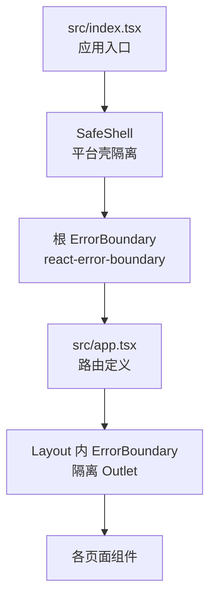
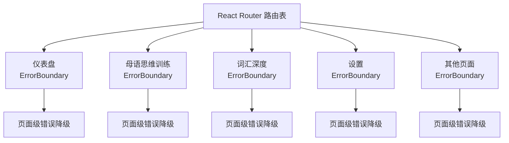
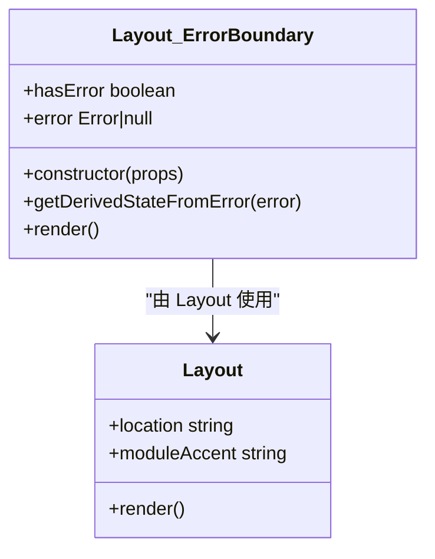
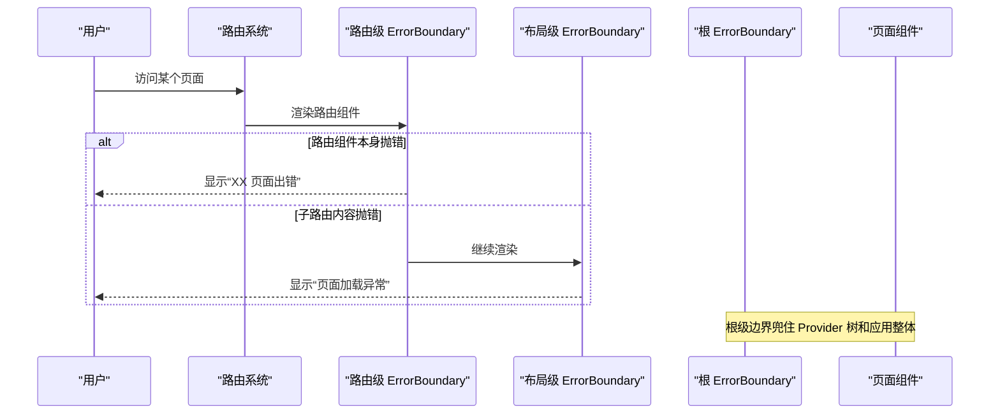
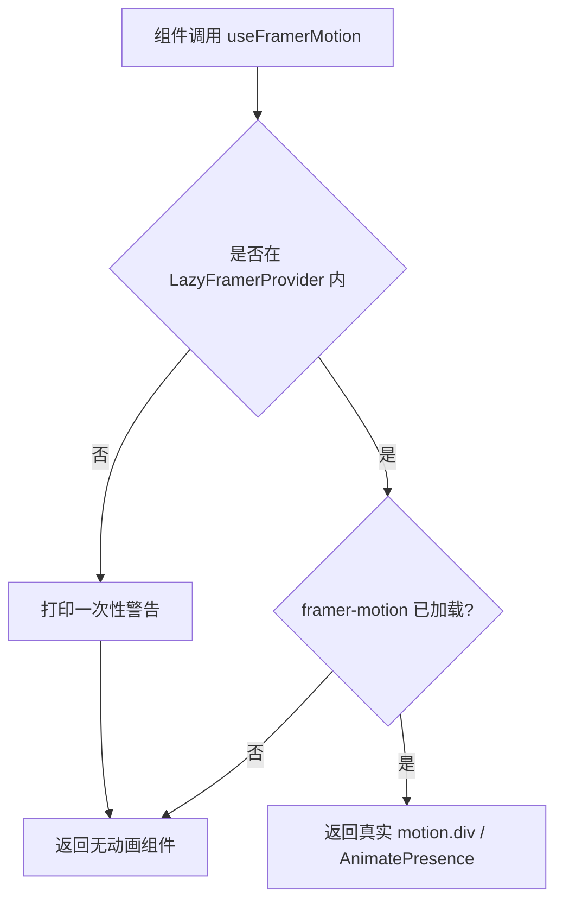
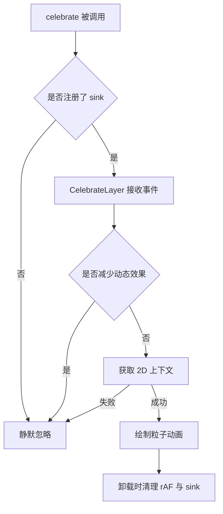
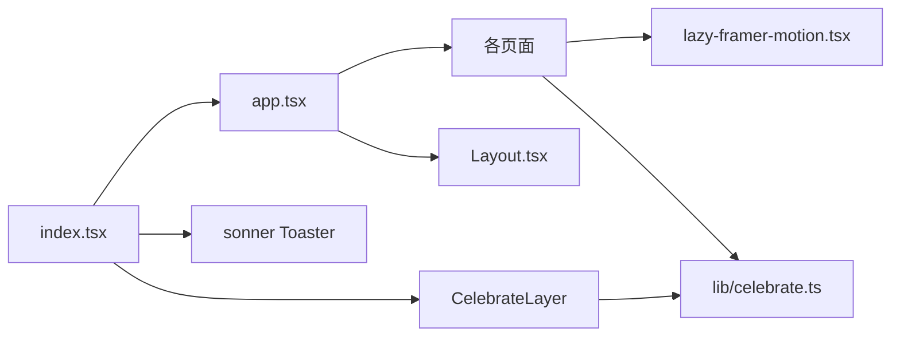
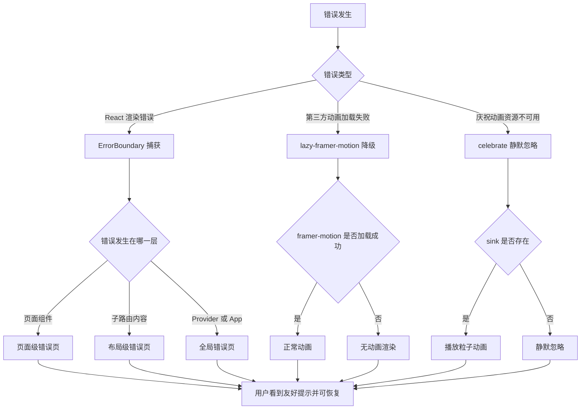

# 错误隔离与容错

<cite>
**本文引用的文件**   
- [src/index.tsx](file://src/index.tsx)
- [src/app.tsx](file://src/app.tsx)
- [src/components/Layout.tsx](file://src/components/Layout.tsx)
- [src/lib/lazy-framer-motion.tsx](file://src/lib/lazy-framer-motion.tsx)
- [src/components/CelebrateLayer.tsx](file://src/components/CelebrateLayer.tsx)
- [src/lib/celebrate.ts](file://src/lib/celebrate.ts)
- [src/pages/FavoritesPage/FavoritesPage.tsx](file://src/pages/FavoritesPage/FavoritesPage.tsx)
- [src/pages/ChunkTrainingPage/ChunkTrainingPage.tsx](file://src/pages/ChunkTrainingPage/ChunkTrainingPage.tsx)
- [src/pages/DeepVocabularyPage/DeepVocabularyPage.tsx](file://src/pages/DeepVocabularyPage/DeepVocabularyPage.tsx)
- [src/pages/ProgressPage/ProgressPage.tsx](file://src/pages/ProgressPage/ProgressPage.tsx)
- [src/pages/DeepVocabularyPage/components/FlashcardMode.tsx](file://src/pages/DeepVocabularyPage/components/FlashcardMode.tsx)
</cite>

## 目录

1. [引言](#引言)
2. [项目结构中的错误边界布局](#项目结构中的错误边界布局)
3. [核心组件分析](#核心组件分析)
4. [架构总览：从页面崩溃到用户感知](#架构总览从页面崩溃到用户感知)
5. [第三方动画库的懒加载与降级](#第三方动画库的懒加载与降级)
6. [庆祝动画等关键 UI 的降级策略](#庆祝动画等关键-ui-的降级策略)
7. [运行时错误捕获、上报与提示现状](#运行时错误捕获上报与提示现状)
8. [依赖关系与耦合分析](#依赖关系与耦合分析)
9. [性能与稳定性特征](#性能与稳定性特征)
10. [最佳实践与常见陷阱](#最佳实践与常见陷阱)
11. [故障恢复流程图](#故障恢复流程图)
12. [监控与诊断建议](#监控与诊断建议)
13. [结论](#结论)

## 引言

NativeThink 是一个多页面学习应用，包含词汇、句子、跟读、写作、视频精听、母语思维训练等多个功能模块。这类应用的典型风险是：**某个页面的渲染逻辑或第三方动画库异常，可能把整个应用拖垮**。

本仓库已经建立了一套分层错误隔离机制：

| 层级 | 职责 | 实现位置 |
|---|---|---|
| 根级全局边界 | 兜住应用启动和 Provider 树中的同步渲染错误 | `src/index.tsx` |
| 路由级边界 | 每个主要页面单独隔离，一个页面失败不污染其他页面 | `src/app.tsx` |
| 布局级边界 | 包裹 `<Outlet />`，防止子路由内部出错破坏侧边栏和导航 | `src/components/Layout.tsx` |
| 第三方动画层 | 懒加载 framer-motion，缺失 provider 时只降级为无动画 | `src/lib/lazy-framer-motion.tsx` |
| 庆祝动画层 | 程序化 canvas 粒子效果，拿不到上下文时静默 no-op | `src/components/CelebrateLayer.tsx`、`src/lib/celebrate.ts` |

这些机制共同保证了：**单个页面崩溃不会让全站白屏，动画库加载失败不会中断业务，关键交互可以回退到非动画或非程序化状态。**

## 项目结构中的错误边界布局

应用启动入口在 `src/index.tsx`，它负责：

1. 初始化主题、按压动效、原生 TTS 健康检查；
2. 挂载全局 Toast 出口；
3. 尝试动态加载平台壳 `@lark-apaas/client-toolkit-lite`；
4. 用三层边界包裹主应用：
   - `SafeShell`：隔离平台壳渲染；
   - 根 `ErrorBoundary`：兜住 `<App />` 及其 Provider 树；
   - 各路由 `ErrorBoundary`：隔离具体页面；
   - `Layout` 内还有一个 `ErrorBoundary`：隔离 `<Outlet />` 的子路由内容。

**图表来源**
- [src/index.tsx:66-123](file://src/index.tsx#L66-L123)
- [src/app.tsx:1-66](file://src/app.tsx#L1-L66)
- [src/components/Layout.tsx:1-155](file://src/components/Layout.tsx#L1-L155)

**章节来源**
- [src/index.tsx:1-123](file://src/index.tsx#L1-L123)
- [src/app.tsx:1-66](file://src/app.tsx#L1-L66)

## 核心组件分析

### 根级全局错误边界

`src/index.tsx` 中定义了 `GlobalErrorFallback`，用于展示“页面加载出错”的通用提示，并提供“刷新重试”按钮。它被作为根 `ErrorBoundary` 的 fallback，包裹了 `AuthProvider`、`CloudSyncProvider`、`FocusModeProvider` 和 `<App />`。

这个边界的关键特征是：

- 使用 `react-error-boundary` 提供的 `ErrorBoundary`；
- 通过 `fallbackRender` 传入自定义降级界面；
- 在 React 18 + `StrictMode` 下，它是应用启动后最早能捕获渲染错误的 React 边界；
- 如果连 `createRoot` 之后的 React 渲染阶段都出错，它是最外层兜底。

需要注意：**它不是 `window.onerror` 或 `unhandledrejection` 的全局监听器**，因此无法捕获异步 Promise 未处理拒绝、网络请求失败、Worker 异常等非 React 渲染路径错误。

**章节来源**
- [src/index.tsx:34-62](file://src/index.tsx#L34-L62)
- [src/index.tsx:103-123](file://src/index.tsx#L103-L123)

### 路由级错误边界

`src/app.tsx` 对每个主要路由都包裹了一个独立的 `ErrorBoundary`，并附带 `PageErrorFallback`。该 fallback 会显示“XX 页面出错”，并提供“刷新页面”按钮。

这意味着：

- “仪表盘”页面崩溃不会影响“设置”页面；
- “母语思维训练”页面崩溃不会影响“词汇深度”页面；
- 每个页面可以拥有自己的错误文案和恢复操作；
- 所有路由共享同一个 `Layout`，但各自有独立边界。

**图表来源**
- [src/app.tsx:18-66](file://src/app.tsx#L18-L66)

**章节来源**
- [src/app.tsx:18-66](file://src/app.tsx#L18-L66)

### 布局级错误边界

`src/components/Layout.tsx` 中实现了自己的类组件 `ErrorBoundary`，并把它包裹在 `<Outlet />` 外层。它的降级界面包括警告图标、标题、错误消息和“刷新页面”按钮。

与路由级边界不同，布局级边界更偏向于“兜住当前路由内容区域”，避免子组件异常导致侧边栏、头部、底部导航一起崩坏。它还配合 `Suspense` 骨架屏，在数据或子组件尚未就绪时提供加载态。

**图表来源**
- [src/components/Layout.tsx:29-71](file://src/components/Layout.tsx#L29-L71)
- [src/components/Layout.tsx:117-155](file://src/components/Layout.tsx#L117-L155)

**章节来源**
- [src/components/Layout.tsx:1-155](file://src/components/Layout.tsx#L1-L155)

### 平台壳安全外壳

`SafeShell` 是 `src/index.tsx` 中的一个特殊隔离层，专门处理 `@lark-apaas/client-toolkit-lite` 的动态加载。它会：

- 判断是否运行在 miaoda 平台；
- 通过 `useEffect` 动态 import 平台壳；
- 若加载失败，标记 `appContainerFailed`，直接渲染 children；
- 再用一层 `ErrorBoundary` 包裹平台壳容器，若壳自身报错则回退到裸 children。

这体现了“外部不可信宿主环境也要做错误隔离”的设计思路。

**章节来源**
- [src/index.tsx:64-102](file://src/index.tsx#L64-L102)

## 架构总览：从页面崩溃到用户感知

下面的序列图展示了三个典型错误路径：

1. **页面渲染同步异常**：路由级边界拦截 → 显示页面级错误页；
2. **子路由内部异常**：布局级边界拦截 → 保留侧边栏和导航；
3. **应用启动或 Provider 异常**：根级边界拦截 → 显示全局错误页。

**图表来源**
- [src/app.tsx:18-66](file://src/app.tsx#L18-L66)
- [src/components/Layout.tsx:29-71](file://src/components/Layout.tsx#L29-L71)
- [src/index.tsx:103-123](file://src/index.tsx#L103-L123)

## 第三方动画库的懒加载与降级

framer-motion 是一个体积较大且可能不稳定的第三方动画库。项目没有直接在全量入口引入它，而是通过 `src/lib/lazy-framer-motion.tsx` 实现懒加载和降级。

### LazyFramerProvider 的工作方式

`LazyFramerProvider` 在首次渲染时立即提供一个“降级上下文”，然后异步 `import('framer-motion')`。一旦加载成功，就把 `motion.div` 和 `AnimatePresence` 注入到上下文中；如果始终没加载成功，消费者继续使用纯 HTML div 和无动画 presence。

关键点：

| 行为 | 说明 |
|---|---|
| 首帧不阻塞 | 不等待 framer-motion 下载完成就渲染页面 |
| 缺省实现存在 | `resolved` 初始值就是 fallback，不会因空 context 而崩溃 |
| 加载失败仍可用 | 动画不出现，但页面仍可正常交互 |
| 缺失 provider 只警告 | `useFramerMotion` 不再抛出错误，而是记录一次 `console.warn` 并返回 fallback |

**图表来源**
- [src/lib/lazy-framer-motion.tsx:38-99](file://src/lib/lazy-framer-motion.tsx#L38-L99)

### 使用位置

多个页面需要动画，因此各自在其顶部挂载 `LazyFramerProvider`：

- `src/pages/ChunkTrainingPage/ChunkTrainingPage.tsx`；
- `src/pages/FavoritesPage/FavoritesPage.tsx`；
- `src/pages/DeepVocabularyPage/DeepVocabularyPage.tsx`；
- `src/pages/ProgressPage/ProgressPage.tsx`。

这些页面内部的卡片模式组件再通过 `useFramerMotion()` 获取 `LazyMotionDiv` 和 `AnimatePresence`。

**章节来源**
- [src/lib/lazy-framer-motion.tsx:1-99](file://src/lib/lazy-framer-motion.tsx#L1-L99)
- [src/pages/ChunkTrainingPage/ChunkTrainingPage.tsx:61-2718](file://src/pages/ChunkTrainingPage/ChunkTrainingPage.tsx#L61-L2718)
- [src/pages/FavoritesPage/FavoritesPage.tsx:20-211](file://src/pages/FavoritesPage/FavoritesPage.tsx#L20-L211)
- [src/pages/DeepVocabularyPage/DeepVocabularyPage.tsx:31-977](file://src/pages/DeepVocabularyPage/DeepVocabularyPage.tsx#L31-L977)
- [src/pages/ProgressPage/ProgressPage.tsx:52-891](file://src/pages/ProgressPage/ProgressPage.tsx#L52-L891)

## 庆祝动画等关键 UI 的降级策略

### 设计原则

庆祝动画采用“唯一 sink”模式：

- 页面只调用 `celebrate(kind, anchor)`；
- 不直接引用 canvas 或大量动画代码；
- 真正的渲染由挂在根层的 `CelebrateLayer` 统一处理；
- 拿不到 sink 或拿不到 2D 上下文时，**静默 no-op**，绝不回退成 toast。

这是为了避免两个问题：

1. 多处 canvas 导致重复动画、重复 `requestAnimationFrame`；
2. 动画失败后弹出文字提示，反而违背“结果不靠文字”的视觉反馈目标。

### CelebrateLayer 的降级点

`CelebrateLayer` 做了多层防御：

| 条件 | 行为 |
|---|---|
| 没有注册 sink | `celebrate` 直接返回，无副作用 |
| 用户开启“减少动态效果” | 跳过动画 |
| Canvas 元素不存在 | 忽略 |
| 取不到 2D 上下文 | 忽略 |
| DPR 过高 | 限制到 2，避免移动端显存爆炸 |
| 粒子过多 | 固定上限 46 |
| 动画结束 | 清理画布并停止 `requestAnimationFrame` |
| 组件卸载 | 注销 sink 并取消动画帧 |

**图表来源**
- [src/lib/celebrate.ts:1-29](file://src/lib/celebrate.ts#L1-L29)
- [src/components/CelebrateLayer.tsx:1-72](file://src/components/CelebrateLayer.tsx#L1-L72)

### 实际触发场景

例如在深词汇闪卡模式中，连续答对 7 题或一轮全部正确时会触发庆祝动画。它传入了“完美轮次”或“连击 7”两种类型，并可选择绑定到一个锚点元素，让粒子从按钮中心炸开。

**章节来源**
- [src/lib/celebrate.ts:1-29](file://src/lib/celebrate.ts#L1-L29)
- [src/components/CelebrateLayer.tsx:1-72](file://src/components/CelebrateLayer.tsx#L1-L72)
- [src/pages/DeepVocabularyPage/components/FlashcardMode.tsx:417-496](file://src/pages/DeepVocabularyPage/components/FlashcardMode.tsx#L417-L496)

## 运行时错误捕获、上报与提示现状

### 已实现的错误捕获

| 类型 | 是否实现 | 说明 |
|---|---:|---|
| React 渲染期同步错误 | 是 | 根边界、路由边界、布局边界覆盖不同范围 |
| Suspense 加载失败 | 部分 | 路由默认 fallback 是骨架屏，但没有针对 chunk 加载失败的专用错误边界 |
| 第三方库动态加载失败 | 是 | framer-motion 通过 lazy-framer-motion 降级 |
| 平台壳动态加载失败 | 是 | `SafeShell` 捕获并回退 |
| Promise 未处理拒绝 | 否 | 未发现 `unhandledrejection` 监听 |
| window.onerror / unhandledexception | 否 | 未发现全局 JS 错误监听 |
| API 请求失败 | 视模块而定 | 由各自业务组件或 hooks 处理，不属于统一错误边界 |
| Toast 提示 | 是 | 使用 sonner 的 `Toaster`，位于根边界上方 |

### 用户提示机制

应用使用 sonner 的 `Toaster` 作为全局提示出口，位置在 `top-center`，桌面和移动端分别配置偏移。它位于根 `ErrorBoundary` 之上，因此即使应用内部出错，toast 本身仍有机会展示。

此外，`Layout` 中还有针对 Android 本地语音包的引导提示，属于功能降级提示而非错误提示。

**章节来源**
- [src/index.tsx:94-123](file://src/index.tsx#L94-L123)
- [src/components/Layout.tsx:72-116](file://src/components/Layout.tsx#L72-L116)

## 依赖关系与耦合分析

**图表来源**
- [src/index.tsx:1-123](file://src/index.tsx#L1-L123)
- [src/app.tsx:1-66](file://src/app.tsx#L1-L66)
- [src/components/Layout.tsx:1-155](file://src/components/Layout.tsx#L1-L155)
- [src/lib/lazy-framer-motion.tsx:1-99](file://src/lib/lazy-framer-motion.tsx#L1-L99)
- [src/lib/celebrate.ts:1-29](file://src/lib/celebrate.ts#L1-L29)
- [src/components/CelebrateLayer.tsx:1-72](file://src/components/CelebrateLayer.tsx#L1-L72)

### 耦合特点

1. **错误边界是横向基础设施**：`index.tsx`、`app.tsx`、`Layout.tsx` 共同承担错误隔离，形成“根—路由—布局”三层结构。
2. **动画与业务解耦**：业务组件通过 `celebrate()` 或 `useFramerMotion()` 调用，不直接持有 canvas 或动画状态。
3. **Provider 前置条件脆弱**：`useFramerMotion` 依赖外层 `LazyFramerProvider`。虽然现在已经改为降级而不是抛错，但忘记加 provider 仍会导致动画丢失。
4. **Toast 与 celebrate 都是全局 UI 出口**：二者都在根附近挂载，避免子组件各自管理全局提示和全局动画。

### 潜在循环依赖风险

目前未见明显循环导入，但以下耦合值得注意：

- `index.tsx` 同时管理全局错误、Toast、celebrate 和平台壳；
- `Layout.tsx` 既负责布局，又内置一个错误边界；
- 多个页面自行决定在哪里放置 `LazyFramerProvider`，新增页面容易遗漏。

**章节来源**
- [src/index.tsx:1-123](file://src/index.tsx#L1-L123)
- [src/app.tsx:1-66](file://src/app.tsx#L1-L66)
- [src/components/Layout.tsx:1-155](file://src/components/Layout.tsx#L1-L155)
- [src/lib/lazy-framer-motion.tsx:1-99](file://src/lib/lazy-framer-motion.tsx#L1-L99)
- [src/lib/celebrate.ts:1-29](file://src/lib/celebrate.ts#L1-L29)
- [src/components/CelebrateLayer.tsx:1-72](file://src/components/CelebrateLayer.tsx#L1-L72)

## 性能与稳定性特征

### 启动阶段

- 原生 TTS 健康检查放在 `createRoot` 之前，避免反复崩溃；
- 主题和按压动效也在挂载前初始化，减少首帧闪烁；
- 平台壳通过 `useEffect` 动态加载，非 miaoda 环境不引入额外依赖；
- 根级 `ErrorBoundary` 在 React 渲染树内，不能捕获更早阶段的脚本解析错误。

### 动画性能

- framer-motion 不在主 bundle，按需懒加载；
- 庆祝动画限制 DPR 到 2；
- 粒子数量固定为 46；
- 动画生命周期约 0.7 秒；
- 组件卸载时清理 `requestAnimationFrame`；
- 支持 `prefers-reduced-motion`，尊重系统无障碍偏好。

### 路由切换

- 布局内通过 `key={location.pathname}` 强制重新挂载页面，使进入动画生效；
- 每次路由变化滚动到顶部；
- 最后一个访问模块保存在存储中，用于首页“继续上次学习”。

**章节来源**
- [src/index.tsx:13-22](file://src/index.tsx#L13-L22)
- [src/index.tsx:64-102](file://src/index.tsx#L64-L102)
- [src/components/CelebrateLayer.tsx:10-72](file://src/components/CelebrateLayer.tsx#L10-L72)
- [src/components/Layout.tsx:117-155](file://src/components/Layout.tsx#L117-L155)

## 最佳实践与常见陷阱

### 推荐实践

1. **新页面必须包裹路由级错误边界**  
   新增路由时应复制现有模式，给页面加上 `ErrorBoundary` 和对应的 `PageErrorFallback`。

2. **任何使用 `useFramerMotion` 的页面都要挂载 `LazyFramerProvider`**  
   即使现在缺失 provider 不会抛错，也会导致动画丢失，影响用户体验。

3. **不要绕过 celebrate 直接写 canvas**  
   保持唯一 sink，避免重复动画、重复动画帧和内存泄漏。

4. **不要把业务错误当成渲染错误**  
   API 失败、表单校验失败、数据为空应该用 toast 或空状态组件，而不是让组件 throw。

5. **错误信息要可恢复**  
   页面级错误应提供明确的恢复动作，如“刷新页面”或“返回首页”。

6. **对外部资源加载失败要有明确降级**  
   像 framer-motion、平台壳、TTS 引擎一样，先判断能力，再选择完整功能或降级功能。

### 已知陷阱

| 陷阱 | 现象 | 修复方向 |
|---|---|---|
| 忘记 `LazyFramerProvider` | 动画不出现，开发期有一次 console 警告 | 在页面顶层挂载 provider |
| 忘记路由级 `ErrorBoundary` | 页面崩溃可能影响同父级路由 | 在路由定义处包裹边界 |
| 误用全局错误边界代替业务错误处理 | 普通 API 失败触发整页降级 | 改用 toast、空状态或局部 loading |
| 在 celebrate 中直接创建多个 canvas | 多次动画叠加、内存泄漏 | 复用 `CelebrateLayer` 的 sink |
| 依赖 Promise 未处理拒绝 | 异步错误可能静默消失 | 补充 `unhandledrejection` 监听 |
| 依赖 `window.onerror` 缺失 | 非 Promise 的未捕获异常可能不被上报 | 补充全局错误监听 |

**章节来源**
- [src/lib/lazy-framer-motion.tsx:69-86](file://src/lib/lazy-framer-motion.tsx#L69-L86)
- [src/lib/celebrate.ts:1-29](file://src/lib/celebrate.ts#L1-L29)
- [src/components/CelebrateLayer.tsx:1-72](file://src/components/CelebrateLayer.tsx#L1-L72)

## 故障恢复流程图

下图展示从错误发生到用户感知的完整链路，覆盖 React 渲染错误、第三方动画加载失败和庆祝动画失效三种情况。

**图表来源**
- [src/index.tsx:34-123](file://src/index.tsx#L34-L123)
- [src/app.tsx:18-66](file://src/app.tsx#L18-L66)
- [src/components/Layout.tsx:29-71](file://src/components/Layout.tsx#L29-L71)
- [src/lib/lazy-framer-motion.tsx:38-99](file://src/lib/lazy-framer-motion.tsx#L38-L99)
- [src/lib/celebrate.ts:1-29](file://src/lib/celebrate.ts#L1-L29)
- [src/components/CelebrateLayer.tsx:1-72](file://src/components/CelebrateLayer.tsx#L1-L72)

## 监控与诊断建议

当前仓库中没有发现 Sentry、Bugsnag、Google Analytics、自定义日志上报等服务集成。现有的诊断线索主要来自：

1. **浏览器控制台**：framer-motion 缺失 provider 时的 `console.warn`；
2. **用户可见的错误页**：页面级、布局级、全局级错误边界；
3. **Toast 提示**：用于功能降级和功能引导；
4. **构建产物和路由结构**：可通过路由名称定位出错页面。

建议在未来增加以下能力：

| 能力 | 建议实现方式 | 优先级 |
|---|---|---|
| 未处理 Promise 拒绝上报 | `window.addEventListener('unhandledrejection', ...)` | 高 |
| 全局 JS 错误上报 | `window.addEventListener('error', ...)` | 高 |
| 路由级错误埋点 | 在 `PageErrorFallback` 中记录页面名称、时间、错误堆栈 | 高 |
| 第三方库加载失败埋点 | 在 `LazyFramerProvider` 的 `.catch` 中记录 | 中 |
| 庆祝动画失败埋点 | 在 `CelebrateLayer` 拿不到 2D 上下文时记录 | 低 |
| 用户反馈入口 | 在错误页增加“反馈问题”按钮，携带环境信息 | 中 |

**章节来源**
- [src/lib/lazy-framer-motion.tsx:69-86](file://src/lib/lazy-framer-motion.tsx#L69-L86)
- [src/app.tsx:18-66](file://src/app.tsx#L18-L66)
- [src/components/Layout.tsx:29-71](file://src/components/Layout.tsx#L29-L71)
- [src/components/CelebrateLayer.tsx:18-72](file://src/components/CelebrateLayer.tsx#L18-L72)

## 结论

NativeThink 的错误隔离体系已经覆盖了大多数前端典型风险：

- **页面级崩溃**被路由级边界隔离；
- **子路由内部异常**被布局级边界隔离；
- **Provider 和应用整体异常**被根级边界兜住；
- **第三方动画库加载失败**被懒加载层降级；
- **庆祝动画不可用**被静默忽略，不影响业务；
- **平台壳不可用**被 `SafeShell` 回退。

当前最明显的改进空间是**运行时错误的主动上报**和**Promise 未处理拒绝的捕获**。在现有边界基础上增加全局错误监听和埋点，可以把“用户能看到错误”升级为“开发者也能及时收到错误信息”，从而进一步缩短故障恢复时间。