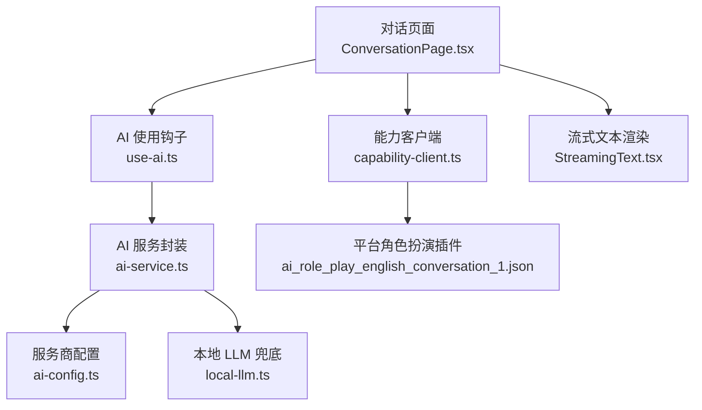
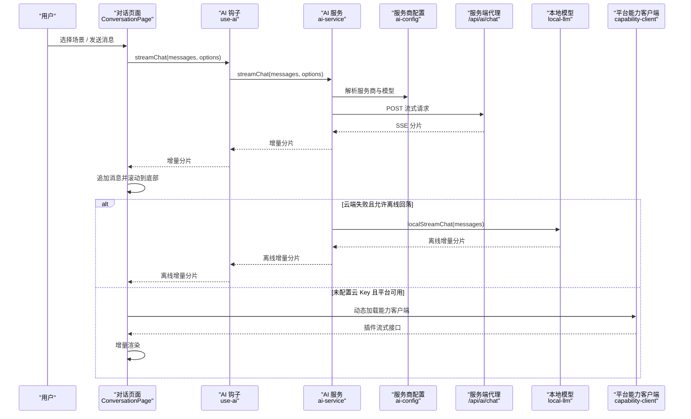
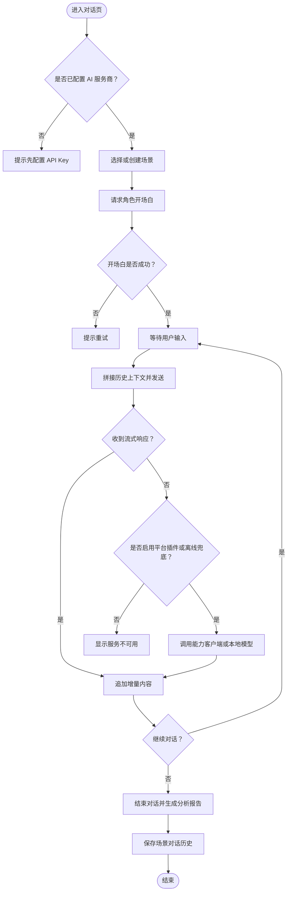
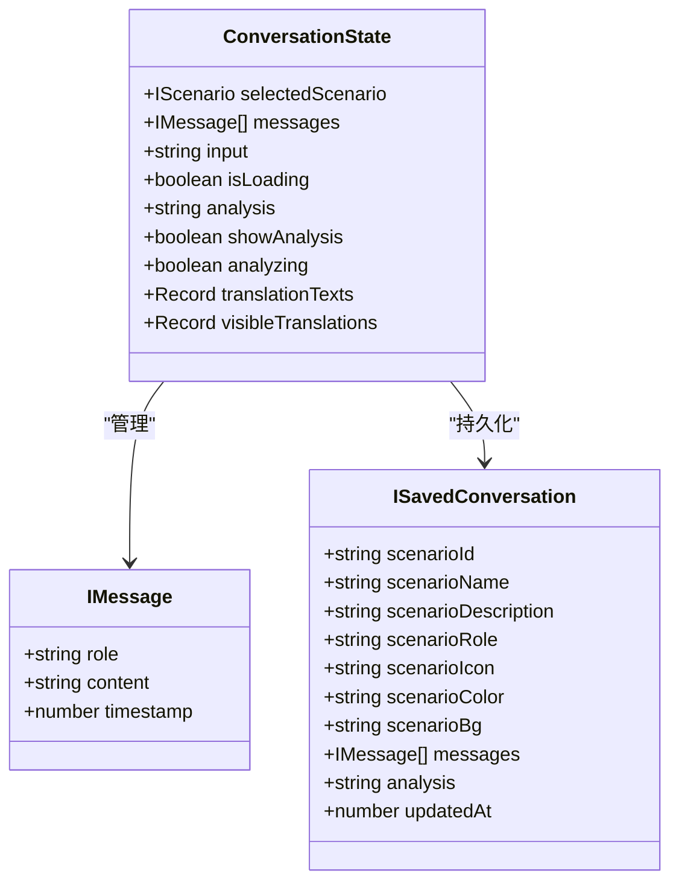
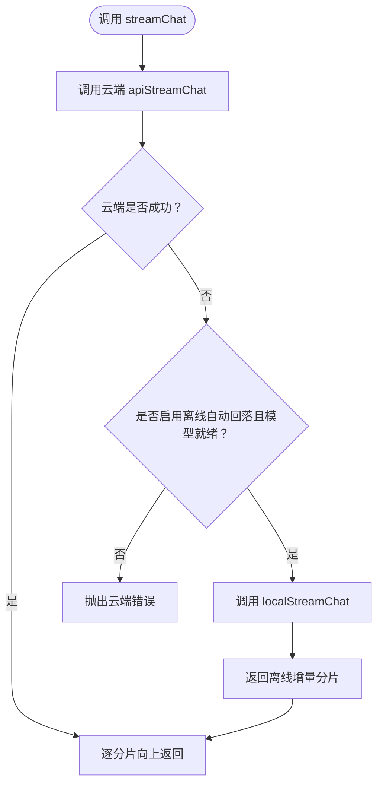
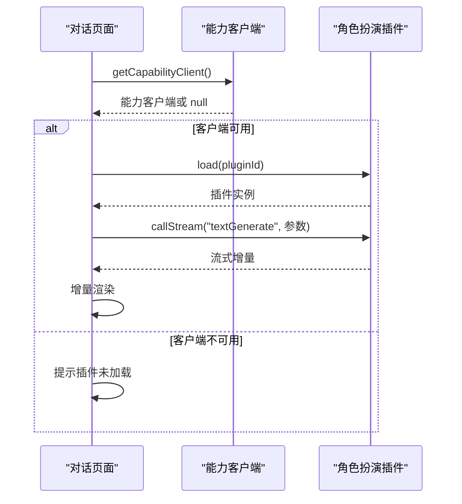
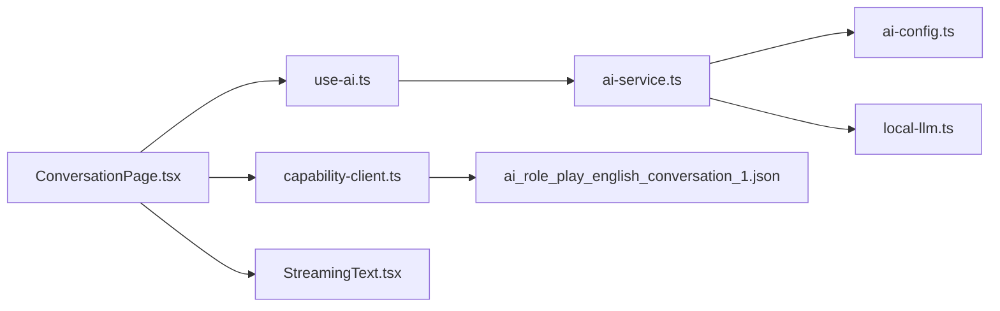

# AI 对话模块

<cite>
**本文引用的文件**   
- [ConversationPage.tsx](file://src/pages/ConversationPage/ConversationPage.tsx)
- [use-ai.ts](file://src/hooks/use-ai.ts)
- [ai-service.ts](file://src/services/ai-service.ts)
- [ai-config.ts](file://src/services/ai-config.ts)
- [StreamingText.tsx](file://src/components/StreamingText.tsx)
- [local-llm.ts](file://src/lib/local-llm.ts)
- [capability-client.ts](file://src/lib/capability-client.ts)
- [ai_role_play_english_conversation_1.json](file://shared/capabilities/ai_role_play_english_conversation_1.json)
</cite>

## 目录
1. [引言](#引言)
2. [项目结构](#项目结构)
3. [核心组件](#核心组件)
4. [架构总览](#架构总览)
5. [详细组件分析](#详细组件分析)
6. [依赖关系分析](#依赖关系分析)
7. [性能与可用性考量](#性能与可用性考量)
8. [故障排查指南](#故障排查指南)
9. [结论](#结论)

## 引言
本文件面向 NativeThink AI 对话模块，重点说明：
- 场景选择与聊天界面的交互设计；
- AI 角色扮演功能如何组织系统提示、上下文与流式输出；
- 消息管理、本地 LLM 离线兜底、云端服务商切换；
- `ConversationPage`、`use-ai.ts`、`ai-service.ts`、`StreamingText.tsx` 的职责边界；
- 能力客户端与角色扮演插件的集成方式；
- 对话历史持久化、上下文构造与性能优化建议。

## 项目结构
AI 对话相关代码分布在页面、钩子、服务、能力客户端和本地模型四个层次：

**图表来源**
- [ConversationPage.tsx:1-200](file://src/pages/ConversationPage/ConversationPage.tsx#L1-L200)
- [use-ai.ts:1-101](file://src/hooks/use-ai.ts#L1-L101)
- [ai-service.ts:1-200](file://src/services/ai-service.ts#L1-L200)
- [ai-config.ts:1-200](file://src/services/ai-config.ts#L1-L200)
- [local-llm.ts:1-200](file://src/lib/local-llm.ts#L1-L200)
- [capability-client.ts:1-23](file://src/lib/capability-client.ts#L1-L23)
- [ai_role_play_english_conversation_1.json:1-50](file://shared/capabilities/ai_role_play_english_conversation_1.json#L1-L50)

**章节来源**
- [ConversationPage.tsx:1-200](file://src/pages/ConversationPage/ConversationPage.tsx#L1-L200)
- [ai-service.ts:1-200](file://src/services/ai-service.ts#L1-L200)

## 核心组件
| 组件 | 职责 | 关键输入 | 关键输出 |
|---|---|---|---|
| `ConversationPage` | 场景选择、对话发送、开场白生成、对话分析、翻译、自动朗读、历史持久化 | 用户输入、已选场景、TTS、自定义场景 | 消息列表、分析结果、持久化会话 |
| `useAI` | 暴露是否已配置服务商、流式与非流式调用、消息构建辅助 | 消息数组、可选参数 | `streamChat`、`chat`、`buildMessages`、`appendUserMessage` |
| `ai-service` | 统一 OpenAI 兼容流式接口、非流式接口、模型与服务商解析、离线兜底 | 消息、任务类型、信号等 | 流式分片、完整回复 |
| `ai-config` | 服务商枚举、出厂 Key、活跃服务商、Key 存储与事件通知 | Provider ID | API Key、默认模型、配置列表 |
| `local-llm` | 浏览器端小模型下载、状态管理、流式离线推理 | 消息、推理参数 | 离线流式 Token |
| `capability-client` | 动态加载平台能力客户端，仅在需要时引入 | 无 | 能力客户端实例或空值 |
| `StreamingText` | 渐进展示最新字符并带光标动画 | 文本、速度、间隔 | 渐进可见文本 |

**章节来源**
- [ConversationPage.tsx:1-200](file://src/pages/ConversationPage/ConversationPage.tsx#L1-L200)
- [use-ai.ts:1-101](file://src/hooks/use-ai.ts#L1-L101)
- [ai-service.ts:1-200](file://src/services/ai-service.ts#L1-L200)
- [ai-config.ts:1-200](file://src/services/ai-config.ts#L1-L200)
- [local-llm.ts:1-200](file://src/lib/local-llm.ts#L1-L200)
- [capability-client.ts:1-23](file://src/lib/capability-client.ts#L1-L23)
- [StreamingText.tsx:1-53](file://src/components/StreamingText.tsx#L1-L53)

## 架构总览
AI 对话的主流程是“界面发起请求 → 钩子包装错误与配置 → 服务层路由到云端或本地模型 → 流式增量写入界面”。

**图表来源**
- [ConversationPage.tsx:201-450](file://src/pages/ConversationPage/ConversationPage.tsx#L201-L450)
- [use-ai.ts:1-101](file://src/hooks/use-ai.ts#L1-L101)
- [ai-service.ts:1-200](file://src/services/ai-service.ts#L1-L200)
- [ai-service.ts:201-368](file://src/services/ai-service.ts#L201-L368)
- [local-llm.ts:1-200](file://src/lib/local-llm.ts#L1-L200)
- [capability-client.ts:1-23](file://src/lib/capability-client.ts#L1-L23)

## 详细组件分析

### 对话页面：场景、消息与生命周期
`ConversationPage` 负责：
- 内置场景与自定义场景的管理；
- 进入场景时由 AI 先开口，生成角色开场白；
- 用户发送消息后，构造历史上下文并发起流式对话；
- 根据是否配置服务商，走云端流式或平台插件流式；
- 提供对话结束后的自然度分析；
- 自动朗读、消息翻译、复制、删除等辅助操作；
- 将每个场景的会话记录持久化到本地存储。

关键点包括：
- 使用 `AbortController` 在切换场景、关闭页面时中断在途请求；
- 使用 `mountedRef` 防止开发环境 StrictMode 导致的挂载时序问题；
- 通过 `safeStorage` 保存按场景分组的对话历史；
- 对“发出去一句”进行学习信用计数，避免重复刷新；
- 分析阶段会抽取纠错条目，补充到纠偏笔记中。

**图表来源**
- [ConversationPage.tsx:1-200](file://src/pages/ConversationPage/ConversationPage.tsx#L1-L200)
- [ConversationPage.tsx:201-450](file://src/pages/ConversationPage/ConversationPage.tsx#L201-L450)

**章节来源**
- [ConversationPage.tsx:1-200](file://src/pages/ConversationPage/ConversationPage.tsx#L1-L200)
- [ConversationPage.tsx:201-450](file://src/pages/ConversationPage/ConversationPage.tsx#L201-L450)

### 消息管理与上下文构造
- 每条消息包含角色、内容、时间戳；
- 开场白阶段只保留一条空的 AI 消息，后续以全量字符串覆盖更新；
- 普通对话阶段先插入用户消息，再插入空的 AI 占位消息；
- 上下文由“说话者标签 + 内容”拼接成多行文本，传给系统提示词；
- 分析阶段复用相同历史格式，但更换为教练风格提示词；
- 场景切换会清空消息、打断旧流、重置加载状态，避免不同场景互相污染。

**图表来源**
- [ConversationPage.tsx:1-200](file://src/pages/ConversationPage/ConversationPage.tsx#L1-L200)

**章节来源**
- [ConversationPage.tsx:1-200](file://src/pages/ConversationPage/ConversationPage.tsx#L1-L200)

### 流式请求钩子：`use-ai.ts`
`useAI` 把服务层的流式与非流式接口包装为 React 友好的返回值：
- `isConfigured`：是否存在至少一个已配置的服务商；
- `configuredProviders`：当前所有已配置服务商列表；
- `streamChat`：遍历服务端流式分片并透传，捕获异常后产出结束标记；
- `chat`：获取完整文本，同样处理中止和静默模式；
- `buildMessages`、`appendUserMessage`：帮助构造 system/user 消息；
- 监听 `AI_CONFIG_CHANGED_EVENT` 与窗口焦点事件，动态刷新配置状态。

错误处理策略：
- `AbortError` 不弹全局提示；
- 非静默模式下弹出错误 toast；
- 流式函数最终仍产出 `{ content: '', done: true }`，保证调用方循环能退出。

**章节来源**
- [use-ai.ts:1-101](file://src/hooks/use-ai.ts#L1-L101)

### 服务封装：`ai-service.ts`
`ai-service.ts` 是云端与本地路径的统一入口：

- 流式接口 `streamChat`：
  - 优先尝试云端 `apiStreamChat`；
  - 若失败且满足离线自动回落条件，则回退到 `localStreamChat`；
  - 支持 `silent` 选项，用于练习界面内联降级而不弹窗。
- 非流式接口 `chat`：
  - 先走云端；
  - 失败后同样可回退本地模型；
  - 返回完整字符串。
- 模型选择：
  - 显式 model 优先；
  - 否则按任务类型选择免费模型；
  - 最后回退到服务商默认免费模型。
- 服务商解析：
  - 优先使用显式指定且有 Key 的服务商；
  - 其次使用活跃服务商；
  - 再取第一个已配置服务商；
  - 最终回退到默认活跃服务商。

**图表来源**
- [ai-service.ts:1-200](file://src/services/ai-service.ts#L1-L200)
- [ai-service.ts:201-368](file://src/services/ai-service.ts#L201-L368)
- [local-llm.ts:1-200](file://src/lib/local-llm.ts#L1-L200)

**章节来源**
- [ai-service.ts:1-200](file://src/services/ai-service.ts#L1-L200)
- [ai-service.ts:201-368](file://src/services/ai-service.ts#L201-L368)

### 服务商配置：`ai-config.ts`
`ai-config.ts` 集中管理：
- 出厂内置 Key 与出厂默认服务商；
- 所有支持的 OpenAI 兼容服务商；
- 各服务商名称、描述、API 地址、默认模型、免费模型、注册链接；
- 从本地存储读取和设置 API Key；
- 获取当前活跃服务商；
- 当 Key 变更时广播事件，让已挂载页面刷新按钮状态。

厂商列表包括：
- 智谱免费（出厂）；
- DeepSeek；
- 豆包；
- 通义千问；
- 智谱 GLM；
- 硅基流动；
- Moonshot；
- Groq。

**章节来源**
- [ai-config.ts:1-200](file://src/services/ai-config.ts#L1-L200)
- [ai-config.ts:201-206](file://src/services/ai-config.ts#L201-L206)

### 本地 LLM 集成：离线兜底
`local-llm.ts` 实现浏览器端小模型兜底：
- 模型标识指向 Qwen2.5-0.5B-Instruct ONNX；
- 首次通过 transformers.js 懒加载；
- 支持安装包内置模型检测；
- 中文环境优先尝试镜像源；
- 提供下载进度、订阅回调、状态查询；
- 支持清除缓存并重置状态；
- 流式接口基于 TextStreamer 的回调队列，以异步生成器形式返回 token；
- 兜底时限制最大 token，避免长输出拖慢低端设备。

注意事项：
- 模型体积约数百 MB，适合有稳定网络的首次下载或安装包内置；
- 离线质量定位是“可用”，不是“好用”；
- 自动回落需用户明确开启，且模型必须就绪。

**章节来源**
- [local-llm.ts:1-200](file://src/lib/local-llm.ts#L1-L200)
- [local-llm.ts:201-204](file://src/lib/local-llm.ts#L201-L204)

### 能力客户端与角色扮演插件
当未配置云端 AI Key 时，对话页面尝试动态加载平台能力客户端：
- `getCapabilityClient` 仅在实际进入该分支时才动态 import；
- 加载失败会清理 pending 状态，避免一次网络抖动永久阻塞；
- 成功后通过插件 ID 加载角色扮演插件；
- 插件定义位于 `ai_role_play_english_conversation_1.json`，包含参数 schema、表单值、模板 prompt；
- 插件要求英文回复、符合角色身份、控制长度、根据难度调整复杂度，并可标注语法错误。

**图表来源**
- [capability-client.ts:1-23](file://src/lib/capability-client.ts#L1-L23)
- [ai_role_play_english_conversation_1.json:1-50](file://shared/capabilities/ai_role_play_english_conversation_1.json#L1-L50)
- [ConversationPage.tsx:201-450](file://src/pages/ConversationPage/ConversationPage.tsx#L201-L450)

**章节来源**
- [capability-client.ts:1-23](file://src/lib/capability-client.ts#L1-L23)
- [ai_role_play_english_conversation_1.json:1-50](file://shared/capabilities/ai_role_play_english_conversation_1.json#L1-L50)
- [ConversationPage.tsx:201-450](file://src/pages/ConversationPage/ConversationPage.tsx#L201-L450)

### 流式渲染组件：`StreamingText.tsx`
`StreamingText` 负责渐进展示文本：
- 根据 `speed` 与 `interval` 逐步增加可见字符数；
- 尊重系统“减少动态效果”偏好，直接显示全文；
- 将已稳定部分与最新入站部分拆分渲染，并附加光标样式；
- 每次变化使用 key 驱动最新片段重渲染；
- 适用于模拟打字机风格的 AI 输出。

虽然对话页面主要使用 `for await` 直接追加消息，但该组件可作为其他场景中统一流式文本展示的轻量方案。

**章节来源**
- [StreamingText.tsx:1-53](file://src/components/StreamingText.tsx#L1-L53)

## 依赖关系分析

**图表来源**
- [ConversationPage.tsx:1-200](file://src/pages/ConversationPage/ConversationPage.tsx#L1-L200)
- [use-ai.ts:1-101](file://src/hooks/use-ai.ts#L1-L101)
- [ai-service.ts:1-200](file://src/services/ai-service.ts#L1-L200)
- [ai-config.ts:1-200](file://src/services/ai-config.ts#L1-L200)
- [local-llm.ts:1-200](file://src/lib/local-llm.ts#L1-L200)
- [capability-client.ts:1-23](file://src/lib/capability-client.ts#L1-L23)
- [ai_role_play_english_conversation_1.json:1-50](file://shared/capabilities/ai_role_play_english_conversation_1.json#L1-L50)
- [StreamingText.tsx:1-53](file://src/components/StreamingText.tsx#L1-L53)

耦合特点：
- 页面层依赖钩子与服务层，但不直接感知服务商细节；
- 服务层屏蔽了云端与本地的差异；
- 配置层独立于运行时调用链，便于设置界面统一管理；
- 能力客户端采用惰性加载，避免主包膨胀；
- 本地模型作为兜底路径，不影响正常云端流程。

**章节来源**
- [ConversationPage.tsx:1-200](file://src/pages/ConversationPage/ConversationPage.tsx#L1-L200)
- [ai-service.ts:1-200](file://src/services/ai-service.ts#L1-L200)

## 性能与可用性考量

### 流式性能
- 云端流式通过服务端代理 `/api/ai/chat` 返回 SSE，前端逐行解码 JSON；
- 本地模型流式基于回调队列，避免一次性生成造成 UI 卡顿；
- 离线兜底限制最大 token，降低低端设备压力；
- 自动朗读只截取最近约 500 个字符，避免长语音播放影响交互。

### 内存与渲染
- 对话历史以字符串拼接方式传给后端，需注意超长上下文可能带来额外传输与解析成本；
- 每收到一个增量都调用 `setMessages`，高频增量下应考虑合并更新或使用更细粒度的状态隔离；
- `StreamingText` 每次增量都会重新计算稳定段与入栈段，适合短文本增量，不适合超大整段反复替换。

### 网络与降级
- 云端失败时，如果用户开启离线自动回落且模型已就绪，则自动切换到本地模型；
- 若未配置云端 Key，可尝试平台能力客户端；
- 两种降级路径都有“插件未加载”或“服务暂不可用”的用户反馈，避免静默失败。

### 配置与切换
- 新增服务商只需在 `ai-config.ts` 中添加配置；
- 活跃服务商通过本地存储切换；
- 出厂 Key 与用户 Key 分离，出厂选项始终使用内置 Key；
- 任务类型可区分翻译与对话，从而选择更合适免费模型。

[本节为通用指导，不直接分析具体代码行]

## 故障排查指南

| 现象 | 可能原因 | 排查步骤 |
|---|---|---|
| 进入对话页空白且不报错 | 开发环境 StrictMode 导致挂载标志未正确恢复 | 检查页面初始化逻辑中的挂载标志与 effect 清理 |
| 切换场景后输入框禁用 | 上一场景的流仍在写入新场景的消息 | 确认切换场景前是否中断旧 AbortController 并重置 loading |
| 开场白为空 | AI 服务不可用或返回空内容 | 查看 toast 提示、检查服务商 Key 与网络连接 |
| 云端报错但无离线兜底 | 未开启离线自动回落或模型未下载 | 打开 AI 设置，检查本地模型状态并启用自动回落 |
| 平台插件提示未加载 | 不在平台环境或动态加载失败 | 检查 `capability-client` 动态 import 是否被拦截 |
| 本地模型一直下载失败 | 网络不可达、镜像源不可用、安装包未内置模型 | 检查是否有内置模型、切换镜像源或手动触发下载 |
| 分析结果为空 | 流式正常结束但内容为空 | 查看是否调用失败但未正确提示，或 AI 未返回结构化内容 |

**章节来源**
- [ConversationPage.tsx:1-200](file://src/pages/ConversationPage/ConversationPage.tsx#L1-L200)
- [ConversationPage.tsx:201-450](file://src/pages/ConversationPage/ConversationPage.tsx#L201-L450)
- [ai-service.ts:201-368](file://src/services/ai-service.ts#L201-L368)
- [local-llm.ts:1-200](file://src/lib/local-llm.ts#L1-L200)
- [capability-client.ts:1-23](file://src/lib/capability-client.ts#L1-L23)

## 结论
NativeThink AI 对话模块围绕“场景驱动的英语对话练习”展开：
- `ConversationPage` 负责场景、消息、上下文、分析与持久化；
- `use-ai.ts` 提供简洁的流式与非流式调用接口；
- `ai-service.ts` 统一云端与本地路径，并负责模型和服务商解析；
- `ai-config.ts` 集中管理服务商配置与出厂 Key；
- `local-llm.ts` 提供断网或限流时的离线兜底；
- `capability-client.ts` 与角色扮演插件构成平台侧备选路径；
- `StreamingText.tsx` 提供轻量流式文本展示。

整体架构强调“云端优先、本地兜底、平台备用”，并通过事件机制与本地存储实现配置热更新与会话持久化。生产环境中建议优先配置至少一个稳定的云端服务商，并根据目标设备情况决定是否启用本地离线模型。