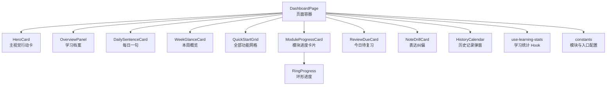
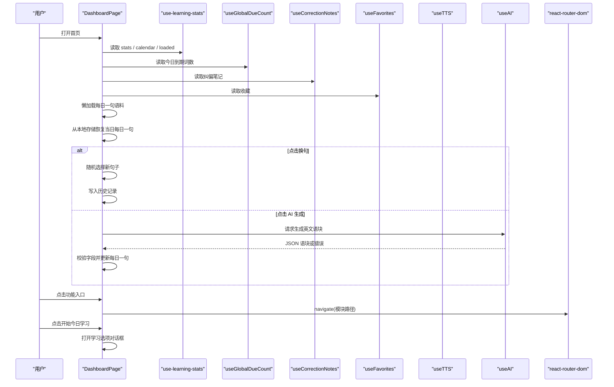
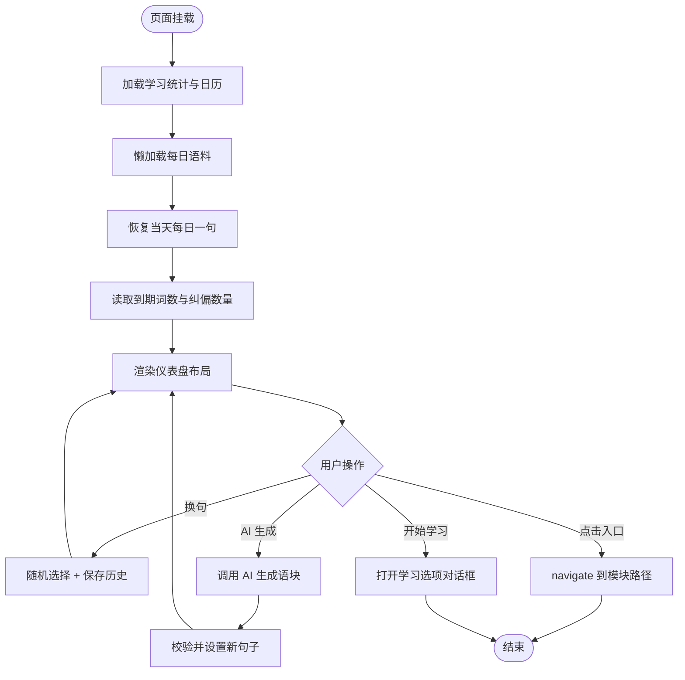
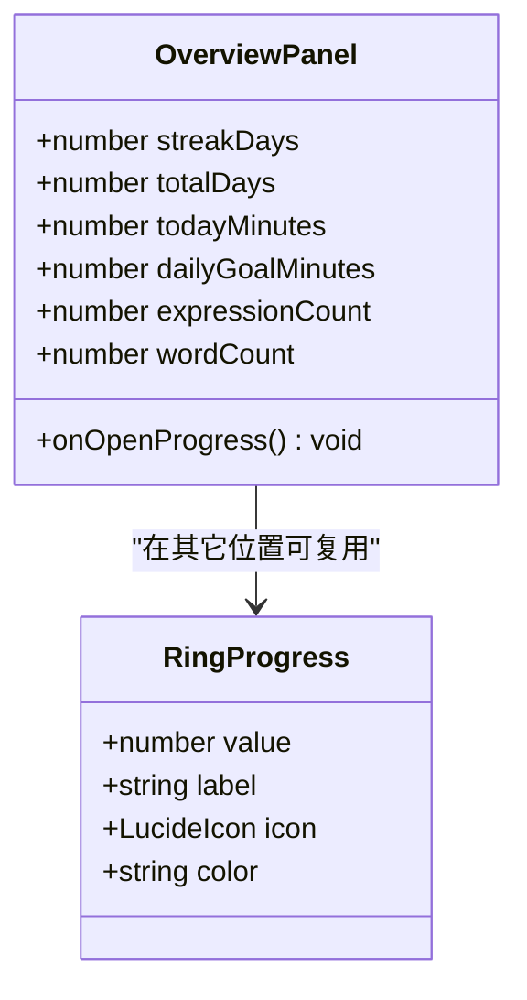
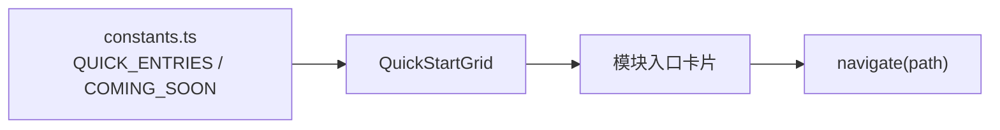
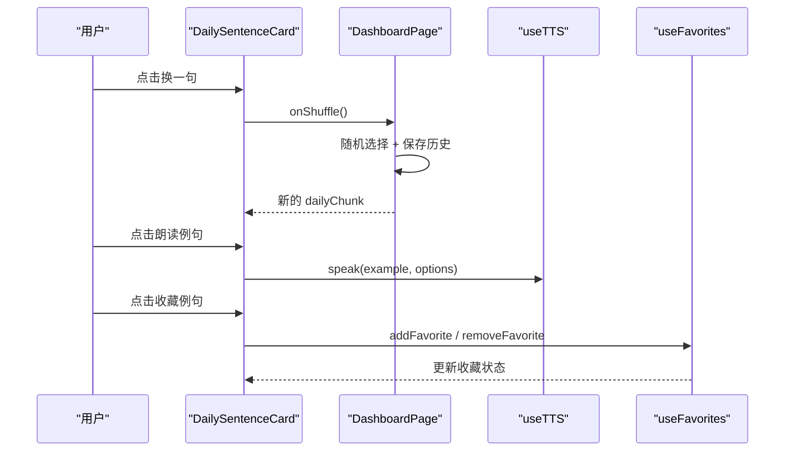
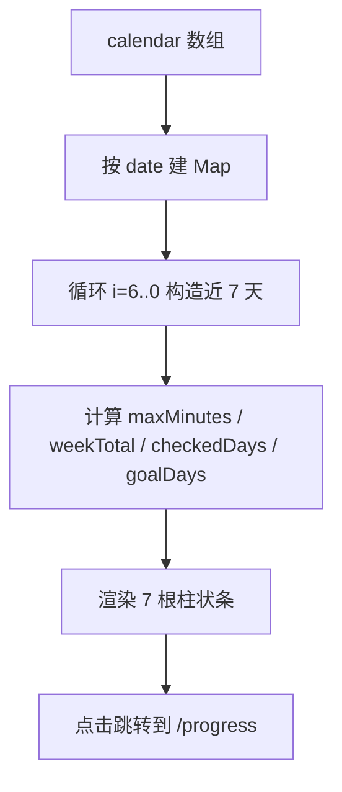
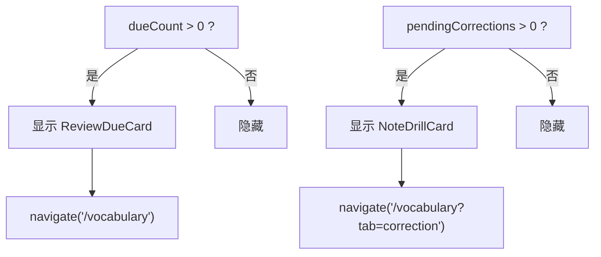
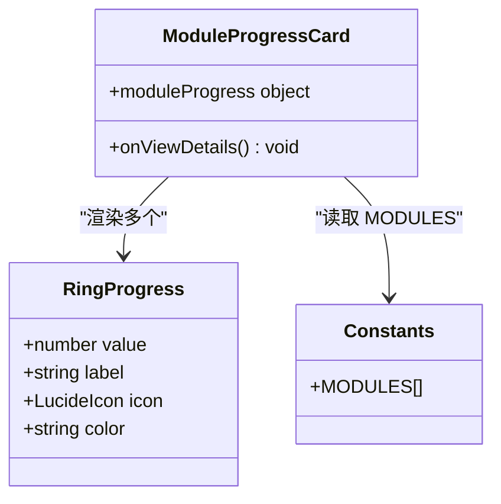
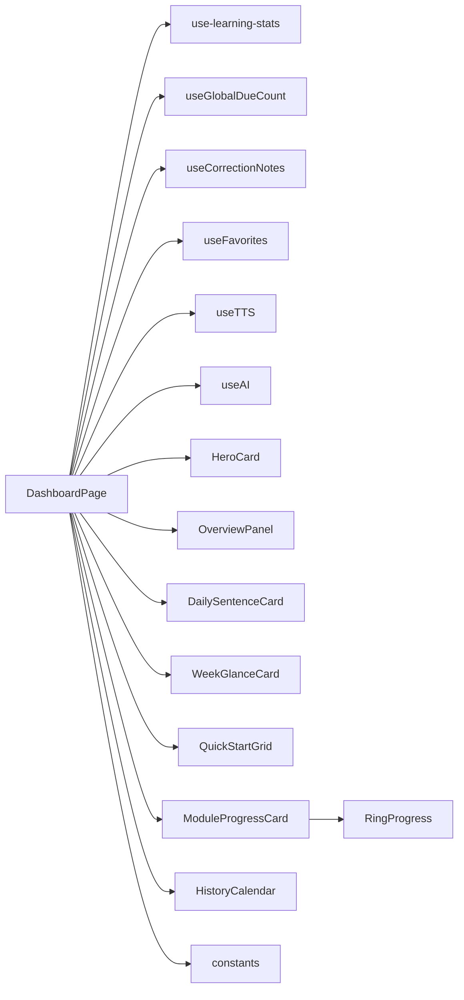

# 仪表盘模块

<cite>
**本文引用的文件**   
- [DashboardPage.tsx](file://src/pages/DashboardPage/DashboardPage.tsx)
- [OverviewPanel.tsx](file://src/pages/DashboardPage/OverviewPanel.tsx)
- [QuickStartGrid.tsx](file://src/pages/DashboardPage/QuickStartGrid.tsx)
- [use-learning-stats.ts](file://src/lib/use-learning-stats.ts)
- [RingProgress.tsx](file://src/pages/DashboardPage/RingProgress.tsx)
- [WeekGlanceCard.tsx](file://src/pages/DashboardPage/WeekGlanceCard.tsx)
- [DailySentenceCard.tsx](file://src/pages/DashboardPage/DailySentenceCard.tsx)
- [ReviewDueCard.tsx](file://src/pages/DashboardPage/ReviewDueCard.tsx)
- [ModuleProgressCard.tsx](file://src/pages/DashboardPage/ModuleProgressCard.tsx)
- [HeroCard.tsx](file://src/pages/DashboardPage/HeroCard.tsx)
- [HistoryCalendar.tsx](file://src/pages/DashboardPage/HistoryCalendar.tsx)
- [NoteDrillCard.tsx](file://src/pages/DashboardPage/NoteDrillCard.tsx)
- [constants.ts](file://src/pages/DashboardPage/constants.ts)
</cite>

## 目录
1. [简介](#简介)
2. [项目结构](#项目结构)
3. [核心组件](#核心组件)
4. [架构总览](#架构总览)
5. [详细组件分析](#详细组件分析)
6. [依赖关系分析](#依赖关系分析)
7. [性能与可扩展性](#性能与可扩展性)
8. [常见问题排查](#常见问题排查)
9. [结论](#结论)
10. [附录：配置与复用指南](#附录配置与复用指南)

## 简介
NativeThink 仪表盘模块是应用的首页入口，承担“学习导航 + 进度可视化 + 快速开始”三大职责。它把每日一句、本周学习概览、待复习提醒、快速功能网格和各模块进度卡片组合成一张可响应式布局的首页面板；数据主要来自 `use-learning-stats` 暴露的学习统计、日历记录以及全局到期词数、收藏和纠偏数据。

该模块的设计目标是：
- 让用户一眼看到今日目标、连续打卡天数和学习路径。
- 提供“继续上次学习”“今日待复习”“表达纠偏”等强意图入口。
- 通过“全部功能”网格引导用户进入句子学习、词汇深度、文章阅读、母语思维训练等具体模块。
- 用环形进度、柱状图和日历展示学习沉淀，避免首页信息过载。

## 项目结构
仪表盘模块采用“页面容器 + 子卡片 + 共享常量”的组织方式：
- `DashboardPage.tsx`：页面级容器，负责状态装配、路由跳转、AI 生成、历史记忆与整体布局。
- `OverviewPanel.tsx`：右侧“学习档案”，聚合连续天数、今日目标环、收藏数量等关键指标。
- `QuickStartGrid.tsx`：左侧“全部功能”网格，按学习路径排序展示模块入口。
- `DailySentenceCard.tsx`：每日一句卡片，支持换句、AI 生成、朗读、翻译、收藏和最近历史。
- `WeekGlanceCard.tsx`：本周学习柱状图，基于本地日历数据计算近 7 天学习时长。
- `ModuleProgressCard.tsx` + `RingProgress.tsx`：各模块进度环形图。
- `ReviewDueCard.tsx` + `NoteDrillCard.tsx`：顶部横幅，分别提示间隔重复到期和纠偏重考。
- `HeroCard.tsx`：主视觉行动卡，强调“母语思维”品牌语和行动按钮。
- `HistoryCalendar.tsx`：每日一句历史记录弹窗。
- `constants.ts`：模块列表、快捷入口、星期名称和学习选项等静态配置。

**图表来源**
- [DashboardPage.tsx:1-439](file://src/pages/DashboardPage/DashboardPage.tsx#L1-L439)
- [OverviewPanel.tsx:1-112](file://src/pages/DashboardPage/OverviewPanel.tsx#L1-L112)
- [QuickStartGrid.tsx:1-75](file://src/pages/DashboardPage/QuickStartGrid.tsx#L1-L75)
- [DailySentenceCard.tsx:1-254](file://src/pages/DashboardPage/DailySentenceCard.tsx#L1-L254)
- [WeekGlanceCard.tsx:1-103](file://src/pages/DashboardPage/WeekGlanceCard.tsx#L1-L103)
- [ModuleProgressCard.tsx:1-54](file://src/pages/DashboardPage/ModuleProgressCard.tsx#L1-L54)
- [RingProgress.tsx:1-62](file://src/pages/DashboardPage/RingProgress.tsx#L1-L62)
- [use-learning-stats.ts:1-326](file://src/lib/use-learning-stats.ts#L1-L326)
- [constants.ts:1-132](file://src/pages/DashboardPage/constants.ts#L1-L132)

**章节来源**
- [DashboardPage.tsx:1-439](file://src/pages/DashboardPage/DashboardPage.tsx#L1-L439)
- [constants.ts:1-132](file://src/pages/DashboardPage/constants.ts#L1-L132)

## 核心组件
仪表盘的核心由以下组件构成：

| 组件 | 职责 | 主要输入 | 行为与输出 |
|---|---|---|---|
| `DashboardPage` | 页面容器、状态装配、路由跳转、AI 每日一句、历史记录 | 学习统计、到期词数、收藏、纠错笔记、TTS、AI | 渲染所有子卡片，打开“开始今日学习”对话框和历史日历 |
| `HeroCard` | 主视觉行动卡 | 今日分钟数、每日目标、到期词数 | 显示品牌标语、学习目标进度条、开始学习按钮 |
| `OverviewPanel` | 学习档案聚合面板 | 连续天数、累计天数、今日分钟、每日目标、收藏表达、收藏单词 | 显示大号连续天数、今日目标环、四项统计值 |
| `DailySentenceCard` | 每日一句交互卡片 | 当前句子、例句中文、加载状态、收藏状态、近期历史 | 换句、AI 生成、朗读、复制、翻译、收藏、查看历史 |
| `WeekGlanceCard` | 本周学习柱状图 | 日历记录、每日目标、导航函数 | 计算近 7 天学习时长并绘制柱状图 |
| `QuickStartGrid` | 全部功能网格 | 导航函数 | 渲染 `QUICK_ENTRIES` 和 `COMING_SOON` 入口 |
| `ModuleProgressCard` | 各模块进度汇总 | 模块进度对象、查看详情回调 | 渲染多个 `RingProgress` |
| `RingProgress` | 环形进度图 | 百分比、标签、图标、颜色 | 使用 SVG 圆环展示百分比 |
| `ReviewDueCard` | 今日待复习横幅 | 到期词数、导航函数 | 到期数大于 0 时显示，跳转到词汇页 |
| `NoteDrillCard` | 表达纠偏横幅 | 待重考数量、导航函数 | 未重考数量大于 0 时显示，跳转到词汇纠偏 |
| `HistoryCalendar` | 每日一句历史弹窗 | 历史记录、月份状态、月份数据 | 月历视图 + 当月条目列表 |
| `constants` | 静态配置 | 无 | 模块列表、快捷入口、学习选项、星期名称 |

**章节来源**
- [DashboardPage.tsx:1-439](file://src/pages/DashboardPage/DashboardPage.tsx#L1-L439)
- [OverviewPanel.tsx:1-112](file://src/pages/DashboardPage/OverviewPanel.tsx#L1-L112)
- [QuickStartGrid.tsx:1-75](file://src/pages/DashboardPage/QuickStartGrid.tsx#L1-L75)
- [DailySentenceCard.tsx:1-254](file://src/pages/DashboardPage/DailySentenceCard.tsx#L1-L254)
- [WeekGlanceCard.tsx:1-103](file://src/pages/DashboardPage/WeekGlanceCard.tsx#L1-L103)
- [ModuleProgressCard.tsx:1-54](file://src/pages/DashboardPage/ModuleProgressCard.tsx#L1-L54)
- [RingProgress.tsx:1-62](file://src/pages/DashboardPage/RingProgress.tsx#L1-L62)
- [ReviewDueCard.tsx:1-40](file://src/pages/DashboardPage/ReviewDueCard.tsx#L1-L40)
- [NoteDrillCard.tsx:1-45](file://src/pages/DashboardPage/NoteDrillCard.tsx#L1-L45)
- [HistoryCalendar.tsx:1-150](file://src/pages/DashboardPage/HistoryCalendar.tsx#L1-L150)
- [constants.ts:1-132](file://src/pages/DashboardPage/constants.ts#L1-L132)

## 架构总览
仪表盘的数据流可以概括为：

**图表来源**
- [DashboardPage.tsx:1-439](file://src/pages/DashboardPage/DashboardPage.tsx#L1-L439)
- [use-learning-stats.ts:1-326](file://src/lib/use-learning-stats.ts#L1-L326)

## 详细组件分析

### DashboardPage：页面容器与状态中枢
`DashboardPage` 是仪表盘唯一页面组件，承担以下职责：
1. **数据装配**：调用 `useLearningStats` 获取 `stats`、`calendar`、`loaded`；调用 `useGlobalDueCount` 获取到期词数；调用 `useCorrectionNotes` 计算纠偏待重考数量；调用 `useFavorites` 管理收藏；调用 `useTTS` 和 `useAI` 提供语音与 AI 能力。
2. **每日一句生命周期**：懒加载 `MOCK_CHUNKS`，按日期持久化当日句子，避免同一天刷新多次更换句子；首次挂载后将句子写入本地历史。
3. **历史记录管理**：维护每日一句历史数组，按日期分组构建月历数据，支持上/下月切换、回到今天、去重保存。
4. **继续上次学习**：从本地存储读取最近一次访问的路径和标签，并在 14 天内显示“继续上次学习”入口。
5. **目标达成庆祝**：当 `todayMinutes >= dailyGoalMinutes` 且目标大于 0 时，触发一次成功提示。
6. **布局编排**：将“继续上次学习 + 待复习 + 纠偏”放在首行网格；主视觉 `HeroCard` 与学习档案 `OverviewPanel` 并列；下方放置每日一句、本周概览和快速开始网格；底部展示模块进度。
7. **跳转集成**：通过 `navigate` 跳转到 `/think`、`/chunks`、`/conversation`、`/shadowing`、`/vocabulary`、`/articles`、`/sentences`、`/favorites`、`/writing`、`/spelling`、`/video`、`/progress` 等功能页。

**图表来源**
- [DashboardPage.tsx:1-439](file://src/pages/DashboardPage/DashboardPage.tsx#L1-L439)

**章节来源**
- [DashboardPage.tsx:1-439](file://src/pages/DashboardPage/DashboardPage.tsx#L1-L439)

### OverviewPanel：学习档案聚合面板
`OverviewPanel` 将原来分散的统计卡片整合为一个紧凑面板：
- 左侧显示大号连续天数、累计天数和今日学习分钟数。
- 右侧使用内嵌 SVG 圆环展示今日目标完成百分比。
- 底部四格展示“今日已学”“每日目标”“收藏表达”“收藏单词”。
- 右上角“全部记录”按钮跳转到 `/progress`。

其内部计算逻辑：
- 如果 `dailyGoalMinutes` 为 0，则回退为 30 分钟作为默认目标。
- 百分比上限为 100%。
- 圆环半径固定为 30，周长通过 `2πr` 计算，并通过 `strokeDashoffset` 控制进度。

**图表来源**
- [OverviewPanel.tsx:1-112](file://src/pages/DashboardPage/OverviewPanel.tsx#L1-L112)
- [RingProgress.tsx:1-62](file://src/pages/DashboardPage/RingProgress.tsx#L1-L62)

**章节来源**
- [OverviewPanel.tsx:1-112](file://src/pages/DashboardPage/OverviewPanel.tsx#L1-L112)

### QuickStartGrid：全部功能网格
`QuickStartGrid` 是模块入口的主要组织者：
- 标题显示模块总数，来源于 `QUICK_ENTRIES.length`。
- 使用两列或三列网格（移动端两列，桌面端三列）。
- 每个入口包含序号、标签、描述和悬停动效。
- “即将上线”占位卡片不可点击，仅用于展示未来规划。

该组件完全由 `constants.ts` 中的 `QUICK_ENTRIES` 和 `COMING_SOON` 驱动，新增模块只需修改常量即可。

**图表来源**
- [QuickStartGrid.tsx:1-75](file://src/pages/DashboardPage/QuickStartGrid.tsx#L1-L75)
- [constants.ts:1-132](file://src/pages/DashboardPage/constants.ts#L1-L132)

**章节来源**
- [QuickStartGrid.tsx:1-75](file://src/pages/DashboardPage/QuickStartGrid.tsx#L1-L75)
- [constants.ts:1-132](file://src/pages/DashboardPage/constants.ts#L1-L132)

### DailySentenceCard：每日一句交互卡片
`DailySentenceCard` 负责展示和交互每日一句：
- 展示英文内容、中文释义、分类和难度标签。
- 提供“历史记录”“换一句”“AI 生成”按钮。
- 支持朗读英文内容和例句，复制链接文本，复制英文加释义和例句。
- 支持收藏句子和例句，收藏状态来自 `useFavorites`。
- 展示最近的三条非当前句子历史，并提供历史弹窗入口。
- 示例中文翻译由父组件 `DashboardPage` 通过 `exampleZh` 传入，并由 `StreamingText` 流式展示。

**图表来源**
- [DailySentenceCard.tsx:1-254](file://src/pages/DashboardPage/DailySentenceCard.tsx#L1-L254)
- [DashboardPage.tsx:1-439](file://src/pages/DashboardPage/DashboardPage.tsx#L1-L439)

**章节来源**
- [DailySentenceCard.tsx:1-254](file://src/pages/DashboardPage/DailySentenceCard.tsx#L1-L254)

### WeekGlanceCard：本周学习柱状图
`WeekGlanceCard` 基于 `use-learning-stats` 返回的 `calendar` 渲染最近 7 天的学习柱状图：
- 使用 `formatDate` 生成日期字符串键，再查表取对应记录。
- 不直接取 `calendar.slice(-7)`，因为日历只在超出 31 天窗口时才追加新记录，直接切片会把“今天”丢掉。
- 每根柱子高度按当日分钟数与最大值的比例计算。
- 达标日高亮，未达标但有学习记录使用半透明色，零学习使用 muted 色。
- 点击整张卡片跳转到 `/progress`。

**图表来源**
- [WeekGlanceCard.tsx:1-103](file://src/pages/DashboardPage/WeekGlanceCard.tsx#L1-L103)
- [use-learning-stats.ts:1-326](file://src/lib/use-learning-stats.ts#L1-L326)

**章节来源**
- [WeekGlanceCard.tsx:1-103](file://src/pages/DashboardPage/WeekGlanceCard.tsx#L1-L103)

### ReviewDueCard 与 NoteDrillCard：顶部提醒横幅
两个横幅组件遵循同一设计原则：**没有待办就不渲染**，避免占用空间。

- `ReviewDueCard`：基于 `useGlobalDueCount` 的到期词数，大于 0 时显示“间隔重复复习”横幅，点击跳转到 `/vocabulary`。
- `NoteDrillCard`：基于纠偏笔记中尚未重认的数量，大于 0 时显示“表达纠偏”横幅，点击跳转到 `/vocabulary?tab=correction`。

**图表来源**
- [ReviewDueCard.tsx:1-40](file://src/pages/DashboardPage/ReviewDueCard.tsx#L1-L40)
- [NoteDrillCard.tsx:1-45](file://src/pages/DashboardPage/NoteDrillCard.tsx#L1-L45)

**章节来源**
- [ReviewDueCard.tsx:1-40](file://src/pages/DashboardPage/ReviewDueCard.tsx#L1-L40)
- [NoteDrillCard.tsx:1-45](file://src/pages/DashboardPage/NoteDrillCard.tsx#L1-L45)

### ModuleProgressCard 与 RingProgress：模块进度环形图
`ModuleProgressCard` 根据 `constants.ts` 中的 `MODULES` 列表渲染多个 `RingProgress`，展示各模块学习进度百分比。`RingProgress` 是一个纯展示组件，接收百分比、标签、图标和颜色，使用 SVG 圆环实现动画进度。

**图表来源**
- [ModuleProgressCard.tsx:1-54](file://src/pages/DashboardPage/ModuleProgressCard.tsx#L1-L54)
- [RingProgress.tsx:1-62](file://src/pages/DashboardPage/RingProgress.tsx#L1-L62)
- [constants.ts:1-132](file://src/pages/DashboardPage/constants.ts#L1-L132)

**章节来源**
- [ModuleProgressCard.tsx:1-54](file://src/pages/DashboardPage/ModuleProgressCard.tsx#L1-L54)
- [RingProgress.tsx:1-62](file://src/pages/DashboardPage/RingProgress.tsx#L1-L62)
- [constants.ts:1-132](file://src/pages/DashboardPage/constants.ts#L1-L132)

### HeroCard：主视觉行动卡
`HeroCard` 是首页的品牌主视觉：
- 背景使用深色主题和大脑水印图标。
- 右上角显示“今日分钟数 / 每日目标”。
- 中间是品牌标语和行动文案。
- 下方显示“到期词”“新词”“短文”“纠偏”学习路径。
- 最下方是“开始今日学习”按钮和今日目标进度条。

**章节来源**
- [HeroCard.tsx:1-99](file://src/pages/DashboardPage/HeroCard.tsx#L1-L99)

### HistoryCalendar：每日一句历史弹窗
`HistoryCalendar` 以弹窗形式展示每日一句的历史：
- 支持上/下月切换。
- 显示当月有记录的日期数量和总条目数量。
- 使用 7 列网格展示日历，有记录的日期显示小圆点，超过两条显示“+N”。
- 下方列出当月每天的句子、释义和例句。

**章节来源**
- [HistoryCalendar.tsx:1-150](file://src/pages/DashboardPage/HistoryCalendar.tsx#L1-L150)

## 依赖关系分析

**图表来源**
- [DashboardPage.tsx:1-439](file://src/pages/DashboardPage/DashboardPage.tsx#L1-L439)
- [use-learning-stats.ts:1-326](file://src/lib/use-learning-stats.ts#L1-L326)
- [constants.ts:1-132](file://src/pages/DashboardPage/constants.ts#L1-L132)

### 耦合与内聚
- `DashboardPage` 是最高层协调者，耦合较多外部 Hook，但本身不直接读写本地存储细节，而是通过 Hook 和子组件暴露的回调完成。
- `constants.ts` 是仪表盘模块的可扩展配置中心，新增模块通常只需要修改该文件。
- `RingProgress` 是低耦合展示组件，可被 `ModuleProgressCard` 和 `OverviewPanel` 复用。
- `QuickStartGrid` 与 `constants.ts` 强关联，属于配置驱动型组件。

### 外部依赖
- React Router：`useNavigate` 负责页面跳转。
- Lucide 图标：大量 UI 图标。
- Sonner 通知：`toast.success` / `toast.error`。
- 本地存储：`safeStorage` 用于每日一句、历史记录、最后访问记录等。
- AI 服务：`useAI` 提供每日一句生成和例句翻译。
- TTS：`useTTS` 提供朗读能力。

**章节来源**
- [DashboardPage.tsx:1-439](file://src/pages/DashboardPage/DashboardPage.tsx#L1-L439)
- [use-learning-stats.ts:1-326](file://src/lib/use-learning-stats.ts#L1-L326)

## 性能与可扩展性

### 性能特征
1. **懒加载每日语料**：`DashboardPage` 通过动态 `import('@/data/chunks')` 延迟加载约 146KB 的语料数据，避免阻塞主包加载。
2. **本地存储优先**：学习统计、日历、每日一句、历史记录、最后访问记录都优先从本地存储读取，减少网络依赖。
3. **跨实例同步**：`use-learning-stats` 通过 `STATS_CHANGED_EVENT` 和 `CALENDAR_CHANGED_EVENT` 在多个浏览器标签页之间同步数据。
4. **组件 memo 优化**：多数子组件使用 `memo` 包裹，避免父组件重渲染导致的无效重绘。
5. **条件渲染横幅**：`ReviewDueCard` 和 `NoteDrillCard` 在数据为空时直接返回 null，避免无意义 DOM。

### 可扩展点
- 新增模块：在 `constants.ts` 的 `QUICK_ENTRIES`、`MODULES`、`LEARNING_OPTIONS` 中添加条目。
- 新增统计维度：扩展 `ILearningStats.moduleProgress` 并在 `MODULE_PROGRESS_KEYS` 白名单中加入新键。
- 新增每日一句来源：可在 `DashboardPage` 中增加新的数据源分支，但需保持与 `IChunk` 类型兼容。
- 新增提醒横幅：参考 `ReviewDueCard` 和 `NoteDrillCard` 的模式，创建零态隐藏、非零态显示的横幅组件。

### 潜在风险
- `DashboardPage` 状态较多，包括每日一句、历史记录、学习对话框、历史日历、最后访问记录等，后续可考虑拆分更细粒度的子容器。
- AI 生成失败和格式异常需要前端容错，当前已通过 toast 和用户提示处理。
- 本地存储解析失败会被静默忽略，调试时需留意存储损坏场景。

[本节为通用性能讨论，不直接分析具体代码片段]

## 常见问题排查

### 每日一句每天变化
问题：每次刷新首页都会换一句，导致“每日一句”语义失效。  
原因：旧逻辑每次挂载重新随机，并把随机结果写进历史。  
修复方向：按日期持久化当日句子，只有日期变化才更换。

**章节来源**
- [DashboardPage.tsx:1-439](file://src/pages/DashboardPage/DashboardPage.tsx#L1-L439)

### AI 生成报错或格式异常
问题：AI 返回空串或非法 JSON。  
处理方式：
- 空串视为服务不可用，提示“AI 服务暂不可用”。
- JSON 解析失败提示“AI 返回格式异常”。
- 缺少 `content` 或 `meaning` 提示“AI 生成内容不完整”。
- category 和 difficulty 会落入合法枚举范围。

**章节来源**
- [DashboardPage.tsx:1-439](file://src/pages/DashboardPage/DashboardPage.tsx#L1-L439)

### 周柱状图错位
问题：直接取 `calendar.slice(-7)` 导致“今天”丢失，柱状图整体偏移一天。  
原因：日历只在超出 31 天窗口后才 push 新记录，尾部不一定是今天。  
解决：使用 `formatDate` 循环生成近 7 天日期字符串，再查表取值。

**章节来源**
- [WeekGlanceCard.tsx:1-103](file://src/pages/DashboardPage/WeekGlanceCard.tsx#L1-L103)

### 学习统计出现废弃键
问题：老用户 localStorage 中存在已废弃模块键，导致统计图表颜色 undefined。  
解决：`use-learning-stats` 使用白名单投影 `MODULE_PROGRESS_KEYS`，只读取有效键，其余丢弃。

**章节来源**
- [use-learning-stats.ts:1-326](file://src/lib/use-learning-stats.ts#L1-L326)

### 横幅一直占位
问题：即使没有待复习或纠偏，横幅仍渲染空白卡。  
解决：`ReviewDueCard` 和 `NoteDrillCard` 在数量为 0 时直接返回 null，由父容器决定是否渲染整行。

**章节来源**
- [ReviewDueCard.tsx:1-40](file://src/pages/DashboardPage/ReviewDueCard.tsx#L1-L40)
- [NoteDrillCard.tsx:1-45](file://src/pages/DashboardPage/NoteDrillCard.tsx#L1-L45)

## 结论
NativeThink 仪表盘模块以 `DashboardPage` 为中心，将学习统计、每日一句、待复习提醒、功能入口和模块进度组合成一个面向用户的首页面板。它通过 `use-learning-stats` 提供可靠的数据基础，通过 `constants.ts` 提供可配置的模块入口，通过多个独立卡片组件实现清晰的职责划分。整体设计兼顾可读性、可维护性和可扩展性，适合继续围绕“母语思维”主线增强学习引导和功能发现。

[本节为总结性内容，不直接分析具体文件]

## 附录：配置与复用指南

### 添加新模块入口
1. 在 `constants.ts` 的 `QUICK_ENTRIES` 中添加一个对象，包含 `path`、`label`、`icon`、`tint`、`desc` 等字段。
2. 如果需要在模块进度中展示，在 `MODULES` 中添加相同 key 的条目。
3. 如果需要出现在“开始今日学习”对话框，在 `LEARNING_OPTIONS` 中添加对应项。

**章节来源**
- [constants.ts:1-132](file://src/pages/DashboardPage/constants.ts#L1-L132)

### 自定义环形进度
`RingProgress` 可单独复用，适用于任何百分比可视化场景：
- `value`：百分比数值，会自动限制为有限数。
- `label`：底部标签文本。
- `icon`：Lucide 图标组件。
- `color`：前景色。

**章节来源**
- [RingProgress.tsx:1-62](file://src/pages/DashboardPage/RingProgress.tsx#L1-L62)

### 自定义学习档案面板
若需要扩展 `OverviewPanel`，建议：
- 新增 props 而非直接修改内部状态。
- 保持 SVG 圆环计算逻辑一致。
- 保持四项统计区的网格布局风格。
- 使用 `memo` 包裹以避免无关重渲染。

**章节来源**
- [OverviewPanel.tsx:1-112](file://src/pages/DashboardPage/OverviewPanel.tsx#L1-L112)

### 自定义每周概览
若需要扩展 `WeekGlanceCard`：
- 保持基于 `formatDate` 的日期查询逻辑。
- 保留达标判定逻辑。
- 如需更多统计指标，新增 props 传入。
- 保持点击跳转到 `/progress` 的行为一致性。

**章节来源**
- [WeekGlanceCard.tsx:1-103](file://src/pages/DashboardPage/WeekGlanceCard.tsx#L1-L103)