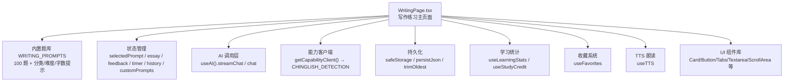
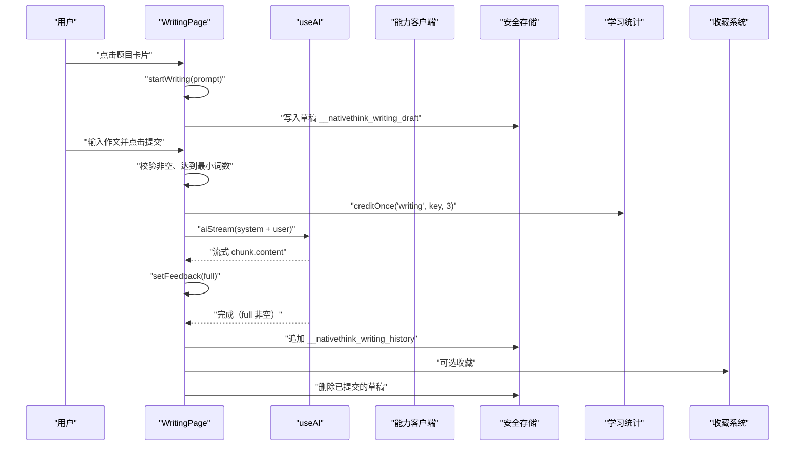
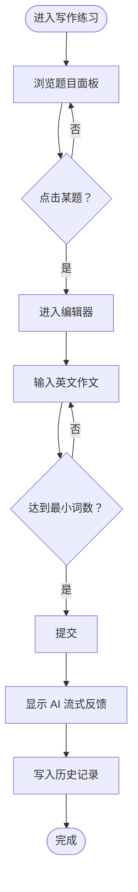
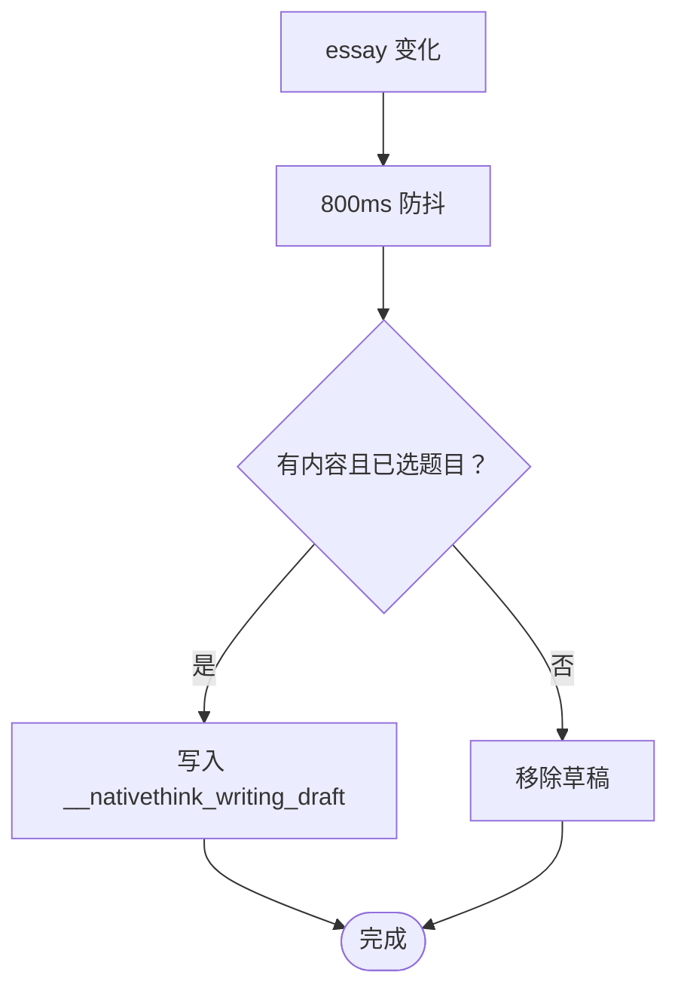
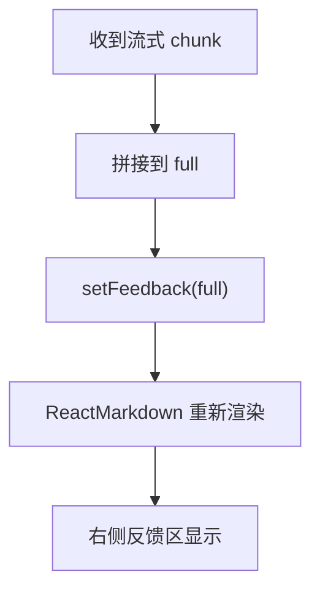
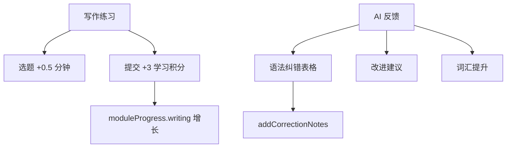
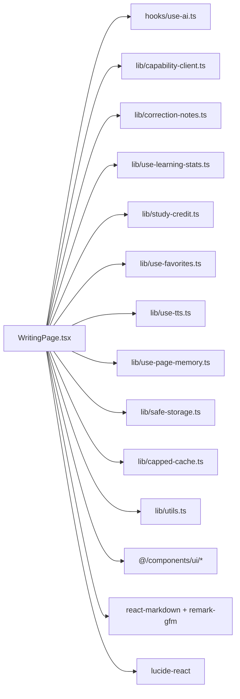

# 写作练习模块

<cite>
**本文引用的文件**
- [WritingPage.tsx](file://src/pages/WritingPage/WritingPage.tsx)
- [writing.md](file://docs/modules/writing.md)
</cite>

## 目录
1. [引言](#引言)
2. [项目结构](#项目结构)
3. [核心组件](#核心组件)
4. [架构总览](#架构总览)
5. [详细组件分析](#详细组件分析)
6. [依赖关系分析](#依赖关系分析)
7. [性能考虑](#性能考虑)
8. [故障排查指南](#故障排查指南)
9. [结论](#结论)

## 引言
本模块是 NativeThink 的写作练习入口，提供 100 道内置英文写作题目、AI 生成的自定义题目、在线编辑器、流式 AI 批改反馈以及学习记录与收藏能力。用户可以在分类面板中浏览题目、输入英文作文、提交后获得结构化 Markdown 反馈，并在本地保存历史与草稿；同时模块会把练习时长和学习积分写入全局学习统计系统。

## 项目结构
写作练习模块以单页面 React 组件为核心，所有业务逻辑、题库数据、界面渲染和持久化都集中在一个文件中：



图表来源
- [WritingPage.tsx:1-20](file://src/pages/WritingPage/WritingPage.tsx#L1-L20)
- [WritingPage.tsx:357-750](file://src/pages/WritingPage/WritingPage.tsx#L357-L750)
- [WritingPage.tsx:987-1217](file://src/pages/WritingPage/WritingPage.tsx#L987-L1217)

章节来源
- [WritingPage.tsx:1-20](file://src/pages/WritingPage/WritingPage.tsx#L1-L20)
- [writing.md:1-55](file://docs/modules/writing.md#L1-L55)

## 核心组件
WritingPage 是一个完整的单文件页面组件，承担以下职责：

| 职责 | 实现位置 | 说明 |
|---|---|---|
| 题型数据结构定义 | `IWritingPrompt` | 包含 id、title、description、category、wordLimit、difficulty、tips |
| 内置题库常量 | `WRITING_PROMPTS` | 100 道题，id 为 `'1'` 到 `'100'` |
| 题目浏览界面 | `PromptGrid` / `PromptCard` | 默认只渲染前 12 张卡，支持展开全部 |
| 分类过滤 | Tabs + `catMap` | 日常叙事、观点表达、职场写作、议论文四类 |
| 编辑器与提交按钮 | Textarea + Button | 字数目标进度条、最小词数校验、Ctrl/Cmd+Enter 快捷提交 |
| 计时器 | `timer` / `setInterval` | 开始写作时启动，提交或换题时停止 |
| 草稿恢复与自动保存 | `__nativethink_writing_draft` | 800ms 防抖落盘，进入页面尝试恢复 |
| 学习记录历史 | `__nativethink_writing_history` | 最近 50 条、最多 256KB，最新优先保留 |
| 自定义题目 | `customPrompts` | 由 AI 生成，localStorage 键 `__nativethink_custom_prompts` |
| AI 批改 | `handleSubmit` | 优先走 `useAI.streamChat`，失败回退能力插件 |
| 学习积分 | `creditOnce('writing', ...)` | 提交动作计 3 分钟，同一题同一篇只记一次 |
| 收藏 | `useFavorites` | 类型 `writing_prompt`，内容为主题标题 |
| 朗读作文 | `useTTS.speak(essay)` | 在编辑器下方提供朗读按钮 |

章节来源
- [WritingPage.tsx:21-60](file://src/pages/WritingPage/WritingPage.tsx#L21-L60)
- [WritingPage.tsx:357-450](file://src/pages/WritingPage/WritingPage.tsx#L357-L450)
- [WritingPage.tsx:987-1217](file://src/pages/WritingPage/WritingPage.tsx#L987-L1217)

## 架构总览
写作练习的数据与控制流可以概括为“浏览题目 → 选择题目 → 编写英文作文 → 提交 → AI 流式反馈 → 保存历史 → 同步学习统计”。



图表来源
- [WritingPage.tsx:451-608](file://src/pages/WritingPage/WritingPage.tsx#L451-L608)
- [WritingPage.tsx:987-1120](file://src/pages/WritingPage/WritingPage.tsx#L987-L1120)

## 详细组件分析

### 写作题数据结构与分类
题目统一使用 `IWritingPrompt` 接口，字段包括：

| 字段 | 类型 | 含义 |
|---|---|---|
| `id` | `string` | 题目唯一标识；内置题从 `'1'` 到 `'100'`，AI 生成题以 `ai_` 开头 |
| `title` | `string` | 中文标题，也用于收藏内容 |
| `description` | `string` | 中文题目描述 |
| `category` | `string` | 分类，映射到四个 Tab：日常叙事、观点表达、职场写作、议论文 |
| `wordLimit` | `{ min: number; max: number }` | 字数区间；前 24 题多数 `max` 为 9999，表示“至少 min 词” |
| `difficulty` | `string` | 难度标记：beginner、intermediate、advanced |
| `tips` | `string[]` | 写作建议列表，渲染为标签 |

分类管理与显示规则如下：

| 分类 | Tab 值 | 内置题数量 | 是否可筛选 |
|---|---|---:|---:|
| 日常叙事 | `narrative` | 35 | 是 |
| 观点表达 | `opinion` | 24 | 是 |
| 议论文 | `essay` | 23 | 是 |
| 职场写作 | `workplace` | 18 | 是 |

注意：AI 生成面板提供 10 个话题方向，但只有 4 个对应正式分类；其余 6 类（创意写作、科技前沿、社会热点、个人成长、文化对比、环保绿色）只在“全部题目”中出现，不会出现在对应分类 Tab 中。

章节来源
- [WritingPage.tsx:21-60](file://src/pages/WritingPage/WritingPage.tsx#L21-L60)
- [WritingPage.tsx:61-344](file://src/pages/WritingPage/WritingPage.tsx#L61-L344)
- [WritingPage.tsx:806-849](file://src/pages/WritingPage/WritingPage.tsx#L806-L849)
- [writing.md:8-21](file://docs/modules/writing.md#L8-L21)

### 题目浏览与答题界面
界面分为两个主要视图：

1. **题目浏览视图**
   - 顶部显示“AI 写作练习”标题和操作区。
   - “AI 生成题目”弹窗允许选择分类、难度和关键词。
   - Tabs 切换全部题目和四个分类。
   - `PromptGrid` 默认只显示前 12 张卡片，超过 12 张时出现“展开其余 N 题（共 M 题）”或“收起，只看前 12 题”。
   - AI 生成题卡片显示“AI”标签和悬停出现的删除按钮。
   - 底部展示最近 5 条写作历史，点击打开历史详情对话框。

2. **答题视图**
   - 顶部显示题目标题、分类、难度徽章、计时器和当前词数。
   - 左侧写作区包含提示标签、多行文本编辑器、字数目标进度条、朗读按钮、字数信息、提交按钮。
   - 右侧固定反馈区显示流式 Markdown 反馈，未提交时为空状态，提交中显示加载动画。



图表来源
- [WritingPage.tsx:660-986](file://src/pages/WritingPage/WritingPage.tsx#L660-L986)
- [WritingPage.tsx:987-1120](file://src/pages/WritingPage/WritingPage.tsx#L987-L1120)

章节来源
- [WritingPage.tsx:660-986](file://src/pages/WritingPage/WritingPage.tsx#L660-L986)
- [WritingPage.tsx:987-1217](file://src/pages/WritingPage/WritingPage.tsx#L987-L1217)

### 编辑器实现
编辑器由多行文本框驱动，关键行为如下：

| 功能 | 实现方式 |
|---|---|
| 双向绑定 | `essay` state 与 `Textarea.value` |
| 字数统计 | `essay.trim().split(/\s+/).length` |
| 字符统计 | `essay.length` |
| 最小词数校验 | 提交按钮禁用条件含 `wordCount < selectedPrompt.wordLimit.min` |
| 字数目标进度条 | 按 `wordCount / wordLimit.min` 计算百分比，低于目标为 amber，达到后变绿 |
| 快捷键提交 | `Ctrl` 或 `Meta` + `Enter` 触发 `handleSubmit` |
| 朗读 | 调用 `tts.speak(essay)` |
| 草稿恢复 | 进入页面读取 `__nativethink_writing_draft`，若存在则恢复 prompt 和 essay |
| 草稿自动保存 | `essay` 或 `selectedPrompt` 变化后 800ms 防抖写入 |
| 放弃草稿 | 清除 storage、重置 essay 和 selectedPrompt |



图表来源
- [WritingPage.tsx:384-420](file://src/pages/WritingPage/WritingPage.tsx#L384-L420)
- [WritingPage.tsx:987-1055](file://src/pages/WritingPage/WritingPage.tsx#L987-L1055)

章节来源
- [WritingPage.tsx:384-420](file://src/pages/WritingPage/WritingPage.tsx#L384-L420)
- [WritingPage.tsx:987-1055](file://src/pages/WritingPage/WritingPage.tsx#L987-L1055)

### 提交流程与 AI 批改
提交流程是模块的核心控制路径，负责状态切换、AI 调用、错误处理和历史保存。

```mermaid
sequenceDiagram
  participant UI as "提交按钮"
  participant Page as "WritingPage.handleSubmit"
  participant AI as "useAI.streamChat"
  participant Plugin as "能力插件"
  participant Store as "storage"
  participant Stats as "学习统计"

  UI->>Page: "onClick(handleSubmit)"
  Page->>Page: "校验 essay 非空、非重复提交"
  Page->>Stats: "creditOnce('writing', key, 3)"
  Page->>Page: "新建 AbortController"
  alt "AI Key 已配置"
    Page->>AI: "aiStream(system, user, {temperature: 0.4, signal})"
    loop "流式接收 chunk"
      AI-->>Page: "chunk.content"
      Page->>Page: "full += content; setFeedback(full)"
    end
  else "AI Key 未配置"
    Page->>Plugin: "load(CHINGLISH_DETECTION).callStream(...)"
    loop "流式接收 chunk"
      Plugin-->>Page: "chunk.content"
      Page->>Page: "full += content; setFeedback(full)"
    end
  end
  alt "full 为空"
    Page->>Page: "toast 不可用 + 设置兜底反馈"
  else "full 非空"
    Page->>Store: "追加 __nativethink_writing_history"
    Page->>Store: "删除已提交草稿"
  end
  Page->>Page: "finally: setIsSubmitting(false), 清理 abortRef"
```

图表来源
- [WritingPage.tsx:451-608](file://src/pages/WritingPage/WritingPage.tsx#L451-L608)

关键点：

- **流式批改模板**：system 提示要求输出七个二级标题，包括总体评分、优点、语法纠错表格、地道度、结构与连贯性、改进建议和词汇提升。
- **温度参数**：批改使用 `temperature: 0.4`，生成自定义题使用 `temperature: 0.9`、`maxTokens: 1024`。
- **降级路径**：没有 AI Key 时回退到能力插件 `CHINGLISH_DETECTION`。
- **空结果保护**：如果流结束但 `full` 为空，视为服务异常，不写历史、不清草稿，并显示兜底提示。
- **中止机制**：每次换题、重置或卸载组件都会调用 `abortRef.current?.abort()`，避免旧流覆盖新题草稿。

章节来源
- [WritingPage.tsx:451-608](file://src/pages/WritingPage/WritingPage.tsx#L451-L608)
- [writing.md:22-35](file://docs/modules/writing.md#L22-L35)

### 反馈展示与解析
AI 返回的是 Markdown 文本，不是 JSON。页面通过 `ReactMarkdown` 配合 `remarkGfm` 直接渲染反馈内容，而不是解析结构化对象。

| 部分 | 说明 |
|---|---|
| 渲染方式 | `ReactMarkdown remarkPlugins={[remarkGfm]}` |
| 容器 | 固定高度 `h-[400px]` 的 `ScrollArea` |
| 更新频率 | 每个流式 chunk 都执行 `setFeedback(full)`，导致整篇 Markdown 重渲染 |
| 纠错提取 | 使用 `extractWritingRows` 从反馈中提取“原文 | 修正 | 解释”表格，再通过 `addCorrectionNotes` 写入纠偏笔记 |
| 空反馈 | 显示“正在分析你的作文...”或初始占位提示 |



图表来源
- [WritingPage.tsx:517-578](file://src/pages/WritingPage/WritingPage.tsx#L517-L578)
- [WritingPage.tsx:1075-1090](file://src/pages/WritingPage/WritingPage.tsx#L1075-L1090)

章节来源
- [WritingPage.tsx:517-578](file://src/pages/WritingPage/WritingPage.tsx#L517-L578)
- [WritingPage.tsx:1075-1090](file://src/pages/WritingPage/WritingPage.tsx#L1075-L1090)
- [writing.md:22-35](file://docs/modules/writing.md#L22-L35)

### 自定义题目生成与管理
用户可以通过“AI 生成题目”弹窗创建题目，参数包括：

| 参数 | 类型 | 默认值或范围 |
|---|---|---|
| 话题方向 | 字符串 | 日常叙事、观点表达、职场写作、议论文、创意写作、科技前沿、社会热点、个人成长、文化对比、环保绿色 |
| 难度 | 字符串 | beginner、intermediate、advanced |
| 关键词 | 字符串 | 可选 |

生成流程：

1. 校验 AI Key 是否配置。
2. 将内置 100 题标题拼接成“禁止重复”列表。
3. 调用 `aiChat` 生成单个 JSON 对象。
4. 使用 `extractJson` 解析响应。
5. 构造 `IWritingPrompt`，id 为 `ai_${Date.now()}`。
6. 插入 `customPrompts` 数组头部。
7. 关闭弹窗并自动开始写作。

注意事项：

- 去重只基于内置 100 题标题，不检查已有自定义题，因此可能重复出题。
- 自定义题保存在 localStorage，键为 `__nativethink_custom_prompts`。
- 写失败会调用 `warnStorageFull()` 给出可见提示，不再静默丢弃。
- 自定义题卡片支持删除操作。

章节来源
- [WritingPage.tsx:609-710](file://src/pages/WritingPage/WritingPage.tsx#L609-L710)
- [writing.md:36-42](file://docs/modules/writing.md#L36-L42)

### 用户答案存储格式与学习记录
模块涉及三类本地数据：

| 数据 | 存储键 | 格式 | 限制 |
|---|---|---|---|
| 草稿 | `__nativethink_writing_draft` | `{ prompt, essay, savedAt }` | 无显式大小上限，异常时忽略 |
| 写作历史 | `__nativethink_writing_history` | 对象数组 | 最多 50 条，最多 256KB，保留最新 |
| 自定义题目 | `__nativethink_custom_prompts` | `IWritingPrompt[]` | 无显式条数上限 |

每条历史记录的字段：

| 字段 | 类型 | 含义 |
|---|---|---|
| `prompt` | `string` | 题目标题 |
| `essay` | `string` | 用户提交的英文作文 |
| `feedback` | `string` | AI 返回的 Markdown 反馈 |
| `date` | `number` | 提交时间戳 |

历史列表在首页只展示最后 5 条，点击条目打开对话框查看完整作文和反馈。

章节来源
- [WritingPage.tsx:357-428](file://src/pages/WritingPage/WritingPage.tsx#L357-L428)
- [WritingPage.tsx:849-986](file://src/pages/WritingPage/WritingPage.tsx#L849-L986)
- [writing.md:43-55](file://docs/modules/writing.md#L43-L55)

### 进度追踪、错误分析与改进建议
| 功能 | 实现方式 |
|---|---|
| 练习时长 | 选题时调用 `addStudyMinutes(0.5, 'writing')`，提交成功时调用 `creditOnce('writing', key, 3)` |
| 学习积分 | 使用 `useStudyCredit`，key 为 `writing.submit.${promptId}.${essay}`，同一题同一篇只记一次 |
| 错误分析 | AI 反馈中包含语法纠错表格和自然度反馈；模块还通过 `extractWritingRows` 抽取纠错行写入纠偏笔记 |
| 改进建议 | AI 反馈包含具体改进建议和词汇提升建议，由 system 模板强制输出 |
| 字数目标 | 根据 `wordLimit.min` 显示进度条和目标达成状态 |
| 错题回顾 | 历史对话框可查看过去作文和反馈；纠偏笔记可通过其他模块汇总查看 |



图表来源
- [WritingPage.tsx:486-508](file://src/pages/WritingPage/WritingPage.tsx#L486-L508)
- [WritingPage.tsx:578-590](file://src/pages/WritingPage/WritingPage.tsx#L578-L590)

章节来源
- [WritingPage.tsx:486-508](file://src/pages/WritingPage/WritingPage.tsx#L486-L508)
- [WritingPage.tsx:578-590](file://src/pages/WritingPage/WritingPage.tsx#L578-L590)
- [writing.md:43-55](file://docs/modules/writing.md#L43-L55)

## 依赖关系分析
WritingPage 依赖多个内部模块和外部库，耦合点如下：



图表来源
- [WritingPage.tsx:1-20](file://src/pages/WritingPage/WritingPage.tsx#L1-L20)
- [WritingPage.tsx:357-750](file://src/pages/WritingPage/WritingPage.tsx#L357-L750)

依赖说明：

| 依赖 | 用途 | 风险点 |
|---|---|---|
| `useAI` | 流式和非流式 AI 调用 | 配置缺失时回退到能力插件 |
| `getCapabilityClient` | 降级批改能力 | 可能返回 null，`.load` 抛错需捕获 |
| `correction-notes` | 从反馈文本抽取纠错行 | 依赖反馈 Markdown 格式 |
| `use-learning-stats` | 记录练习时长 | 与全局学习统计耦合 |
| `study-credit` | 学习积分计数 | 防止重复计分依赖 essay 内容 |
| `use-favorites` | 收藏题目 | 收藏类型为 `writing_prompt` |
| `use-tts` | 朗读作文 | 依赖 TTS 能力 |
| `safe-storage` / `capped-cache` | 本地持久化 | 容量不足时需降级提示 |
| `react-markdown` | 渲染反馈 | 长反馈频繁重排影响低端机性能 |

章节来源
- [WritingPage.tsx:1-20](file://src/pages/WritingPage/WritingPage.tsx#L1-L20)
- [WritingPage.tsx:451-608](file://src/pages/WritingPage/WritingPage.tsx#L451-L608)

## 性能考虑
模块对性能做了若干针对性优化，但也存在可继续改进的空间：

| 方面 | 现状 | 建议 |
|---|---|---|
| 题目渲染 | 默认只渲染前 12 张卡，避免一次性挂载 100 张卡片 | 保持现有分页策略 |
| 反馈渲染 | 每个流式 chunk 都 `setFeedback(full)`，整篇 Markdown 重渲染 | 可引入节流或增量渲染，但要保留“字逐出”体验 |
| 草稿保存 | 800ms 防抖 | 合理，无需改动 |
| 历史裁剪 | 50 条 + 256KB 双封顶 | 合理，滚动窗口语义正确 |
| 内存清理 | 卸载时 abort 流和定时器 | 必要，避免旧流污染新题 |
| 移动端首屏 | 全量渲染约 17,604px 高、1055ms 长任务；改为 12 卡后约 2,634px、118ms | 继续监控大设备全量展开场景 |

章节来源
- [WritingPage.tsx:1110-1138](file://src/pages/WritingPage/WritingPage.tsx#L1110-L1138)
- [writing.md:36-55](file://docs/modules/writing.md#L36-L55)

## 故障排查指南

| 现象 | 可能原因 | 处理建议 |
|---|---|---|
| 提交后反馈一直为空 | AI 服务返回空内容或网络异常 | 检查 toast 提示；确认未丢失草稿；稍后重试 |
| 换题后旧反馈出现在新题 | 旧流未中止 | 确保 `startWriting` 和 `reset` 都调用 `abortRef.current?.abort()` |
| 刷新后自定义题目消失 | localStorage 写入失败 | 查看 `warnStorageFull()` 提示；清理学习数据后重试 |
| 历史过长仍爆容量 | 仅靠条数上限不够 | 当前已改为条数 + 字节双封顶；如仍报错，减少历史或清理缓存 |
| 生成的题目找不到 | 使用了未在分类 Tab 中映射的话题方向 | 在“全部题目”中查找 |
| 收藏无效 | 收藏类型或内容不一致 | 确认收藏类型为 `writing_prompt`，内容为题目标题 |
| 字数达标但提交按钮仍禁用 | `essay.trim()` 为空或仍在提交中 | 检查编辑器内容和 `isSubmitting` 状态 |
| 快捷键提交无效 | 未按 `Ctrl` 或 `Meta` + `Enter` | 确认操作系统快捷键组合 |

章节来源
- [WritingPage.tsx:451-608](file://src/pages/WritingPage/WritingPage.tsx#L451-L608)
- [writing.md:43-55](file://docs/modules/writing.md#L43-L55)

## 结论
NativeThink 写作练习模块以单一 WritingPage 组件承载完整写作链路：100 道内置题、AI 生成题、分类浏览、编辑器、流式 Markdown 反馈、本地草稿与历史、学习积分和收藏。其核心设计优势在于：

1. 明确的数据结构 `IWritingPrompt` 统一管理内置题和自定义题。
2. 流式批改提高反馈实时性，同时具备能力插件降级路径。
3. 草稿自动保存和历史双封顶机制降低数据丢失风险。
4. 默认 12 卡渲染策略显著改善移动端首屏性能。
5. 学习统计、收藏和纠偏笔记形成闭环，便于长期学习分析。

未来可优化的重点包括：反馈渲染节流、自定义题去重范围扩展、分类映射补全、更严格的字数区间校验，以及将反馈从纯 Markdown 演进为结构化数据以便更精确的错误分析和改进建议展示。