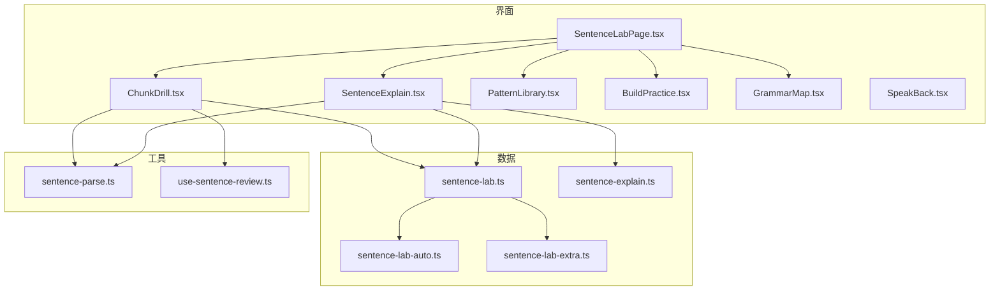
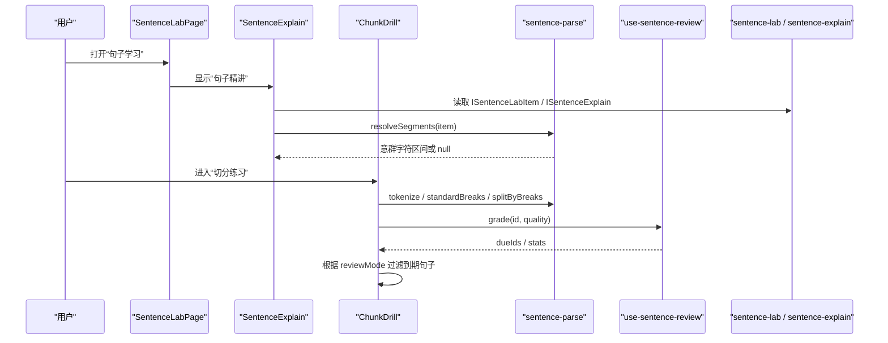
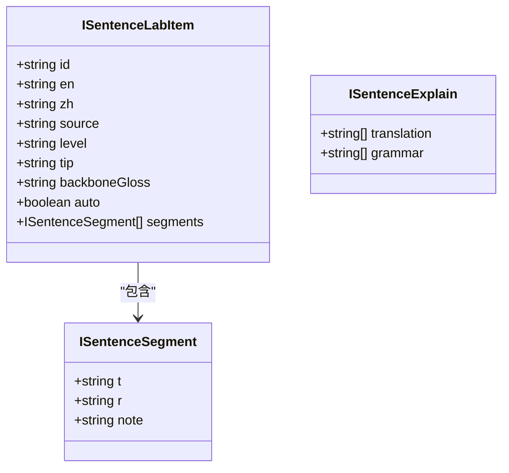
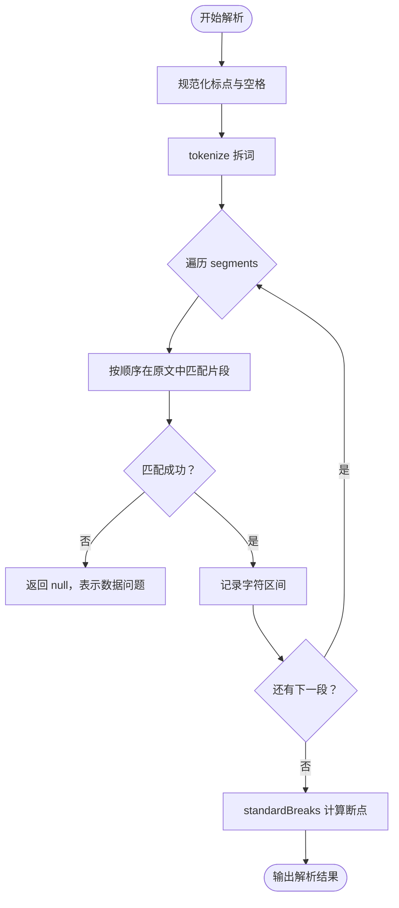
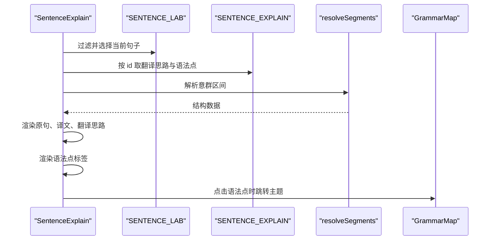
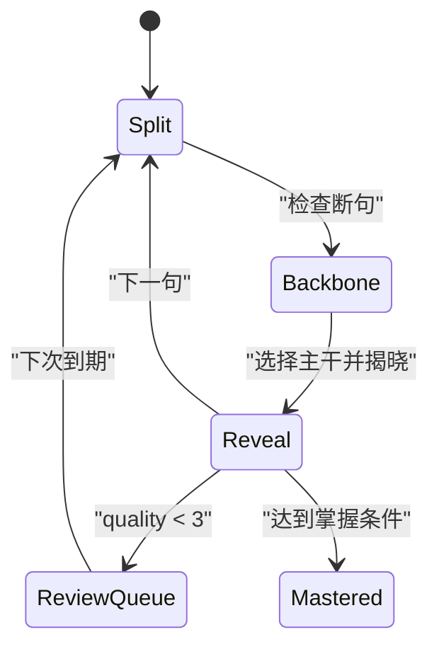
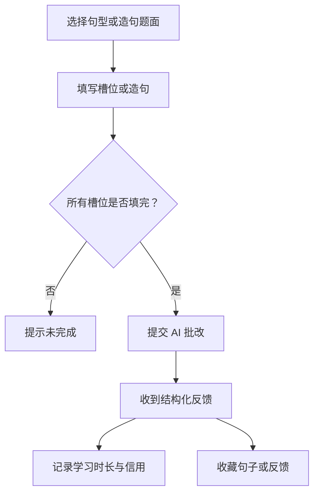
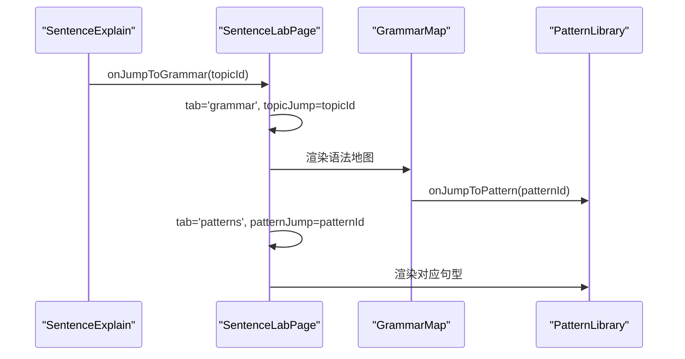
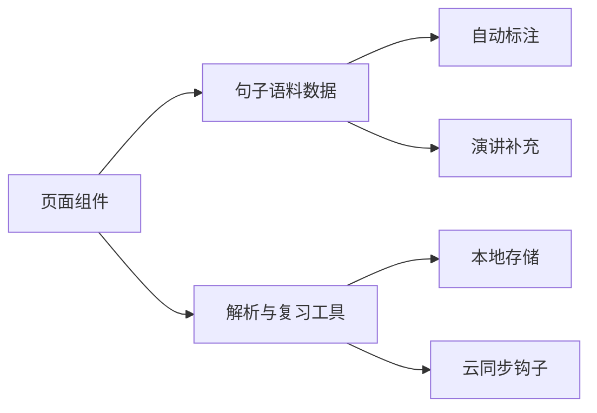

# 句子学习模块

<cite>
**本文引用的文件**   
- [SentenceLabPage.tsx](file://src/pages/SentenceLabPage/SentenceLabPage.tsx)
- [SentenceExplain.tsx](file://src/pages/SentenceLabPage/components/SentenceExplain.tsx)
- [ChunkDrill.tsx](file://src/pages/SentenceLabPage/components/ChunkDrill.tsx)
- [PatternLibrary.tsx](file://src/pages/SentenceLabPage/components/PatternLibrary.tsx)
- [BuildPractice.tsx](file://src/pages/SentenceLabPage/components/BuildPractice.tsx)
- [GrammarMap.tsx](file://src/pages/SentenceLabPage/components/GrammarMap.tsx)
- [SpeakBack.tsx](file://src/pages/SentenceLabPage/components/SpeakBack.tsx)
- [sentence-lab.ts](file://src/data/sentence-lab.ts)
- [sentence-explain.ts](file://src/data/sentence-explain.ts)
- [sentence-lab-auto.ts](file://src/data/sentence-lab-auto.ts)
- [sentence-lab-extra.ts](file://src/data/sentence-lab-extra.ts)
- [use-sentence-review.ts](file://src/lib/use-sentence-review.ts)
- [sentence-parse.ts](file://src/lib/sentence-parse.ts)
</cite>

## 目录
1. [简介](#简介)
2. [项目结构](#项目结构)
3. [核心组件](#核心组件)
4. [架构总览](#架构总览)
5. [详细组件分析](#详细组件分析)
6. [依赖关系分析](#依赖关系分析)
7. [性能与可扩展性](#性能与可扩展性)
8. [故障排查](#故障排查)
9. [结论](#结论)

## 简介
NativeThink 的句子学习模块围绕“看懂长句、学会造句”两条主线展开：输入侧通过意群定位、主干识别和语法讲解帮助学习者拆解真实语料；输出侧通过句型骨架、AI 批改和跟读评测训练表达。数据层把书籍、演讲、站内刊物三类语料统一为同一模型，并配合自动标注与人工补充内容；复习管理基于 SM-2 间隔重复算法跟踪掌握度。

## 项目结构
句子学习模块由一个入口页面、五个功能子页面和三个数据/工具层组成：

**图表来源**
- [SentenceLabPage.tsx:1-98](file://src/pages/SentenceLabPage/SentenceLabPage.tsx#L1-L98)
- [sentence-lab.ts:1-200](file://src/data/sentence-lab.ts#L1-L200)
- [sentence-lab-auto.ts:1-200](file://src/data/sentence-lab-auto.ts#L1-L200)
- [sentence-lab-extra.ts:1-195](file://src/data/sentence-lab-extra.ts#L1-L195)
- [sentence-explain.ts:1-200](file://src/data/sentence-explain.ts#L1-L200)
- [sentence-parse.ts:1-114](file://src/lib/sentence-parse.ts#L1-L114)
- [use-sentence-review.ts:1-140](file://src/lib/use-sentence-review.ts#L1-L140)

**章节来源**
- [SentenceLabPage.tsx:1-98](file://src/pages/SentenceLabPage/SentenceLabPage.tsx#L1-L98)

## 核心组件
| 组件 | 职责 | 关键交互 |
|---|---|---|
| SentenceLabPage | 页面路由与概览，聚合“看懂句子”和“学会造句”两个方向 | 切换“句子精讲 / 切分练习 / 句型 / 造句 / 语法”五个标签页 |
| SentenceExplain | 展示原句、中文对照、翻译思路、语法点与意群结构 | 朗读、收藏、按来源/难度筛选、点击语法点跳转语法地图 |
| ChunkDrill | 三步读句法训练：断句、选主干、揭晓 | 手动切分、示例演示、SM-2 质量评分、复习模式 |
| PatternLibrary | 句型骨架库与填空造句 | 分类筛选、骨架高亮、槽位填空、收藏句型 |
| BuildPractice | 关键词独立造句 + AI 结构化反馈 | 提交句子、查看参考句、收藏 AI 批改结果 |
| GrammarMap | 按中文思维差异组织的语法索引 | 分组浏览、本质说明、中式错误对比、跳转到句型 |
| SpeakBack | 录音与离线音频分析 | 听原声、跟读录音、评估语速/停顿/音量/音高趋势 |

**章节来源**
- [SentenceLabPage.tsx:1-98](file://src/pages/SentenceLabPage/SentenceLabPage.tsx#L1-L98)
- [SentenceExplain.tsx:1-200](file://src/pages/SentenceLabPage/components/SentenceExplain.tsx#L1-L200)
- [ChunkDrill.tsx:1-200](file://src/pages/SentenceLabPage/components/ChunkDrill.tsx#L1-L200)
- [PatternLibrary.tsx:1-200](file://src/pages/SentenceLabPage/components/PatternLibrary.tsx#L1-L200)
- [BuildPractice.tsx:1-200](file://src/pages/SentenceLabPage/components/BuildPractice.tsx#L1-L200)
- [GrammarMap.tsx:1-189](file://src/pages/SentenceLabPage/components/GrammarMap.tsx#L1-L189)
- [SpeakBack.tsx:1-200](file://src/pages/SentenceLabPage/components/SpeakBack.tsx#L1-L200)

## 架构总览
句子学习模块的数据流可概括为：语料定义 → 解析工具 → 界面渲染 → 用户练习 → 复习调度。

**图表来源**
- [SentenceLabPage.tsx:1-98](file://src/pages/SentenceLabPage/SentenceLabPage.tsx#L1-L98)
- [SentenceExplain.tsx:1-200](file://src/pages/SentenceLabPage/components/SentenceExplain.tsx#L1-L200)
- [ChunkDrill.tsx:1-200](file://src/pages/SentenceLabPage/components/ChunkDrill.tsx#L1-L200)
- [sentence-parse.ts:1-114](file://src/lib/sentence-parse.ts#L1-L114)
- [use-sentence-review.ts:1-140](file://src/lib/use-sentence-review.ts#L1-L140)
- [sentence-lab.ts:1-200](file://src/data/sentence-lab.ts#L1-L200)
- [sentence-explain.ts:1-200](file://src/data/sentence-explain.ts#L1-L200)

## 详细组件分析

### 句子语料与数据结构
句子语料采用统一接口描述一条英文句子及其教学注解：

| 字段 | 含义 |
|---|---|
| id | 句子唯一标识，用于关联讲解、收藏、复习进度 |
| en | 英文原句 |
| zh | 中文翻译 |
| source | 出处（书籍、演讲、站内刊物） |
| level | beginner / intermediate / advanced |
| tip | 一句话阅读提示 |
| backboneGloss | 只保留主干后的简单句释义 |
| auto | 是否来自自动标注脚本 |
| segments | 意群数组，包含文本片段 t、角色 r、可选说明 note |

segments 中的角色分为三类：

| 角色 | 含义 |
|---|---|
| core | 主干成分（主语、谓语、宾语、表语等），去掉后句子不成立 |
| mod | 修饰成分（定语、状语、同位语等），去掉后句子仍可成立 |
| conn | 连接标记（从句引导词、并列连词、插入语标记等） |

语料来源包括：

| 来源 | 文件 | 特点 |
|---|---|---|
| 书籍语料 | [sentence-lab.ts](file://src/data/sentence-lab.ts) | 公版书全文逐句核验，含入门到进阶多类长句 |
| 自动标注语料 | [sentence-lab-auto.ts](file://src/data/sentence-lab-auto.ts) | 由脚本生成，经结构校验：片段可定位、存在主干、译文与提示齐全 |
| 演讲语料 | [sentence-lab-extra.ts](file://src/data/sentence-lab-extra.ts) | 取自站内演讲，偏口语化、排比多、适合练长句节奏 |

**图表来源**
- [sentence-lab.ts:1-200](file://src/data/sentence-lab.ts#L1-L200)
- [sentence-explain.ts:1-200](file://src/data/sentence-explain.ts#L1-L200)

**章节来源**
- [sentence-lab.ts:1-200](file://src/data/sentence-lab.ts#L1-L200)
- [sentence-lab-auto.ts:1-200](file://src/data/sentence-lab-auto.ts#L1-L200)
- [sentence-lab-extra.ts:1-195](file://src/data/sentence-lab-extra.ts#L1-L195)
- [sentence-explain.ts:1-200](file://src/data/sentence-explain.ts#L1-L200)

### 句子解析与意群划分规则
解析层负责把数据中的意群片段映射回原句的字符区间，并计算标准断点：

| 函数 | 输入 | 输出 | 作用 |
|---|---|---|---|
| resolveSegments | 一条句子数据 | IResolvedSegment[] 或 null | 按顺序匹配每个 segment.t 在原句中的位置 |
| tokenize | 英文句子 | IToken[] | 拆出单词与分隔符，供断点渲染使用 |
| standardBreaks | 句子数据 | Set<number> | 每个意群首词前的词序号集合 |
| splitByBreaks | 句子 + 断点集 | string[] | 按断点还原意群文本片段 |

解析的关键规则如下：

1. 字符规范化：撇号、引号、破折号先折叠，避免排版差异导致匹配失败。
2. 分段宽松匹配：segment 内部空白用 `\s+` 放宽，其余字符逐字匹配。
3. 顺序定位：从上一段结束位置继续查找，确保 segments 拼接与原句一致。
4. 失败保护：任一片段找不到就返回 null，调用方应降级处理，不把坏数据当成正确断句。
5. 断点语义：第一个意群之前不算断点；后续每个意群起点对应一个“词前断点”。

**图表来源**
- [sentence-parse.ts:1-114](file://src/lib/sentence-parse.ts#L1-L114)

**章节来源**
- [sentence-parse.ts:1-114](file://src/lib/sentence-parse.ts#L1-L114)

### 句子精讲界面
SentenceExplain 负责回答三个问题：为什么这么译、怎么译、用了什么语法。它的数据来源有两个：

- 句子本体：SENTENCE_LAB，提供原句、译文、出处、难度、意群标注。
- 讲解数据：SENTENCE_EXPLAIN，提供翻译思路和语法点列表。

界面流程包括：

1. 按来源（书籍/演讲/刊物）和难度（入门/进阶/高阶）过滤句子。
2. 展示当前句子编号、出处、难度和自动生成标记。
3. 支持朗读原句、隐藏/显示译文、收藏到表达本。
4. 展示翻译思路；若无脚本生成的翻译思路，则退回到 tip。
5. 展示语法点，并尝试匹配语法地图条目；若命中且允许跳转，则点击后跳到对应语法主题。
6. 通过 resolveSegments 渲染结构分解，将主干、修饰、连接三类意群可视化。

**图表来源**
- [SentenceExplain.tsx:1-200](file://src/pages/SentenceLabPage/components/SentenceExplain.tsx#L1-L200)
- [sentence-lab.ts:1-200](file://src/data/sentence-lab.ts#L1-L200)
- [sentence-explain.ts:1-200](file://src/data/sentence-explain.ts#L1-L200)
- [sentence-parse.ts:1-114](file://src/lib/sentence-parse.ts#L1-L114)

**章节来源**
- [SentenceExplain.tsx:1-200](file://src/pages/SentenceLabPage/components/SentenceExplain.tsx#L1-L200)

### 切分练习与复习管理
ChunkDrill 实现“三步读句法”：找动词、定主干、切意群。其状态机包含三个阶段：

| 阶段 | 行为 |
|---|---|
| split | 用户在词间虚线处切换断点，系统统计命中、漏切、多切 |
| backbone | 从意群候选中选择主干，必须与 segments 同源以避免索引错位 |
| reveal | 揭晓结构，并把表现折算为 SM-2 quality，写入复习队列 |

复习管理由 use-sentence-review 提供，核心能力包括：

| 能力 | 说明 |
|---|---|
| grade | 记录一次练习结果，quality 0–5 |
| dueIds | 已到期且未掌握的句子 id 列表 |
| stats | 追踪总数、已掌握、学习中、今日复习数、待复习数 |
| getProgress | 查询单句进度 |
| resetAll | 清空复习数据 |

**图表来源**
- [ChunkDrill.tsx:1-200](file://src/pages/SentenceLabPage/components/ChunkDrill.tsx#L1-L200)
- [use-sentence-review.ts:1-140](file://src/lib/use-sentence-review.ts#L1-L140)

#### 自动生成的句子练习
ChunkDrill 支持“复习模式”，此时语料池不再是全部 SENTENCE_LAB，而是其中到期句子。该设计让练习量自动收敛：答错的句子立即回到队列，答对的句子按间隔重复推迟。

#### 额外补充内容的管理
除了书籍语料，模块还维护两类补充语料：

- 自动标注语料：覆盖站内刊物和部分演讲，强调结构校验与可定位性。
- 演讲补充语料：面向口语化长句、排比句和演讲体，适合训练一口气读长句的节奏。

这些语料与主语料共用同一个 ISentenceLabItem 模型，因此可以在 SentenceExplain 和 ChunkDrill 中统一筛选、展示和练习。

**章节来源**
- [ChunkDrill.tsx:1-200](file://src/pages/SentenceLabPage/components/ChunkDrill.tsx#L1-L200)
- [use-sentence-review.ts:1-140](file://src/lib/use-sentence-review.ts#L1-L140)
- [sentence-lab-auto.ts:1-200](file://src/data/sentence-lab-auto.ts#L1-L200)
- [sentence-lab-extra.ts:1-195](file://src/data/sentence-lab-extra.ts#L1-L195)

### 句型库与造句练习
PatternLibrary 以“骨架 + 槽位”的方式组织句型。骨架中的 `{key}` 会被替换为用户填写的值，形成完整句子。每个句型包含：

- 名称与分类
- 骨架片段
- 中文思维说明
- 母语者组织方式说明
- 例句
- 槽位及示例填充

BuildPractice 则转向产出训练：给出关键词、含义和使用场景，用户写出英文句子，再由 AI 按四段结构反馈：

1. 骨架体检
2. 地道度评分
3. 更地道的说法
4. 与参考句的差异

该组件还会把成功收到的反馈计入学习时长，并通过 study-credit 去重，避免重试重复记账。

**图表来源**
- [PatternLibrary.tsx:1-200](file://src/pages/SentenceLabPage/components/PatternLibrary.tsx#L1-L200)
- [BuildPractice.tsx:1-200](file://src/pages/SentenceLabPage/components/BuildPractice.tsx#L1-L200)

**章节来源**
- [PatternLibrary.tsx:1-200](file://src/pages/SentenceLabPage/components/PatternLibrary.tsx#L1-L200)
- [BuildPractice.tsx:1-200](file://src/pages/SentenceLabPage/components/BuildPractice.tsx#L1-L200)

### 语法地图与跨页面跳转
GrammarMap 按中文思维差异组织语法条目，每条语法都强调“本质一句话”和“中文为什么容易错”，并提供高频中式错误对比。它与句型库互补：语法解释机制，句型提供骨架。

跨页面跳转逻辑如下：

- 句子精讲点击语法点 → 跳到语法地图对应主题。
- 语法地图底部“去句型库练” → 跳到对应句型。
- 语法地图支持从 URL 或父组件传入 jumpToTopic，直接激活目标条目。

**图表来源**
- [SentenceLabPage.tsx:1-98](file://src/pages/SentenceLabPage/SentenceLabPage.tsx#L1-L98)
- [SentenceExplain.tsx:1-200](file://src/pages/SentenceLabPage/components/SentenceExplain.tsx#L1-L200)
- [GrammarMap.tsx:1-189](file://src/pages/SentenceLabPage/components/GrammarMap.tsx#L1-L189)
- [PatternLibrary.tsx:1-200](file://src/pages/SentenceLabPage/components/PatternLibrary.tsx#L1-L200)

**章节来源**
- [GrammarMap.tsx:1-189](file://src/pages/SentenceLabPage/components/GrammarMap.tsx#L1-L189)
- [SentenceLabPage.tsx:1-98](file://src/pages/SentenceLabPage/SentenceLabPage.tsx#L1-L98)

### 跟读评测
SpeakBack 不负责发音音素评分，而是基于录音波形做客观测量：

| 指标 | 判断方式 |
|---|---|
| 语速贴合 | 录音时长 vs 词数参考时长 |
| 停顿落点 | 能量包络检出停顿，比对标准意群边界 |
| 音量 | RMS 与峰值检测，提示过低或爆音 |
| 音高趋势 | 整体与句尾趋势，不评具体音素 |

它还与标准断点工具协作：expectedBoundaries 由 standardBreaks 换算成比例位置，再交给 speech-analysis 做停顿匹配。

**章节来源**
- [SpeakBack.tsx:1-200](file://src/pages/SentenceLabPage/components/SpeakBack.tsx#L1-L200)
- [sentence-parse.ts:1-114](file://src/lib/sentence-parse.ts#L1-L114)

## 依赖关系分析
模块内部依赖呈分层结构：

**图表来源**
- [SentenceLabPage.tsx:1-98](file://src/pages/SentenceLabPage/SentenceLabPage.tsx#L1-L98)
- [sentence-lab.ts:1-200](file://src/data/sentence-lab.ts#L1-L200)
- [sentence-lab-auto.ts:1-200](file://src/data/sentence-lab-auto.ts#L1-L200)
- [sentence-lab-extra.ts:1-195](file://src/data/sentence-lab-extra.ts#L1-L195)
- [use-sentence-review.ts:1-140](file://src/lib/use-sentence-review.ts#L1-L140)

耦合要点：

- 页面组件强依赖 sentence-lab 的统一数据结构。
- 讲解与练习共享 sentence-parse 的解析能力。
- 复习模块独立于界面，仅暴露 grade、dueIds、stats 等能力。
- 语法地图与句型库通过主题 id 和句型 id 松耦合跳转。
- 自动标注语料与手工语料共用接口，便于扩展而不破坏现有页面。

潜在风险：

- 如果 segment.t 无法在原句中定位，resolveSegments 返回 null，需要调用方正确处理，否则可能产生假正确断句。
- 主干选项必须与评分用的 segments 同源，否则索引错位会导致用户选了正确答案却被判错。
- 复习队列依赖本地存储和日期格式化，跨设备需要同步下行刷新。

**章节来源**
- [sentence-parse.ts:1-114](file://src/lib/sentence-parse.ts#L1-L114)
- [ChunkDrill.tsx:1-200](file://src/pages/SentenceLabPage/components/ChunkDrill.tsx#L1-L200)
- [use-sentence-review.ts:1-140](file://src/lib/use-sentence-review.ts#L1-L140)

## 性能与可扩展性
- 语料过滤集中在 useMemo 中，按来源和难度筛选，避免每次渲染重新扫描。
- 解析工具只在 item 变化时重新计算，减少重复正则匹配。
- 复习队列的 dueIds 通过 useMemo 排序，优先展示 lapses 多、到期早的句子。
- 自动标注语料数量较大时，建议在上层组件按需分页或懒加载，避免一次性渲染大量句子卡片。
- 新增语料只需遵循 ISentenceLabItem 模型，即可被现有页面复用。
- 新增语法点或句型可通过 GRAMMAR_TOPICS 和 SENTENCE_PATTERNS 扩展，无需改动核心解析逻辑。

[本节为通用优化建议，不直接分析具体代码行]

## 故障排查

| 现象 | 可能原因 | 处理建议 |
|---|---|---|
| 断句得分异常正确但实际没切 | resolveSegments 返回 null，standardBreaks 退化为空集 | 检查 segment.t 是否能逐字定位到原句；修复语料后再练习 |
| 主干选择答案错位 | 主干候选与 segments 不同源 | 使用 resolved 映射后的候选，而不是直接从 stdParts 取 |
| 复习队列不更新 | 本地存储损坏或云同步未触发 | 检查 safeStorage 读写；确认 useSyncDown 回调生效 |
| AI 批改无反馈 | 服务不可用或返回空串 | 不记录学习时长，提示稍后重试；不要显示假反馈 |
| 麦克风权限失败 | 浏览器或系统禁止录音 | 提示用户允许录音权限；SpeakBack 会捕获异常并 toast 提示 |
| 语法点点击无效 | 语法名称无法匹配 GRAMMAR_TOPICS | 检查语法点命名或使用 findGrammarTopic 的兜底正则映射 |

**章节来源**
- [sentence-parse.ts:1-114](file://src/lib/sentence-parse.ts#L1-L114)
- [ChunkDrill.tsx:1-200](file://src/pages/SentenceLabPage/components/ChunkDrill.tsx#L1-L200)
- [use-sentence-review.ts:1-140](file://src/lib/use-sentence-review.ts#L1-L140)
- [BuildPractice.tsx:1-200](file://src/pages/SentenceLabPage/components/BuildPractice.tsx#L1-L200)
- [SpeakBack.tsx:1-200](file://src/pages/SentenceLabPage/components/SpeakBack.tsx#L1-L200)
- [SentenceExplain.tsx:1-200](file://src/pages/SentenceLabPage/components/SentenceExplain.tsx#L1-L200)

## 结论
NativeThink 的句子学习模块把“语料建模、结构解析、界面训练、间隔复习”串联成一个闭环。句子精讲负责理解，切分练习负责操作，句型库和造句练习负责输出，语法地图负责机制解释，SpeakBack 负责口语节奏辅助，use-sentence-review 负责长期记忆调度。未来可在自动标注质量、语料规模分页、AI 批改策略和语音分析精度上继续增强，但核心数据模型与解析契约已经为扩展留出空间。