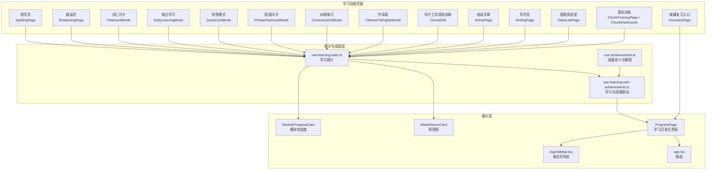
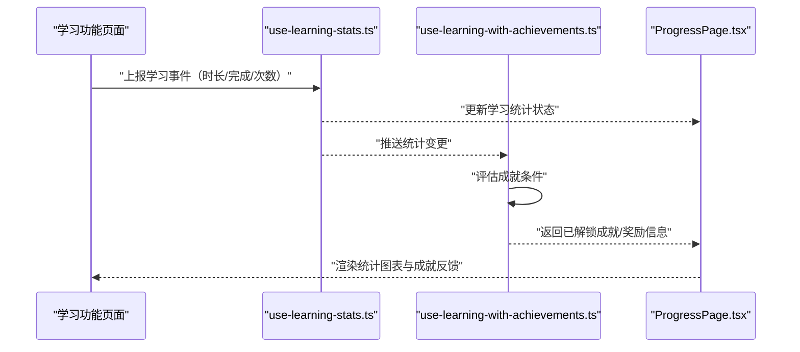
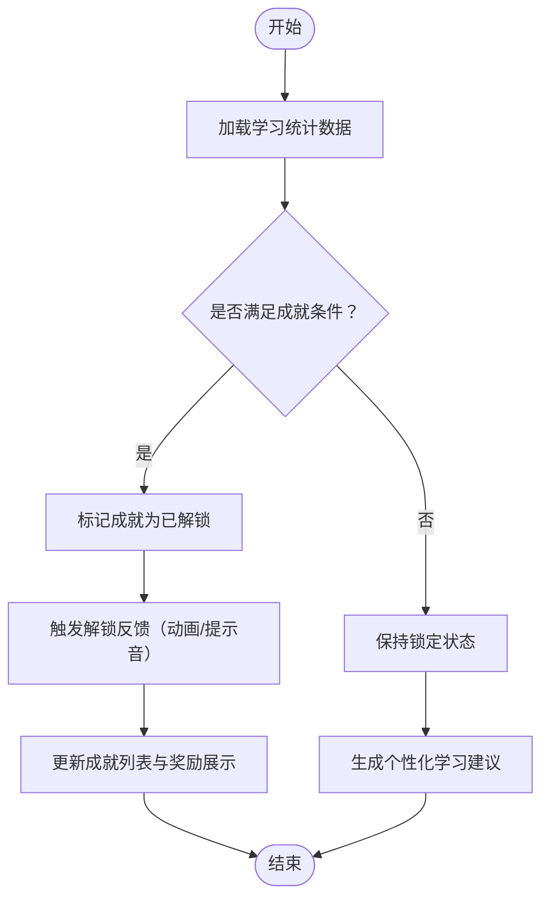
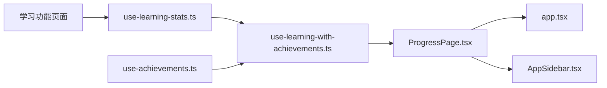

# 学习记录模块

<cite>
**本文引用的文件**   
- [src/lib/use-learning-stats.ts](file://src/lib/use-learning-stats.ts)
- [src/lib/use-achievements.ts](file://src/lib/use-achievements.ts)
- [src/lib/use-learning-with-achievements.ts](file://src/lib/use-learning-with-achievements.ts)
- [src/pages/ProgressPage/ProgressPage.tsx](file://src/pages/ProgressPage/ProgressPage.tsx)
- [src/pages/DashboardPage/WeekGlanceCard.tsx](file://src/pages/DashboardPage/WeekGlanceCard.tsx)
- [src/pages/DashboardPage/ModuleProgressCard.tsx](file://src/pages/DashboardPage/ModuleProgressCard.tsx)
- [src/components/AppSidebar.tsx](file://src/components/AppSidebar.tsx)
- [src/app.tsx](file://src/app.tsx)
- [src/pages/SpellingPage/SpellingPage.tsx](file://src/pages/SpellingPage/SpellingPage.tsx)
- [src/pages/ShadowingPage/ShadowingPage.tsx](file://src/pages/ShadowingPage/ShadowingPage.tsx)
- [src/pages/DeepVocabularyPage/components/FlashcardMode.tsx](file://src/pages/DeepVocabularyPage/components/FlashcardMode.tsx)
- [src/pages/DeepVocabularyPage/components/DailyLearningMode.tsx](file://src/pages/DeepVocabularyPage/components/DailyLearningMode.tsx)
- [src/pages/DeepVocabularyPage/components/QuickCardMode.tsx](file://src/pages/DeepVocabularyPage/components/QuickCardMode.tsx)
- [src/pages/DeepVocabularyPage/components/PhraseFlashcardMode.tsx](file://src/pages/DeepVocabularyPage/components/PhraseFlashcardMode.tsx)
- [src/pages/DeepVocabularyPage/components/CorrectionDrillMode.tsx](file://src/pages/DeepVocabularyPage/components/CorrectionDrillMode.tsx)
- [src/pages/DeepVocabularyPage/components/ChineseToEnglishMode.tsx](file://src/pages/DeepVocabularyPage/components/ChineseToEnglishMode.tsx)
- [src/pages/SentenceLabPage/components/ChunkDrill.tsx](file://src/pages/SentenceLabPage/components/ChunkDrill.tsx)
- [src/pages/ArticlePage/ArticlePage.tsx](file://src/pages/ArticlePage/ArticlePage.tsx)
- [src/pages/WritingPage/WritingPage.tsx](file://src/pages/WritingPage/WritingPage.tsx)
- [src/pages/VideoLabPage/VideoLabPage.tsx](file://src/pages/VideoLabPage/VideoLabPage.tsx)
- [src/pages/ChunkTrainingPage/ChunkTrainingPage.tsx](file://src/pages/ChunkTrainingPage/ChunkTrainingPage.tsx)
- [src/pages/ChunkTrainingPage/components/ChunkFlashcards.tsx](file://src/pages/ChunkTrainingPage/components/ChunkFlashcards.tsx)
- [src/pages/FavoritesPage/FavoritesPage.tsx](file://src/pages/FavoritesPage/FavoritesPage.tsx)
- [src/lib/study-credit.ts](file://src/lib/study-credit.ts)
</cite>

## 目录
1. [引言](#引言)
2. [项目结构](#项目结构)
3. [核心组件](#核心组件)
4. [架构总览](#架构总览)
5. [详细组件分析](#详细组件分析)
6. [依赖关系分析](#依赖关系分析)
7. [性能与可扩展性](#性能与可扩展性)
8. [故障排查指南](#故障排查指南)
9. [结论](#结论)

## 引言
本文件系统性梳理 NativeThink 应用中的“学习记录模块”，聚焦以下能力：
- 学习统计汇总：学习时长、完成度、日历记录、模块进度。
- 成就系统：成就定义、条件判断、解锁反馈与奖励展示。
- 数据流：各学习页面如何上报学习事件，use-learning-stats 如何聚合，use-learning-with-achievements 如何联动成就，ProgressPage 如何呈现统计与图表。
- 报告与建议：学习报告生成思路、趋势分析方法、个性化建议输出方式。

该模块以 hooks + 页面组件为主，属于前端本地统计与可视化层，不直接涉及后端 API 逻辑。

## 项目结构
学习记录模块由四个层次构成：
- 数据收集层：各学习功能页面通过 useLearningStats 上报学习事件。
- 统计计算层：use-learning-stats.ts 维护学习时长、完成度、日历等统计状态。
- 成就关联层：use-learning-with-achievements.ts 将学习行为映射到成就条件，并驱动解锁流程。
- 展示层：ProgressPage 渲染统计概览、日历、模块完成度及成就列表；Dashboard 相关卡片复用统计类型。

图示来源
- [src/pages/ProgressPage/ProgressPage.tsx:97-120](file://src/pages/ProgressPage/ProgressPage.tsx#L97-L120)
- [src/lib/use-learning-stats.ts](file://src/lib/use-learning-stats.ts)
- [src/lib/use-achievements.ts](file://src/lib/use-achievements.ts)
- [src/lib/use-learning-with-achievements.ts:1-20](file://src/lib/use-learning-with-achievements.ts#L1-L20)
- [src/pages/DashboardPage/WeekGlanceCard.tsx:1-10](file://src/pages/DashboardPage/WeekGlanceCard.tsx#L1-L10)
- [src/pages/DashboardPage/ModuleProgressCard.tsx:1-10](file://src/pages/DashboardPage/ModuleProgressCard.tsx#L1-L10)
- [src/app.tsx:15-55](file://src/app.tsx#L15-L55)
- [src/components/AppSidebar.tsx:40-50](file://src/components/AppSidebar.tsx#L40-L50)

章节来源
- [src/pages/ProgressPage/ProgressPage.tsx:97-120](file://src/pages/ProgressPage/ProgressPage.tsx#L97-L120)
- [src/lib/use-learning-with-achievements.ts:1-20](file://src/lib/use-learning-with-achievements.ts#L1-L20)
- [src/app.tsx:15-55](file://src/app.tsx#L15-L55)
- [src/components/AppSidebar.tsx:40-50](file://src/components/AppSidebar.tsx#L40-L50)

## 核心组件
- use-learning-stats.ts：提供 useLearningStats hook，暴露学习时长、完成度、日历记录 ICalendarRecord、统计接口 ILearningStats 等类型与状态，供多个学习页面写入和读取。
- use-achievements.ts：定义成就数据结构与解锁判定逻辑，为成就列表、解锁动画、奖励提示提供基础能力。
- use-learning-with-achievements.ts：组合 useLearningStats 与 useAchievements，在学习数据变化时触发成就检查与解锁回调。
- ProgressPage.tsx：学习记录主页面，整合统计概览、日历、模块完成度、成就列表，并作为收藏复习等功能的入口承载者。

章节来源
- [src/lib/use-learning-stats.ts](file://src/lib/use-learning-stats.ts)
- [src/lib/use-achievements.ts](file://src/lib/use-achievements.ts)
- [src/lib/use-learning-with-achievements.ts:1-20](file://src/lib/use-learning-with-achievements.ts#L1-L20)
- [src/pages/ProgressPage/ProgressPage.tsx:97-120](file://src/pages/ProgressPage/ProgressPage.tsx#L97-L120)

## 架构总览
学习记录模块采用“多生产者—单消费者”的数据流设计：
- 生产者：拼写、跟读、词汇、句子工坊、写作、视频、收藏复习等页面。
- 消费者：use-learning-stats 聚合数据；use-learning-with-achievements 消费统计数据并触发成就；ProgressPage 消费最终统计结果进行可视化。

图示来源
- [src/pages/SpellingPage/SpellingPage.tsx:70-85](file://src/pages/SpellingPage/SpellingPage.tsx#L70-L85)
- [src/pages/ShadowingPage/ShadowingPage.tsx:35-45](file://src/pages/ShadowingPage/ShadowingPage.tsx#L35-L45)
- [src/pages/DeepVocabularyPage/components/FlashcardMode.tsx:10-20](file://src/pages/DeepVocabularyPage/components/FlashcardMode.tsx#L10-L20)
- [src/lib/use-learning-stats.ts](file://src/lib/use-learning-stats.ts)
- [src/lib/use-learning-with-achievements.ts:1-20](file://src/lib/use-learning-with-achievements.ts#L1-L20)
- [src/pages/ProgressPage/ProgressPage.tsx:97-120](file://src/pages/ProgressPage/ProgressPage.tsx#L97-L120)

## 详细组件分析

### 学习统计：use-learning-stats.ts
作用：
- 提供 useLearningStats hook，统一接收来自各页面的学习事件。
- 维护学习时长、任务完成数量、日期维度记录（ICalendarRecord）、总体统计（ILearningStats）。
- 导出类型给 Dashboard 的 WeekGlanceCard、ModuleProgressCard 使用。

关键职责：
- 数据收集规则：按模块、日期、时长、完成标志等维度聚合。
- 时间口径：参考 study-credit.ts 对思维训练、对话、语块接龙等计时口径说明。
- 对外接口：供页面调用提交学习事件，供统计页面订阅最新数据。

复杂度与性能：
- 单次事件处理为 O(1) 或 O(n)（取决于内部数组长度），日常使用场景下开销较小。
- 可通过批量合并、防抖优化高频上报。

错误处理：
- 对非法学习时间、重复上报、空数据做兜底校验。
- 在 ProgressPage 的清理清单中保留旧键兼容逻辑，避免迁移后显示异常。

章节来源
- [src/lib/use-learning-stats.ts](file://src/lib/use-learning-stats.ts)
- [src/lib/study-credit.ts:1-30](file://src/lib/study-credit.ts#L1-L30)
- [src/lib/colloc-ai-cache.ts:1-20](file://src/lib/colloc-ai-cache.ts#L1-L20)

### 成就系统：use-achievements.ts
作用：
- 定义成就数据结构、等级、图标、奖励描述。
- 提供成就判定函数，根据学习数据判断是否满足解锁条件。
- 管理已解锁成就集合，支持重置、刷新、通知。

关键职责：
- 条件匹配：累计学习时长、连续打卡天数、模块完成度、特定任务次数等。
- 奖励反馈：解锁动画、提示音、弹窗提醒。
- 可配置化：新增成就只需扩展配置，无需改动业务逻辑。

复杂度与性能：
- 成就判定为纯函数，复杂度低，适合频繁调用。
- 可结合缓存减少重复计算。

错误处理：
- 对缺失字段、非法 ID、未定义成就做保护。
- 解锁失败时回滚状态并给出提示。

章节来源
- [src/lib/use-achievements.ts](file://src/lib/use-achievements.ts)

### 学习与成就联动：use-learning-with-achievements.ts
作用：
- 组合 useLearningStats 与 useAchievements。
- 监听学习统计变化，自动触发成就检查。
- 向 ProgressPage 暴露已解锁成就、待解锁目标、推荐学习内容。

关键职责：
- 数据桥接：将 ILearningStats 转换为成就条件输入。
- 状态同步：确保 UI 与成就状态一致。
- 建议生成：基于未完成成就和学习薄弱项，输出个性化学习建议。

流程图（成就判定）

图示来源
- [src/lib/use-learning-with-achievements.ts:1-20](file://src/lib/use-learning-with-achievements.ts#L1-L20)
- [src/lib/use-achievements.ts](file://src/lib/use-achievements.ts)
- [src/lib/use-learning-stats.ts](file://src/lib/use-learning-stats.ts)

章节来源
- [src/lib/use-learning-with-achievements.ts:1-20](file://src/lib/use-learning-with-achievements.ts#L1-L20)

### 统计界面：ProgressPage.tsx
作用：
- 展示学习统计概览：学习时长、完成度、日历记录、模块完成度。
- 集成成就列表、解锁动画、奖励提示。
- 作为收藏复习等功能入口的承载者。

关键职责：
- 渲染统计卡片：引用 useLearningStats 提供的数据。
- 渲染成就面板：引用 use-learning-with-achievements 提供的解锁状态与建议。
- 导航与路由：由 app.tsx 与 AppSidebar.tsx 管理访问路径。

章节来源
- [src/pages/ProgressPage/ProgressPage.tsx:97-120](file://src/pages/ProgressPage/ProgressPage.tsx#L97-L120)
- [src/app.tsx:15-55](file://src/app.tsx#L15-L55)
- [src/components/AppSidebar.tsx:40-50](file://src/components/AppSidebar.tsx#L40-L50)

### 学习数据收集规则
数据来源页面：
- 拼写：SpellingPage.tsx
- 跟读：ShadowingPage.tsx
- 词汇：FlashcardMode.tsx、DailyLearningMode.tsx、QuickCardMode.tsx、PhraseFlashcardMode.tsx、CorrectionDrillMode.tsx、ChineseToEnglishMode.tsx
- 句子工坊：SentenceLabPage/components/ChunkDrill.tsx
- 阅读：ArticlePage.tsx
- 写作：WritingPage.tsx
- 视频：VideoLabPage.tsx
- 语块训练：ChunkTrainingPage.tsx、ChunkFlashcards.tsx
- 收藏复习：FavoritesPage.tsx（入口承载）

收集规则要点：
- 按模块分类：不同学习模块对应不同的统计维度。
- 时间粒度：支持日级统计，便于日历与趋势图展示。
- 完成度：基于任务总数与已完成数计算百分比。
- 时长统计：遵循 study-credit.ts 中对不同模块计时口径的定义。

章节来源
- [src/pages/SpellingPage/SpellingPage.tsx:70-85](file://src/pages/SpellingPage/SpellingPage.tsx#L70-L85)
- [src/pages/ShadowingPage/ShadowingPage.tsx:35-45](file://src/pages/ShadowingPage/ShadowingPage.tsx#L35-L45)
- [src/pages/DeepVocabularyPage/components/FlashcardMode.tsx:10-20](file://src/pages/DeepVocabularyPage/components/FlashcardMode.tsx#L10-L20)
- [src/pages/DeepVocabularyPage/components/DailyLearningMode.tsx:10-20](file://src/pages/DeepVocabularyPage/components/DailyLearningMode.tsx#L10-L20)
- [src/pages/DeepVocabularyPage/components/QuickCardMode.tsx:30-45](file://src/pages/DeepVocabularyPage/components/QuickCardMode.tsx#L30-L45)
- [src/pages/DeepVocabularyPage/components/PhraseFlashcardMode.tsx:30-40](file://src/pages/DeepVocabularyPage/components/PhraseFlashcardMode.tsx#L30-L40)
- [src/pages/DeepVocabularyPage/components/CorrectionDrillMode.tsx:20-30](file://src/pages/DeepVocabularyPage/components/CorrectionDrillMode.tsx#L20-L30)
- [src/pages/DeepVocabularyPage/components/ChineseToEnglishMode.tsx:20-30](file://src/pages/DeepVocabularyPage/components/ChineseToEnglishMode.tsx#L20-L30)
- [src/pages/SentenceLabPage/components/ChunkDrill.tsx:5-15](file://src/pages/SentenceLabPage/components/ChunkDrill.tsx#L5-L15)
- [src/pages/ArticlePage/ArticlePage.tsx:15-25](file://src/pages/ArticlePage/ArticlePage.tsx#L15-L25)
- [src/pages/WritingPage/WritingPage.tsx:35-45](file://src/pages/WritingPage/WritingPage.tsx#L35-L45)
- [src/pages/VideoLabPage/VideoLabPage.tsx:20-30](file://src/pages/VideoLabPage/VideoLabPage.tsx#L20-L30)
- [src/pages/ChunkTrainingPage/ChunkTrainingPage.tsx:50-60](file://src/pages/ChunkTrainingPage/ChunkTrainingPage.tsx#L50-L60)
- [src/pages/ChunkTrainingPage/components/ChunkFlashcards.tsx:20-30](file://src/pages/ChunkTrainingPage/components/ChunkFlashcards.tsx#L20-L30)
- [src/pages/FavoritesPage/FavoritesPage.tsx:200-210](file://src/pages/FavoritesPage/FavoritesPage.tsx#L200-L210)

### 统计图表渲染
- 日历视图：WeekGlanceCard.tsx 使用 ICalendarRecord 类型渲染日级学习记录。
- 模块完成度：ModuleProgressCard.tsx 使用 ILearningStats 类型展示各模块进度。
- 趋势分析：基于历史学习时长与完成度计算增长率、波动区间，辅助用户理解学习节奏。

章节来源
- [src/pages/DashboardPage/WeekGlanceCard.tsx:1-10](file://src/pages/DashboardPage/WeekGlanceCard.tsx#L1-L10)
- [src/pages/DashboardPage/ModuleProgressCard.tsx:1-10](file://src/pages/DashboardPage/ModuleProgressCard.tsx#L1-L10)

### 学习报告生成与建议
- 报告内容：总学习时长、模块完成度、成就解锁情况、薄弱项分析。
- 趋势分析：对比近七日、近三十日数据，识别增长或退步趋势。
- 个性化建议：基于未解锁成就与薄弱模块，推荐下一步学习任务。

实现要点：
- 使用 use-learning-with-achievements.ts 提供的解锁状态与建议字段。
- 结合 use-learning-stats.ts 的历史数据进行趋势计算。
- 在 ProgressPage.tsx 中渲染报告卡片与建议列表。

章节来源
- [src/lib/use-learning-with-achievements.ts:1-20](file://src/lib/use-learning-with-achievements.ts#L1-L20)
- [src/lib/use-learning-stats.ts](file://src/lib/use-learning-stats.ts)
- [src/pages/ProgressPage/ProgressPage.tsx:97-120](file://src/pages/ProgressPage/ProgressPage.tsx#L97-L120)

## 依赖关系分析
学习记录模块依赖关系如下：
- 页面层依赖 use-learning-stats.ts 获取统计数据。
- 成就层依赖 use-achievements.ts 定义成就逻辑。
- 联动层 use-learning-with-achievements.ts 依赖前两者。
- 展示层 ProgressPage.tsx 依赖联动层与统计层。
- 路由与导航依赖 app.tsx 与 AppSidebar.tsx。

图示来源
- [src/pages/SpellingPage/SpellingPage.tsx:70-85](file://src/pages/SpellingPage/SpellingPage.tsx#L70-L85)
- [src/lib/use-learning-stats.ts](file://src/lib/use-learning-stats.ts)
- [src/lib/use-achievements.ts](file://src/lib/use-achievements.ts)
- [src/lib/use-learning-with-achievements.ts:1-20](file://src/lib/use-learning-with-achievements.ts#L1-L20)
- [src/pages/ProgressPage/ProgressPage.tsx:97-120](file://src/pages/ProgressPage/ProgressPage.tsx#L97-L120)
- [src/app.tsx:15-55](file://src/app.tsx#L15-L55)
- [src/components/AppSidebar.tsx:40-50](file://src/components/AppSidebar.tsx#L40-L50)

章节来源
- [src/lib/use-learning-with-achievements.ts:1-20](file://src/lib/use-learning-with-achievements.ts#L1-L20)
- [src/app.tsx:15-55](file://src/app.tsx#L15-L55)
- [src/components/AppSidebar.tsx:40-50](file://src/components/AppSidebar.tsx#L40-L50)

## 性能与可扩展性
- 性能优化：
  - 对高频学习事件进行批处理与防抖，降低 re-render 频率。
  - 成就判定使用纯函数与缓存，避免重复计算。
  - 图表渲染按需懒加载，减少首屏压力。
- 可扩展性：
  - 新增学习模块只需接入 useLearningStats 上报事件。
  - 新增成就只需扩展 use-achievements.ts 的配置与判定逻辑。
  - 报告与建议模板可在 ProgressPage.tsx 中扩展新卡片。

[本节为通用指导，不直接分析具体文件]

## 故障排查指南
常见问题与解决思路：
- 学习数据未更新：
  - 检查对应学习页面是否正确调用 useLearningStats 上报事件。
  - 确认 use-learning-stats.ts 中的数据聚合逻辑是否被正确触发。
- 成就未解锁：
  - 检查成就条件配置是否与当前学习数据匹配。
  - 查看 use-learning-with-achievements.ts 的条件判定分支。
- 图表渲染异常：
  - 确认 ICalendarRecord 与 ILearningStats 类型字段完整。
  - 检查 WeekGlanceCard.tsx 与 ModuleProgressCard.tsx 的数据绑定。
- 导航白屏：
  - 确认 ProgressPage.tsx 是否被 AppSidebar.tsx 与 app.tsx 正确路由。
  - 检查懒加载与错误边界配置。

章节来源
- [src/lib/use-learning-stats.ts](file://src/lib/use-learning-stats.ts)
- [src/lib/use-learning-with-achievements.ts:1-20](file://src/lib/use-learning-with-achievements.ts#L1-L20)
- [src/pages/DashboardPage/WeekGlanceCard.tsx:1-10](file://src/pages/DashboardPage/WeekGlanceCard.tsx#L1-L10)
- [src/pages/DashboardPage/ModuleProgressCard.tsx:1-10](file://src/pages/DashboardPage/ModuleProgressCard.tsx#L1-L10)
- [src/app.tsx:15-55](file://src/app.tsx#L15-L55)
- [src/components/AppSidebar.tsx:40-50](file://src/components/AppSidebar.tsx#L40-L50)

## 结论
NativeThink 的学习记录模块以 hooks 为核心，实现了从学习行为采集、统计聚合、成就联动到可视化展示的完整闭环。其设计清晰、职责分离良好，便于后续扩展新的学习模块与成就类型。通过合理的性能优化与错误处理机制，系统在用户体验与可维护性之间取得了平衡。未来可进一步引入更丰富的趋势分析与个性化推荐算法，以提升学习效果与用户粘性。