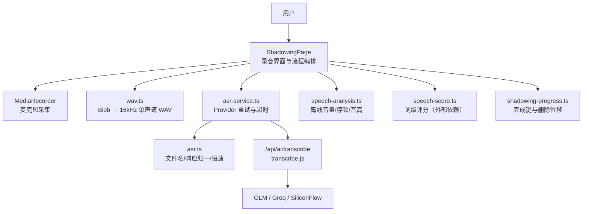
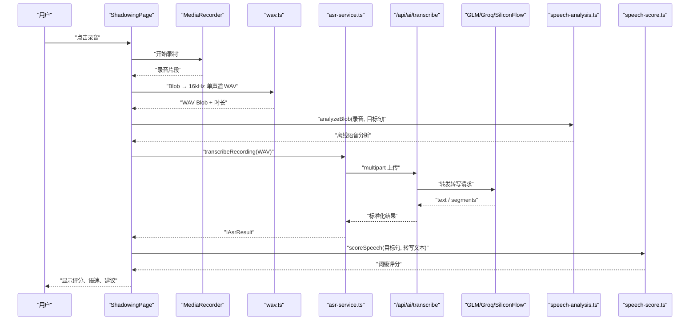
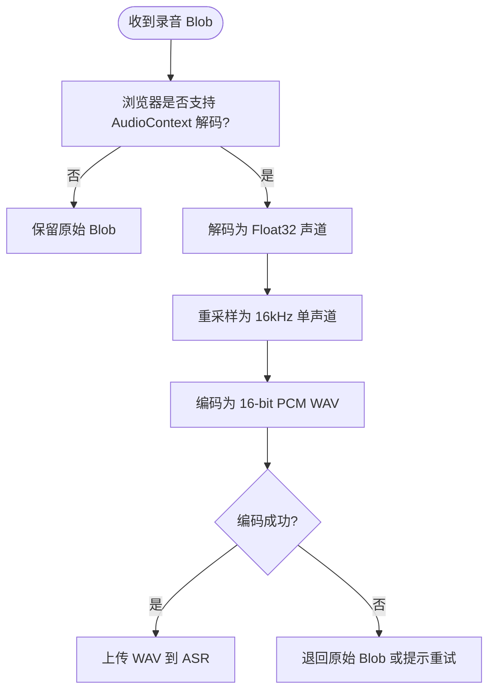
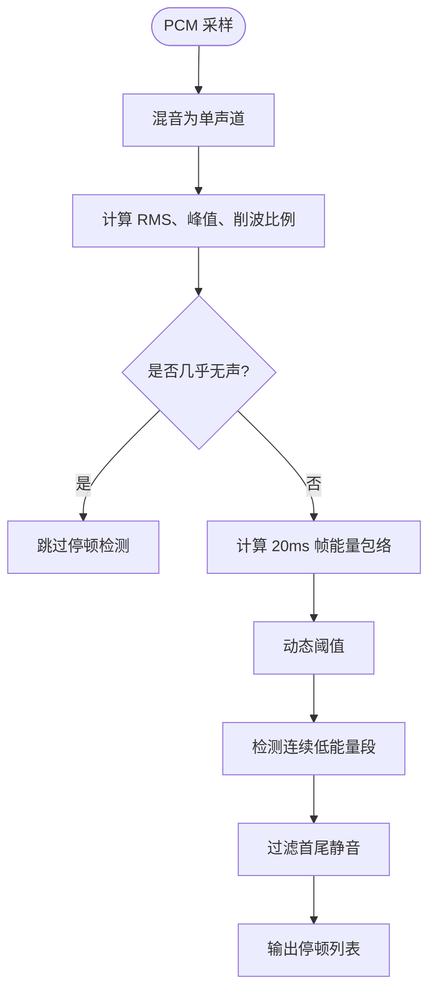
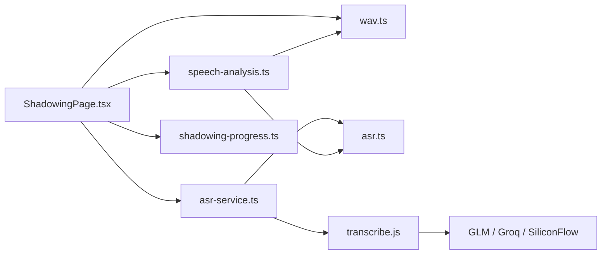

# 影子跟读模块

<cite>
**本文引用的文件**   
- [ShadowingPage.tsx](file://src/pages/ShadowingPage/ShadowingPage.tsx)
- [asr.ts](file://src/lib/asr.ts)
- [speech-analysis.ts](file://src/lib/speech-analysis.ts)
- [shadowing-progress.ts](file://src/lib/shadowing-progress.ts)
- [wav.ts](file://src/lib/wav.ts)
- [asr-service.ts](file://src/services/asr-service.ts)
- [transcribe.js](file://functions/api/ai/transcribe.js)
- [verify-shadowing-asr.mjs](file://scripts/verify-shadowing-asr.mjs)
- [probe-shadowing-asr.mjs](file://scripts/probe-shadowing-asr.mjs)
- [verify-shadowing-completion.mjs](file://scripts/verify-shadowing-completion.mjs)
</cite>

## 目录
1. [简介](#简介)
2. [项目结构与职责边界](#项目结构与职责边界)
3. [核心组件](#核心组件)
4. [系统架构总览](#系统架构总览)
5. [详细组件分析](#详细组件分析)
6. [依赖关系分析](#依赖关系分析)
7. [性能与资源特性](#性能与资源特性)
8. [排错指南](#排错指南)
9. [结论](#结论)

## 简介
影子跟读模块是 NativeThink 中围绕“听—录—评”闭环的口语训练功能。用户先听标准英文，再按住录音按钮模仿朗读；系统通过浏览器采集音频、转换为稳定格式后上传到后端转写服务，得到文本与可选分段；随后把目标句、识别结果和离线语音特征一起用于发音评分与个性化改进建议生成。

该模块同时强调：
- 不保存用户录音，隐私边界清晰。
- 离线语音分析不依赖 ASR，即使网络或 ASR Key 不可用也能给出音量、停顿、音高等反馈。
- 词级评分与 ASR 走同一套 `scoreSpeech` 口径，避免不同评测路径产生矛盾结果。
- 完成标记使用“语料 id + 合并索引”，AI 追加句与原句共享统一进度语义。

## 项目结构与职责边界
影子跟读涉及浏览器页面、纯逻辑库、网络服务和云端函数四个层次：

| 层级 | 主要文件 | 职责 |
|---|---|---|
| 页面层 | `ShadowingPage.tsx` | 录音界面、TTS 播放、ASR 调用、评分展示、AI 分析与完成进度 |
| 纯逻辑层 | `asr.ts`、`speech-analysis.ts`、`wav.ts`、`shadowing-progress.ts` | Provider 选择、WAV 编码、离线语音分析、完成键索引 |
| 客户端服务层 | `asr-service.ts` | 多 Provider 重试、超时取消、响应归一化 |
| 服务端函数层 | `functions/api/ai/transcribe.js` | multipart 接收、Provider 转发、转写结果标准化 |
| 测试脚本层 | `verify-shadowing-asr.mjs`、`probe-shadowing-asr.mjs`、`verify-shadowing-completion.mjs` | 契约守卫、端到端探针、完成标记回归测试 |

**图表来源**
- [ShadowingPage.tsx:1-120](file://src/pages/ShadowingPage/ShadowingPage.tsx#L1-L120)
- [asr-service.ts:1-99](file://src/services/asr-service.ts#L1-L99)
- [transcribe.js:1-200](file://functions/api/ai/transcribe.js#L1-L200)
- [speech-analysis.ts:1-80](file://src/lib/speech-analysis.ts#L1-L80)
- [asr.ts:1-101](file://src/lib/asr.ts#L1-L101)
- [wav.ts:1-102](file://src/lib/wav.ts#L1-L102)
- [shadowing-progress.ts:1-85](file://src/lib/shadowing-progress.ts#L1-L85)

**章节来源**
- [ShadowingPage.tsx:1-120](file://src/pages/ShadowingPage/ShadowingPage.tsx#L1-L120)
- [asr-service.ts:1-99](file://src/services/asr-service.ts#L1-L99)
- [transcribe.js:1-200](file://functions/api/ai/transcribe.js#L1-L200)

## 核心组件
### ShadowingPage：影子跟读主界面
ShadowingPage 是影子跟读的编排中心，负责以下任务：
- 加载内置或 AI 生成的语料，并合并原句与 AI 追加句。
- 管理 TTS 播放、循环播放、自动下一句、语速调节。
- 控制录音按钮状态、最大录音时长、录音质量提示。
- 调用 `transcribeRecording` 进行 ASR 转写。
- 调用 `analyzeBlob` 做离线语音分析。
- 基于目标句与识别文本调用词级评分。
- 记录当前句完成标记，并通过 `countCompletedForCorpus` 计算整体进度。
- 提供 AI 分析入口，根据本地分析和转写文本生成个性化建议。

关键设计点：
- 完成键按 `${corpusId}-${mergedIdx}` 构造，其中 `mergedIdx` 是“原句 + AI 追加句”的统一索引。
- 完成数据持久化采用带上限的缓存策略，防止大量语料导致存储写入无界增长。
- 切换语料或句子时清理录音、录音 URL、评分和本地分析结果，避免旧状态污染新句。
- 自动前进定时器在切句、切语料、手动完成后必须取消。
- 录音按钮旁明确标注“不保存音频”“不评音素发音”，对外说明能力边界。

**章节来源**
- [ShadowingPage.tsx:1-120](file://src/pages/ShadowingPage/ShadowingPage.tsx#L1-L120)
- [ShadowingPage.tsx:201-546](file://src/pages/ShadowingPage/ShadowingPage.tsx#L201-L546)
- [verify-shadowing-completion.mjs:1-183](file://scripts/verify-shadowing-completion.mjs#L1-L183)

### asr.ts：语音识别纯逻辑
`asr.ts` 不直接发起网络请求，而是暴露可测试的纯函数：
- `ASR_PROVIDERS`：支持的 provider 列表。
- `ASR_MODELS`：provider 到模型的映射。
- `pickAsrCandidates`：从配置中筛选出有 API Key 的 provider，并按 GLM、Groq、SiliconFlow 优先级排序。
- `filenameForAudio`：根据 Blob MIME 类型决定上传文件名，确保后端能识别容器。
- `normalizeAsrResponse`：统一 GLM、Groq、SiliconFlow 返回结构，保证 text 字段始终可用。
- `speechPace`：按词数估算参考时长，判断录音偏慢、偏快或正常。

复杂度要点：
- Provider 选择为线性扫描，provider 数量固定且很小。
- 响应归一化对 segments、results、text、transcript 多种形状做容错处理。
- 语速评估先分词，再乘以每词期望毫秒数，空句保底 800ms。

**章节来源**
- [asr.ts:1-101](file://src/lib/asr.ts#L1-L101)

### speech-analysis.ts：离线发音分析算法
`speech-analysis.ts` 实现离线语音分析，重点在于“能从波形客观量出来，但不承诺音素级发音正确性”。它输出：
- 录音时长。
- 音量摘要：RMS、峰值、削波比例、是否太轻、是否爆音。
- 停顿列表：按能量包络检测，排除首尾静音段。
- 预期意群边界：由标点推导，没有标点时回退到连词。
- 边界命中数：实际停顿位置与预期边界的接近程度。
- 音高摘要：中位频率、百分位范围、趋势、尾部是否上扬、有声帧数量。
- 语速评估：复用 `asr.speechPace`。

核心算法结构：
- `mixMono`：多声道混成单声道。
- `expectedBreakRatios`：从英文文本推导意群边界比例。
- `summarizeVolume`：计算 RMS、峰值、削波比例。
- `detectPauses`：20ms 帧 RMS 能量包络 + 自适应阈值。
- `summarizePitch`：自相关基频检测，过滤噪声帧，取中位和百分位。
- `analyzePcm`：组合上述分析。
- `analyzeBlob`：浏览器侧解码任意录音 Blob 后调用 `analyzePcm`。

**章节来源**
- [speech-analysis.ts:1-80](file://src/lib/speech-analysis.ts#L1-L80)
- [speech-analysis.ts:201-325](file://src/lib/speech-analysis.ts#L201-L325)

### shadowing-progress.ts：完成标记与删除位移
这个模块是“完成键”的单点权威实现，解决一个真实历史缺陷：
- 完成键使用“合并数组索引”，但删除按钮原本传入的是 AI 追加句的“本地索引”。
- 错误用法会把内置原句的完成标记误删，并把后续标记集体左移一位。
- 后果是完成数不再等于句数，成就横幅和“再来一遍”按钮永久消失。

提供的纯函数包括：
- `shadowingCompletionKey`：构造完成键。
- `parseCompletionIndex`：解析键中的数字索引。
- `countCompletedForCorpus`：按语料统计完成数。
- `isSentenceCompleted`：判断某句是否已完成。
- `shiftCompletionAfterDelete`：删除一句后重排完成键。
- `clearCompletionForCorpus`：清空某语料的完成标记。
- `extrasLocalIndex`：把合并索引换算为 extras 本地索引，并拒绝删除内置原句。

**章节来源**
- [shadowing-progress.ts:1-85](file://src/lib/shadowing-progress.ts#L1-L85)
- [verify-shadowing-completion.mjs:1-183](file://scripts/verify-shadowing-completion.mjs#L1-L183)

### wav.ts：WAV 音频处理
`wav.ts` 把浏览器录音转换成三个 provider 都稳定的 16kHz 单声道 16-bit PCM WAV：
- `resampleMono16k`：多声道 Float32 线性插值重采样为单声道 16kHz。
- `encodeWavMono16k`：构造 RIFF/WAVE/fmt/data 头部，写入 16-bit PCM。
- `blobToWav16k`：浏览器侧解码 Blob，失败时返回 null，让上层保留原始录音。

设计动机：
- Chrome MediaRecorder 可能产出 WebM/Opus，某些 ASR provider 不支持。
- WAV 是 GLM、Groq、SiliconFlow 都能接受的稳定容器。
- 解码与重采样只在浏览器执行，编码本身是纯函数，可在 Node 测试中真跑。

**章节来源**
- [wav.ts:1-102](file://src/lib/wav.ts#L1-L102)

### asr-service.ts：ASR 网络服务
`asr-service.ts` 负责把录音 Blob 送到 `/api/ai/transcribe`，并提供健壮性保障：
- 读取各 provider 的 API Key。
- 若未配置任何 provider，抛出 `ASR_NOT_CONFIGURED`。
- 使用 FormData 上传 audio、provider、apiKey、language。
- 设置默认 30 秒超时，支持外部 `AbortSignal`。
- 对多个候选 provider 依次尝试，直到成功。
- 对 `AbortError`、HTTP 错误、空转写文本分别给出清晰错误信息。

**章节来源**
- [asr-service.ts:1-99](file://src/services/asr-service.ts#L1-L99)

### transcribe.js：服务端转写函数
`functions/api/ai/transcribe.js` 同时支持两类入口：
1. 影子跟读录音：multipart/form-data，包含音频文件和 provider 元信息。
2. B 站字幕等 JSON 场景：application/json。

关键能力：
- 校验 Content-Type。
- 限制上传大小 8MB。
- 按 provider 路由到对应 Whisper 兼容接口。
- `normalizeTranscript`：统一 text、segments、results 三种返回结构。
- Origin 白名单、IP 限流、出厂 Key 用量记账。

**章节来源**
- [transcribe.js:1-200](file://functions/api/ai/transcribe.js#L1-L200)

## 系统架构总览
影子跟读的整体数据流如下：

**图表来源**
- [ShadowingPage.tsx:1-120](file://src/pages/ShadowingPage/ShadowingPage.tsx#L1-L120)
- [wav.ts:1-102](file://src/lib/wav.ts#L1-L102)
- [asr-service.ts:1-99](file://src/services/asr-service.ts#L1-L99)
- [transcribe.js:1-200](file://functions/api/ai/transcribe.js#L1-L200)
- [speech-analysis.ts:201-325](file://src/lib/speech-analysis.ts#L201-L325)

## 详细组件分析

### 录音与权限处理
ShadowingPage 使用 `MediaRecorder` 和 `getUserMedia({ audio: true })` 采集麦克风。录音流程包括：
- 检查 `MediaRecorder` 可用性。
- 选择浏览器支持的 MIME 类型，优先 Opus WebM，其次 WebM、MP4、OGG。
- 限制最大录音时长 20 秒、最大字节数 8MB。
- 启动计时器记录录音时长。
- 停止后释放媒体轨道、清理录音片段、撤销 Object URL。
- 卸载页面时统一清理录音、转写请求和自动前进定时器。

权限问题处理建议：
- 如果浏览器不支持 `MediaRecorder`，应提示用户改用其他浏览器或设备。
- 如果麦克风权限被拒绝，应在录音前拦截并引导用户开启权限。
- 如果录音为空或几乎无声，应提示靠近麦克风重新录制。
- 如果转写结果为空文本，应提示识别不到英文内容并重试。

**章节来源**
- [ShadowingPage.tsx:1-120](file://src/pages/ShadowingPage/ShadowingPage.tsx#L1-L120)
- [verify-shadowing-asr.mjs:120-197](file://scripts/verify-shadowing-asr.mjs#L120-L197)

### 音频格式转换与多平台兼容性
浏览器录音格式不稳定：
- Chrome 可能输出 WebM/Opus。
- Safari 可能输出 MP4/M4A。
- Android WebView 或 Electron 环境可能行为不同。

解决方案：
- 前端先尝试将录音转换为 16kHz 单声道 16-bit WAV。
- 转换失败时保留原始 Blob，由 ASR 服务或后端继续处理。
- `filenameForAudio` 根据 MIME 类型映射到 `.wav`、`.m4a`、`.ogg`、`.mp3`、`.webm`。
- 服务端也具备相同 MIME 到扩展名的推断逻辑。

**图表来源**
- [wav.ts:1-102](file://src/lib/wav.ts#L1-L102)
- [asr.ts:1-101](file://src/lib/asr.ts#L1-L101)
- [transcribe.js:120-200](file://functions/api/ai/transcribe.js#L120-L200)

**章节来源**
- [wav.ts:1-102](file://src/lib/wav.ts#L1-L102)
- [asr.ts:1-101](file://src/lib/asr.ts#L1-L101)
- [transcribe.js:120-200](file://functions/api/ai/transcribe.js#L120-L200)

### ASR 语音识别接口
ASR 流程分为三层：
1. 页面层：准备录音 Blob，调用 `transcribeRecording`。
2. 服务层：组装 FormData，选择 provider，处理超时和取消。
3. 服务端：接收 multipart，转发到 GLM/Groq/SiliconFlow，标准化结果。

Provider 选择顺序：
- GLM：出厂优先，模型 `GLM-ASR-2512`。
- Groq：模型 `whisper-large-v3-turbo`。
- SiliconFlow：模型 `FunAudioLLM/SenseVoiceSmall`。

异常分支：
- 无 API Key：抛出 `ASR_NOT_CONFIGURED`。
- 所有 provider 失败：抛出最后一次错误。
- 用户取消：抛出 `AbortError`。
- 超时：抛出超时错误。
- 识别结果为空：提示“没有识别到英文内容”。

**章节来源**
- [asr-service.ts:1-99](file://src/services/asr-service.ts#L1-L99)
- [asr.ts:1-101](file://src/lib/asr.ts#L1-L101)
- [transcribe.js:1-200](file://functions/api/ai/transcribe.js#L1-L200)
- [verify-shadowing-asr.mjs:1-197](file://scripts/verify-shadowing-asr.mjs#L1-L197)

### 发音评分与准确度计算
发音评分由两部分组成：
1. 词级评分：使用 `scoreSpeech`，比较目标句与 ASR 转写文本，输出词级命中率。
2. 离线语音分析：从波形中提取音量、停顿、音高、语速，不依赖 ASR。

评分输入：
- 目标句文本。
- ASR 转写文本。
- 录音时长。
- 录音波形。

评分输出：
- 词级评分对象。
- 语速标签：slow、fast、ok。
- 停顿位置与预期意群边界匹配数。
- 音量是否太轻或爆音。
- 音高趋势：rising、falling、stable。

注意：
- 离线分析不评价音素发音，那是专用口语评测服务的职责。
- 如果 ASR 不可用，仍可通过离线分析给出部分反馈。
- 如果转写为空，词级评分无法计算，但语音质量分析仍可运行。

**章节来源**
- [speech-analysis.ts:1-80](file://src/lib/speech-analysis.ts#L1-L80)
- [speech-analysis.ts:201-325](file://src/lib/speech-analysis.ts#L201-L325)
- [asr.ts:60-101](file://src/lib/asr.ts#L60-L101)

### 录音质量评估
录音质量评估主要来自 `summarizeVolume` 和 `detectPauses`：
- RMS 音量过低会被标记为太轻。
- 接近满幅样本占比超过阈值会被标记为爆音。
- 整段几乎无声时跳过停顿检测，避免把安静录音当成一处超长停顿。
- 停顿阈值基于峰值能量的相对比例，适应不同录音音量。
- 只保留不在首尾极端位置的停顿，避免把录音开头和结尾的静音当作意群边界。

**图表来源**
- [speech-analysis.ts:80-200](file://src/lib/speech-analysis.ts#L80-L200)

**章节来源**
- [speech-analysis.ts:80-200](file://src/lib/speech-analysis.ts#L80-L200)

### 个性化改进建议生成
ShadowingPage 支持两类 AI 辅助：
1. 生成额外跟读句子：向 AI 发送材料标题、分类、难度、已有句子，要求返回结构化 JSON。
2. 分析录音表现：结合本地语音分析和转写文本，让用户获得改进建议。

安全与体验设计：
- AI 生成需要已配置 AI API Key。
- 生成结果必须能被解析为数组，且每条句子都有英文文本。
- 新增句子带有临时 ID，方便删除。
- 删除 AI 追加句时使用 `extrasLocalIndex` 保护内置原句不被删除。
- AI 分析结果必须先判空串，避免把“服务不可用”当成空结果。
- 语音标注渲染不使用危险 HTML 注入，而是通过受控方式渲染 `<u>` 标签。

**章节来源**
- [ShadowingPage.tsx:201-546](file://src/pages/ShadowingPage/ShadowingPage.tsx#L201-L546)
- [verify-shadowing-completion.mjs:120-183](file://scripts/verify-shadowing-completion.mjs#L120-L183)

### 进度追踪与完成标记
完成标记的关键规则：
- 每个句子有一个完成键，形式为 `${corpusId}-${mergedIdx}`。
- `mergedIdx` 是合并数组索引，不是 extras 本地索引。
- 完成集合按语料隔离统计，不会跨语料虚高。
- 删除 AI 追加句后，后续完成键整体左移一位。
- “再来一遍”只清空当前语料的完成标记。
- 完成百分比是当前语料的完成数除以当前语料的总句数。

历史缺陷修复验证：
- 脚本 `verify-shadowing-completion.mjs` 覆盖了 8 原句 + 3 追加句的完整场景。
- 正对照证明旧调用方式会破坏完成标记。
- 断言覆盖键互逆、跨语料隔离、中间句删除、末尾孤儿键、非法键拒绝。

**章节来源**
- [shadowing-progress.ts:1-85](file://src/lib/shadowing-progress.ts#L1-L85)
- [verify-shadowing-completion.mjs:1-183](file://scripts/verify-shadowing-completion.mjs#L1-L183)

## 依赖关系分析

**图表来源**
- [ShadowingPage.tsx:1-120](file://src/pages/ShadowingPage/ShadowingPage.tsx#L1-L120)
- [asr-service.ts:1-99](file://src/services/asr-service.ts#L1-L99)
- [speech-analysis.ts:1-80](file://src/lib/speech-analysis.ts#L1-L80)
- [transcribe.js:1-200](file://functions/api/ai/transcribe.js#L1-L200)

耦合与内聚分析：
- `asr.ts` 是纯函数模块，无副作用，适合单元测试。
- `speech-analysis.ts` 把算法与浏览器解码分离，Node 下可测试核心逻辑。
- `shadowing-progress.ts` 零外部依赖，完全可转译运行。
- `ShadowingPage.tsx` 耦合较多 UI 状态、TTS、AI、ASR，属于编排层，不应把索引逻辑搬回页面。
- `asr-service.ts` 封装网络和重试，避免页面直接操作 fetch。
- `transcribe.js` 作为单一入口，集中处理 multipart、JSON、Origin、限流、用量记账。

潜在风险：
- 页面组件较重，未来可拆分录音控制器、评分控制器、进度控制器。
- ASR provider 配置分散在多处常量和服务中，需保持 key、model、endpoint 一致。
- 离线分析对长录音可能产生 CPU 压力，应考虑录音长度限制或异步分块处理。

**章节来源**
- [asr.ts:1-101](file://src/lib/asr.ts#L1-L101)
- [speech-analysis.ts:1-80](file://src/lib/speech-analysis.ts#L1-L80)
- [shadowing-progress.ts:1-85](file://src/lib/shadowing-progress.ts#L1-L85)
- [asr-service.ts:1-99](file://src/services/asr-service.ts#L1-L99)

## 性能与资源特性
- 最大录音时长 20 秒，最大录音文件大小 8MB，与服务端上传上限一致。
- WAV 重采样和编码在浏览器侧完成，避免上传非标准格式造成后端失败。
- 离线分析使用 20ms 帧和 40ms 音高帧，适合实时或近实时反馈。
- 完成标记使用 Set 存储，查找和插入近似 O(1)，但位移操作为 O(n)。
- 完成数据写入 localStorage 时有 2000 条数和 64KB 双封顶，避免无限增长。
- 预加热 TTS 引擎可降低连续播放的首播延迟。

优化建议：
- 如果用户频繁录制长录音，可考虑在分析阶段加入分块处理。
- 如果语料规模很大，完成标记可迁移到 IndexedDB，减少 localStorage 写入压力。
- 如果 ASR provider 全部不可用，应提前降级为仅离线分析模式，而不是让用户反复重试。

[本节为通用性能讨论，不直接分析具体代码行]

## 排错指南

### 常见问题与定位
| 现象 | 可能原因 | 定位方法 |
|---|---|---|
| 录音按钮无效 | 浏览器不支持 `MediaRecorder` | 检查页面是否创建 `MediaRecorder` |
| 麦克风权限被拒绝 | 用户未授权或设备不可用 | 检查 `getUserMedia` 调用与错误回调 |
| 转写一直失败 | 没有配置 ASR API Key | 检查 `hasAsrChannel` 和 `ASR_NOT_CONFIGURED` |
| 某个 provider 失败 | Key 过期、限流或模型不可用 | 查看多 provider 重试链 |
| 转写超时 | 网络慢或 provider 响应慢 | 检查 30 秒超时与 `AbortController` |
| 识别结果为空 | 录音质量差或 ASR 没识别到英文 | 检查录音时长、音量、提示文案 |
| 完成进度异常 | 完成键索引混乱 | 运行 `verify-shadowing-completion.mjs` |
| 100% 成就消失 | 删除 AI 追加句后完成键错位 | 检查 `shiftCompletionAfterDelete` 和 `extrasLocalIndex` |
| WAV 上传失败 | 浏览器解码失败 | 检查 `blobToWav16k` 返回值 |
| 离线分析无结果 | 录音几乎无声或采样率异常 | 检查 `analyzePcm` 前置条件 |

### 调试脚本
- `scripts/verify-shadowing-asr.mjs`：验证 ASR 纯函数、WAV 编码、服务端 normalizeTranscript、页面接线、反向断言。
- `scripts/probe-shadowing-asr.mjs`：端到端探针，可生成英文音频、调用 ASR、运行真实 `scoreSpeech`。
- `scripts/verify-shadowing-completion.mjs`：验证完成标记、删除位移、跨语料隔离、索引换算守卫。

**章节来源**
- [verify-shadowing-asr.mjs:1-197](file://scripts/verify-shadowing-asr.mjs#L1-L197)
- [probe-shadowing-asr.mjs:1-200](file://scripts/probe-shadowing-asr.mjs#L1-L200)
- [verify-shadowing-completion.mjs:1-183](file://scripts/verify-shadowing-completion.mjs#L1-L183)

## 结论
影子跟读模块以 ShadowingPage 为中心，串联录音、WAV 转换、ASR 转写、离线语音分析和词级评分，形成完整的口语训练闭环。其重要价值在于：
- 把浏览器录音的不稳定性收敛到 `wav.ts` 和 `asr.ts`。
- 把 provider 差异收敛到 `asr-service.ts` 和 `transcribe.js`。
- 把完成标记的复杂索引收敛到 `shadowing-progress.ts`。
- 让离线分析成为 ASR 不可用时的可靠替代反馈通道。
- 通过多个 Node 脚本对纯函数、服务端行为和页面接线做契约守卫。

后续改进方向可聚焦于：
- 将 ShadowingPage 拆分为更小的控制器组件。
- 将完成标记从 localStorage 迁移到 IndexedDB。
- 增加录音质量实时监控，如音量过低、爆音、长时间静音。
- 提供更多离线分析指标，例如节奏稳定性、重音分布。
- 扩展 ASR provider 列表，并保持配置一致性。

[本节为总结性内容，不直接分析具体文件]