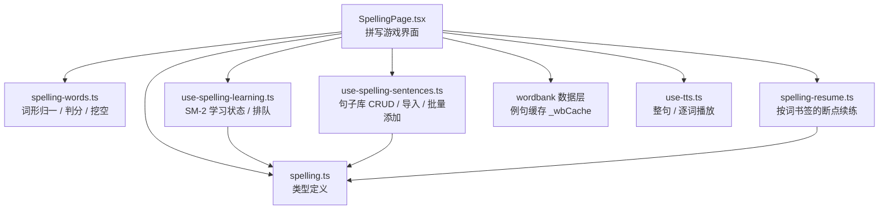
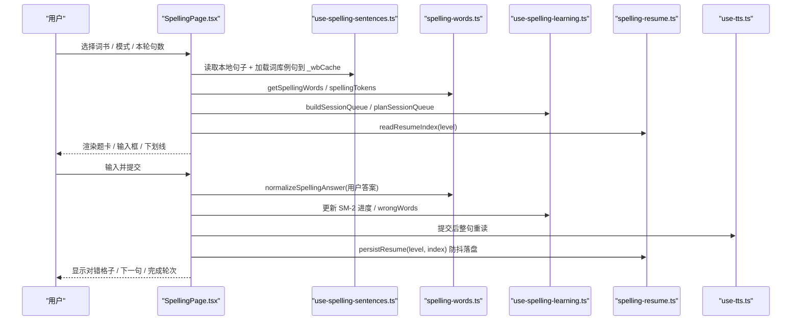
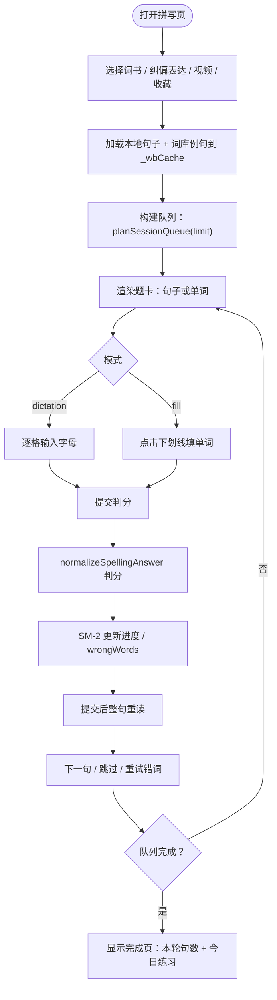
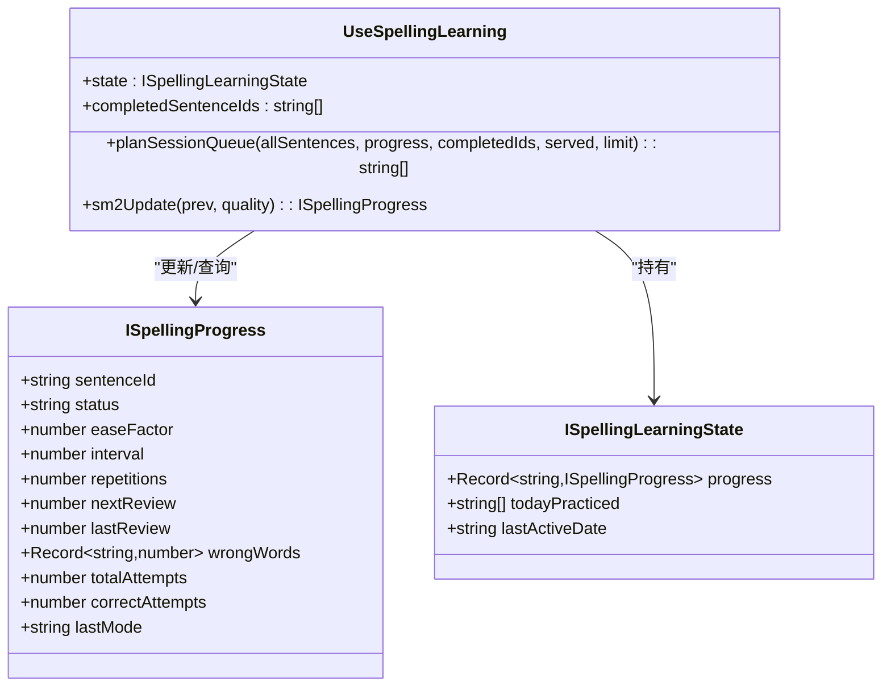
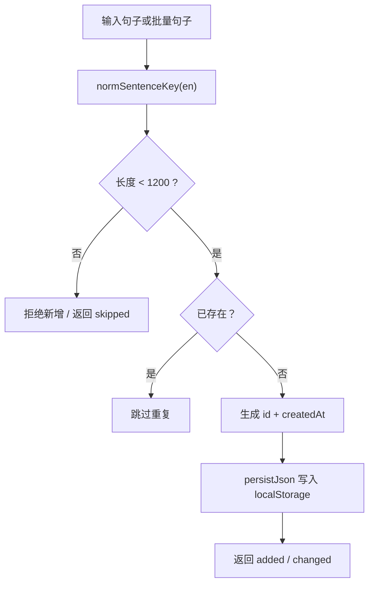
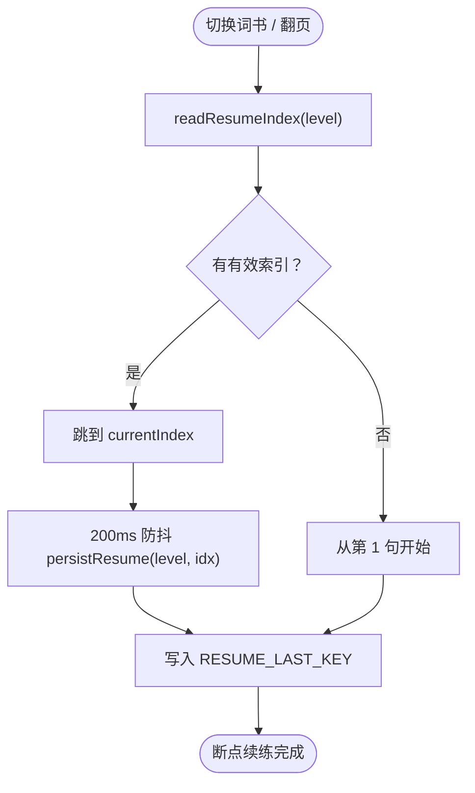
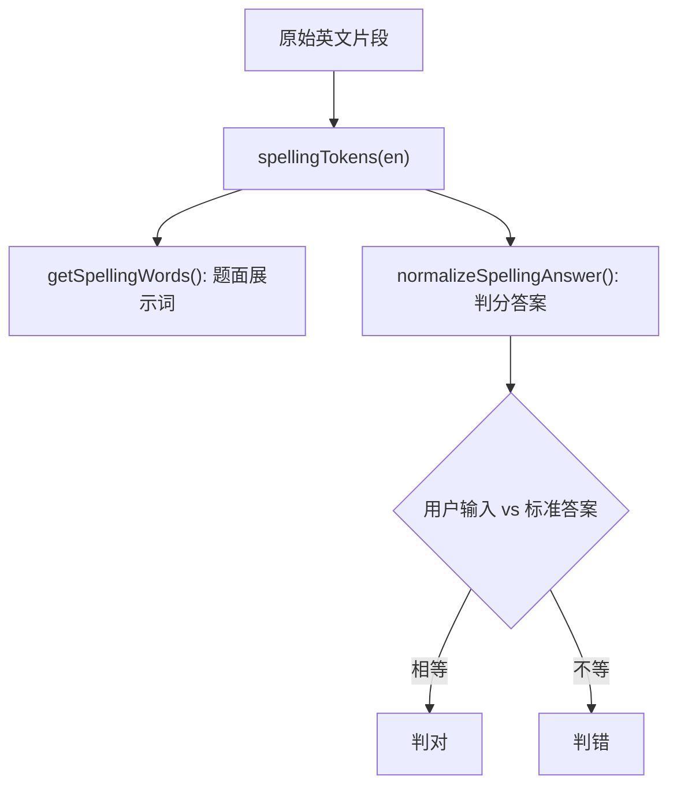
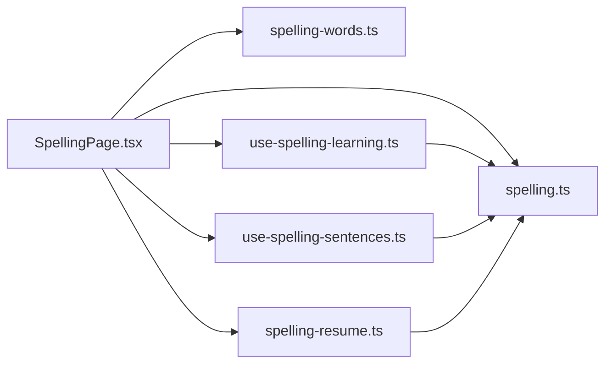

# 拼写练习模块

<cite>
**本文引用的文件**   
- [SpellingPage.tsx](file://src/pages/SpellingPage/SpellingPage.tsx)
- [use-spelling-learning.ts](file://src/lib/use-spelling-learning.ts)
- [use-spelling-sentences.ts](file://src/lib/use-spelling-sentences.ts)
- [spelling-resume.ts](file://src/lib/spelling-resume.ts)
- [spelling-words.ts](file://src/lib/spelling-words.ts)
- [spelling.ts](file://src/types/spelling.ts)
- [spelling.md](file://docs/modules/spelling.md)
- [verify-spelling-logic.mjs](file://scripts/verify-spelling-logic.mjs)
- [verify-spelling-resume.mjs](file://scripts/verify-spelling-resume.mjs)
</cite>

## 目录
1. [引言](#引言)
2. [项目结构](#项目结构)
3. [核心组件](#核心组件)
4. [架构总览](#架构总览)
5. [详细组件分析](#详细组件分析)
6. [依赖关系分析](#依赖关系分析)
7. [性能与难度调优](#性能与难度调优)
8. [故障排查指南](#故障排查指南)
9. [结论](#结论)

## 引言
本模块为 NativeThink 的拼写练习功能，围绕“句子拼写”和“单词填空”两种玩法展开。它通过五种题目来源组织题库，使用 SM-2 间隔重复维护学习进度，支持按词书断点续练，并提供本地句子库管理与用户成就统计。文档重点解释：
- 2×2 玩法机制（模式 × 音频模式）
- 五种题目来源与难度判定
- SpellingPage 游戏界面与交互流程
- use-spelling-learning.ts 的学习状态与排期
- use-spelling-sentences.ts 的句子题库管理
- spelling-resume.ts 的断点续练逻辑
- spelling-words.ts 的词形归一与判分口径
- 题目生成算法、错误检测、难度自适应与成就系统

## 项目结构
拼写练习模块由页面层、学习引擎、句子库、断点续练、词形判分以及类型定义组成：

**图示来源**
- [SpellingPage.tsx:1-80](file://src/pages/SpellingPage/SpellingPage.tsx#L1-L80)
- [spelling-words.ts:1-58](file://src/lib/spelling-words.ts#L1-L58)
- [use-spelling-learning.ts:1-60](file://src/lib/use-spelling-learning.ts#L1-L60)
- [use-spelling-sentences.ts:1-60](file://src/lib/use-spelling-sentences.ts#L1-L60)
- [spelling-resume.ts:1-40](file://src/lib/spelling-resume.ts#L1-L40)
- [spelling.ts:1-61](file://src/types/spelling.ts#L1-L61)

**章节来源**
- [SpellingPage.tsx:1-120](file://src/pages/SpellingPage/SpellingPage.tsx#L1-L120)
- [spelling.md:1-40](file://docs/modules/spelling.md#L1-L40)

## 核心组件
| 组件 | 职责 | 关键能力 |
|---|---|---|
| SpellingPage.tsx | 拼写游戏主界面 | 切换 dictation/fill 模式、选择音频 sentence/word、加载词库例句、收藏导入、AI 批量加句、提交判分、完成轮次、显示完成页 |
| use-spelling-learning.ts | 学习引擎 Hook | SM-2 进度、今日练习计数、已完成句 ID、最近出题记录 served、计划队列 planSessionQueue |
| use-spelling-sentences.ts | 句子库 Hook | 本地持久化句子、去重、上限 1200 条、纠偏表达与视频精听桶、批量导入、按 source 清理 |
| spelling-resume.ts | 断点续练纯函数 | 按 level 分键读写 currentIndex、上次词书指针、旧全局键迁移、按前缀重置 |
| spelling-words.ts | 词形口径 | 展示词与判分词统一、弯引号/破折号/数字处理、Fisher-Yates 洗牌 |
| spelling.ts | 类型定义 | 句子来源、模式、音频模式、难度、进度、会话模型 |

**章节来源**
- [spelling.ts:1-61](file://src/types/spelling.ts#L1-L61)
- [spelling-words.ts:1-58](file://src/lib/spelling-words.ts#L1-L58)
- [use-spelling-learning.ts:1-60](file://src/lib/use-spelling-learning.ts#L1-L60)
- [use-spelling-sentences.ts:1-60](file://src/lib/use-spelling-sentences.ts#L1-L60)
- [spelling-resume.ts:1-40](file://src/lib/spelling-resume.ts#L1-L40)

## 架构总览
拼写练习的整体调用链如下：

**图示来源**
- [SpellingPage.tsx:1-120](file://src/pages/SpellingPage/SpellingPage.tsx#L1-L120)
- [use-spelling-learning.ts:120-170](file://src/lib/use-spelling-learning.ts#L120-L170)
- [spelling-words.ts:1-58](file://src/lib/spelling-words.ts#L1-L58)
- [spelling-resume.ts:40-128](file://src/lib/spelling-resume.ts#L40-L128)
- [use-spelling-sentences.ts:60-120](file://src/lib/use-spelling-sentences.ts#L60-L120)

## 详细组件分析

### SpellingPage：2×2 玩法与游戏界面
SpellingPage 是拼写练习的主界面，实现以下能力：
- 2×2 玩法组合：
  - 模式：`dictation`（句子拼写）、`fill`（单词拼写）
  - 音频模式：`sentence`（整句朗读）、`word`（逐词串播）
- 题目来源：
  - 词库例句：从 wordbank 提取 `w.examples`，存入模块级缓存 `_wbCache` 与 `_wbCacheAll`，id 用文本哈希 `_wbId()` 稳定生成
  - 收藏单词：category 为 `spelling` 的收藏词条
  - AI 批量：带 `batchId` 的本地句子
  - 纠偏表达：单独 level 桶 `correction`，不混入词库例句
  - 用户自建：类型存在但仓库无写入点
- 难度判断：
  - 词库等级映射：zhongkao/gaokao/cet4 等 beginner，advanced 为 advanced，其余 intermediate
  - 纠偏好/视频句子按英文词数 ≤7 / ≤13 / 更多判定 beginner / intermediate / advanced
- 输入与判分：
  - dictation：每个空格对应一个隐形输入格，提交后用 `normalizeSpellingAnswer` 判分
  - fill：按 `selectBlanks` 挖空内容词，`splitForFill` 共用 `spellingTokens` 保证下标一致
- 自动朗读：
  - 仅在 `mode === 'dictation'` 且开启自动朗读时触发；fill 模式不自动朗读整句，避免把被挖空的答案读出来
- 完成轮次：
  - 队列全部完成后进入独立完成页，显示本轮句数、今日练习数、再来一轮与学习记录；不再在题卡上方叠加横幅

**图示来源**
- [SpellingPage.tsx:1-120](file://src/pages/SpellingPage/SpellingPage.tsx#L1-L120)
- [SpellingPage.tsx:400-560](file://src/pages/SpellingPage/SpellingPage.tsx#L400-L560)
- [spelling-words.ts:1-58](file://src/lib/spelling-words.ts#L1-L58)
- [use-spelling-learning.ts:120-170](file://src/lib/use-spelling-learning.ts#L120-L170)

**章节来源**
- [spelling.md:1-40](file://docs/modules/spelling.md#L1-L40)
- [SpellingPage.tsx:1-200](file://src/pages/SpellingPage/SpellingPage.tsx#L1-L200)

### use-spelling-learning.ts：学习状态与排期
该 Hook 维护拼写学习的长期进度与本轮队列：
- 存储键：
  - `__nativethink_spelling_progress`：SM-2 主体
  - `__nativethink_spelling_completed`：已完成句子 ID 列表
  - `__nativethink_spelling_served`：最近出题记录，超过 4000 条剪最旧
- SM-2 更新：
  - quality ≥ 3 视为正确，更新 easeFactor、interval、repetitions，并计算 nextReview
  - quality < 3 视为错误，重置 repetitions=0、interval=1，status 可能回到 learning
- 队列规划 planSessionQueue：
  - 排除 completed 与 mastered
  - 顺序：到期句（按 oldest nextReview）→ 从未出过（洗牌）→ 出过（最久未出优先）
  - limit 截断发生在 markServed 之前，确保只登记本轮实际出的句子
- 日常计数：
  - todayPracticed 保存今日已练习句子 ID，跨天重置 lastActiveDate
  - 云同步下行后重读 storage，避免双写 POST 回云端

**图示来源**
- [spelling.ts:20-61](file://src/types/spelling.ts#L20-L61)
- [use-spelling-learning.ts:1-60](file://src/lib/use-spelling-learning.ts#L1-L60)
- [use-spelling-learning.ts:120-170](file://src/lib/use-spelling-learning.ts#L120-L170)

**章节来源**
- [use-spelling-learning.ts:1-200](file://src/lib/use-spelling-learning.ts#L1-L200)

### use-spelling-sentences.ts：句子题库管理
该 Hook 负责本地句子库的 CRUD、导入与容量控制：
- 上限与策略：
  - `SPELLING_SENTENCE_LIMIT = 1200`，超过上限只拒绝新增、不裁剪已有
  - 写失败走 `warnStorageFull()`，避免静默丢失用户/AI 生成的不可重算句子
- 去重口径：
  - `normSentenceKey(en)` 统一 trim、toLowerCase、正则替换连续空白
  - addSentence / addSentences / upsertSentences 都走同一去重逻辑
- 特殊桶：
  - CORRECTION_LEVEL = `'correction'`：纠偏表达，不跟词库例句混池
  - VIDEO_LEVEL = `'video'`：视频精听字幕，同样独立桶
- 难度判定：
  - 按英文词数 ≤7 → beginner，≤13 → intermediate，>13 → advanced
- API：
  - addSentence：单条添加，返回是否成功
  - addSentences：批量添加，返回实际 added 数量
  - upsertSentences：按 en 文本更新 level 或插入新条目
  - removeSentence / removeBySource：按 id 或 source 删除

**图示来源**
- [use-spelling-sentences.ts:1-120](file://src/lib/use-spelling-sentences.ts#L1-L120)

**章节来源**
- [use-spelling-sentences.ts:1-200](file://src/lib/use-spelling-sentences.ts#L1-L200)

### spelling-resume.ts：断点续练逻辑
断点续练按词书 level 分键，解决旧实现“全局单键只能记住一本”的问题：
- 键约定：
  - `__nativethink_spelling_resume_<level>`：每本书的 currentIndex
  - `__nativethink_spelling_resume_last`：上次词书指针
  - 兼容旧全局键 `__nativethink_spelling_resume`
- 核心函数：
  - resumeKeyFor(level)：生成分键
  - readResumeIndex(level)：读取某本书断点，无效值返回 null
  - readLastResumeLevel()：读取上次词书
  - persistResume(level, currentIndex)：写断点 + 上次指针
  - migrateLegacyResume()：一次性迁移旧全局键，目标已有数据不被覆盖
  - clearAllResume()：按前缀枚举清除所有断点键
- 适配层：
  - IResumeStorage：可注入替身存储，供守卫真跑
  - resumeStorageWithKeys()：基于 safeStorage 补齐 keys() 枚举能力

**图示来源**
- [spelling-resume.ts:1-128](file://src/lib/spelling-resume.ts#L1-L128)

**章节来源**
- [spelling-resume.ts:1-128](file://src/lib/spelling-resume.ts#L1-L128)

### spelling-words.ts：词形归一与判分口径
该模块统一题面展示词与判分答案的处理规则：
- 展示词：
  - normalizeSpellingWord：弯引号转 ASCII 撇号，连字符变体转 `-`，剥掉两端多余引号，保留 `\p{L}` 与 `\p{N}`
  - spellingTokens：按空白切分，过滤纯标点 token，输出 `{raw, word}`
  - getSpellingWords：用于填空题面展示
- 判分词：
  - normalizeSpellingAnswer：展示口径基础上 NFD 折叠重音、转小写
  - shuffledCopy：Fisher-Yates 洗牌，替代 `sort(random)`
- 设计要点：
  - It’s 展示为 It's，判分时 Its ≠ It's（撇号参与拼写）
  - 2024、blasé、well-known 等数字、重音、连字符正确处理
  - 纯标点 token 不占格，避免省略号、破折号造成错位

**图示来源**
- [spelling-words.ts:1-58](file://src/lib/spelling-words.ts#L1-L58)

**章节来源**
- [spelling-words.ts:1-58](file://src/lib/spelling-words.ts#L1-L58)

### 题目来源与配置方法
五种题目来源的配置方式如下：

| 来源 | source | 数据来源 | 难度判定 | 存储位置 |
|---|---|---|---|---|
| 词库例句 | `word_example` | queryWords({level}) 抽取 w.examples | 按词书等级映射 | 模块级缓存 `_wbCache`，不落 localStorage |
| 收藏单词 | `favorite` | favorites.filter(type==='word') | 继承词库或默认 | 模块级缓存 `_wbCache` |
| AI 批量 | `ai_generated` | AI 服务返回 JSON | 由生成器决定 | localStorage `__nativethink_spelling_sentences` |
| 纠偏表达 | `correction` | correctionToSpellingItem(right, chineseHint/note) | 按英文词数 ≤7/≤13/>13 | localStorage，level='correction' |
| 用户自建 | `user_created` | 类型存在但无写入点 | 不适用 | 无写入点 |

**章节来源**
- [spelling.md:10-60](file://docs/modules/spelling.md#L10-L60)
- [use-spelling-sentences.ts:30-80](file://src/lib/use-spelling-sentences.ts#L30-L80)

## 依赖关系分析
拼写模块内部依赖如下：

**图示来源**
- [SpellingPage.tsx:1-80](file://src/pages/SpellingPage/SpellingPage.tsx#L1-L80)
- [spelling.ts:1-61](file://src/types/spelling.ts#L1-L61)

**章节来源**
- [SpellingPage.tsx:1-120](file://src/pages/SpellingPage/SpellingPage.tsx#L1-L120)

## 性能与难度调优
- 词形处理复杂度：
  - spellingTokens/getSpellingWords 为 O(n)，n 为英文片段 token 数
  - normalizeSpellingAnswer 包含 NFD 规范化与正则替换，常数开销较小
- 队列规划复杂度：
  - planSessionQueue 遍历 allSentences 一次，排序 due/seen，时间复杂度 O(n log n)
  - served 记录最多 4000 条，超出剪最旧，避免无限增长
- 存储策略：
  - 句子库上限 1200 条，超限只拒绝新增，不裁剪已有
  - SM-2 进度、completed、served 分别落盘，避免重复写相同 JSON
- 难度自适应：
  - 词库等级映射提供 beginner/intermediate/advanced 基础难度
  - 纠偏/视频句子按词数自动划分难度
  - 可通过调整 `selectBlanks` 的空位比例（当前 ≈ 词数 × 0.35）调节填空难度
- 音频性能：
  - 提交后整句重读前先 cancelAutoRead/cancelWordPlay，避免串播残留
  - 长句预热与实播语速键不同，预热可能不命中，需关注 rate 设置

**章节来源**
- [use-spelling-learning.ts:1-120](file://src/lib/use-spelling-learning.ts#L1-L120)
- [use-spelling-sentences.ts:1-120](file://src/lib/use-spelling-sentences.ts#L1-L120)
- [spelling-words.ts:1-58](file://src/lib/spelling-words.ts#L1-L58)

## 故障排查指南
常见问题与定位方式：

| 问题 | 可能原因 | 排查建议 |
|---|---|---|
| 弯引号导致判错 | 旧实现用 `[^a-zA-Z'-]` 剥字符 | 确认使用 spelling-words.ts 的 normalizeSpellingAnswer |
| 填空下标错位 | splitForFill 与 getSpellingWords 未共用 tokens | 检查 SpellingPage 是否直接重写切分逻辑 |
| 切词书断点丢失 | 仍用全局键而非 level 分键 | 确认使用 spelling-resume.ts 的 readResumeIndex/persistResume |
| 导入句子不出现 | importDirty effect 依赖 rebuildSession 导致频繁重建 | 检查是否改为仅依赖 importDirty 并使用 ref 取最新闭包 |
| 完成页仍显示题卡 | completionShown 条件未生效 | 检查完成页渲染分支与 roundSize 传递 |
| 自动朗读乱序 | 切句/切模式未取消逐词串播定时器 | 确认 cancelWordPlay/tts.cancel 顺序 |
| 句子库刷新丢失 | persistJson 失败未提示 | 检查 warnStorageFull 与 localStorage 容量 |

**章节来源**
- [spelling.md:60-100](file://docs/modules/spelling.md#L60-L100)
- [verify-spelling-logic.mjs:1-191](file://scripts/verify-spelling-logic.mjs#L1-L191)
- [verify-spelling-resume.mjs:1-155](file://scripts/verify-spelling-resume.mjs#L1-L155)

## 结论
NativeThink 拼写练习模块以 SpellingPage 为入口，结合 use-spelling-learning.ts 的 SM-2 学习引擎、use-spelling-sentences.ts 的句子库管理、spelling-resume.ts 的断点续练与 spelling-words.ts 的词形判分，形成完整的 2×2 拼写游戏体系。其优势在于：
- 统一词形口径，避免弯引号/破折号/数字导致的判错
- 按 level 分键断点续练，多本书互不干扰
- 句子库上限保护与去重，避免用户/AI 生成内容丢失
- 队列规划区分到期/从未出过/已出过，提升复习效率
- 完成轮次独立页面，清晰反馈本轮成果

调优方向包括：
- 根据用户水平调整 selectBlanks 空位比例
- 扩展纠偏/视频句子的中文提示质量
- 监控 served 超 4000 条剪枝与 long sentence 预热命中率
- 保持守卫脚本 verify-spelling-logic.mjs 与 verify-spelling-resume.mjs 全绿