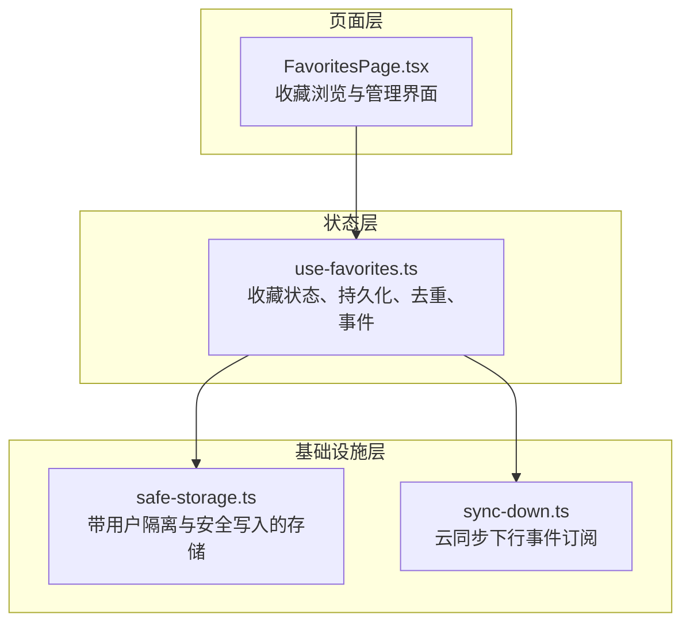
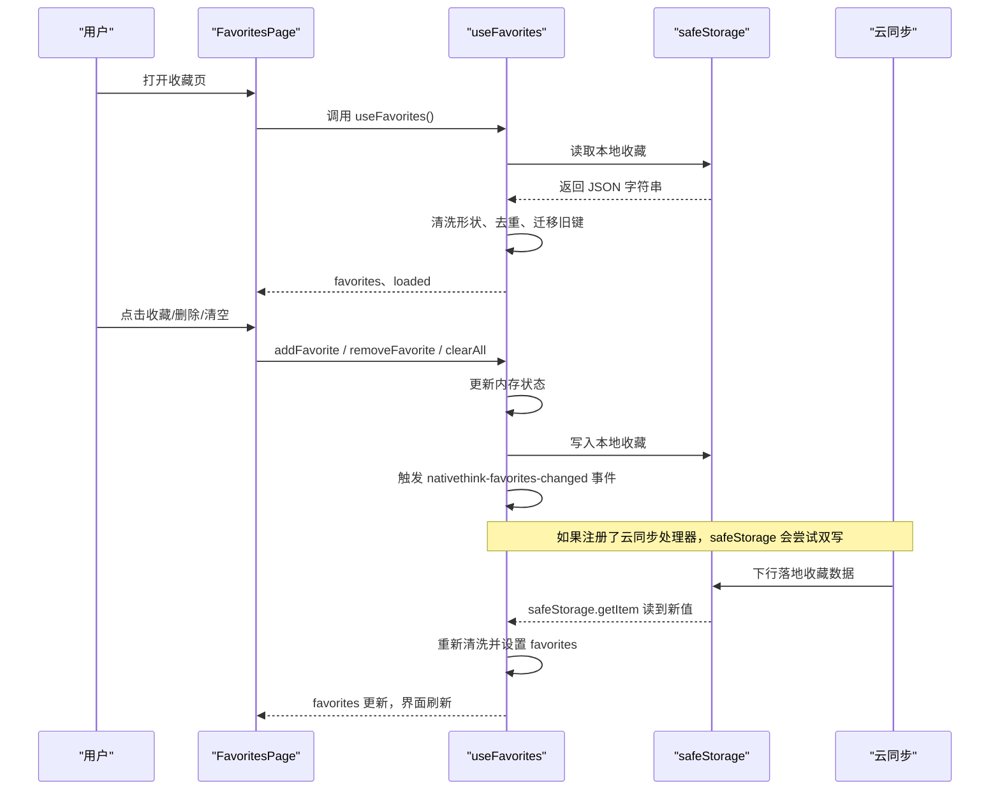
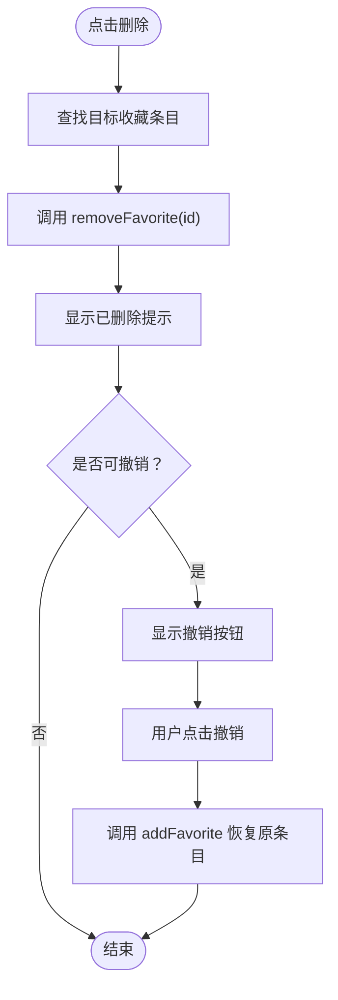
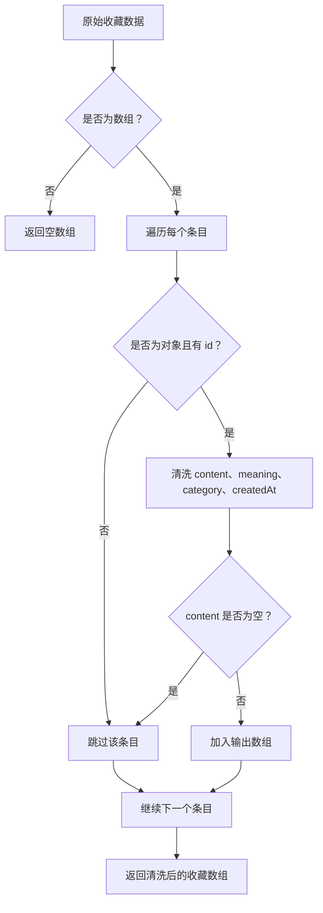
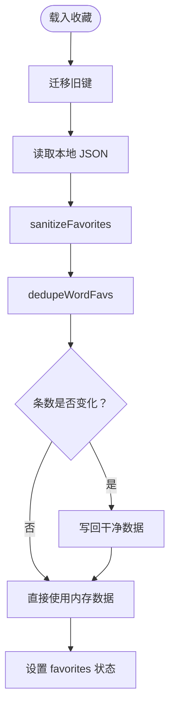
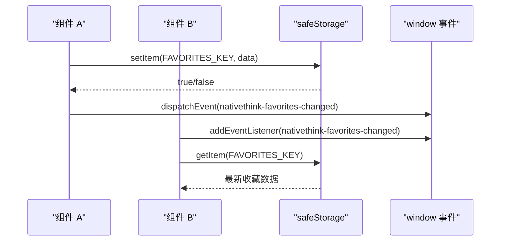
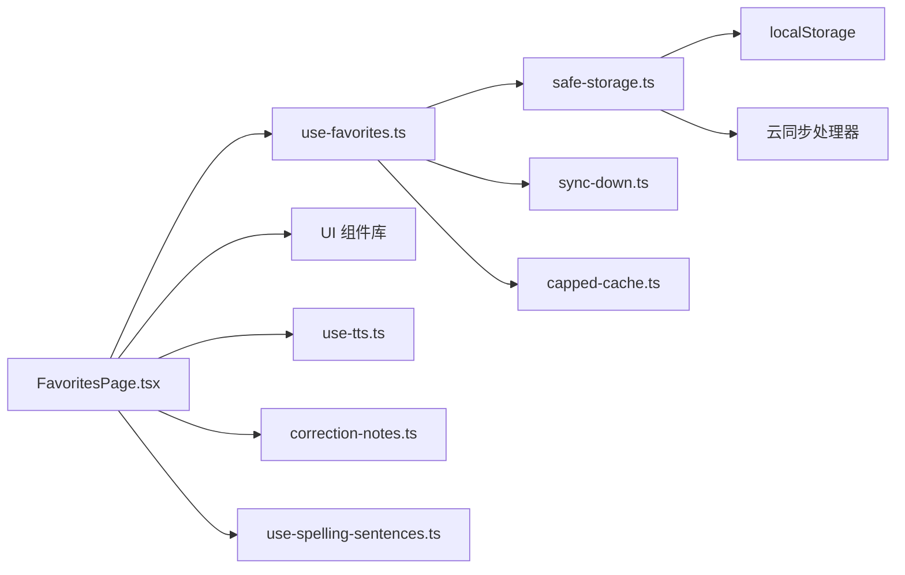

# 收藏模块

<cite>
**本文引用的文件**   
- [FavoritesPage.tsx](file://src/pages/FavoritesPage/FavoritesPage.tsx)
- [use-favorites.ts](file://src/lib/use-favorites.ts)
- [sync-down.ts](file://src/lib/sync-down.ts)
- [safe-storage.ts](file://src/lib/safe-storage.ts)
</cite>

## 目录

1. [引言](#引言)
2. [项目结构定位](#项目结构定位)
3. [核心组件](#核心组件)
4. [架构总览](#架构总览)
5. [详细组件分析](#详细组件分析)
6. [依赖关系分析](#依赖关系分析)
7. [性能与复杂度](#性能与复杂度)
8. [故障排查指南](#故障排查指南)
9. [结论](#结论)

## 引言

NativeThink 的收藏模块负责收集、浏览、筛选和管理用户在词汇、表达、思维训练、影子跟读、文章、句子拼写等页面中主动收藏的内容。其职责包括：

- 提供收藏列表展示、分类筛选和卡片操作。
- 维护收藏状态，支持添加、删除、清空、查重和多处星标同步。
- 将收藏数据持久化到本地存储，并迁移旧键名。
- 通过云同步事件刷新本地收藏，保证多设备一致性。
- 与纠偏表达、句子拼写、语音合成等能力集成，形成学习闭环。

该模块由两个核心部分组成：

- **管理界面**：`FavoritesPage` 负责渲染收藏卡片、分类标签、纠偏表达区块、回顾模式入口和跳转链接。
- **状态与持久化层**：`use-favorites.ts` 暴露 `useFavorites` Hook，封装收藏数据结构、去重逻辑、本地读写、事件广播和云同步重读。

## 项目结构定位

收藏模块位于前端应用的两层结构中：

**图表来源**
- [FavoritesPage.tsx:1-200](file://src/pages/FavoritesPage/FavoritesPage.tsx#L1-L200)
- [use-favorites.ts:1-211](file://src/lib/use-favorites.ts#L1-L211)
- [sync-down.ts:1-49](file://src/lib/sync-down.ts#L1-L49)
- [safe-storage.ts:1-200](file://src/lib/safe-storage.ts#L1-L200)

**章节来源**
- [FavoritesPage.tsx:1-463](file://src/pages/FavoritesPage/FavoritesPage.tsx#L1-L463)
- [use-favorites.ts:1-211](file://src/lib/use-favorites.ts#L1-L211)

## 核心组件

### 收藏项数据结构

收藏项使用统一的数据结构表示不同类型的内容。关键字段如下：

| 字段 | 类型 | 含义 | 是否必填 |
|---|---|---|---|
| `id` | 字符串 | 收藏条目唯一标识，用于删除和撤销 | 是 |
| `type` | 枚举字符串 | 收藏来源类型，如语块、表达、词汇、思维训练、影子跟读、单词、文章、写作提示、句子拼写、视频 | 是 |
| `content` | 字符串 | 收藏正文，例如词汇、表达、例句或内容标识 | 是 |
| `meaning` | 字符串 | 释义或说明文本 | 是 |
| `example` | 可选字符串 | 例句或扩展内容 | 否 |
| `category` | 字符串 | 收藏分类，例如书籍、演讲、AI、刊物、语块类别等 | 是 |
| `createdAt` | 数字时间戳 | 创建时间，用于保留较新的同词条目和排序展示 | 是 |

类型标签在界面中映射为中文名称，例如“语块”“表达”“词汇”“思维训练”“影子跟读”“文章”“单词”“句子拼写”“写作提示”“视频”。过滤类型集合包含全部类型以及这些业务分类。

**章节来源**
- [use-favorites.ts:12-27](file://src/lib/use-favorites.ts#L12-L27)
- [FavoritesPage.tsx:19-43](file://src/pages/FavoritesPage/FavoritesPage.tsx#L19-L43)

### 主要接口与返回值

`useFavorites` 返回以下状态和方法：

| 名称 | 类型 | 用途 |
|---|---|---|
| `favorites` | 收藏数组 | 当前内存中的收藏列表 |
| `loaded` | 布尔值 | 是否完成初始加载，用于控制页面加载态 |
| `addFavorite` | 函数 | 添加收藏，自动查重并持久化 |
| `removeFavorite` | 函数 | 删除收藏，并清理同词异来源的孪生条目 |
| `clearAll` | 函数 | 清空所有收藏 |
| `isFavorited` | 函数 | 判断指定内容与类型是否已收藏 |
| `isWordFavorited` | 函数 | 判断某个单词是否在“词汇”或“单词”来源中被收藏 |

其中 `isWordFavorited` 是为跨来源收藏设计的语义接口；`isFavorited` 则按精确类型匹配，适合需要区分来源的业务场景。

**章节来源**
- [use-favorites.ts:197-211](file://src/lib/use-favorites.ts#L197-L211)

## 架构总览

收藏模块的整体数据流如下：

**图表来源**
- [FavoritesPage.tsx:1-200](file://src/pages/FavoritesPage/FavoritesPage.tsx#L1-L200)
- [use-favorites.ts:100-160](file://src/lib/use-favorites.ts#L100-L160)
- [safe-storage.ts:150-216](file://src/lib/safe-storage.ts#L150-L216)
- [sync-down.ts:1-49](file://src/lib/sync-down.ts#L1-L49)

## 详细组件分析

### FavoritesPage：收藏管理界面

`FavoritesPage` 是收藏模块的用户入口，承担以下职责：

1. **从 Hook 获取收藏状态**  
   通过 `useFavorites()` 获取 `favorites`、`removeFavorite`、`addFavorite` 和 `loaded`。

2. **显示加载态、空态和浏览态**  
   - 未加载时显示“加载中…”。
   - 收藏为空时显示空状态引导，并提示可在词汇、搭配、文章等页面点击收藏图标。
   - 有收藏时显示标题、总数、分类标签、卡片网格和回顾按钮。

3. **分类筛选**  
   使用 `filterType` 状态和 `filteredFavorites` 计算属性实现按类型过滤。`all` 表示全部，其他值为具体类型。

4. **纠偏表达区块**  
   与纠偏笔记模块集成，展示错误表达、地道表达、来源标签、分类统计和导出到句子拼写的入口。

5. **卡片操作**  
   - 删除：弹出成功提示，并提供撤销操作。
   - 语音朗读：对正文和例句调用 TTS。
   - 复制：复制正文或正文加例句。
   - 文章跳转：根据 `category` 跳转到文章阅读页。
   - 影子跟读跳转：根据 `content` 跳转到影子跟读材料。

6. **回顾模式**  
   点击“开始回顾”进入 `FavoriteReviewMode`，并使用 `LazyFramerProvider` 包裹以复用动画能力。

#### 分类与颜色模型

界面为每种类型定义了中文标签和配色方案，同时定义可过滤类型集合。`TYPE_LABELS` 用于展示，`TYPE_COLORS` 用于卡片徽标背景色，`FILTER_TYPES` 决定筛选器可见的分类。

#### 删除与撤销流程

删除逻辑不是直接调用底层移除方法，而是先保存目标条目，再调用 `removeFavorite`，最后用 `toast` 显示成功消息，并在存在原始条目时提供“撤销”回调，重新调用 `addFavorite` 恢复收藏。

**图表来源**
- [FavoritesPage.tsx:70-88](file://src/pages/FavoritesPage/FavoritesPage.tsx#L70-L88)

#### 回顾模式入口

当 `reviewMode` 为真时，页面不再渲染卡片网格，而是渲染 `FavoriteReviewMode`，传入当前筛选后的收藏列表。该模式要求外部提供 Framer Motion Provider，因此页面显式包裹 `LazyFramerProvider`。

**章节来源**
- [FavoritesPage.tsx:1-200](file://src/pages/FavoritesPage/FavoritesPage.tsx#L1-L200)
- [FavoritesPage.tsx:201-463](file://src/pages/FavoritesPage/FavoritesPage.tsx#L201-L463)

### use-favorites.ts：收藏状态与持久化

`use-favorites.ts` 是收藏模块的核心逻辑所在，负责：

- 定义收藏项类型。
- 处理旧版键名迁移。
- 清洗脏数据。
- 同词去重。
- 本地持久化。
- 多实例同步。
- 云同步后刷新。
- 暴露增删查 API。

#### 数据清洗与容错

由于收藏数据可能来自旧键迁移和云同步，`sanitizeFavorites` 会对每条数据进行形状清洗：

- 非数组输入直接返回空数组。
- 非对象或没有 `id` 字段的条目被丢弃。
- `content` 必须是非空字符串。
- 其他字段转换为字符串，缺失时设为空字符串。
- `example` 仅在存在且不为 `null` 时保留。

这种设计保证视图层不会因为一条脏数据导致整页白屏。

**图表来源**
- [use-favorites.ts:57-93](file://src/lib/use-favorites.ts#L57-L93)

#### 同词去重策略

“词汇”和“单词”被视为同一词的两种收藏来源。去重规则如下：

- 遇到“词汇”或“单词”类型时，按 `content` 判重。
- 若已存在同词条目，保留 `createdAt` 较新的那条。
- 非“词汇/单词”类型的条目不参与该 Map 判重，直接保留。
- 去重在载入时执行，只有清洗后长度变化时才回写存储，避免无意义覆盖。

**图表来源**
- [use-favorites.ts:100-143](file://src/lib/use-favorites.ts#L100-L143)

#### 添加收藏逻辑

添加收藏时：

1. 检查是否已存在相同内容和类型。
2. “词汇”和“单词”视为同词来源，避免重复收藏。
3. 生成随机 ID 和创建时间。
4. 将新条目放在数组开头。
5. 持久化并通知其他消费者。

如果已经存在，返回 `false`，不修改状态。

#### 删除收藏逻辑

删除收藏时：

1. 查找目标条目。
2. 如果不存在，仍调用持久化以保持状态一致。
3. 如果是“词汇”或“单词”，同时删除同词异来源的孪生条目。
4. 否则只删除对应 `id`。

#### 多实例与多设备同步

多实例同步分为两层：

| 机制 | 作用域 | 行为 |
|---|---|---|
| `nativethink-favorites-changed` | 单页多组件 | 收藏变更后派发窗口事件，其他监听者重新读取本地存储 |
| `useSyncDown` + `SYNC_DOWN_EVENT` | 云同步后 | 云数据落地 storage 后，触发各 Hook 重新加载 |
| `safeStorage.setItem` 双写 | 云端集成 | 如果注册了云同步处理器，写入时会尝试上传键值 |

**图表来源**
- [use-favorites.ts:130-150](file://src/lib/use-favorites.ts#L130-L150)
- [safe-storage.ts:170-216](file://src/lib/safe-storage.ts#L170-L216)

**章节来源**
- [use-favorites.ts:1-211](file://src/lib/use-favorites.ts#L1-L211)

### 持久化存储：safeStorage

`safeStorage` 是收藏数据的最终落盘层，关键特性包括：

- **用户隔离**：根据应用 ID 和用户 ID 生成键前缀，防止不同用户数据混用。
- **匿名 ID 恢复**：如果匿名 ID 引导键丢失，会从已有键名中恢复，避免历史数据“隐身”。
- **旧键迁移**：写入时记录已迁移键，读取时尝试从旧格式键迁移到新格式。
- **安全写入**：`setItem` 返回布尔值，失败时不抛错但让调用方感知。
- **云同步双写**：如果注册了云同步处理器，每次写入都会尝试向云端传播变更。

收藏模块使用的本地键名为 `__nativethink_favorites`，旧键名为 `__nativethink_favorites_v2`。

**章节来源**
- [safe-storage.ts:1-216](file://src/lib/safe-storage.ts#L1-L216)

### 云同步与多设备一致性

云同步本身由上层云同步模块负责，但收藏模块通过以下方式参与：

1. 使用 `useSyncDown(loadFromStorage)` 订阅云同步下行事件。
2. 当远端数据写入本地 storage 后，触发重新加载。
3. 重新加载时再次执行清洗和去重，确保本地数据形状正确。
4. 如果 `safeStorage` 已连接云同步处理器，本地写入也会尝试双写。

这意味着：

- 单设备内多个组件可以通过窗口事件实时同步。
- 多设备间通过云同步后刷新本地缓存保持一致。
- 收藏数据是“不可重算清单”，因此写入失败必须明确提示，不能静默丢数据。

**章节来源**
- [sync-down.ts:1-49](file://src/lib/sync-down.ts#L1-L49)
- [use-favorites.ts:100-143](file://src/lib/use-favorites.ts#L100-L143)
- [safe-storage.ts:150-216](file://src/lib/safe-storage.ts#L150-L216)

## 依赖关系分析

收藏模块的外部依赖关系如下：

**图表来源**
- [FavoritesPage.tsx:1-20](file://src/pages/FavoritesPage/FavoritesPage.tsx#L1-L20)
- [use-favorites.ts:1-10](file://src/lib/use-favorites.ts#L1-L10)
- [safe-storage.ts:150-216](file://src/lib/safe-storage.ts#L150-L216)

### 耦合与内聚

- **高内聚**：`use-favorites.ts` 集中处理收藏的所有状态逻辑、持久化和兼容性处理。
- **低耦合**：`FavoritesPage` 只关心界面交互，把数据变更委托给 Hook。
- **基础设施解耦**：本地存储和云同步通过抽象接口使用，便于测试和替换。

### 潜在风险

1. **大列表性能**：当前过滤和统计基于数组遍历，收藏数量很大时会有线性开销。
2. **同步竞态**：多设备同时编辑时，依赖最后一次写入胜出，没有冲突合并。
3. **存储配额**：收藏是用户清单，不能重建，因此写失败必须提示；当前通过 `warnStorageFull` 处理。
4. **旧数据兼容**：虽然做了清洗和去重，但如果长期存在严重脏数据，仍需监控迁移成功率。

**章节来源**
- [FavoritesPage.tsx:1-463](file://src/pages/FavoritesPage/FavoritesPage.tsx#L1-L463)
- [use-favorites.ts:1-211](file://src/lib/use-favorites.ts#L1-L211)
- [safe-storage.ts:1-216](file://src/lib/safe-storage.ts#L1-L216)

## 性能与复杂度

### 时间复杂度

| 操作 | 时间复杂度 | 说明 |
|---|---:|---|
| 添加收藏 | O(n) | 需要遍历现有收藏判断重复 |
| 删除收藏 | O(n) | 查找目标条目并按条件过滤 |
| 清空收藏 | O(1) | 直接设置空数组并持久化 |
| 判断是否收藏 | O(n) | 遍历收藏夹 |
| 同词判断 | O(n) | 遍历收藏中“词汇/单词”类型条目 |
| 清洗数据 | O(n) | 逐条校验和转换 |
| 同词去重 | O(n) | 使用 Map 按内容判重 |
| 分类过滤 | O(n) | 对当前收藏数组执行过滤 |
| 类型计数 | O(n) | 遍历收藏统计各类数量 |

### 空间复杂度

- 收藏数组占用 O(n)。
- 去重 Map 在最坏情况下也占用 O(n)。
- 清洗和过滤通常产生临时数组或对象，整体仍为 O(n)。

### 优化建议

1. **搜索索引**：如果需要全文搜索，可以为 `content`、`meaning`、`example` 建立倒排索引。
2. **分页或虚拟滚动**：收藏量很大时，可使用虚拟列表减少 DOM 节点。
3. **批量操作**：目前支持清空和单项删除；未来可增加批量删除、批量移动分类等能力。
4. **增量同步**：云侧若支持增量，可减少全量刷新时的清洗成本。
5. **统计缓存**：类型计数可按类型维护计数器，避免每次渲染重新统计。

[本节为通用性能指导，不直接分析具体代码行]

## 故障排查指南

### 收藏刷新后消失

**可能原因**

- 本地存储配额已满。
- 隐私模式或浏览器限制阻止写入。
- 旧键迁移失败。
- 云同步后覆盖了陈旧本地数据。

**排查步骤**

1. 检查 `safeStorage.setItem` 返回值是否为 `true`。
2. 查看是否触发了存储空间不足提示。
3. 确认 `__nativethink_favorites` 键是否存在。
4. 检查云同步是否成功拉取数据。
5. 查看是否有其他 Tab 或组件触发 `nativethink-favorites-changed` 事件。

**相关实现位置**

- [use-favorites.ts:140-150](file://src/lib/use-favorites.ts#L140-L150)
- [safe-storage.ts:170-216](file://src/lib/safe-storage.ts#L170-L216)

### 同一个词出现两条收藏

**可能原因**

- 旧版本只按单一类型判重，导致“词汇”和“单词”同时存在。
- 数据尚未经历一次完整的载入+去重+回写流程。

**处理方式**

- 载入时自动去重，保留较新的 `createdAt`。
- 删除时同时清理同词异来源条目。
- 新增时按词族判重。

**相关实现位置**

- [use-favorites.ts:29-55](file://src/lib/use-favorites.ts#L29-L55)
- [use-favorites.ts:110-143](file://src/lib/use-favorites.ts#L110-L143)

### 收藏星标在不同页面不一致

**可能原因**

- 使用了精确类型匹配的 `isFavorited`，而另一个页面使用的是词族语义 `isWordFavorited`。
- 页面尚未完成初始加载。
- 多组件之间未收到 `nativethink-favorites-changed` 事件。

**处理方式**

- 词汇和单词来源应使用 `isWordFavorited`。
- 其他来源使用 `isFavorited`。
- 确保页面等待 `loaded` 后再渲染收藏状态。

**相关实现位置**

- [use-favorites.ts:160-196](file://src/lib/use-favorites.ts#L160-L196)
- [use-favorites.ts:130-150](file://src/lib/use-favorites.ts#L130-L150)

### 收藏页白屏

**可能原因**

- 收藏数据中存在非对象、缺少 `id`、`content` 为空等脏数据。
- 视图层直接渲染非字符串字段导致异常。

**处理方式**

- 使用 `sanitizeFavorites` 清洗数据。
- 对 `example` 使用 `cleanText` 等安全渲染。
- 不合法条目直接丢弃，不破坏整个列表。

**相关实现位置**

- [use-favorites.ts:57-93](file://src/lib/use-favorites.ts#L57-L93)
- [FavoritesPage.tsx:320-360](file://src/pages/FavoritesPage/FavoritesPage.tsx#L320-L360)

### 无法导入或导出收藏

当前仓库中未发现专门的收藏导入导出 UI 或独立导出函数。收藏数据可通过以下方式间接处理：

- 本地键 `__nativethink_favorites` 是标准 JSON 数组，可直接从浏览器存储读取。
- 备份脚本和云同步测试中引用了该键，说明它作为全局备份键的一部分存在。
- 如需完整导入导出功能，建议在 `use-favorites.ts` 中增加纯函数接口，并供工具脚本或设置页调用。

**相关实现位置**

- [use-favorites.ts:1-27](file://src/lib/use-favorites.ts#L1-L27)
- [scripts/verify-cloud-sync-hygiene.mjs:200](file://scripts/verify-cloud-sync-hygiene.mjs#L200)

**章节来源**
- [use-favorites.ts:57-150](file://src/lib/use-favorites.ts#L57-L150)
- [safe-storage.ts:150-216](file://src/lib/safe-storage.ts#L150-L216)
- [FavoritesPage.tsx:300-400](file://src/pages/FavoritesPage/FavoritesPage.tsx#L300-L400)

## 结论

NativeThink 收藏模块是一个结构清晰、边界明确的前端数据模块：

- 界面层 `FavoritesPage` 专注展示、筛选、跳转和辅助操作。
- 状态层 `use-favorites.ts` 统一管理收藏数据、持久化、兼容性和同步。
- 基础设施层 `safeStorage` 和 `sync-down` 提供可靠存储与云同步事件通道。

其优势在于：

- 数据清洗和去重增强了鲁棒性。
- 词族判重解决了跨来源收藏的一致性。
- 多实例事件和云同步下行保证了多组件、多设备的状态一致性。
- 删除撤销、TTS、纠偏表达、句子拼写等功能提升了学习体验。

需要关注的是：

- 大收藏量下的性能和虚拟滚动需求。
- 多设备并发编辑时的冲突处理。
- 导入导出能力的显式封装。
- 批量管理操作的进一步扩展。