# 文章阅读模块

<cite>
**本文引用的文件**
- [ArticlePage.tsx](file://src/pages/ArticlePage/ArticlePage.tsx)
- [PageReader.tsx](file://src/pages/ArticlePage/components/PageReader.tsx)
- [ReaderParagraph.tsx](file://src/pages/ArticlePage/components/ReaderParagraph.tsx)
- [books.ts](file://src/data/books.ts)
- [book-fulltext.ts](file://src/data/book-fulltext.ts)
- [book-clean.ts](file://src/data/book-clean.ts)
- [reading.ts](file://src/data/reading.ts)
- [imported-books.ts](file://src/data/imported-books.ts)
- [book-stats.ts](file://src/data/book-stats.ts)
- [book-translation.ts](file://src/data/book-translation.ts)
- [reader-highlight.ts](file://src/lib/reader-highlight.ts)
- [idb.ts](file://src/lib/idb.ts)
- [safe-storage.ts](file://src/lib/safe-storage.ts)
</cite>

## 目录
1. [引言](#引言)
2. [项目结构](#项目结构)
3. [核心组件](#核心组件)
4. [架构总览](#架构总览)
5. [详细组件分析](#详细组件分析)
6. [依赖关系分析](#依赖关系分析)
7. [性能与分页策略](#性能与分页策略)
8. [导入书籍处理流程](#导入书籍处理流程)
9. [翻译数据关联与显示](#翻译数据关联与显示)
10. [阅读进度同步与多设备体验](#阅读进度同步与多设备体验)
11. [阅读偏好设置](#阅读偏好设置)
12. [故障排查](#故障排查)
13. [结论](#结论)

## 引言
NativeThink 的文章阅读模块围绕“整书全文阅读器”展开：它既提供内置古腾堡公版书的元数据书单，又支持运行时加载完整原文、清洗章节、分页展示、复习词高亮、翻译缓存和阅读统计。模块由三层组成：
- 内容层：`reading.ts` 定义统一阅读模型；`books.ts` 提供内置节选；`book-fulltext.ts` 提供全文升级；`book-clean.ts` 负责清洗；`imported-books.ts` 承载用户导入文本。
- 界面层：`ArticlePage.tsx` 是入口页面（书单、AI 生成、维基百科、演讲等）；`PageReader.tsx` 是阅读器主容器；`ReaderParagraph.tsx` 是段落渲染单元。
- 辅助层：`reader-highlight.ts` 管理复习词高亮；`book-stats.ts` 提供真实规模；`book-translation.ts` 提供全书批量翻译；`idb.ts` 和 `safe-storage.ts` 分别承担 IndexedDB 与带用户隔离的本地存储。

## 项目结构
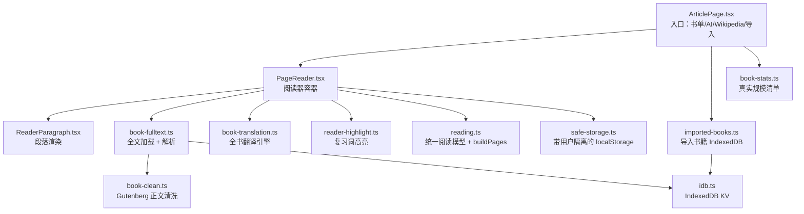

**图表来源**
- [ArticlePage.tsx:1-120](file://src/pages/ArticlePage/ArticlePage.tsx#L1-L120)
- [PageReader.tsx:1-120](file://src/pages/ArticlePage/components/PageReader.tsx#L1-L120)
- [ReaderParagraph.tsx:1-60](file://src/pages/ArticlePage/components/ReaderParagraph.tsx#L1-L60)
- [book-fulltext.ts:1-106](file://src/data/book-fulltext.ts#L1-L106)
- [book-clean.ts:1-194](file://src/data/book-clean.ts#L1-L194)
- [imported-books.ts:1-154](file://src/data/imported-books.ts#L1-L154)
- [book-stats.ts:1-37](file://src/data/book-stats.ts#L1-L37)
- [reading.ts:1-83](file://src/data/reading.ts#L1-L83)
- [idb.ts:1-200](file://src/lib/idb.ts#L1-L200)
- [safe-storage.ts:1-200](file://src/lib/safe-storage.ts#L1-L200)

**章节来源**
- [ArticlePage.tsx:1-120](file://src/pages/ArticlePage/ArticlePage.tsx#L1-L120)
- [PageReader.tsx:1-120](file://src/pages/ArticlePage/components/PageReader.tsx#L1-L120)

## 核心组件
- **ArticlePage.tsx**：文章与书籍的统一入口。负责展示书籍列表、导入书籍、AI 生成文章、维基百科查询、演讲与刊物内容，并调用 `openReader` 打开 `PageReader`。它还计算阅读时长、合并内置书单与导入书籍、加载真实规模清单。
- **PageReader.tsx**：阅读器主容器。负责翻页/小说模式、TTS 连读、复习词高亮订阅、单段翻译、全书翻译、阅读进度持久化、字体/主题/模式偏好保存，以及古腾堡书籍的全文升级。
- **ReaderParagraph.tsx**：段落级渲染器。把英文拆成可点击单词，应用复习词高亮，支持朗读、翻译、收藏、批注。
- **reading.ts**：统一类型与分页逻辑。所有阅读内容最终都通过 `buildPages` 切分为约 300 词一页。
- **book-clean.ts**：从 Gutenberg 原始文本中剔除版权页、识别章节标题，并在缺章节时按字数自动分章。
- **book-fulltext.ts**：在阅读器打开有 `gutenbergId` 的书时，优先拉取随包 `public/books/<id>.txt`，失败再走 `/api/gutenberg` 代理，结果写入 IndexedDB 缓存。
- **imported-books.ts**：把用户粘贴或选择的 txt/md 文本解析为标准 `IReadingContent`，存入 IndexedDB，并自动生成可用章节。
- **book-stats.ts**：异步加载 `public/books/index.json`，提供每本书的真实词数与章节数，避免书单误用压缩节选的 `totalWords`。
- **reader-highlight.ts**：模块级复习词表与高亮颜色状态机，供翻页模式和小说模式共享。
- **book-translation.ts**：按章节组织批量翻译任务，断点续传、并发控制、重试退避，并把译文落盘。

**章节来源**
- [reading.ts:1-83](file://src/data/reading.ts#L1-L83)
- [book-clean.ts:1-194](file://src/data/book-clean.ts#L1-L194)
- [book-fulltext.ts:1-106](file://src/data/book-fulltext.ts#L1-L106)
- [imported-books.ts:1-154](file://src/data/imported-books.ts#L1-L154)
- [book-stats.ts:1-37](file://src/data/book-stats.ts#L1-L37)
- [reader-highlight.ts:1-128](file://src/lib/reader-highlight.ts#L1-L128)
- [book-translation.ts:1-200](file://src/data/book-translation.ts#L1-L200)

## 架构总览
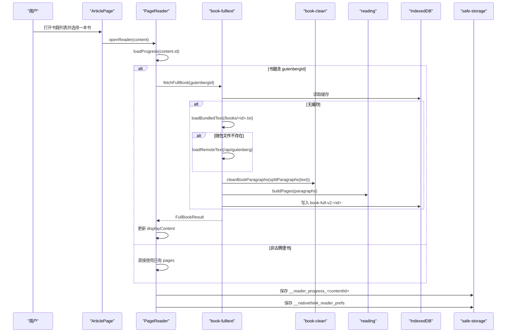

**图表来源**
- [ArticlePage.tsx:240-320](file://src/pages/ArticlePage/ArticlePage.tsx#L240-L320)
- [PageReader.tsx:280-360](file://src/pages/ArticlePage/components/PageReader.tsx#L280-L360)
- [book-fulltext.ts:55-106](file://src/data/book-fulltext.ts#L55-L106)
- [book-clean.ts:120-194](file://src/data/book-clean.ts#L120-L194)
- [reading.ts:58-83](file://src/data/reading.ts#L58-L83)
- [idb.ts:120-200](file://src/lib/idb.ts#L120-L200)
- [safe-storage.ts:150-216](file://src/lib/safe-storage.ts#L150-L216)

## 详细组件分析

### ArticlePage：书籍列表与阅读入口
ArticlePage 统一管理多个阅读来源：
- 内置书籍：首次进入书籍标签时才懒加载 `books-meta`，只加载元数据；真正打开某本书时才动态 import `books.ts` 获取节选内容。
- 导入书籍：组件挂载时从 IndexedDB 加载，置顶展示；支持上传 txt/md/text 文件、粘贴文本、创建/删除导入书籍。
- AI 生成文章：保存到 `safeStorage`，最多保留 50 篇，支持重写、删除。
- Wikipedia：通过后端代理请求，带 7 天 TTL 缓存。
- 阅读统计：打开阅读器记录开始时间，关闭时累计 `addStudyMinutes(minutes, 'articles')`。

关键行为路径：
- `openReader` 初始化阅读会话。
- `handleImportFile` / `doImport` 解析用户输入并调用 `importBookFromText`。
- `loadBookStats` 获取真实规模，用于修正书单中的词数显示。
- `allBooks` 合并导入书籍与内置书单。

**章节来源**
- [ArticlePage.tsx:240-384](file://src/pages/ArticlePage/ArticlePage.tsx#L240-L384)
- [ArticlePage.tsx:1-120](file://src/pages/ArticlePage/ArticlePage.tsx#L1-L120)

### PageReader：阅读器主容器
PageReader 承担以下职责：
- **阅读进度**：根据 `content.id` 读写 `__reader_progress_<contentId>`，支持翻页模式页码和小说模式章节起始页。
- **全文升级**：当 `content.gutenbergId` 存在时，调用 `fetchFullBook` 替换当前内容。
- **复习词高亮**：从 `content.highlightWords` 或 `rvWords` 派生待高亮词表，并通过 `setHighlightWords` 推给模块状态。
- **TTS 连读**：使用 `useTTS`，按段落编译词数区间，实现“读到哪”高亮和自动翻页。
- **翻译缓存**：按段落索引维护 v2 结构 `{v:2, byIdx:{索引:译文}}`，避免内容升级后错位。
- **偏好设置**：字体大小、主题、阅读模式持久化为 `__nativethink_reader_prefs`。
- **模式切换**：默认小说模式，支持切换到翻页模式。

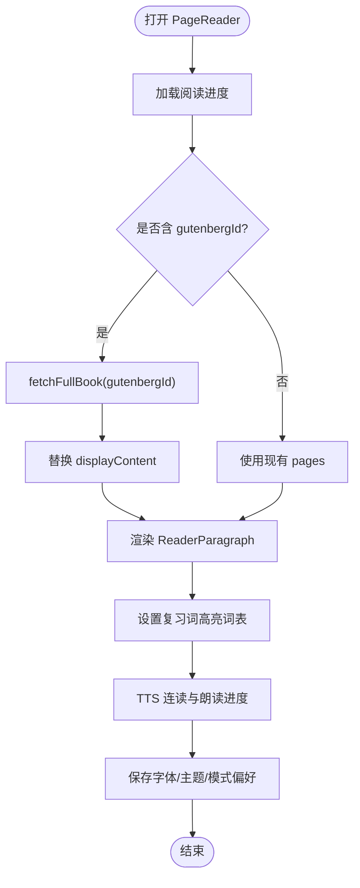

**图表来源**
- [PageReader.tsx:280-360](file://src/pages/ArticlePage/components/PageReader.tsx#L280-L360)
- [PageReader.tsx:1-120](file://src/pages/ArticlePage/components/PageReader.tsx#L1-L120)

**章节来源**
- [PageReader.tsx:1-400](file://src/pages/ArticlePage/components/PageReader.tsx#L1-L400)

### ReaderParagraph：段落渲染与复习词高亮
ReaderParagraph 是翻页模式和小说模式共用的段落渲染器。它：
- 将英文文本按空白分割为单词。
- 对长度 ≥ 2 且符合形态归并规则的单词应用复习词高亮。
- 支持段落朗读、单段翻译、句子收藏、批注标记。
- 通过 `useHighlightWords()` 与 `useHighlightColor()` 获取当前待高亮词表和颜色。

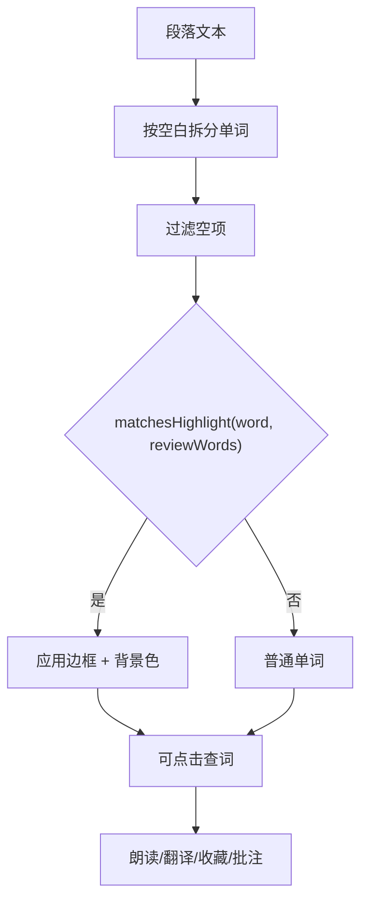

**图表来源**
- [ReaderParagraph.tsx:60-197](file://src/pages/ArticlePage/components/ReaderParagraph.tsx#L60-L197)
- [reader-highlight.ts:80-128](file://src/lib/reader-highlight.ts#L80-L128)

**章节来源**
- [ReaderParagraph.tsx:1-197](file://src/pages/ArticlePage/components/ReaderParagraph.tsx#L1-L197)

### books.ts：内置书籍节选
`books.ts` 导出 22 本古腾堡公版书的压缩节选。每条书通过 `cleanBookParagraphs` 清洗英文段落，再用 `buildPages` 分页，并计算 `totalWords`。该模块还兼容旧代码导出 `cleanBookParagraphs`。

注意：由于节选词数相近，直接用它作为书单厚度指标会失真；因此 `ArticlePage` 通过 `book-stats.ts` 获取真实全文词数。

**章节来源**
- [books.ts:1-37](file://src/data/books.ts#L1-L37)

### book-fulltext.ts：全文加载与缓存
`fetchFullBook` 是全文升级的核心：
1. 先检查模块级 `inFlight` 去重。
2. 读取 IndexedDB 缓存键 `book-full-v2-<gutenbergId>`。
3. 优先拉取静态资源 `/books/<gutenbergId>.txt`。
4. 若失败则回退到 `/api/gutenberg?id=<id>`。
5. 用 `cleanBookParagraphs` 清洗段落，再用 `buildPages` 分页。
6. 计算章节数、总词数，写入 IndexedDB。

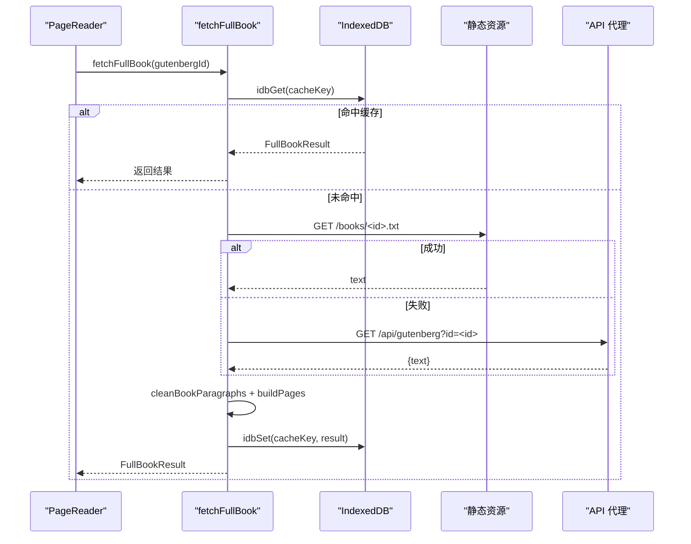

**图表来源**
- [book-fulltext.ts:20-106](file://src/data/book-fulltext.ts#L20-L106)

**章节来源**
- [book-fulltext.ts:1-106](file://src/data/book-fulltext.ts#L1-L106)

### book-clean.ts：清洗后文本
`cleanBookParagraphs` 的职责包括：
- 跳过 Gutenberg 版权头尾与出版社信息。
- 识别多种章节标题格式，包括罗马数字、英文编号、中文“第 N 章”，以及全大写小节名启发式。
- 处理一段内出现多个章节标记的情况。
- 若无足够章节标记且篇幅较长，按每 3000 词插入合成章节，保证目录可用。

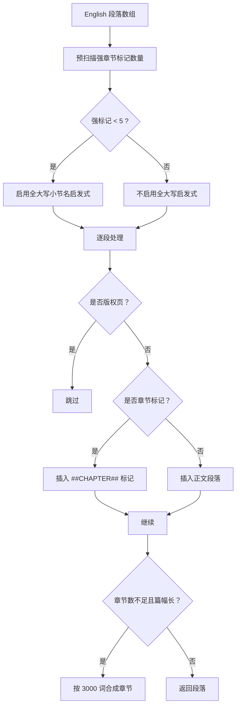

**图表来源**
- [book-clean.ts:20-194](file://src/data/book-clean.ts#L20-L194)

**章节来源**
- [book-clean.ts:1-194](file://src/data/book-clean.ts#L1-L194)

### reader-highlight.ts：高亮逻辑
`reader-highlight.ts` 提供：
- 可选高亮颜色列表，默认青绿。
- 模块级待高亮词表 `_words`，通过 `setHighlightWords` 设置，并通过 `window` 自定义事件广播。
- `useHighlightWords` 订阅变化并触发重渲染。
- `matchesHighlight` 做保守形态归并：复数 s/es、过去式 ed/d、进行式 ing、比较级 er/est，以及辅音重复加 ed/ing 的情况。

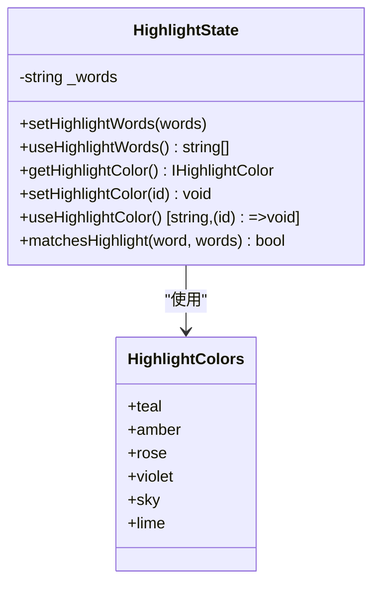

**图表来源**
- [reader-highlight.ts:1-128](file://src/lib/reader-highlight.ts#L1-L128)

**章节来源**
- [reader-highlight.ts:1-128](file://src/lib/reader-highlight.ts#L1-L128)

## 依赖关系分析
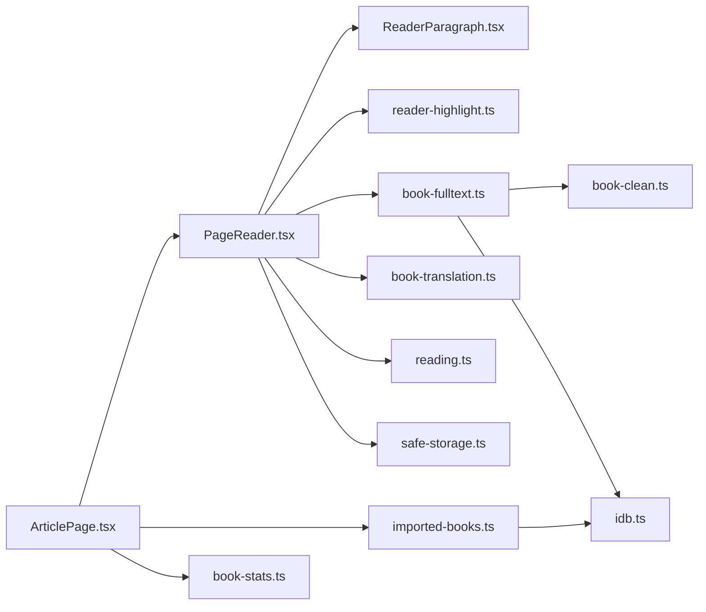

**图表来源**
- [ArticlePage.tsx:1-120](file://src/pages/ArticlePage/ArticlePage.tsx#L1-L120)
- [PageReader.tsx:1-120](file://src/pages/ArticlePage/components/PageReader.tsx#L1-L120)
- [book-fulltext.ts:1-106](file://src/data/book-fulltext.ts#L1-L106)
- [imported-books.ts:1-154](file://src/data/imported-books.ts#L1-L154)
- [book-stats.ts:1-37](file://src/data/book-stats.ts#L1-L37)
- [reader-highlight.ts:1-128](file://src/lib/reader-highlight.ts#L1-L128)

**章节来源**
- [ArticlePage.tsx:1-120](file://src/pages/ArticlePage/ArticlePage.tsx#L1-L120)
- [PageReader.tsx:1-120](file://src/pages/ArticlePage/components/PageReader.tsx#L1-L120)

## 性能与分页策略
- **首屏优化**：`ArticlePage` 只在进入书籍标签时才加载 `books-meta`；真正打开书时才加载 `books.ts` 节选；`PageReader` 再决定是否升级到全文。
- **全文缓存**：`book-fulltext.ts` 用 IndexedDB 缓存全文解析结果，避免重复网络请求；同时用模块级 `inFlight` 去重并发。
- **分页策略**：`reading.ts` 的 `buildPages` 按每页约 300 词切分；`book-clean.ts` 在无章节时按 3000 词插入合成章节，确保目录可用。
- **翻译优化**：`book-translation.ts` 按章分批、并发 2、失败退避重试，并将进度落盘，避免重复翻译。
- **渲染优化**：`ReaderParagraph` 使用 memo，减少 TTS 切片引起的整章重渲染。

[本节为通用性能讨论，不直接分析具体代码片段]

## 导入书籍处理流程
用户导入 txt/md/text 文本时，`ArticlePage` 调用 `importBookFromText`，后者：
1. 把文本按行解析，识别章节标题。
2. 没有章节时按 2500 词切块自动生成章节。
3. 若首章前有前言内容，插入“前言”章节。
4. 用 `buildPages` 生成分页，计算总词数。
5. 生成唯一 ID（前缀 `imp_`），写入 IndexedDB。
6. 返回列表倒序排序，最新导入置顶。

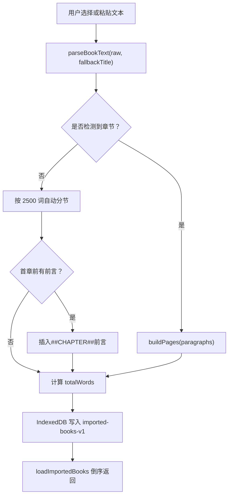

**图表来源**
- [imported-books.ts:40-154](file://src/data/imported-books.ts#L40-L154)

**章节来源**
- [ArticlePage.tsx:260-310](file://src/pages/ArticlePage/ArticlePage.tsx#L260-L310)
- [imported-books.ts:1-154](file://src/data/imported-books.ts#L1-L154)

## 翻译数据关联与显示
翻译数据在两个层面联动：
- **单段翻译**：`PageReader` 维护段落索引到译文的 v2 缓存结构，ReaderParagraph 按 `transMode` 显示英文、中文或双语。
- **全书翻译**：`book-translation.ts` 通过 `splitChapters` 按 `##CHAPTER##` 切章，批量提交给本地或在线翻译引擎，结果按章节下标写入 IndexedDB。

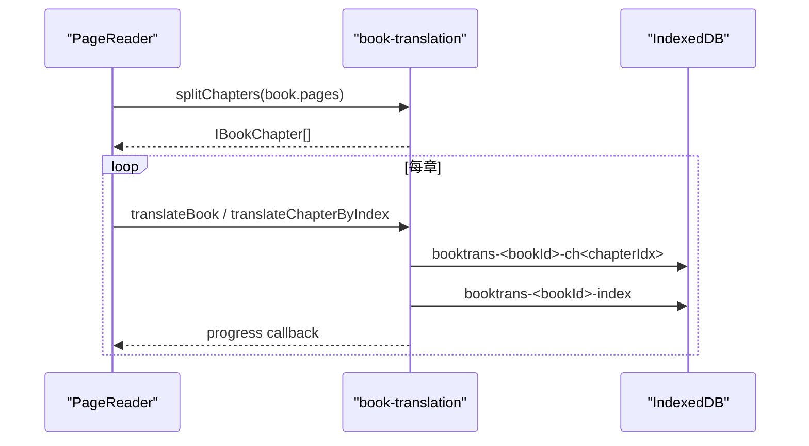

**图表来源**
- [book-translation.ts:120-200](file://src/data/book-translation.ts#L120-L200)

**章节来源**
- [PageReader.tsx:200-400](file://src/pages/ArticlePage/components/PageReader.tsx#L200-L400)
- [book-translation.ts:1-200](file://src/data/book-translation.ts#L1-L200)

## 阅读进度同步与多设备体验
- **阅读进度**：`PageReader` 以 `content.id` 为键保存 `__reader_progress_<contentId>`，支持翻页页码和小说模式章节位置。
- **偏好设置**：字体大小、主题、阅读模式保存到 `__nativethink_reader_prefs`。
- **用户隔离**：`safe-storage.ts` 基于平台 `user_id` 或匿名 ID 生成 key 前缀，避免不同用户或应用间数据串扰；同时支持云端双写。
- **全文缓存**：`book-fulltext.ts` 使用 `idb.ts` 的 `idbGet`/`idbSet` 缓存解析后的 `FullBookResult`，跨会话复用。

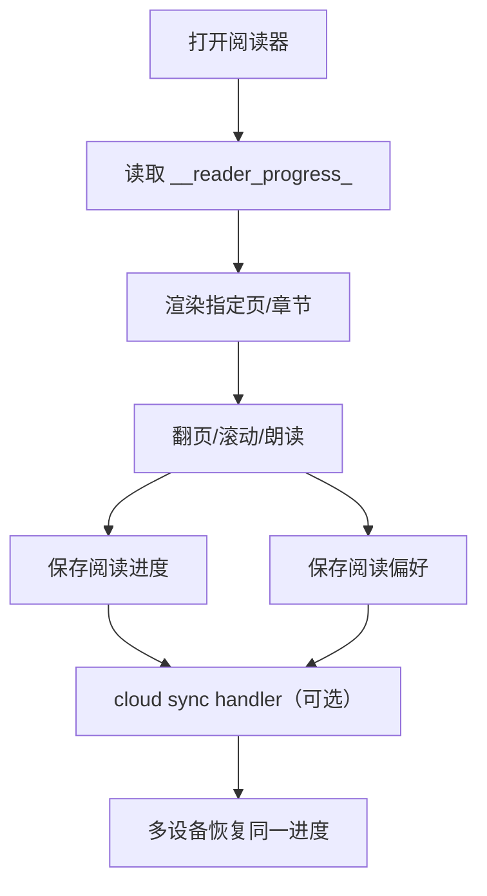

**图表来源**
- [PageReader.tsx:80-120](file://src/pages/ArticlePage/components/PageReader.tsx#L80-L120)
- [safe-storage.ts:150-216](file://src/lib/safe-storage.ts#L150-L216)
- [book-fulltext.ts:20-106](file://src/data/book-fulltext.ts#L20-L106)

**章节来源**
- [PageReader.tsx:80-120](file://src/pages/ArticlePage/components/PageReader.tsx#L80-L120)
- [safe-storage.ts:1-216](file://src/lib/safe-storage.ts#L1-L216)
- [idb.ts:120-200](file://src/lib/idb.ts#L120-L200)

## 阅读偏好设置
`PageReader` 暴露三种可持久化的阅读偏好：
- **字体大小**：`sm`、`base`、`lg`、`xl`。
- **主题**：`light`、`paper`、`night`。
- **阅读模式**：`novel`（默认）、`paged`。

这些值保存在 `safeStorage` 的 `__nativethink_reader_prefs`，并在组件初始化时读取。高亮颜色单独保存在 `safeStorage` 的 `__nativethink_review_highlight_color`，并通过 `useHighlightColor` 在多个阅读器组件之间同步。

**章节来源**
- [PageReader.tsx:300-360](file://src/pages/ArticlePage/components/PageReader.tsx#L300-L360)
- [reader-highlight.ts:1-80](file://src/lib/reader-highlight.ts#L1-L80)

## 故障排查
- **全文加载失败**：如果 `public/books/<id>.txt` 缺失，`book-fulltext.ts` 会回退到 `/api/gutenberg`；两者都失败则退回节选。检查静态资源是否正确部署，以及 API 代理是否可达。
- **章节错乱**：若节选与全文章节结构不一致，应优先使用随包全文；不要静默回退到节选，否则章节目录和译文可能错位。
- **高亮不生效**：确认 `content.highlightWords` 或 `rvWords` 是否存在；检查 `matchesHighlight` 的形态归并是否匹配实际拼写。
- **进度丢失**：若浏览器隐私模式或存储配额受限，`safeStorage.setItem` 会返回 false；检查云同步是否开启，或清理损坏的本地键。
- **导入书籍为空**：`parseBookText` 要求至少有一个有效段落；检查输入文本编码、换行符和章节标记。
- **翻译卡顿**：全书翻译是异步过程；建议降低 `concurrency` 或增大 `batchSize`，并观察 IndexedDB 中已存章节进度。

**章节来源**
- [book-fulltext.ts:20-106](file://src/data/book-fulltext.ts#L20-L106)
- [reader-highlight.ts:80-128](file://src/lib/reader-highlight.ts#L80-L128)
- [safe-storage.ts:150-216](file://src/lib/safe-storage.ts#L150-L216)
- [imported-books.ts:40-154](file://src/data/imported-books.ts#L40-L154)
- [book-translation.ts:120-200](file://src/data/book-translation.ts#L120-L200)

## 结论
NativeThink 的文章阅读模块以统一阅读模型为核心，通过 `ArticlePage` 聚合多源内容，通过 `PageReader` 提供翻页与小说两种阅读体验，并通过 `book-fulltext.ts`、`book-clean.ts`、`book-stats.ts` 解决古腾堡书籍“节选 vs 全文”的规模差异。复习词高亮由 `reader-highlight.ts` 提供跨组件共享状态，导入书籍由 `imported-books.ts` 标准化为可读内容，翻译由 `book-translation.ts` 实现断点续传。阅读进度与偏好通过 `safe-storage.ts` 和用户隔离 key 实现本地持久化，并可扩展至云端同步，从而形成完整的整书全文阅读体验。