# 核心功能模块

<cite>
**本文引用的文件**   
- [README.md](file://README.md)
- [package.json](file://package.json)
- [src/app.tsx](file://src/app.tsx)
- [DashboardPage.tsx](file://src/pages/DashboardPage/DashboardPage.tsx)
- [ThinkInEnglishPage.tsx](file://src/pages/ThinkInEnglishPage/ThinkInEnglishPage.tsx)
- [ChunkTrainingPage.tsx](file://src/pages/ChunkTrainingPage/ChunkTrainingPage.tsx)
- [ConversationPage.tsx](file://src/pages/ConversationPage/ConversationPage.tsx)
- [ShadowingPage.tsx](file://src/pages/ShadowingPage/ShadowingPage.tsx)
- [ArticlePage.tsx](file://src/pages/ArticlePage/ArticlePage.tsx)
- [DeepVocabularyPage.tsx](file://src/pages/DeepVocabularyPage/DeepVocabularyPage.tsx)
- [WritingPage.tsx](file://src/pages/WritingPage/WritingPage.tsx)
- [SentenceLabPage.tsx](file://src/pages/SentenceLabPage/SentenceLabPage.tsx)
- [SpellingPage.tsx](file://src/pages/SpellingPage/SpellingPage.tsx)
- [VideoLabPage.tsx](file://src/pages/VideoLabPage/VideoLabPage.tsx)
- [ProgressPage.tsx](file://src/pages/ProgressPage/ProgressPage.tsx)
- [FavoritesPage.tsx](file://src/pages/FavoritesPage/FavoritesPage.tsx)
- [SettingsPage.tsx](file://src/pages/SettingsPage/SettingsPage.tsx)
</cite>

## 目录
1. [引言](#引言)
2. [项目结构](#项目结构)
3. [核心组件总览](#核心组件总览)
4. [架构总览](#架构总览)
5. [详细模块分析](#详细模块分析)
6. [依赖关系分析](#依赖关系分析)
7. [性能与容量设计](#性能与容量设计)
8. [故障排查指南](#故障排查指南)
9. [结论](#结论)

## 引言
NativeThink 是一个面向英语学习者的多模态学习应用，覆盖思维训练、语块、对话、影子跟读、阅读、词汇、写作、句子、拼写、视频精听、进度、收藏与设置等 14 个主要页面。前端基于 React 19 + TypeScript，使用 Tailwind CSS、shadcn/ui、react-router-dom、framer-motion 和 echarts-for-react；打包产物同时支持 Web、Electron 桌面端与 Android APK。所有业务模块集中在 `src/pages` 下，每个页面一个目录，并通过路由懒加载进入主应用。

本文件聚焦 14 个核心页面的功能、界面、数据模型、状态管理、进度追踪机制与跨模块集成方式，帮助开发者快速理解 NativeThink 的整体结构与演进方向。

## 项目结构
仓库根目录包含前端源码 `src/`、服务端函数 `functions/`、Android 工程 `android/`、脚本 `scripts/`、文档 `docs/` 以及 Electron 入口 `electron/main.mjs`。`src/` 内部按“组件 / 页面 / 工具库 / 数据类型”划分：

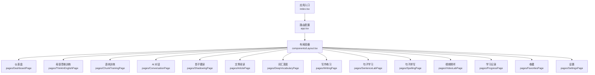

**图示来源**
- [src/app.tsx:1-66](file://src/app.tsx#L1-L66)

**章节来源**
- [README.md:1-111](file://README.md#L1-L111)
- [package.json:1-130](file://package.json#L1-L130)
- [src/app.tsx:1-66](file://src/app.tsx#L1-L66)

## 核心组件总览
NativeThink 的页面遵循统一模式：
- 页面组件负责用户交互与局部状态。
- 共享状态通过 hooks 提供，如 `useLearningStats`、`useFavorites`、`useTTS`、`useAI`、`useStudyCredit`、`usePageMemory`。
- 持久化主要使用 `safeStorage`（封装 localStorage）、IndexedDB、capped-cache 与业务模块自己的 store。
- AI 能力通过 `hooks/use-ai` 与 `lib/capability-client` 调用后端或本地模型。
- 学习统计由 `use-learning-stats` 聚合，用于首页概览、学习记录页与每日目标。
- 收藏与纠偏笔记作为跨模块通用资产，被多个页面写入并集中展示。

| 模块 | 主要职责 | 关键状态 | 主要持久化位置 | 主要外部依赖 |
|---|---|---|---|---|
| 仪表盘 | 学习概览、每日一句、快捷入口、日历与复习提示 | 今日待学数量、历史每日一句、模块进度 | safeStorage | use-learning-stats、use-favorites、use-tts、use-ai |
| 母语思维训练 | 中式英语检测、翻译、回译、原生表达、自定义题库 | 各练习模式输入与结果、自定义题库 | safeStorage、capped-cache | use-ai、use-favorites、use-study-credit |
| 语块训练 | 短语库浏览、闪卡、替换题、AI 例句 | 分类筛选、记忆标记、AI 派生缓存 | safeStorage、capped-cache | use-favorites、use-learning-stats、use-phrase-learning |
| AI 对话 | 场景式英文对话、消息流、逐句翻译与分析 | 场景、消息列表、分析文本 | safeStorage | use-ai、capability-client、use-custom-scenarios |
| 影子跟读 | 材料播放、录音、ASR、评分、完成进度 | 当前材料、句索引、完成集合、AI 追加句 | safeStorage、capped-cache | speech-analysis、asr-service、shadowing-progress |
| 文章阅读 | 书籍、网文、SCP、刊物、AI 生成、演讲、维基百科 | 当前书、页码、进度、批注 | IndexedDB、localStorage | rv-articles、book-stats、imported-books |
| 词汇深度 | 词书选择、每日学习、闪卡、SM-2、搭配、测试 | 当前词书、模式、每日配额、学习进度 | safeStorage、wordbank | use-word-learning、use-favorites |
| 写作练习 | 命题写作、AI 批改、草稿、收藏 | 选题、正文、草稿、批改结果 | safeStorage、capped-cache | use-ai、use-favorites |
| 句子学习 | 句子精讲、切分、句型、造句、语法地图 | 子标签、跳转参数 | 静态数据为主 | sentence-lab、sentence-patterns、grammar-map |
| 句子拼写 | 单词/句子拼写、断点续学、纠偏表达 | 题目队列、填空答案、断点索引 | spelling-resume、spelling-words | use-spelling-sentences |
| 视频精听 | 导入媒体+字幕、逐句播放、批量翻译、录音评分 | 课表、当前句、窗口滚动、翻译任务 | videoStore、safeStorage | asr-service、use-spelling-sentences |
| 学习记录 | 日历、统计图表、成就、备份、重置 | 统计、日历、成就、过滤器 | use-learning-stats、backup | achievements、favorites |
| 收藏 | 跨模块收藏汇总、纠偏归纳、送拼写 | 收藏列表、纠偏笔记 | use-favorites、correction-notes | use-spelling-sentences |
| 设置 | 主题、学习目标、TTS、AI、帮助、版本 | 主题、UI 主题、每日目标 | use-theme、use-ui-theme、use-learning-stats | TTSSettings、AISettings |

**章节来源**
- [DashboardPage.tsx:1-200](file://src/pages/DashboardPage/DashboardPage.tsx#L1-L200)
- [ThinkInEnglishPage.tsx:1-200](file://src/pages/ThinkInEnglishPage/ThinkInEnglishPage.tsx#L1-L200)
- [ChunkTrainingPage.tsx:1-200](file://src/pages/ChunkTrainingPage/ChunkTrainingPage.tsx#L1-L200)
- [ConversationPage.tsx:1-200](file://src/pages/ConversationPage/ConversationPage.tsx#L1-L200)
- [ShadowingPage.tsx:1-200](file://src/pages/ShadowingPage/ShadowingPage.tsx#L1-L200)
- [ArticlePage.tsx:1-135](file://src/pages/ArticlePage/ArticlePage.tsx#L1-L135)
- [DeepVocabularyPage.tsx:1-200](file://src/pages/DeepVocabularyPage/DeepVocabularyPage.tsx#L1-L200)
- [WritingPage.tsx:1-200](file://src/pages/WritingPage/WritingPage.tsx#L1-L200)
- [SentenceLabPage.tsx:1-98](file://src/pages/SentenceLabPage/SentenceLabPage.tsx#L1-L98)
- [SpellingPage.tsx:1-200](file://src/pages/SpellingPage/SpellingPage.tsx#L1-L200)
- [VideoLabPage.tsx:1-200](file://src/pages/VideoLabPage/VideoLabPage.tsx#L1-L200)
- [ProgressPage.tsx:1-200](file://src/pages/ProgressPage/ProgressPage.tsx#L1-L200)
- [FavoritesPage.tsx:1-200](file://src/pages/FavoritesPage/FavoritesPage.tsx#L1-L200)
- [SettingsPage.tsx:1-183](file://src/pages/SettingsPage/SettingsPage.tsx#L1-L183)

## 架构总览
应用以 React Router 为导航中枢，所有页面包裹在统一 Layout 中，并通过 ErrorBoundary 保护单个页面崩溃不影响全局。模块间不直接互相 import 业务页面，而是通过共享 hooks、类型与工具库协作。

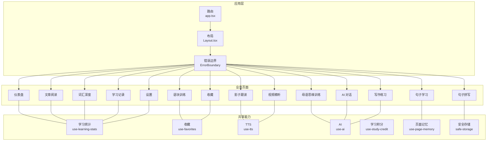

**图示来源**
- [src/app.tsx:1-66](file://src/app.tsx#L1-L66)

## 详细模块分析

### 仪表盘（Dashboard）
仪表盘是学习路径的入口，聚合学习统计、日历、每日一句、模块进度、复习提醒、纠偏提示与快捷入口。它从 `use-learning-stats` 获取统计与日历，从 `use-global-due-count` 获取待复习数量，从 `use-correction-notes` 计算未重认的纠偏条目，并从 `use-favorites` 接入收藏能力。

每日一句采用延迟加载策略：语块数据单独 `import('@/data/chunks')`，避免主包膨胀；同一天固定一句并写入 safeStorage，防止刷新多次导致“每日一句”语义漂移。历史最多保留 1000 条，按日期去重。

- 核心功能：学习概览、日历、模块进度、每日一句、复习提醒、纠偏横幅、快捷导航。
- 界面结构：HeroCard、OverviewPanel、DailySentenceCard、QuickStartGrid、ModuleProgressCard、HistoryCalendar、ReviewDueCard、NoteDrillCard、WeekGlanceCard。
- 数据模型：每日一句字段包括内容、含义、例句、类别、难度；历史记录包含日期、内容、含义、例句。
- 状态管理：本地状态 + safeStorage；AI 生成时校验返回 JSON 并限制类别与难度取值。
- 进度追踪：将每日一句保存进历史，结合 use-learning-stats 的日历与分钟数。
- 集成关系：与收藏、TTS、AI、纠偏笔记、词库数据解耦。

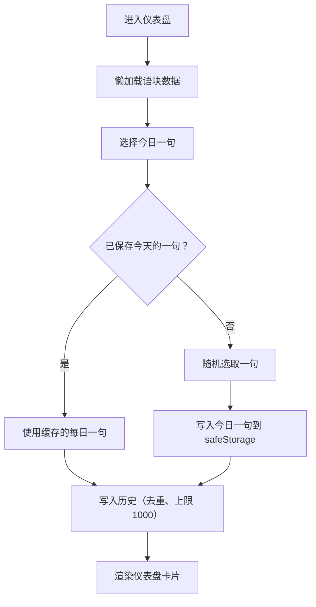

**图示来源**
- [DashboardPage.tsx:1-200](file://src/pages/DashboardPage/DashboardPage.tsx#L1-L200)

**章节来源**
- [DashboardPage.tsx:1-200](file://src/pages/DashboardPage/DashboardPage.tsx#L1-L200)

### 母语思维训练（ThinkInEnglish）
该模块围绕“消除中式英语”展开，提供四类练习：
1. 检测器：输入英文句子，AI 输出中英双语分析报告，指出中式表达、自然替代与思维差异。
2. 翻译练习：中文到英文，可参考原生表达。
3. 回译练习：英文到中文，再对照原句。
4. 原生思维翻译：引导用英文思维组织语言。

模块维护三份自定义题库，分别持久化到 safeStorage，并使用 `persistJson` + `warnStorageFull` 处理存储空间不足。每项提交都通过 `useStudyCredit` 记一次学习积分，且同一题同一句只计一次。

- 核心功能：中式英语检测、翻译/回译/原生翻译、自定义题库、AI 流式回复、收藏、TTS。
- 数据模型：`IThinkExercise`、`IBackTranslation`、`INativeTranslate`，以及检测器历史。
- 状态管理：每个练习模式独立输入、结果、加载状态、AbortController；自定义题库初始化与同步使用 effect。
- 进度追踪：按动作计数学习积分，避免连点重复计费。
- 集成关系：与收藏、纠偏笔记、AI、TTS、学习积分、页面记忆协作。

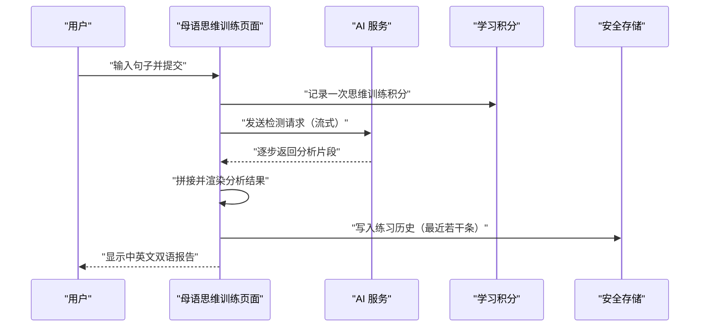

**图示来源**
- [ThinkInEnglishPage.tsx:1-200](file://src/pages/ThinkInEnglishPage/ThinkInEnglishPage.tsx#L1-L200)

**章节来源**
- [ThinkInEnglishPage.tsx:1-200](file://src/pages/ThinkInEnglishPage/ThinkInEnglishPage.tsx#L1-L200)

### 语块训练（Chunks）
语块训练模块整合短语库、分类筛选、难度筛选、闪卡、替换题、收藏、记忆标记、AI 派生例句与短语例句缓存。它特别注意洗牌稳定性：稳定序列来自上层 `useStableShuffle`，替换题选项通过哈希确定顺序，避免重渲染导致题目漂移。

- 核心功能：短语库浏览、分类与难度过滤、闪卡、替换题、AI 例句、记忆分组、收藏。
- 数据模型：`IChunk`、短语等级、替换题对象。
- 状态管理：页面记忆保存 tab、分类、难度、位置；AI 派生数据使用 capped-cache 封顶，避免 localStorage 爆满。
- 进度追踪：通过 `use-learning-stats` 增加学习分钟数，通过 `use-study-credit` 记录学习积分。
- 集成关系：与收藏、TTS、AI、短语库、去重逻辑、链式判定工具协作。

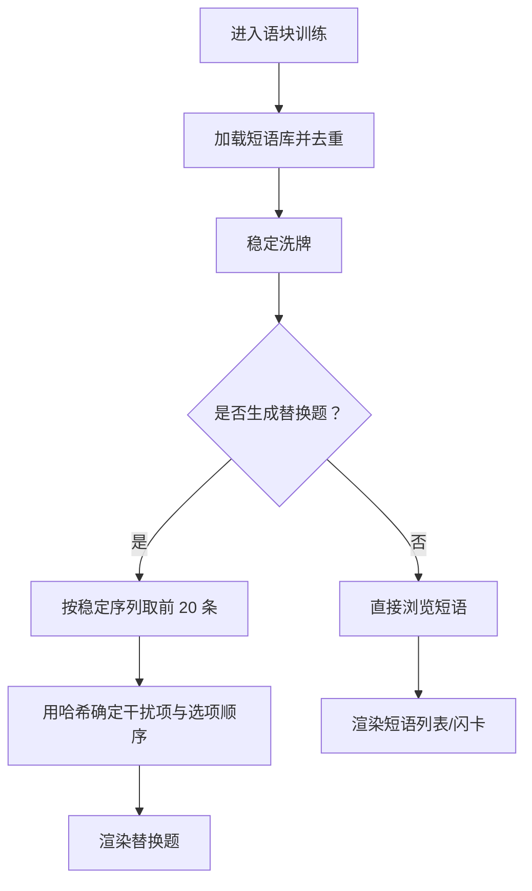

**图示来源**
- [ChunkTrainingPage.tsx:1-200](file://src/pages/ChunkTrainingPage/ChunkTrainingPage.tsx#L1-L200)

**章节来源**
- [ChunkTrainingPage.tsx:1-200](file://src/pages/ChunkTrainingPage/ChunkTrainingPage.tsx#L1-L200)

### AI 对话（Conversation）
对话页支持内置场景与自定义场景，每个场景有角色设定、图标、颜色与背景。用户切换场景时会中断旧流、清空消息并让 AI 先开口，形成“情境先行”的体验。消息流通过 `streamChat` 逐步渲染，支持逐句翻译、自动朗读、场景分析与纠偏笔记收集。

- 核心功能：多场景对话、消息流、逐句翻译、自动朗读、场景分析、自定义场景、纠偏笔记。
- 数据模型：消息对象含角色、内容、时间戳；保存会话含场景信息与消息历史。
- 状态管理：场景选择、消息列表、加载状态、分析文本、翻译映射；使用 AbortController 取消旧请求。
- 进度追踪：每次提交计入学习积分，纠偏数据写入 correction-notes。
- 集成关系：与 capability-client、use-ai、use-custom-scenarios、use-tts、use-favorites、safeStorage 协作。

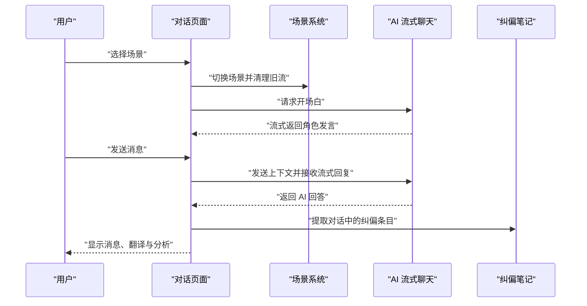

**图示来源**
- [ConversationPage.tsx:1-200](file://src/pages/ConversationPage/ConversationPage.tsx#L1-L200)

**章节来源**
- [ConversationPage.tsx:1-200](file://src/pages/ConversationPage/ConversationPage.tsx#L1-L200)

### 影子跟读（Shadowing）
影子跟读模块支持材料播放、循环、倍速、录音、语音识别、发音评分、AI 追加句子与完成进度。已完成句子以键值集合形式持久化，并用 capped-cache 做条数与字节双封顶；AI 追加句子与内置句子合并后统一维护完成键，删除时也需换算本地索引。

- 核心功能：材料浏览、播放控制、录音、ASR、评分、AI 扩展、收藏、完成进度。
- 数据模型：`IShadowingMaterial`、`IShadowingSentence`、完成键、额外句子映射。
- 状态管理：当前材料 ID、句索引、循环、倍速、完成集合、AI 追加句；URL 查询参数支持直达特定材料。
- 进度追踪：完成集合按语料 ID 与句序组合键持久化，并按语料维度统计完成率。
- 集成关系：与 speech-analysis、asr-service、use-favorites、use-learning-stats、use-ai、shadowing-progress 协作。

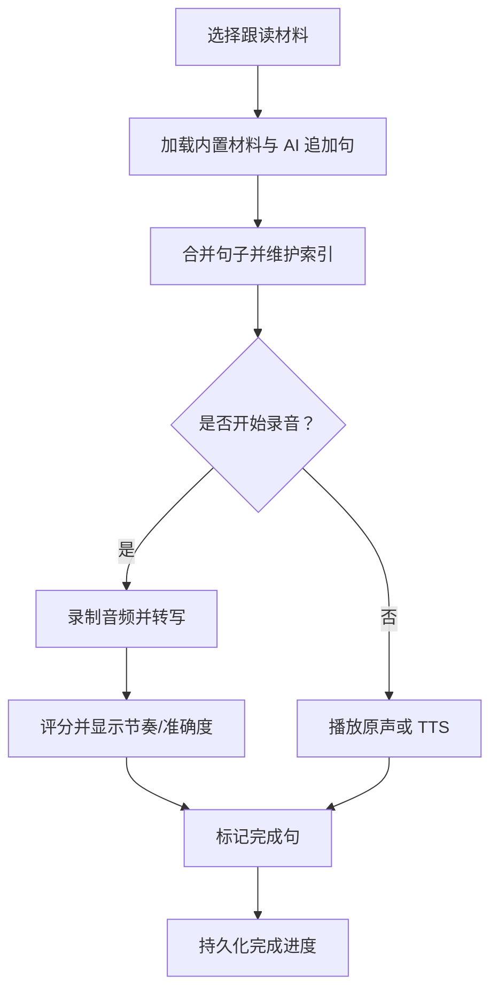

**图示来源**
- [ShadowingPage.tsx:1-200](file://src/pages/ShadowingPage/ShadowingPage.tsx#L1-L200)

**章节来源**
- [ShadowingPage.tsx:1-200](file://src/pages/ShadowingPage/ShadowingPage.tsx#L1-L200)

### 文章阅读（Articles）
文章阅读模块聚合多种阅读源：内置书籍元数据、网文推荐、SCP 基金会、出版物、AI 生成、演讲与维基百科。它支持复习词汇文章生成、导入书籍、阅读进度、批注、查词、翻译缓存与复习批次控制。

- 核心功能：多源阅读、复习词汇文章、导入书籍、进度跟踪、批注、查词、翻译。
- 数据模型：阅读内容、段落、书籍元数据、导入书籍、演讲、SCPC 文章。
- 状态管理：当前主标签、选中书籍、页码、复习批次、翻译批次、进度、批注、最近查词。
- 进度追踪：每本书进度、对照翻译缓存、批注与最近查词分开存储；复习词汇文章按批次消费。
- 集成关系：与 rv-articles、book-stats、imported-books、webnovels、publications-extra、speeches、wikipedia 协作。

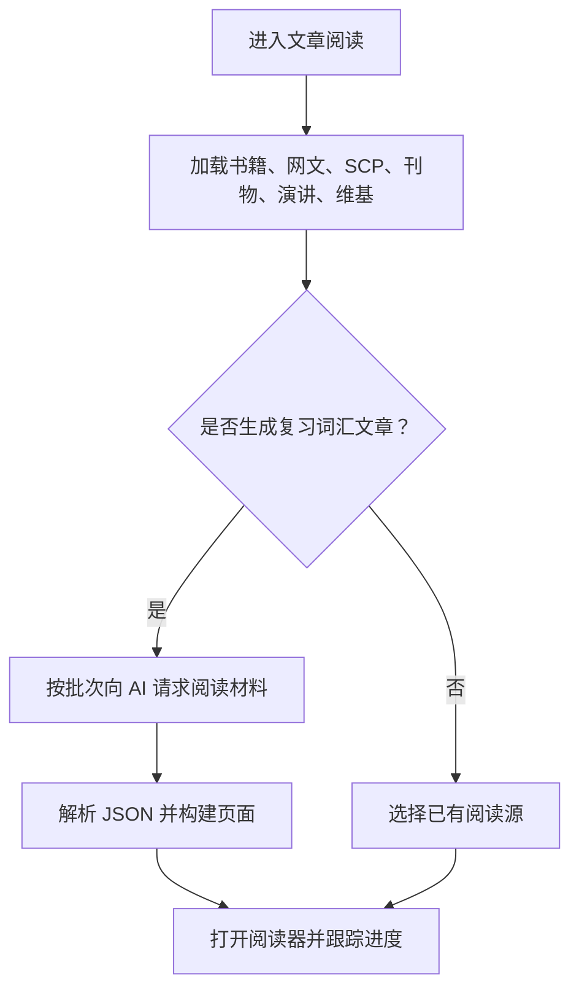

**图示来源**
- [ArticlePage.tsx:1-135](file://src/pages/ArticlePage/ArticlePage.tsx#L1-L135)

**章节来源**
- [ArticlePage.tsx:1-135](file://src/pages/ArticlePage/ArticlePage.tsx#L1-L135)

### 词汇深度（Vocabulary）
词汇深度是词库学习的中心页面，支持多本词书、每日学习、快速闪卡、复习检测、短语闪卡、中译英、纠偏重考、词库浏览、搭配学习与词汇量测试。首次进入会引导选择词书与学习方式，换书时可一步生效并保持当前模式。

- 核心功能：词书选择、每日学习、闪卡、SM-2 复习、短语闪卡、中译英、纠偏重考、搭配、词汇测试。
- 数据模型：词库条目、短语等级、词书配置、学习进度、每日配额。
- 状态管理：向导步骤、当前词书、学习模式、每日数量、复习模式；词库预加载仅在显式选择时触发，避免移动端 OOM。
- 进度追踪：按词书维度保存学习进度与每日配额，通过 use-word-learning 统一管理。
- 集成关系：与 wordbank、use-favorites、use-ai、use-tts、use-page-memory、capped-cache 协作。

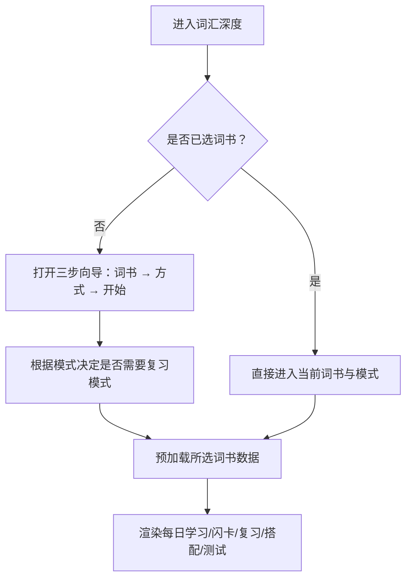

**图示来源**
- [DeepVocabularyPage.tsx:1-200](file://src/pages/DeepVocabularyPage/DeepVocabularyPage.tsx#L1-L200)

**章节来源**
- [DeepVocabularyPage.tsx:1-200](file://src/pages/DeepVocabularyPage/DeepVocabularyPage.tsx#L1-L200)

### 写作练习（Writing）
写作练习提供命题写作、AI 批改、草稿保存、收藏与学习积分。提示词按类别与难度组织，支持字数限制与写作建议。

- 核心功能：命题写作、AI 批改、草稿、收藏、学习积分。
- 数据模型：写作提示、用户正文、批改结果、草稿。
- 状态管理：当前选题、正文、草稿、AI 生成状态、收藏状态。
- 进度追踪：每次提交计入学习积分，AI 生成结果与草稿使用 capped-cache 与 safeStorage 持久化。
- 集成关系：与 use-ai、use-favorites、use-learning-stats、correction-notes、TTSAI 设置协作。

**章节来源**
- [WritingPage.tsx:1-200](file://src/pages/WritingPage/WritingPage.tsx#L1-L200)

### 句子学习（Sentences）
句子学习分为“看懂句子”和“学会造句”两个方向，包含句子精讲、切分练习、句型库、造句练习与语法地图。它更多是知识型入口，将静态数据与组件组合成结构化学习体验。

- 核心功能：句子精讲、切分练习、句型库、造句、语法地图。
- 数据模型：句子语料、句型骨架、语法主题。
- 状态管理：子标签、语法跳转、句型跳转。
- 进度追踪：主要以知识掌握为主，配合其他模块的纠偏与收藏。
- 集成关系：与 sentence-lab、sentence-patterns、grammar-map 静态数据协作。

**章节来源**
- [SentenceLabPage.tsx:1-98](file://src/pages/SentenceLabPage/SentenceLabPage.tsx#L1-L98)

### 句子拼写（Spelling）
句子拼写提供单词拼写与句子拼写两种模式，支持填空、听写、断点续学、纠偏表达导入、音效反馈与词库句子缓存。断点续学按词书分键，迁移逻辑集中在 `spelling-resume`。

- 核心功能：单词/句子拼写、填空、断点续学、纠偏表达、音效、词库句子缓存。
- 数据模型：拼写句子、拼写模式、音频模式、难度、断点索引。
- 状态管理：题目队列、填空答案、提交结果、断点状态、词库缓存。
- 进度追踪：按词书维度记录进度、已完成、出题记录与断点。
- 集成关系：与 spelling-words、spelling-resume、use-spelling-sentences、use-favorites、use-ai、wordbank 协作。

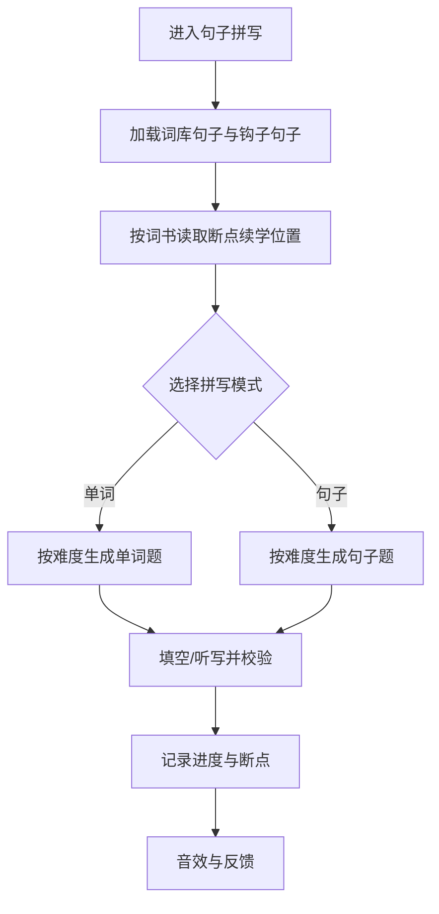

**图示来源**
- [SpellingPage.tsx:1-200](file://src/pages/SpellingPage/SpellingPage.tsx#L1-L200)

**章节来源**
- [SpellingPage.tsx:1-200](file://src/pages/SpellingPage/SpellingPage.tsx#L1-L200)

### 视频精听（VideoLab）
视频精听允许导入视频/音频与字幕，像“每日英语听力”一样逐句学习。由于网页环境无法可靠抓取本机 ASR，因此统一走导入流程。模块强调三条约定：必须释放 object URL、字幕必须开窗渲染、无媒体时仍应正常显示 TTS 朗读。

- 核心功能：导入媒体与字幕、逐句播放、批量翻译、录音评分、收藏、查词、笔记。
- 数据模型：视频元信息、课程、句子、进度、录音评分。
- 状态管理：课表、当前课、句索引、时间、倍速、AB 循环、翻译任务、滚动吸顶、面板高度。
- 进度追踪：每课进度、到达最远句、翻译批次与超时控制。
- 集成关系：与 video-store、use-spelling-sentences、use-tts、use-learning-stats、use-ai、asr-service 协作。

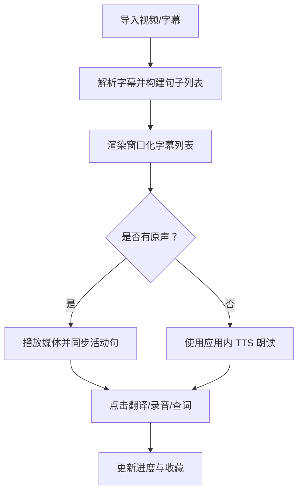

**图示来源**
- [VideoLabPage.tsx:1-200](file://src/pages/VideoLabPage/VideoLabPage.tsx#L1-L200)

**章节来源**
- [VideoLabPage.tsx:1-200](file://src/pages/VideoLabPage/VideoLabPage.tsx#L1-L200)

### 学习记录（Progress）
学习记录是全站学习数据的可视化与控制中心，包含日历、统计图表、收藏回顾、成就、备份与各类重置操作。它能重置学习统计、句子拼写进度、阅读进度、AI 缓存、词汇学习进度等。

- 核心功能：日历视图、统计图表、收藏回顾、成就、备份、重置。
- 数据模型：学习统计、日历、成就、收藏、备份文件。
- 状态管理：当前月份、过滤器、标签、确认对话框、重置范围。
- 进度追踪：聚合 use-learning-stats 与 use-achievements，并提供导出与清除能力。
- 集成关系：与 backup、spelling-resume、favorites、achievements、wordbank-meta 协作。

**章节来源**
- [ProgressPage.tsx:1-200](file://src/pages/ProgressPage/ProgressPage.tsx#L1-L200)

### 收藏（Favorites）
收藏页汇聚跨模块收藏条目，并新增纠偏归纳区。它能把纠偏条目送入句子拼写库，实现“输入侧发现地道表达 → 输出侧逐词拼写”的学习闭环。

- 核心功能：收藏汇总、类型过滤、撤销删除、纠偏归纳、送拼写、收藏回顾。
- 数据模型：收藏条目、纠偏笔记、拼写句子。
- 状态管理：过滤类型、纠偏类别、查看全部、复习模式。
- 进度追踪：收藏本身不是进度，但通过“送拼写”与“纠偏重考”参与其他模块的学习循环。
- 集成关系：与 use-favorites、correction-notes、use-spelling-sentences、use-tts 协作。

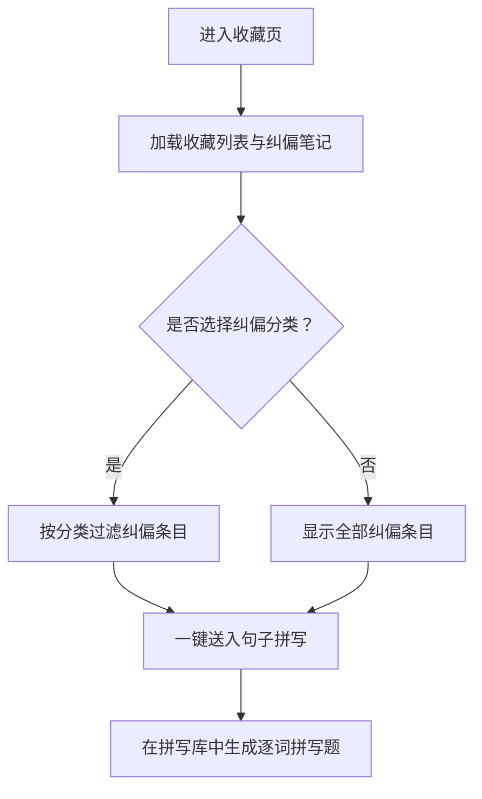

**图示来源**
- [FavoritesPage.tsx:1-200](file://src/pages/FavoritesPage/FavoritesPage.tsx#L1-L200)

**章节来源**
- [FavoritesPage.tsx:1-200](file://src/pages/FavoritesPage/FavoritesPage.tsx#L1-L200)

### 设置（Settings）
设置页统一管理外观、学习目标、TTS、AI、帮助、更新日志与版本信息。它通过 use-theme、use-ui-theme、use-learning-stats 控制主题与每日目标，并提供跳转到帮助与开发者主页的能力。

- 核心功能：亮色/暗色主题、UI 主题、每日目标、TTS 设置、AI 设置、帮助、版本。
- 数据模型：主题配置、UI 主题、每日目标、平台信息。
- 状态管理：当前主题、当前 UI 主题、每日目标、版本号。
- 进度追踪：每日目标影响首页进度与每日学习新词量。
- 集成关系：与 TTSSettings、AISettings、HelpGuide、ChangelogDialog 协作。

**章节来源**
- [SettingsPage.tsx:1-183](file://src/pages/SettingsPage/SettingsPage.tsx#L1-L183)

## 依赖关系分析
14 个模块通过共享能力耦合，而不是直接互相引用页面。这种设计降低了页面间的强依赖，但也意味着修改共享 hook 或存储键会影响多个模块。

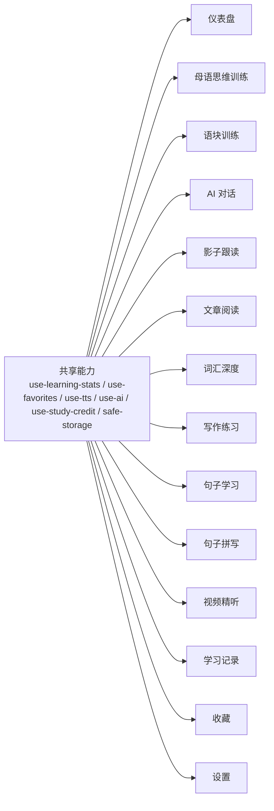

**图示来源**
- [DashboardPage.tsx:1-200](file://src/pages/DashboardPage/DashboardPage.tsx#L1-L200)
- [ThinkInEnglishPage.tsx:1-200](file://src/pages/ThinkInEnglishPage/ThinkInEnglishPage.tsx#L1-L200)
- [ChunkTrainingPage.tsx:1-200](file://src/pages/ChunkTrainingPage/ChunkTrainingPage.tsx#L1-L200)
- [ConversationPage.tsx:1-200](file://src/pages/ConversationPage/ConversationPage.tsx#L1-L200)
- [ShadowingPage.tsx:1-200](file://src/pages/ShadowingPage/ShadowingPage.tsx#L1-L200)
- [ArticlePage.tsx:1-135](file://src/pages/ArticlePage/ArticlePage.tsx#L1-L135)
- [DeepVocabularyPage.tsx:1-200](file://src/pages/DeepVocabularyPage/DeepVocabularyPage.tsx#L1-L200)
- [WritingPage.tsx:1-200](file://src/pages/WritingPage/WritingPage.tsx#L1-L200)
- [SentenceLabPage.tsx:1-98](file://src/pages/SentenceLabPage/SentenceLabPage.tsx#L1-L98)
- [SpellingPage.tsx:1-200](file://src/pages/SpellingPage/SpellingPage.tsx#L1-L200)
- [VideoLabPage.tsx:1-200](file://src/pages/VideoLabPage/VideoLabPage.tsx#L1-L200)
- [ProgressPage.tsx:1-200](file://src/pages/ProgressPage/ProgressPage.tsx#L1-L200)
- [FavoritesPage.tsx:1-200](file://src/pages/FavoritesPage/FavoritesPage.tsx#L1-L200)
- [SettingsPage.tsx:1-183](file://src/pages/SettingsPage/SettingsPage.tsx#L1-L183)

**章节来源**
- [src/app.tsx:1-66](file://src/app.tsx#L1-L66)
- [package.json:1-130](file://package.json#L1-L130)

## 性能与容量设计
NativeThink 在多处体现了对性能和容量的考虑：

| 关注点 | 实现方式 | 影响 |
|---|---|---|
| 路由懒加载 | 所有页面通过 `lazy` 加载 | 减少首屏体积 |
| 错误边界 | 每个页面包裹 `ErrorBoundary` | 单页崩溃不影响全局 |
| 语块数据懒加载 | 每日一句相关语块单独 import | 避免主包膨胀 |
| 词库预加载限制 | 仅在用户选择词书时预加载 | 防止移动端 OOM |
| AI 派生缓存封顶 | capped-cache 限制条数与字节 | 防止 localStorage 爆满 |
| 影子跟读完成标记封顶 | 条数 + 字节双封顶 | 老进度淘汰，写入成本有界 |
| 视频字幕开窗 | 只渲染活动句前后窗口 | 长列表不一次性铺满 DOM |
| 翻译分批串行 | 每批固定句数、并发受控、超时兜底 | 避免打爆后端并发额度 |
| 图表懒加载 | 学习记录统计图表 lazy 加载 | 减少非活跃 tab 的包体 |
| 稳定洗牌 | 使用稳定 shuffle + 哈希确定选项 | 避免重渲染导致题目漂移 |

这些策略共同保证 NativeThink 在多端、多模块、多 AI 调用场景下保持可预期性能。

[本节为通用性能讨论，不直接分析具体代码行，故无“章节来源”]

## 故障排查指南

### 常见问题与定位思路
- **页面报错但不影响其他页面**  
  检查对应路由是否在 ErrorBoundary 中，查看 PageErrorFallback 显示的页面名称，并刷新页面重试。
- **每日一句每天变化**  
  检查 safeStorage 中每日一句缓存是否按日期写入，以及 mockChunks 是否加载完成。
- **AI 返回格式异常**  
  检查 AI 返回是否为空字符串或非法 JSON，注意区分“服务不可用”与“格式异常”。
- **对话页开发环境空白**  
  检查 mountedRef 是否在 effect 体内恢复 true，避免 StrictMode 下 ref 恒为 false。
- **收藏页纠偏区块缺失**  
  确保纠偏区块在收藏为空时仍然渲染，不要只放在浏览分支里。
- **视频精听字幕不吸顶**  
  检查滚动框是否自成一帧、IntersectionObserver 根是否正确、高度是否量出。
- **词汇深度选择词书后卡住**  
  检查是否只在显式选择时才预加载词书，避免一次性加载全部词库。
- **学习记录重置不完整**  
  核对 reset 方法枚举了哪些 key，特别是拼写断点、阅读进度、AI 缓存、词汇学习进度。

### 建议的排查顺序
1. 确认页面路由是否正常挂载。
2. 确认相关 hook 是否返回有效数据。
3. 检查 safeStorage 或 indexedDB 中对应 key 是否存在。
4. 检查 AI 配置与网络返回。
5. 检查 capped-cache 是否达到容量上限。
6. 检查页面内存是否因大列表或大图泄漏。
7. 检查学习统计与积分是否被正确记录。

**章节来源**
- [src/app.tsx:1-66](file://src/app.tsx#L1-L66)
- [DashboardPage.tsx:1-200](file://src/pages/DashboardPage/DashboardPage.tsx#L1-L200)
- [ConversationPage.tsx:1-200](file://src/pages/ConversationPage/ConversationPage.tsx#L1-L200)
- [FavoritesPage.tsx:1-200](file://src/pages/FavoritesPage/FavoritesPage.tsx#L1-L200)
- [VideoLabPage.tsx:1-200](file://src/pages/VideoLabPage/VideoLabPage.tsx#L1-L200)
- [DeepVocabularyPage.tsx:1-200](file://src/pages/DeepVocabularyPage/DeepVocabularyPage.tsx#L1-L200)
- [ProgressPage.tsx:1-200](file://src/pages/ProgressPage/ProgressPage.tsx#L1-L200)

## 结论
NativeThink 的核心功能模块以 React 页面为中心，通过共享 hooks 与工具库实现松耦合集成。学习进度追踪贯穿仪表盘、词汇、拼写、视频、跟读、阅读与学习记录；数据持久化则结合 safeStorage、capped-cache、IndexedDB 与模块自有 store。AI 能力作为横切能力，支撑思维训练、对话、写作、语块、阅读与视频翻译。整体架构清晰、可扩展性强，适合继续扩展新的学习模式与数据源。

[本节为总结性内容，不直接分析具体代码行，故无“章节来源”]