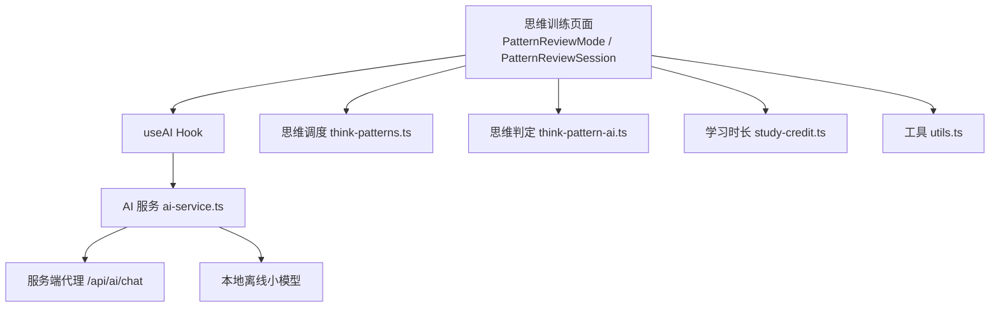
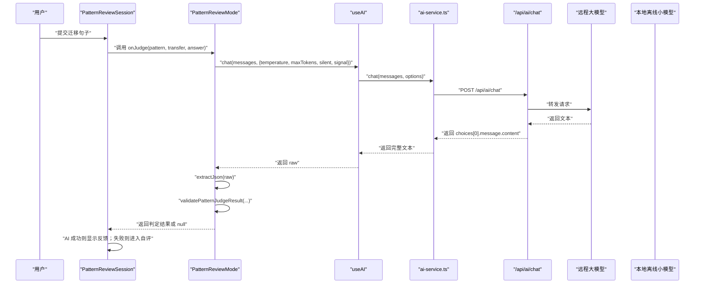
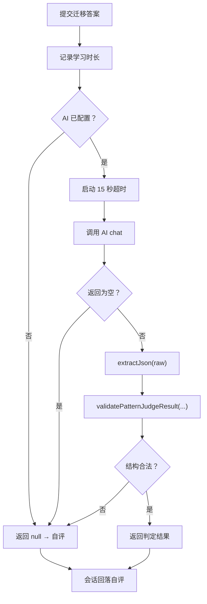
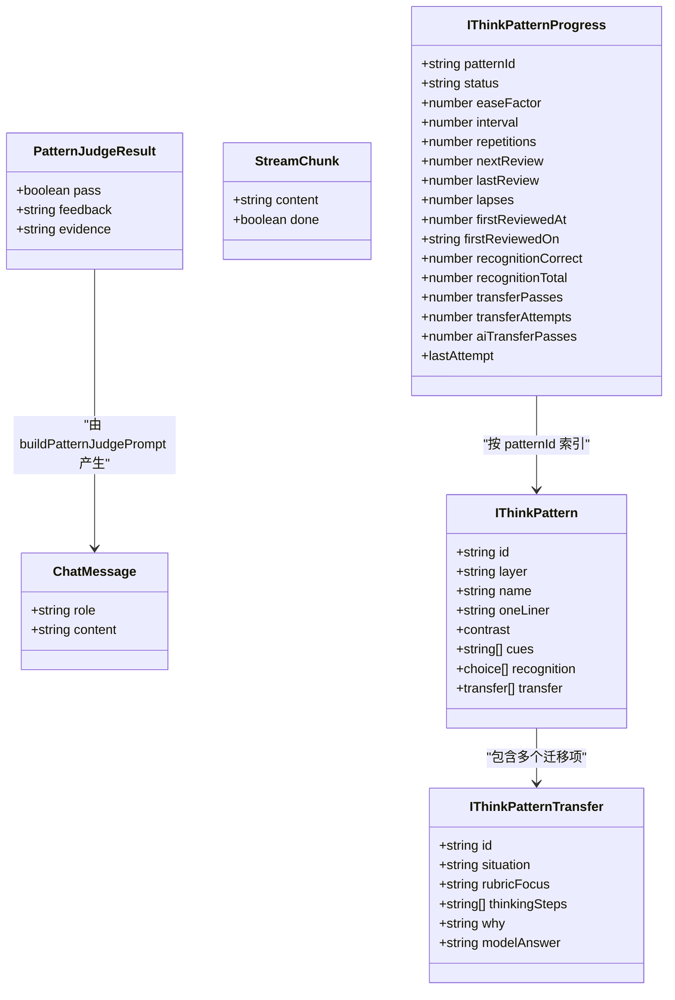
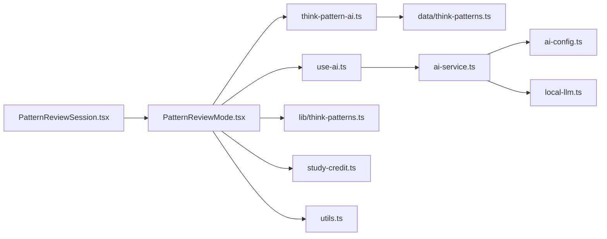

# AI 辅助思维训练

<cite>
**本文引用的文件**   
- [think-pattern-ai.ts](file://src/lib/think-pattern-ai.ts)
- [ai-service.ts](file://src/services/ai-service.ts)
- [use-ai.ts](file://src/hooks/use-ai.ts)
- [PatternReviewMode.tsx](file://src/pages/ThinkInEnglishPage/PatternReviewMode.tsx)
- [PatternReviewSession.tsx](file://src/pages/ThinkInEnglishPage/PatternReviewSession.tsx)
- [think-patterns.ts](file://src/lib/think-patterns.ts)
- [utils.ts](file://src/lib/utils.ts)
- [study-credit.ts](file://src/lib/study-credit.ts)
- [think-patterns.ts（数据定义）](file://src/data/think-patterns.ts)
</cite>

## 目录
1. [引言](#引言)
2. [项目结构](#项目结构)
3. [核心组件](#核心组件)
4. [架构总览](#架构总览)
5. [详细组件分析](#详细组件分析)
6. [依赖关系分析](#依赖关系分析)
7. [性能与可靠性](#性能与可靠性)
8. [故障排查指南](#故障排查指南)
9. [结论](#结论)

## 引言
NativeThink 的“AI 辅助思维训练”围绕一个明确目标展开：在用户完成英语思维模式的迁移练习后，用大模型判断其是否真正使用了目标思维模式，并把结构化反馈融入复习流程。该能力由三层组成：
- Prompt 与结果校验层：负责拼装思维模式判定 Prompt、解析并归一化 AI 返回。
- AI 服务层：统一封装流式与非流式 API 调用、模型选择、离线小模型兜底和错误提示。
- 训练流程层：在“思维体检”和“模式复习”中驱动 AI 判定，并在失败时平滑回落至自评，保证练习体验不中断。

本文件重点说明 `think-pattern-ai.ts` 中的 AI 辅助实现，以及与 `ai-service.ts`、`use-ai.ts` 的集成方式，包括流式响应、错误处理、超时控制、学习时长记账和 SM-2 进度更新。

## 项目结构
与本次目标直接相关的代码主要分布在以下位置：
- `src/lib/think-pattern-ai.ts`：思维模式判定的 Prompt 构建与结果校验。
- `src/services/ai-service.ts`：统一的 AI 流式/非流式调用、模型路由、离线兜底。
- `src/hooks/use-ai.ts`：React Hook 包装，提供 `streamChat`、`chat`、消息构造等便捷接口。
- `src/pages/ThinkInEnglishPage/PatternReviewMode.tsx`：模式复习入口，编排体检、复习、完成页，并发起 AI 判定。
- `src/pages/ThinkInEnglishPage/PatternReviewSession.tsx`：单张思维模式卡片的状态机：对比 → 识别 → 迁移 → 反馈。
- `src/lib/think-patterns.ts`：SM-2 进度计算、会话队列、薄弱模式排序等纯函数逻辑。
- `src/lib/utils.ts`：通用工具，包括从 AI 文本中提取 JSON。
- `src/lib/study-credit.ts`：按提交动作的学习时长去重记账。
- `src/data/think-patterns.ts`：思维模式、识别题、迁移题等静态数据。

**图表来源**
- [PatternReviewMode.tsx:1-120](file://src/pages/ThinkInEnglishPage/PatternReviewMode.tsx#L1-L120)
- [PatternReviewSession.tsx:1-80](file://src/pages/ThinkInEnglishPage/PatternReviewSession.tsx#L1-L80)
- [use-ai.ts:1-101](file://src/hooks/use-ai.ts#L1-L101)
- [ai-service.ts:1-120](file://src/services/ai-service.ts#L1-L120)
- [ai-service.ts:201-368](file://src/services/ai-service.ts#L201-L368)
- [think-pattern-ai.ts:1-66](file://src/lib/think-pattern-ai.ts#L1-L66)
- [think-patterns.ts:1-120](file://src/lib/think-patterns.ts#L1-L120)
- [utils.ts:40-87](file://src/lib/utils.ts#L40-L87)
- [study-credit.ts:1-80](file://src/lib/study-credit.ts#L1-L80)

**章节来源**
- [think-pattern-ai.ts:1-66](file://src/lib/think-pattern-ai.ts#L1-L66)
- [ai-service.ts:1-120](file://src/services/ai-service.ts#L1-L120)
- [use-ai.ts:1-101](file://src/hooks/use-ai.ts#L1-L101)
- [PatternReviewMode.tsx:1-120](file://src/pages/ThinkInEnglishPage/PatternReviewMode.tsx#L1-L120)
- [PatternReviewSession.tsx:1-80](file://src/pages/ThinkInEnglishPage/PatternReviewSession.tsx#L1-L80)
- [think-patterns.ts:1-120](file://src/lib/think-patterns.ts#L1-L120)
- [utils.ts:40-87](file://src/lib/utils.ts#L40-L87)
- [study-credit.ts:1-80](file://src/lib/study-credit.ts#L1-L80)

## 核心组件
### 思维模式判定模块：`think-pattern-ai.ts`
该模块是 AI 辅助思维训练的“最小可运行单元”，职责非常克制：
- 拼装判定 Prompt：把当前思维模式、原则、线索、中英对照、场景、评分重点和用户答案拼成系统消息与用户消息。
- 校验 AI 返回：只接受包含 `pass`、`feedback`、`evidence` 的结构化对象，其他情况一律视为无效。

关键设计点：
- 使用 `import type` 引用 ChatMessage 和思维模式类型，避免运行时依赖，便于守卫脚本通过 `ts.transpileModule` 直接执行。
- 解析入口不在本模块：组件先判断空串，再提取 JSON，最后交给 `validatePatternJudgeResult`。
- `pass` 字段兼容布尔值和字符串 `'true'`/`'false'`；`feedback` 必须是非空字符串；`evidence` 可选，缺失时为空字符串。

**章节来源**
- [think-pattern-ai.ts:1-66](file://src/lib/think-pattern-ai.ts#L1-L66)

### AI 服务层：`ai-service.ts`
该模块提供统一的 AI 调用能力，屏蔽不同服务商和流式/非流式差异。

主要职责：
- 模型选择：显式 model 优先，否则按任务类型选择免费模型，最后回退到服务商默认免费模型。
- 流式调用：通过 `/api/ai/chat` 获取 SSE 流，逐段解析 `data:` 行，产出 `{content, done}` 片段。
- 非流式调用：直接返回完整文本。
- 错误处理：对 503、HTTP 错误、JSON 解析异常进行包装，抛出可读错误。
- 离线兜底：当启用自动离线回落且本地小模型就绪时，在线调用失败后自动切换 `localStreamChat`。
- 静默模式：传入 `silent: true` 时不弹出“离线回落”全局提示，适合练习界面内联降级。

**章节来源**
- [ai-service.ts:1-120](file://src/services/ai-service.ts#L1-L120)
- [ai-service.ts:201-368](file://src/services/ai-service.ts#L201-L368)

### React Hook：`use-ai.ts`
该 Hook 将底层 AI 服务包装为 React 友好的接口：
- 暴露 `isConfigured`、`configuredProviders`、`streamChat`、`chat`、`buildMessages`、`appendUserMessage`。
- 监听 AI Key 配置变化事件和窗口焦点事件，刷新可用服务商列表。
- 对 `AbortError` 做特殊处理：直接返回而不弹错误 toast。
- 支持 `silent` 选项：练习界面由调用方自行展示错误，而不是弹全局 toast。

**章节来源**
- [use-ai.ts:1-101](file://src/hooks/use-ai.ts#L1-L101)

## 架构总览
AI 辅助思维训练的整体调用链如下：

**图表来源**
- [PatternReviewSession.tsx:120-220](file://src/pages/ThinkInEnglishPage/PatternReviewSession.tsx#L120-L220)
- [PatternReviewMode.tsx:80-160](file://src/pages/ThinkInEnglishPage/PatternReviewMode.tsx#L80-L160)
- [use-ai.ts:40-101](file://src/hooks/use-ai.ts#L40-L101)
- [ai-service.ts:201-368](file://src/services/ai-service.ts#L201-L368)

## 详细组件分析

### 思维模式判定 Prompt 设计
`buildPatternJudgePrompt` 根据三个输入生成两条消息：
- system 消息：声明角色为英语思维教练，并注入目标思维模式名称、一句话原则、线索、中文思维版本、母语版本、原因、场景、评分重点。
- user 消息：携带用户提交的英文答案。

Prompt 规则要求：
- 只有目标思维模式清晰出现且句子足够自然时才 pass。
- 语法正确但忽略目标模式不算通过。
- 大小写不敏感，句首小写 i 仍算代词 I。
- 判断的是思维模式，不是逐字匹配参考表达。
- 不重写整个句子，只提供一句中文反馈和一个证据短语。
- 仅返回指定结构的 JSON。

这种设计把“语言风格 + 思维模式 + 场景约束”一起交给模型，同时限制输出格式，方便前端稳定解析。

**章节来源**
- [think-pattern-ai.ts:12-45](file://src/lib/think-pattern-ai.ts#L12-L45)

### AI 反馈解析与归一化
`validatePatternJudgeResult` 的职责不是解析 JSON，而是校验已解析的对象：
- 值必须是对象。
- `pass` 必须是布尔值或字符串 `'true'`/`'false'`。
- `feedback` 必须是非空字符串。
- `evidence` 是可选字符串，缺失时转为空字符串。
- 任何不符合条件的输入返回 `null`，让上层按“AI 不可用”处理。

这一层与 JSON 解析解耦，使错误来源更清晰：解析失败由 `extractJson` 抛错，结构校验失败由 `validatePatternJudgeResult` 返回 `null`。

**章节来源**
- [think-pattern-ai.ts:47-66](file://src/lib/think-pattern-ai.ts#L47-L66)

### 与 `ai-service.ts` 和 `use-ai.ts` 的集成
#### 流式响应处理
`ai-service.ts` 的流式调用通过 `ReadableStream` 读取服务器返回的 SSE 数据，逐行拆分 `data:` 前缀，解析 JSON chunk，并产出 `choices[0].delta.content`。它处理了：
- 不完整分片缓冲。
- `[DONE]` 终止信号。
- finish_reason 提前结束。
- 不可解析 chunk 的跳过。
- finally 中释放 reader lock。

`use-ai.ts` 的 `handleStreamChat` 再次包装 async generator，捕获异常后：
- 如果是 `AbortError`，直接结束。
- 如果不是静默模式，弹出全局 toast。
- 最终 yield 一个 `done: true` 的空片段，确保消费方不会永远等待。

#### 非流式响应与本地调用
`chat` 方法返回完整文本，供思维判定这类不需要实时打字效果的场景使用。失败时同样支持离线小模型兜底。

#### 错误重试机制
当前实现没有显式的指数退避重试循环，而是采用两层容错：
1. 网络或服务端错误：如果启用离线自动回落且本地小模型就绪，则自动切换到本地流式模型。
2. 应用层超时：`PatternReviewMode` 使用 `AbortController` 和 15 秒定时器主动中止请求。

这意味着“重试”更多体现在“在线失败 → 本地兜底”和“AI 不可用 → 自评降级”，而不是反复拉取远端 API。

**章节来源**
- [ai-service.ts:1-120](file://src/services/ai-service.ts#L1-L120)
- [ai-service.ts:201-368](file://src/services/ai-service.ts#L201-L368)
- [use-ai.ts:40-101](file://src/hooks/use-ai.ts#L40-L101)
- [PatternReviewMode.tsx:80-160](file://src/pages/ThinkInEnglishPage/PatternReviewMode.tsx#L80-L160)

### 个性化建议生成算法
本项目没有独立的“个性化建议算法”。AI 建议主要由两部分构成：
- 模型侧建议：system prompt 中明确要求模型给出中文反馈和证据短语，因此每条判定都附带针对该句的改进意见。
- 系统侧建议：SM-2 进度根据质量等级决定下次复习间隔、重复次数、掌握状态；薄弱模式排序根据识别与迁移统计决定体检推荐顺序。

SM-2 相关逻辑位于 `think-patterns.ts`：
- 质量等级：迁移失败为 2，自评通过为 3，AI 判定通过且识别正确为 5，AI 判定通过但识别错误为 4。
- 失败立即重置间隔和重复次数，增加遗忘次数。
- 通过后按 1 → 3 → interval × easeFactor 天扩展。
- `easeFactor` 随质量动态调整，最低不低于 1.3。
- 掌握条件：重复至少 4 次、间隔至少 21 天、AI 判定迁移通过至少 2 次。

**章节来源**
- [think-pattern-ai.ts:12-45](file://src/lib/think-pattern-ai.ts#L12-L45)
- [think-patterns.ts:1-120](file://src/lib/think-patterns.ts#L1-L120)
- [think-patterns.ts:120-200](file://src/lib/think-patterns.ts#L120-L200)

### AI 如何分析用户的思维模式使用习惯
AI 并不直接扫描历史练习记录；它的分析单位是单次迁移作答。每次提交时，Prompt 会带上：
- 目标思维模式名称、原则、线索。
- 中文思维 vs 母语思维对照。
- 当前场景和评分重点。
- 用户英文答案。

模型据此判断是否使用了目标模式，并给出简短中文反馈和句中证据。系统层面再通过 SM-2 积累长期习惯画像：哪些模式容易失败、哪些已经掌握、今天是否已通过、薄弱模式排序等。

**章节来源**
- [think-pattern-ai.ts:12-45](file://src/lib/think-pattern-ai.ts#L12-L45)
- [think-patterns.ts:1-120](file://src/lib/think-patterns.ts#L1-L120)
- [think-patterns.ts:120-200](file://src/lib/think-patterns.ts#L120-L200)

### AI 反馈如何融入训练流程
在“模式复习”中，用户完成迁移步骤后触发判定：
1. 记录学习时长：`creditOnce('think', creditKey('pattern', target.id, answer))`。
2. 检查是否配置 AI：未配置直接返回 `null`。
3. 创建 AbortController，设置 15 秒超时。
4. 调用 `aiChat`，温度较低以减少随机性，最大 token 限制较小。
5. 如果返回空串，视为 AI 不可用。
6. 尝试提取 JSON 并校验。
7. 校验失败或超时，返回 `null`。
8. 会话组件收到 `null` 时进入自评模式，显示参考表达和两个按钮，不再弹全局错误。

**图表来源**
- [PatternReviewMode.tsx:80-160](file://src/pages/ThinkInEnglishPage/PatternReviewMode.tsx#L80-L160)
- [PatternReviewSession.tsx:120-220](file://src/pages/ThinkInEnglishPage/PatternReviewSession.tsx#L120-L220)
- [utils.ts:40-87](file://src/lib/utils.ts#L40-L87)

**章节来源**
- [PatternReviewMode.tsx:80-160](file://src/pages/ThinkInEnglishPage/PatternReviewMode.tsx#L80-L160)
- [PatternReviewSession.tsx:120-220](file://src/pages/ThinkInEnglishPage/PatternReviewSession.tsx#L120-L220)

### 关键数据结构

**图表来源**
- [think-pattern-ai.ts:10-66](file://src/lib/think-pattern-ai.ts#L10-L66)
- [ai-service.ts:1-60](file://src/services/ai-service.ts#L1-L60)
- [think-patterns.ts:1-120](file://src/lib/think-patterns.ts#L1-L120)
- [think-patterns.ts:120-200](file://src/lib/think-patterns.ts#L120-L200)
- [think-patterns.ts（数据定义）:1-80](file://src/data/think-patterns.ts#L1-L80)

**章节来源**
- [think-pattern-ai.ts:10-66](file://src/lib/think-pattern-ai.ts#L10-L66)
- [ai-service.ts:1-60](file://src/services/ai-service.ts#L1-L60)
- [think-patterns.ts:1-120](file://src/lib/think-patterns.ts#L1-L120)
- [think-patterns.ts:120-200](file://src/lib/think-patterns.ts#L120-L200)
- [think-patterns.ts（数据定义）:1-80](file://src/data/think-patterns.ts#L1-L80)

## 依赖关系分析
- `PatternReviewMode` 依赖 `useAI` 获取聊天能力，依赖 `think-pattern-ai` 生成判定 Prompt，依赖 `think-patterns` 管理复习会话和进度，依赖 `study-credit` 记录学习时长。
- `PatternReviewSession` 依赖 `think-pattern-ai` 的类型，但不直接调用 AI，而是通过父组件传入的 `onJudge` 回调。
- `ai-service.ts` 依赖 `ai-config.ts` 获取服务商配置和 API Key，依赖本地小模型能力作为离线兜底。
- `use-ai.ts` 依赖 `ai-service.ts` 和 `ai-config.ts`，对外暴露 React 友好接口。
- `think-patterns.ts` 是纯函数层，不直接依赖 UI 和服务，便于测试和守卫脚本转译。
- `utils.ts` 提供 JSON 提取工具，被判定流程使用。
- `study-credit.ts` 独立于 AI 是否成功，只要用户提交了真实作答就按去重键记账。

**图表来源**
- [think-pattern-ai.ts:1-66](file://src/lib/think-pattern-ai.ts#L1-L66)
- [PatternReviewMode.tsx:1-120](file://src/pages/ThinkInEnglishPage/PatternReviewMode.tsx#L1-L120)
- [PatternReviewSession.tsx:1-80](file://src/pages/ThinkInEnglishPage/PatternReviewSession.tsx#L1-L80)
- [use-ai.ts:1-101](file://src/hooks/use-ai.ts#L1-L101)
- [ai-service.ts:1-120](file://src/services/ai-service.ts#L1-L120)
- [think-patterns.ts:1-120](file://src/lib/think-patterns.ts#L1-L120)
- [utils.ts:40-87](file://src/lib/utils.ts#L40-L87)
- [study-credit.ts:1-80](file://src/lib/study-credit.ts#L1-L80)

**章节来源**
- [think-pattern-ai.ts:1-66](file://src/lib/think-pattern-ai.ts#L1-L66)
- [PatternReviewMode.tsx:1-120](file://src/pages/ThinkInEnglishPage/PatternReviewMode.tsx#L1-L120)
- [PatternReviewSession.tsx:1-80](file://src/pages/ThinkInEnglishPage/PatternReviewSession.tsx#L1-L80)
- [use-ai.ts:1-101](file://src/hooks/use-ai.ts#L1-L101)
- [ai-service.ts:1-120](file://src/services/ai-service.ts#L1-L120)
- [think-patterns.ts:1-120](file://src/lib/think-patterns.ts#L1-L120)
- [utils.ts:40-87](file://src/lib/utils.ts#L40-L87)
- [study-credit.ts:1-80](file://src/lib/study-credit.ts#L1-L80)

## 性能与可靠性
### 性能特性
- 思维判定使用低温度和小 token 上限，减少模型随机性和响应长度，有利于快速得到结构化结果。
- 流式接口用于检测器、翻译练习等需要即时反馈的场景；思维判定使用非流式接口，因为只需要一次完整结果。
- 本地离线小模型可作为兜底，避免完全阻断用户体验。
- SM-2 计算是纯函数，无 IO，复杂度低，适合每次提交后重新计算进度。

### 可靠性设计
- 空串即表示 AI 不可用，避免把空响应喂给 JSON 解析器。
- JSON 提取失败或结构校验失败时返回 `null`，由会话组件降级为自评。
- 15 秒超时防止判定卡死。
- 异步判定使用序列号防抖，卸载或换卡后旧结果被丢弃。
- 学习时长按“提交动作”去重，AI 失败不撤销真实作答投入。
- 静默模式阻止练习界面弹出全局错误 toast，由界面内联降级。

**章节来源**
- [PatternReviewMode.tsx:80-160](file://src/pages/ThinkInEnglishPage/PatternReviewMode.tsx#L80-L160)
- [PatternReviewSession.tsx:120-220](file://src/pages/ThinkInEnglishPage/PatternReviewSession.tsx#L120-L220)
- [ai-service.ts:201-368](file://src/services/ai-service.ts#L201-L368)
- [use-ai.ts:40-101](file://src/hooks/use-ai.ts#L40-L101)
- [study-credit.ts:1-80](file://src/lib/study-credit.ts#L1-L80)

## 故障排查指南
### 常见问题与定位
- **AI Key 未配置**：服务端返回 503，前端抛出包含配置指引的错误。若未配置 Key，`PatternReviewMode` 直接跳过请求并走自评路径。
- **API 错误**：非 2xx 响应会被包装为包含服务商名称和状态码的错误；JSON 错误体优先提取 `error.message` 或 `message`。
- **流式响应异常**：无法解析的分片被跳过；reader 在 finally 中释放；完成信号通过 `[DONE]` 或 `finish_reason` 触发。
- **离线兜底未生效**：需要同时满足“启用自动离线回落”和“本地小模型已下载”。
- **判定超时**：超过 15 秒的请求会被中止，`use-ai.ts` 将 `AbortError` 视为正常取消，返回空串，会话走自评。
- **JSON 解析失败**：`extractJson` 会尝试普通 JSON、包裹在 markdown 代码块中的 JSON、以及平衡括号匹配的 JSON；全部失败则抛错，外层 catch 返回 `null`。
- **结构校验失败**：`validatePatternJudgeResult` 对 `pass`、`feedback`、`evidence` 做严格校验，不合规返回 `null`。
- **进度重复记账**：`study-credit.ts` 按动作键去重，同一页面内连点不会重复计时；键包含动作类型、题目身份和用户原文。

### 调试建议
1. 确认服务端 AI Key 是否已配置，浏览器控制台查看 `/api/ai/chat` 请求和响应。
2. 打开 AI 设置，检查是否启用了自动离线回落，并确认本地小模型已下载。
3. 在 `PatternReviewMode` 中检查 `isConfigured` 是否为真。
4. 检查 AI 返回是否包含有效 JSON，尤其是嵌套结构和转义字符。
5. 检查 `validatePatternJudgeResult` 是否能接受当前模型的返回结构。
6. 如果频繁超时，可适当延长判定时间或优化 Prompt，但不要无限增大 token。
7. 如果学习时长异常增长，检查是否在不同页面重复提交相同内容，或 key 生成逻辑是否发生变化。

**章节来源**
- [ai-service.ts:1-120](file://src/services/ai-service.ts#L1-L120)
- [ai-service.ts:201-368](file://src/services/ai-service.ts#L201-L368)
- [use-ai.ts:40-101](file://src/hooks/use-ai.ts#L40-L101)
- [PatternReviewMode.tsx:80-160](file://src/pages/ThinkInEnglishPage/PatternReviewMode.tsx#L80-L160)
- [PatternReviewSession.tsx:120-220](file://src/pages/ThinkInEnglishPage/PatternReviewSession.tsx#L120-L220)
- [utils.ts:40-87](file://src/lib/utils.ts#L40-L87)
- [study-credit.ts:1-80](file://src/lib/study-credit.ts#L1-L80)

## 结论
NativeThink 的 AI 辅助思维训练以“最小 Prompt + 严格校验 + 平滑降级”为核心思路：
- `think-pattern-ai.ts` 只负责拼装判定 Prompt 和校验结果，保持职责单一、可测试、可转译。
- `ai-service.ts` 统一封装流式与非流式调用、模型选择、离线兜底和错误提示。
- `use-ai.ts` 把服务层适配为 React Hook，屏蔽 AbortError 和配置变化。
- `PatternReviewMode` 和 `PatternReviewSession` 把 AI 判定嵌入复习流程，失败时自动回落自评，保证学习体验不断线。
- SM-2 进度和学习时长记账把短期判定结果转化为长期个性化训练路径。

这套设计既能让 AI 提供针对性反馈，又能保证在没有网络、没有 Key、模型返回异常时，用户仍能完成思维训练。未来可扩展的方向包括：更长上下文的历史行为分析、多轮对话式纠错、更强的本地离线模型能力，以及更细粒度的 Prompt A/B 测试。