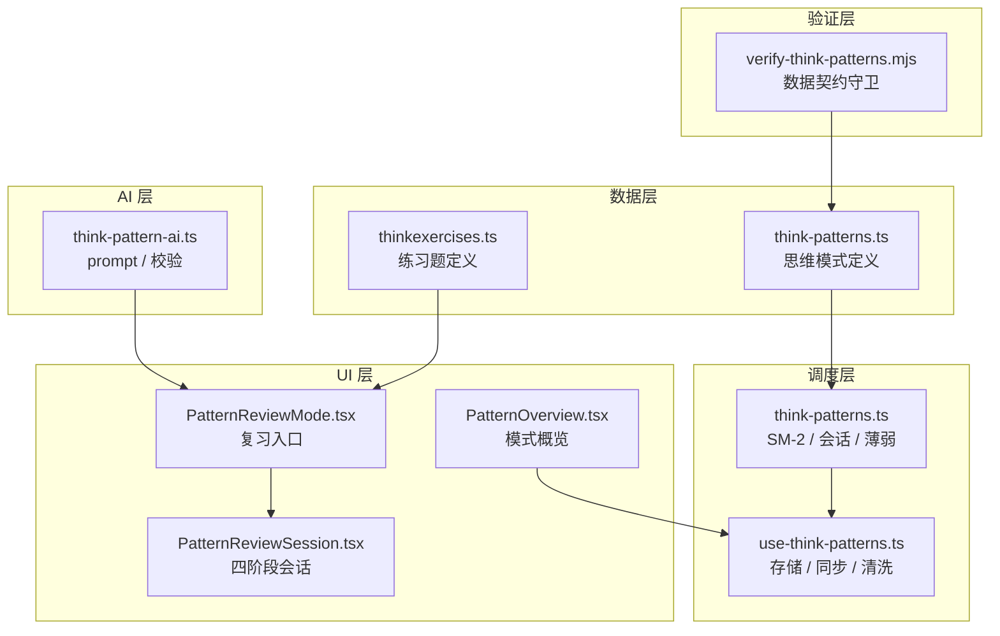
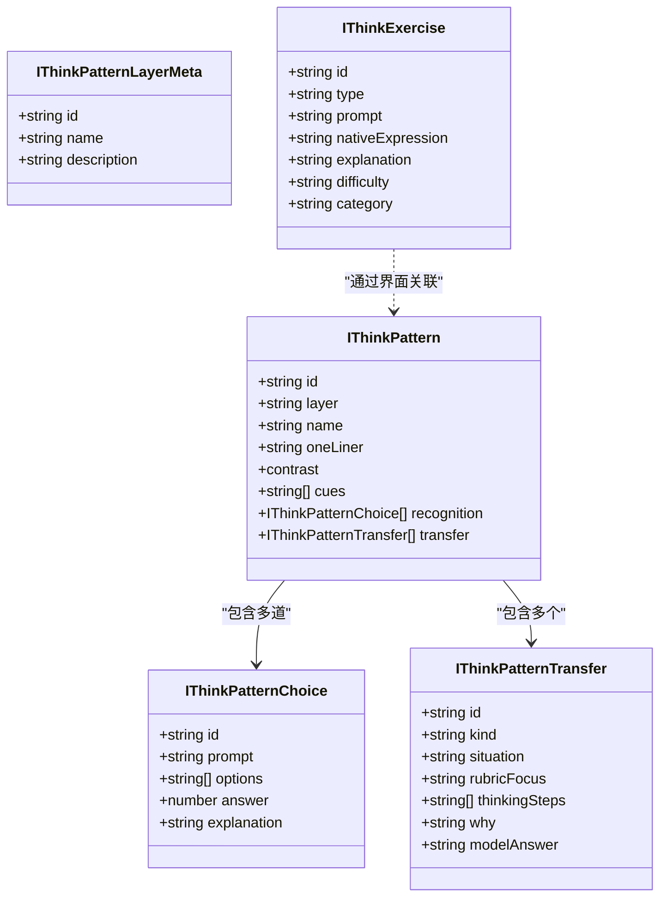
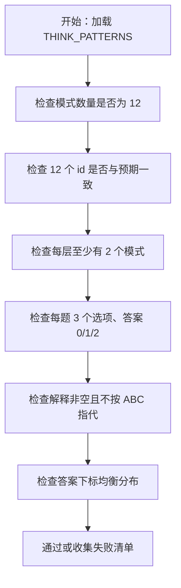
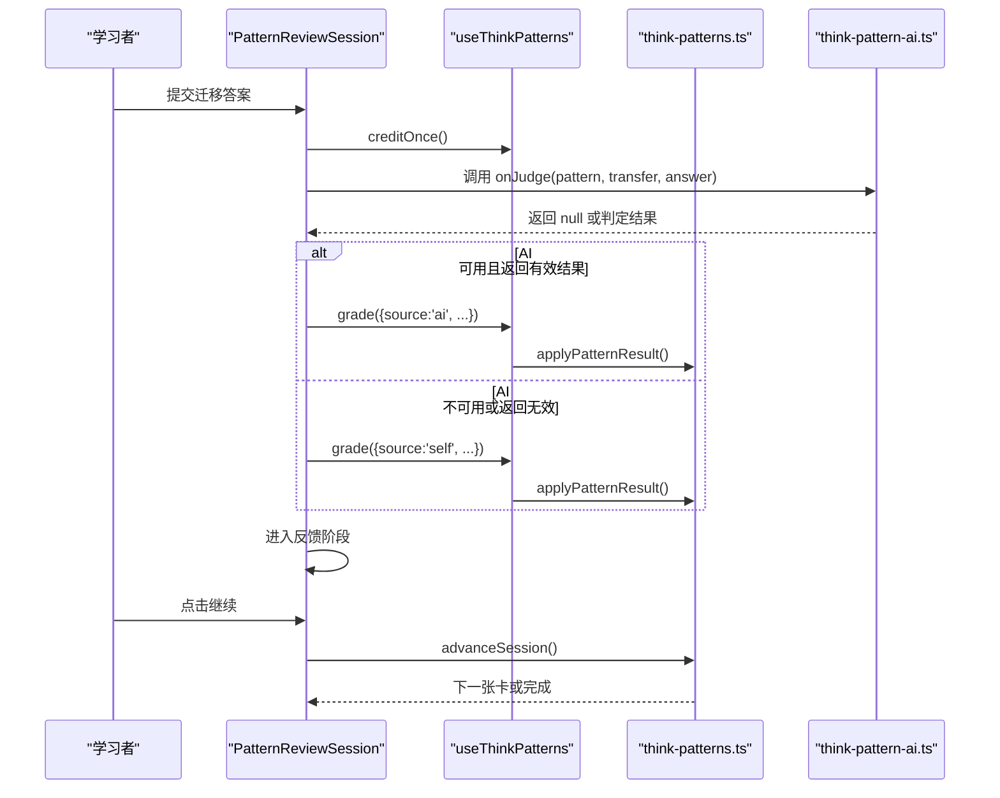
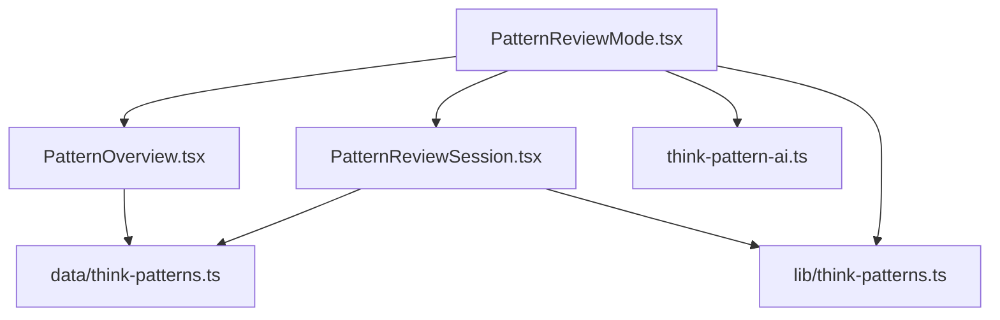

# 思维模式数据模型

<cite>
**本文引用的文件**
- [src/data/think-patterns.ts](file://src/data/think-patterns.ts)
- [src/data/thinkexercises.ts](file://src/data/thinkexercises.ts)
- [src/lib/think-patterns.ts](file://src/lib/think-patterns.ts)
- [src/lib/use-think-patterns.ts](file://src/lib/use-think-patterns.ts)
- [src/lib/think-pattern-ai.ts](file://src/lib/think-pattern-ai.ts)
- [src/pages/ThinkInEnglishPage/PatternOverview.tsx](file://src/pages/ThinkInEnglishPage/PatternOverview.tsx)
- [src/pages/ThinkInEnglishPage/PatternReviewMode.tsx](file://src/pages/ThinkInEnglishPage/PatternReviewMode.tsx)
- [src/pages/ThinkInEnglishPage/PatternReviewSession.tsx](file://src/pages/ThinkInEnglishPage/PatternReviewSession.tsx)
- [scripts/verify-think-patterns.mjs](file://scripts/verify-think-patterns.mjs)
</cite>

## 目录
1. [引言](#引言)
2. [项目结构与职责划分](#项目结构与职责划分)
3. [核心数据结构总览](#核心数据结构总览)
4. [思维模式数据模型](#思维模式数据模型)
5. [练习题数据模型](#练习题数据模型)
6. [模式与练习的关联关系](#模式与练习的关联关系)
7. [难度分级体系](#难度分级体系)
8. [复习调度与掌握判定](#复习调度与掌握判定)
9. [扩展新思维模式与练习题的方法](#扩展新思维模式与练习题的方法)
10. [依赖关系分析](#依赖关系分析)
11. [性能与健壮性特征](#性能与健壮性特征)
12. [故障排查指南](#故障排查指南)
13. [结论](#结论)

## 引言
本文件为 NativeThink “思维模式”学习模块的数据模型文档，重点说明两类数据：

- **思维模式数据**：定义 12 种英语思维模式的结构、对比示例、识别题和迁移训练项。
- **练习题数据**：定义翻译类与回译类练习题，包含难度分级、类别和母语者表达参考。

同时说明模式与练习之间的关联方式、难度分级实现、SM-2 复习调度、AI 判定链路，以及如何安全扩展新的思维模式和练习题。

## 项目结构与职责划分
思维模式数据分布在“数据层”“调度层”“UI 会话层”和“验证脚本”中：

| 层级 | 文件 | 职责 |
|---|---|---|
| 内容数据 | `src/data/think-patterns.ts` | 定义思维模式接口、四层元数据、12 个模式的识别题与迁移题 |
| 练习数据 | `src/data/thinkexercises.ts` | 定义练习题接口和初始题库 |
| 纯调度逻辑 | `src/lib/think-patterns.ts` | SM-2 进度、到期判断、会话状态、薄弱模式排序 |
| 持久化 Hook | `src/lib/use-think-patterns.ts` | 本地存储、云同步、进度清洗、统计聚合 |
| AI 判定辅助 | `src/lib/think-pattern-ai.ts` | 构建判定 prompt、校验 AI 返回 JSON |
| UI 会话 | `src/pages/ThinkInEnglishPage/PatternReviewSession.tsx` | 单模式四阶段复习流程 |
| 模式概览 | `src/pages/ThinkInEnglishPage/PatternOverview.tsx` | 今日行动、模式地图、体检建议 |
| 复习入口 | `src/pages/ThinkInEnglishPage/PatternReviewMode.tsx` | 概览、体检、复习、完成页状态机 |
| 数据契约验证 | `scripts/verify-think-patterns.mjs` | 转译并运行类型数据，检查数量、id、分布、诊断题等 |

**图表来源**
- [src/data/think-patterns.ts:1-60](file://src/data/think-patterns.ts#L1-L60)
- [src/data/thinkexercises.ts:1-30](file://src/data/thinkexercises.ts#L1-L30)
- [src/lib/think-patterns.ts:1-60](file://src/lib/think-patterns.ts#L1-L60)
- [src/lib/use-think-patterns.ts:1-40](file://src/lib/use-think-patterns.ts#L1-L40)
- [src/lib/think-pattern-ai.ts:1-30](file://src/lib/think-pattern-ai.ts#L1-L30)
- [src/pages/ThinkInEnglishPage/PatternOverview.tsx:1-40](file://src/pages/ThinkInEnglishPage/PatternOverview.tsx#L1-L40)
- [src/pages/ThinkInEnglishPage/PatternReviewMode.tsx:1-40](file://src/pages/ThinkInEnglishPage/PatternReviewMode.tsx#L1-L40)
- [src/pages/ThinkInEnglishPage/PatternReviewSession.tsx:1-40](file://src/pages/ThinkInEnglishPage/PatternReviewSession.tsx#L1-L40)
- [scripts/verify-think-patterns.mjs:1-40](file://scripts/verify-think-patterns.mjs#L1-L40)

**章节来源**
- [src/data/think-patterns.ts:1-60](file://src/data/think-patterns.ts#L1-L60)
- [src/data/thinkexercises.ts:1-30](file://src/data/thinkexercises.ts#L1-L30)
- [src/lib/think-patterns.ts:1-60](file://src/lib/think-patterns.ts#L1-L60)
- [src/lib/use-think-patterns.ts:1-40](file://src/lib/use-think-patterns.ts#L1-L40)
- [src/lib/think-pattern-ai.ts:1-30](file://src/lib/think-pattern-ai.ts#L1-L30)
- [src/pages/ThinkInEnglishPage/PatternOverview.tsx:1-40](file://src/pages/ThinkInEnglishPage/PatternOverview.tsx#L1-L40)
- [src/pages/ThinkInEnglishPage/PatternReviewMode.tsx:1-40](file://src/pages/ThinkInEnglishPage/PatternReviewMode.tsx#L1-L40)
- [src/pages/ThinkInEnglishPage/PatternReviewSession.tsx:1-40](file://src/pages/ThinkInEnglishPage/PatternReviewSession.tsx#L1-L40)
- [scripts/verify-think-patterns.mjs:1-40](file://scripts/verify-think-patterns.mjs#L1-L40)

## 核心数据结构总览
思维模式相关核心类型包括：

| 类型 | 所在文件 | 用途 |
|---|---|---|
| `IThinkPatternChoice` | `src/data/think-patterns.ts` | 一道识别题：题干、三个选项、正确答案下标、解释 |
| `IThinkPatternTransfer` | `src/data/think-patterns.ts` | 一个迁移训练项：情境、判定重点、先想三步、自然性解释、参考答案 |
| `IThinkPatternLayerMeta` | `src/data/think-patterns.ts` | 思维模式四层元数据：id、名称、描述 |
| `IThinkPattern` | `src/data/think-patterns.ts` | 一个思维模式：id、layer、name、oneLiner、对比、线索、识别题、迁移题 |
| `IThinkExercise` | `src/data/thinkexercises.ts` | 一个练习题：题型、中文提示、母语者表达、解析、难度、类别 |
| `IThinkPatternProgress` | `src/lib/think-patterns.ts` | 单个模式的复习进度与最近一次尝试 |
| `IThinkPatternState` | `src/lib/think-patterns.ts` | 所有模式进度、每日列表、最近一次体检汇总 |
| `PatternSessionState` | `src/lib/think-patterns.ts` | 本轮复习会话的队列、当前下标、重试次数、每个模式结果 |

**图表来源**
- [src/data/think-patterns.ts:1-60](file://src/data/think-patterns.ts#L1-L60)
- [src/data/thinkexercises.ts:1-20](file://src/data/thinkexercises.ts#L1-L20)
- [src/lib/think-patterns.ts:40-120](file://src/lib/think-patterns.ts#L40-L120)

**章节来源**
- [src/data/think-patterns.ts:1-60](file://src/data/think-patterns.ts#L1-L60)
- [src/data/thinkexercises.ts:1-20](file://src/data/thinkexercises.ts#L1-L20)
- [src/lib/think-patterns.ts:40-120](file://src/lib/think-patterns.ts#L40-L120)

## 思维模式数据模型
### 思维模式四层
四种思维模式层由常量数组定义，每层有 id、中文名称和一句话描述：

| 层 id | 中文名称 | 含义 |
|---|---|---|
| `structure` | 信息结构 | 谁在前、什么在后、指代是否补全 |
| `verb` | 动词与焦点 | 动作由谁承担、结果怎么落在句子里 |
| `clarity` | 逻辑与信息 | 关系是否明说、断言力度、细节是否足够 |
| `pragmatics` | 语域与语用 | 正式度、面子、请求拒绝赞美的默认脚本 |

验证脚本要求四层恰好存在，且顺序固定；每个模式必须属于合法层，且每层至少有两个模式。

**章节来源**
- [src/data/think-patterns.ts:17-38](file://src/data/think-patterns.ts#L17-L38)
- [scripts/verify-think-patterns.mjs:60-90](file://scripts/verify-think-patterns.mjs#L60-L90)

### 思维模式对象字段
一个思维模式 `IThinkPattern` 包含以下字段：

| 字段 | 类型 | 说明 |
|---|---|---|
| `id` | 字符串 | 模式唯一标识，例如 `subject-first`、`verb-driven` |
| `layer` | 枚举 | 所属思维模式层 |
| `name` | 字符串 | 面向用户的中文模式名称 |
| `oneLiner` | 字符串 | 一句话原则，用于概览和卡片展示 |
| `contrast.chineseThinking` | 字符串 | 中文思路示例 |
| `contrast.native` | 字符串 | 母语者表达示例 |
| `contrast.note` | 字符串 | 为什么这样更自然的说明 |
| `cues` | 字符串数组 | 识别线索，通常至少两条 |
| `recognition` | 数组 | 三选一识别题 |
| `transfer` | 数组 | 三个迁移训练项 |

验证脚本还要求：

- 模式总数恰好为 12。
- 12 个 id 与预期顺序一致。
- 每个模式有非空 name、oneLiner、对比三字段。
- 每个模式至少两条非空 cues。
- 每个模式恰好三道识别题、三个迁移项。
- 识别题答案下标在 0、1、2 之间。
- 识别题解释不能按 A/B/C 字母指代选项。
- 迁移项中恰好有一个 `kind` 为 `wording`，其余为 `scenario`。
- 迁移项必须有 `thinkingSteps`，长度为 3，且全部非空。

**章节来源**
- [src/data/think-patterns.ts:1-60](file://src/data/think-patterns.ts#L1-L60)
- [scripts/verify-think-patterns.mjs:90-160](file://scripts/verify-think-patterns.mjs#L90-L160)

### 识别题数据结构
识别题 `IThinkPatternChoice` 是选择题形式，用于检测学习者是否能识别目标思维模式：

| 字段 | 类型 | 说明 |
|---|---|---|
| `id` | 字符串 | 题目 id，作为 React key 和内容契约键 |
| `prompt` | 字符串 | 中文情境或句子提示 |
| `options` | 三元组 | 三个英文选项，必须语法成立，差异在于思维模式 |
| `answer` | 0、1 或 2 | 正确选项的下标 |
| `explanation` | 字符串 | 对三个选项整体说明，不直接写“选 A/B/C” |

验证脚本额外约束：

- 每题三个选项。
- 三个选项都不为空。
- 三个选项互不相同。
- 36 道识别题的答案下标均衡分布：0、1、2 各出现 12 次，防止用户靠位置蒙题。
- 每道题的解释必须存在且非空。

**图表来源**
- [scripts/verify-think-patterns.mjs:40-120](file://scripts/verify-think-patterns.mjs#L40-L120)

**章节来源**
- [src/data/think-patterns.ts:1-20](file://src/data/think-patterns.ts#L1-L20)
- [scripts/verify-think-patterns.mjs:100-140](file://scripts/verify-think-patterns.mjs#L100-L140)

### 迁移训练项数据结构
迁移训练项 `IThinkPatternTransfer` 用于让学习者在真实情境中输出英文，并使用目标思维模式：

| 字段 | 类型 | 说明 |
|---|---|---|
| `id` | 字符串 | 迁移项唯一 id |
| `kind` | `scenario` 或 `wording` | 默认 `scenario`；`wording` 表示换措辞训练 |
| `situation` | 字符串 | 给学习者使用的中文情境 |
| `rubricFocus` | 字符串 | 给 AI 判定的重点，用户不可见 |
| `thinkingSteps` | 三段字符串数组 | 先想三步，引导学习者拆解问题 |
| `why` | 字符串 | 反馈卡中解释为什么参考表达更自然 |
| `modelAnswer` | 字符串 | 参考答案，用于自评对照 |

验证脚本要求：

- 每个模式恰好三个迁移项。
- 每个模式恰好一个 `wording` 迁移项。
- `situation`、`rubricFocus`、`why`、`modelAnswer` 都必须非空。
- `thinkingSteps` 必须是长度为 3 的非空字符串数组。

**章节来源**
- [src/data/think-patterns.ts:9-16](file://src/data/think-patterns.ts#L9-L16)
- [scripts/verify-think-patterns.mjs:140-170](file://scripts/verify-think-patterns.mjs#L140-L170)

### 思维模式数据示例
以下以“让主语站出来”为例，给出字段语义示例（不直接复制原文）：

- 模式 id：`subject-first`
- 层：`structure`
- 名称：让主语站出来
- 一句话原则：中文先给话题，英文先给主语和动作
- 中文思路示例：把“这个电影”放在句首的话题句
- 母语者表达示例：以 I 为主语、动词在前
- 说明：中文话题前置 vs 英文主语前置
- 线索：先找谁做了动作、句首尽量主语加谓语、中文话题不是主语
- 识别题：三选一选择最符合该模式的英文句子
- 迁移项：告诉同事交报告、看剧感受、修 bug 等情境

**章节来源**
- [src/data/think-patterns.ts:39-120](file://src/data/think-patterns.ts#L39-L120)

## 练习题数据模型
### 练习题接口
练习题 `IThinkExercise` 是独立于思维模式的通用练习数据，主要用于翻译与回译场景：

| 字段 | 类型 | 说明 |
|---|---|---|
| `id` | 字符串 | 练习题唯一 id |
| `type` | `translation` 或 `backTranslation` | 题型：中文到英文，或英文到中文 |
| `prompt` | 字符串 | 中文提示，描述学习者想表达的内容 |
| `nativeExpression` | 字符串 | 母语者参考表达 |
| `explanation` | 字符串 | 解析说明，解释为什么该表达更自然 |
| `difficulty` | `beginner`、`intermediate` 或 `advanced` | 难度等级 |
| `category` | 字符串 | 类别，如日常表达、职场沟通、社交互动 |

当前仓库中的初始题库只包含 `translation` 类型，但类型定义允许未来加入 `backTranslation`。

**章节来源**
- [src/data/thinkexercises.ts:1-20](file://src/data/thinkexercises.ts#L1-L20)

### 练习题示例
以“你想告诉朋友我最近工作很忙，压力很大”为例：

- 题型：`translation`
- 中文提示：描述忙碌和压力
- 母语者表达：使用更地道的短语而非直译
- 解析：说明母语者常用表达和语气
- 难度：`beginner`
- 类别：日常表达

**章节来源**
- [src/data/thinkexercises.ts:1-40](file://src/data/thinkexercises.ts#L1-L40)

## 模式与练习的关联关系
目前仓库中，“思维模式”和“练习题”是两个相对独立的数据源：

- 思维模式数据负责“如何思考英语”，包括识别题和迁移训练。
- 练习题数据负责“翻译能力练习”，提供母语者表达和解析。
- 两者没有直接的数据库外键或共享 id 字段。
- 关联主要通过 UI 和业务场景实现：
  - 思维模式复习走 `PatternReviewSession`，基于 `THINK_PATTERNS`。
  - 练习题数据导出为 `MOCK_THINK_EXERCISES`，可被其他页面或功能消费。
  - 如果需要在某个练习页面引入思维模式，应新增引用并建立业务层映射，而不是直接耦合两个数据文件。

[此图为概念图，不绑定具体代码结构]

**章节来源**
- [src/data/think-patterns.ts:1-60](file://src/data/think-patterns.ts#L1-L60)
- [src/data/thinkexercises.ts:1-20](file://src/data/thinkexercises.ts#L1-L20)
- [src/pages/ThinkInEnglishPage/PatternReviewSession.tsx:1-60](file://src/pages/ThinkInEnglishPage/PatternReviewSession.tsx#L1-L60)

## 难度分级体系
思维模式复习不使用 beginner / intermediate / advanced 文本标签，而是使用 SM-2 间隔重复算法驱动的动态难度：

| 维度 | 实现方式 |
|---|---|
| 学习状态 | `learning`、`reviewing`、`mastered` |
| 间隔增长 | 第 1 次通过后间隔 1 天，第 2 次 3 天，之后乘以 easeFactor |
| 易度因子 | 根据质量评分调整，最低不低于 1.3 |
| 失败处理 | lapses 增加，interval 归零，nextReview 回到当前时间 |
| 掌握条件 | repetitions ≥ 4、interval ≥ 21 天、aiTransferPasses ≥ 2 |
| 题目选择 | 使用 `pickRecognitionIndex`、`pickTransferIndex` 等函数轮换识别题和迁移题 |
| 闭卷机制 | 多次复习后进入闭卷，延迟探测还会标记延迟迁移 |

练习题数据本身保留 beginner / intermediate / advanced 三级难度，便于未来按难度筛选练习，但与思维模式掌握状态解耦。

**章节来源**
- [src/lib/think-patterns.ts:1-120](file://src/lib/think-patterns.ts#L1-L120)
- [src/data/thinkexercises.ts:1-20](file://src/data/thinkexercises.ts#L1-L20)

## 复习调度与掌握判定
### SM-2 评分质量口径
`applyPatternResult` 将一次作答映射为质量值：

| 质量值 | 含义 |
|---|---|
| 5 | 识别正确 + 迁移通过 |
| 4 | 识别错误 + 迁移通过 |
| 3 | 自评迁移通过 |
| 2 | 迁移失败或自评未通过 |

质量小于 3 视为失败，立即重置间隔和重复次数，lapses 加一。

**章节来源**
- [src/lib/think-patterns.ts:120-220](file://src/lib/think-patterns.ts#L120-L220)

### 到期判断与会话推进
到期判断会排除已掌握、未到复习时间的记录，并考虑“今天已通过”的去重。会话状态维护：

- `queue`：本轮要练的模式 id 列表
- `index`：当前模式下标
- `retries`：每个模式在本轮的重试次数
- `results`：每个模式的最终结果 pass 或 fail

**图表来源**
- [src/pages/ThinkInEnglishPage/PatternReviewSession.tsx:120-220](file://src/pages/ThinkInEnglishPage/PatternReviewSession.tsx#L120-L220)
- [src/lib/think-pattern-ai.ts:20-66](file://src/lib/think-pattern-ai.ts#L20-L66)
- [src/lib/think-patterns.ts:180-260](file://src/lib/think-patterns.ts#L180-L260)

**章节来源**
- [src/pages/ThinkInEnglishPage/PatternReviewSession.tsx:100-220](file://src/pages/ThinkInEnglishPage/PatternReviewSession.tsx#L100-L220)
- [src/lib/think-pattern-ai.ts:1-66](file://src/lib/think-pattern-ai.ts#L1-L66)
- [src/lib/think-patterns.ts:160-260](file://src/lib/think-patterns.ts#L160-L260)

## 扩展新思维模式与练习题的方法
### 添加新思维模式
要添加一个新思维模式，需要修改 `src/data/think-patterns.ts`，并确保满足验证脚本约束：

1. 在 `THINK_PATTERNS` 末尾追加一个 `IThinkPattern` 对象。
2. 为新模式分配唯一 id，并确认它不属于已有 12 个 id。
3. 设置合法的 `layer`，使四层仍保持至少两个模式。
4. 填写 name、oneLiner、contrast、cues。
5. 添加三道识别题，确保：
   - 每题有三个不同选项。
   - answer 为 0、1 或 2。
   - 解释不依赖 A/B/C 字母。
6. 添加三个迁移项，确保：
   - 恰好一个 `kind` 为 `wording`。
   - `thinkingSteps` 有三条非空步骤。
   - `situation`、`rubricFocus`、`why`、`modelAnswer` 都非空。
7. 如需更新思维体检，需在 `THINK_PATTERN_DIAGNOSTIC` 中加入对应条目。
8. 如需更新选项注释，需在 `THINK_PATTERN_OPTION_NOTES` 中补充三条 best/ok/off 注释。

验证脚本会在 Node 环境中转译 TypeScript 并运行，因此任何语法错误或缺失字段都会导致守卫失败。

**章节来源**
- [src/data/think-patterns.ts:1-60](file://src/data/think-patterns.ts#L1-L60)
- [scripts/verify-think-patterns.mjs:40-170](file://scripts/verify-think-patterns.mjs#L40-L170)

### 添加新练习题
要添加新练习题，只需在 `src/data/thinkexercises.ts` 的 `MOCK_THINK_EXERCISES` 中追加对象：

1. 生成全局唯一的 `id`。
2. 指定 `type` 为 `translation` 或 `backTranslation`。
3. 填写 `prompt`、`nativeExpression`、`explanation`。
4. 指定 `difficulty` 为 beginner、intermediate 或 advanced。
5. 指定 `category`，用于分类展示或筛选。

注意：当前仓库没有对练习题数量做类似思维模式的强校验，因此新增时仍需保证字段完整性和可读性。

**章节来源**
- [src/data/thinkexercises.ts:1-40](file://src/data/thinkexercises.ts#L1-L40)

## 依赖关系分析
### 组件依赖
- `PatternReviewMode` 组合 `PatternOverview`、`PatternDiagnostic`、`PatternReviewSession`。
- `PatternOverview` 读取 `THINK_PATTERNS`、`THINK_PATTERN_LAYERS`，并显示模式状态。
- `PatternReviewSession` 读取 `THINK_PATTERN_OPTION_NOTES`，并根据 `progress` 决定开卷或闭卷。
- `PatternReviewMode` 通过 `useAI` 调用 `buildPatternJudgePrompt`，并用 `validatePatternJudgeResult` 校验结果。

**图表来源**
- [src/pages/ThinkInEnglishPage/PatternReviewMode.tsx:1-60](file://src/pages/ThinkInEnglishPage/PatternReviewMode.tsx#L1-L60)
- [src/pages/ThinkInEnglishPage/PatternOverview.tsx:1-40](file://src/pages/ThinkInEnglishPage/PatternOverview.tsx#L1-L40)
- [src/pages/ThinkInEnglishPage/PatternReviewSession.tsx:1-40](file://src/pages/ThinkInEnglishPage/PatternReviewSession.tsx#L1-L40)
- [src/lib/think-pattern-ai.ts:1-30](file://src/lib/think-pattern-ai.ts#L1-L30)
- [src/lib/think-patterns.ts:1-40](file://src/lib/think-patterns.ts#L1-L40)
- [src/data/think-patterns.ts:1-40](file://src/data/think-patterns.ts#L1-L40)

**章节来源**
- [src/pages/ThinkInEnglishPage/PatternReviewMode.tsx:1-60](file://src/pages/ThinkInEnglishPage/PatternReviewMode.tsx#L1-L60)
- [src/pages/ThinkInEnglishPage/PatternOverview.tsx:1-60](file://src/pages/ThinkInEnglishPage/PatternOverview.tsx#L1-L60)
- [src/pages/ThinkInEnglishPage/PatternReviewSession.tsx:1-60](file://src/pages/ThinkInEnglishPage/PatternReviewSession.tsx#L1-L60)
- [src/lib/think-pattern-ai.ts:1-30](file://src/lib/think-pattern-ai.ts#L1-L30)
- [src/lib/think-patterns.ts:1-40](file://src/lib/think-patterns.ts#L1-L40)
- [src/data/think-patterns.ts:1-40](file://src/data/think-patterns.ts#L1-L40)

## 性能与健壮性特征
### 数据层
- 思维模式数据以静态数组导出，UI 层按需查找。
- 验证脚本在构建或 CI 阶段转译 TypeScript，避免运行时类型错误。

### 持久化层
- `use-think-patterns.ts` 在读取本地存储时对脏数据进行清洗：
  - 丢弃未知 patternId。
  - 丢弃形状错误的 progress 条目。
  - 丢弃 daily 中非字符串数组的桶。
  - 丢弃诊断记录中未知层或非法数值。
- 写盘失败时发出警告，避免静默丢失进度。

### 会话层
- 识别题下标和迁移题下标在组件挂载时快照，避免进度更新导致反馈页突然切换题目。
- 异步判定使用序号 ref 丢弃旧 Promise，防止换卡后上一题结果污染下一题。
- 自评按钮和“继续”按钮都有防重复提交保护。
- AI 判定最长等待 15 秒，超时按不可用处理，不会让界面永久停留在判定中。

**章节来源**
- [src/lib/use-think-patterns.ts:1-120](file://src/lib/use-think-patterns.ts#L1-L120)
- [src/pages/ThinkInEnglishPage/PatternReviewSession.tsx:60-160](file://src/pages/ThinkInEnglishPage/PatternReviewSession.tsx#L60-L160)
- [src/pages/ThinkInEnglishPage/PatternReviewMode.tsx:60-140](file://src/pages/ThinkInEnglishPage/PatternReviewMode.tsx#L60-L140)

## 故障排查指南
### 模式数量或 id 不符合预期
现象：验证脚本报错，或模式列表渲染异常。

排查步骤：
1. 检查 `THINK_PATTERNS` 长度是否为 12。
2. 检查 12 个 id 是否与预期顺序一致。
3. 检查是否存在重复 id。
4. 检查每个模式是否属于合法层，且每层至少两个模式。

**章节来源**
- [scripts/verify-think-patterns.mjs:40-90](file://scripts/verify-think-patterns.mjs#L40-L90)

### 识别题选项或答案异常
现象：用户能靠位置猜题，或反馈解释不清晰。

排查步骤：
1. 检查每题是否有三个不同选项。
2. 检查 answer 是否为 0、1 或 2。
3. 检查 36 道题的答案下标是否均衡分布。
4. 检查解释是否避免了“选 A/B/C”。
5. 检查 `THINK_PATTERN_OPTION_NOTES` 是否为每道题提供 best/ok/off 三条注释。

**章节来源**
- [scripts/verify-think-patterns.mjs:120-170](file://scripts/verify-think-patterns.mjs#L120-L170)

### 迁移项缺少必填字段
现象：迁移界面无法展示先想三步，或 AI 判定缺少 rubricFocus。

排查步骤：
1. 检查每个迁移项是否有 `situation`、`rubricFocus`、`why`、`modelAnswer`。
2. 检查 `thinkingSteps` 是否为长度为 3 的非空数组。
3. 检查每个模式是否恰好一个 `wording` 迁移项。

**章节来源**
- [scripts/verify-think-patterns.mjs:140-170](file://scripts/verify-think-patterns.mjs#L140-L170)

### 本地进度丢失或状态异常
现象：刷新后进度消失、下次复习时间异常、今日计数出错。

排查步骤：
1. 检查本地存储是否被清空或处于隐私模式。
2. 检查 `sanitizeProgress` 是否丢弃了脏记录。
3. 检查 `daily` 是否只包含字符串数组。
4. 检查写盘失败时是否弹出存储已满提示。
5. 检查云同步下行后是否重新读盘，避免本地空状态覆盖远端进度。

**章节来源**
- [src/lib/use-think-patterns.ts:1-120](file://src/lib/use-think-patterns.ts#L1-L120)

### AI 判定失败或界面卡住
现象：迁移提交后一直显示判定中，或自动回落自评。

排查步骤：
1. 检查 AI Key 是否配置。
2. 检查 `isConfigured` 是否为真。
3. 检查 AI 响应是否为空串或非法 JSON。
4. 检查 `validatePatternJudgeResult` 是否返回 null。
5. 检查 15 秒超时是否触发。
6. 检查组件卸载时是否递增 `judgeSeqRef`，丢弃旧 Promise。

**章节来源**
- [src/pages/ThinkInEnglishPage/PatternReviewMode.tsx:80-140](file://src/pages/ThinkInEnglishPage/PatternReviewMode.tsx#L80-L140)
- [src/lib/think-pattern-ai.ts:20-66](file://src/lib/think-pattern-ai.ts#L20-L66)
- [src/pages/ThinkInEnglishPage/PatternReviewSession.tsx:140-220](file://src/pages/ThinkInEnglishPage/PatternReviewSession.tsx#L140-L220)

## 结论
NativeThink 的思维模式数据模型由两层组成：

- **内容数据层**：`think-patterns.ts` 定义 12 个思维模式及其识别题与迁移训练；`thinkexercises.ts` 定义翻译练习题及难度分级。
- **调度与交互层**：`think-patterns.ts` 提供 SM-2 进度与会话逻辑，`use-think-patterns.ts` 负责持久化和清洗，`PatternReviewSession` 提供四阶段复习体验，`think-pattern-ai.ts` 提供 AI 判定辅助。

该设计将“英语思维模式”与“翻译练习”解耦，同时通过严格的验证脚本、进度清洗、超时降级和会话保护，保证数据完整性、用户体验和可扩展性。扩展新模式时，应优先遵循验证脚本的结构性约束；扩展练习题时，应保持字段完整并与现有类别保持一致。