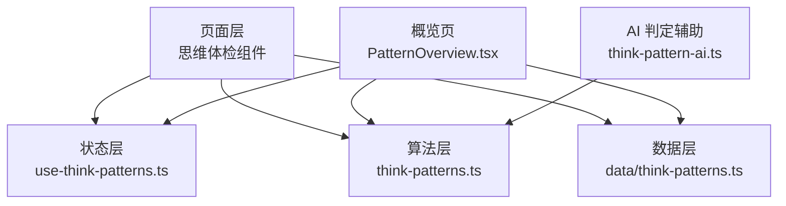
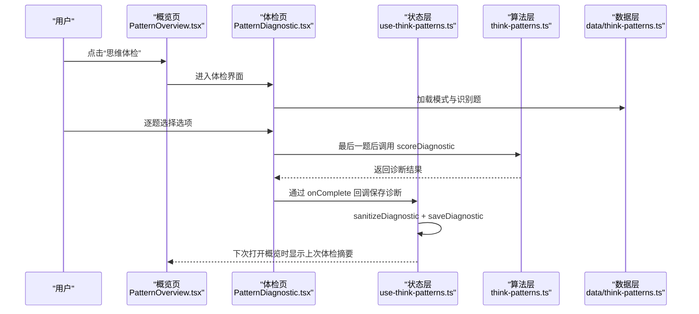
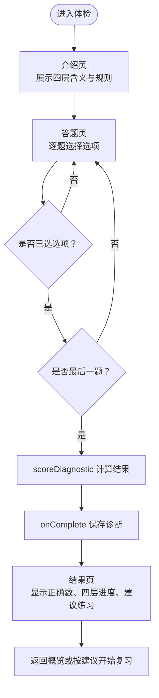
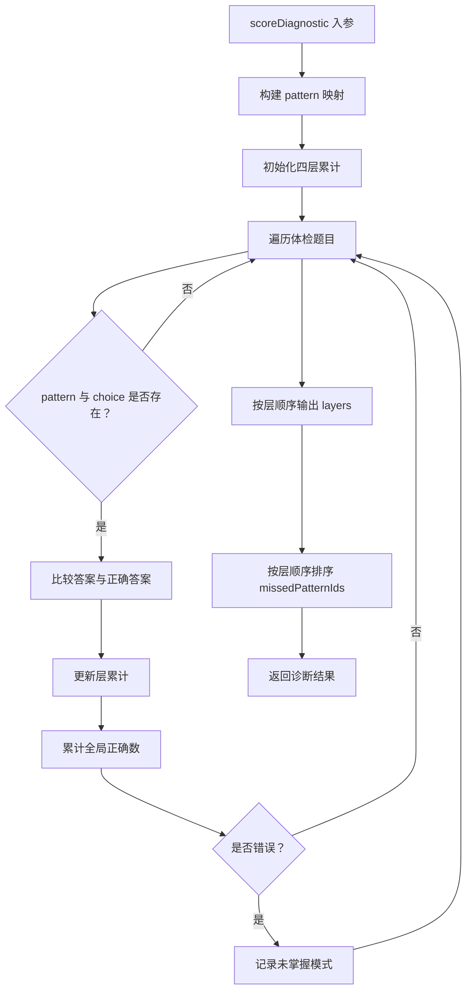
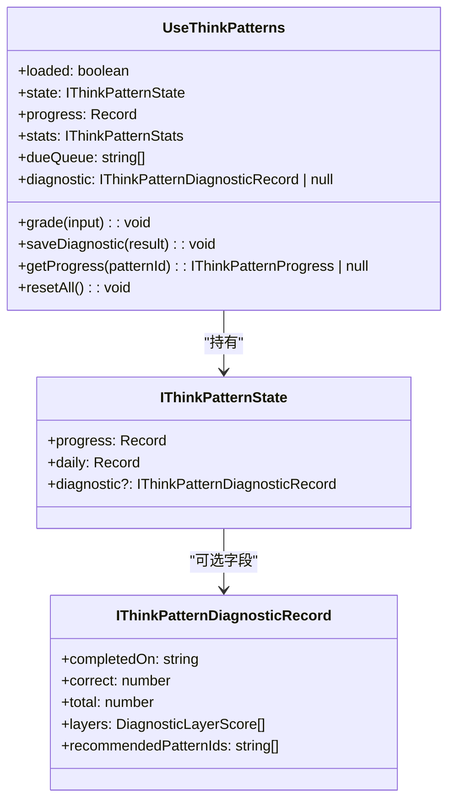
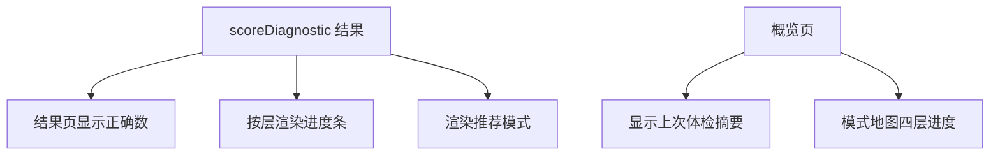
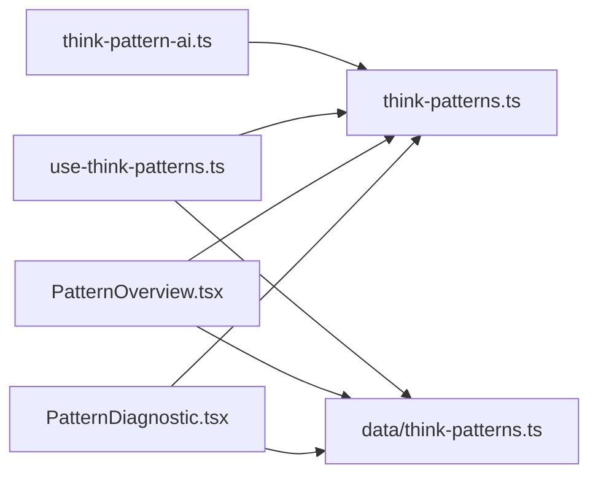

# 模式体检诊断系统

<cite>
**本文引用的文件**   
- [PatternDiagnostic.tsx](file://src/pages/ThinkInEnglishPage/PatternDiagnostic.tsx)
- [use-think-patterns.ts](file://src/lib/use-think-patterns.ts)
- [think-patterns.ts](file://src/lib/think-patterns.ts)
- [think-patterns.ts（数据）](file://src/data/think-patterns.ts)
- [PatternOverview.tsx](file://src/pages/ThinkInEnglishPage/PatternOverview.tsx)
- [think-pattern-ai.ts](file://src/lib/think-pattern-ai.ts)
</cite>

## 目录
1. [引言](#引言)
2. [项目结构](#项目结构)
3. [核心组件与职责](#核心组件与职责)
4. [架构总览](#架构总览)
5. [详细组件分析](#详细组件分析)
6. [依赖关系分析](#依赖关系分析)
7. [性能与可维护性](#性能与可维护性)
8. [故障排查](#故障排查)
9. [结论](#结论)

## 引言
本文件面向 NativeThink 模式的“思维体检”能力，重点说明 PatternDiagnostic 组件的诊断流程、答题交互、实时反馈机制，以及诊断算法如何评估用户对各思维模式的掌握程度。文档还深入解释 use-think-patterns.ts 中管理诊断状态的核心逻辑，包括答题记录存储、进度追踪、结果计算和可视化展示方式。

需要特别说明的是：当前仓库中的“思维体检”只负责识别题层面的诊断与建议排序，并不生成个人能力雷达图；能力雷达图属于更上层或未来扩展的可视化需求，不在现有源码中实现。

## 项目结构
思维体检相关代码主要分布在四个层次：
- 页面层：思维体检入口与答题界面
- 状态层：复习与体检的状态存储、清洗、持久化
- 算法层：SM-2 复习调度、诊断计分、队列构建
- 数据层：思维模式定义、四层分类、识别题与迁移题题库

**图表来源**
- [PatternDiagnostic.tsx:1-200](file://src/pages/ThinkInEnglishPage/PatternDiagnostic.tsx#L1-L200)
- [use-think-patterns.ts:1-200](file://src/lib/use-think-patterns.ts#L1-L200)
- [think-patterns.ts:1-200](file://src/lib/think-patterns.ts#L1-L200)
- [think-patterns.ts（数据）:1-200](file://src/data/think-patterns.ts#L1-L200)
- [PatternOverview.tsx:1-200](file://src/pages/ThinkInEnglishPage/PatternOverview.tsx#L1-L200)
- [think-pattern-ai.ts:1-66](file://src/lib/think-pattern-ai.ts#L1-L66)

**章节来源**
- [PatternDiagnostic.tsx:1-200](file://src/pages/ThinkInEnglishPage/PatternDiagnostic.tsx#L1-L200)
- [use-think-patterns.ts:1-200](file://src/lib/use-think-patterns.ts#L1-L200)
- [think-patterns.ts:1-200](file://src/lib/think-patterns.ts#L1-L200)
- [think-patterns.ts（数据）:1-200](file://src/data/think-patterns.ts#L1-L200)
- [PatternOverview.tsx:1-200](file://src/pages/ThinkInEnglishEnglishPage/PatternOverview.tsx#L1-L200)

## 核心组件与职责
- PatternDiagnostic.tsx：负责思维体检的用户界面与答题流程，包含介绍页、答题页、结果页。
- use-think-patterns.ts：思维模式复习与体检状态的权威 store，负责读取本地存储、清洗脏数据、保存诊断结果、计算统计信息。
- think-patterns.ts（lib）：纯函数算法层，提供 SM-2 评分、诊断计分、队列构建、四层汇总等无副作用方法。
- think-patterns.ts（data）：思维模式元数据、四层结构、识别题与迁移题题库。
- PatternOverview.tsx：模式复习概览页，显示今日行动、薄弱项、到期队列、模式地图、体检入口。
- think-pattern-ai.ts：为 AI 判定的迁移题构造提示词并校验返回结构，不属于体检识别题主流程，但与整体复习体系相关。

**章节来源**
- [PatternDiagnostic.tsx:1-200](file://src/pages/ThinkInEnglishPage/PatternDiagnostic.tsx#L1-L200)
- [use-think-patterns.ts:1-200](file://src/lib/use-think-patterns.ts#L1-L200)
- [think-patterns.ts:1-200](file://src/lib/think-patterns.ts#L1-L200)
- [think-patterns.ts（数据）:1-200](file://src/data/think-patterns.ts#L1-L200)
- [PatternOverview.tsx:1-200](file://src/pages/ThinkInEnglishPage/PatternOverview.tsx#L1-L200)
- [think-pattern-ai.ts:1-66](file://src/lib/think-pattern-ai.ts#L1-L66)

## 架构总览
思维体检在整体系统中的位置如下：

**图表来源**
- [PatternDiagnostic.tsx:1-200](file://src/pages/ThinkInEnglishPage/PatternDiagnostic.tsx#L1-L200)
- [use-think-patterns.ts:201-291](file://src/lib/use-think-patterns.ts#L201-L291)
- [think-patterns.ts:201-400](file://src/lib/think-patterns.ts#L201-L400)
- [think-patterns.ts（数据）:1-200](file://src/data/think-patterns.ts#L1-L200)

## 详细组件分析

### PatternDiagnostic 组件：诊断流程与交互
PatternDiagnostic 是思维体检的直接入口。它接收三类外部输入：
- patterns：当前可用的思维模式列表
- items：体检题目映射，指明每道题对应哪个 patternId 与 choiceId
- 回调：onComplete 用于保存诊断结果，onStart 用于根据建议开始复习，onExit 用于退出

组件内部维护以下状态：
- stage：intro、quiz、result 三阶段
- index：当前题目索引
- answers：以 choiceId 为键、选项序号为值的答题记录
- result：最终诊断结果
- finishedRef：防止重复保存结果的防抖标记

**图表来源**
- [PatternDiagnostic.tsx:1-200](file://src/pages/ThinkInEnglishPage/PatternDiagnostic.tsx#L1-L200)
- [think-patterns.ts:201-400](file://src/lib/think-patterns.ts#L201-L400)

#### 模式选择界面
介绍页不要求用户从多个模式中选择某一个模式，而是让用户理解本次体检覆盖的四层思维结构：
- 信息结构
- 动词与焦点
- 逻辑与信息
- 语域与语用

介绍页强调：
- 体检约 12 道跨模式识别题
- 不计分、不排名
- 只用来决定接下来先练哪些模式
- 答题时不显示对错

**章节来源**
- [PatternDiagnostic.tsx:1-200](file://src/pages/ThinkInEnglishPage/PatternDiagnostic.tsx#L1-L200)
- [think-patterns.ts（数据）:1-200](file://src/data/think-patterns.ts#L1-L200)

#### 答题交互
答题页每次渲染一道识别题，题干来自 IThinkPatternChoice.prompt，选项来自 options，正确答案由 answer 指定。用户点击选项后，answers 中以 choice.id 为键保存选项序号。按钮文案会随题目变化：
- 非最后一题：下一题
- 最后一题：看结果

组件明确约定“答题过程中不显示对错”，避免把体检变成即时刷题。

**章节来源**
- [PatternDiagnostic.tsx:201-285](file://src/pages/ThinkInEnglishPage/PatternDiagnostic.tsx#L201-L285)
- [think-patterns.ts（数据）:1-200](file://src/data/think-patterns.ts#L1-L200)

#### 实时反馈机制
PatternDiagnostic 的“实时反馈”不是每题判对错，而是：
- 选项选中态提供视觉反馈
- 最后一题提交后才计算诊断结果
- 结果页展示四层正确率进度条与建议练习列表

因此，真正的“反馈延迟到结束”是该组件的设计约束，而不是实现缺陷。

**章节来源**
- [PatternDiagnostic.tsx:1-200](file://src/pages/ThinkInEnglishPage/PatternDiagnostic.tsx#L1-L200)

#### 结果页与建议练习
结果页展示：
- 总正确数与总题数
- 各层的 correct / total
- 按层顺序排列的进度条
- recommendedPatternIds 对应的推荐练习模式

推荐模式来源于 scoreDiagnostic 返回的 missedPatternIds，也就是这次识别没抓住的模式。

**章节来源**
- [PatternDiagnostic.tsx:1-200](file://src/pages/ThinkInEnglishPage/PatternDiagnostic.tsx#L1-L200)
- [think-patterns.ts:201-400](file://src/lib/think-patterns.ts#L201-L400)

### 诊断算法：scoreDiagnostic 与指标计算
scoreDiagnostic 是体检的核心纯函数。它接收：
- patterns：全部思维模式
- items：体检题目映射
- answers：用户答题记录
- layerIds：四层顺序

算法执行步骤：
1. 将 patterns 转为 Map，便于按 id 查找。
2. 初始化四层累计对象，初始值均为 correct=0、total=0。
3. 遍历 items：
   - 匹配 pattern 与 choice
   - 若缺失则跳过，不破坏整份体检
   - 判断 answers[choiceId] 是否等于 choice.answer
   - 更新该模式所属层的 total 与 correct
   - 累计全局 correct
   - 错误答案加入 missed 集合
4. 按 layerIds 的顺序输出 layers，并按层顺序排序 missedPatternIds。
5. 返回 correct、total、layers、missedPatternIds、recommendedPatternIds。

关键特性：
- 不写进度
- 不调 SM-2
- 不生成“思维分数”
- 对坏数据做容错处理

时间复杂度：
- 构建 patterns Map：O(n)
- 遍历 items：O(m)
- 排序 missedPatterns：O(k log k)，k 为错误模式数量
- 总体近似 O(n + m + k log k)

空间复杂度：
- perLayer Map、layerOrder Map、byId Map、missed Set
- 近似 O(n + m + k)

**图表来源**
- [think-patterns.ts:201-400](file://src/lib/think-patterns.ts#L201-L400)

**章节来源**
- [think-patterns.ts:201-400](file://src/lib/think-patterns.ts#L201-L400)

### use-think-patterns.ts：诊断状态管理与存储
use-think-patterns.ts 是思维模式复习与体检状态的权威源。它对外暴露：
- loaded：是否完成初始加载
- state：完整状态
- progress：每个模式的学习进度
- stats：tracked、mastered、due、reviewedToday
- dueQueue：本轮复习顺序
- diagnostic：最近一次体检记录
- grade：评分接口
- saveDiagnostic：保存体检结果
- getProgress：查询单个模式进度
- resetAll：重置所有进度

#### 诊断状态数据结构
诊断记录 IThinkPatternDiagnosticRecord 只保留汇总与建议，不存储逐题答案：
- completedOn：完成日期
- correct：正确题数
- total：总题数
- layers：各层正确与总数
- recommendedPatternIds：建议练习的模式 id 列表

#### 读盘边界清洗
sanitizeDiagnostic 对本地存储中的诊断记录进行严格清洗：
- 必须是非数组对象
- completedOn 必须是有效字符串
- correct 与 total 必须是有限数字且满足 0 ≤ correct ≤ total
- layers 必须是数组
- 每个 layer 必须有合法 layerId、correct、total
- recommendedPatternIds 只保留已知模式 id

如果整份诊断记录损坏，会回退为 undefined，不影响复习进度。

#### 保存诊断
saveDiagnostic 使用 setState updater 生成新状态，today 由 formatDate(new Date()) 计算，然后写入 state.diagnostic。实际落盘由 useEffect 统一处理，避免 StrictMode 双调用导致的数据不一致。

**图表来源**
- [use-think-patterns.ts:1-200](file://src/lib/use-think-patterns.ts#L1-L200)
- [use-think-patterns.ts:201-291](file://src/lib/use-think-patterns.ts#L201-L291)
- [think-patterns.ts:201-400](file://src/lib/think-patterns.ts#L201-L400)

**章节来源**
- [use-think-patterns.ts:1-200](file://src/lib/use-think-patterns.ts#L1-L200)
- [use-think-patterns.ts:201-291](file://src/lib/use-think-patterns.ts#L201-L291)

### 诊断结果可视化
当前实现中，诊断结果的可视化包括：
- 结果页总正确数与总题数
- 各层正确率进度条
- 推荐模式列表，附带模式名称、层级标签、oneLiner

概览页还会显示：
- 上次体检摘要：`上次 X/Y`
- 模式地图：按四层的 mastered 比例与到期数量
- 今日先练模式、薄弱项、到期项

**图表来源**
- [PatternDiagnostic.tsx:1-200](file://src/pages/ThinkInEnglishPage/PatternDiagnostic.tsx#L1-L200)
- [PatternOverview.tsx:201-367](file://src/pages/ThinkInEnglishPage/PatternOverview.tsx#L201-L367)
- [think-patterns.ts:201-400](file://src/lib/think-patterns.ts#L201-L400)

**章节来源**
- [PatternDiagnostic.tsx:1-200](file://src/pages/ThinkInEnglishPage/PatternDiagnostic.tsx#L1-L200)
- [PatternOverview.tsx:201-367](file://src/pages/ThinkInEnglishPage/PatternOverview.tsx#L201-L367)

### 个人能力雷达图现状
当前仓库没有实现“个人能力雷达图”。现有可视化是：
- 四层进度条
- 模式地图
- 概览页统计卡片

如果要扩展为雷达图，可以基于 summarizeLayers 输出的四层 mastered 与 total 数据，以及 scoreDiagnostic 输出的各层 correct/total 数据作为输入。但这一能力不在当前源码中实现，也不应误认为已存在。

**章节来源**
- [think-patterns.ts:201-400](file://src/lib/think-patterns.ts#L201-L400)
- [PatternOverview.tsx:201-367](file://src/pages/ThinkInEnglishPage/PatternOverview.tsx#L201-L367)

### 诊断报告生成逻辑
当前“诊断报告”并非独立 PDF 或云端报告，而是：
1. PatternDiagnostic 调用 scoreDiagnostic 得到 DiagnosticResult。
2. 通过 onComplete 回调把结果传给父级状态层。
3. use-think-patterns.ts 的 saveDiagnostic 把结果写入 state.diagnostic。
4. 本地存储经 sanitizeDiagnostic 清洗后持久化。
5. 概览页读取 diagnostic.completedOn、correct、total、recommendedPatternIds 并展示摘要。

因此，“诊断报告”在当前系统中是一个轻量化的本地状态记录，用于：
- 显示上次体检表现
- 驱动“建议先练”优先级
- 避免重复保存同一份结果

**章节来源**
- [PatternDiagnostic.tsx:1-200](file://src/pages/ThinkInEnglishPage/PatternDiagnostic.tsx#L1-L200)
- [use-think-patterns.ts:201-291](file://src/lib/use-think-patterns.ts#L201-L291)
- [think-patterns.ts:201-400](file://src/lib/think-patterns.ts#L201-L400)

## 依赖关系分析

**图表来源**
- [PatternDiagnostic.tsx:1-200](file://src/pages/ThinkInEnglishPage/PatternDiagnostic.tsx#L1-L200)
- [PatternOverview.tsx:1-200](file://src/pages/ThinkInEnglishPage/PatternOverview.tsx#L1-L200)
- [use-think-patterns.ts:1-200](file://src/lib/use-think-patterns.ts#L1-L200)
- [think-patterns.ts:1-200](file://src/lib/think-patterns.ts#L1-L200)
- [think-patterns.ts（数据）:1-200](file://src/data/think-patterns.ts#L1-L200)
- [think-pattern-ai.ts:1-66](file://src/lib/think-pattern-ai.ts#L1-L66)

### 耦合与内聚
- PatternDiagnostic 与 think-patterns.ts（lib）解耦良好：UI 只消费纯函数 scoreDiagnostic。
- use-think-patterns.ts 集中处理存储、清洗、持久化，保持 UI 与算法之间的一致性。
- data/think-patterns.ts 作为静态数据源，被 UI 与算法共同消费，符合“数据与行为分离”原则。
- think-pattern-ai.ts 不直接参与识别题体检，但服务于整体复习流程中的 AI 判定环节。

### 潜在循环依赖
当前文件组织未发现明显循环依赖：
- 页面层依赖状态层与算法层
- 状态层依赖算法层与数据层
- 算法层只依赖数据层类型
- 数据层不反向依赖其他模块

**章节来源**
- [PatternDiagnostic.tsx:1-200](file://src/pages/ThinkInEnglishPage/PatternDiagnostic.tsx#L1-L200)
- [use-think-patterns.ts:1-200](file://src/lib/use-think-patterns.ts#L1-L200)
- [think-patterns.ts:1-200](file://src/lib/think-patterns.ts#L1-L200)
- [think-patterns.ts（数据）:1-200](file://src/data/think-patterns.ts#L1-L200)
- [think-pattern-ai.ts:1-66](file://src/lib/think-pattern-ai.ts#L1-L66)

## 性能与可维护性
### 性能特征
- scoreDiagnostic 使用 Map 与 Set，避免多次线性查找。
- 结果页渲染使用 useMemo 构建 questions，减少重复计算。
- 进度与统计信息通过 useMemo 与 useCallback 控制更新粒度。
- 存储写入采用 JSON 对比策略，避免无意义回写。

### 可维护性
- 纯函数与副作用分离：算法层无副作用，状态层负责存储。
- 数据清洗前置：sanitizeProgress、sanitizeDaily、sanitizeDiagnostic 保证脏数据不会破坏界面。
- 错误边界明确：缺题、拼错 patternId/choiceId 会跳过，不中断体检。
- 状态更新遵循 React StrictMode 语义：updater 纯计算，effect 负责落盘。

**章节来源**
- [think-patterns.ts:201-400](file://src/lib/think-patterns.ts#L201-L400)
- [use-think-patterns.ts:1-200](file://src/lib/use-think-patterns.ts#L1-L200)
- [use-think-patterns.ts:201-291](file://src/lib/use-think-patterns.ts#L201-L291)
- [PatternDiagnostic.tsx:1-200](file://src/pages/ThinkInEnglishPage/PatternDiagnostic.tsx#L1-L200)

## 故障排查
### 常见异常与处理
- 体检题目不完整：PatternDiagnostic 会提示内容不完整并允许返回概览。
- 诊断记录损坏：sanitizeDiagnostic 会丢弃无效记录，不影响复习进度。
- 本地存储失败：safeStorage.setItem 返回 false 时触发 warnStorageFull，避免无声丢失。
- 云同步回声：loadedFromStorageRef 标记首次 hydration 与下行重读后的状态，避免立即回写覆盖远端数据。

### 定位建议
1. 如果体检结果不更新：检查 PatternDiagnostic 是否正确调用 onComplete，并确认 saveDiagnostic 是否被执行。
2. 如果上次体检摘要消失：检查本地存储中 diagnostic 是否被 sanitizeDiagnostic 清洗掉。
3. 如果推荐模式为空：确认 scoreDiagnostic 是否正确识别 missedPatternIds，并检查推荐模式是否已被标记为 mastered。
4. 如果进度刷新异常：检查 useSyncDown 是否成功重读存储，以及 safeStorage 是否可用。

**章节来源**
- [PatternDiagnostic.tsx:201-285](file://src/pages/ThinkInEnglishPage/PatternDiagnostic.tsx#L201-L285)
- [use-think-patterns.ts:1-200](file://src/lib/use-think-patterns.ts#L1-L200)
- [use-think-patterns.ts:201-291](file://src/lib/use-think-patterns.ts#L201-L291)

## 结论
NativeThink 的思维体检诊断系统以 PatternDiagnostic 为入口，以 scoreDiagnostic 为核心算法，以 use-think-patterns.ts 为状态中枢，形成“界面 → 算法 → 状态 → 存储”的清晰链路。其设计重点在于：
- 体检只做识别题诊断，不混入迁移评分与 SM-2 进度
- 结果延迟展示，避免把体检变成即时刷题
- 数据存储严格清洗，保证脏数据不破坏复习体验
- 可视化聚焦四层进度与建议模式，而非过度复杂的雷达图

若后续需要个人能力雷达图，可直接复用 summarizeLayers 与 scoreDiagnostic 的四层数据，将其映射为雷达图坐标，而不必重新实现诊断逻辑。