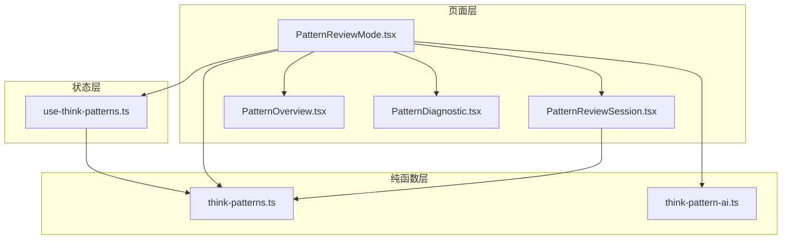
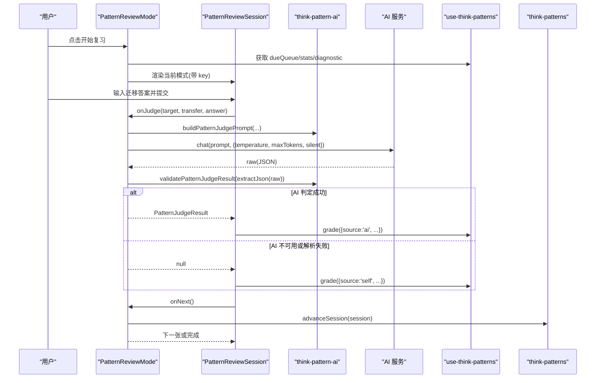
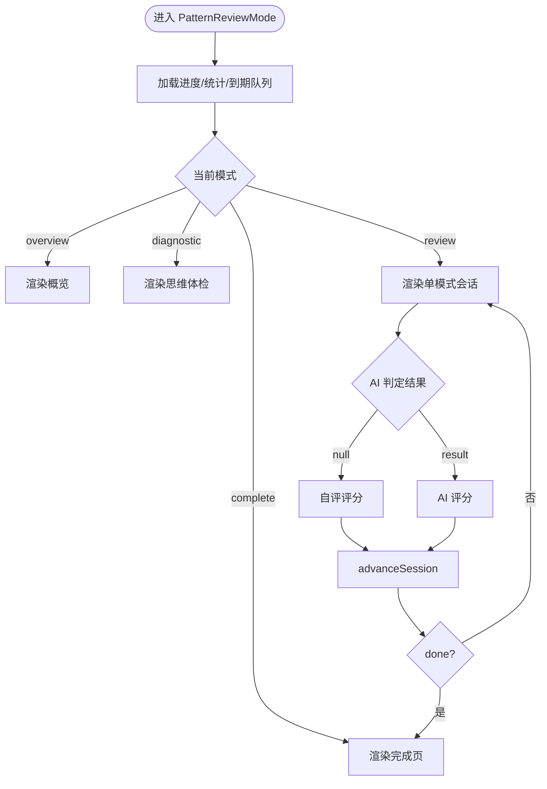
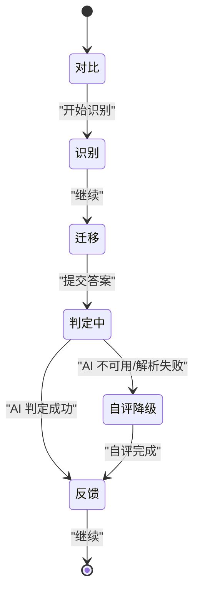
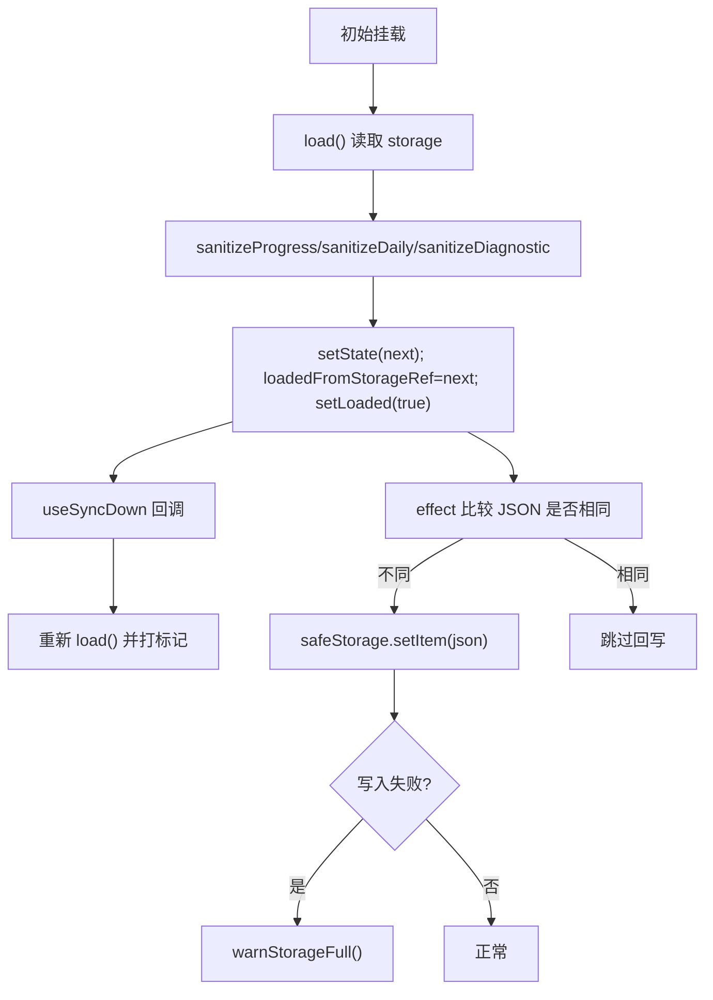
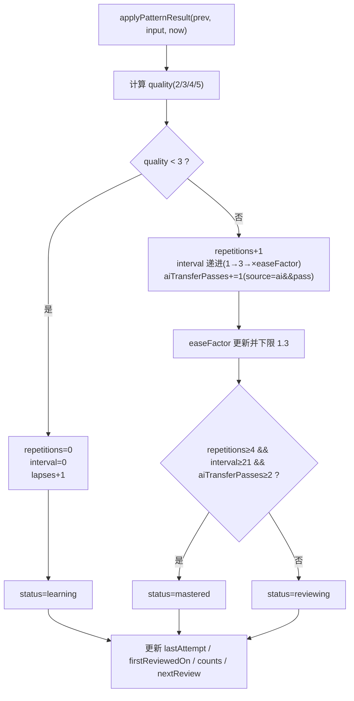
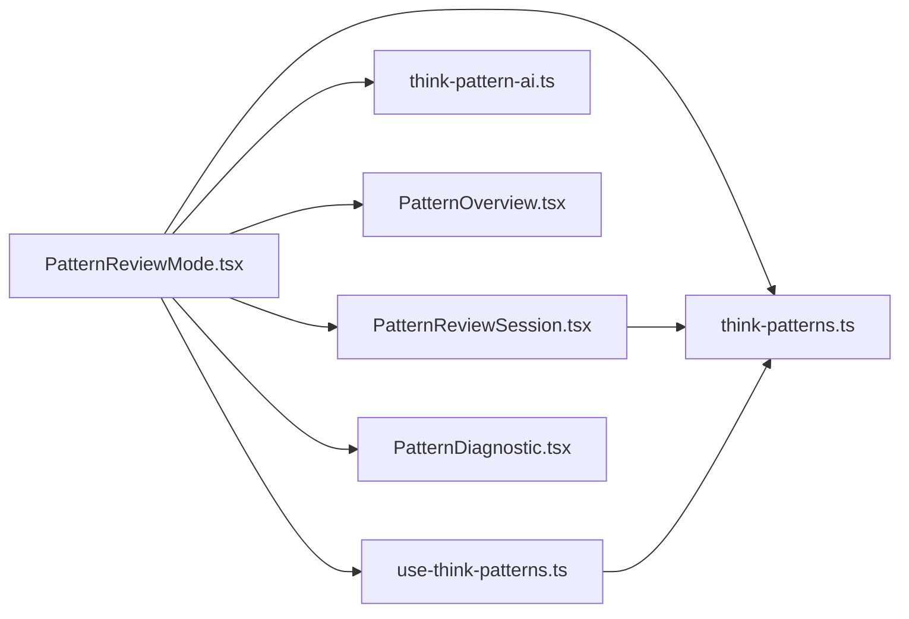

# 模式复习模式实现

<cite>
**本文引用的文件**   
- [PatternReviewMode.tsx](file://src/pages/ThinkInEnglishPage/PatternReviewMode.tsx)
- [PatternReviewSession.tsx](file://src/pages/ThinkInEnglishPage/PatternReviewSession.tsx)
- [PatternOverview.tsx](file://src/pages/ThinkInEnglishPage/PatternOverview.tsx)
- [PatternDiagnostic.tsx](file://src/pages/ThinkInEnglishPage/PatternDiagnostic.tsx)
- [use-think-patterns.ts](file://src/lib/use-think-patterns.ts)
- [think-patterns.ts](file://src/lib/think-patterns.ts)
- [think-pattern-ai.ts](file://src/lib/think-pattern-ai.ts)
- [ThinkInEnglishPage.tsx](file://src/pages/ThinkInEnglishPage/ThinkInEnglishPage.tsx)
</cite>

## 目录
1. [引言](#引言)
2. [项目结构](#项目结构)
3. [核心组件](#核心组件)
4. [架构总览](#架构总览)
5. [详细组件分析](#详细组件分析)
6. [依赖关系分析](#依赖关系分析)
7. [性能与复杂度](#性能与复杂度)
8. [故障排查](#故障排查)
9. [结论](#结论)

## 引言
本文件为 NativeThink 模式复习模式的实现文档，聚焦 PatternReviewMode 及其相关组件、状态钩子与纯函数调度层。内容覆盖：
- 薄弱模式识别算法
- 复习题目的智能选择与会话编排
- SM-2 间隔重复策略与遗忘曲线模拟
- 用户界面流程：对比 → 识别 → 迁移 → 反馈
- AI 判定与自评降级机制
- use-think-patterns.ts 中复习状态管理、历史清洗、今日去重与存储可靠性
- 思维体检、复习效果评估与个性化复习计划生成

## 项目结构
模式复习功能位于 ThinkInEnglishPage 模块内，分为三层：
- 页面层：PatternReviewMode（顶层状态机）、PatternReviewSession（单模式会话）、PatternOverview（概览与焦点卡）、PatternDiagnostic（思维体检）
- 状态层：use-think-patterns.ts（进度 store、每日记录、云同步回声抑制）
- 纯函数层：think-patterns.ts（SM-2、队列、薄弱排序、会话编排）、think-pattern-ai.ts（AI 判定 prompt 与结果校验）

**图示来源**
- [PatternReviewMode.tsx:1-200](file://src/pages/ThinkInEnglishPage/PatternReviewMode.tsx#L1-L200)
- [PatternReviewSession.tsx:1-200](file://src/pages/ThinkInEnglishPage/PatternReviewSession.tsx#L1-L200)
- [PatternOverview.tsx:1-200](file://src/pages/ThinkInEnglishPage/PatternOverview.tsx#L1-L200)
- [PatternDiagnostic.tsx:1-200](file://src/pages/ThinkInEnglishPage/PatternDiagnostic.tsx#L1-L200)
- [use-think-patterns.ts:1-200](file://src/lib/use-think-patterns.ts#L1-L200)
- [think-patterns.ts:1-200](file://src/lib/think-patterns.ts#L1-L200)
- [think-pattern-ai.ts:1-66](file://src/lib/think-pattern-ai.ts#L1-L66)

**章节来源**
- [PatternReviewMode.tsx:1-200](file://src/pages/ThinkInEnglishPage/PatternReviewMode.tsx#L1-L200)
- [use-think-patterns.ts:1-200](file://src/lib/use-think-patterns.ts#L1-L200)
- [think-patterns.ts:1-200](file://src/lib/think-patterns.ts#L1-L200)

## 核心组件
- PatternReviewMode：复习顶层状态机，负责概览 ↔ 体检 ↔ 复习 ↔ 完成页切换；维护本轮会话队列、下标、重试次数与模式结果；协调 AI 判定与自评降级。
- PatternReviewSession：单模式四阶段 UI（对比、识别、迁移、反馈），处理闭卷/开卷、延迟探测、AI 判定序列号防抖、自评二选一防重复记分。
- PatternOverview：展示今日行动、模式地图、建议先练 Top 3、全部模式库；由 props 驱动，不直接写盘。
- PatternDiagnostic：12 题跨模式识别体检，输出四层概况与建议模式 ID 列表。
- use-think-patterns：唯一权威进度 store，负责读取、清洗、更新、落盘、云同步回声抑制、今日去重与统计计算。
- think-patterns：纯函数库，实现 SM-2、队列构建、薄弱模式排序、会话编排、体检计分、延迟探测等。
- think-pattern-ai：构造“是否使用目标思维模式”的判定 prompt，并校验返回 JSON。

**章节来源**
- [PatternReviewMode.tsx:1-200](file://src/pages/ThinkInEnglishPage/PatternReviewMode.tsx#L1-L200)
- [PatternReviewSession.tsx:1-200](file://src/pages/ThinkInEnglishPage/PatternReviewSession.tsx#L1-L200)
- [PatternOverview.tsx:1-200](file://src/pages/ThinkInEnglishPage/PatternOverview.tsx#L1-L200)
- [PatternDiagnostic.tsx:1-200](file://src/pages/ThinkInEnglishPage/PatternDiagnostic.tsx#L1-L200)
- [use-think-patterns.ts:1-200](file://src/lib/use-think-patterns.ts#L1-L200)
- [think-patterns.ts:1-200](file://src/lib/think-patterns.ts#L1-L200)
- [think-pattern-ai.ts:1-66](file://src/lib/think-pattern-ai.ts#L1-L66)

## 架构总览
复习模式采用“UI 状态机 + 纯函数调度 + 状态 hook”的分层设计：
- UI 层只关心阶段与交互；
- 纯函数层保证可测试性与不变性；
- hook 层统一读写 storage、cloud sync、today 去重与统计。

**图示来源**
- [PatternReviewMode.tsx:60-170](file://src/pages/ThinkInEnglishPage/PatternReviewMode.tsx#L60-L170)
- [PatternReviewSession.tsx:120-260](file://src/pages/ThinkInEnglishPage/PatternReviewSession.tsx#L120-L260)
- [think-pattern-ai.ts:1-66](file://src/lib/think-pattern-ai.ts#L1-L66)
- [use-think-patterns.ts:220-291](file://src/lib/use-think-patterns.ts#L220-L291)
- [think-patterns.ts:350-507](file://src/lib/think-patterns.ts#L350-L507)

## 详细组件分析

### PatternReviewMode：复习顶层状态机
职责：
- 从 useThinkPatterns 取进度、统计、到期队列、诊断；
- 维护本轮会话队列、当前下标、重试次数与每个模式的结果；
- 将 PatternOverview 与 PatternReviewSession 接起来；
- 调用 AI 判定，超时/失败/空串/坏 JSON 均回落自评；
- 按不同模式计数完成页统计。

关键约定：
- 换卡必须用 pattern.id-index 组成的 key 重挂载，避免旧会话状态污染；
- loaded=false 时不渲染统计与模式卡，避免首屏闪 0；
- creditOnce 在请求前记账，AI 失败不撤销；
- AI 判定带 silent=true，练习界面不弹全局错误 toast；
- 最长等 15 秒，超时按不可用处理。

**图示来源**
- [PatternReviewMode.tsx:1-200](file://src/pages/ThinkInEnglishPage/PatternReviewMode.tsx#L1-L200)

**章节来源**
- [PatternReviewMode.tsx:1-200](file://src/pages/ThinkInEnglishPage/PatternReviewMode.tsx#L1-L200)

### PatternReviewSession：单模式四阶段会话
阶段：
- 对比：展示中文思路与母语者说法差异及 cues；
- 识别：根据累计识别次数确定题目，显示选项与解释；
- 迁移：提交英文表达，触发 AI 判定或自评；
- 反馈：展示通过/未通过、来源（AI/self）、证据短语与继续按钮。

重点逻辑：
- 挂载时快照识别/迁移题目索引，避免评分后 progress 变化导致题目跳变；
- closedBook 与 delayedProbeDay：第 3 次及以后复习闭卷；首次练习后 ≥7/21/60 天延迟探测；
- judgeSeqRef 异步判定序号防抖，卸载/退出丢弃旧 Promise；
- finishedRef 与 nextRef 防止连点导致重复评分或跳过下一张卡；
- fallback 路径：AI 不可用时展示参考表达与两个自评按钮。

**图示来源**
- [PatternReviewSession.tsx:1-200](file://src/pages/ThinkInEnglishPage/PatternReviewSession.tsx#L1-L200)
- [PatternReviewSession.tsx:201-531](file://src/pages/ThinkInEnglishPage/PatternReviewSession.tsx#L201-L531)

**章节来源**
- [PatternReviewSession.tsx:1-200](file://src/pages/ThinkInEnglishPage/PatternReviewSession.tsx#L1-L200)
- [PatternReviewSession.tsx:201-531](file://src/pages/ThinkInEnglishPage/PatternReviewSession.tsx#L201-L531)

### PatternOverview：概览与焦点卡
职责：
- 展示今日先练的单个模式卡片（体检建议 → 薄弱 → 到期）；
- 提供思维体检入口、模式地图开关、全部模式库展开；
- 基于 summarizeLayers 展示四层掌握率与到期数；
- 完成页按不同模式统计 passed/failed，显示下次到期时间。

关键行为：
- hero 优先来自 diagnostic.recommendedPatternIds，否则来自 weak 或 dueQueue；
- focusPatterns 去重保留最多 3 个；
- mode=complete 时显示下一次最早到期模式或“全部已掌握”。

**章节来源**
- [PatternOverview.tsx:1-200](file://src/pages/ThinkInEnglishPage/PatternOverview.tsx#L1-L200)
- [PatternOverview.tsx:201-367](file://src/pages/ThinkInEnglishPage/PatternOverview.tsx#L201-L367)

### PatternDiagnostic：思维体检
职责：
- 12 道跨模式识别题，答题过程不显示对错；
- 最后一题完成后输出四层概况与建议模式；
- 建议模式用于构建“建议先练”队列，过滤已掌握与今天已通过的模式。

数据流：
- 组装 questions（pattern+choice）→ 收集 answers → scoreDiagnostic → 保存诊断记录 → 渲染结果 → 开始复习。

**章节来源**
- [PatternDiagnostic.tsx:1-200](file://src/pages/ThinkInEnglishPage/PatternDiagnostic.tsx#L1-L200)
- [PatternDiagnostic.tsx:201-285](file://src/pages/ThinkInEnglishPage/PatternDiagnostic.tsx#L201-L285)

### use-think-patterns.ts：复习状态管理
职责：
- 唯一权威源：progress、daily、diagnostic；
- 读盘边界清洗：progress/daily/diagnostic 三项严格校验；
- updater 保持纯：setState 只算新状态，落盘在 effect；
- 回声抑制：loadedFromStorageRef 标记 hydration 与云同步下行后的 state，避免回写；
- safeStorage.setItem 失败时 warnStorageFull；
- grade 纯更新器：applyPatternResult + pruneDaily + daily 去重；
- dueQueue/stats 由 useMemo 计算；
- saveDiagnostic 仅保存汇总与建议，不存逐题答案。

存储形状：
- IThinkPatternState.progress：patternId → IThinkPatternProgress；
- IThinkPatternState.daily：YYYY-MM-DD → patternId[]；
- IThinkPatternState.diagnostic：最近一次体检汇总与建议。

**图示来源**
- [use-think-patterns.ts:1-200](file://src/lib/use-think-patterns.ts#L1-L200)
- [use-think-patterns.ts:201-291](file://src/lib/use-think-patterns.ts#L201-L291)

**章节来源**
- [use-think-patterns.ts:1-200](file://src/lib/use-think-patterns.ts#L1-L200)
- [use-think-patterns.ts:201-291](file://src/lib/use-think-patterns.ts#L201-L291)

### think-patterns.ts：纯函数调度层
包含以下核心能力：
- SM-2 间隔重复：applyPatternResult 依据 quality 调整 easeFactor、interval、repetitions、lapses、aiTransferPasses，status 在 learning/reviewing/mastered 之间转换；mastered 需要 repetitions≥4、interval≥21、aiTransferPasses≥2。
- 到期判断：isDue 要求 status≠mastered、nextReview≤now、且非“今天已通过”。
- 题目轮换：pickRecognitionIndex/pickTransferIndex 使用累计次数取模，确定性轮换。
- 闭卷与延迟探测：isClosedBook 第 3 次起闭卷；delayedProbeDay 在首次练习后 ≥7/21/60 天标注延迟迁移。
- 体检计分：scoreDiagnostic 按层统计 correct/total，输出 missedPatternIds 与 recommendedPatternIds。
- 队列构建：buildReviewQueue 合并 due（按 nextReview 升序）与 fresh（今日新引入，受 maxNewPerDay 限制），最终截断至 maxPatterns。
- 会话编排：createPatternSession/applySessionResult/advanceSession/sessionCounts 管理队列、重试与完成计数。
- 薄弱模式：getWeakPatterns 按 lapses 降序 → 迁移失败率降序 → nextReview 升序取前 N。
- 每日裁剪：pruneDaily 保留 [today-(days-1), today] 范围并按日期升序。

**图示来源**
- [think-patterns.ts:1-200](file://src/lib/think-patterns.ts#L1-L200)
- [think-patterns.ts:201-507](file://src/lib/think-patterns.ts#L201-L507)

**章节来源**
- [think-patterns.ts:1-200](file://src/lib/think-patterns.ts#L1-L200)
- [think-patterns.ts:201-507](file://src/lib/think-patterns.ts#L201-L507)

### think-pattern-ai.ts：AI 判定辅助
职责：
- buildPatternJudgePrompt：根据目标模式、场景、用户答案构造系统提示与用户消息；
- validatePatternJudgeResult：校验 pass/feedback/evidence 字段，容错字符串布尔值，trim 文本。

注意：
- 该模块仅做 prompt 拼接与结果校验，不执行 JSON 解析；
- 组件层先判空串，再 extractJson，最后 validatePatternJudgeResult。

**章节来源**
- [think-pattern-ai.ts:1-66](file://src/lib/think-pattern-ai.ts#L1-L66)

## 依赖关系分析
- PatternReviewMode 依赖：
  - useThinkPatterns：进度、统计、到期队列、诊断、grade/saveDiagnostic；
  - think-patterns：会话创建/推进/结果应用、薄弱模式、会话计数；
  - think-pattern-ai：判定 prompt 构建与结果校验；
  - 页面子组件：PatternOverview、PatternReviewSession、PatternDiagnostic。
- PatternReviewSession 依赖：
  - think-patterns：pickRecognitionIndex/pickTransferIndex/isClosedBook/delayedProbeDay；
  - think-pattern-ai：类型定义 PatternJudgeResult。
- use-think-patterns 依赖：
  - think-patterns：applyPatternResult/buildReviewQueue/isDue/pruneDaily/scoreDiagnostic；
  - data/think-patterns：THINK_PATTERNS/THINK_PATTERN_LAYERS；
  - storage/sync-down/utils：safeStorage/useSyncDown/formatDate/warnStorageFull。

**图示来源**
- [PatternReviewMode.tsx:1-200](file://src/pages/ThinkInEnglishPage/PatternReviewMode.tsx#L1-L200)
- [PatternReviewSession.tsx:1-200](file://src/pages/ThinkInEnglishPage/PatternReviewSession.tsx#L1-L200)
- [use-think-patterns.ts:1-200](file://src/lib/use-think-patterns.ts#L1-L200)
- [think-patterns.ts:1-200](file://src/lib/think-patterns.ts#L1-L200)
- [think-pattern-ai.ts:1-66](file://src/lib/think-pattern-ai.ts#L1-L66)

**章节来源**
- [PatternReviewMode.tsx:1-200](file://src/pages/ThinkInEnglishPage/PatternReviewMode.tsx#L1-L200)
- [PatternReviewSession.tsx:1-200](file://src/pages/ThinkInEnglishPage/PatternReviewSession.tsx#L1-L200)
- [use-think-patterns.ts:1-200](file://src/lib/use-think-patterns.ts#L1-L200)
- [think-patterns.ts:1-200](file://src/lib/think-patterns.ts#L1-L200)
- [think-pattern-ai.ts:1-66](file://src/lib/think-pattern-ai.ts#L1-L66)

## 性能与复杂度
- 弱模式排序：O(n log n)，n 为模式数量（默认 12），排序键为 lapses、failureRate、nextReview；
- 队列构建：due 排序 O(m log m)，m 为到期模式数；fresh 截取 O(k)；合并截断 O(maxPatterns)；
- 会话推进：advanceSession 为 O(1)；applySessionResult 中 dropQueuedRetries 可能遍历队列，但队列长度有限；
- 每日裁剪 pruneDaily：O(d) 日期项过滤与排序；
- SM-2 评分 applyPatternResult：O(1)；
- 界面渲染：概览层仅 props 驱动，无额外状态；会话层仅在 stage 切换与异步判定态变化时更新。

[本节为通用性能讨论，无需具体文件分析]

## 故障排查
常见问题与定位要点：
- 进度刷新后丢失：检查 safeStorage.setItem 是否返回 false；use-think-patterns 会调用 warnStorageFull，需查看浏览器存储配额或隐私模式限制；
- 云同步覆盖本地进度：确认 loadedFromStorageRef 是否正确标记 hydration 与 useSyncDown 重读；避免在 effect 外直接写 storage；
- 体检结果异常：sanitizeDiagnostic 对 layers/recommendedPatternIds 有强校验，损坏数据会被丢弃；检查存储中的 completedOn/correct/total/layers 字段类型；
- AI 判定永远失败：确认 isConfigured 为真、prompt 构造正确、JSON 解析成功、validatePatternJudgeResult 返回有效对象；若为空串或超时，会自动回落自评；
- 会话状态污染：确保 PatternReviewMode 用 `${pattern.id}-${session.index}` 作为 key 重挂载；避免复用上一个会话的选择/答案；
- 重复评分：finishedRef/nextRef/judgeSeqRef 分别防止自评按钮连点、“继续”双击与异步判定旧 Promise 回填；
- 今日计数虚高：ensure daily[today] 去重，pruneDaily 只保留 [today-(days-1), today] 区间；
- 完成页计数异常：results 以 patternId 为键，重试通过后覆盖为 pass，sessionCounts 按不同模式计数，不会重复计数同一模式。

**章节来源**
- [use-think-patterns.ts:1-200](file://src/lib/use-think-patterns.ts#L1-L200)
- [use-think-patterns.ts:201-291](file://src/lib/use-think-patterns.ts#L201-L291)
- [PatternReviewSession.tsx:120-260](file://src/pages/ThinkInEnglishPage/PatternReviewSession.tsx#L120-L260)
- [PatternReviewMode.tsx:60-170](file://src/pages/ThinkInEnglishPage/PatternReviewMode.tsx#L60-L170)

## 结论
NativeThink 模式复习模式通过清晰的分层架构实现了稳健的间隔重复与个性化复习体验：
- 纯函数层保证 SM-2、队列与薄弱排序的可测试性与一致性；
- 状态层统一处理存储、云同步与今日去重，并提供安全的降级与警告；
- UI 层聚焦用户体验，提供对比→识别→迁移→反馈的完整流程，并在 AI 不可用时平滑降级到自评；
- 思维体检为复习计划提供个性化起点，结合薄弱模式与到期队列形成“建议先练”的焦点路径。

这套实现既适合初学者快速上手，也为进阶用户提供可观测、可调试、可扩展的复习引擎。

[本节为总结性内容，无需具体文件分析]