# 模式总览仪表盘

<cite>
**本文引用的文件**
- [PatternOverview.tsx](file://src/pages/ThinkInEnglishPage/PatternOverview.tsx)
- [use-think-patterns.ts](file://src/lib/use-think-patterns.ts)
- [think-patterns.ts](file://src/lib/think-patterns.ts)
- [think-patterns.ts（数据定义）](file://src/data/think-patterns.ts)
- [think-pattern-ai.ts](file://src/lib/think-pattern-ai.ts)
</cite>

## 目录
1. [引言](#引言)
2. [项目结构定位](#项目结构定位)
3. [核心组件：PatternOverview](#核心组件patternoverview)
4. [架构总览](#架构总览)
5. [详细组件分析](#详细组件分析)
6. [依赖关系分析](#依赖关系分析)
7. [性能与可维护性](#性能与可维护性)
8. [故障排查指南](#故障排查指南)
9. [结论](#结论)

## 引言
本篇文档聚焦 NativeThink 模式的“模式总览仪表盘”，也就是 `PatternOverview` 组件及其相关的数据、算法与视觉实现。它负责在“思维复习”入口中，向用户展示 12 种思维模式的学习状态、掌握度进度条、四层模式地图、今日优先练习项、薄弱模式建议以及快速导航入口。其数据来源并非直接读写存储，而是由父级 Hook `useThinkPatterns` 聚合后以 props 传入；计算逻辑则集中在纯函数模块 `think-patterns.ts`，包括 SM-2 排期、到期判断、薄弱模式排序、模式地图汇总与会话队列等。

## 项目结构定位
该仪表盘属于 ThinkInEnglish 模块的前端页面层，位于 `src/pages/ThinkInEnglishPage`；它与数据模型、调度算法和持久化 Hook 分属不同层次，职责清晰：

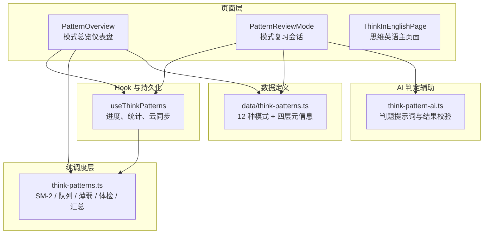

**图表来源**
- [PatternOverview.tsx:1-30](file://src/pages/ThinkInEnglishPage/PatternOverview.tsx#L1-L30)
- [use-think-patterns.ts:1-40](file://src/lib/use-think-patterns.ts#L1-L40)
- [think-patterns.ts:1-35](file://src/lib/think-patterns.ts#L1-L35)
- [think-patterns.ts（数据定义）:1-25](file://src/data/think-patterns.ts#L1-L25)
- [think-pattern-ai.ts:1-20](file://src/lib/think-pattern-ai.ts#L1-L20)

**章节来源**
- [PatternOverview.tsx:1-30](file://src/pages/ThinkInEnglishPage/PatternOverview.tsx#L1-L30)
- [use-think-patterns.ts:1-40](file://src/lib/use-think-patterns.ts#L1-L40)
- [think-patterns.ts:1-35](file://src/lib/think-patterns.ts#L1-L35)
- [think-patterns.ts（数据定义）:1-25](file://src/data/think-patterns.ts#L1-L25)
- [think-pattern-ai.ts:1-20](file://src/lib/think-pattern-ai.ts#L1-L20)

## 核心组件：PatternOverview
`PatternOverview` 是模式复习的概览入口，不是进度写入点。它的职责可以概括为：

| 职责 | 说明 |
|---|---|
| 展示今日优先练习项 | 从“体检建议 → 薄弱 → 到期”中选出最多 3 个模式，并把第一个作为主按钮。 |
| 展示 12 种思维模式 | 按四层折叠展开，显示名称、一句话描述、掌握状态标签、下次到期时间。 |
| 展示四层模式地图 | 用进度条显示每层的已掌握数量、总数和到期数量。 |
| 提供快速导航 | 思维体检入口、模式地图开关、全部模式库开关。 |
| 渲染本轮完成页 | 当 `mode === 'complete'` 时，显示本轮通过数、失败数和下次到期时间。 |
| 不写存储 | 所有数据来自 props，点击模式卡只展开详情，不改变进度。 |

### 关键属性接口
`PatternOverviewProps` 定义了仪表盘所需的全部输入：

| 字段 | 类型 | 含义 |
|---|---|---|
| `stats` | `IThinkPatternStats` | 追踪数、已掌握数、到期数、今日已练数。 |
| `weak` | `PatternWeakItem[]` | 薄弱模式列表，用于构建推荐队列。 |
| `dueQueue` | `string[]` | 本轮复习队列，即到期模式与新引入模式的合并结果。 |
| `progress` | `Record<string, IThinkPatternProgress>` | 各模式的进度记录。 |
| `mode` | `'overview' \| 'review' \| 'complete'` | 当前视图模式。 |
| `passed` | `number` | 本轮通过的不同模式数。 |
| `failed` | `number` | 本轮失败的不同模式数。 |
| `diagnostic` | `IThinkPatternDiagnosticRecord \| null` | 最近一次思维体检结果。 |
| `onStart` | `(firstPatternId?: string) => void` | 开始复习入口。 |
| `onDiagnostic` | `() => void` | 打开思维体检。 |
| `onBack` | `() => void` | 返回上一级。 |

**章节来源**
- [PatternOverview.tsx:18-35](file://src/pages/ThinkInEnglishPage/PatternOverview.tsx#L18-L35)

## 架构总览
PatternOverview 的渲染流程并不直接读存储，而是把“数据准备”交给 `useThinkPatterns`，把“模式元数据”交给 `data/think-patterns.ts`，把“业务算法”交给 `lib/think-patterns.ts`。

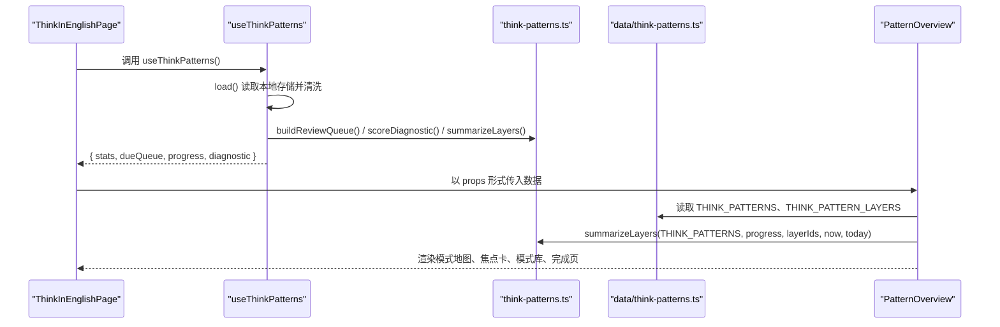

**图表来源**
- [use-think-patterns.ts:160-291](file://src/lib/use-think-patterns.ts#L160-L291)
- [think-patterns.ts:240-507](file://src/lib/think-patterns.ts#L240-L507)
- [PatternOverview.tsx:201-367](file://src/pages/ThinkInEnglishPage/PatternOverview.tsx#L201-L367)
- [think-patterns.ts（数据定义）:1-25](file://src/data/think-patterns.ts#L1-L25)

**章节来源**
- [PatternOverview.tsx:1-30](file://src/pages/ThinkInEnglishPage/PatternOverview.tsx#L1-L30)
- [use-think-patterns.ts:160-291](file://src/lib/use-think-patterns.ts#L160-L291)
- [think-patterns.ts:240-507](file://src/lib/think-patterns.ts#L240-L507)

## 详细组件分析

### 12 种思维模式的可视化展示
12 种思维模式定义在 `data/think-patterns.ts`，分为四个层级：

| 层级 ID | 中文名称 | 设计目标 |
|---|---|---|
| `structure` | 信息结构 | 谁在前、什么在后、指代是否补全。 |
| `verb` | 动词与焦点 | 动作由谁承担、结果怎么落在句子里。 |
| `clarity` | 逻辑与信息 | 关系是否明说、断言力度、细节是否足够。 |
| `pragmatics` | 语域与语用 | 正式度、面子、请求拒绝赞美的默认脚本。 |

每个模式包含：

| 字段 | 含义 |
|---|---|
| `id` | 模式唯一标识，如 `subject-first`、`end-focus`、`soften-disagreement`、`be-concrete` 等。 |
| `layer` | 所属层级。 |
| `name` | 面向用户的中文标题。 |
| `oneLiner` | 一句话总结该模式的英文思维原则。 |
| `contrast.chineseThinking` | 中文思路示例。 |
| `contrast.native` | 母语者说法示例。 |
| `contrast.note` | 中英思维差异说明。 |
| `cues` | 识别该模式时可用的线索提示。 |
| `recognition` | 选择题训练项。 |
| `transfer` | 迁移场景，含 AI 判定重点、思考步骤、参考表达。 |

在 `PatternOverview` 中，12 个模式被按层分组渲染，每个模式卡片显示：

- 模式名称与一句话描述。
- 掌握状态标签：“未开始”“学习中”“复习中”“已掌握”。
- 下次到期时间。
- 展开后可见中文思路、母语者说法、差异说明和线索列表。

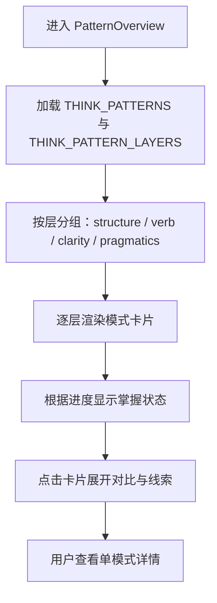

**图表来源**
- [think-patterns.ts（数据定义）:1-25](file://src/data/think-patterns.ts#L1-L25)
- [PatternOverview.tsx:260-367](file://src/pages/ThinkInEnglishPage/PatternOverview.tsx#L260-L367)

**章节来源**
- [think-patterns.ts（数据定义）:1-25](file://src/data/think-patterns.ts#L1-L25)
- [PatternOverview.tsx:100-190](file://src/pages/ThinkInEnglishPage/PatternOverview.tsx#L100-L190)
- [PatternOverview.tsx:260-367](file://src/pages/ThinkInEnglishPage/PatternOverview.tsx#L260-L367)

### 掌握度指示器与颜色编码系统
掌握度在三个层面体现：

1. **模式卡片的状态标签**  
   状态标签由 `statusLabel` 生成，映射为“未开始”“学习中”“复习中”“已掌握”。

2. **状态边框与文字色调**  
   `statusTone` 根据进度状态返回不同的边框和文本样式类：
   - 无进度：中性边框与模糊文本。
   - 已掌握：绿色系。
   - 复习中：品牌色或青绿色调。
   - 学习中：琥珀色系。

3. **四层模式地图进度条**  
   模式地图使用水平进度条，宽度由该层已掌握模式数除以该层模式总数得出。进度条背景使用中性底色，填充色使用品牌变量。

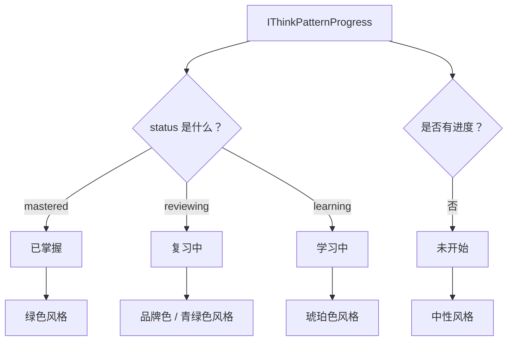

**图表来源**
- [PatternOverview.tsx:37-58](file://src/pages/ThinkInEnglishPage/PatternOverview.tsx#L37-L58)
- [think-patterns.ts:30-50](file://src/lib/think-patterns.ts#L30-L50)

**章节来源**
- [PatternOverview.tsx:37-58](file://src/pages/ThinkInEnglishPage/PatternOverview.tsx#L37-L58)
- [PatternOverview.tsx:201-230](file://src/pages/ThinkInEnglishPage/PatternOverview.tsx#L201-L230)
- [think-patterns.ts:30-50](file://src/lib/think-patterns.ts#L30-L50)

### 快速导航入口
仪表盘提供三类快速入口：

| 入口 | 行为 |
|---|---|
| 今日先练主按钮 | 打开模式复习会话，优先选择“体检建议 → 薄弱 → 到期”中的第一个模式。 |
| 思维体检 | 跳转到诊断入口，若已有体检记录，显示上次正确数与总数。 |
| 模式地图 | 切换四层进度条面板。 |
| 全部模式 | 展开 12 个模式的完整列表。 |

“今日先练”的推荐顺序由以下规则决定：

1. 取体检推荐的模式，过滤掉已掌握模式。
2. 追加薄弱模式中的模式 ID。
3. 追加到期队列中的模式 ID。
4. 去重后取前 3 个。
5. 如果推荐为空，回退到前 3 个模式。

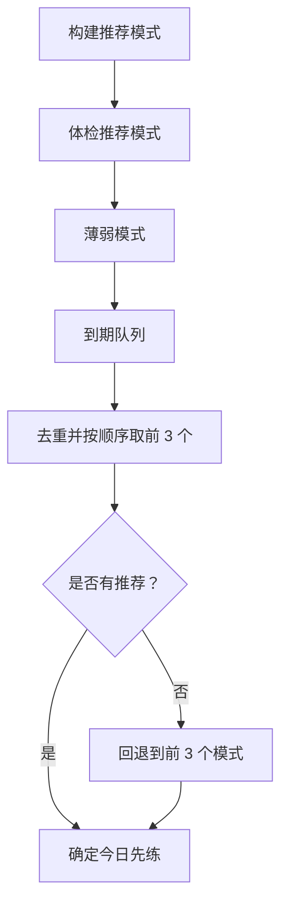

**图表来源**
- [PatternOverview.tsx:60-120](file://src/pages/ThinkInEnglishPage/PatternOverview.tsx#L60-L120)

**章节来源**
- [PatternOverview.tsx:60-120](file://src/pages/ThinkInEnglishPage/PatternOverview.tsx#L60-L120)
- [PatternOverview.tsx:230-310](file://src/pages/ThinkInEnglishPage/PatternOverview.tsx#L230-L310)

### 仪表盘数据聚合逻辑
仪表盘本身不聚合原始历史，而是消费 `useThinkPatterns` 暴露的聚合结果：

| 聚合项 | 计算位置 | 说明 |
|---|---|---|
| `stats.tracked` | `useThinkPatterns.stats` | 有进度的模式数量。 |
| `stats.mastered` | `useThinkPatterns.stats` | 状态为 `mastered` 的模式数量。 |
| `stats.due` | `useThinkPatterns.stats` | 满足 `isDue` 且未掌握的模式数量。 |
| `stats.reviewedToday` | `useThinkPatterns.stats` | 当天 `daily` 数组的长度。 |
| `dueQueue` | `useThinkPatterns.dueQueue` | 到期模式与新引入模式合并后的复习队列。 |
| `diagnostic` | `useThinkPatterns.diagnostic` | 最近一次思维体检记录。 |
| `progress` | `useThinkPatterns.progress` | 各模式的 SM-2 进度。 |

`useThinkPatterns` 的职责还包括：

- 从本地安全存储加载并清洗进度、每日记录、体检记录。
- 在状态变化后比较 JSON 字符串，避免云同步下行回声。
- 将评分结果写入进度和当日桶。
- 计算到期队列和统计指标。

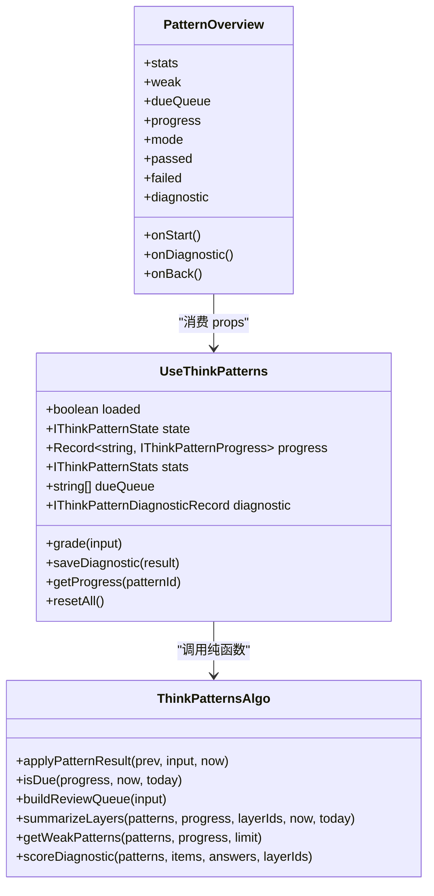

**图表来源**
- [use-think-patterns.ts:40-160](file://src/lib/use-think-patterns.ts#L40-L160)
- [use-think-patterns.ts:201-291](file://src/lib/use-think-patterns.ts#L201-L291)
- [think-patterns.ts:30-507](file://src/lib/think-patterns.ts#L30-L507)
- [PatternOverview.tsx:18-35](file://src/pages/ThinkInEnglishPage/PatternOverview.tsx#L18-L35)

**章节来源**
- [use-think-patterns.ts:40-160](file://src/lib/use-think-patterns.ts#L40-L160)
- [use-think-patterns.ts:201-291](file://src/lib/use-think-patterns.ts#L201-L291)
- [PatternOverview.tsx:18-35](file://src/pages/ThinkInEnglishPage/PatternOverview.tsx#L18-L35)

### 历史表现平均与掌握度评分算法
掌握度评分的核心是 `applyPatternResult`，它基于类似间隔重复的算法更新每个模式的进度。

#### 质量分级
质量值由识别是否正确和迁移是否通过共同决定：

| 条件 | 质量值 | 含义 |
|---|---:|---|
| 迁移失败 | 2 | 失败，立即重置间隔和重复次数。 |
| 迁移通过但自评 | 3 | 自评通过，但不计入掌握所需的 AI 通过次数。 |
| 识别错误但迁移通过 | 4 | 识别错但迁移过。 |
| 识别对且迁移通过 | 5 | 高质量通过。 |

#### 间隔与重复
- 失败时：`repetitions = 0`，`interval = 0`，`lapses += 1`。
- 第一次通过后：`interval = 1`。
- 第二次通过后：`interval = 3`。
- 第三次及以后：`interval = Math.round(Math.max(1, interval) * easeFactor)`。

#### 难度因子
`easeFactor` 初始值为 2.5，每次调整后最低不低于 1.3。

#### 掌握条件
模式要成为“已掌握”，必须同时满足：

| 条件 | 要求 |
|---|---|
| 重复次数 | ≥ 4 |
| 间隔 | ≥ 21 天 |
| AI 迁移通过次数 | ≥ 2 |

这意味着仅靠自评无法把模式刷成已掌握。

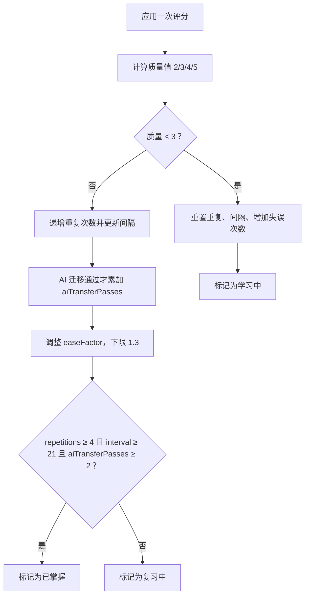

**图表来源**
- [think-patterns.ts:60-140](file://src/lib/think-patterns.ts#L60-L140)

**章节来源**
- [think-patterns.ts:60-140](file://src/lib/think-patterns.ts#L60-L140)

### 到期判断与会话队列
到期判断由 `isDue` 负责，核心规则是：

- 模式不是 `mastered`。
- `nextReview` 已经到达当前时间。
- 今天没有已通过该模式。

会话队列由 `buildReviewQueue` 生成，优先级是：

1. 到期模式，按 `nextReview` 升序排列。
2. 新引入模式，限制每天新增数量。
3. 合并后截断到最大模式数。

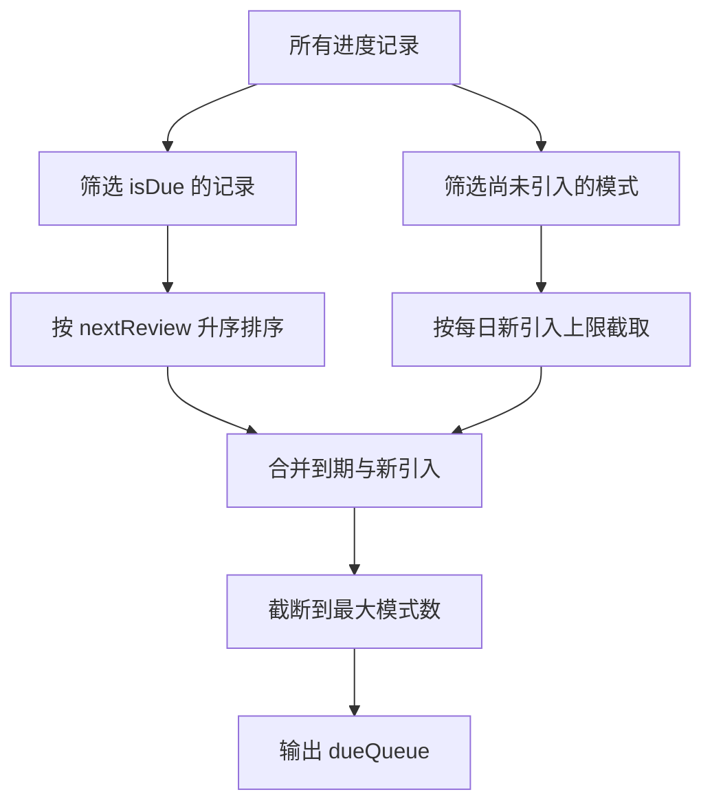

**图表来源**
- [think-patterns.ts:201-260](file://src/lib/think-patterns.ts#L201-L260)
- [think-patterns.ts:380-440](file://src/lib/think-patterns.ts#L380-L440)

**章节来源**
- [think-patterns.ts:201-260](file://src/lib/think-patterns.ts#L201-L260)
- [think-patterns.ts:380-440](file://src/lib/think-patterns.ts#L380-L440)

### 薄弱模式排序算法
薄弱模式由 `getWeakPatterns` 计算，排序规则是：

1. 失误次数 `lapses` 降序。
2. 迁移失败率降序。
3. 下次到期时间升序。

迁移失败率定义为：

| 情况 | 失败率 |
|---|---|
| 从未尝试迁移 | 0 |
| 有迁移尝试 | `(attempt - pass) / attempt` |

只有存在失误或迁移失败的记录才会进入薄弱列表；未开始的模式不参与。

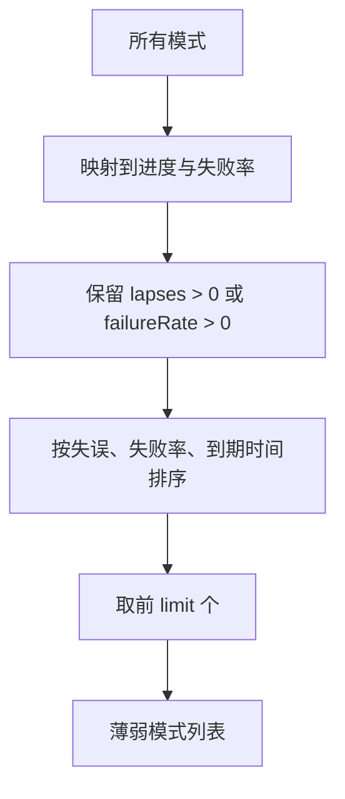

**图表来源**
- [think-patterns.ts:440-507](file://src/lib/think-patterns.ts#L440-L507)

**章节来源**
- [think-patterns.ts:440-507](file://src/lib/think-patterns.ts#L440-L507)

### 视觉反馈：进度条与完成页
#### 四层模式地图进度条
模式地图对每一层计算：

- `total`：该层模式总数。
- `mastered`：该层中状态为 `mastered` 的数量。
- `due`：该层中满足到期条件的数量。

进度条宽度为 `Math.round((mastered / total) * 100)%`。

#### 本轮完成页
完成页显示：

- 本轮涉及的不同模式数。
- 通过的不同模式数。
- 失败的不同模式数。
- 下一个到期时间，或由“全部模式都已掌握”替代。

完成页计数基于会话状态机，同一模式重试后不会重复计数。

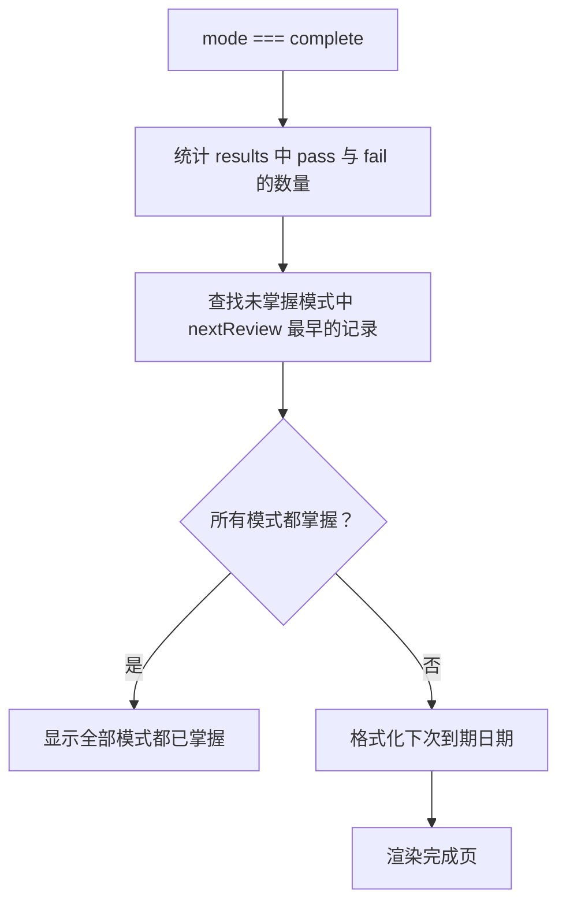

**图表来源**
- [PatternOverview.tsx:230-260](file://src/pages/ThinkInEnglishPage/PatternOverview.tsx#L230-L260)
- [think-patterns.ts:460-507](file://src/lib/think-patterns.ts#L460-L507)

**章节来源**
- [PatternOverview.tsx:201-260](file://src/pages/ThinkInEnglishPage/PatternOverview.tsx#L201-L260)
- [think-patterns.ts:460-507](file://src/lib/think-patterns.ts#L460-L507)

### 响应式布局与交互体验
PatternOverview 的布局特点如下：

| 特性 | 实现方式 |
|---|---|
| 移动端优先 | 卡片、按钮、标签均使用紧凑字号和圆角。 |
| 网格适配 | 模式库使用 `grid-cols-1 sm:grid-cols-2`，在小屏单列、大屏双列。 |
| 可折叠内容 | 模式卡片通过展开状态切换详情。 |
| 可折叠地图 | 模式地图通过布尔状态控制显示。 |
| 可折叠全部模式 | 全部模式列表通过布尔状态控制显示。 |
| 无障碍基础 | 使用 `aria-expanded`、`aria-hidden`、按钮语义。 |
| 日期处理 | 统一使用本地日期格式化，避免东八区凌晨错位。 |

动画方面，PatternOverview 本身主要依赖 CSS 过渡，例如箭头旋转、悬停高亮；更复杂的动画通常不在概览层处理，而是由复习会话层或其他 UI 组件承担。

**章节来源**
- [PatternOverview.tsx:120-200](file://src/pages/ThinkInEnglishPage/PatternOverview.tsx#L120-L200)
- [PatternOverview.tsx:300-367](file://src/pages/ThinkInEnglishPage/PatternOverview.tsx#L300-L367)

## 依赖关系分析

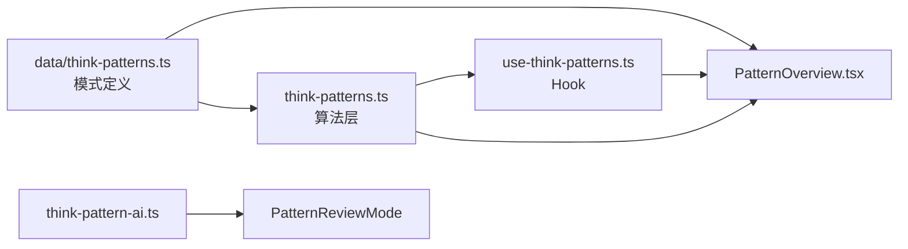

**图表来源**
- [think-patterns.ts（数据定义）:1-25](file://src/data/think-patterns.ts#L1-L25)
- [think-patterns.ts:1-507](file://src/lib/think-patterns.ts#L1-L507)
- [use-think-patterns.ts:1-291](file://src/lib/use-think-patterns.ts#L1-L291)
- [PatternOverview.tsx:1-367](file://src/pages/ThinkInEnglishPage/PatternOverview.tsx#L1-L367)
- [think-pattern-ai.ts:1-66](file://src/lib/think-pattern-ai.ts#L1-L66)

**章节来源**
- [think-patterns.ts（数据定义）:1-25](file://src/data/think-patterns.ts#L1-L25)
- [think-patterns.ts:1-507](file://src/lib/think-patterns.ts#L1-L507)
- [use-think-patterns.ts:1-291](file://src/lib/use-think-patterns.ts#L1-L291)
- [PatternOverview.tsx:1-367](file://src/pages/ThinkInEnglishPage/PatternOverview.tsx#L1-L367)
- [think-pattern-ai.ts:1-66](file://src/lib/think-pattern-ai.ts#L1-L66)

## 性能与可维护性
PatternOverview 的性能关键点在于：

1. **数据不重复计算**  
   `stats`、`dueQueue`、`diagnostic` 由 `useThinkPatterns` 用 `useMemo` 或稳定引用暴露，避免每次渲染重新扫描历史。

2. **模式地图汇总为只读纯函数**  
   `summarizeLayers` 不修改入参，也不访问外部存储，便于测试和复用。

3. **模式卡片展开状态局部管理**  
   每个模式卡片的展开状态由组件内 `expandedId` 控制，不影响全局状态。

4. **DOM 渲染可控**  
   模式地图和全部模式库默认收起，减少首屏渲染压力；用户主动展开后再渲染完整列表。

5. **纯函数与副作用分离**  
   进度更新、队列计算、薄弱排序都在纯函数层；组件只做渲染和事件转发。

潜在优化空间：

- 如果 12 个模式数据量继续增长，可为模式列表增加虚拟滚动或分页。
- 如果体检建议、薄弱模式和到期队列频繁变化，可在父层缓存推荐列表，避免每次渲染重新组合。
- 模式地图进度条若需更高精度，可增加小数位展示或工具提示。

[本节为通用性能讨论，不直接分析具体代码片段]

## 故障排查指南

| 现象 | 可能原因 | 排查建议 |
|---|---|---|
| 某个模式一直不到期 | 进度缺失关键字段，或被清洗丢弃 | 检查 `sanitizeProgress` 清洗规则，确认 `nextReview`、`firstReviewedOn`、`status` 等字段有效。 |
| 今日已练数为 0 | `daily` 键被未来日期污染或格式不符 | 检查 `pruneDaily` 是否保留了正确的日期范围。 |
| 刷新后进度丢失 | 本地存储写入失败，但未提示 | 检查 `safeStorage.setItem` 返回值，确认是否触发 `warnStorageFull`。 |
| 云同步后进度变空 | 本地空状态覆盖远端数据 | 检查 `loadedFromStorageRef` 是否阻止了回声写入。 |
| 模式地图数据异常 | 未知层或未知模式 ID | 检查体检记录清洗逻辑，确保 `layerId` 和 `recommendedPatternIds` 合法。 |
| 完成页数字重复 | 会话状态机中重试逻辑异常 | 检查 `applySessionResult`、`dropQueuedRetries`、`sessionCounts`。 |
| 模式卡片状态显示异常 | 状态标签或状态色调逻辑未匹配最新进度 | 检查 `statusLabel` 与 `statusTone`。 |

**章节来源**
- [use-think-patterns.ts:40-160](file://src/lib/use-think-patterns.ts#L40-L160)
- [use-think-patterns.ts:201-291](file://src/lib/use-think-patterns.ts#L201-L291)
- [think-patterns.ts:30-507](file://src/lib/think-patterns.ts#L30-L507)
- [PatternOverview.tsx:37-58](file://src/pages/ThinkInEnglishPage/PatternOverview.tsx#L37-L58)

## 结论
`PatternOverview` 是一个以数据驱动为主的概览仪表盘：它不负责存储，也不负责复杂业务计算，而是把 12 种思维模式、四层模式地图、今日优先练习项和完成页状态，建立在 `useThinkPatterns` 提供的权威状态之上。掌握度评分由 `applyPatternResult` 实现，强调 AI 迁移通过次数、间隔重复和失误累积；到期与会话队列由 `isDue`、`buildReviewQueue`、`applySessionResult` 等纯函数保证一致性；视觉层面则以简洁的卡片、状态标签、进度条和可折叠区域呈现。

对于后续扩展，建议保持“组件只渲染、Hook 管状态、纯函数算逻辑”的分层约定，避免在 `PatternOverview` 中引入新的存储或排期逻辑。这样既能维持仪表盘的轻量，又能让 SM-2 排期、薄弱模式排序、体检建议和会话状态机等核心机制保持稳定演进。