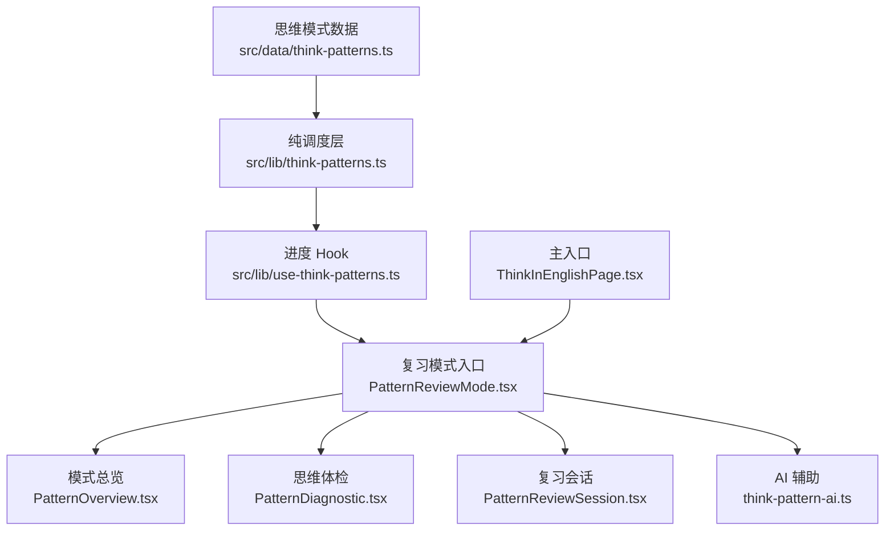
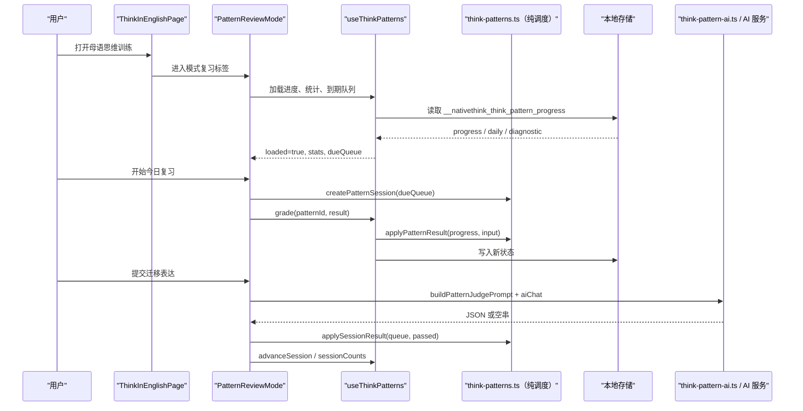
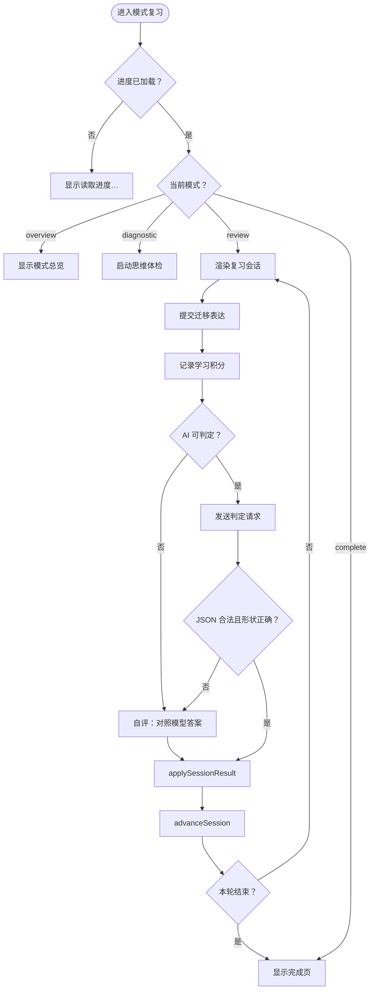
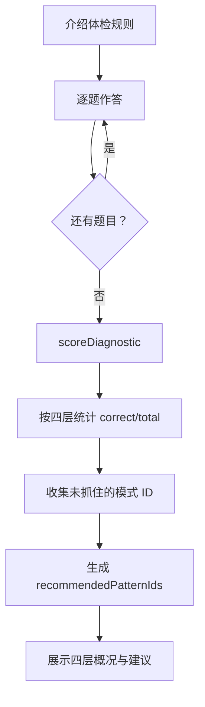
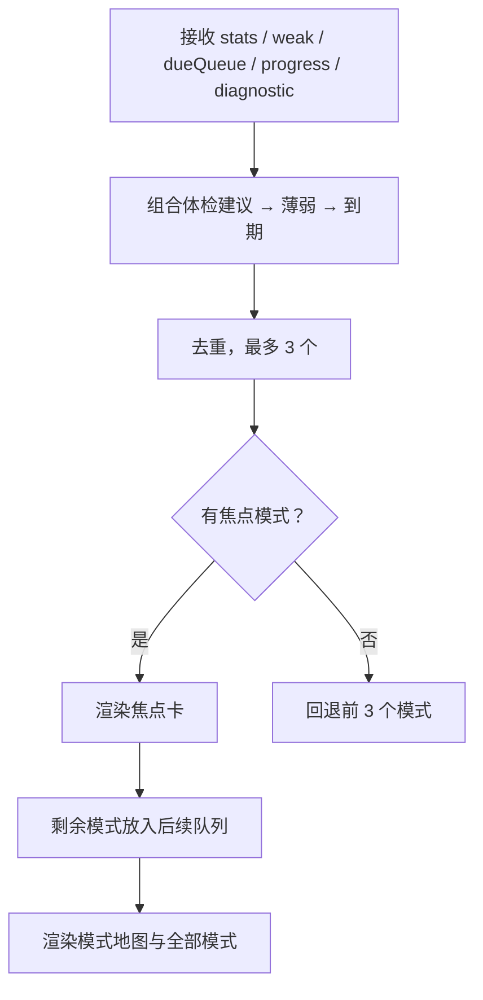
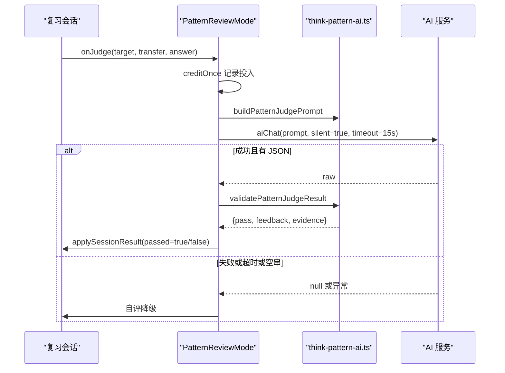
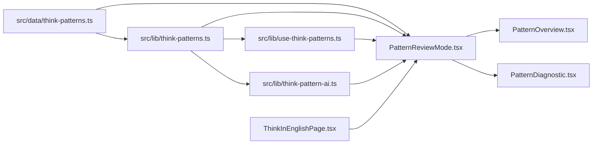

# 母语思维训练模块

<cite>
**本文引用的文件**
- [think-patterns.ts](file://src/data/think-patterns.ts)
- [use-think-patterns.ts](file://src/lib/use-think-patterns.ts)
- [think-patterns.ts（纯调度层）](file://src/lib/think-patterns.ts)
- [think-pattern-ai.ts](file://src/lib/think-pattern-ai.ts)
- [ThinkInEnglishPage.tsx](file://src/pages/ThinkInEnglishPage/ThinkInEnglishPage.tsx)
- [PatternReviewMode.tsx](file://src/pages/ThinkInEnglishPage/PatternReviewMode.tsx)
- [PatternOverview.tsx](file://src/pages/ThinkInEnglishPage/PatternOverview.tsx)
- [PatternDiagnostic.tsx](file://src/pages/ThinkInEnglishPage/PatternDiagnostic.tsx)
- [think-in-english.md](file://docs/modules/think-in-english.md)
</cite>

## 目录

1. [引言](#引言)
2. [项目结构](#项目结构)
3. [核心组件](#核心组件)
4. [架构总览](#架构总览)
5. [详细组件分析](#详细组件分析)
6. [依赖关系分析](#依赖关系分析)
7. [性能与容量特性](#性能与容量特性)
8. [故障排查指南](#故障排查指南)
9. [结论](#结论)

## 引言

NativeThink 母语思维训练模块围绕“12 种思维模式 × 四层维度”的体系，构建从模式体检、对比理解、识别练习到迁移表达和间隔复习的完整闭环。模块以 `ThinkInEnglishPage` 为入口，默认落到“模式复习”标签页；该标签页由 `PatternReviewMode` 管理概览、体检、复习会话与完成页四阶段状态，并由 `useThinkPatterns` 提供进度、统计与到期队列等唯一权威状态。

模块的核心目标是帮助学习者从“中文话题优先”的思维方式转向“主语先行、动词承担、逻辑显化、语域适配”的英语思维习惯：

| 层级 | 含义 | 代表问题 |
|---|---|---|
| 信息结构 | 谁在前、什么在后、指代是否补全 | “这个电影我看过” vs “I’ve seen this movie.” |
| 动词与焦点 | 动作由谁承担，还是被塞进名词短语 | “对问题进行整理” vs “sort through the problem” |
| 逻辑与信息 | 关系是否明说、断言力度、细节是否足够 | 因果、转折、程度是否显式表达 |
| 语域与语用 | 正式度、面子、请求拒绝赞美的默认脚本 | 对上级、朋友、陌生人说话方式不同 |

文档重点覆盖以下实现要点：

- 12 种思维模式的定义数据结构与四层分类。
- 模式体检的诊断算法与建议生成。
- 模式总览界面如何组合“体检建议 → 薄弱 → 到期”三张焦点卡。
- 模式复习会话的状态机与 AI 判定降级路径。
- SM-2 间隔复习、每日上限、薄弱排序与掌握度评估。
- 本地存储清洗、云同步回声抑制与写失败可见性。
- 训练进度追踪与 AI 反馈机制的具体职责边界。

**章节来源**
- [think-in-english.md:1-82](file://docs/modules/think-in-english.md#L1-L82)

## 项目结构

母语思维训练相关代码集中在三个层次：

1. **数据层**：`src/data/think-patterns.ts` 定义 12 个模式、四层元数据、识别题与迁移题。
2. **纯调度层**：`src/lib/think-patterns.ts` 实现 SM-2、体检计分、队列编排、会话状态机，零副作用且只允许类型导入。
3. **状态与 UI 层**：`src/lib/use-think-patterns.ts` 连接存储、云同步与 React 状态；页面组件负责交互流程。

**图表来源**
- [think-patterns.ts（数据层）:1-120](file://src/data/think-patterns.ts#L1-L120)
- [think-patterns.ts（纯调度层）:1-60](file://src/lib/think-patterns.ts#L1-L60)
- [use-think-patterns.ts:1-80](file://src/lib/use-think-patterns.ts#L1-L80)
- [PatternReviewMode.tsx:1-60](file://src/pages/ThinkInEnglishPage/PatternReviewMode.tsx#L1-L60)
- [think-pattern-ai.ts:1-30](file://src/lib/think-pattern-ai.ts#L1-L30)

**章节来源**
- [think-in-english.md:1-82](file://docs/modules/think-in-english.md#L1-L82)

## 核心组件

### 思维模式数据结构

`src/data/think-patterns.ts` 是模式内容的基础事实源。它定义了：

- `IThinkPatternChoice`：识别题，包含题目提示、三个选项、正确答案下标和解释。
- `IThinkPatternTransfer`：迁移题，包含场景、评分焦点、“先想三步”、为什么参考表达自然、模型答案，以及可选的 `kind`（`scenario` 新情境或 `wording` 换措辞）。
- `THINK_PATTERN_LAYERS`：四层元数据，包括 `structure`、`verb`、`clarity`、`pragmatics`。
- `IThinkPattern`：一个完整思维模式，包括 ID、所属层、名称、一句话原则、中英对比、线索、识别题集合和迁移题集合。
- `THINK_PATTERNS`：12 个模式的常量数组。

关键设计点：

| 字段 | 作用 | 复杂度说明 |
|---|---|---|
| `id` | 模式唯一标识，也是进度键 | O(1) 查找键 |
| `layer` | 把模式归入四层之一 | 用于体检按层汇总 |
| `contrast` | 展示中文思路与母语者说法的差异 | 不直接参与计算 |
| `cues` | 给用户的思维线索 | 数量固定，通常为 3 条 |
| `recognition` | 多道三选一识别题 | 长度通常约 3 |
| `transfer` | 多道迁移题，含新情境和换措辞 | 每模式约 3 条，第 3 次常轮换到换措辞 |

数据结构本身不含运行期副作用，因此可以被守卫脚本直接转译执行，用于校验 12 个模式、识别题答案分布、体检项引用等不变量。

**章节来源**
- [think-patterns.ts:1-120](file://src/data/think-patterns.ts#L1-L120)

### 纯调度层

`src/lib/think-patterns.ts` 是模块的“算法核心”，负责：

- SM-2 进度更新：`applyPatternResult`。
- 到期判断：`isDue`。
- 识别题与迁移题轮换：`pickRecognitionIndex`、`pickTransferIndex`。
- 闭卷检测：`isClosedBook`。
- 延迟探测：`delayedProbeDay`。
- 体检计分：`scoreDiagnostic`。
- 体检推荐队列：`buildDiagnosticQueue`。
- 四层汇总：`summarizeLayers`。
- 复习队列：`buildReviewQueue`。
- 轮内重试：`pushRetry`、`dropQueuedRetries`。
- 会话状态机：`createPatternSession`、`applySessionResult`、`advanceSession`、`sessionCounts`。
- 薄弱模式：`getWeakPatterns`。
- 每日记录裁剪：`pruneDaily`。

SM-2 口径如下：

| quality | 含义 | 行为 |
|---|---|---|
| 5 | 识别对 + 迁移过 | 正常递增间隔 |
| 4 | 识别错 + 迁移过 | 仍算通过，但 easeFactor 调整更保守 |
| 3 | 自评做到但无 AI 判定 | 不算已掌握，需至少两次 AI 通过 |
| 2 | 迁移失败 | repetitions 清零、interval 清零、lapses+1、nextReview=now |

掌握条件为：repetitions ≥ 4、interval ≥ 21 天、`aiTransferPasses` ≥ 2。这意味着仅靠自评无法刷出“已掌握”。

**章节来源**
- [think-patterns.ts（纯调度层）:1-120](file://src/lib/think-patterns.ts#L1-L120)
- [think-patterns.ts（纯调度层）:120-220](file://src/lib/think-patterns.ts#L120-L220)
- [think-patterns.ts（纯调度层）:220-360](file://src/lib/think-patterns.ts#L220-L360)
- [think-patterns.ts（纯调度层）:360-507](file://src/lib/think-patterns.ts#L360-L507)

### 进度 Hook

`src/lib/use-think-patterns.ts` 是模式复习状态的唯一权威源。它维护：

- `progress`：每个模式的 SM-2 进度。
- `daily`：日期到当天练过的模式 ID 列表。
- `diagnostic`：最近一次思维体检汇总。
- `stats`：tracked、mastered、due、reviewedToday。
- `dueQueue`：本轮复习顺序。
- `grade`：提交识别与迁移结果。
- `saveDiagnostic`：保存体检汇总。
- `getProgress`：读取某个模式进度。
- `resetAll`：重置全部进度。

Hook 的四条关键约定：

1. 读盘时丢弃键与 `patternId` 不一致、ID 不在已知模式集合中的条目。
2. updater 保持纯函数，不落盘、不弹提示。
3. 使用 `loadedFromStorageRef` 防止云同步下行后重写的旧内存态覆盖远端值。
4. `safeStorage.setItem` 返回 false 时调用 `warnStorageFull()`，让配额满或隐私模式不可写的问题可见。

**章节来源**
- [use-think-patterns.ts:1-120](file://src/lib/use-think-patterns.ts#L1-L120)
- [use-think-patterns.ts:120-291](file://src/lib/use-think-patterns.ts#L120-L291)

### AI 辅助功能

`src/lib/think-pattern-ai.ts` 只做两件事：

1. 构造“判断用户迁移表达是否使用了目标思维模式”的 prompt。
2. 校验并归一化 AI 返回的 JSON。

它刻意不引入运行时依赖，所有运行时类型都使用 `import type`，以便守卫脚本可直接转译执行。

Prompt 输入包括：

- 模式名称与一句话原则。
- 全部思维线索。
- 中文影响版本与母语版本。
- 迁移场景与评分焦点。

返回必须包含：

- `pass`：布尔值。
- `feedback`：非空中文反馈。
- `evidence`：用户句中的证据短语，可为空字符串。

**章节来源**
- [think-pattern-ai.ts:1-66](file://src/lib/think-pattern-ai.ts#L1-L66)

## 架构总览

下图展示从页面入口到复习会话、进度存储与 AI 判定的整体流程。

**图表来源**
- [ThinkInEnglishPage.tsx:1-80](file://src/pages/ThinkInEnglishPage/ThinkInEnglishPage.tsx#L1-L80)
- [PatternReviewMode.tsx:1-120](file://src/pages/ThinkInEnglishPage/PatternReviewMode.tsx#L1-L120)
- [use-think-patterns.ts:1-120](file://src/lib/use-think-patterns.ts#L1-L120)
- [think-patterns.ts（纯调度层）:420-507](file://src/lib/think-patterns.ts#L420-L507)
- [think-pattern-ai.ts:1-66](file://src/lib/think-pattern-ai.ts#L1-L66)

## 详细组件分析

### ThinkInEnglishPage：主入口控制

`ThinkInEnglishPage.tsx` 是 `/think` 页面的总入口，承担以下职责：

- 维护五个标签页：模式复习、中式英语检测、思维转译、反翻译训练、思维还原。
- 管理四个旧 tab 的检测器、翻译、反翻译、思维还原输入与流式 AI 响应。
- 管理自建题库：自定义翻译题、反翻译题、思维还原题。
- 将“模式复习”作为默认标签，并通过 `usePageMemory('think-tab', 'patterns')` 持久化用户选择。
- 向子组件提供 AI、TTS、收藏、学习积分等能力。

该页面不是模式复习的主控制器；模式复习的实际状态机在 `PatternReviewMode.tsx` 中。`ThinkInEnglishPage` 主要处理的是“传统思维训练题型”和“模式复习入口”。

关键设计点：

- 旧 tab 使用流式 `aiStream` 输出中英双语 Markdown。
- 出题类 AI 使用非流式 `aiChat`，并要求返回单个 JSON。
- 自建题库读写失败通过 `persistJson` 返回值和 `warnStorageFull()` 暴露。
- 所有 AI 请求在卸载或切换题时通过 `AbortController` 中止。

**章节来源**
- [ThinkInEnglishPage.tsx:1-120](file://src/pages/ThinkInEnglishPage/ThinkInEnglishPage.tsx#L1-L120)
- [think-in-english.md:1-82](file://docs/modules/think-in-english.md#L1-L82)

### PatternReviewMode：复习模式主流程

`PatternReviewMode.tsx` 是模式复习的顶层状态机，维护四种内部模式：

| 模式 | 含义 |
|---|---|
| overview | 显示概览、体检入口、薄弱项与今日行动 |
| diagnostic | 运行 12 题思维体检 |
| review | 当前思维模式的识别与迁移练习 |
| complete | 本轮完成页，显示通过数与失败数 |

主流程：

1. 从 `useThinkPatterns` 获取进度、统计、到期队列、诊断结果。
2. 根据 `dueQueue` 创建会话队列。
3. 若用户从体检进入，则使用 `buildDiagnosticQueue` 过滤已掌握和今天已通过的模式。
4. 迁移提交时先记学习积分，再发起 AI 判定。
5. 根据判定结果调用 `applySessionResult`，失败最多回队 2 次。
6. 下一题使用 `advanceSession`，完成后切换到完成页。

AI 判定超时策略：

- 最长等待 15 秒。
- 超时使用 `AbortController` 中断。
- 未配置 AI Key、空串、JSON 解析失败、形状不合规均返回 null。
- 返回 null 时，会话回落自评，不会弹出全局错误 toast。

**图表来源**
- [PatternReviewMode.tsx:1-120](file://src/pages/ThinkInEnglishPage/PatternReviewMode.tsx#L1-L120)
- [think-patterns.ts（纯调度层）:420-507](file://src/lib/think-patterns.ts#L420-L507)
- [think-pattern-ai.ts:1-66](file://src/lib/think-pattern-ai.ts#L1-L66)

**章节来源**
- [PatternReviewMode.tsx:1-200](file://src/pages/ThinkInEnglishPage/PatternReviewMode.tsx#L1-L200)

### PatternDiagnostic：模式体检诊断算法

`PatternDiagnostic.tsx` 负责 12 道跨模式识别题的交互与结果展示。它的职责边界很明确：

- 不写 SM-2 进度。
- 不调 `grade`。
- 答题过程中不显示对错。
- 只在最后一题点击“看结果”时落一次体检汇总。

体检流程：

1. 根据 `items` 匹配 `patterns` 中的模式和识别题。
2. 用户依次作答，答案暂存于本地 state。
3. 最后一题通过后调用 `scoreDiagnostic`。
4. 将 `DiagnosticResult` 传给父级 `onComplete`。
5. 根据 `recommendedPatternIds` 决定下一步先练哪些模式。

体检计分算法 `scoreDiagnostic`：

- 将模式按 ID 建 Map。
- 按四层顺序初始化每层得分。
- 逐题判断答案是否正确。
- 正确累计总分与层分；错误加入未掌握模式集合。
- 最终按四层顺序排列未掌握模式，作为建议先练的顺序。

**图表来源**
- [PatternDiagnostic.tsx:1-120](file://src/pages/ThinkInEnglishPage/PatternDiagnostic.tsx#L1-L120)
- [think-patterns.ts（纯调度层）:260-330](file://src/lib/think-patterns.ts#L260-L330)

**章节来源**
- [PatternDiagnostic.tsx:1-200](file://src/pages/ThinkInEnglishPage/PatternDiagnostic.tsx#L1-L200)
- [think-patterns.ts（纯调度层）:260-330](file://src/lib/think-patterns.ts#L260-L330)

### PatternOverview：模式总览界面

`PatternOverview.tsx` 是用户进入模式复习后的首屏。它不直接读存储，也不直接修改进度，而是消费 `useThinkPatterns` 提供的 props：

- `stats`： tracked、mastered、due、reviewedToday。
- `weak`：薄弱模式 Top 3。
- `dueQueue`：到期队列。
- `progress`：各模式进度。
- `diagnostic`：最近一次体检结果。

总览的关键布局：

1. 一行状态卡片：已跟踪、已掌握、到期、今日完成。
2. 一张“今日先练”焦点卡：优先来自体检建议，其次薄弱，最后到期。
3. 一句“之后接着练”的名字，帮助用户记住本轮目标。
4. 体检入口、模式地图、全部 12 个模式作为次级入口。
5. 展开模式卡时显示中文思路、母语者说法、思维线索和下次到期时间。

焦点卡选择逻辑：

- 优先取体检建议中尚未掌握的模式。
- 再取薄弱模式。
- 再取到期模式。
- 去重后最多取 3 个。
- 如果都为空，回退到前 3 个模式。

**图表来源**
- [PatternOverview.tsx:1-120](file://src/pages/ThinkInEnglishPage/PatternOverview.tsx#L1-L120)
- [think-patterns.ts（纯调度层）:340-390](file://src/lib/think-patterns.ts#L340-L390)

**章节来源**
- [PatternOverview.tsx:1-200](file://src/pages/ThinkInEnglishPage/PatternOverview.tsx#L1-L200)

### 训练进度追踪与掌握度评估

训练进度由 `use-think-patterns.ts` 与 `think-patterns.ts（纯调度层）` 共同实现。

#### 进度数据结构

`IThinkPatternProgress` 记录每个模式的 SM-2 状态：

| 字段 | 含义 |
|---|---|
| `status` | learning、reviewing、mastered |
| `easeFactor` | 难度系数，最低 1.3 |
| `interval` | 下一次间隔天数 |
| `repetitions` | 连续通过次数 |
| `nextReview` | 下一次复习时间戳 |
| `lastReview` | 上次复习时间戳 |
| `lapses` | 失败次数 |
| `firstReviewedAt` | 首次练习时间戳 |
| `firstReviewedOn` | 首次练习的本地日期键 |
| `recognitionCorrect` / `recognitionTotal` | 识别题正确数与总数 |
| `transferPasses` / `transferAttempts` | 迁移通过数与尝试数 |
| `aiTransferPasses` | AI 判定的迁移通过数 |
| `lastAttempt` | 最近一次尝试摘要 |

#### 掌握度评估

掌握条件比简单“答对几次”更严格：

1. 连续通过次数达到 4。
2. 间隔达到 21 天或以上。
3. 至少通过 2 次 AI 判定的迁移。

这防止了“一直自评但不经过真实 AI 反馈”的用户把模式标记为已掌握。

#### 薄弱模式评估

薄弱模式排序依据：

1. lapses 降序。
2. 迁移失败率降序。
3. nextReview 升序。

薄弱报告只基于历史数据，不额外请求 AI。

**章节来源**
- [think-patterns.ts（纯调度层）:1-120](file://src/lib/think-patterns.ts#L1-L120)
- [think-patterns.ts（纯调度层）:466-507](file://src/lib/think-patterns.ts#L466-L507)
- [use-think-patterns.ts:1-120](file://src/lib/use-think-patterns.ts#L1-L120)

### AI 反馈机制

AI 反馈在模式复习中有两个层面：

1. **Prompt 构造与结果校验**：`think-pattern-ai.ts`。
2. **调用、超时、降级与会话编排**：`PatternReviewMode.tsx`。

AI 判定流程：

关键点：

- 判定请求带 `silent: true`，避免练习界面弹出全局 AI 错误 toast。
- 15 秒超时使用 `AbortController`。
- 判定失败不会撤销已经记录的“提交了这次作答”的学习积分。
- 没有 AI 时自动走自评：展示模型答案、检查点和用户自检选项。

**图表来源**
- [PatternReviewMode.tsx:60-160](file://src/pages/ThinkInEnglishPage/PatternReviewMode.tsx#L60-L160)
- [think-pattern-ai.ts:1-66](file://src/lib/think-pattern-ai.ts#L1-L66)

**章节来源**
- [PatternReviewMode.tsx:1-160](file://src/pages/ThinkInEnglishPage/PatternReviewMode.tsx#L1-L160)
- [think-pattern-ai.ts:1-66](file://src/lib/think-pattern-ai.ts#L1-L66)

## 依赖关系分析

耦合关系说明：

- 数据层 `think-patterns.ts` 被纯调度层、UI 层和文档共同依赖。
- 纯调度层不依赖 UI，只依赖数据层的类型。
- Hook 依赖纯调度层和存储，向上暴露稳定 API。
- `PatternReviewMode` 同时依赖 Hook、纯调度层、AI 辅助和 UI 子组件。
- `ThinkInEnglishPage` 是入口，但不直接持有模式复习状态机。

潜在风险点：

- 如果 `THINK_PATTERNS` 变更，需要同步校验识别题与迁移题的引用。
- 如果 SM-2 参数变化，需要重新验证掌握条件和间隔序列。
- 如果 AI 返回格式变化，需要更新 `validatePatternJudgeResult`。
- 如果存储键或结构变化，需要更新 `sanitizeProgress`、`sanitizeDiagnostic`。

**图表来源**
- [think-patterns.ts（数据层）:1-120](file://src/data/think-patterns.ts#L1-L120)
- [think-patterns.ts（纯调度层）:1-60](file://src/lib/think-patterns.ts#L1-L60)
- [use-think-patterns.ts:1-60](file://src/lib/use-think-patterns.ts#L1-L60)
- [PatternReviewMode.tsx:1-60](file://src/pages/ThinkInEnglishPage/PatternReviewMode.tsx#L1-L60)

**章节来源**
- [think-in-english.md:1-82](file://docs/modules/think-in-english.md#L1-L82)

## 性能与容量特性

| 方面 | 实现方式 | 影响 |
|---|---|---|
| 进度读取 | 一次性 `load()` + 清洗 | 避免脏数据导致 UI 崩溃 |
| 每日记录 | `pruneDaily` 保留最近 31 天 | 控制存储增长 |
| 识别题轮换 | 累计识别次数取模 | 确定性轮换，不依赖随机数 |
| 迁移题轮换 | 累计迁移尝试次数取模 | 第 3 次复习通常轮换到换措辞题 |
| AI 判定 | 非流式 `aiChat`，温度 0.2，最大 512 token | 适合短 JSON 判定，不适合长文本 |
| AI 超时 | 15 秒 AbortController | 防止练习界面永久挂起 |
| 会话状态 | 纯 reducer，组件只 `setSession` | 便于测试和变异校验 |
| 存储写入 | effect 中统一落盘 | 避免 StrictMode 双写造成竞态 |
| 云同步 | useSyncDown 回调重读 | 防止本地陈旧状态覆盖远端进度 |

容量限制：

- 每日总模式上限：10。
- 每日新引入模式上限：2。
- 自建题库历史去重后展示 8 条，底层归档最多 50 条。
- 体检历史只存汇总，不存逐题答案。

**章节来源**
- [think-patterns.ts（纯调度层）:360-507](file://src/lib/think-patterns.ts#L360-L507)
- [use-think-patterns.ts:1-120](file://src/lib/use-think-patterns.ts#L1-L120)
- [think-in-english.md:1-82](file://docs/modules/think-in-english.md#L1-L82)

## 故障排查指南

### 刷新后进度丢失

可能原因：

1. 浏览器隐私模式或存储空间已满，`safeStorage.setItem` 返回 false。
2. 本地状态在云同步下行前抢先写盘，形成 last-write-wins 冲突。
3. 存储键损坏，触发 `sanitizeProgress` 整份丢弃。

排查步骤：

- 检查 `warnStorageFull()` 是否被调用。
- 检查 `loadedFromStorageRef` 是否在云同步后重新赋值。
- 检查存储键是否为 `__nativethink_think_pattern_progress`。
- 检查 `progress` 中是否存在 `patternId` 与键不一致的记录。

**章节来源**
- [use-think-patterns.ts:1-120](file://src/lib/use-think-patterns.ts#L1-L120)

### 模式始终不到期

可能原因：

1. 模式从未被评分，`nextReview` 未设置。
2. 进度记录缺少 `firstReviewedOn` 或有限数字字段，被清洗掉。
3. 设备时钟回拨或时区切换导致 `today` 与实际日期不一致。
4. 今天是第一次练习，新引入项排在到期项之后。

排查步骤：

- 检查 `isDue` 的条件：未掌握、`nextReview <= now`、今天未通过。
- 检查 `pruneDaily` 是否保留了正确的日期范围。
- 检查 `formatDate(new Date())` 是否与存储中的日期键一致。

**章节来源**
- [think-patterns.ts（纯调度层）:200-220](file://src/lib/think-patterns.ts#L200-L220)
- [think-patterns.ts（纯调度层）:493-507](file://src/lib/think-patterns.ts#L493-L507)

### AI 判定永远失败或为空

可能原因：

1. 未配置 AI Key，`isConfigured` 为假。
2. 请求超过 15 秒被 abort。
3. AI 服务返回空串。
4. `extractJson` 抛错。
5. `validatePatternJudgeResult` 返回 null。

排查步骤：

- 确认 `isConfigured`。
- 检查 `AbortController` 定时器是否在 `finally` 清理。
- 检查 AI 返回是否为空串。
- 检查 JSON 是否包含 `pass`、非空 `feedback`。
- 确认会话在返回 null 时走自评降级。

**章节来源**
- [PatternReviewMode.tsx:60-160](file://src/pages/ThinkInEnglishPage/PatternReviewMode.tsx#L60-L160)
- [think-pattern-ai.ts:1-66](file://src/lib/think-pattern-ai.ts#L1-L66)

### 体检结果不更新

可能原因：

1. 多次点击“看结果”，但 `finishedRef` 已标记。
2. `items` 中的 `patternId` 或 `choiceId` 不存在，被跳过。
3. `layers` 中只有未知层或非法数字，被清洗。
4. 调用方没有在 `onComplete` 中保存结果。

排查步骤：

- 检查 `finishedRef`。
- 检查 `scoreDiagnostic` 是否跳过了无效题目。
- 检查 `sanitizeDiagnostic` 是否保留了合法层和建议模式。
- 检查 `PatternReviewMode` 的 `onComplete={saveDiagnostic}`。

**章节来源**
- [PatternDiagnostic.tsx:1-120](file://src/pages/ThinkInEnglishPage/PatternDiagnostic.tsx#L1-L120)
- [use-think-patterns.ts:60-120](file://src/lib/use-think-patterns.ts#L60-L120)

### 模式无法达到“已掌握”

可能原因：

1. 只做了自评，没有通过 AI 判定。
2. `aiTransferPasses` 小于 2。
3. repetitions 未达到 4。
4. interval 未达到 21 天。

排查步骤：

- 检查 `applyPatternResult` 中 quality 的计算。
- 检查 `source === 'ai' && transferPassed` 才累加 `aiTransferPasses`。
- 检查掌握条件：repetitions ≥ 4、interval ≥ 21、`aiTransferPasses` ≥ 2。

**章节来源**
- [think-patterns.ts（纯调度层）:60-120](file://src/lib/think-patterns.ts#L60-L120)

## 结论

NativeThink 母语思维训练模块通过清晰的分层设计，把“内容定义、纯调度算法、React 状态与 UI”解耦：

- `src/data/think-patterns.ts` 专注 12 种思维模式和四层语义。
- `src/lib/think-patterns.ts` 专注 SM-2、队列、会话状态机和薄弱排序。
- `src/lib/use-think-patterns.ts` 专注存储、云同步和 Hook API。
- `src/lib/think-pattern-ai.ts` 专注判定 prompt 与结果校验。
- `PatternReviewMode`、`PatternOverview`、`PatternDiagnostic` 专注用户流程。

这套架构的优势在于：

- 纯函数与 UI 分离，便于静态检查和变异测试。
- AI 判定失败不会破坏用户体验，能稳定回落到自评。
- 进度清洗和云同步回声抑制降低了数据一致性风险。
- 掌握度评估不仅看对错，还要求间隔复习和真实 AI 反馈。
- 体检、薄弱报告和到期队列共同构成“今天先练什么”的决策链。

对于后续扩展，建议继续遵循现有约定：新增模式时补充识别题、迁移题和体检项；调整 SM-2 参数时同步更新测试；变更 AI 返回格式时只改校验层；任何异步操作都要保证中止、去重和卸载清理。