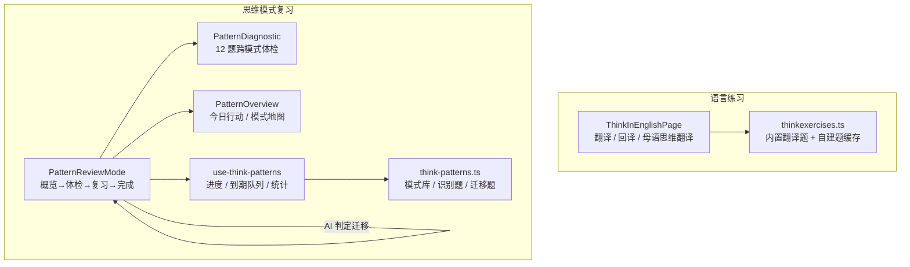
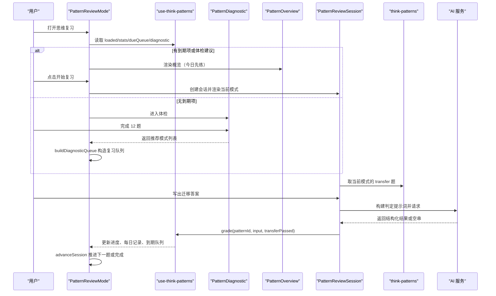
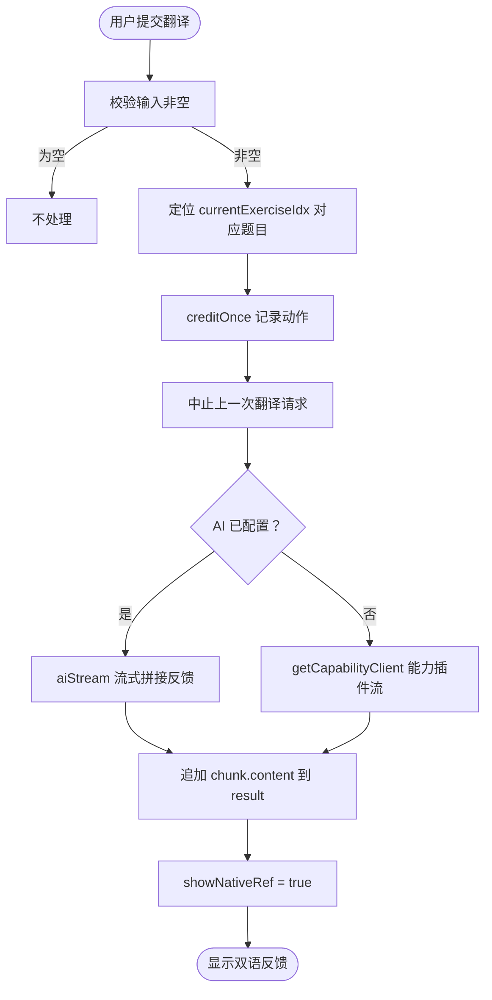
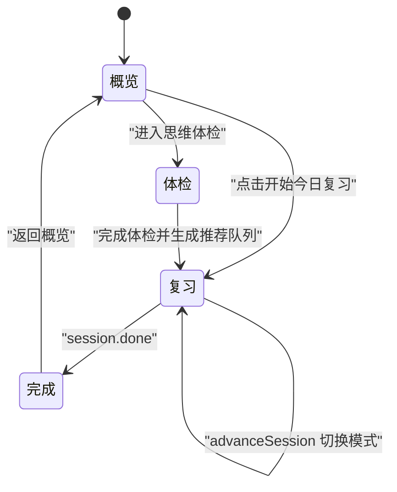
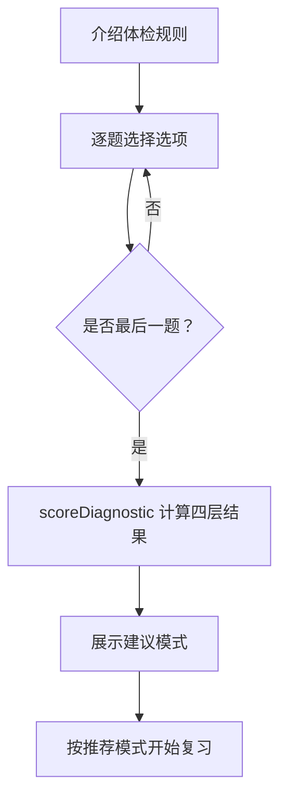
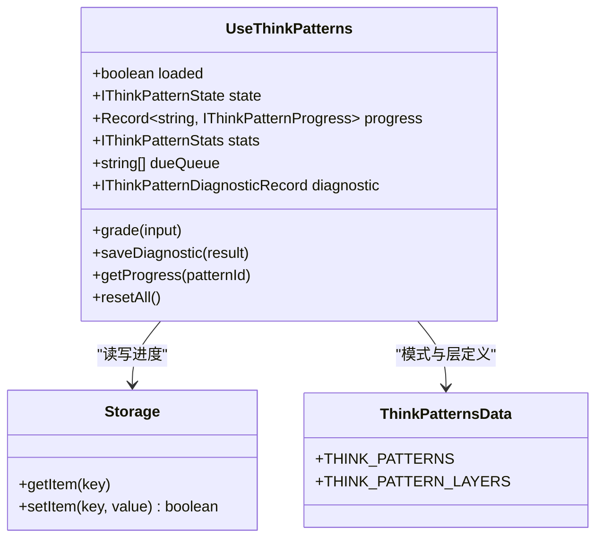
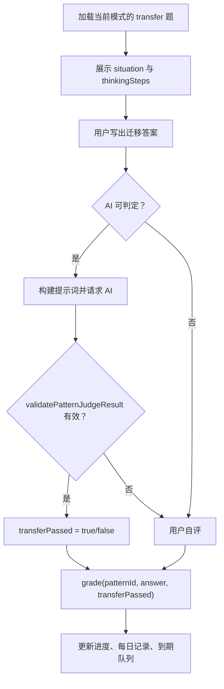
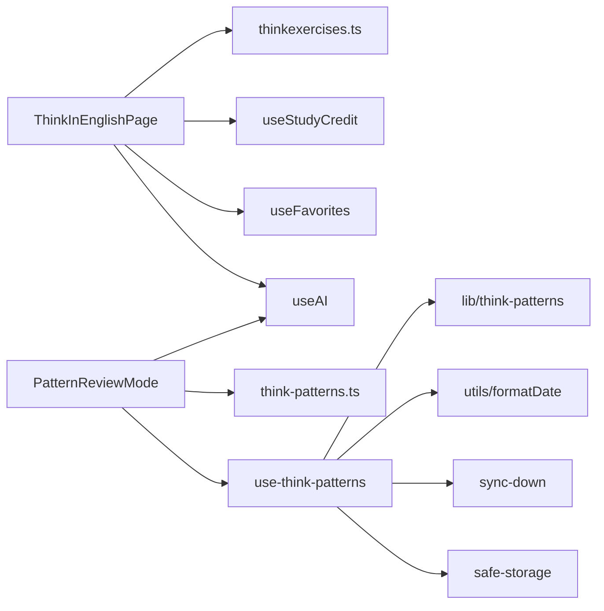

# 迁移练习工作流

<cite>
**本文引用的文件**   
- [ThinkInEnglishPage.tsx](file://src/pages/ThinkInEnglishPage/ThinkInEnglishPage.tsx)
- [PatternReviewMode.tsx](file://src/pages/ThinkInEnglishPage/PatternReviewMode.tsx)
- [PatternDiagnostic.tsx](file://src/pages/ThinkInEnglishPage/PatternDiagnostic.tsx)
- [PatternOverview.tsx](file://src/pages/ThinkInEnglishPage/PatternOverview.tsx)
- [use-think-patterns.ts](file://src/lib/use-think-patterns.ts)
- [thinkexercises.ts](file://src/data/thinkexercises.ts)
- [think-patterns.ts](file://src/data/think-patterns.ts)
</cite>

## 目录
1. [引言](#引言)
2. [项目结构](#项目结构)
3. [核心组件](#核心组件)
4. [架构总览](#架构总览)
5. [详细组件分析](#详细组件分析)
6. [依赖关系分析](#依赖关系分析)
7. [性能与健壮性](#性能与健壮性)
8. [故障排查指南](#故障排查指南)
9. [结论](#结论)

## 引言
本文聚焦 NativeThink 的“迁移练习”工作流，目标是说明 ThinkInEnglishPage 主页面中的翻译、回译、母语思维翻译等练习流程如何控制题目加载、用户输入处理与即时反馈；并深入解释 PatternReviewMode 中的模式复习机制：从诊断到练习的过渡、练习题目的动态组合、用户输入的处理、迁移判定的 AI 路径与降级策略，以及 use-think-patterns.ts 中复习进度、到期队列、错误模式分析与每日记录的持久化逻辑。

## 项目结构
ThinkInEnglishPage 负责三大语言练习入口：
- 中文表达纠偏检测器
- 场景翻译练习（带母语参考）
- 关键词回译造句
- 母语思维翻译

PatternReviewMode 则承担思维模式的复习工作流：概览 → 体检 → 复习会话 → 完成页，并与 use-think-patterns 的状态管理、think-patterns 的模式库与迁移题库、thinkexercises 的语言练习题库解耦。

**图示来源**
- [ThinkInEnglishPage.tsx:1-120](file://src/pages/ThinkInEnglishPage/ThinkInEnglishPage.tsx#L1-L120)
- [PatternReviewMode.tsx:1-60](file://src/pages/ThinkInEnglishPage/PatternReviewMode.tsx#L1-L60)
- [PatternDiagnostic.tsx:1-40](file://src/pages/ThinkInEnglishPage/PatternDiagnostic.tsx#L1-L40)
- [PatternOverview.tsx:1-40](file://src/pages/ThinkInEnglishPage/PatternOverview.tsx#L1-L40)
- [use-think-patterns.ts:1-40](file://src/lib/use-think-patterns.ts#L1-L40)
- [thinkexercises.ts:1-20](file://src/data/thinkexercises.ts#L1-L20)
- [think-patterns.ts:1-30](file://src/data/think-patterns.ts#L1-L30)

**章节来源**
- [ThinkInEnglishPage.tsx:1-120](file://src/pages/ThinkInEnglishPage/ThinkInEnglishPage.tsx#L1-L120)
- [PatternReviewMode.tsx:1-60](file://src/pages/ThinkInEnglishPage/PatternReviewMode.tsx#L1-L60)

## 核心组件
- ThinkInEnglishPage：聚合三类语言练习，提供输入框、AI 流式反馈、历史回填、收藏与积分。
- PatternReviewMode：复习顶层状态机，维护本轮会话队列、当前模式索引、回队次数，并调用 store 的 grade 更新持久进度。
- PatternDiagnostic：跨模式识别体检，输出四层概况与建议优先练习的模式。
- PatternOverview：展示今日行动、薄弱模式、到期队列、模式地图与全部模式卡片。
- use-think-patterns：复习进度的权威状态源，包含清洗、持久化、到期队列计算、统计、诊断结果保存。
- thinkexercises：内置翻译与回译题集，支持本地自建题库合并与稳定打乱。
- think-patterns：思维模式元数据，包括四层维度、对比句、识别选择题与迁移练习。

**章节来源**
- [ThinkInEnglishPage.tsx:1-120](file://src/pages/ThinkInEnglishPage/ThinkInEnglishPage.tsx#L1-L120)
- [PatternReviewMode.tsx:1-60](file://src/pages/ThinkInEnglishPage/PatternReviewMode.tsx#L1-L60)
- [PatternDiagnostic.tsx:1-40](file://src/pages/ThinkInEnglishPage/PatternDiagnostic.tsx#L1-L40)
- [PatternOverview.tsx:1-40](file://src/pages/ThinkInEnglishPage/PatternOverview.tsx#L1-L40)
- [use-think-patterns.ts:1-40](file://src/lib/use-think-patterns.ts#L1-L40)
- [thinkexercises.ts:1-20](file://src/data/thinkexercises.ts#L1-L20)
- [think-patterns.ts:1-30](file://src/data/think-patterns.ts#L1-L30)

## 架构总览
迁移练习工作流由两条主线组成：

1. 语言练习主线：ThinkInEnglishPage 读取内置或自建题库，按当前索引加载题目，用户提交后走 AI 流式反馈，同时记录学习积分、收藏和历史。
2. 模式复习主线：PatternReviewMode 根据 use-think-patterns 提供的 dueQueue、stats、diagnostic 决定先练哪个模式；进入 PatternReviewSession 后进行对比、识别、迁移；迁移判定优先走 AI，失败则回落自评；grade 会更新 SM-2 进度、每日记录与到期队列。

**图示来源**
- [PatternReviewMode.tsx:60-202](file://src/pages/ThinkInEnglishPage/PatternReviewMode.tsx#L60-L202)
- [PatternDiagnostic.tsx:40-120](file://src/pages/ThinkInEnglishPage/PatternDiagnostic.tsx#L40-L120)
- [PatternOverview.tsx:120-220](file://src/pages/ThinkInEnglishPage/PatternOverview.tsx#L120-L220)
- [use-think-patterns.ts:200-291](file://src/lib/use-think-patterns.ts#L200-L291)
- [think-patterns.ts:1-60](file://src/data/think-patterns.ts#L1-L60)

## 详细组件分析

### ThinkInEnglishPage：语言练习与即时反馈
ThinkInEnglishPage 管理三组练习状态：
- 翻译练习：currentExerciseIdx、translationInput、translationResult、showNativeRef、translationAbortRef。
- 回译造句：currentBackIdx、backInput、backResult、showBackRef、backAbortRef。
- 母语思维翻译：currentNativeIdx、nativeInput、nativeResult、showNativeThinkRef、nativeAbortRef。

题库组合方式：
- 翻译题：useStableShuffle(customTranslations, MOCK_THINK_EXERCISES.filter(type === 'translation'))
- 回译题：useStableShuffle(customBacks, MOCK_BACK_TRANSLATIONS)
- 母语翻译题：useStableShuffle(customNatives, MOCK_NATIVE_TRANSLATES)

用户输入处理与反馈流程：
- 防抖与中断：每个练习使用 AbortController 在切题或卸载时中止上一次请求。
- 计分口径：每次提交调用 creditOnce('think', creditKey(...))，避免连点刷进度环。
- AI 流式响应：isConfigured 为真时使用 aiStream，否则走 getCapabilityClient 的能力插件流。
- 错误处理：捕获异常后显示 toast 和占位错误文本，finally 中重置 loading 与 abort 引用。
- 历史回填：检测器最近 8 条历史保存在 safeStorage，按 type='detector' 去重截断。
- 收藏：翻译与回译题可加入收藏，内容字段与 category 同步到 favorites。

**图示来源**
- [ThinkInEnglishPage.tsx:200-350](file://src/pages/ThinkInEnglishPage/ThinkInEnglishPage.tsx#L200-L350)

**章节来源**
- [ThinkInEnglishPage.tsx:1-120](file://src/pages/ThinkInEnglishPage/ThinkInEnglishPage.tsx#L1-L120)
- [ThinkInEnglishPage.tsx:200-450](file://src/pages/ThinkInEnglishPage/ThinkInEnglishPage.tsx#L200-L450)
- [thinkexercises.ts:1-58](file://src/data/thinkexercises.ts#L1-L58)

### PatternReviewMode：复习会话状态机
PatternReviewMode 的职责是编排：
- 从 useThinkPatterns 拉取 progress、stats、dueQueue、diagnostic。
- 通过 createPatternSession 初始化本轮会话队列。
- 维护 mode：overview → diagnostic → review → complete。
- 调用 grade 将模式级结果写回 store。
- 实现 judge 函数作为迁移判定的 AI 路径，超时 15 秒、未配置、空串、解析失败均回落自评。

关键流程：
- startWith：用推荐模式或到期队列创建会话，若无任务则回到概览。
- handleGrade：把当前模式的转移判定结果写入 store，并根据 transferPassed 更新本地 session.results。
- handleNext：advanceSession 推进下一题，done 则进入完成页。
- judge：creditOnce 先行记动作，再请求 AI；silent=true 避免全局 toast；extractJson + validatePatternJudgeResult 做结构化校验。

**图示来源**
- [PatternReviewMode.tsx:60-202](file://src/pages/ThinkInEnglishPage/PatternReviewMode.tsx#L60-L202)

**章节来源**
- [PatternReviewMode.tsx:1-202](file://src/pages/ThinkInEnglishPage/PatternReviewMode.tsx#L1-L202)

### PatternDiagnostic：跨模式体检
PatternDiagnostic 从 THINK_PATTERN_DIAGNOSTIC 抽取 12 道跨模式识别题，每题绑定一个 pattern 与 choice。答题阶段不显示对错，只累积 answers；最后一题完成后调用 scoreDiagnostic 得到 DiagnosticResult，包括 correct、total、layers 与 recommendedPatternIds。

状态转换：
- intro：介绍四层维度与规则。
- quiz：逐题选择选项，禁用“下一题”直到选中。
- result：显示四层正确率与建议模式。

**图示来源**
- [PatternDiagnostic.tsx:40-120](file://src/pages/ThinkInEnglishPage/PatternDiagnostic.tsx#L40-L120)
- [PatternDiagnostic.tsx:200-285](file://src/pages/ThinkInEnglishPage/PatternDiagnostic.tsx#L200-L285)

**章节来源**
- [PatternDiagnostic.tsx:1-285](file://src/pages/ThinkInEnglishPage/PatternDiagnostic.tsx#L1-L285)

### PatternOverview：复习概览与焦点卡
PatternOverview 接收 stats、weak、dueQueue、progress、diagnostic，并计算：
- 今日先练 hero：体检建议优先，其次薄弱模式，最后到期队列。
- 模式地图：按四层展示掌握率与到期数量。
- 全部模式：展开后可查看每个模式的中文思路、母语者说法、cues 与下次到期时间。

完成页：
- passed/failed 基于 sessionCounts，重试通过后只计一次 pass，避免重复计数。

**章节来源**
- [PatternOverview.tsx:1-367](file://src/pages/ThinkInEnglishPage/PatternOverview.tsx#L1-L367)

### use-think-patterns：复习状态与持久化
use-think-patterns 是复习进度的权威状态源，实现四条约定：
1. 读盘边界清洗：sanitizeProgress/sanitizeDaily/sanitizeDiagnostic 丢弃幽灵记录、未知 id、残缺字段、非法 daily 桶。
2. updater 纯函数：setState updater 只算新状态，落盘统一在 effect 中。
3. 回声抑制：loadedFromStorageRef 标记 hydration 与云同步下行后的 state，同引用不回写。
4. 写失败可见：safeStorage.setItem 返回 false 时 warnStorageFull()。

主要 API：
- grade：SM-2 进度更新、daily 去重、pruneDaily。
- dueQueue：buildReviewQueue 计算到期项。
- stats：tracked/mastered/due/reviewedToday。
- saveDiagnostic：保存体检汇总与建议。
- resetAll：清空本地复习状态。

**图示来源**
- [use-think-patterns.ts:1-120](file://src/lib/use-think-patterns.ts#L1-L120)
- [use-think-patterns.ts:200-291](file://src/lib/use-think-patterns.ts#L200-L291)
- [think-patterns.ts:1-60](file://src/data/think-patterns.ts#L1-L60)

**章节来源**
- [use-think-patterns.ts:1-291](file://src/lib/use-think-patterns.ts#L1-L291)

### 迁移练习的业务逻辑
迁移练习的核心是把已掌握的思维模式应用到新的语言场景中，具体体现在 think-patterns.ts 的 IThinkPatternTransfer：
- situation：给用户的迁移情境。
- rubricFocus：给 AI 的判定重点。
- thinkingSteps：三步引导思考。
- why：解释参考表达为什么自然。
- modelAnswer：参考译文。
- kind：scenario 或 wording，兼容旧数据。

PatternReviewSession 的任务是根据这些字段让用户写出目标句子，然后：
- 若 AI 可用且返回有效结构化结果，transferPassed 由 AI 判定。
- 若 AI 不可用、超时、空串或解析失败，自动回落为用户自评。
- 最终调用 grade 更新该模式的 transferPasses、transferAttempts、nextReview、status 等字段。

**图示来源**
- [PatternReviewMode.tsx:120-202](file://src/pages/ThinkInEnglishPage/PatternReviewMode.tsx#L120-L202)
- [think-patterns.ts:1-60](file://src/data/think-patterns.ts#L1-L60)

**章节来源**
- [PatternReviewMode.tsx:120-202](file://src/pages/ThinkInEnglishPage/PatternReviewMode.tsx#L120-L202)
- [think-patterns.ts:1-60](file://src/data/think-patterns.ts#L1-L60)

### 练习题目的生成策略
- 内置题库：MOCK_THINK_EXERCISES 提供大量 translation/backTranslation 场景，含 nativeExpression、explanation、difficulty、category。
- 自建题库：customTranslations/customBacks/customNatives 由用户生成或导入，persistJson 持久化到 localStorage。
- 组合策略：自定义题在前，内置题在后，再用 useStableShuffle 稳定打乱，避免刷新导致顺序抖动。
- 题型扩展：新增 INativeTranslate 类型用于母语思维翻译，保持与翻译、回译相同的 UI 交互与 AI 反馈链路。

**章节来源**
- [ThinkInEnglishPage.tsx:80-160](file://src/pages/ThinkInEnglishPage/ThinkInEnglishPage.tsx#L80-L160)
- [thinkexercises.ts:1-215](file://src/data/thinkexercises.ts#L1-L215)

### 用户输入处理与答案验证机制
- 语言练习：ThinkInEnglishPage 对每种练习使用独立 AbortController、loading、result、showReference 状态；提交前校验非空，提交后流式拼接 AI 反馈；异常时显示 toast 与错误文本。
- 思维迁移：PatternReviewMode 的 judge 先记 credit，再请求 AI；15 秒超时、未配置、空串、JSON 解析失败、结构校验失败均返回 null，由会话回落自评；validatePatternJudgeResult 确保结构化结果安全。
- 进度验证：use-think-patterns 的 sanitize* 函数在读取时严格校验 progress、daily、diagnostic 的形状，防止脏数据导致界面崩溃或到期判断失效。

**章节来源**
- [ThinkInEnglishPage.tsx:200-450](file://src/pages/ThinkInEnglishPage/ThinkInEnglishPage.tsx#L200-L450)
- [PatternReviewMode.tsx:120-202](file://src/pages/ThinkInEnglishPage/PatternReviewMode.tsx#L120-L202)
- [use-think-patterns.ts:40-120](file://src/lib/use-think-patterns.ts#L40-L120)

## 依赖关系分析
- ThinkInEnglishPage 依赖：
  - useAI：AI 流式对话。
  - useTTS：朗读参考表达。
  - useStudyCredit：积分记录。
  - useFavorites：收藏与取消收藏。
  - usePageMemory：Tab 记忆。
  - safeStorage/capped-cache：自建题持久化。
  - data/thinkexercises：内置题库。
- PatternReviewMode 依赖：
  - useThinkPatterns：进度、统计、到期队列、诊断。
  - useAI：迁移判定。
  - data/think-patterns：模式库、识别题、迁移题。
  - lib/think-patterns：会话工厂、推进函数、弱项计算、提示词构建。
- use-think-patterns 依赖：
  - safeStorage：本地存储。
  - sync-down：云同步下行后重读。
  - utils/formatDate：本地日期格式化。
  - data/think-patterns：模式与层定义。
  - lib/think-patterns：SM-2 应用、队列构建、每日裁剪。

**图示来源**
- [ThinkInEnglishPage.tsx:1-120](file://src/pages/ThinkInEnglishPage/ThinkInEnglishPage.tsx#L1-L120)
- [PatternReviewMode.tsx:1-60](file://src/pages/ThinkInEnglishPage/PatternReviewMode.tsx#L1-L60)
- [use-think-patterns.ts:1-40](file://src/lib/use-think-patterns.ts#L1-L40)

**章节来源**
- [ThinkInEnglishPage.tsx:1-120](file://src/pages/ThinkInEnglishPage/ThinkInEnglishPage.tsx#L1-L120)
- [PatternReviewMode.tsx:1-60](file://src/pages/ThinkInEnglishPage/PatternReviewMode.tsx#L1-L60)
- [use-think-patterns.ts:1-40](file://src/lib/use-think-patterns.ts#L1-L40)

## 性能与健壮性
- 流式响应：所有 AI 请求采用异步迭代流式拼接，避免长轮询阻塞 UI。
- 中止控制：每个练习与判定都有 AbortController，切题、卸载、超时都会中止上一次请求。
- 存储防护：persistJson 失败时 warnStorageFull；use-think-patterns 的 write effect 先比较 JSON 字符串避免回声双写。
- StrictMode 兼容：updater 保持纯函数，storage 操作移到事件层或 effect，避免 StrictMode 双调用导致重复历史或双写。
- 数据清洗：sanitizeProgress/sanitizeDaily/sanitizeDiagnostic 在读取时清理脏数据，防止 Invalid Date 或数组拆字符等运行时错误。
- 稳定排序：useStableShuffle 保证刷题顺序不因 React 重渲染变化。

[本节为通用指导，不直接分析具体文件]

## 故障排查指南
常见问题与定位方法：
- 刷新后自建题消失：检查 persistJson 返回值与 warnStorageFull 是否触发；确认 localStorage 配额与隐私模式。
- 进度丢失：检查 safeStorage.setItem 是否返回 false；确认 loadedFromStorageRef 是否正确抑制回声；确认云同步下行后是否重新 load。
- 体检结果不保存：确认 scoreDiagnostic 输出 layers 非空、layerId 属于已知层、correct/total 合法。
- 迁移判定永远自评：检查 isConfigured、aiChat 是否返回空串、extractJson 是否抛错、validatePatternJudgeResult 是否返回 null；确认 15 秒超时未被误触发。
- 到期数为零但仍有待练项：确认 dueQueue 与 stats.due 的计算口径不同——新引入项不计入 due，应由 dueQueue 驱动。

**章节来源**
- [use-think-patterns.ts:120-291](file://src/lib/use-think-patterns.ts#L120-L291)
- [PatternReviewMode.tsx:120-202](file://src/pages/ThinkInEnglishPage/PatternReviewMode.tsx#L120-L202)
- [PatternDiagnostic.tsx:120-285](file://src/pages/ThinkInEnglishPage/PatternDiagnostic.tsx#L120-L285)

## 结论
NativeThink 的迁移练习工作流通过 ThinkInEnglishPage 提供语言层面的即时反馈练习，并通过 PatternReviewMode 与 use-think-patterns 实现思维模式的系统化复习。其设计强调：
- 诊断先行：先用 12 题体检确定薄弱模式。
- 渐进迁移：从对比到识别再到迁移，AI 判定优先，失败自动降级自评。
- 状态权威：use-think-patterns 是唯一进度源，具备严格的清洗、持久化与回声抑制。
- 稳健体验：流式响应、中止控制、StrictMode 兼容、配额警告与结构化校验共同保障用户体验与数据安全。

[本节为总结性内容，不直接分析具体文件]