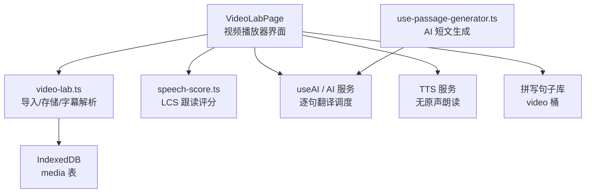
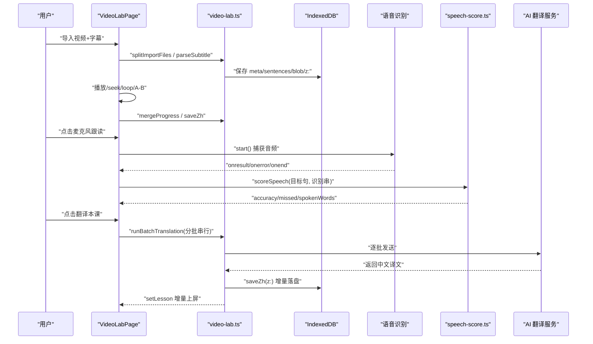
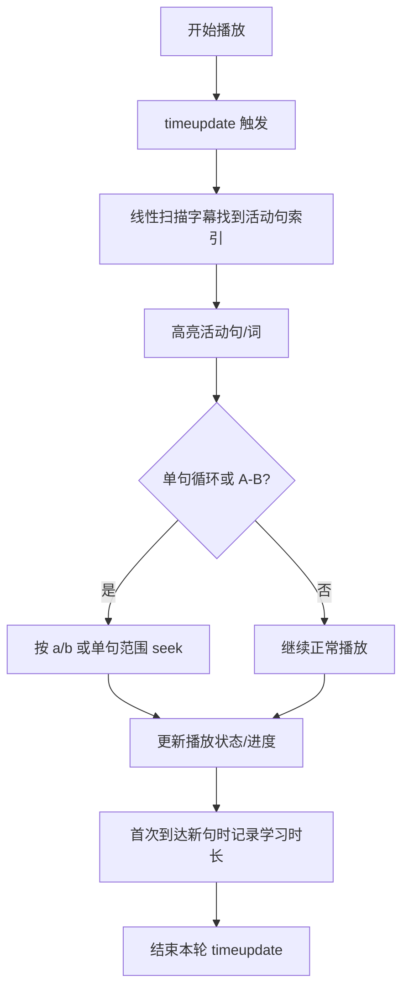
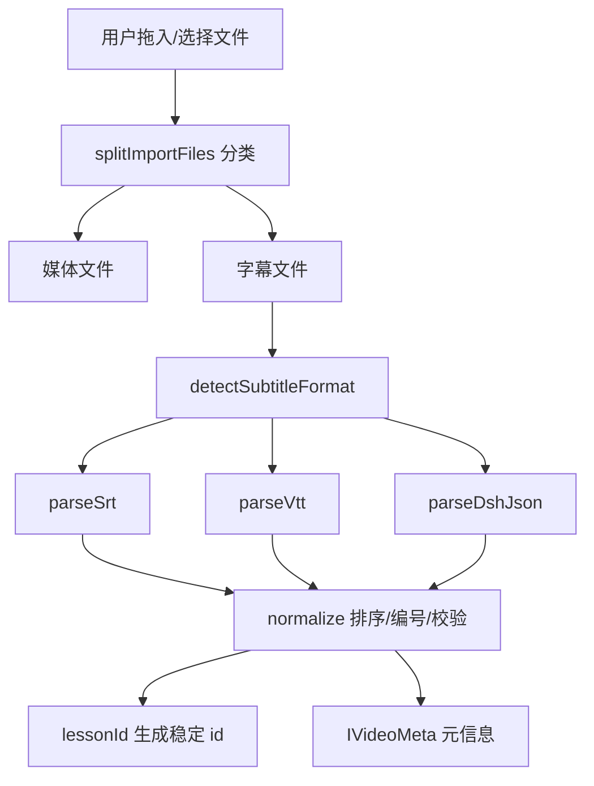
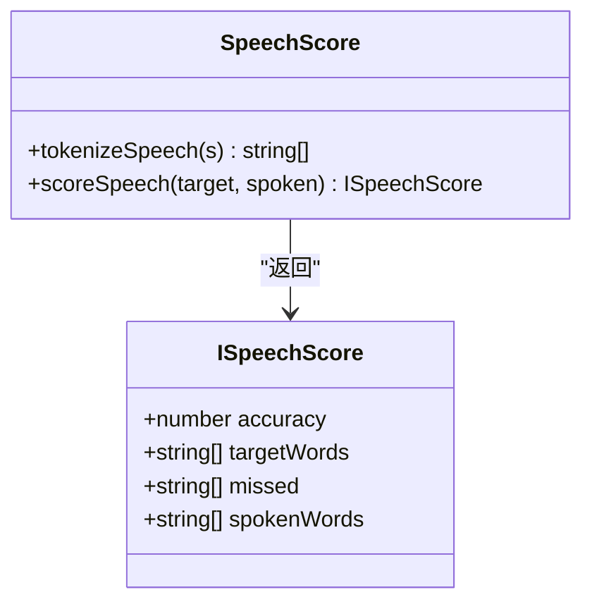
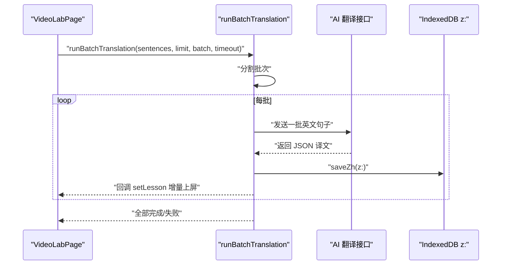
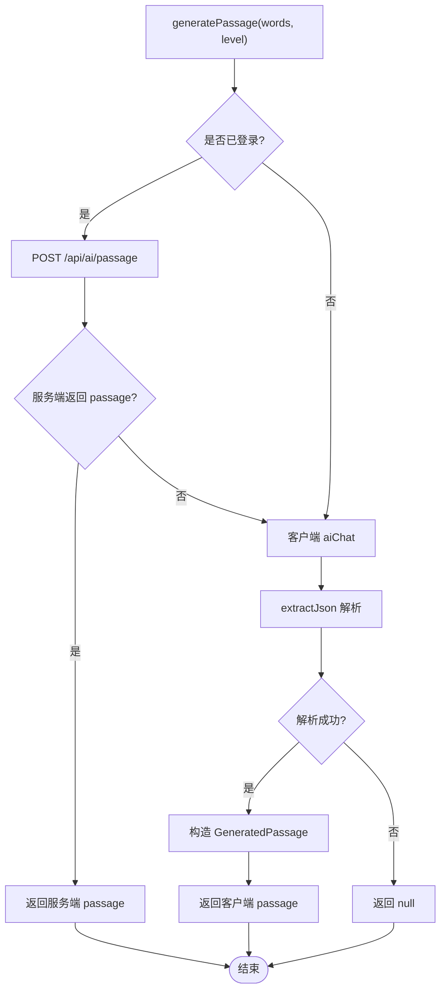
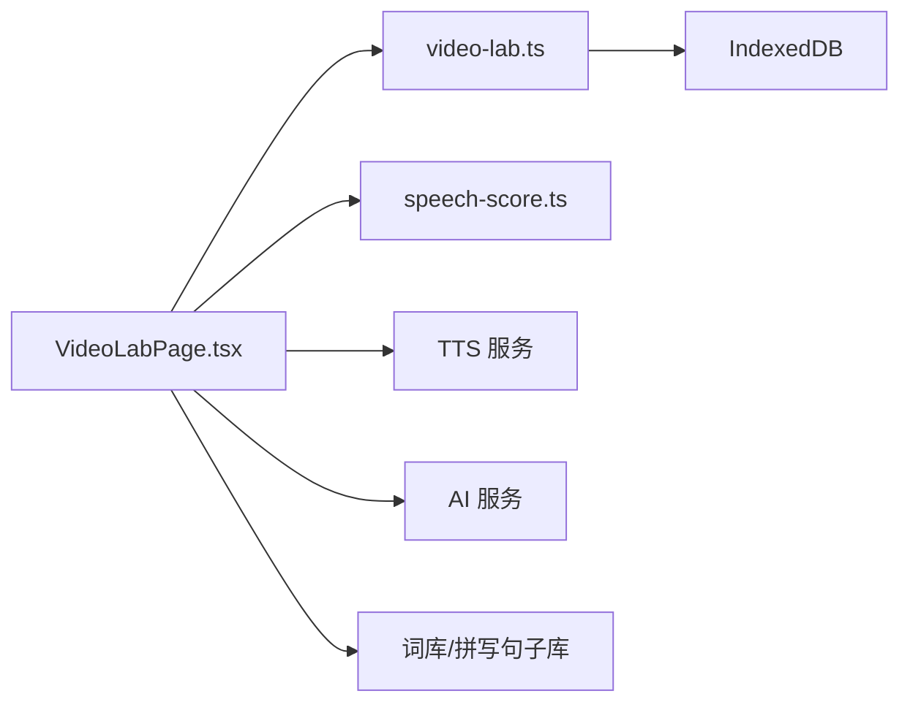

# 视频精听模块

<cite>
**本文引用的文件**   
- [VideoLabPage.tsx](file://src/pages/VideoLabPage/VideoLabPage.tsx)
- [video-lab.ts](file://src/lib/video-lab.ts)
- [speech-score.ts](file://src/lib/speech-score.ts)
- [use-passage-generator.ts](file://src/hooks/use-passage-generator.ts)
- [video-lab.md](file://docs/modules/video-lab.md)
- [verify-video-lab.mjs](file://scripts/verify-video-lab.mjs)
</cite>

## 目录
1. [引言](#引言)
2. [项目结构](#项目结构)
3. [核心组件](#核心组件)
4. [架构总览](#架构总览)
5. [详细组件分析](#详细组件分析)
6. [依赖关系分析](#依赖关系分析)
7. [性能与并发特性](#性能与并发特性)
8. [字幕格式、媒体加载与多语言支持](#字幕格式媒体加载与多语言支持)
9. [故障排查指南](#故障排查指南)
10. [结论](#结论)

## 引言
本模块为 NativeThink 的“视频精听”功能：用户导入视频或音频，再导入对应字幕，按句学习。它不是内置转录工具，而是把已转录结果（SRT / VTT / dshzmd JSON）统一成句级和词级时间轴，并提供播放控制、点词查词、收藏、跟读评分、听写、双语翻译等能力。文档重点覆盖以下目标：
- 视频字幕导入流程与媒体资源加载
- 播放器界面与字幕同步机制
- 基于 LCS 的跟读准确度算法
- 批量翻译调度策略
- `VideoLabPage` 的视频播放器界面行为
- `use-passage-generator.ts` 的段落生成逻辑
- 字幕格式支持、视频源配置与多语言方案

## 项目结构
视频精听相关代码分布在页面层、数据层、评分层以及辅助 hooks：
- 页面层：`src/pages/VideoLabPage/VideoLabPage.tsx`
- 数据层：`src/lib/video-lab.ts`
- 评分层：`src/lib/speech-score.ts`
- 段落生成：`src/hooks/use-passage-generator.ts`
- 模块说明与守卫脚本：`docs/modules/video-lab.md`、`scripts/verify-video-lab.mjs`

图表来源
- [VideoLabPage.tsx:1-200](file://src/pages/VideoLabPage/VideoLabPage.tsx#L1-L200)
- [video-lab.ts:1-200](file://src/lib/video-lab.ts#L1-L200)
- [speech-score.ts:1-51](file://src/lib/speech-score.ts#L1-L51)
- [use-passage-generator.ts:1-91](file://src/hooks/use-passage-generator.ts#L1-L91)

章节来源
- [video-lab.md:1-92](file://docs/modules/video-lab.md#L1-L92)

## 核心组件
本节聚焦四个关键实现点：
1. 视频精听页面 `VideoLabPage`：负责播放器、字幕窗口、收藏、点词、跟读、听写、翻译入口。
2. 数据层 `video-lab.ts`：负责 SRT/VTT/dshzmd 字幕解析、导入分类、课程 id、存储键、进度合并、批量翻译调度。
3. 跟读评分 `speech-score.ts`：基于最长公共子序列的词级准确度计算。
4. 段落生成 `use-passage-generator.ts`：双模式 AI 短文生成（服务端优先，客户端兜底）。

章节来源
- [VideoLabPage.tsx:1-200](file://src/pages/VideoLabPage/VideoLabPage.tsx#L1-L200)
- [video-lab.ts:1-200](file://src/lib/video-lab.ts#L1-L200)
- [speech-score.ts:1-51](file://src/lib/speech-score.ts#L1-L51)
- [use-passage-generator.ts:1-91](file://src/hooks/use-passage-generator.ts#L1-L91)

## 架构总览
视频精听采用“页面 + 数据层 + 纯函数评分 + AI 服务”的分层结构：
- 页面只承担交互状态与渲染；真正的导入、解析、持久化、时长判断、批量翻译放在数据层。
- 跟读评分是独立纯函数，避免把 IndexedDB 拖进影子跟读或其他轻量场景。
- 批量翻译使用串行批处理，避免打满免费并发上限并出现永不回包问题。

图表来源
- [VideoLabPage.tsx:1-200](file://src/pages/VideoLabPage/VideoLabPage.tsx#L1-L200)
- [video-lab.ts:1-200](file://src/lib/video-lab.ts#L1-L200)
- [speech-score.ts:1-51](file://src/lib/speech-score.ts#L1-L51)

## 详细组件分析

### VideoLabPage：视频播放器界面与同步
`VideoLabPage` 是视频精听的主界面，职责包括：
- 列表载入与上次打开课恢复
- 视频/音频与字幕导入
- 播放控制：播放、暂停、倍速、单句循环、A-B 复读
- 字幕窗口：默认渲染活动句前后固定数量的句子，避免长列表首屏爆炸
- 点词查词、收藏句/词、加入生词本
- 跟读录音、语音识别错误处理、LCS 准确度展示
- 听写这句：进入拼写练习的 video 桶
- 双语字幕：调用批量翻译调度，边翻边上屏
- 播放器吸顶悬浮：在自身滚动容器内 sticky，并量出高度给 scroll-padding 避让
- 无原声降级：没有媒体时走 TTS 朗读当前句，并显示“仅字幕课程”提示

关键点：
- 活动句通过线性扫描时间轴确定，适合几十到几百条字幕；二分反而容易 off-by-one。
- 课时长度以字幕最后一条终点为准，不信任容器或 JSON 里的 duration。
- 学习时长统计对“同一课同一句”去重，换课后重新计数。
- 对象 URL 在卸载或换课时必须释放，否则大 blob 长期驻留内存。
- 字幕窗口大小由常量控制，长列表必须分片渲染。
- 播放器吸顶需要独立的滚动框根，外层容器 overflow 行为会导致 sticky 失效。

章节来源
- [VideoLabPage.tsx:1-200](file://src/pages/VideoLabPage/VideoLabPage.tsx#L1-L200)
- [video-lab.md:1-92](file://docs/modules/video-lab.md#L1-L92)

### 视频与字幕同步机制
视频与字幕同步的核心流程如下：

图表来源
- [VideoLabPage.tsx:1-200](file://src/pages/VideoLabPage/VideoLabPage.tsx#L1-L200)
- [video-lab.ts:1-200](file://src/lib/video-lab.ts#L1-L200)

同步规则要点：
- 活动句判定：按 `t0 <= currentTime + 容差` 顺序扫描。
- 时长基准：以字幕最后一条 `t1` 作为课时长度。
- 进度去重：每课一个 Set，只有第一次推进到新句才记学习时长。
- 断点恢复：切 tab 或返回后恢复上次课程。

章节来源
- [video-lab.md:1-92](file://docs/modules/video-lab.md#L1-L92)

### 字幕导入与文件格式支持
`video-lab.ts` 提供完整的字幕导入管线：
- 支持 SRT、VTT、dshzmd JSON。
- 自动检测格式：WEBVTT 头部判 VTT，JSON 开头判 JSON，SRT 时间箭头兜底。
- 解析器统一归一化：过滤无效时间、空文本，按起点排序，重新编号，保证 `t1 >= t0`。
- 词级时间戳：来自 dshzmd JSON，用于卡拉 OK 逐词高亮；普通 SRT 退化为整句高亮。
- 导入文件分类：先看 MIME，再按扩展名兜；一次拖入多个文件只取第一个媒体和第一个字幕。
- 课程稳定 id：标题、时长、字节数哈希，重复导入同一份内容不会堆积。
- 语种猜测：简单中英日字符判断，未知留空交给“自动”。

图表来源
- [video-lab.ts:1-200](file://src/lib/video-lab.ts#L1-L200)

章节来源
- [video-lab.ts:1-200](file://src/lib/video-lab.ts#L1-L200)
- [video-lab.md:1-92](file://docs/modules/video-lab.md#L1-L92)

### 媒体资源加载与时长处理
媒体资源加载遵循以下约束：
- 媒体 blob 只进 IndexedDB，不进 localStorage，避免配额爆掉。
- 列表只读轻量索引，不枚举带 blob 的记录。
- load 时把 blob 转 object URL，失败则退化“无原声”，不抛异常掀翻页面。
- 流媒体或截断下载常见“容器头 duration 很大但实际很短”，界面会提示播放器报的时长与字幕覆盖的时长不一致。
- 素材打包工具会把有画面轨的媒体压缩到 ≤480p、H.264、yuv420p、AAC，并按字幕末秒裁剪。

章节来源
- [video-lab.ts:1-200](file://src/lib/video-lab.ts#L1-L200)
- [video-lab.md:1-92](file://docs/modules/video-lab.md#L1-L92)

### 跟读准确度：LCS 算法实现
跟读评分模块 `speech-score.ts` 是纯函数，被视频精听与影子跟读共用：
- 归一化：小写、剥标点、丢弃空 token。
- 打分：用动态规划计算最长公共子序列长度，再除以目标句词数得到准确率。
- 漏读词：沿 DP 表回溯，标记匹配上的目标词，未匹配的去重保序输出。
- 不使用集合交集：因为同词多次出现只能算一次命中。
- 不使用编辑距离：多说的插入词不应压低命中率。

图表来源
- [speech-score.ts:1-51](file://src/lib/speech-score.ts#L1-L51)

复杂度分析：
- 时间复杂度：O(m×n)，m 为目标句词数，n 为识别串词数。
- 空间复杂度：O(m×n)，DP 表大小。
- 适用场景：单句长度通常不大，适合浏览器端实时评分；若超长句可考虑分段或启发式优化。

章节来源
- [speech-score.ts:1-51](file://src/lib/speech-score.ts#L1-L51)
- [video-lab.md:1-92](file://docs/modules/video-lab.md#L1-L92)

### 批量翻译调度管理
批量翻译调度位于 `video-lab.ts`，页面只提供入口与 UI 状态：
- 每次最多翻译 `TRANSLATE_LIMIT` 句，避免一次性打爆额度。
- 每批 `TRANSLATE_BATCH` 句，串行执行，不抢并发。
- 每批有超时看门狗，防止请求永不回包导致界面永久停在“翻译中”。
- 每批完成立即回调：增量 `setLesson` 上屏 + `saveZh` 落盘 z: 键。
- 全局标志 `translateRunning` 防止同一浏览器里两课并发翻把额度打重。
- 系统提示词要求严格 JSON，编号与输入一一对应，避免自由文本破坏解析。

图表来源
- [video-lab.ts:1-200](file://src/lib/video-lab.ts#L1-L200)
- [VideoLabPage.tsx:1-200](file://src/pages/VideoLabPage/VideoLabPage.tsx#L1-L200)

章节来源
- [video-lab.ts:1-200](file://src/lib/video-lab.ts#L1-L200)
- [video-lab.md:1-92](file://docs/modules/video-lab.md#L1-L92)

### use-passage-generator.ts：段落生成逻辑
`use-passage-generator.ts` 提供 AI 短文生成功能，主要服务于复习段落生成：
- 如果已登录，先尝试服务端 `/api/ai/passage`，携带当前激活提供商的 API key。
- 服务端不可用或返回 fallback，则回到客户端：调用 `useAI.chat`，使用用户自己的 AI key。
- 客户端输出期望 JSON：包含标题、正文、使用的单词列表。
- 使用 `extractJson` 安全提取第一段 JSON，避免贪婪正则吞掉中间文本。
- 生成失败返回 null，同时保持 `generating=false`。

图表来源
- [use-passage-generator.ts:1-91](file://src/hooks/use-passage-generator.ts#L1-L91)

章节来源
- [use-passage-generator.ts:1-91](file://src/hooks/use-passage-generator.ts#L1-L91)

## 依赖关系分析
视频精听模块的外部依赖主要包括：
- IndexedDB：媒体、字幕、译文、索引分键存储。
- 语音识别 API：Web Speech Recognition，存在模拟器 WebView 可用但回调不触发的边缘情况。
- TTS 服务：无原声时的句子朗读。
- AI 服务：逐句翻译与短文生成。
- 词库：点词查词、加生词本、拼写句子库。

图表来源
- [VideoLabPage.tsx:1-200](file://src/pages/VideoLabPage/VideoLabPage.tsx#L1-L200)
- [video-lab.ts:1-200](file://src/lib/video-lab.ts#L1-L200)
- [speech-score.ts:1-51](file://src/lib/speech-score.ts#L1-L51)

章节来源
- [video-lab.md:1-92](file://docs/modules/video-lab.md#L1-L92)

## 性能与并发特性
- 字幕渲染窗口：默认只渲染活动句前后固定数量，避免长列表首屏渲染开销。
- 线性扫描活动句：对几十到几百条字幕足够，且比二分更稳健。
- 批量翻译串行：虽然慢于并发，但避免免费通道并发限制与永不回包。
- 增量上屏：每批翻译完成即回调，提升即时阅读体验。
- 媒体存储：blob 放 IndexedDB，列表只读轻量索引，避免全量读取。
- LCS 评分：O(m×n) 对单句可行；若未来引入超长句，应考虑分句或近似匹配优化。

章节来源
- [video-lab.md:1-92](file://docs/modules/video-lab.md#L1-L92)

## 字幕格式、媒体加载与多语言支持

### 字幕格式支持
- SRT：标准时间箭头与多行 cue，支持 BOM、CRLF、空白文本丢条、乱序时间轴排序。
- VTT：头部 WEBVTT，跳过 NOTE 块，cue 结构与 SRT 一致。
- dshzmd JSON：兼容 result 包装与裸 sentences，支持 start/end/content 别名字段，保留词级时间戳。
- 自动检测：WEBVTT、JSON、SRT、unknown，未知时按 SRT 兜底。

章节来源
- [video-lab.ts:1-200](file://src/lib/video-lab.ts#L1-L200)

### 媒体资源加载
- 媒体类型：mp4/m4v/mov/webm/mkv/avi/mp3/m4a/m4b/aac/wav/flac/ogg/opus。
- 文件分类：先看 MIME，再按扩展名兜；一次拖入多个同类文件只取第一个。
- 时长处理：字幕末秒作为课时长度；容器头与实际不一致时在界面提示。
- 打包规范：≤480p、H.264、yuv420p、AAC 96k、faststart、按字幕末秒裁剪。

章节来源
- [video-lab.ts:1-200](file://src/lib/video-lab.ts#L1-L200)
- [video-lab.md:1-92](file://docs/modules/video-lab.md#L1-L92)

### 多语言支持
- 语种猜测：简单中英日字符判断，未知留空给“自动”。
- 识别语言检查：英文课识别结果不含英文字母时不计分，避免设备幻觉。
- 翻译系统提示词：要求简体中文输出，编号严格对应，JSON 格式严格。

章节来源
- [video-lab.ts:1-200](file://src/lib/video-lab.ts#L1-L200)
- [video-lab.md:1-92](file://docs/modules/video-lab.md#L1-L92)

## 故障排查指南
常见问题与定位方法：
- 导入没反应：可能 IndexedDB 配额已满或 safeStorage 静默失败；检查 media 表是否写入、索引是否更新。
- 黑屏：可能是只有音频轨或 WebView 不支持 AV1；确认打包工具是否强制 H.264 yuv420p，或手动提供有画面轨媒体。
- 播放器报很长时长但实际很短：容器头截断下载导致；界面会提示播放器时长与字幕时长不一致。
- 跟读按钮一直“正在听”：语音识别通道存在但回调不回；需要 try/catch start、9 秒看门狗、onend 原因文案。
- 识别结果胡说八道：设备返回非英文字符串时不计分，避免把幻觉打成低准确率。
- 翻译永远停在“翻译中”：批量任务遇到永不回包；检查超时看门狗与串行批处理。
- 字幕错乱或跳句：检查字幕是否乱序、时间戳无效；normalize 会排序并过滤无效条目。

章节来源
- [video-lab.md:1-92](file://docs/modules/video-lab.md#L1-L92)
- [verify-video-lab.mjs:1-200](file://scripts/verify-video-lab.mjs#L1-L200)

## 结论
视频精听模块以“导入为主、播放为辅、评分独立、翻译串行”的方式实现稳定的逐句学习体验。其优势在于：
- 字幕解析健壮，支持多种格式与词级时间戳。
- 媒体与字幕分键存储，避免重存大 blob。
- 播放同步与学习时长统计严谨，断点恢复可靠。
- 跟读评分使用 LCS，避免集合与编辑距离的误判。
- 批量翻译串行批处理，兼顾用户体验与服务端限制。
- 段落生成双模式，服务端优先、客户端兜底。

未来优化方向可包括：
- 对超长句 LCS 评分进行分句或近似匹配优化。
- 对批量翻译增加重试与错误分流，但不改变串行主路径。
- 对媒体加载增加更细的解码失败诊断与降级提示。
- 对字幕格式检测增强边界样本，减少 unknown 分支。