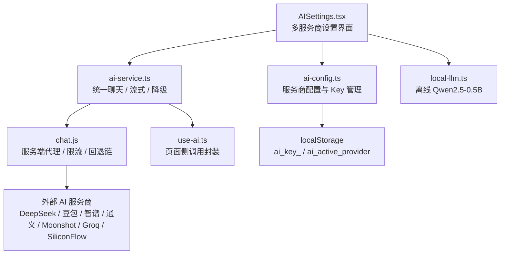
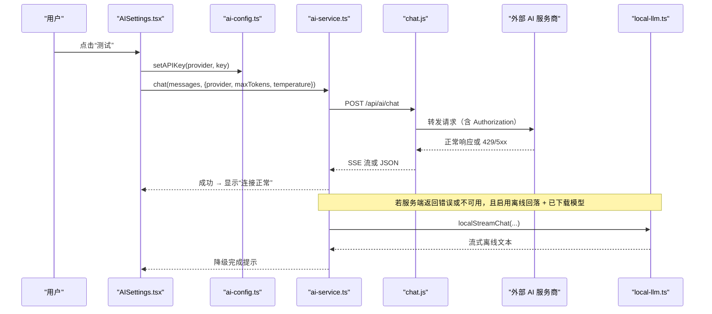
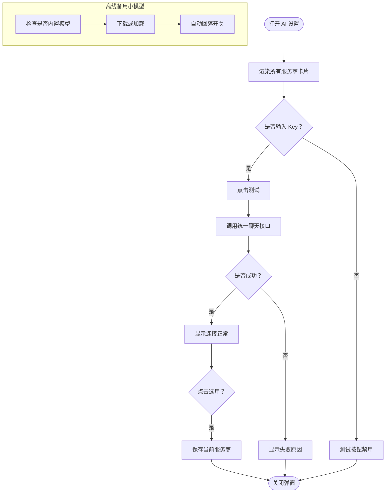
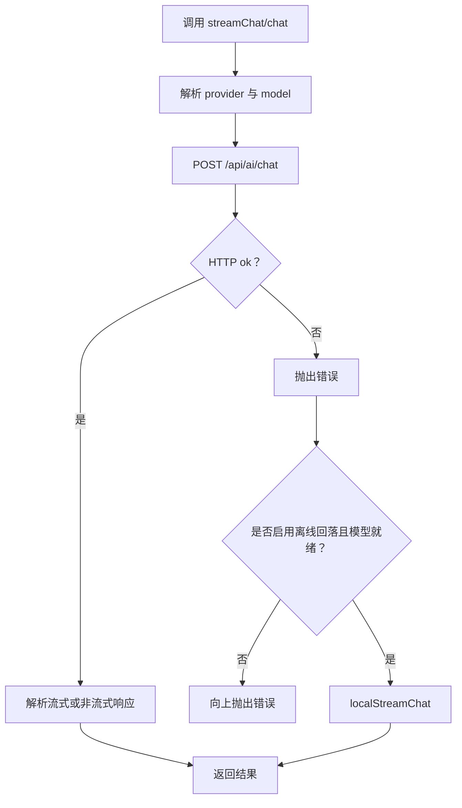
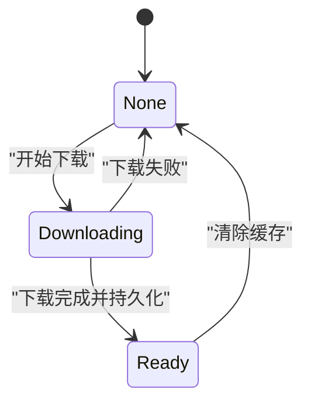
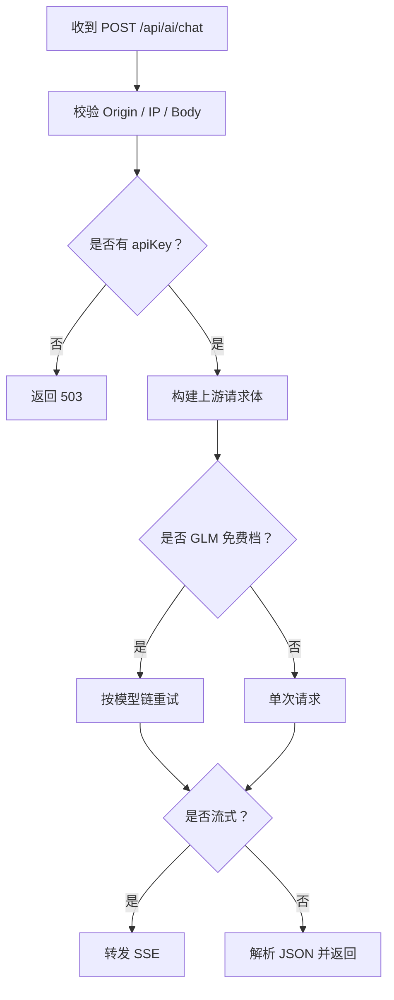
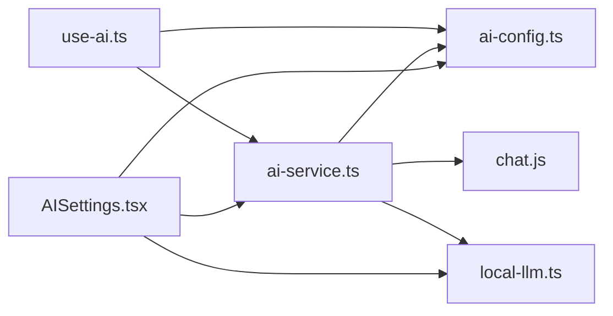

# AI 服务设置

<cite>
**本文引用的文件**   
- [AISettings.tsx](file://src/components/AISettings.tsx)
- [ai-config.ts](file://src/services/ai-config.ts)
- [ai-service.ts](file://src/services/ai-service.ts)
- [local-llm.ts](file://src/lib/local-llm.ts)
- [use-ai.ts](file://src/hooks/use-ai.ts)
- [chat.js](file://functions/api/ai/chat.js)
- [crypto.js](file://functions/_lib/crypto.js)
- [safe-storage.ts](file://src/lib/safe-storage.ts)
</cite>

## 目录
1. [简介](#简介)
2. [项目结构定位](#项目结构定位)
3. [核心组件与职责](#核心组件与职责)
4. [系统架构总览](#系统架构总览)
5. [详细组件分析](#详细组件分析)
6. [依赖关系分析](#依赖关系分析)
7. [性能与可用性特性](#性能与可用性特性)
8. [故障排查指南](#故障排查指南)
9. [结论](#结论)

## 简介
本文件围绕“AI 服务设置”模块，系统性说明以下能力：
- 多服务商配置界面：API Key、Base URL（由服务商配置对象提供）、模型选择、流式响应开关。
- 本地离线小模型集成：Qwen2.5-0.5B 量化模型下载、加载状态、自动回落开关。
- 安全与存储：浏览器本地存储 API Key、服务端代理保护密钥、服务端密码哈希工具。
- 连接测试、配置验证、多服务商切换、降级策略、请求级超时与错误处理方案。

该文档既适合前端开发者理解组件与服务层交互，也适合运营或产品人员理解设置项含义与行为。

## 项目结构定位
AI 服务设置涉及三层代码：
- 用户界面层：`AISettings.tsx` 负责弹窗表单、服务商卡片、离线模型控制面板。
- 配置与服务层：`ai-config.ts` 定义服务商元数据、Key 读写与活跃服务商；`ai-service.ts` 封装统一聊天接口、流式解析、降级逻辑。
- 服务端代理层：Cloudflare Worker `chat.js` 转发 OpenAI 兼容请求、鉴权、限流、GLM 免费档模型回退链。
- 本地 LLM 层：`local-llm.ts` 基于 transformers.js 加载并流式生成离线文本。
- 调用方 Hook：`use-ai.ts` 将流式与非流式调用暴露给页面。
- 安全与存储：`safe-storage.ts` 提供带前缀的本地存储抽象；`crypto.js` 提供服务端 PBKDF2 密码哈希。

**图表来源**
- [AISettings.tsx:1-488](file://src/components/AISettings.tsx#L1-L488)
- [ai-config.ts:1-206](file://src/services/ai-config.ts#L1-L206)
- [ai-service.ts:1-368](file://src/services/ai-service.ts#L1-L368)
- [local-llm.ts:1-204](file://src/lib/local-llm.ts#L1-L204)
- [chat.js:1-192](file://functions/api/ai/chat.js#L1-L192)
- [use-ai.ts:1-101](file://src/hooks/use-ai.ts#L1-L101)

**章节来源**
- [AISettings.tsx:1-488](file://src/components/AISettings.tsx#L1-L488)
- [ai-config.ts:1-206](file://src/services/ai-config.ts#L1-L206)
- [ai-service.ts:1-368](file://src/services/ai-service.ts#L1-L368)
- [local-llm.ts:1-204](file://src/lib/local-llm.ts#L1-L204)
- [chat.js:1-192](file://functions/api/ai/chat.js#L1-L192)
- [use-ai.ts:1-101](file://src/hooks/use-ai.ts#L1-L101)

## 核心组件与职责
| 组件 | 主要职责 | 关键输入 | 关键输出 |
|---|---|---|---|
| `AISettings.tsx` | 展示所有服务商卡片、保存/清除 Key、测试连接、切换当前服务商、管理离线小模型 | 用户输入的 Key、选择的 provider、本地 LLM 状态 | 触发 toast、更新 localStorage、调用 chat 测试 |
| `ai-config.ts` | 定义 ALL_PROVIDERS、PROVIDER_CONFIGS、出厂 Key、获取/设置/清除 Key、活跃 provider | provider 标识 | API Key、active provider、是否工厂 Key |
| `ai-service.ts` | 统一 `streamChat` / `chat` / `buildMessages`，通过 `/api/ai/chat` 流式请求，失败时按策略降级到本地 LLM | 消息数组、StreamCallOptions | 流式 chunk、完整文本 |
| `local-llm.ts` | 检测内置模型、下载 transformers.js 模型、流式文本生成、进度与就绪状态 | messages、maxTokens、temperature、AbortSignal | 流式 token、ready/downloading/none |
| `chat.js` | 校验 Origin/IP 限流、拼装上游请求、GLM 免费档模型回退链、透传 SSE | provider、apiKey、messages、model、task | JSON 或 SSE 流 |
| `use-ai.ts` | 为页面提供 isConfigured、configuredProviders、streamChat、chat | 无 | 封装后的调用函数 |
| `safe-storage.ts` | 带 appId/userId 前缀的本地存储包装 | key/value | 带前缀键值写入/读取 |
| `crypto.js` | Cloudflare Workers 中 PBKDF2 密码哈希与验证 | password | salt:hash 字符串 |

**章节来源**
- [AISettings.tsx:1-488](file://src/components/AISettings.tsx#L1-L488)
- [ai-config.ts:1-206](file://src/services/ai-config.ts#L1-L206)
- [ai-service.ts:1-368](file://src/services/ai-service.ts#L1-L368)
- [local-llm.ts:1-204](file://src/lib/local-llm.ts#L1-L204)
- [chat.js:1-192](file://functions/api/ai/chat.js#L1-L192)
- [use-ai.ts:1-101](file://src/hooks/use-ai.ts#L1-L101)
- [safe-storage.ts:1-216](file://src/lib/safe-storage.ts#L1-L216)
- [crypto.js:1-26](file://functions/_lib/crypto.js#L1-L26)

## 系统架构总览
下图描述一次典型“测试连接”和“实际对话”的端到端流程：

**图表来源**
- [AISettings.tsx:1-200](file://src/components/AISettings.tsx#L1-L200)
- [ai-service.ts:1-200](file://src/services/ai-service.ts#L1-L200)
- [chat.js:1-192](file://functions/api/ai/chat.js#L1-L192)
- [local-llm.ts:1-204](file://src/lib/local-llm.ts#L1-L204)

## 详细组件分析

### AISettings.tsx 界面设计
`AISettings.tsx` 是一个模态对话框，内部以网格布局展示多个服务商卡片，每个卡片包含：
- 服务商名称、描述、默认免费模型、注册链接。
- “出厂内置”标签用于标记无需 Key 的出厂免费选项。
- API Key 输入框：支持明文/密文切换、失焦保存、清空按钮。
- “测试”按钮：调用统一聊天接口发送极短 ping 消息，判断连通性。
- “选用”按钮：将服务商设为当前活跃 provider。
- 测试结果区域：显示“连接正常”或“Key 无效或无余额”。

离线备用小模型区域位于底部：
- 显示模型状态：未下载、下载中、就绪（内置/非内置）。
- 提供“下载”或“加载内置模型”按钮，以及“清除”按钮。
- 提供开关：当云端 API 失败时自动使用离线小模型。

**图表来源**
- [AISettings.tsx:1-200](file://src/components/AISettings.tsx#L1-L200)
- [AISettings.tsx:201-488](file://src/components/AISettings.tsx#L201-L488)
- [ai-service.ts:1-200](file://src/services/ai-service.ts#L1-L200)
- [local-llm.ts:1-204](file://src/lib/local-llm.ts#L1-L204)

**章节来源**
- [AISettings.tsx:1-200](file://src/components/AISettings.tsx#L1-L200)
- [AISettings.tsx:201-488](file://src/components/AISettings.tsx#L201-L488)

### ai-config.ts 配置管理逻辑
该文件集中维护 AI 服务商元数据和 Key 生命周期：
- 定义 `AIProvider` 类型，包括 factory、deepseek、doubao、qwen、glm、siliconflow、moonshot、groq。
- `PROVIDER_CONFIGS` 给出每个服务商的名称、描述、API 端点、默认模型、免费模型、注册链接、是否支持流式。
- 出厂内置 Key 通过构建时注入变量获得；`getAPIKey` 对 factory 始终返回内置 Key，对其他 provider 从 `localStorage` 读取 `ai_key_<provider>`。
- `getActiveProvider` 读取 `ai_active_provider`，并对旧默认 `glm` 做迁移：如果用户没有自配 GLM Key，则归到 `factory`。
- `setAPIKey` / `clearAPIKey` 写库后触发 `AI_CONFIG_CHANGED_EVENT`，供页面刷新配置状态。
- `isFactoryKey` 表示当前 provider 是否在使用出厂内置 Key。

| 字段 | 含义 | 示例值 |
|---|---|---|
| name | 显示名 | DeepSeek、智谱 GLM、通义千问 |
| apiEndpoint | 上游 OpenAI 兼容端点 | https://api.deepseek.com/v1/chat/completions |
| defaultModel | 默认模型 | deepseek-chat |
| freeModel | 免费模型 | glm-4-flash-250414 |
| registerUrl | 申请 Key 的跳转链接 | https://platform.deepseek.com |
| supportsStreaming | 是否支持流式 | true |

**章节来源**
- [ai-config.ts:1-206](file://src/services/ai-config.ts#L1-L206)

### ai-service.ts 统一 AI 调用与降级
该文件对外暴露三个关键入口：
- `buildMessages(systemPrompt, userContent)`：构造 system + user 消息。
- `appendUserMessage(existing, content)`：追加用户消息。
- `streamChat(messages, options)`：流式聊天。
- `chat(messages, options)`：非流式聊天。

实现要点：
- 通过 `resolveProvider` 决定最终 provider：显式传入 > 当前 active provider > 已配置 provider > 默认 provider。
- 通过 `resolveModel` 决定 model：显式 model > task 专用模型 > 服务商 freeModel。
- 请求统一走 `/api/ai/chat`，避免前端直接暴露 API Key。
- 流式响应使用 `ReadableStream` + `TextDecoder`，逐行解析 `data:` SSE 片段，提取 `choices[0].delta.content`。
- 非流式路径解析 `choices[0].message.content`。
- 错误处理：
  - 服务端返回 503：抛出“服务端 AI Key 未配置”错误。
  - 其他 HTTP 错误：解析服务端 error message 后抛出。
- 降级策略：
  - 捕获异常后，若未开启离线自动回落或未就绪，则原样抛错。
  - 若开启且本地模型 ready，则调用 `localStreamChat` 继续流式输出。
  - `hintOfflineFallback` 控制“离线回落”提示频率，避免频繁 toast。

**图表来源**
- [ai-service.ts:1-200](file://src/services/ai-service.ts#L1-L200)
- [ai-service.ts:201-368](file://src/services/ai-service.ts#L201-L368)
- [local-llm.ts:1-204](file://src/lib/local-llm.ts#L1-L204)

**章节来源**
- [ai-service.ts:1-200](file://src/services/ai-service.ts#L1-L200)
- [ai-service.ts:201-368](file://src/services/ai-service.ts#L201-L368)

### local-llm.ts 本地 LLM 集成
本地 LLM 的目标是在云端 API 限流、断网或手机端受限场景下提供可用兜底：
- 模型 ID：`onnx-community/Qwen2.5-0.5B-Instruct`，q4 量化，约 780MB。
- 状态：`none`、`downloading`、`ready`，持久化在 localStorage。
- 进度：`downloadProgress` 0-100，订阅者通过 `subscribeLocalLlm` 更新 UI。
- 内置模型检测：尝试同源 `/models/<id>/config.json`，存在则视为安装包内置。
- 下载流程：
  - 动态 import `@huggingface/transformers`。
  - 允许本地模型路径 `/models/`，同时允许远程模型。
  - 设备选择：有 GPU 时用 webgpu，否则 wasm。
  - 中文环境优先 hf-mirror 镜像，再回退 huggingface.co。
  - 下载阶段有 45 秒看门狗，若无进度则认为源不可用，换下一个源重试。
- 流式生成：
  - 使用 TextStreamer 回调收集 token。
  - 将 token 推入队列，异步 generator 逐步 yield。
  - 兼容非流式回调场景：若一次流式回调都没触发，则回退到完整结果。
- 清理：`clearLocalLlmCache` 删除 Cache API 缓存并重置状态。

**图表来源**
- [local-llm.ts:1-204](file://src/lib/local-llm.ts#L1-L204)

**章节来源**
- [local-llm.ts:1-204](file://src/lib/local-llm.ts#L1-L204)

### use-ai.ts 页面侧调用封装
Hook 为页面提供：
- `isConfigured`：是否存在至少一个已配置 provider。
- `configuredProviders`：已配置 provider 列表。
- `streamChat`：封装 try/catch，AbortError 不弹 toast。
- `chat`：非流式版本，同样吞掉 AbortError。
- `buildMessages`、`appendUserMessage`：复用 service 层消息构造。

此外，它监听 `AI_CONFIG_CHANGED_EVENT` 和窗口 focus 事件，重新计算 configured providers，确保用户在设置页修改 Key 后，已挂载页面能刷新按钮状态。

**章节来源**
- [use-ai.ts:1-101](file://src/hooks/use-ai.ts#L1-L101)

### 服务端代理 chat.js
Cloudflare Worker 作为安全边界：
- CORS 预检与跨域支持，适配 Capacitor APK。
- Origin 白名单校验，防止第三方网页滥用。
- IP 限流，避免被当作免费 AI 中继。
- 请求体校验：messages 必须为非空字符串数组，总长度限制。
- API Key 优先级：客户端传入 apiKey > 环境变量 `AI_KEY_<PROVIDER>` > `SERVER_AI_KEY`。
- 未配置 Key 时返回 503。
- GLM 免费档回退链：
  - translate 任务优先 `glm-4.7-flash`，chat 任务优先 `glm-4-flash-250414`。
  - 候选链：`glm-4-flash-250414`、`glm-4-flash`、`glm-4v-flash`、`glm-4.7-flash`。
  - 仅对 429、500、502、503、504 等可重试错误继续降级；401/403 直接失败。
- 响应透传：SSE 流直接转发，非流式返回 JSON。

**图表来源**
- [chat.js:1-192](file://functions/api/ai/chat.js#L1-L192)

**章节来源**
- [chat.js:1-192](file://functions/api/ai/chat.js#L1-L192)

### 安全与存储机制
- 前端 API Key 存储：
  - `ai-key_<provider>` 存储在 `localStorage`。
  - `ai_active_provider` 记录当前活跃服务商。
  - 出厂内置 Key 不经过用户存储，而是构建时注入常量。
- 安全建议：
  - 当前实现未对浏览器本地 Key 进行加密，属于“本地可读”的安全模型。
  - 如需更高安全等级，可在应用内引入 `safe-storage.ts` 的前缀隔离机制，并结合平台 SDK 的 scopedStorage。
  - 生产部署应通过服务端代理访问外部 API，避免前端直连暴露 Key。
- 服务端密码哈希：
  - `crypto.js` 提供 PBKDF2 哈希与验证，适用于账号密码等敏感数据的服务器端处理。
  - 与 AI Key 存储解耦：AI Key 当前不走此哈希路径。

| 存储位置 | 内容 | 安全性 | 备注 |
|---|---|---|---|
| 浏览器 localStorage | `ai_key_<provider>`、`ai_active_provider` | 低 | 同域脚本可读取 |
| 构建时注入变量 | 出厂内置 Key | 中 | 仅打包产物可见 |
| Cloudflare Worker 环境变量 | `AI_KEY_<PROVIDER>`、`SERVER_AI_KEY` | 高 | 前端不可见 |
| safe-storage.ts | 带 appId/userId 前缀的数据 | 中 | 防同域多应用串扰 |
| crypto.js | PBKDF2 hash/verify | 高 | 服务端密码处理 |

**章节来源**
- [ai-config.ts:1-206](file://src/services/ai-config.ts#L1-L206)
- [safe-storage.ts:1-216](file://src/lib/safe-storage.ts#L1-L216)
- [crypto.js:1-26](file://functions/_lib/crypto.js#L1-L26)

## 依赖关系分析

**图表来源**
- [AISettings.tsx:1-488](file://src/components/AISettings.tsx#L1-L488)
- [ai-config.ts:1-206](file://src/services/ai-config.ts#L1-L206)
- [ai-service.ts:1-368](file://src/services/ai-service.ts#L1-L368)
- [local-llm.ts:1-204](file://src/lib/local-llm.ts#L1-L204)
- [use-ai.ts:1-101](file://src/hooks/use-ai.ts#L1-L101)
- [chat.js:1-192](file://functions/api/ai/chat.js#L1-L192)

**章节来源**
- [AISettings.tsx:1-488](file://src/components/AISettings.tsx#L1-L488)
- [ai-config.ts:1-206](file://src/services/ai-config.ts#L1-L206)
- [ai-service.ts:1-368](file://src/services/ai-service.ts#L1-L368)
- [local-llm.ts:1-204](file://src/lib/local-llm.ts#L1-L204)
- [use-ai.ts:1-101](file://src/hooks/use-ai.ts#L1-L101)
- [chat.js:1-192](file://functions/api/ai/chat.js#L1-L192)

## 性能与可用性特性
- 流式响应：
  - 前端使用 ReadableStream 分块解析 SSE，降低首字延迟。
  - 服务端直接透传上游 body，减少中间缓冲。
- 模型选择优化：
  - 翻译任务优先准确率更高的模型，对话任务优先更快模型。
  - GLM 免费档高峰期自动降级到更稳定模型。
- 本地离线模型：
  - 首次下载约 780MB，之后通过浏览器 Cache API 持久化。
  - 中文环境优先镜像源，提升下载成功率。
  - 下载阶段 45 秒无进度即认为源不可用，自动换源。
- 降级体验：
  - 自动回落时提示“AI 服务不可用，已切换离线小模型”。
  - 未下载模型时提示引导用户在设置中下载。
- 请求超时与取消：
  - 前端请求携带 AbortSignal，支持用户主动取消。
  - 本地模型流式生成也检查 signal.aborted。
  - 内置模型检测使用 `AbortSignal.timeout(4000)`。

**章节来源**
- [ai-service.ts:1-200](file://src/services/ai-service.ts#L1-L200)
- [ai-service.ts:201-368](file://src/services/ai-service.ts#L201-L368)
- [local-llm.ts:1-204](file://src/lib/local-llm.ts#L1-L204)
- [chat.js:1-192](file://functions/api/ai/chat.js#L1-L192)

## 故障排查指南

| 现象 | 可能原因 | 排查步骤 | 建议处理 |
|---|---|---|---|
| 测试连接失败 | API Key 无效、余额不足、服务商限流 | 检查对应服务商控制台 Key 是否有效；查看余额；确认 Base URL 是否正确 | 重新复制 Key；更换服务商；等待限流恢复 |
| 服务端返回 503 | 服务端未配置对应 provider 的 API Key | 检查 Cloudflare Worker 环境变量 `AI_KEY_<PROVIDER>` 或 `SERVER_AI_KEY` | 配置环境变量后重新部署 |
| 翻译质量差 | 使用了快速模型而非准确模型 | 检查 task 是否为 translate；确认工厂 Key 下的任务模型分工 | 保持 translate 使用 glm-4.7-flash |
| 高峰期 429 | 智谱免费档并发限制 | 观察是否命中 GLM 回退链 | 等待自动降级；或切换到付费 Key |
| 离线模型下载失败 | 网络不可达、镜像源不可用、磁盘空间不足 | 检查网络；尝试手动访问 hf-mirror 或 huggingface.co；清理缓存后重试 | 清除离线模型缓存后重试；确保安装包内置模型存在 |
| 离线模式未生效 | 未开启自动回落开关或模型未就绪 | 检查“API 失败时自动使用离线小模型”开关；确认模型状态为 ready | 开启开关并下载模型 |
| 页面未刷新配置 | 未监听配置变更事件 | 检查是否使用 `use-ai.ts`；确认 `AI_CONFIG_CHANGED_EVENT` 被监听 | 使用 Hook 或在设置保存后手动刷新 provider 列表 |
| 本地存储丢失 | 隐私模式、配额满、手动清理 | 检查浏览器存储；确认 safe-storage 前缀是否变化 | 重新配置 Key；避免跨 app 混用前缀 |

**章节来源**
- [AISettings.tsx:1-200](file://src/components/AISettings.tsx#L1-L200)
- [ai-service.ts:201-368](file://src/services/ai-service.ts#L201-L368)
- [chat.js:1-192](file://functions/api/ai/chat.js#L1-L192)
- [local-llm.ts:1-204](file://src/lib/local-llm.ts#L1-L204)

## 结论
AI 服务设置模块以 `AISettings.tsx` 为入口，配合 `ai-config.ts` 的多服务商配置、`ai-service.ts` 的统一调用与降级、`local-llm.ts` 的离线兜底，以及 `chat.js` 的服务端代理与安全边界，形成一套可扩展、可降级、可观测的 AI 服务接入方案。

对于后续扩展，建议：
- 将浏览器本地 API Key 升级为可选加密存储，结合平台 SDK 的 scopedStorage。
- 增加更多服务商时，仅需扩展 `ALL_PROVIDERS` 与 `PROVIDER_CONFIGS`，并在 `chat.js` 补充端点映射。
- 为流式请求增加可配置的请求超时、重试次数、熔断阈值。
- 在服务端增加用量监控、速率限制、审计日志，便于识别滥用与容量瓶颈。