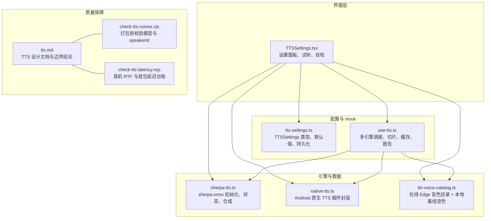
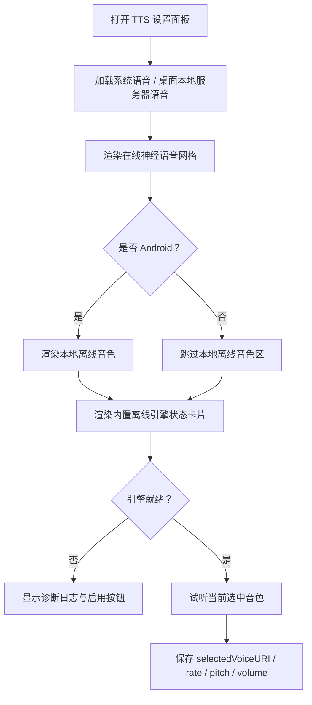
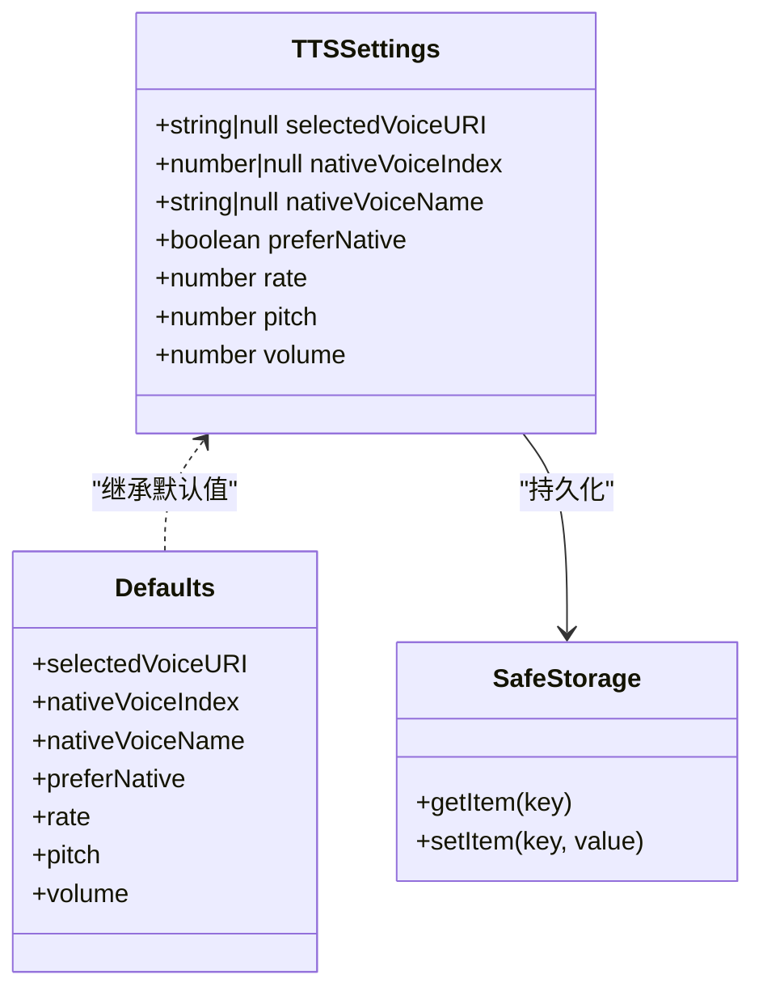
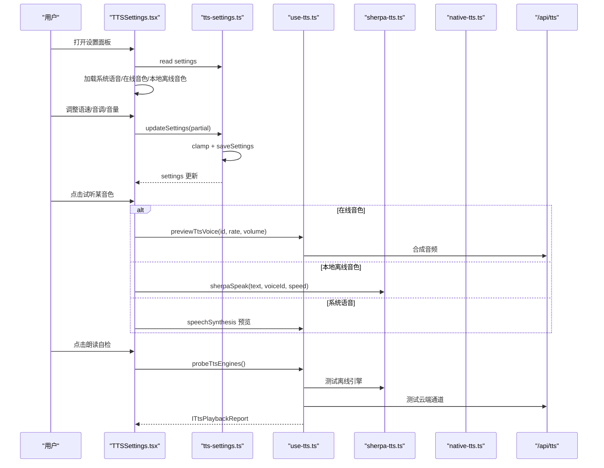
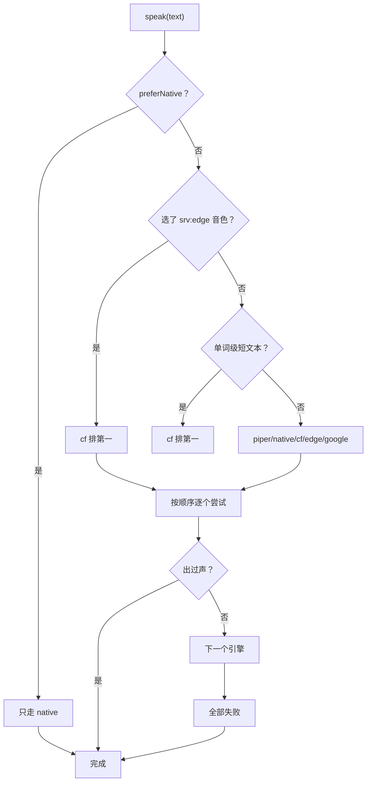
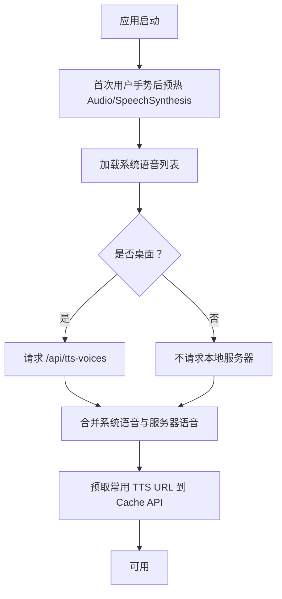
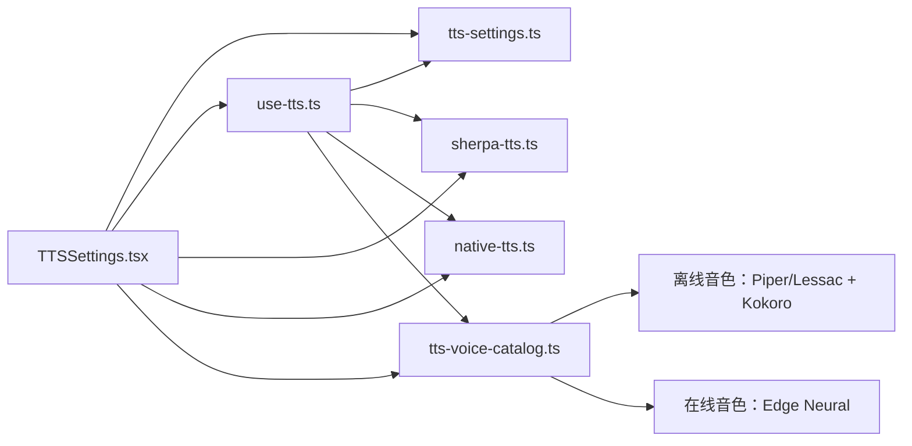

# TTS 语音设置

<cite>
**本文引用的文件**   
- [TTSSettings.tsx](file://src/components/TTSSettings.tsx)
- [tts-settings.ts](file://src/lib/tts-settings.ts)
- [use-tts.ts](file://src/lib/use-tts.ts)
- [tts-voice-catalog.ts](file://src/lib/tts-voice-catalog.ts)
- [sherpa-tts.ts](file://src/lib/sherpa-tts.ts)
- [native-tts.ts](file://src/lib/native-tts.ts)
- [tts.md](file://docs/modules/tts.md)
- [check-tts-voices.cjs](file://scripts/check-tts-voices.cjs)
- [check-tts-latency.mjs](file://scripts/check-tts-latency.mjs)
</cite>

## 目录
1. [引言](#引言)
2. [项目结构](#项目结构)
3. [核心组件](#核心组件)
4. [架构总览](#架构总览)
5. [详细组件分析](#详细组件分析)
6. [依赖关系分析](#依赖关系分析)
7. [性能与降级特性](#性能与降级特性)
8. [故障排查指南](#故障排查指南)
9. [结论](#结论)

## 引言
本文件聚焦 TTS 语音设置模块，目标是把“用户能看到的设置界面”和“引擎选择、参数调节、健康检查、持久化与预览逻辑”讲清楚。文档围绕两个核心实现展开：

- 界面层：`TTSSettings.tsx`，提供音色选择（系统语音、内置在线神经语音、本地离线音色）、语速/音调/音量滑块、试听按钮、引擎状态卡片和朗读自检入口。
- 配置层：`tts-settings.ts`，定义 `TTSSettings` 数据结构、默认值、校验与持久化，并提供 `useTTSSettings` Hook 供页面消费。

同时说明多引擎降级链（sherpa-onnx 离线、系统 SpeechSynthesis、云端 `/api/tts`、Edge WebSocket、Google TTS）如何被设置影响，以及预加载、引擎健康检查、配置同步和实时预览的实现细节。

## 项目结构
TTS 设置相关代码分布在 UI 组件、Hook、音色目录与工具脚本四个层面：

**图表来源**
- [TTSSettings.tsx:1-200](file://src/components/TTSSettings.tsx#L1-L200)
- [tts-settings.ts:1-140](file://src/lib/tts-settings.ts#L1-L140)
- [use-tts.ts:201-508](file://src/lib/use-tts.ts#L201-L508)
- [tts-voice-catalog.ts:1-162](file://src/lib/tts-voice-catalog.ts#L1-L162)
- [tts.md:1-137](file://docs/modules/tts.md#L1-L137)

**章节来源**
- [TTSSettings.tsx:1-200](file://src/components/TTSSettings.tsx#L1-L200)
- [tts-settings.ts:1-140](file://src/lib/tts-settings.ts#L1-L140)
- [tts.md:1-137](file://docs/modules/tts.md#L1-L137)

## 核心组件
### TTSSettings.tsx：设置面板与交互
该组件是 Header 中的“喇叭图标”弹出面板，负责把用户的 TTS 偏好可视化并驱动预览与自检。主要职责包括：

- **音色三选一**：
  - 浏览器系统语音（`SpeechSynthesisVoice`），在桌面通过 `/api/tts-voices` 补充 Windows SAPI / OneCore 音色；移动端 WebView 通常为空，因此该区域会隐藏或显示“未检测到浏览器语音”。
  - 内置在线神经语音：来自 `EDGE_VOICE_CATALOG`，ID 形如 `srv:edge:en-US-AvaNeural`，需要联网。
  - 本地离线音色：仅在 Android 原生环境可见，来自 `listLocalVoices()`，使用 sherpa-onnx 设备内合成。
- **参数调节**：语速、音调、音量由外部 `useTTSSettings` 提供，并通过 `updateSettings` 持久化。
- **实时预览**：点击某个音色后调用 `previewTtsVoice` 或 `sherpaSpeak` 播放短句，避免每次预览都重新读整段课文。
- **引擎健康检查**：Android 环境下展示内置 sherpa-onnx 引擎的状态标签（未加载、加载中、已就绪、加载失败、已停用），并展示诊断日志片段。
- **朗读自检**：调用 `probeTtsEngines`，按引擎顺序尝试合成，并把最近一次 `ITtsPlaybackReport` 回显到面板，帮助判断慢在离线引擎还是云端。

**图表来源**
- [TTSSettings.tsx:1-200](file://src/components/TTSSettings.tsx#L1-L200)
- [TTSSettings.tsx:201-481](file://src/components/TTSSettings.tsx#L201-L481)

**章节来源**
- [TTSSettings.tsx:1-200](file://src/components/TTSSettings.tsx#L1-L200)
- [TTSSettings.tsx:201-481](file://src/components/TTSSettings.tsx#L201-L481)

### tts-settings.ts：配置模型、默认值与持久化
`TTSSettings` 是全局 TTS 偏好的结构化表示，字段含义如下：

| 字段 | 类型 | 含义 | 默认值 |
|---|---|---|---|
| `selectedVoiceURI` | `string \| null` | 选中的语音 URI；`null` 表示自动选择最佳声音 | `null` |
| `nativeVoiceIndex` | `number \| null` | Android 原生 TTS 引擎的语音索引；`null` 表示系统默认 | `null` |
| `nativeVoiceName` | `string \| null` | 仅用于设置页回显的原生可读名 | `null` |
| `preferNative` | `boolean` | 优先使用系统原生 TTS，开启后不再尝试云端/Edge | `false` |
| `rate` | `number` | 语速，范围 `0.5 – 1.5` | `0.9` |
| `pitch` | `number` | 音调，范围 `0.5 – 2.0` | `1.0` |
| `volume` | `number` | 音量，范围 `0.0 – 1.0` | `1.0` |

关键行为：

- **默认值管理**：通过 `DEFAULTS` 对象集中维护，加载失败时回退到默认值。
- **数值校验**：`clamp` 确保 `rate/pitch/volume` 始终落在合法区间；`updateSettings` 中再次 clamp，防止外部传入越界值。
- **跨平台持久化**：使用 `safeStorage`，键名为 `__nativethink_tts_settings`；格式为 JSON。
- **云同步重读**：当其他设备修改了 TTS 配置后，通过 `useSyncDown` 触发 `loadSettings`，保证本机配置与云端一致。
- **英语语音筛选与排序**：`getEnglishVoices` 过滤 `lang.startsWith('en-')` 的语音，并按 `localService`、厂商关键词等打分排序，便于自动选择更高质量的系统语音。

**图表来源**
- [tts-settings.ts:1-140](file://src/lib/tts-settings.ts#L1-L140)

**章节来源**
- [tts-settings.ts:1-140](file://src/lib/tts-settings.ts#L1-L140)

## 架构总览
TTS 设置不是孤立 UI：它既是用户偏好输入端，也是多引擎调度器的观察端。整体链路如下：

**图表来源**
- [TTSSettings.tsx:1-200](file://src/components/TTSSettings.tsx#L1-L200)
- [use-tts.ts:201-508](file://src/lib/use-tts.ts#L201-L508)
- [tts-settings.ts:1-140](file://src/lib/tts-settings.ts#L1-L140)

## 详细组件分析

### 引擎选择与多引擎降级链
TTS 引擎候选顺序由 `use-tts.ts` 决定，并受 `settings.preferNative`、在线音色选择和内置引擎健康状态影响：

| 条件 | 候选顺序 |
|---|---|
| Android 默认 | piper → native → cf → edge → google |
| 显式选择在线音色 `srv:edge:*` | cf → piper → native → edge → google |
| 打开“只用系统引擎” | 只有 native |
| 内置引擎被闪退护栏停用 | 从候选中剔除 piper |
| 非 Android（网页/桌面/iOS） | cf → edge → google |

其中：

- **piper**：sherpa-onnx 离线引擎，使用 Piper 或 Kokoro 模型。
- **native**：Android 原生 TTS 插件，零延迟、不断流，但音色选择受限。
- **cf**：云端 `/api/tts`，代理 Google Translate TTS，绕过网络限制，适合短词朗读。
- **edge**：直接 Edge-TTS WebSocket。
- **google**：最终兜底 URL。

**图表来源**
- [use-tts.ts:201-508](file://src/lib/use-tts.ts#L201-L508)
- [tts.md:1-137](file://docs/modules/tts.md#L1-L137)

**章节来源**
- [use-tts.ts:201-508](file://src/lib/use-tts.ts#L201-L508)
- [tts.md:1-137](file://docs/modules/tts.md#L1-L137)

### 语音参数调节：语速、音调、音量
`TTSSettings` 暴露三个可调参数：

- **语速 `rate`**：范围 `0.5 – 1.5`，默认 `0.9`。
- **音调 `pitch`**：范围 `0.5 – 2.0`，默认 `1.0`。
- **音量 `volume`**：范围 `0.0 – 1.0`，默认 `1.0`。

这些参数会被：

1. `TTSSettings.tsx` 的滑块控件读取并调用 `updateSettings`。
2. `tts-settings.ts` 用 `clamp` 限制范围后写入 `safeStorage`。
3. `use-tts.ts` 在合成时读取，传给具体引擎：
   - System SpeechSynthesis：`SpeechSynthesisUtterance.rate/pitch/volume`。
   - Edge/TTS 云端：通过 `rateToEdge` 转为百分比速率。
   - sherpa-onnx：通过 `speed` 参数传入。

**章节来源**
- [tts-settings.ts:1-140](file://src/lib/tts-settings.ts#L1-L140)
- [TTSSettings.tsx:1-200](file://src/components/TTSSettings.tsx#L1-L200)
- [use-tts.ts:201-508](file://src/lib/use-tts.ts#L201-L508)

### 多引擎降级链的配置界面
`TTSSettings.tsx` 把三种主要音色源组织成并列区块：

1. **系统语音下拉框**：
   - 来源：`window.speechSynthesis.getVoices()`。
   - 桌面额外来源：`/api/tts-voices`，返回 Windows SAPI / OneCore 音色。
   - 移动端可能为空，此时显示提示文案。
2. **内置在线神经语音网格**：
   - 来源：`EDGE_VOICE_CATALOG`。
   - 每个音色支持单独试听，试听失败时提示网络问题。
   - 若当前选中在线音色且处于 Android 环境，可一键切换到推荐的本地离线音色。
3. **本地离线音色网格**：
   - 仅 Android 原生环境显示。
   - 来源：`listLocalVoices()`，包含默认 Lessac 和 11 个 Kokoro 音色。
   - 点击试听会调用 `sherpaSpeak` 播放固定例句。

此外，面板还提供：

- **内置离线引擎状态卡片**：显示“未加载 / 加载中 / 已就绪 / 加载失败 / 已停用”，并在失败时展示诊断信息。
- **重新启用按钮**：当内置引擎因闪退被停用时，用户可手动恢复。

**章节来源**
- [TTSSettings.tsx:201-481](file://src/components/TTSSettings.tsx#L201-L481)
- [tts-voice-catalog.ts:1-162](file://src/lib/tts-voice-catalog.ts#L1-L162)

### 语音预加载机制
预加载分为两层：

1. **语音列表预加载**：
   - `TTSSettings.tsx` 在组件挂载和面板打开时多次尝试加载系统语音，并监听 `voiceschanged`。
   - 桌面环境主动请求 `/api/tts-voices`，只在 `platformTag() === 'desktop'` 时发起，避免 web/APK 误发请求。
2. **音频内容预加载**：
   - `use-tts.ts` 使用 Cache API 对云端 TTS URL 做幂等预取，命中时直接返回 blob URL。
   - 缓存有 FIFO 上限，防止长期运行占用过多存储空间。
   - sherpa-onnx 侧也提供 `warmSherpa`，用于预热内置离线引擎。

**图表来源**
- [TTSSettings.tsx:1-200](file://src/components/TTSSettings.tsx#L1-L200)
- [use-tts.ts:201-508](file://src/lib/use-tts.ts#L201-L508)

**章节来源**
- [TTSSettings.tsx:1-200](file://src/components/TTSSettings.tsx#L1-L200)
- [use-tts.ts:201-508](file://src/lib/use-tts.ts#L201-L508)

### 引擎健康检查与诊断
Android 环境下，`TTSSettings.tsx` 每 1.5 秒轮询 sherpa-onnx 引擎状态：

- 如果引擎被闪退护栏自动停用，则显示“已停用”，并提供“重新启用”按钮。
- 如果状态为 `ready`，显示采样率、缓存数量和加载方式。
- 如果状态为 `error`，显示错误原因、模型大小、espeak 文件数量等诊断信息。
- 如果有初始化日志，则以滚动区域展示最近几行。

`sherpa-tts.ts` 暴露：

- `getSherpaStatus`：查询当前引擎状态。
- `isBundledEngineDisabled`：判断是否被自动停用。
- `reenableBundledEngine`：允许用户重新启用。
- `getSherpaInitLog`：获取初始化日志。
- `warmSherpa`：预热内置引擎。

**章节来源**
- [TTSSettings.tsx:1-200](file://src/components/TTSSettings.tsx#L1-L200)
- [TTSSettings.tsx:201-481](file://src/components/TTSSettings.tsx#L201-L481)

### 配置持久化与云同步
`tts-settings.ts` 的持久化策略：

- 存储键：`__nativethink_tts_settings`。
- 存储介质：`safeStorage`，适配 Web Storage 与 Capacitor 安全存储。
- 加载失败或解析失败时，返回完整默认值。
- 云同步下行后触发 `loadSettings`，使另一台设备的修改在本机生效。
- 所有数值字段在保存前 clamp，避免脏数据污染持久化层。

**章节来源**
- [tts-settings.ts:1-140](file://src/lib/tts-settings.ts#L1-L140)

### 实时预览功能
`TTSSettings.tsx` 提供三类预览路径：

1. **系统语音预览**：使用 `SpeechSynthesisUtterance` 播放固定英文句子。
2. **在线神经语音预览**：调用 `previewTtsVoice`，根据音色 ID 走云端合成。
3. **本地离线音色预览**：调用 `sherpaSpeak` 播放固定句子，并创建临时 `Audio` 元素播放。

预览过程中，按钮会显示“试听中…”，播放结束后恢复。试听失败时会 toast 提示。

**章节来源**
- [TTSSettings.tsx:201-481](file://src/components/TTSSettings.tsx#L201-L481)

### TTS 配置验证与默认值管理
配置验证主要体现在以下位置：

- `loadSettings`：解析 JSON 后对每个字段做类型检查和默认值回退。
- `clamp`：强制 `rate ∈ [0.5, 1.5]`、`pitch ∈ [0.5, 2.0]`、`volume ∈ [0.0, 1.0]`。
- `updateSettings`：再次 clamp 新增字段，保证后续保存一定合法。
- `getEnglishVoices`：过滤无效语言、按质量评分排序。
- `getBestVoice`：优先匹配用户上次选择的 `selectedVoiceURI`，否则返回最高分语音。

默认值管理集中在 `DEFAULTS` 对象，新字段应同时加入默认值、加载逻辑和更新逻辑。

**章节来源**
- [tts-settings.ts:1-140](file://src/lib/tts-settings.ts#L1-L140)

### 跨平台兼容性方案
TTS 设置的跨平台处理体现在多处：

- **Android WebView 无系统语音**：隐藏系统语音下拉框，引导用户使用“系统语音引擎”或在线/离线音色。
- **桌面 Electron/Chrome**：额外拉取 `/api/tts-voices`，提供 Windows SAPI / OneCore 音色。
- **iOS**：`use-tts.ts` 将 iOS 视为 `SpeechSynthesis` 不可靠的平台，默认优先云端通道。
- **在线音色 vs 本地音色**：在线音色需要网络，本地音色依赖 sherpa-onnx 模型；两者在设置面板中分别展示，避免用户误以为“离线就能用在线音色”。
- **原生 TTS 健康检查**：Android 下明确区分“内置离线引擎”和“系统原生 TTS 引擎”，前者对应 sherpa-onnx，后者对应 `native-tts.ts`。

**章节来源**
- [TTSSettings.tsx:1-200](file://src/components/TTSSettings.tsx#L1-L200)
- [use-tts.ts:201-508](file://src/lib/use-tts.ts#L201-L508)
- [tts-voice-catalog.ts:1-162](file://src/lib/tts-voice-catalog.ts#L1-L162)

## 依赖关系分析
TTS 设置模块的内部依赖关系如下：

**图表来源**
- [TTSSettings.tsx:1-200](file://src/components/TTSSettings.tsx#L1-L200)
- [tts-settings.ts:1-140](file://src/lib/tts-settings.ts#L1-L140)
- [use-tts.ts:201-508](file://src/lib/use-tts.ts#L201-L508)
- [tts-voice-catalog.ts:1-162](file://src/lib/tts-voice-catalog.ts#L1-L162)

**章节来源**
- [TTSSettings.tsx:1-200](file://src/components/TTSSettings.tsx#L1-L200)
- [tts-settings.ts:1-140](file://src/lib/tts-settings.ts#L1-L140)
- [use-tts.ts:201-508](file://src/lib/use-tts.ts#L201-L508)
- [tts-voice-catalog.ts:1-162](file://src/lib/tts-voice-catalog.ts#L1-L162)

## 性能与降级特性

### 长文朗读与 RTF 边界
文档明确指出：

- 默认本地音色是 Piper Lessac，因为其实测 RTF 约 `0.076`，远小于 1，能跟上播放。
- Kokoro int8 实测 RTF 约 `1.008–1.75`，大于 1，意味着合成慢于播放，长文会在句间停顿。
- 增加线程数只能次线性改善 Kokoro，无法突破 RTF > 1 的根本瓶颈。
- 因此设置面板中对 Kokoro 音色明确标注代价，而不是悄悄切换引擎。

**章节来源**
- [tts.md:1-137](file://docs/modules/tts.md#L1-L137)
- [tts-voice-catalog.ts:1-162](file://src/lib/tts-voice-catalog.ts#L1-L162)

### 首包延迟与入队顺序
性能脚本 `check-tts-latency.mjs` 记录了：

- 原版写法先预取下一片再发送本片，导致原生串行队列里本片排在第二位，首包延迟接近两倍单片耗时。
- 改为“本片先入队、预取排在后面”后，首包延迟显著下降，而两轮总时长基本不变。
- 缓存命中的重复朗读成本极低，冷合成才是主成本。

**章节来源**
- [check-tts-latency.mjs:1-149](file://scripts/check-tts-latency.mjs#L1-L149)

### 云端缓存与配额控制
`use-tts.ts` 对云端 TTS 结果做 Cache API 缓存：

- 命中时返回 blob URL，起播更快。
- 未命中时 fetch 带超时，避免网络黑洞。
- 缓存条目有 FIFO 上限，防止挤占 IndexedDB 或其他存储配额。

**章节来源**
- [use-tts.ts:201-508](file://src/lib/use-tts.ts#L201-L508)

## 故障排查指南

### 内置离线引擎加载失败
现象：

- 设置面板显示“加载失败”。
- 可能伴随模型大小、espeak 文件数量的诊断信息。

排查步骤：

1. 查看“内置离线引擎”卡片中的错误原因。
2. 查看诊断日志最后几行。
3. 确认 espeak 数据是否齐全。
4. 如果之前闪退被自动停用，点击“重新启用”并等待预热。

**章节来源**
- [TTSSettings.tsx:201-481](file://src/components/TTSSettings.tsx#L201-L481)

### 试听在线音色失败
现象：

- 点击在线音色试听后 toast 提示“试听失败，请检查网络”。

排查步骤：

1. 确认网络连接正常。
2. 检查是否被网络限制阻断 Edge-TTS 或云端代理。
3. 考虑改用本地离线音色或系统语音。

**章节来源**
- [TTSSettings.tsx:201-481](file://src/components/TTSSettings.tsx#L201-L481)

### 试听本地离线音色失败
现象：

- 点击本地离线音色试听失败。
- 提示“内置离线引擎已就绪”类错误。

排查步骤：

1. 确认内置离线引擎状态为“已就绪”。
2. 如果是首次试听，等待模型加载完成。
3. 如果引擎被停用，先重新启用。

**章节来源**
- [TTSSettings.tsx:201-481](file://src/components/TTSSettings.tsx#L201-L481)

### 朗读自检结果异常
现象：

- “上次朗读实测”显示某个引擎耗时很长。
- 或者一直提示“朗读暂时不可用”。

排查步骤：

1. 查看 `engine` 字段，判断是离线引擎、系统引擎还是云端通道。
2. 查看 `firstAudioMs`，判断是起播慢还是整句慢。
3. 查看 `startEvidence`，确认是否是原生引擎整句念完才上报。
4. 检查网络是否影响云端通道。
5. 检查是否有英语系统语音可用。

**章节来源**
- [use-tts.ts:201-508](file://src/lib/use-tts.ts#L201-L508)
- [TTSSettings.tsx:1-200](file://src/components/TTSSettings.tsx#L1-L200)

### 音色 speakerId 不一致
现象：

- 某个 Kokoro 音色听起来像别人的声音。
- 打包或部署后出现“读错音色”。

排查步骤：

1. 运行 `scripts/check-tts-voices.cjs`，检查模型资产是否齐全。
2. 检查 `speakerId` 是否与模型内嵌元数据一致。
3. 确认 `model.int8.onnx` 是预期版本。
4. 修正 `tts-voice-catalog.ts` 中的 `speakerId` 后重新构建。

**章节来源**
- [check-tts-voices.cjs:1-200](file://scripts/check-tts-voices.cjs#L1-L200)
- [tts-voice-catalog.ts:1-162](file://src/lib/tts-voice-catalog.ts#L1-L162)

## 结论
TTS 语音设置模块的核心价值在于：**把用户偏好、多引擎能力和平台差异统一到一个可解释的设置面板中**。

- 界面层 `TTSSettings.tsx` 不只提供下拉框和滑块，还承担音色试听、引擎健康检查和朗读自检的职责。
- 配置层 `tts-settings.ts` 定义了清晰的 `TTSSettings` 模型，负责默认值、校验、持久化和云同步。
- 引擎层 `use-tts.ts` 实现了以 sherpa-onnx 离线、系统原生 TTS、云端代理、Edge、Google 为主的降级链，并针对短词、长文、RTF 和首包延迟做了专门优化。
- 质量保障层通过 `tts.md`、`check-tts-voices.cjs`、`check-tts-latency.mjs` 把产品决策和实测数据固化下来，避免“看起来能跑、实际音质或延迟不达标”的装饰性实现。

对于后续扩展，建议遵循以下原则：

- 新增音色必须同时更新目录、默认值、校验逻辑和界面展示。
- 新增引擎必须进入统一降级链，不能绕过 `use-tts.ts`。
- 新增参数必须先定义默认值、取值范围、持久化逻辑和预览路径。
- 任何影响发音质量的改动都应参考 RTF、首包延迟和音色一致性这三个维度进行验证。