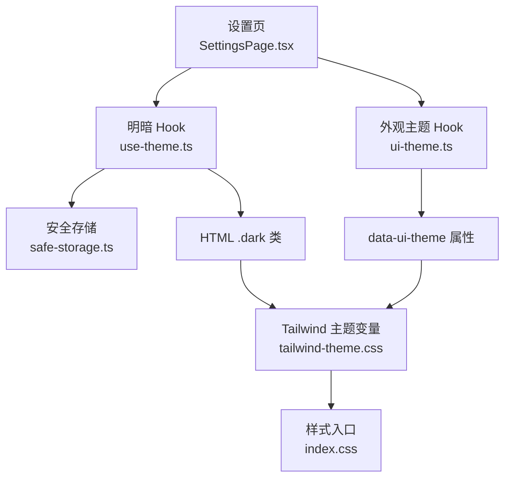
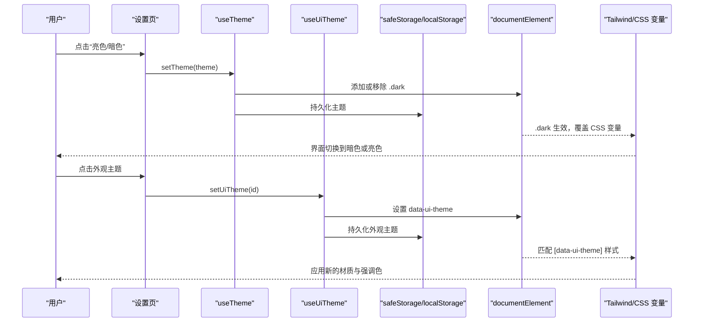
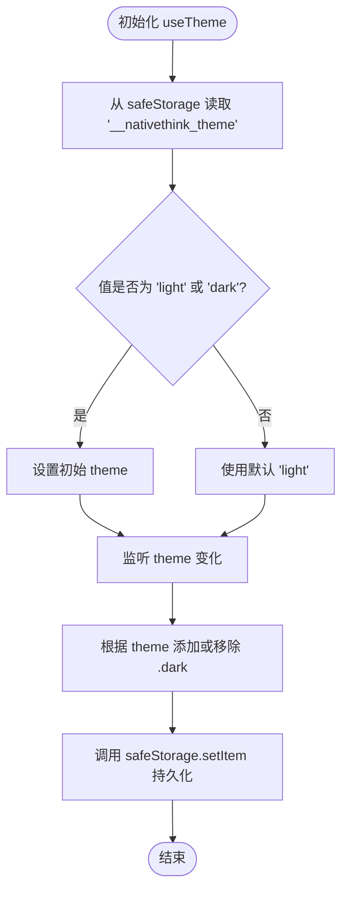
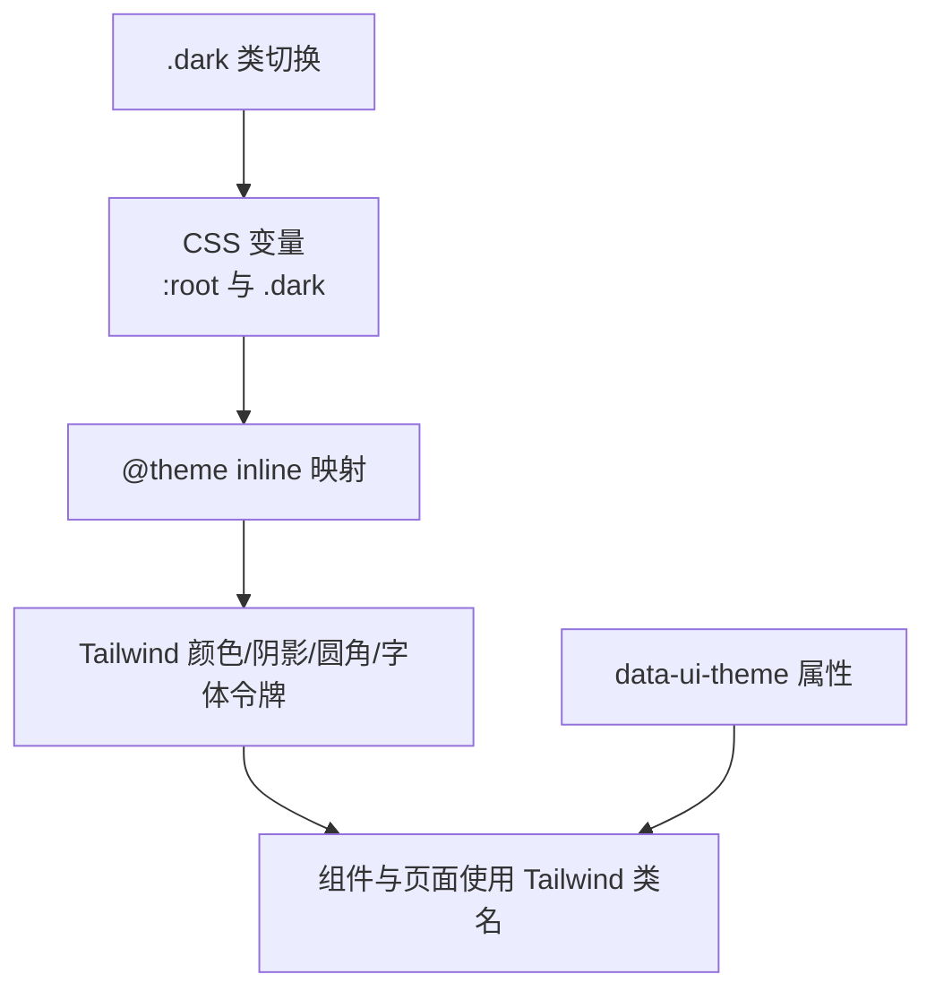
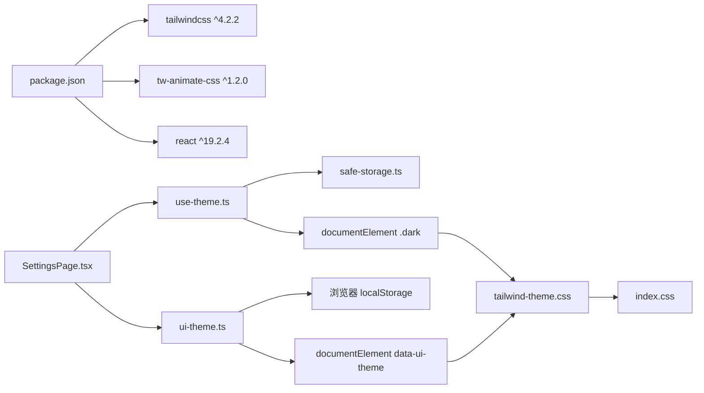

# 主题系统

<cite>
**本文引用的文件**   
- [use-theme.ts](file://src/lib/use-theme.ts)
- [ui-theme.ts](file://src/lib/ui-theme.ts)
- [safe-storage.ts](file://src/lib/safe-storage.ts)
- [tailwind-theme.css](file://src/tailwind-theme.css)
- [index.css](file://src/index.css)
- [SettingsPage.tsx](file://src/pages/SettingsPage/SettingsPage.tsx)
- [package.json](file://package.json)
</cite>

## 目录
1. [简介](#简介)
2. [项目结构](#项目结构)
3. [核心组件](#核心组件)
4. [架构总览](#架构总览)
5. [详细组件分析](#详细组件分析)
6. [依赖关系分析](#依赖关系分析)
7. [性能与可访问性](#性能与可访问性)
8. [故障排查](#故障排查)
9. [结论](#结论)

## 简介
NativeThink 的主题系统由两套正交机制组成：
- 明暗模式：通过 `useTheme` Hook 控制 `<html>` 的 `.dark` 类，驱动 Tailwind CSS v4 的 `@custom-variant dark`。
- UI 外观主题：通过 `useUiTheme` Hook 和 `data-ui-theme` 属性，在默认“原生青绿”基础上切换材质、强调色和品牌色，而不改变布局与组件结构。

两者共同依赖 Tailwind CSS v4 的 CSS 变量体系与 `@theme inline` 映射，把设计令牌暴露给 Tailwind 工具类；样式入口 `index.css` 负责引入 Tailwind、动画库、主题变量以及全局过渡与动画策略。

## 项目结构
主题相关代码集中在以下位置：
- React Hook：`src/lib/use-theme.ts`（明暗）、`src/lib/ui-theme.ts`（UI 外观）。
- 持久化存储：`src/lib/safe-storage.ts`（带用户隔离与迁移的安全存储）。
- 样式层：`src/tailwind-theme.css`（CSS 变量与 Tailwind 主题映射）、`src/index.css`（Tailwind 入口、动画、自定义变体）。
- 使用方：`src/pages/SettingsPage/SettingsPage.tsx`（设置页同时提供明暗切换与外观主题选择）。
- 构建与依赖：`package.json`（Tailwind v4、tw-animate-css、React 等）。



**图表来源**
- [SettingsPage.tsx:6-7](file://src/pages/SettingsPage/SettingsPage.tsx#L6-L7)
- [use-theme.ts:1-44](file://src/lib/use-theme.ts#L1-L44)
- [ui-theme.ts:1-84](file://src/lib/ui-theme.ts#L1-L84)
- [tailwind-theme.css:1-357](file://src/tailwind-theme.css#L1-L357)
- [index.css:1-10](file://src/index.css#L1-L10)

**章节来源**
- [package.json:1-130](file://package.json#L1-L130)

## 核心组件
- `useTheme`：管理 `light` / `dark` 状态，写入 `<html class="dark">`，并通过 `safeStorage` 持久化。
- `useUiTheme`：管理 `classic | porcelain | graphite | lime | sand | berry` 外观主题，写入 `document.documentElement` 的 `data-ui-theme`，并通过 `localStorage` 与 `window` 自定义事件同步。
- `safeStorage`：对 `localStorage` 做前缀隔离、用户 ID 注入、旧键迁移、云同步钩子与错误容错。
- `tailwind-theme.css`：定义亮/暗两套 CSS 变量，并用 `@theme inline` 映射到 Tailwind 的颜色、阴影、圆角、字体等设计令牌。
- `index.css`：引入 Tailwind、`tw-animate-css`、主题 CSS 与排版 CSS，定义全局动画、减少动效策略与阅读器主题。

**章节来源**
- [use-theme.ts:1-44](file://src/lib/use-theme.ts#L1-L44)
- [ui-theme.ts:1-84](file://src/lib/ui-theme.ts#L1-L84)
- [tailwind-theme.css:1-357](file://src/tailwind-theme.css#L1-L357)
- [index.css:1-200](file://src/index.css#L1-L200)

## 架构总览
主题系统的运行时流程如下：



**图表来源**
- [SettingsPage.tsx:61-62](file://src/pages/SettingsPage/SettingsPage.tsx#L61-L62)
- [use-theme.ts:8-44](file://src/lib/use-theme.ts#L8-L44)
- [ui-theme.ts:49-84](file://src/lib/ui-theme.ts#L49-L84)
- [tailwind-theme.css:1-357](file://src/tailwind-theme.css#L1-L357)

## 详细组件分析

### 明暗模式 Hook：`useTheme`
`useTheme` 的职责是维护明暗主题状态，并在首次加载时恢复已保存的值；随后将当前主题映射为 `<html>` 上的 `.dark` 类名，从而触发 Tailwind 的暗色变体。

关键行为：
- 初始状态：优先从 `safeStorage.getItem('__nativethink_theme')` 读取 `'light'` 或 `'dark'`，否则默认为 `'light'`。
- 副作用：当 `theme` 变化时，向 `document.documentElement` 添加或移除 `.dark` 类。
- 更新接口：
  - `setTheme(t)`：设置主题并尝试持久化。
  - `toggleTheme()`：在 `'light'` 与 `'dark'` 之间切换。
- 容错：读写 `safeStorage` 均使用 `try/catch`，失败时不阻断渲染。



**图表来源**
- [use-theme.ts:1-44](file://src/lib/use-theme.ts#L1-L44)
- [safe-storage.ts:1-216](file://src/lib/safe-storage.ts#L1-L216)

**章节来源**
- [use-theme.ts:1-44](file://src/lib/use-theme.ts#L1-L44)
- [safe-storage.ts:1-216](file://src/lib/safe-storage.ts#L1-L216)

### 外观主题 Hook：`ui-theme.ts`
`ui-theme.ts` 管理的是与明暗模式正交的 UI 外观主题。它定义了一组预置主题，并通过 `data-ui-theme` 属性作用于根节点。

设计要点：
- 主题集合：`classic`（默认，不覆盖任何 token）、`porcelain`、`graphite`、`lime`、`sand`、`berry`。
- 类型约束：`UiThemeId` 只允许上述六个值；`isThemeId` 用于校验本地存储中的历史值。
- 持久化：使用 `localStorage` 中固定 key `'__nativethink_ui_theme'`。
- 首帧保护：导出 `initUiTheme()`，应在应用挂载前执行，避免先闪回默认再切主题。
- 跨组件同步：
  - 内部状态：React `useState` 持有当前主题。
  - DOM 标记：`applyUiTheme` 设置或移除 `document.documentElement` 的 `data-ui-theme`。
  - 事件总线：自定义事件 `nativethink:ui-theme-change` 让其他模块订阅新主题。
- Hook 返回值：`{ uiTheme, setUiTheme }`，其中 `setUiTheme` 既更新 React 状态，也派发跨组件事件。

```mermaid
classDiagram
  class UiTheme {
    +string id
    +string name
    +string desc
    +[string,string,string] swatch
  }

  class UiThemeStore {
    +readUiTheme() string
    +applyUiTheme(id) void
    +initUiTheme() void
    +useUiTheme() {uiTheme, setUiTheme}
  }

  class SettingsPage {
    +render()
  }

  UiThemeStore --> UiTheme : "管理一组主题"
  SettingsPage --> UiThemeStore : "读取与切换"
```

**图表来源**
- [ui-theme.ts:1-84](file://src/lib/ui-theme.ts#L1-L84)
- [SettingsPage.tsx:61-62](file://src/pages/SettingsPage/SettingsPage.tsx#L61-L62)

**章节来源**
- [ui-theme.ts:1-84](file://src/lib/ui-theme.ts#L1-L84)

### Tailwind CSS v4 主题定制与 CSS 变量系统
项目使用 Tailwind CSS v4（见 `package.json` 中 `"tailwindcss": "^4.2.2"`），并通过 `index.css` 引入：
- `@import "tailwindcss";`
- `@custom-variant dark (&:where(.dark, .dark *));`
- `@import "tw-animate-css";`
- `@import "./tailwind-theme.css";`
- `@import "./typography.css";`

`tailwind-theme.css` 的核心职责：
1. 在 `:root` 定义亮色主题的全部 CSS 变量，包括背景、前景、主色、辅助色、边框、阴影、字体栈、圆角、间距等。
2. 在 `.dark` 下覆盖这些变量，形成完整的暗色主题。
3. 使用 `@theme inline` 将 CSS 变量映射为 Tailwind 的设计令牌，例如 `--color-background`、`--color-primary`、`--shadow-*`、`--radius-*`、`--font-sans` 等。
4. 提供交互提升系统（hover/active/elevate）与实用类，配合 `--elevate-1`、`--elevate-2` 实现自动对比度调整。



**图表来源**
- [tailwind-theme.css:1-357](file://src/tailwind-theme.css#L1-L357)
- [index.css:1-10](file://src/index.css#L1-L10)

**章节来源**
- [tailwind-theme.css:1-357](file://src/tailwind-theme.css#L1-L357)
- [index.css:1-10](file://src/index.css#L1-L10)
- [package.json:1-130](file://package.json#L1-L130)

### 动态样式注入与过渡动画
`index.css` 不仅引入 Tailwind 与主题变量，还承担以下职责：
- 自定义暗色变体：`@custom-variant dark`，使 `.dark` 类能包裹选择器，如 `.dark body`。
- 全局基础样式：平滑滚动、字体抗锯齿、正文颜色继承 `var(--foreground)`，保证暗色模式下轮廓按钮等控件可读。
- 统一动效：
  - 页面入场动画 `.page-enter`。
  - 卡片交错动画 `.stagger > *`。
  - 阅读翻页动画 `.page-turn-next`、`.page-turn-prev`。
  - 流式文本淡入 `.stream-in`。
  - 拼写光标闪烁 `.spelling-caret`。
- 可访问性：通过 `prefers-reduced-motion` 关闭或弱化动画，并将 `scroll-behavior` 改为 `auto`。
- 阅读器主题：提供 `.reader-paper` 与 `.reader-night`，局部覆盖 `--background`、`--card`、`--foreground` 等变量。

注意：当前 `useTheme` 仅切换 `.dark` 类，没有直接监听系统 `prefers-color-scheme`；`ui-theme.ts` 也没有系统外观主题检测逻辑。因此，“系统主题检测”在当前仓库中并未实现，而是依赖用户显式选择或外部初始化。

**章节来源**
- [index.css:1-200](file://src/index.css#L1-L200)

### 主题持久化机制
项目存在两套持久化方案：

| 配置项 | 存储位置 | Key | 特点 |
|---|---|---|---|
| 明暗主题 | `safeStorage` | `__nativethink_theme` | 带用户隔离、旧键迁移、云同步钩子；失败时静默降级 |
| UI 外观主题 | `localStorage` | `__nativethink_ui_theme` | 简单字符串存储；失败时只在会话内生效 |

`safeStorage` 的关键能力：
- 前缀隔离：`__miaoda_<appId>_<userId>__:<key>`，防止同域多应用或多用户数据串扰。
- 匿名 ID 恢复：若引导键丢失，会从既有键名中恢复匿名 ID，避免历史数据“隐身”。
- 旧格式迁移：自动从旧前缀 `__miaoda_<appId>__:` 迁移到新前缀。
- 云同步钩子：可通过 `setCloudSyncHandler` 注册双写处理器，删除操作也会通知同步。
- 返回值语义：`setItem` 返回 `boolean`，调用方可判断是否真正写入。

**章节来源**
- [use-theme.ts:1-44](file://src/lib/use-theme.ts#L1-L44)
- [ui-theme.ts:1-84](file://src/lib/ui-theme.ts#L1-L84)
- [safe-storage.ts:1-216](file://src/lib/safe-storage.ts#L1-L216)

### 自定义主题扩展方式
要新增外观主题，应遵循 `ui-theme.ts` 的模式：
1. 在 `UI_THEMES` 数组中添加一条记录，包含 `id`、`name`、`desc`、`swatch`。
2. 如果该主题需要覆盖 shadcn 或业务色板，可在 `tailwind-theme.css` 中增加 `[data-ui-theme="<id>"]` 规则，覆盖对应 CSS 变量。
3. 保持 `classic` 不变量语义：默认主题不应强制覆盖现有视觉，以便“随时切回原生青绿”。

对于新增明暗配色，则应修改 `tailwind-theme.css` 中的 `:root` 与 `.dark` 变量块，而不是在 JS 里硬编码颜色。

**章节来源**
- [ui-theme.ts:1-48](file://src/lib/ui-theme.ts#L1-L48)
- [tailwind-theme.css:1-357](file://src/tailwind-theme.css#L1-L357)

## 依赖关系分析



**图表来源**
- [package.json:1-130](file://package.json#L1-L130)
- [SettingsPage.tsx:6-7](file://src/pages/SettingsPage/SettingsPage.tsx#L6-L7)
- [use-theme.ts:1-44](file://src/lib/use-theme.ts#L1-L44)
- [ui-theme.ts:1-84](file://src/lib/ui-theme.ts#L1-L84)
- [tailwind-theme.css:1-357](file://src/tailwind-theme.css#L1-L357)
- [index.css:1-10](file://src/index.css#L1-L10)

**章节来源**
- [package.json:1-130](file://package.json#L1-L130)

## 性能与可访问性

### 主题切换性能
- 明暗切换只操作单个 DOM 类的添加/移除，并由 CSS 变量接管颜色计算，属于低开销操作。
- 外观主题切换会写入 `data-ui-theme` 并派发一次自定义事件，影响面限于匹配该属性的 CSS 规则。
- `safeStorage.setItem` 可能触发云同步钩子，属于异步外发，不会阻塞主线程。

### 首帧闪烁防护
- `ui-theme.ts` 提供 `initUiTheme()`，注释明确说明应在应用挂载前调用，以避免首帧显示默认主题后再切换。
- 当前 `useTheme` 没有首屏快速注入逻辑，但明暗主题本身依赖 `.dark` 类，未设置 `.dark` 时即亮色，通常不会出现严重闪烁。

### 减少动效支持
`index.css` 通过 `prefers-reduced-motion`：
- 关闭页面入场、卡片交错、阅读翻页、流式文本等动画。
- 将全局 `scroll-behavior` 设为 `auto`。
- 将动画时长压缩到接近零，确保敏感用户仍可正常使用。

### 浏览器兼容性
- 使用现代 CSS 特性：`@custom-variant`、`@theme inline`、`hsl(from ...)`、相对颜色语法、`:where()`。
- Tailwind v4 与 React 19 表明项目面向较新浏览器环境。
- 对于不支持 `localStorage` 的场景，`safeStorage` 已做 try/catch 降级；`ui-theme.ts` 中 `localStorage.setItem` 失败时仅让主题在会话内有效。
- 对于不支持 `prefers-reduced-motion` 的环境，CSS 媒体查询不会命中，动效仍按默认行为播放。

[本节为通用建议，不直接分析具体代码片段]

## 故障排查

| 现象 | 可能原因 | 处理建议 |
|---|---|---|
| 刷新后明暗主题丢失 | `safeStorage` 不可用或配额不足 | 检查隐私模式、浏览器限制；确认 `safeStorage.setItem` 返回 `true` |
| 外观主题刷新后丢失 | `localStorage` 被清理或写入失败 | 检查浏览器存储权限；确认 key `'__nativethink_ui_theme'` 是否存在 |
| 切换主题后无视觉变化 | 未正确设置 `.dark` 或 `data-ui-theme` | 打开开发者工具检查 `<html>` 属性 |
| 首帧出现主题闪烁 | 未在应用挂载前调用 `initUiTheme()` | 在根组件初始化阶段提前执行 |
| 暗色模式文字不可读 | 正文颜色未继承 `var(--foreground)` | 检查 `index.css` 中 `body` 颜色规则 |
| 动效过多导致不适 | 未尊重系统减少动效偏好 | 验证 `prefers-reduced-motion` 是否生效 |
| 主题切换后其他组件未响应 | 未监听 `nativethink:ui-theme-change` | 在需要的外部组件中订阅该自定义事件 |

**章节来源**
- [use-theme.ts:1-44](file://src/lib/use-theme.ts#L1-L44)
- [ui-theme.ts:1-84](file://src/lib/ui-theme.ts#L1-L84)
- [safe-storage.ts:1-216](file://src/lib/safe-storage.ts#L1-L216)
- [index.css:1-200](file://src/index.css#L1-L200)

## 结论
NativeThink 的主题系统以“明暗模式”和“UI 外观主题”两个维度解耦了视觉配置：
- 明暗模式通过 `useTheme` 控制 `.dark` 类，驱动 Tailwind CSS v4 的暗色变体。
- UI 外观主题通过 `useUiTheme` 控制 `data-ui-theme`，在默认主题之上替换材质与强调色。
- 两者都依赖 `tailwind-theme.css` 中的 CSS 变量，并通过 `index.css` 统一管理动画、可访问性与全局样式。
- 持久化方面，明暗主题使用更健壮的 `safeStorage`，外观主题使用简单 `localStorage`。
- 当前仓库未实现系统主题自动检测，也未提供基于 CSS 变量的动态样式注入框架；如需扩展，应优先在 CSS 变量层新增主题，而非在 JS 中拼接样式。