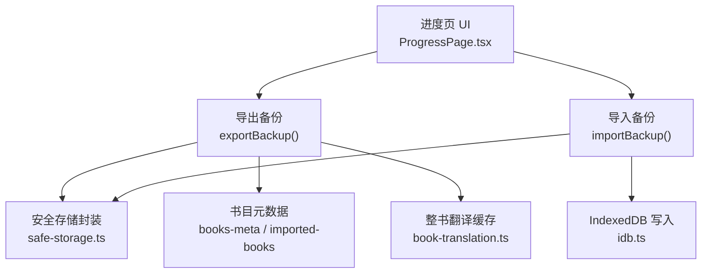
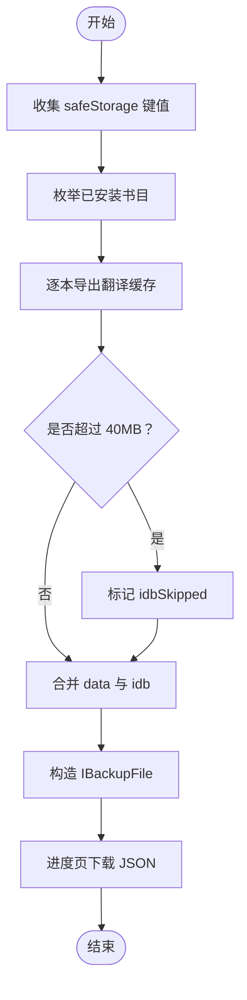
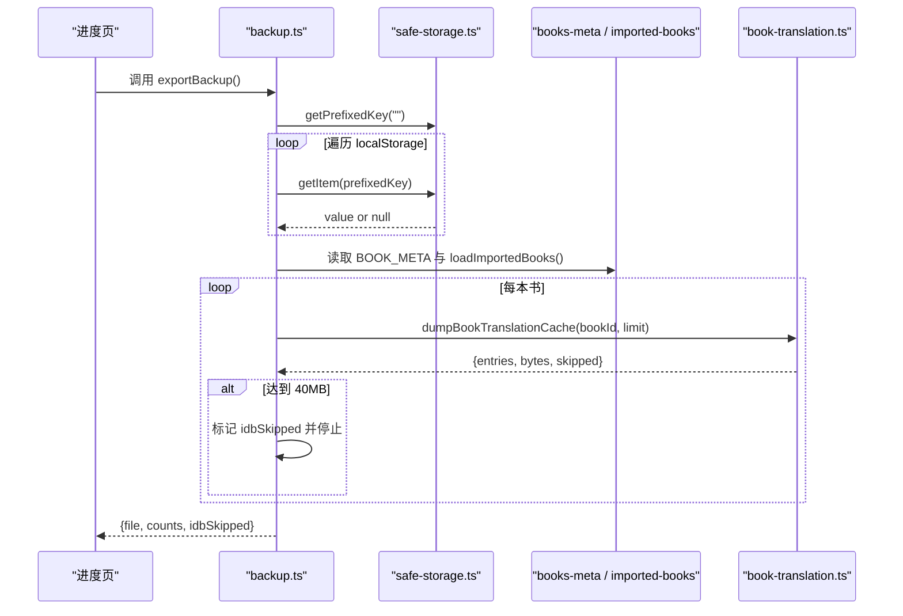
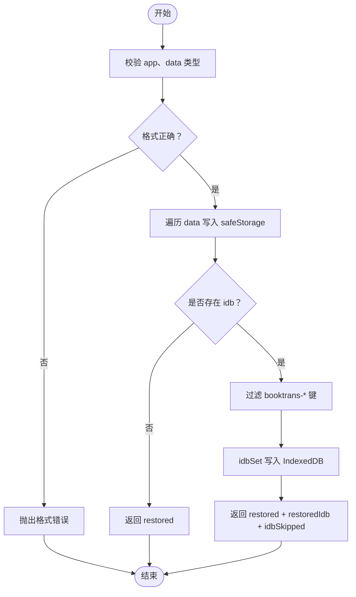
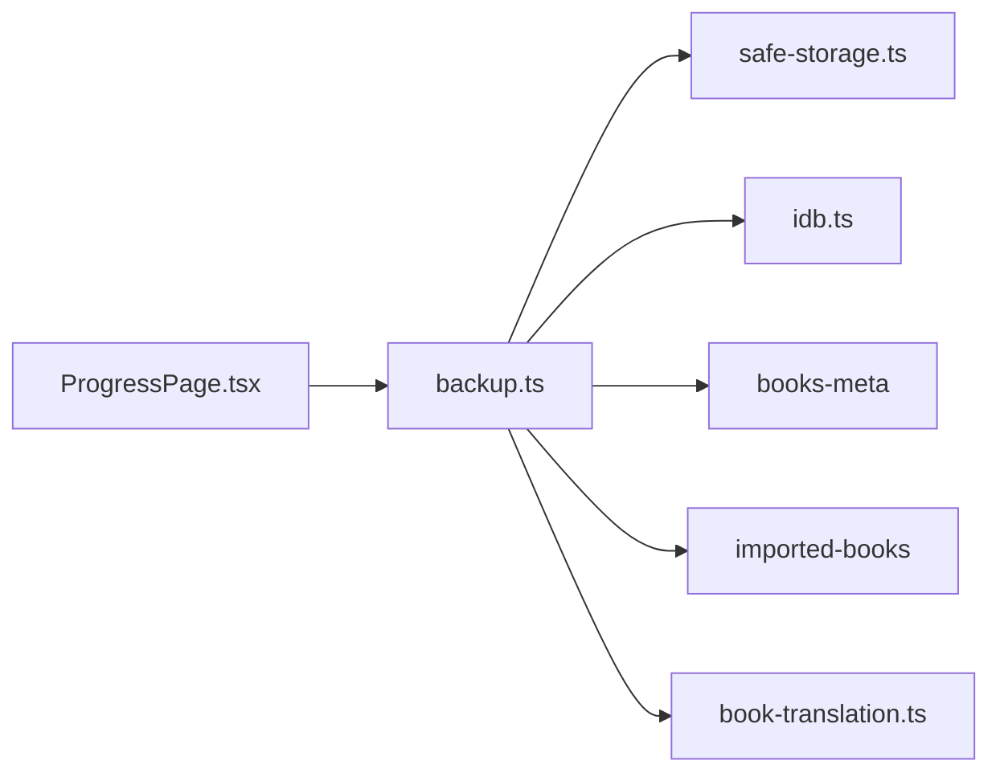

# 备份与恢复

<cite>
**本文引用的文件**   
- [backup.ts](file://src/lib/backup.ts)
- [ProgressPage.tsx](file://src/pages/ProgressPage/ProgressPage.tsx)
- [safe-storage.ts](file://src/lib/safe-storage.ts)
- [idb.ts](file://src/lib/idb.ts)
- [book-translation.ts](file://src/data/book-translation.ts)
</cite>

## 目录
1. [简介](#简介)
2. [项目结构与入口](#项目结构与入口)
3. [核心组件](#核心组件)
4. [架构总览](#架构总览)
5. [详细组件分析](#详细组件分析)
6. [依赖关系分析](#依赖关系分析)
7. [性能与容量控制](#性能与容量控制)
8. [故障排查](#故障排查)
9. [结论](#结论)
10. [附录：备份文件格式与安全建议](#附录备份文件格式与安全建议)

## 简介
NativeThink 的备份与恢复能力由 `src/lib/backup.ts` 提供，用于防止安装包更新或重装导致的学习数据丢失。它覆盖两类本地资产：
- `safeStorage` 作用域内的应用键值（基于 `localStorage`，键前缀为 `__nativethink_*` 及平台隔离前缀）；
- IndexedDB 中的整书对照翻译缓存（体积大、可重算成本很高）。

用户可在进度页面执行“导出学习数据”和“从备份恢复”，以 JSON 形式完成跨设备迁移或离线归档。

## 项目结构与入口
备份功能的调用链如下：
- 用户在进度页触发操作；
- 进度页调用 `exportBackup` / `importBackup`；
- 导出阶段读取 `safeStorage` 所有已作用域化的键，并按需枚举整书翻译缓存；
- 恢复阶段按键覆盖写入 `safeStorage`，并按需写入 IndexedDB。

**图表来源**
- [ProgressPage.tsx:292-320](file://src/pages/ProgressPage/ProgressPage.tsx#L292-L320)
- [backup.ts:20-105](file://src/lib/backup.ts#L20-L105)
- [safe-storage.ts:1-216](file://src/lib/safe-storage.ts#L1-L216)
- [book-translation.ts:800-870](file://src/data/book-translation.ts#L800-L870)
- [idb.ts:1-213](file://src/lib/idb.ts#L1-L213)

**章节来源**
- [ProgressPage.tsx:292-320](file://src/pages/ProgressPage/ProgressPage.tsx#L292-L320)
- [backup.ts:1-105](file://src/lib/backup.ts#L1-L105)

## 核心组件
- **备份文件接口 `IBackupFile`**：定义应用标识、版本、导出时间、`safeStorage` 数据映射以及可选的 IndexedDB 翻译缓存映射。
- **导出函数 `exportBackup`**：遍历带前缀的 `localStorage` 键，收集全部应用数据；随后按书目元数据逐本导出整书翻译缓存，并在达到体积上限时停止。
- **导入函数 `importBackup`**：校验备份结构，覆盖写入 `safeStorage`，再逐个恢复 IndexedDB 中符合 `booktrans-*` 前缀的记录。
- **UI 集成**：进度页负责把 `IBackupFile` 序列化为 JSON 下载，以及从用户选择的文件中解析并恢复。

**章节来源**
- [backup.ts:17-105](file://src/lib/backup.ts#L17-L105)
- [ProgressPage.tsx:46-320](file://src/pages/ProgressPage/ProgressPage.tsx#L46-L320)

## 架构总览
备份流程分两条数据路径：轻量级键值路径走 `localStorage`，重量级整书译文路径走 `IndexedDB`。两者在 `IBackupFile` 中合并为一个 JSON 文档。

**图表来源**
- [backup.ts:26-89](file://src/lib/backup.ts#L26-L89)
- [book-translation.ts:829-870](file://src/data/book-translation.ts#L829-L870)
- [ProgressPage.tsx:296-306](file://src/pages/ProgressPage/ProgressPage.tsx#L296-L306)

## 详细组件分析

### 备份导出逻辑
`exportBackup` 的实现包含两个阶段：

1. **`safeStorage` 数据收集**
   - 通过 `safeStorage.getPrefixedKey('')` 获取当前应用和用户作用域的前缀；
   - 遍历 `localStorage`，仅保留以该前缀开头的键；
   - 去掉内部前缀后存入 `data`，保持对外稳定的短键名。

2. **IndexedDB 整书翻译缓存导出**
   - 动态加载书目元数据、用户导入书籍、整书翻译模块；
   - 合并内置书目和用户导入书目的 `id`；
   - 对每本书调用 `dumpBookTranslationCache(bookId, remainingBytes)`；
   - 累计字节数，超过 `IDB_LIMIT_BYTES`（40MB）则停止后续书本，并设置 `idbSkipped = true`；
   - 若最终存在 IDB 条目，则以可选字段 `idb` 附加到备份文件。

该设计解决了此前“只扫 `localStorage` 却期望找到 `booktrans-*` 键”的历史缺陷：现在枚举来源是书目清单和 manifest，而不是 `localStorage`。

**图表来源**
- [backup.ts:26-89](file://src/lib/backup.ts#L26-L89)
- [book-translation.ts:829-870](file://src/data/book-translation.ts#L829-L870)
- [safe-storage.ts:1-120](file://src/lib/safe-storage.ts#L1-L120)

**章节来源**
- [backup.ts:26-89](file://src/lib/backup.ts#L26-L89)
- [book-translation.ts:800-870](file://src/data/book-translation.ts#L800-L870)

### 备份导入逻辑
`importBackup` 先做严格的结构校验，再分别处理 `safeStorage` 与 IndexedDB：

- 校验 `file.app === 'NativeThink'`，且 `file.data` 为非空对象；
- 对每个字符串值调用 `safeStorage.setItem`，单个键失败不会中断整体恢复；
- 如果存在 `file.idb`，则仅恢复以 `booktrans-` 开头的键；
- 使用 `idbSet` 写入 IndexedDB 的 `wordbank` store；
- 返回恢复条数和是否发生 IDB 跳过标志。

**图表来源**
- [backup.ts:91-105](file://src/lib/backup.ts#L91-L105)
- [idb.ts:140-213](file://src/lib/idb.ts#L140-L213)

**章节来源**
- [backup.ts:91-105](file://src/lib/backup.ts#L91-L105)

### 数据完整性校验机制
- **应用标识校验**：要求 `app === 'NativeThink'`，避免误读其他应用导出的文件。
- **数据结构校验**：要求 `data` 为对象；只有值为字符串的条目才会被写入 `safeStorage`。
- **IDB 前缀校验**：仅恢复键名以 `booktrans-` 开头的记录，防止非翻译缓存数据污染 IndexedDB。
- **容错策略**：单键写入失败不阻断整体流程；IDB 不可用时也会跳过并继续恢复其余数据。
- **恢复反馈**：UI 显示恢复了多少 `safeStorage` 项和多少份翻译缓存，并提示是否需要刷新。

**章节来源**
- [backup.ts:91-105](file://src/lib/backup.ts#L91-L105)
- [ProgressPage.tsx:310-320](file://src/pages/ProgressPage/ProgressPage.tsx#L310-L320)

### 备份范围说明
| 类别 | 备份内容 | 存储位置 | 说明 |
|---|---|---|---|
| 应用配置与学习状态 | 所有 `safeStorage` 作用域内键值 | `localStorage` | 包括学习进度、收藏、设置等由 `safeStorage` 管理的用户数据 |
| 整书对照翻译缓存 | 每本书的章节译文数组与章节清单 | `IndexedDB` | 键格式为 `booktrans-<bookId>-ch<chapterIdx>` 和 `booktrans-<bookId>-index` |
| 词库原始数据 | 未纳入备份 | 打包资源或外部数据源 | 词库属于可再生产物，不在备份范围内 |
| 视频精听媒体 | 未纳入备份 | `IndexedDB` 的 `media` store | 注释明确说明媒体文件很大，不走通用备份路径 |

**章节来源**
- [backup.ts:5-16](file://src/lib/backup.ts#L5-L16)
- [book-translation.ts:9-37](file://src/data/book-translation.ts#L9-L37)
- [book-translation.ts:800-870](file://src/data/book-translation.ts#L800-L870)
- [idb.ts:1-40](file://src/lib/idb.ts#L1-L40)

### 增量备份策略
当前实现不是传统意义上的增量备份，而是**全量快照 + 按需截断**：

- `data` 是全量导出当前会话中所有 `safeStorage` 键；
- `idb` 会扫描所有已知书目，但一旦累计字节数达到 40MB 就停止；
- 当发生截断时，返回值中的 `idbSkipped` 为真，UI 会提示“缓存过大已省略，可重新翻译”。

因此，更准确的说法是：它是一个受体积限制的全量备份，适合“安装包更新前导出一次”的使用场景。

**章节来源**
- [backup.ts:26-89](file://src/lib/backup.ts#L26-L89)
- [book-translation.ts:829-870](file://src/data/book-translation.ts#L829-L870)

### 版本兼容性处理
- 备份文件头包含 `version: 2`，可用于未来区分不同序列化格式。
- 当前 `importBackup` 没有显式版本号升级或降级逻辑；新增字段采用可选字段方式扩展。
- 旧版 `safeStorage` 前缀兼容由 `safe-storage.ts` 负责：支持从匿名 ID 迁移、从旧前缀迁移到新前缀，避免重装或换浏览器后历史数据“隐身”。

这意味着：
- 如果未来引入破坏性格式变更，应在 `importBackup` 中加入 `version` 判断和迁移器；
- 当前 `IBackupFile.version` 更多是声明性契约，尚未驱动实际迁移分支。

**章节来源**
- [backup.ts:20-24](file://src/lib/backup.ts#L20-L24)
- [safe-storage.ts:1-120](file://src/lib/safe-storage.ts#L1-L120)

### 大文件处理
- 常量 `IDB_LIMIT_BYTES = 40 * 1024 * 1024` 将整书翻译缓存限制在约 40MB；
- `dumpBookTranslationCache` 在加入每条记录前估算 `JSON.stringify(value).length`，超限时设置 `skipped = true` 并停止追加；
- 由于按书目顺序累积，可能某本书只备份了部分章节；
- 恢复时，即使部分 IDB 记录写入失败，也只会设置 `idbSkipped = true`，不会回滚已恢复数据。

这是一种“宁可少备份，也不要导出失败”的策略，代价是恢复后可能需要重新翻译某些章节。

**章节来源**
- [backup.ts:24-26](file://src/lib/backup.ts#L24-L26)
- [book-translation.ts:829-870](file://src/data/book-translation.ts#L829-L870)

### 进度反馈
当前实现没有流式进度回调，但提供了足够的事件信号：
- `exportBackup` 返回 `localStorageCount`、`idbCount`、`idbSkipped`；
- `importBackup` 返回 `restored`、`restoredIdb`、`idbSkipped`；
- 进度页用 toast 显示导出数量和是否省略了缓存；
- 恢复成功后延迟 1200ms 刷新页面，让用户看到完整恢复结果。

如果需要长时间任务的用户体验，可考虑：
- 增加 `onProgress` 回调，报告已处理书目数和累计字节数；
- 对超大文件进行分块导出；
- 在 UI 上展示进度条和取消按钮。

**章节来源**
- [backup.ts:26-89](file://src/lib/backup.ts#L26-L89)
- [ProgressPage.tsx:296-320](file://src/pages/ProgressPage/ProgressPage.tsx#L296-L320)

### 错误恢复与健壮性
| 异常场景 | 当前行为 | 影响 |
|---|---|---|
| 备份文件缺少 `app` 或 `data` | 直接抛错，拒绝恢复 | 防止损坏文件或恶意文件污染本地存储 |
| `data` 中某个值不是字符串 | 跳过该键 | 避免写入非法值 |
| 单个 `safeStorage.setItem` 失败 | 忽略并继续 | 保证其余数据仍可恢复 |
| IndexedDB 不可用或写入失败 | 捕获异常并标记 `idbSkipped` | 主数据仍可用，译文缓存可后续重建 |
| 书目模块或 IDB 初始化失败 | 跳过 IDB 导出部分 | 至少保留 `safeStorage` 数据 |
| 存储空间不足 | `safeStorage.setItem` 返回 `false`，但调用方未检查返回值 | 静默丢失风险，建议上层检测返回值 |

**章节来源**
- [backup.ts:91-105](file://src/lib/backup.ts#L91-L105)
- [safe-storage.ts:140-216](file://src/lib/safe-storage.ts#L140-L216)

## 依赖关系分析

**图表来源**
- [backup.ts:17-24](file://src/lib/backup.ts#L17-L24)
- [ProgressPage.tsx:46-46](file://src/pages/ProgressPage/ProgressPage.tsx#L46-L46)

耦合关系要点：
- `backup.ts` 直接依赖 `safe-storage` 和 `idb`，并通过动态 `import` 加载书目与翻译模块，降低冷启动成本；
- `book-translation.ts` 拥有 `booktrans-*` 键格式的私有知识，导出逻辑放在本模块而非 `backup.ts`，符合“键格式由数据模块拥有”的原则；
- `ProgressPage.tsx` 作为唯一公开入口，承担 JSON 序列化、文件下载和恢复后的页面刷新职责。

**章节来源**
- [backup.ts:17-24](file://src/lib/backup.ts#L17-L24)
- [book-translation.ts:800-870](file://src/data/book-translation.ts#L800-L870)
- [ProgressPage.tsx:46-320](file://src/pages/ProgressPage/ProgressPage.tsx#L46-L320)

## 性能与容量控制
- **时间复杂度**：导出 `safeStorage` 为 O(n)，其中 n 是带前缀的本地键数量；IDB 导出为 O(b + c)，b 是书目数量，c 是已登记章节总数。
- **空间复杂度**：备份文件大小取决于 `safeStorage` 数据与整书译文缓存之和，上限约为 40MB 加上应用配置数据；超大 IDB 会被截断。
- **关键瓶颈**：
  - 大量小键遍历时 `getItem` 开销；
  - 每章译文字符串化用于估算大小；
  - 多本书串行导出，无法并行。
- **优化建议**：
  - 对超大书目标支持分页或并发导出；
  - 在 `exportBackup` 暴露进度回调；
  - 对 `safeStorage` 遍历改用 `Object.keys(localStorage)` 或直接维护一个键集合缓存；
  - 对重复导出场景支持增量哈希，便于去重。

[本节为通用性能讨论，不直接分析具体代码片段]

## 故障排查
- **导出后 IDB 数量为 0**
  - 检查是否有已翻译的书目；
  - 确认 `dumpBookTranslationCache` 能读到对应书的 manifest；
  - 查看返回的 `idbSkipped` 是否为真，可能是体积超限。
- **恢复后翻译缓存缺失**
  - 检查备份文件是否包含 `idb` 字段；
  - 确认恢复时 IndexedDB 可用；
  - 若 `idbSkipped` 为真，需重新翻译对应章节。
- **恢复后本地配置丢失**
  - 检查 `safeStorage` 写入是否因配额满返回 `false`；
  - 当前 `importBackup` 未检查 `setItem` 返回值，建议在进度层聚合失败键并提示用户。
- **重装后数据像消失**
  - 检查 `safe-storage.ts` 是否能从既有键恢复匿名 ID；
  - 确认应用标识和用户作用域是否变化。

**章节来源**
- [backup.ts:26-105](file://src/lib/backup.ts#L26-L105)
- [safe-storage.ts:1-120](file://src/lib/safe-storage.ts#L1-L120)
- [book-translation.ts:829-870](file://src/data/book-translation.ts#L829-L870)

## 结论
NativeThink 的备份与恢复功能以 `IBackupFile` 为中心，覆盖了用户最重要的两类本地数据：轻量级的应用状态和重量级的整书翻译缓存。其优势在于：
- 明确的备份范围；
- 对 IDB 缓存采用“按 manifest 枚举 + 40MB 上限”的安全导出；
- 恢复时对单键失败具备容错能力；
- 通过 `safe-storage` 处理平台前缀、用户隔离和历史键迁移。

主要改进空间包括：
- 增加增量备份和进度回调；
- 显式处理 `version` 迁移；
- 检测 `safeStorage.setItem` 的失败返回值；
- 对超大备份提供分块导出与校验机制。

[本节为总结性内容，不直接分析具体代码片段]

## 附录：备份文件格式与安全建议

### 备份文件结构
| 字段 | 类型 | 必填 | 含义 |
|---|---|---:|---|
| `app` | 字符串 | 是 | 固定为 `NativeThink`，用于识别来源 |
| `version` | 数字 | 是 | 当前为 `2`，预留未来格式演进 |
| `exportedAt` | 字符串 | 是 | ISO 8601 时间戳，表示备份生成时间 |
| `data` | 对象 | 是 | 去掉内部前缀后的 `safeStorage` 键值映射 |
| `idb` | 对象 | 否 | 整书翻译缓存映射，键形如 `booktrans-<bookId>-ch<n>` 或 `booktrans-<bookId>-index` |

注意：
- `data` 的值应为字符串；非字符串条目会在恢复时被跳过；
- `idb` 是可选字段；不存在时表示没有导出翻译缓存；
- 文件名由进度页生成，形如 `nativethink-backup-YYYY-MM-DD.json`。

### 安全考虑
- 备份文件包含用户学习数据和阅读缓存，属于敏感本地资产；
- 建议用户：
  - 仅在可信设备上导出和导入；
  - 不要将备份上传到公共云盘而不加密；
  - 在换设备恢复后检查设置和收藏是否正确；
  - 删除不再使用的旧备份。
- 代码层面：
  - 当前不计算文件哈希或签名；
  - 不校验 `exportedAt` 新旧关系；
  - 导入是覆盖式写入，恢复前应先备份现有数据。

### 跨设备同步注意事项
- 同一账号在不同设备上登录时，应优先使用云端同步通道，而不是手动复制 JSON 备份；
- 手动备份更适合以下场景：
  - 重装系统或清空浏览器数据；
  - 迁移到全新设备；
  - 安装包更新前的离线快照；
  - 审计或归档用户学习数据。
- 若同时存在云端同步和本地备份，应以最近更新时间为准，并在恢复前提示用户覆盖风险。

[本节为概念性规范说明，不直接分析具体代码片段]