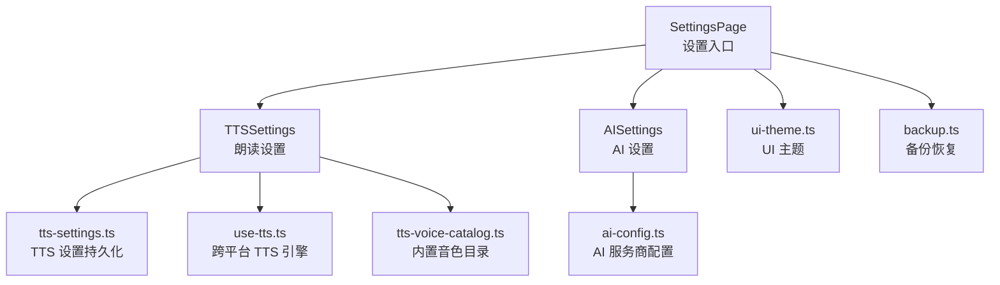
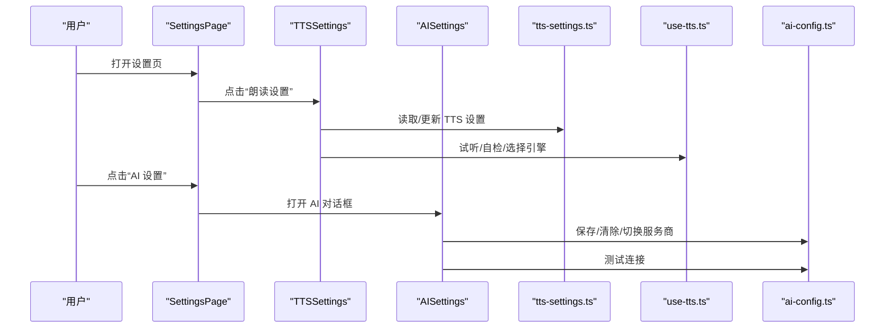
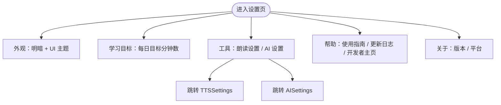
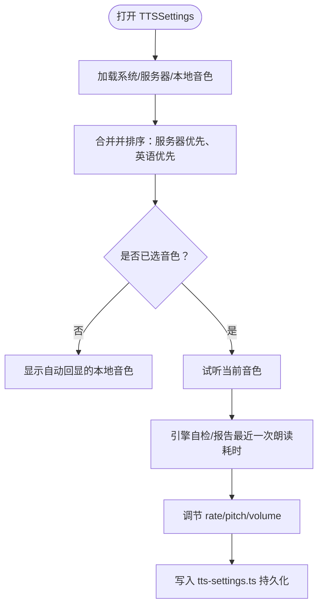
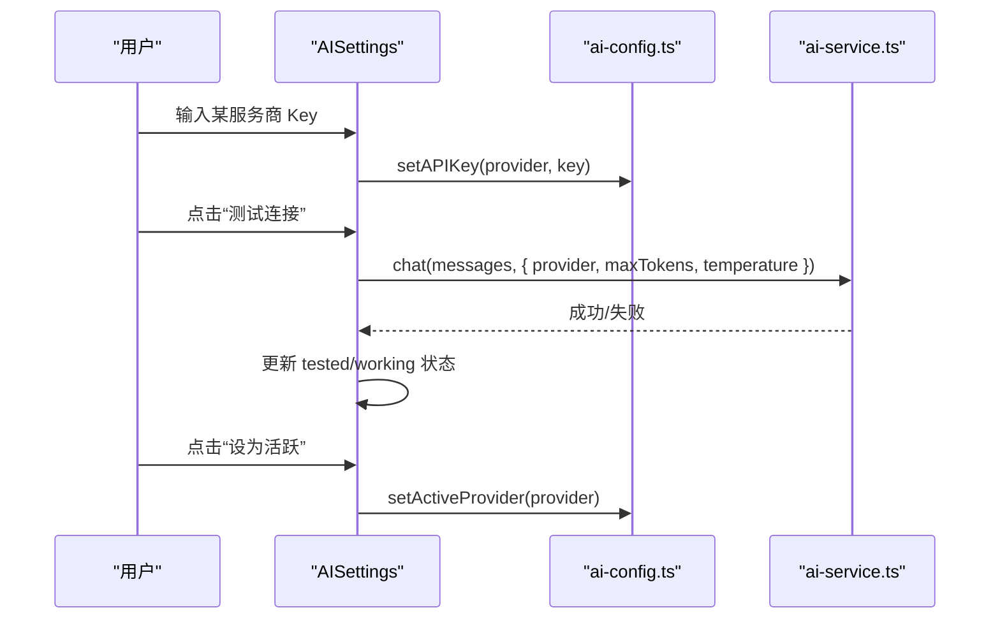
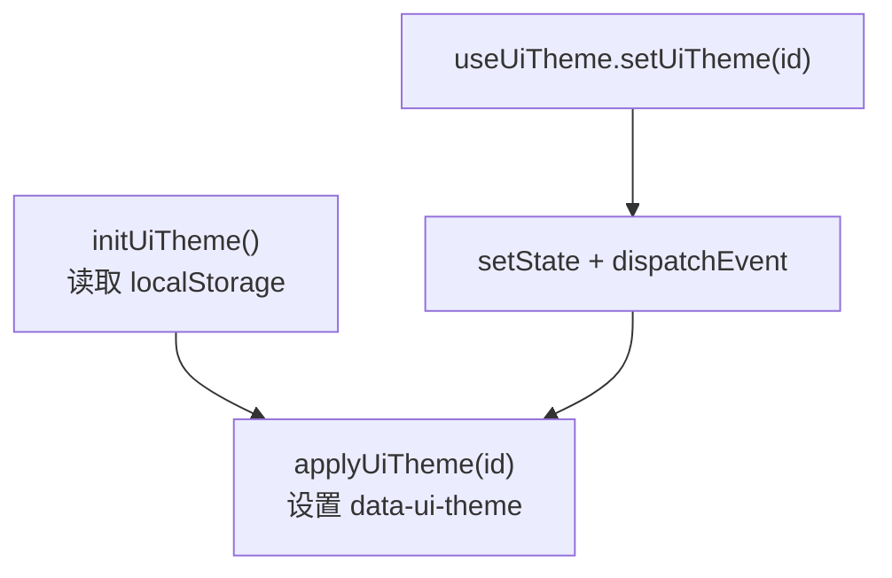
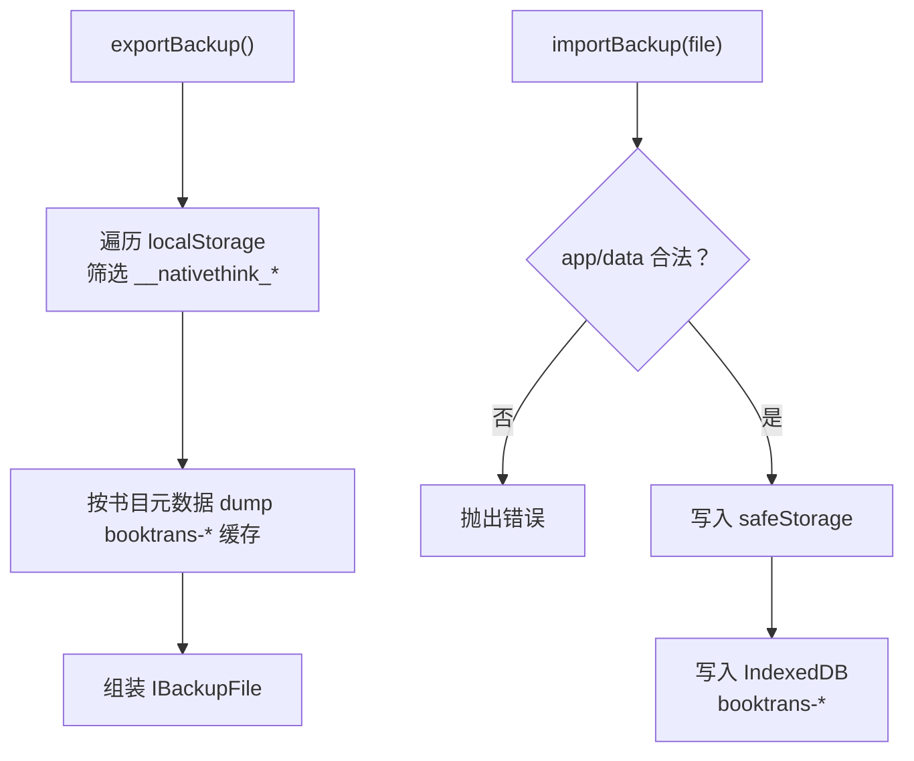
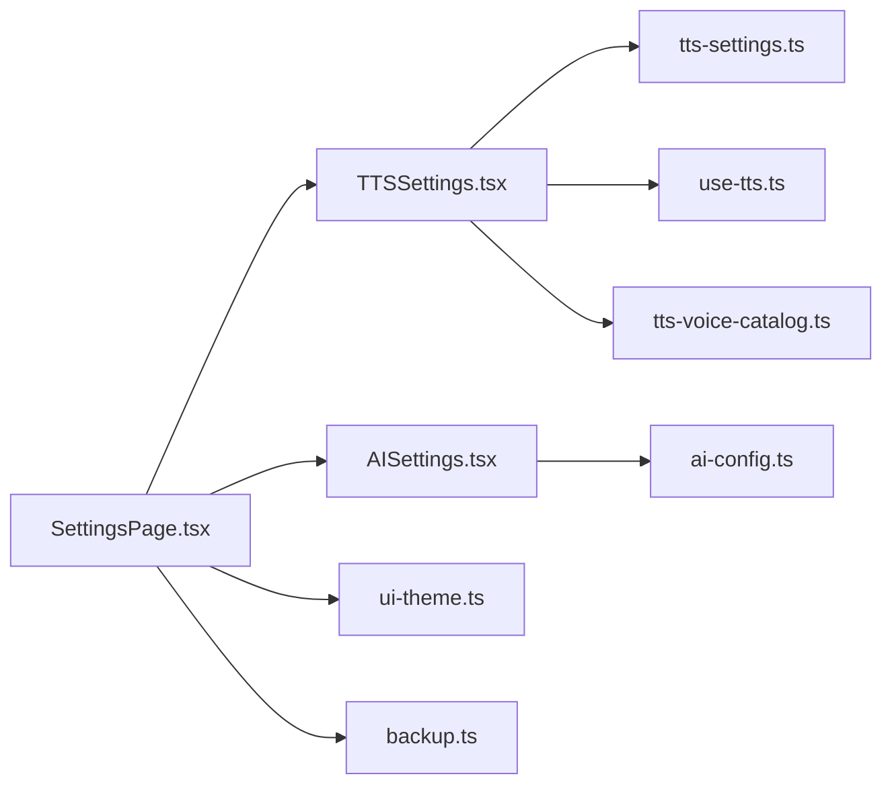

# 设置模块

<cite>
**本文引用的文件**   
- [SettingsPage.tsx](file://src/pages/SettingsPage/SettingsPage.tsx)
- [TTSSettings.tsx](file://src/components/TTSSettings.tsx)
- [AISettings.tsx](file://src/components/AISettings.tsx)
- [tts-settings.ts](file://src/lib/tts-settings.ts)
- [use-tts.ts](file://src/lib/use-tts.ts)
- [tts-voice-catalog.ts](file://src/lib/tts-voice-catalog.ts)
- [ui-theme.ts](file://src/lib/ui-theme.ts)
- [backup.ts](file://src/lib/backup.ts)
- [ai-config.ts](file://src/services/ai-config.ts)
</cite>

## 目录
1. [引言](#引言)
2. [项目结构](#项目结构)
3. [核心组件](#核心组件)
4. [架构总览](#架构总览)
5. [详细组件分析](#详细组件分析)
6. [依赖关系分析](#依赖关系分析)
7. [性能与可用性考虑](#性能与可用性考虑)
8. [故障排查指南](#故障排查指南)
9. [结论](#结论)

## 引言
本文件系统性梳理 NativeThink 的“设置模块”，覆盖以下能力：
- TTS（语音合成）配置：引擎选择、音色列表、语速/音高/音量调节、提示音效开关、自检与诊断。
- AI 服务设置：多服务商管理、API Key 保存与测试、活跃服务商切换、离线小模型备用状态。
- 主题外观：明暗模式与 UI 主题切换，以及样式定制的作用域。
- 数据备份恢复：localStorage 应用数据与整书对照翻译缓存的导出与导入。
- 设置项默认值管理、配置校验与应用范围控制。

该模块以 SettingsPage 为入口，将外观、学习目标、工具（TTS / AI）、帮助与关于信息组织为统一面板；具体业务逻辑下沉到 TTSSettings、AISettings 及对应的 lib 层实现。

## 项目结构
设置模块相关文件按职责分层：
- 页面层：SettingsPage.tsx，负责分组展示、导航与轻量交互。
- 组件层：TTSSettings.tsx、AISettings.tsx，分别承载朗读与 AI 的设置弹窗/弹出框。
- 持久化与运行时库：tts-settings.ts（TTS 设置）、ui-theme.ts（UI 主题）、backup.ts（备份恢复）、ai-config.ts（AI 提供商配置）。
- 运行期引擎：use-tts.ts（跨平台 TTS 调度）、tts-voice-catalog.ts（内置在线/本地音色目录）。



图表来源
- [SettingsPage.tsx:1-183](file://src/pages/SettingsPage/SettingsPage.tsx#L1-L183)
- [TTSSettings.tsx:1-200](file://src/components/TTSSettings.tsx#L1-L200)
- [AISettings.tsx:1-200](file://src/components/AISettings.tsx#L1-L200)
- [tts-settings.ts:1-140](file://src/lib/tts-settings.ts#L1-L140)
- [ui-theme.ts:1-84](file://src/lib/ui-theme.ts#L1-L84)
- [backup.ts:1-105](file://src/lib/backup.ts#L1-L105)
- [ai-config.ts:1-200](file://src/services/ai-config.ts#L1-L200)

章节来源
- [SettingsPage.tsx:1-183](file://src/pages/SettingsPage/SettingsPage.tsx#L1-L183)

## 核心组件
- SettingsPage：设置页容器，提供“外观”“学习目标”“工具”“帮助”“关于”等区块，并将 TTSSettings 和 AISettings 作为子面板挂载。
- TTSSettings：朗读设置面板，负责系统/服务器/本地离线音色枚举、试听、参数调节、自检、原生 Android 语音与 Sherpa 内置引擎状态监控。
- AISettings：AI 设置对话框，负责各服务商 API Key 编辑、连接测试、活跃服务商切换，以及本地 LLM 下载/状态订阅。
- tts-settings.ts：TTS 设置的持久化与默认值管理，包含选中音色、原生语音索引、是否优先原生、语速/音高/音量及其取值钳制。
- ui-theme.ts：UI 主题定义、读取、应用与事件分发，支持 classic/porcelain/graphite/lime/sand/berry 六套主题。
- backup.ts：备份导出与恢复，涵盖 safeStorage 作用域内的键值与 IndexedDB 整书翻译缓存。
- ai-config.ts：AI 服务商常量、出厂 Key、Key 存取、活跃服务商选择与变更事件。
- use-tts.ts：跨平台 TTS 调度器，串联系统 SpeechSynthesis、Edge-TTS WebSocket、Google TTS URL、本地 Sherpa/Kokoro/Piper 等引擎。
- tts-voice-catalog.ts：内置 Edge 神经音色目录与本地离线音色（Kokoro、Piper），含口音、性别、模型 ID 与 speakerId。

章节来源
- [TTSSettings.tsx:1-200](file://src/components/TTSSettings.tsx#L1-L200)
- [AISettings.tsx:1-200](file://src/components/AISettings.tsx#L1-L200)
- [tts-settings.ts:1-140](file://src/lib/tts-settings.ts#L1-L140)
- [ui-theme.ts:1-84](file://src/lib/ui-theme.ts#L1-L84)
- [backup.ts:1-105](file://src/lib/backup.ts#L1-L105)
- [ai-config.ts:1-200](file://src/services/ai-config.ts#L1-L200)
- [use-tts.ts:1-200](file://src/lib/use-tts.ts#L1-L200)
- [tts-voice-catalog.ts:1-162](file://src/lib/tts-voice-catalog.ts#L1-L162)

## 架构总览
设置模块遵循“页面 → 组件 → 领域库”的分层：
- 页面层只负责布局、分组与触发，不持有业务状态。
- 组件层封装用户交互流程（打开/关闭面板、表单编辑、调用库函数、toast 反馈）。
- 领域库提供可复用的持久化、配置、引擎调度与设备能力检测。



图表来源
- [SettingsPage.tsx:1-183](file://src/pages/SettingsPage/SettingsPage.tsx#L1-L183)
- [TTSSettings.tsx:1-200](file://src/components/TTSSettings.tsx#L1-L200)
- [AISettings.tsx:1-200](file://src/components/AISettings.tsx#L1-L200)
- [tts-settings.ts:1-140](file://src/lib/tts-settings.ts#L1-L140)
- [use-tts.ts:1-200](file://src/lib/use-tts.ts#L1-L200)
- [ai-config.ts:1-200](file://src/services/ai-config.ts#L1-L200)

## 详细组件分析

### SettingsPage 设置界面
- 分组展示：外观、学习目标、工具、帮助、关于。
- 外观：亮/暗主题切换 + 六套 UI 主题（classic/porcelain/graphite/lime/sand/berry）。
- 工具：嵌入 TTSSettings 与 AISettings，作为行级按钮触发对应面板。
- 版本与平台：从 meta 标签获取版本号，platformTag() 显示运行平台。



图表来源
- [SettingsPage.tsx:1-183](file://src/pages/SettingsPage/SettingsPage.tsx#L1-L183)

章节来源
- [SettingsPage.tsx:1-183](file://src/pages/SettingsPage/SettingsPage.tsx#L1-L183)

### TTSSettings 朗读设置
功能要点：
- 音色来源合并：系统 SpeechSynthesis 语音、桌面端本地服务器返回的 Windows SAPI/OneCore 音色、内置 Edge 神经音色目录、Android 原生英文语音。
- 试听：对系统/服务器音色走 Web Audio 或 SpeechSynthesis；服务器音色通过 `/api/tts` 直接播放。
- 参数调节：语速 rate、音高 pitch、音量 volume，均受 tts-settings.ts 钳制。
- 提示音效：通过 sfx 模块开关提示音。
- 平台差异：
  - 桌面端额外请求 `/api/tts-voices` 获取本机系统音色。
  - Android 原生路径加载 listNativeEnglishVoices 与 pickPreferredEnglishVoice。
- 自检与诊断：probeTtsEngines、getLastTtsReport、Sherpa 内置引擎状态与禁用原因日志。
- 自动回显：当未手动选音色时，显示实际会自动使用的本地音色。



图表来源
- [TTSSettings.tsx:1-200](file://src/components/TTSSettings.tsx#L1-L200)
- [tts-settings.ts:1-140](file://src/lib/tts-settings.ts#L1-L140)
- [use-tts.ts:1-200](file://src/lib/use-tts.ts#L1-L200)
- [tts-voice-catalog.ts:1-162](file://src/lib/tts-voice-catalog.ts#L1-L162)

章节来源
- [TTSSettings.tsx:1-200](file://src/components/TTSSettings.tsx#L1-L200)
- [tts-settings.ts:1-140](file://src/lib/tts-settings.ts#L1-L140)
- [use-tts.ts:1-200](file://src/lib/use-tts.ts#L1-L200)
- [tts-voice-catalog.ts:1-162](file://src/lib/tts-voice-catalog.ts#L1-L162)

### AISettings AI 服务设置
功能要点：
- 多服务商：factory/deepseek/doubao/qwen/glm/siliconflow/moonshot/groq。
- API Key 管理：每个服务商独立保存/清空 Key，空 Key 表示未配置。
- 连接测试：向所选服务商发送最小消息，期望返回 OK 类结果，失败则 toast 提示。
- 活跃服务商：setActiveProvider 切换后刷新 UI。
- 离线备用小模型：订阅 LocalLLM 状态、下载进度，支持自动降级开关。



图表来源
- [AISettings.tsx:1-200](file://src/components/AISettings.tsx#L1-L200)
- [ai-config.ts:1-200](file://src/services/ai-config.ts#L1-L200)

章节来源
- [AISettings.tsx:1-200](file://src/components/AISettings.tsx#L1-L200)
- [ai-config.ts:1-200](file://src/services/ai-config.ts#L1-L200)

### TTS 引擎与音色体系
- 系统引擎：浏览器 SpeechSynthesis，按语言过滤英语语音，并按厂商/本地服务等打分排序。
- 在线神经音色：tts-voice-catalog.ts 提供 srv:edge:* 系列音色，映射 Edge-TTS 语音名；网络不可达时可用 Google TTS 语言变体兜底。
- 本地离线音色：kokoro:* 与 piper-lessac，speakerId 与包内模型元数据严格对齐；默认 lessac 因 RTF 更优被排在首位。
- 引擎选择策略：
  - 优先原生/系统引擎以获得最低延迟。
  - 若系统引擎不可用或质量不佳，回退至 Edge-TTS WebSocket → Google TTS URL。
  - Android APK 可通过原生插件与 Sherpa/Kokoro/Piper 本地模型合成。

```mermaid
classDiagram
    class UseTTS {
        +speak(text, opts)
        +prewarm(text, opts)
        +pause()
        +resume()
        +cancel()
        +isSpeaking
        +isPaused
        +currentWordIndex
        +voices
    }
    class TTSSettingsStore {
        +selectedVoiceURI
        +nativeVoiceIndex
        +nativeVoiceName
        +preferNative
        +rate
        +pitch
        +volume
        +updateSettings(partial)
    }
    class VoiceCatalog {
        +EDGE_VOICE_CATALOG
        +KOKORO_VOICES
        +listLocalVoices()
        +findLocalVoice(uri)
    }

    UseTTS --> TTSSettingsStore : "读取 rate/pitch/volume/selectedVoiceURI"
    UseTTS --> VoiceCatalog : "解析 srv:/kokoro:/piper: 音色"
```

图表来源
- [use-tts.ts:1-200](file://src/lib/use-tts.ts#L1-L200)
- [tts-settings.ts:1-140](file://src/lib/tts-settings.ts#L1-L140)
- [tts-voice-catalog.ts:1-162](file://src/lib/tts-voice-catalog.ts#L1-L162)

章节来源
- [use-tts.ts:1-200](file://src/lib/use-tts.ts#L1-L200)
- [tts-settings.ts:1-140](file://src/lib/tts-settings.ts#L1-L140)
- [tts-voice-catalog.ts:1-162](file://src/lib/tts-voice-catalog.ts#L1-L162)

### 主题与外观定制
- 明暗模式：由 useTheme 提供 light/dark 切换，作用于全局 CSS 变量。
- UI 主题：classic/porcelain/graphite/lime/sand/berry，仅覆盖设计 token（背景/卡片/描边/主色/品牌文字色等），不改变布局。
- 存储与事件：localStorage 持久化主题 id；通过自定义事件通知其他组件同步切换。



图表来源
- [ui-theme.ts:1-84](file://src/lib/ui-theme.ts#L1-L84)

章节来源
- [ui-theme.ts:1-84](file://src/lib/ui-theme.ts#L1-L84)

### 备份与恢复
- 导出范围：
  - safeStorage 作用域下的所有应用键值（__nativethink_*）。
  - IndexedDB 中 booktrans-* 整书对照翻译缓存，按书目元数据逐本 dump，限制最大体积。
- 导入规则：
  - 校验 app/data 字段类型。
  - 逐条写入 safeStorage；IDB 部分仅处理以 booktrans- 开头的键。
- 边界情况：单键失败不影响整体恢复；IDB 超出体积上限会标记 skipped。



图表来源
- [backup.ts:1-105](file://src/lib/backup.ts#L1-L105)

章节来源
- [backup.ts:1-105](file://src/lib/backup.ts#L1-L105)

### 设置项默认值管理与配置验证
- TTS 设置默认值：selectedVoiceURI=null、preferNative=false、rate=0.9、pitch=1.0、volume=1.0；数值型字段在 loadSettings/updateSettings 中做区间钳制。
- UI 主题默认值：classic；无效值回退到 classic。
- AI 配置默认值：getActiveProvider 默认 factory；factory 选项始终使用构建时注入的出厂 Key。
- 配置验证：
  - TTS 参数：clamp(rate, 0.5, 1.5)、clamp(pitch, 0.5, 2.0)、clamp(volume, 0.0, 1.0)。
  - AI Key：空字符串视为未配置；测试连接失败时置 working=false。
  - 备份：校验 file.app/file.data 类型；IDB 前缀校验。

章节来源
- [tts-settings.ts:1-140](file://src/lib/tts-settings.ts#L1-L140)
- [ui-theme.ts:1-84](file://src/lib/ui-theme.ts#L1-L84)
- [ai-config.ts:1-200](file://src/services/ai-config.ts#L1-L200)
- [backup.ts:1-105](file://src/lib/backup.ts#L1-L105)

## 依赖关系分析
- SettingsPage 依赖 useTheme、useUiTheme、TTSSettings、AISettings。
- TTSSettings 依赖 tts-settings、use-tts、sherpa-tts、sfx、tts-voice-catalog、native-tts。
- AISettings 依赖 ai-config、ai-service、local-llm。
- 主题系统通过事件总线解耦：任何位置修改 uiTheme 都会广播给监听者。
- 备份恢复依赖 safe-storage 与 idb 模块，避免直接操作 localStorage/IndexedDB 的实现细节。



图表来源
- [SettingsPage.tsx:1-183](file://src/pages/SettingsPage/SettingsPage.tsx#L1-L183)
- [TTSSettings.tsx:1-200](file://src/components/TTSSettings.tsx#L1-L200)
- [AISettings.tsx:1-200](file://src/components/AISettings.tsx#L1-L200)
- [tts-settings.ts:1-140](file://src/lib/tts-settings.ts#L1-L140)
- [use-tts.ts:1-200](file://src/lib/use-tts.ts#L1-L200)
- [tts-voice-catalog.ts:1-162](file://src/lib/tts-voice-catalog.ts#L1-L162)
- [ui-theme.ts:1-84](file://src/lib/ui-theme.ts#L1-L84)
- [backup.ts:1-105](file://src/lib/backup.ts#L1-L105)
- [ai-config.ts:1-200](file://src/services/ai-config.ts#L1-L200)

章节来源
- [SettingsPage.tsx:1-183](file://src/pages/SettingsPage/SettingsPage.tsx#L1-L183)
- [TTSSettings.tsx:1-200](file://src/components/TTSSettings.tsx#L1-L200)
- [AISettings.tsx:1-200](file://src/components/AISettings.tsx#L1-L200)

## 性能与可用性考虑
- TTS 延迟与稳定性：
  - 优先系统/原生引擎以降低起播时间。
  - Edge-TTS WebSocket 连接看门狗避免长时间等待；超过阈值即降级。
  - Kokoro 长文可能 RTF≈1，默认 lessac 更流畅；必要时显式选择高质量音色。
- 设置读写：
  - TTS 设置通过 safeStorage 持久化，并在云同步下行后重新加载，保证多设备一致。
  - UI 主题通过事件广播，避免重复渲染。
- 备份体积：
  - IDB 缓存按 40MB 限制截断，避免生成超大备份文件。

[本节为通用指导，不直接分析具体文件]

## 故障排查指南
- 朗读无声音：
  - 检查 TTSSettings 中的“朗读自检”，查看最近一次朗读报告的引擎与起播耗时。
  - 确认 selectedVoiceURI 是否存在于系统/服务器/本地音色列表中。
  - Android 环境下确认原生英文语音是否安装，或启用 preferNative 之外的在线通道。
- 系统音色为空：
  - 桌面端确认 `/api/tts-voices` 是否正常返回。
  - 移动端 WebView 可能在首次打开时才填充 voiceschanged，面板打开时会重试加载。
- AI 连接失败：
  - 确保已输入有效 API Key；使用“测试连接”观察 working 状态与 toast 提示。
  - 若使用 factory 免费选项，确认构建时注入了出厂 Key。
- 主题未生效：
  - 检查 localStorage 是否可读可写；不可写时仅会话内生效。
  - 确认 data-ui-theme 属性是否正确设置。
- 备份恢复异常：
  - 校验 IBackupFile 结构；确认 app 与 data 字段。
  - IDB 恢复失败会跳过单条记录，不会阻断整体恢复。

章节来源
- [TTSSettings.tsx:1-200](file://src/components/TTSSettings.tsx#L1-L200)
- [AISettings.tsx:1-200](file://src/components/AISettings.tsx#L1-L200)
- [ui-theme.ts:1-84](file://src/lib/ui-theme.ts#L1-L84)
- [backup.ts:1-105](file://src/lib/backup.ts#L1-L105)

## 结论
设置模块以清晰的分层与明确的职责划分，将 TTS、AI、主题与备份恢复整合到统一的 SettingsPage 中。TTS 侧通过多引擎融合与音色目录，兼顾速度与音质；AI 侧提供多服务商管理与连接自检；主题系统在不破坏布局的前提下提供丰富的视觉风格；备份恢复保护关键学习数据。通过默认值管理、取值钳制与事件驱动的状态同步，系统在易用性、可维护性与跨平台兼容性之间取得平衡。