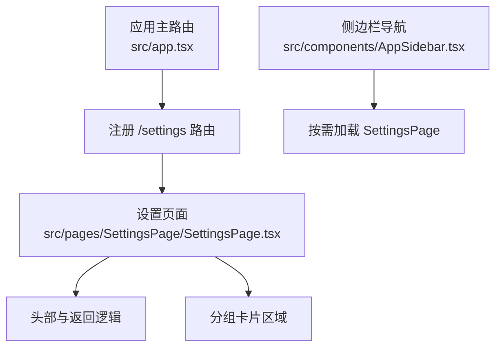
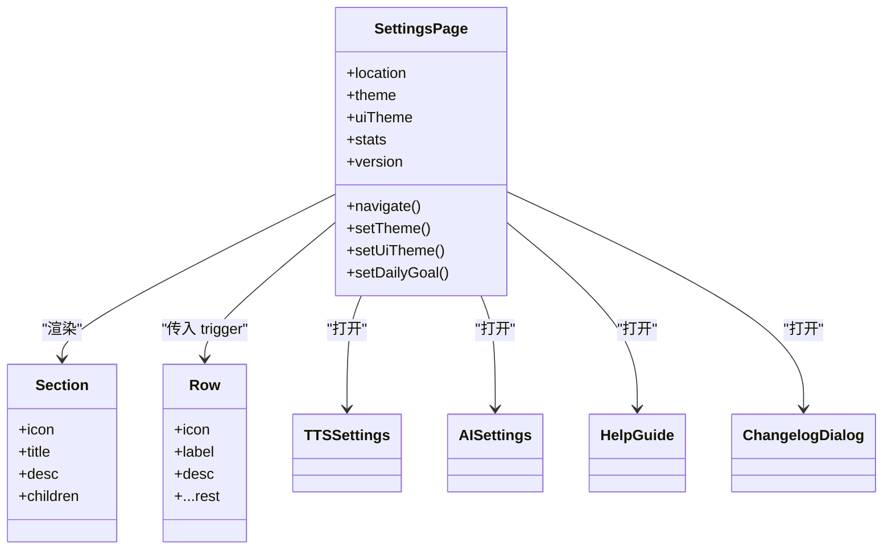
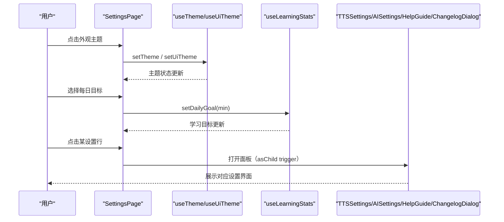
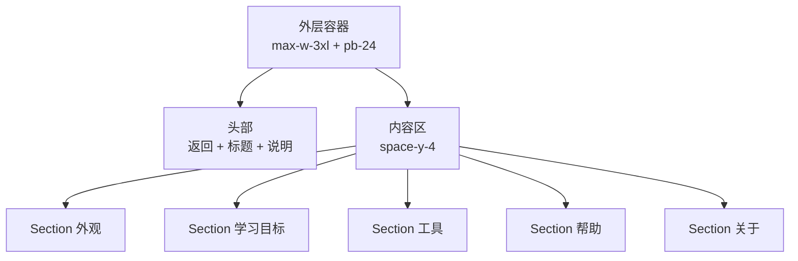
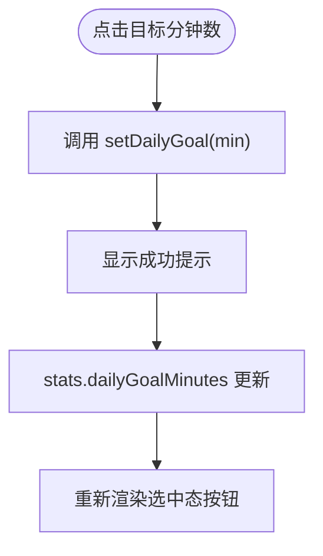
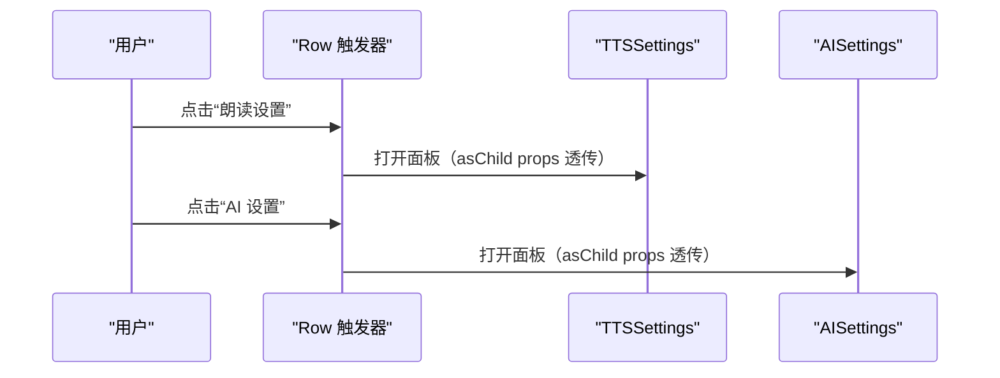
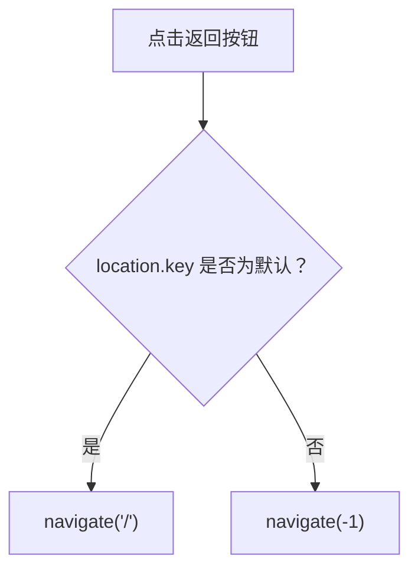
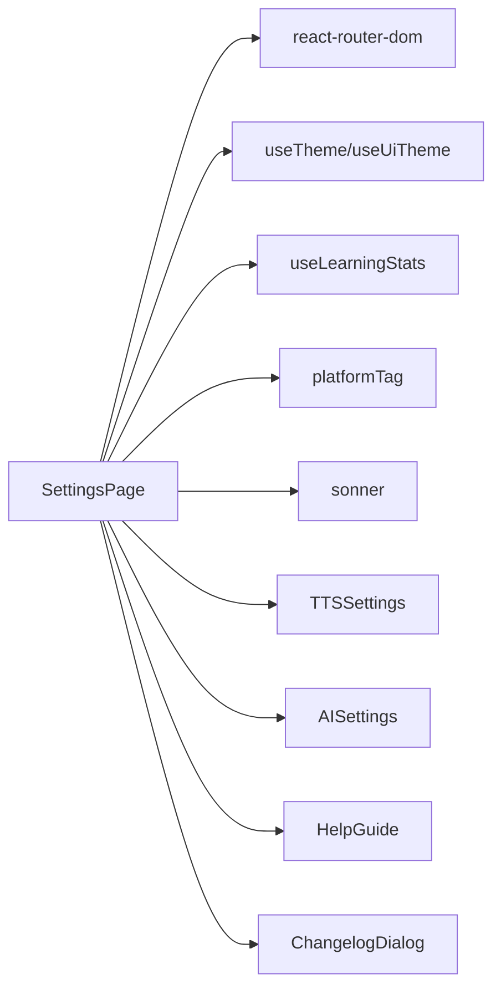

# 设置页面

<cite>
**本文引用的文件**
- [SettingsPage.tsx](file://src/pages/SettingsPage/SettingsPage.tsx)
- [app.tsx](file://src/app.tsx)
- [AppSidebar.tsx](file://src/components/AppSidebar.tsx)
- [use-theme.ts](file://src/lib/use-theme.ts)
- [ui-theme.ts](file://src/lib/ui-theme.ts)
- [use-learning-stats.ts](file://src/lib/use-learning-stats.ts)
- [app-env.ts](file://src/lib/app-env.ts)
- [TTSSettings.tsx](file://src/components/TTSSettings.tsx)
- [AISettings.tsx](file://src/components/AISettings.tsx)
- [HelpGuide.tsx](file://src/components/HelpGuide.tsx)
- [ChangelogDialog.tsx](file://src/components/ChangelogDialog.tsx)
</cite>

## 目录
1. [引言](#引言)
2. [项目结构中的设置页面](#项目结构中的设置页面)
3. [核心组件与职责](#核心组件与职责)
4. [架构总览](#架构总览)
5. [详细组件分析](#详细组件分析)
6. [依赖关系分析](#依赖关系分析)
7. [性能与可维护性](#性能与可维护性)
8. [故障排查指南](#故障排查指南)
9. [结论](#结论)

## 引言
本文件为 NativeThink 的“设置”页面提供完整文档。内容覆盖：
- SettingsPage.tsx 的整体布局、设置项分组和组织方式
- 表单状态管理与用户交互逻辑
- 各设置区域的渲染流程、组件组合模式和数据绑定机制
- 路由配置、权限控制、响应式布局和移动端适配
- 设置项验证规则、错误处理与用户体验优化方案

该页面是一个以“分组卡片 + 行按钮触发面板”的结构化设置界面，负责外观主题、学习目标、朗读与 AI 工具、帮助信息和版本信息等设置入口。

## 项目结构中的设置页面
设置页面的入口和导航由应用主路由与侧边栏共同管理：
- 应用路由通过懒加载注册 `/settings`，并包裹在错误边界中。
- 侧边栏包含 `/settings` 菜单项，并使用动态导入预取设置页组件。
- 设置页自身提供一个返回按钮：若来源是默认首页则跳转首页，否则使用浏览器历史返回。

**图表来源**
- [app.tsx:17-20](file://src/app.tsx#L17-L20)
- [app.tsx:57-60](file://src/app.tsx#L57-L60)
- [AppSidebar.tsx:45-49](file://src/components/AppSidebar.tsx#L45-L49)
- [SettingsPage.tsx:58-90](file://src/pages/SettingsPage/SettingsPage.tsx#L58-L90)

**章节来源**
- [app.tsx:17-20](file://src/app.tsx#L17-L20)
- [app.tsx:57-60](file://src/app.tsx#L57-L60)
- [AppSidebar.tsx:45-49](file://src/components/AppSidebar.tsx#L45-L49)

## 核心组件与职责
- SettingsPage（设置页主组件）
  - 管理返回行为、主题、UI 主题、每日学习目标和版本号等状态。
  - 组织五个设置分区：外观、学习目标、工具、帮助、关于。
- Section（分区容器）
  - 统一的分组卡片样式，承载标题、描述与子内容。
- Row（设置行按钮）
  - 作为 TTSSettings、AISettings、HelpGuide、ChangelogDialog 的触发器，支持 asChild 透传 Radix 面板所需的属性。
- 外部设置面板
  - TTSSettings：朗读引擎、音色、语速等设置。
  - AISettings：AI 模型、密钥、连接测试等设置。
  - HelpGuide：使用指南弹窗或抽屉。
  - ChangelogDialog：更新日志弹窗。

**图表来源**
- [SettingsPage.tsx:12-55](file://src/pages/SettingsPage/SettingsPage.tsx#L12-L55)
- [SettingsPage.tsx:58-183](file://src/pages/SettingsPage/SettingsPage.tsx#L58-L183)
- [TTSSettings.tsx](file://src/components/TTSSettings.tsx)
- [AISettings.tsx](file://src/components/AISettings.tsx)
- [HelpGuide.tsx](file://src/components/HelpGuide.tsx)
- [ChangelogDialog.tsx](file://src/components/ChangelogDialog.tsx)

**章节来源**
- [SettingsPage.tsx:12-55](file://src/pages/SettingsPage/SettingsPage.tsx#L12-L55)
- [SettingsPage.tsx:58-183](file://src/pages/SettingsPage/SettingsPage.tsx#L58-L183)

## 架构总览
设置页面采用“轻量主页面 + 独立面板组件”的组合模式。主页面负责状态聚合、布局组织和交互编排；具体复杂设置通过子组件暴露 `trigger` 属性，实现面板内容与设置行的解耦。

**图表来源**
- [SettingsPage.tsx:58-183](file://src/pages/SettingsPage/SettingsPage.tsx#L58-L183)
- [use-theme.ts](file://src/lib/use-theme.ts)
- [ui-theme.ts](file://src/lib/ui-theme.ts)
- [use-learning-stats.ts](file://src/lib/use-learning-stats.ts)

## 详细组件分析

### 整体布局与分组
- 外层容器限制最大宽度并预留底部间距，确保在移动端不被系统控件遮挡。
- 顶部包含返回按钮、英文小标题、中文主标题与说明文案。
- 主体以垂直间距组织五个 Section 卡片：
  - 外观：亮/暗模式切换 + UI 主题色板网格。
  - 学习目标：可选分钟数网格，选中态高亮。
  - 工具：朗读设置与 AI 设置两个 Row 触发器。
  - 帮助：使用指南、更新日志、开发者主页外链。
  - 关于：版本号和运行平台信息。

**图表来源**
- [SettingsPage.tsx:58-183](file://src/pages/SettingsPage/SettingsPage.tsx#L58-L183)

**章节来源**
- [SettingsPage.tsx:58-183](file://src/pages/SettingsPage/SettingsPage.tsx#L58-L183)

### 外观设置区
- 亮/暗模式切换：
  - 使用 `useTheme()` 提供的 `theme` 与 `setTheme()`。
  - 两个胶囊按钮分别对应 light/dark，选中时显示卡片背景与阴影。
- UI 主题色板：
  - 使用 `useUiTheme()` 提供的 `uiTheme` 与 `setUiTheme()`。
  - 遍历 `UI_THEMES`，每个主题显示色板预览、名称、描述。
  - 当前选中主题边框加深，并显示品牌色圆点。
  - “classic” 主题额外标注“默认”。

数据绑定机制：
- 主题切换直接调用 hook setter，状态变更后 React 重新渲染。
- UI 主题切换同样通过 setter 更新全局主题标识。

用户体验优化：
- 主题预览直观，选中态清晰。
- 默认主题有明确标记，避免用户困惑。

**章节来源**
- [SettingsPage.tsx:96-141](file://src/pages/SettingsPage/SettingsPage.tsx#L96-L141)
- [use-theme.ts](file://src/lib/use-theme.ts)
- [ui-theme.ts](file://src/lib/ui-theme.ts)

### 学习目标设置区
- 目标分钟数选项来自常量数组 `[10, 20, 30, 45, 60]`。
- 点击某个选项调用 `setDailyGoal(min)`，并通过 toast 提示成功。
- 当前目标通过 `stats.dailyGoalMinutes` 判断选中态，高亮显示。

验证与反馈：
- 选项固定且有序，无需额外校验。
- 操作即时反馈（toast），提升确认感。

**图表来源**
- [SettingsPage.tsx:143-160](file://src/pages/SettingsPage/SettingsPage.tsx#L143-L160)
- [use-learning-stats.ts](file://src/lib/use-learning-stats.ts)

**章节来源**
- [SettingsPage.tsx:143-160](file://src/pages/SettingsPage/SettingsPage.tsx#L143-L160)
- [use-learning-stats.ts](file://src/lib/use-learning-stats.ts)

### 工具设置区
- 使用 Row 组件作为触发器，分别打开 TTSSettings 与 AISettings。
- Row 将图标、标签、描述以及 Radix 注入的属性透传给原生按钮，保证 asChild 模式下的面板正确打开。

关键交互：
- 点击 Row 会打开对应面板组件，面板内部完成各自的状态管理和保存逻辑。
- Row 必须展开 `...rest`，否则会丢失 Radix 的面板控制属性。

**图表来源**
- [SettingsPage.tsx:162-171](file://src/pages/SettingsPage/SettingsPage.tsx#L162-L171)
- [SettingsPage.tsx:12-55](file://src/pages/SettingsPage/SettingsPage.tsx#L12-L55)
- [TTSSettings.tsx](file://src/components/TTSSettings.tsx)
- [AISettings.tsx](file://src/components/AISettings.tsx)

**章节来源**
- [SettingsPage.tsx:162-171](file://src/pages/SettingsPage/SettingsPage.tsx#L162-L171)
- [SettingsPage.tsx:12-55](file://src/pages/SettingsPage/SettingsPage.tsx#L12-L55)

### 帮助设置区
- 使用指南：通过 HelpGuide 组件打开帮助面板。
- 更新日志：通过 ChangelogDialog 组件打开日志弹窗。
- 开发者主页：确认后在新窗口打开 bilibili 链接，使用 `window.confirm` 二次确认，并附加安全属性 `noopener,noreferrer`。

用户体验优化：
- 重要外链通过确认框降低误触风险。
- 帮助与日志通过独立面板组件保持页面整洁。

**章节来源**
- [SettingsPage.tsx:173-183](file://src/pages/SettingsPage/SettingsPage.tsx#L173-L183)
- [HelpGuide.tsx](file://src/components/HelpGuide.tsx)
- [ChangelogDialog.tsx](file://src/components/ChangelogDialog.tsx)

### 关于设置区
- 版本号从页面元数据读取，初始值用占位符。
- 运行平台通过 `platformTag()` 获取。

数据来源：
- 版本号来自 `document.querySelector('meta[name="app-version"]')`。
- 平台信息来自 `app-env.ts` 的导出函数。

**章节来源**
- [SettingsPage.tsx:62-71](file://src/pages/SettingsPage/SettingsPage.tsx#L62-L71)
- [app-env.ts](file://src/lib/app-env.ts)

### 返回逻辑与路由集成
- 返回按钮根据 `location.key` 判断来源：
  - 如果来源为默认值，跳转到首页 `/`。
  - 否则调用 `navigate(-1)` 返回上一页。
- 路由注册：
  - 应用主路由懒加载 `SettingsPage`，并用 ErrorBoundary 包裹。
  - 侧边栏提供 `/settings` 条目，并带预取逻辑。

**图表来源**
- [SettingsPage.tsx:58-71](file://src/pages/SettingsPage/SettingsPage.tsx#L58-L71)
- [app.tsx:17-20](file://src/app.tsx#L17-L20)
- [app.tsx:57-60](file://src/app.tsx#L57-L60)
- [AppSidebar.tsx:45-49](file://src/components/AppSidebar.tsx#L45-L49)

**章节来源**
- [SettingsPage.tsx:58-71](file://src/pages/SettingsPage/SettingsPage.tsx#L58-L71)
- [app.tsx:17-20](file://src/app.tsx#L17-L20)
- [app.tsx:57-60](file://src/app.tsx#L57-L60)
- [AppSidebar.tsx:45-49](file://src/components/AppSidebar.tsx#L45-L49)

## 依赖关系分析
设置页面依赖以下模块与组件：
- 路由与导航：react-router-dom 的 `useLocation`、`useNavigate`。
- 主题系统：`useTheme`、`useUiTheme`、`UI_THEMES`。
- 学习统计：`useLearningStats` 提供每日目标状态与设置方法。
- 平台环境：`platformTag` 提供运行平台标识。
- 第三方库：sonner 用于 toast 提示。
- 子组件：TTSSettings、AISettings、HelpGuide、ChangelogDialog。

**图表来源**
- [SettingsPage.tsx:1-11](file://src/pages/SettingsPage/SettingsPage.tsx#L1-L11)
- [SettingsPage.tsx:58-183](file://src/pages/SettingsPage/SettingsPage.tsx#L58-L183)

**章节来源**
- [SettingsPage.tsx:1-11](file://src/pages/SettingsPage/SettingsPage.tsx#L1-L11)
- [SettingsPage.tsx:58-183](file://src/pages/SettingsPage/SettingsPage.tsx#L58-L183)

## 性能与可维护性
- 懒加载与路由分割：
  - 设置页通过 lazy 加载，减少首屏体积。
- 组件拆分：
  - Section 与 Row 抽象了重复的卡片与行样式，提高复用性与一致性。
- 状态集中：
  - 所有设置状态通过 hooks 管理，避免跨组件传递 props 的复杂性。
- 可扩展性：
  - 新增设置项只需添加新的 Section 或使用现有 Row 触发新面板。
- 注意事项：
  - Row 组件必须展开 `...rest`，否则 Radix 面板无法打开。
  - 外链跳转需保留 `window.confirm` 与安全属性，避免误操作与安全风险。

[本节为通用建议，不直接分析具体文件]

## 故障排查指南
- 设置行点击无反应：
  - 检查 Row 组件是否展开 `...rest`，确保 Radix 注入的属性被透传到原生按钮。
  - 参考断言脚本中对 `asChild` 透传的校验。
- 主题未生效：
  - 确认 `useTheme` 与 `useUiTheme` 的 setter 被调用。
  - 检查 UI 主题列表是否正确渲染与选中态。
- 学习目标未更新：
  - 确认 `setDailyGoal` 被调用，并检查 toast 提示是否出现。
  - 查看 `stats.dailyGoalMinutes` 是否与所选值一致。
- 返回逻辑异常：
  - 检查 `location.key` 是否为默认值，决定跳转首页还是返回上一页。
- 外链跳转问题：
  - 确认 `window.confirm` 已弹出，且新窗口打开参数包含 `noopener,noreferrer`。

**章节来源**
- [SettingsPage.tsx:12-55](file://src/pages/SettingsPage/SettingsPage.tsx#L12-L55)
- [SettingsPage.tsx:96-183](file://src/pages/SettingsPage/SettingsPage.tsx#L96-L183)

## 结论
设置页面以清晰的分组结构和可复用的组件模式，提供了完整的设置入口与交互体验。通过 hooks 管理状态、子组件承载复杂面板、路由与侧边栏协同导航，实现了良好的可维护性和扩展性。建议在新增设置项时遵循现有模式，并确保 Row 的 asChild 透传、外链的安全属性以及必要的用户反馈。

[本节为总结性内容，不直接分析具体文件]