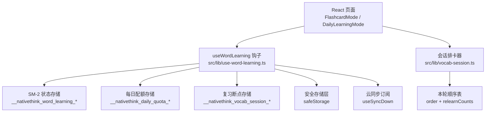
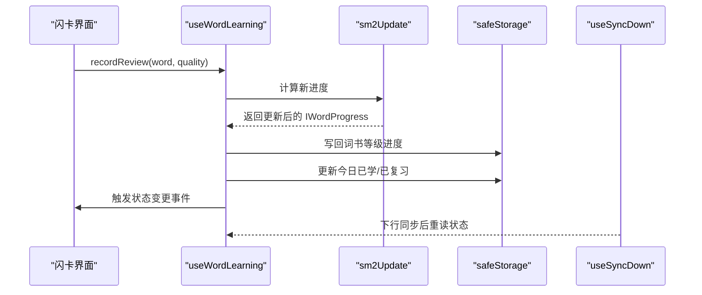
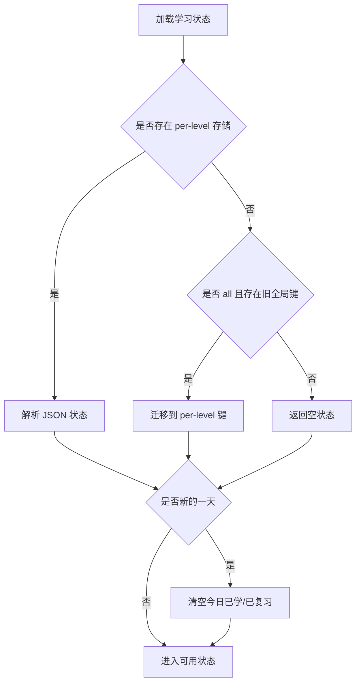
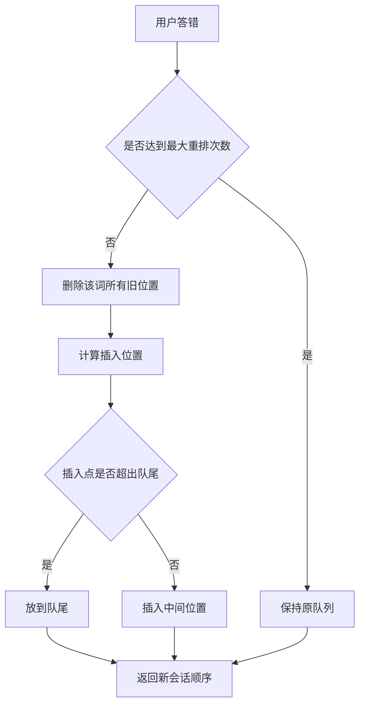
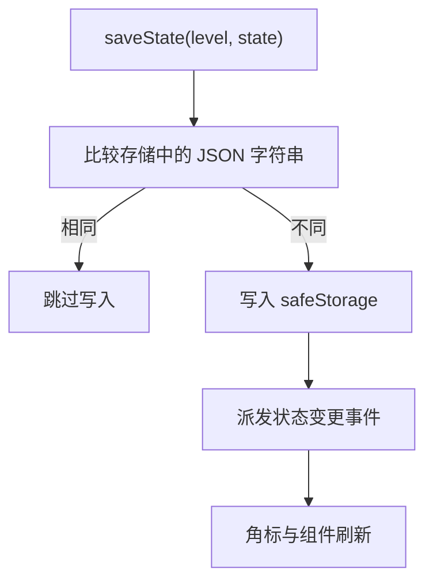

# SM-2 间隔重复算法

<cite>
**本文引用的文件**   
- [vocab-session.ts](file://src/lib/vocab-session.ts)
- [use-word-learning.ts](file://src/lib/use-word-learning.ts)
- [vocabulary.md](file://docs/modules/vocabulary.md)
</cite>

## 目录
1. [引言](#引言)
2. [项目结构定位](#项目结构定位)
3. [核心组件总览](#核心组件总览)
4. [架构与数据流](#架构与数据流)
5. [SM-2 数学模型](#sm-2-数学模型)
6. [词汇学习状态管理](#词汇学习状态管理)
7. [会话排卡逻辑](#会话排卡逻辑)
8. [学习阶段处理](#学习阶段处理)
9. [参数调优指南](#参数调优指南)
10. [性能优化建议](#性能优化建议)
11. [故障排查](#故障排查)
12. [结论](#结论)

## 引言
本技术文档聚焦 NativeThink 词汇模块中的 SM-2 间隔重复实现，目标是帮助开发者理解并调优以下部分：
- SM-2 记忆曲线、难度调整因子与复习间隔计算。
- `use-word-learning.ts` 如何封装单词学习状态、评分、下次复习时间与掌握度更新。
- `vocab-session.ts` 如何在复习会话中冻结队列顺序、处理答错重排与到期预测。
- 算法参数调优策略与性能优化手段，包括批量抽样、缓存、内存管理与云同步回声防护。

该文档不直接粘贴源代码内容，而是通过路径引用和图示解释实现细节。

## 项目结构定位
SM-2 相关代码集中在两个核心文件：
- `src/lib/use-word-learning.ts`：SM-2 算法、学习状态、持久化、每日配额、全局/按词书到期统计、断点续学等。
- `src/lib/vocab-session.ts`：复习会话的纯函数排卡逻辑，负责“答错重排”、下一张卡片索引、未来几天到期预测。

**图表来源**
- [use-word-learning.ts:1-200](file://src/lib/use-word-learning.ts#L1-L200)
- [use-word-learning.ts:201-549](file://src/lib/use-word-learning.ts#L201-L549)
- [vocab-session.ts:1-77](file://src/lib/vocab-session.ts#L1-L77)

**章节来源**
- [use-word-learning.ts:1-200](file://src/lib/use-word-learning.ts#L1-L200)
- [use-word-learning.ts:201-549](file://src/lib/use-word-learning.ts#L201-L549)
- [vocab-session.ts:1-77](file://src/lib/vocab-session.ts#L1-L77)

## 核心组件总览
- **IWordProgress**：单条单词的 SM-2 进度，包含状态、难度系数、间隔、重复次数、下次复习时间、上次复习时间、连续错误计数、屏蔽标记。
- **ILearningState**：某一等级（或 all 聚合）的学习状态，包含全部单词进度、今日已学、今日已复习、最后活跃日期、可选历史聚合。
- **ISavedSession**：复习断点，包含本轮出卡顺序、当前索引、保存时间、以及 v2 扩展的已评记录。
- **ISessionOrder**：会话内顺序表，包含 `order` 字符串数组与每个词的重复重排次数。
- **暴露方法**：`recordReview`、`markLearned`、`setSuspended`、`getNewWords`、`saveSession`、`loadSession`、`clearSession`、`getGlobalDueCount`、`useGlobalDueCount`、`getDueCountsByLevel`、`resetProgress`、`resetLevelProgress`。
- **会话函数**：`createSessionOrder`、`scheduleRelearn`、`nextIndex`、`forecastByDay`。

**章节来源**
- [use-word-learning.ts:1-200](file://src/lib/use-word-learning.ts#L1-L200)
- [use-word-learning.ts:201-549](file://src/lib/use-word-learning.ts#L201-L549)
- [vocab-session.ts:1-77](file://src/lib/vocab-session.ts#L1-L77)

## 架构与数据流
### 学习评分流程
用户给出评分后，系统会：
1. 根据质量值调用 SM-2 更新函数，得到新的难度、间隔、重复次数、下次复习时间。
2. 更新内存中的学习状态。
3. 在跨设备场景下，将结果落盘到对应词书等级；all 模式则写入单词源词书。
4. 触发事件广播，供角标等 UI 刷新。
5. 若为 new 词，加入今日已学；每次复习加入今日已复习；同时更新当日历史桶。

**图表来源**
- [use-word-learning.ts:201-549](file://src/lib/use-word-learning.ts#L201-L549)

**章节来源**
- [use-word-learning.ts:201-549](file://src/lib/use-word-learning.ts#L201-L549)

## SM-2 数学模型
### 基础概念
- **质量值 quality**：0~5，表示用户对答案的信心程度。
- **难度系数 easeFactor**：初始默认值为 2.5，下限为 1.3。
- **间隔 interval**：以天为单位，决定下一次复习时间。
- **重复次数 repetitions**：成功复习累计次数。
- **下次复习 nextReview**：本地时间戳。

### 更新规则
当 quality ≥ 3（正确）时：
- 若 repetitions = 0，interval 设为 1 天。
- 若 repetitions = 1，interval 设为 3 天。
- 否则 interval 取四舍五入后的 `interval × easeFactor`。
- repetitions 加 1。

当 quality < 3（不正确）时：
- repetitions 重置为 0。
- interval 重置为 1 天。

难度系数按公式更新：
- easeFactor 增加一个与 (5 - quality) 相关的修正项。
- 最终不低于 1.3。

状态推导：
- repetitions ≥ 5 → mastered
- repetitions > 0 → reviewing
- repetitions = 0 → learning

下次复习时间：
- nextReview = now + interval × 24 × 60 × 60 × 1000

**章节来源**
- [use-word-learning.ts:201-260](file://src/lib/use-word-learning.ts#L201-L260)

## 词汇学习状态管理
### 数据结构
- **IWordProgress**：
  - wordKey：标准化后的单词键。
  - status：new / learning / reviewing / mastered。
  - easeFactor：SM-2 难度系数。
  - interval：下次复习间隔天数。
  - repetitions：成功复习次数。
  - nextReview：下次复习时间戳。
  - lastReview：上次复习时间戳。
  - wrongCount：连续错误累计，用于错词重练。
  - suspended：用户主动屏蔽。

- **ILearningState**：
  - progress：单词键到进度的映射。
  - todayLearned：今日已学单词键列表。
  - todayReviewed：今日已复习单词键列表。
  - lastActiveDate：最后活跃日期。
  - history：可选的历史聚合，key 为日期，value 包含 learned、reviewed、good。

### 状态生命周期
- 初始化时从 safeStorage 读取；若为空，返回默认空状态。
- 首次挂载时支持旧全局键迁移到 per-level 键。
- 每日计数器在新的一天自动重置。
- all 模式下聚合所有 SUB_LEVELS 的进度、今日集合与历史。

**图表来源**
- [use-word-learning.ts:1-200](file://src/lib/use-word-learning.ts#L1-L200)

**章节来源**
- [use-word-learning.ts:1-200](file://src/lib/use-word-learning.ts#L1-L200)

## 会话排卡逻辑
### 会话顺序表
- `order`：本轮出卡顺序，使用单词 key。
- `relearnCounts`：每个词在本轮中被重新插入的次数。

创建会话顺序时，仅复制原始键数组，不依赖外部 state，从而避免评分导致队列漂移。

### 答错重排
- 默认间隔 RELEARN_GAP = 4，即答错的词在当前位置之后第 4 张再出现。
- 最大重排次数 MAX_RELEARN = 2，超过后不再插入，改由 SM-2 下次复习兜住。
- 重排前先删除该词在本轮的所有旧位置，避免同一张卡重复出现。
- 插入点超出队尾时放到队尾，而不是回绕到开头。

### 下一张与结束判断
- `nextIndex` 返回 currentIndex + 1，若到达末尾则返回 null，表示本轮结束。

### 未来 N 天到期预测
- `forecastByDay` 把每个单词的 nextReview 按本地日历日分桶，用于展示“明天 N 个”等负担提示。
- 已逾期条目计入今天。

**图表来源**
- [vocab-session.ts:1-77](file://src/lib/vocab-session.ts#L1-L77)

**章节来源**
- [vocab-session.ts:1-77](file://src/lib/vocab-session.ts#L1-L77)

## 学习阶段处理
### new 词
- new 词不会出现在到期复习队列中。
- 通过 `getNewWords` 从词库随机抽取未学过的单词，最多尝试 5 轮，每轮抽样 200 个，确保能凑够每日目标。
- 新词被评分后进入 learning 或 reviewing 阶段。

### learning 阶段
- 初次接触的词，successive 失败会回到 learning。
- 成功后进入 reviewing。

### reviewing 阶段
- 已有一定复习次数的词进入复习队列。
- 继续按 SM-2 推进，直到 repetitions ≥ 5 变为 mastered。

### mastered 阶段
- 表示掌握，但仍可被后续复习巩固。
- 可通过 markLearned 把浏览侧标记纳入 SM-2 进度。

### 不再出现 suspended
- 用户可主动屏蔽某个词，使其不出现在复习队列与新词池。
- 恢复屏蔽后，原有进度保留。
- 若原本没有进度，会自动补一条 new 状态的记录。

**章节来源**
- [use-word-learning.ts:201-549](file://src/lib/use-word-learning.ts#L201-L549)
- [vocabulary.md:50-110](file://docs/modules/vocabulary.md#L50-L110)

## 参数调优指南
### 初始间隔设置
- 当前实现中，repetitions = 0 时 interval = 1 天。
- 若希望新用户更快进入长间隔，可提高 initialInterval；但需权衡遗忘风险。

### 难度衰减系数
- easeFactor 初始为 2.5，下限 1.3。
- 公式使高质量回答提升难度系数，低质量回答降低难度系数。
- 调优建议：
  - 提高对高质量回答的奖励，适合记忆较稳定的学习者。
  - 降低难度增长，适合初学者或容易波动的人群。
  - 始终保证下限不低于 1.3，避免间隔无限缩短。

### 遗忘曲线拟合
- 当前采用三段式：
  - repetitions = 0 → 1 天
  - repetitions = 1 → 3 天
  - 其他 → interval × easeFactor
- 可调整为更平滑的指数增长，例如引入 baseInterval 与 growthFactor。
- 对于频繁出错词，可考虑让 interval 更快回落，减少挫败感。

### 答错重排参数
- RELEARN_GAP：控制答错词再次出现的延迟。
  - 太小会导致立即重复，体验差。
  - 太大会失去即时巩固意义。
- MAX_RELEARN：限制一轮内重排次数，防止队列膨胀。
- 建议：
  - 初版保持 4 和 2。
  - 针对高频错题集可调大 gap，配合专项复习。
  - 移动端可适度降低 MAX_RELEARN，避免滑动卡顿。

### 每日配额
- 默认每日配额为 20。
- 高活跃用户可提高配额，但需配合“本轮只安排前 30 个到期复习”的缓冲策略，避免队列堆积。

**章节来源**
- [use-word-learning.ts:201-549](file://src/lib/use-word-learning.ts#L201-L549)
- [vocab-session.ts:1-77](file://src/lib/vocab-session.ts#L1-L77)

## 性能优化建议
### 批量计算
- `getNewWords` 单次抽样 200 个，最多 5 轮，避免反复拉取大量数据。
- 复习队列构建应优先基于 dueForReview 过滤，不要全量排序。

### 缓存策略
- `getGlobalDueCount` 提供 800ms 结果缓存，避免每张评分都反序列化所有等级状态。
- `useGlobalDueCount` 使用 400ms 节流事件刷新，降低角标抖动。

### 内存管理
- 会话顺序表使用显式 key 数组，避免依赖 React state 导致的 memo 重算。
- `aggregateAllLevels` 使用 Set 合并 todayLearned 与 todayReviewed，避免重复。
- 断点续学对象需做字段校验，防止脏数据污染内存。

### 云同步回声防护
- saveState 先比较序列化字符串，相同则跳过写入。
- loadedFromStorageRef 记录“来自 storage 的对象引用”，避免 effect 中把原样读出的状态再写一遍。
- useSyncDown 回调中重新读取状态并覆盖内存，避免陈旧实例覆盖云端数据。

**图表来源**
- [use-word-learning.ts:1-200](file://src/lib/use-word-learning.ts#L1-L200)

**章节来源**
- [use-word-learning.ts:1-200](file://src/lib/use-word-learning.ts#L1-L200)
- [use-word-learning.ts:201-549](file://src/lib/use-word-learning.ts#L201-L549)

## 故障排查
### 复习检测显示有到期词但页面为空
- 角标使用 getGlobalDueCount，统计所有词书。
- 复习检测使用当前 level 的 dueForReview。
- 解决方案：通过 getDueCountsByLevel 展示各词书到期数，并提供跳转入口。

### 切换词书后进度错位
- 原因：effect 中 level 变化与 persist effect 闭包不一致，可能把旧等级状态写进新等级存储。
- 解决：改为渲染期同步调整 stateLevel，保证 commit 自洽；persist effect 只做无变更跳过。

### 云同步后数据被覆盖
- 原因：下行同步后内存仍持有旧实例，下一次评分把旧实例写回 storage，再上行。
- 解决：useSyncDown 回调中重新 loadState，并重置 loadedFromStorageRef。

### 答错重排导致同一张卡重复出现
- 检查 scheduleRelearn 是否先删除旧位置。
- 检查插入点是否越界并被截断到队尾。
- 检查 relearnCounts 是否达到 MAX_RELEARN。

### 历史报告为空
- 原因：all 模式下 history 未累加。
- 解决：aggregateAllLevels 中对 history 进行逐日求和。

**章节来源**
- [use-word-learning.ts:1-200](file://src/lib/use-word-learning.ts#L1-L200)
- [use-word-learning.ts:201-549](file://src/lib/use-word-learning.ts#L201-L549)
- [vocabulary.md:50-110](file://docs/modules/vocabulary.md#L50-L110)

## 结论
NativeThink 词汇模块的 SM-2 实现以 `use-word-learning.ts` 为核心，结合 `vocab-session.ts` 的会话排卡逻辑，形成了完整的学习状态机：
- SM-2 算法负责难度与间隔演进。
- 学习状态负责进度、配额、历史与持久化。
- 会话逻辑负责冻结队列、答错重排与到期预测。
- 性能优化围绕批量抽样、缓存、内存与云同步回声防护展开。

在实际调优中，建议优先稳定 SM-2 基础参数，再逐步调整间隔增长、难度系数、重排策略与每日配额，并结合用户反馈观察遗忘率、正确率与学习时长变化。