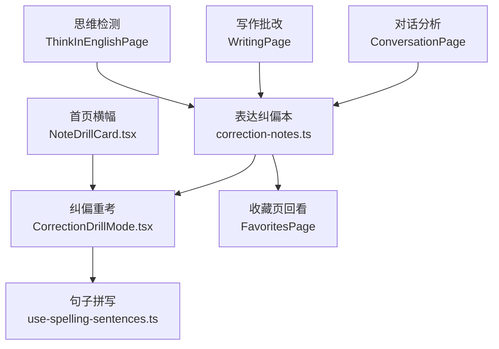
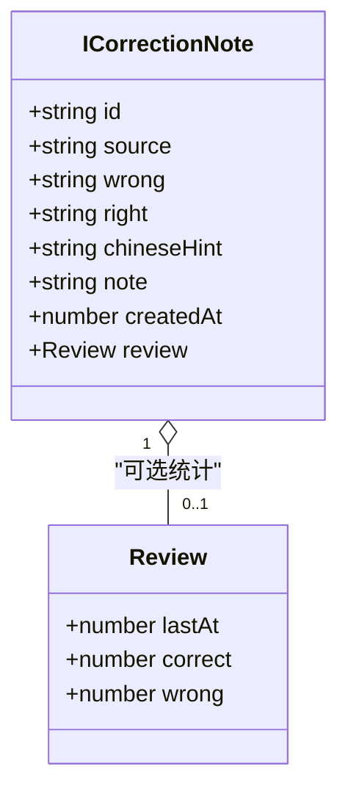
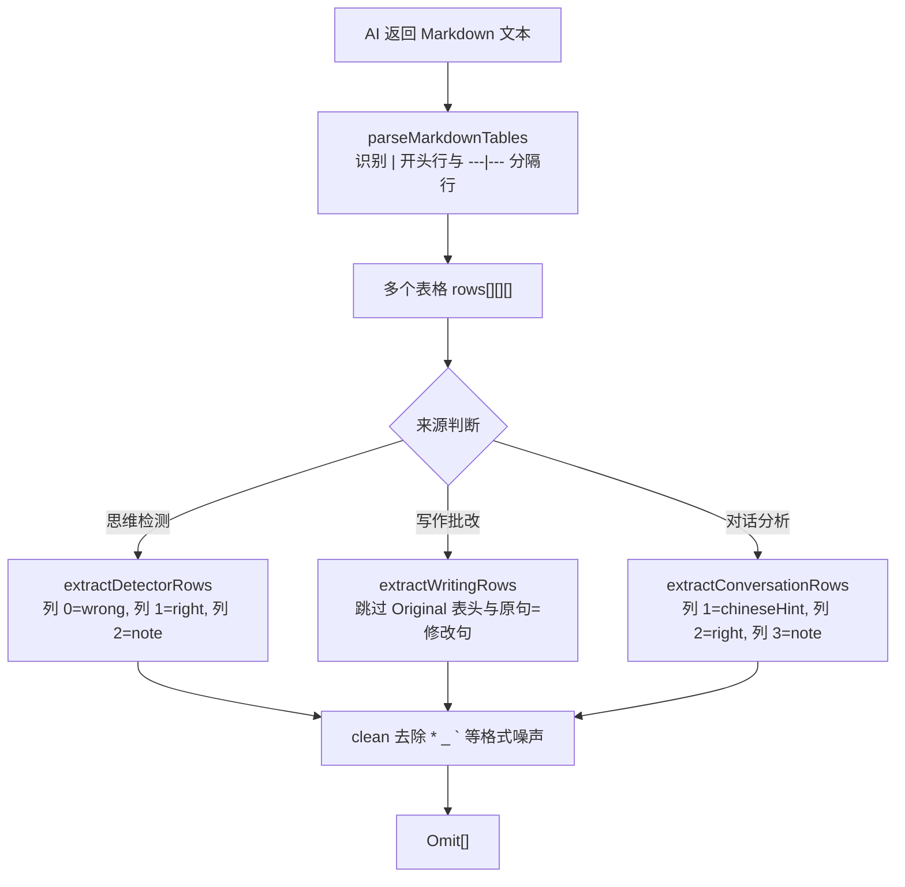
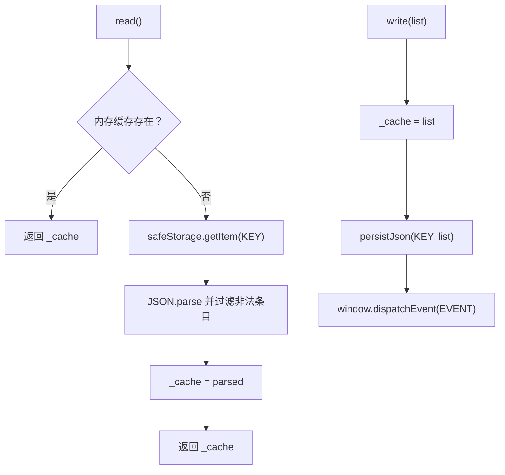
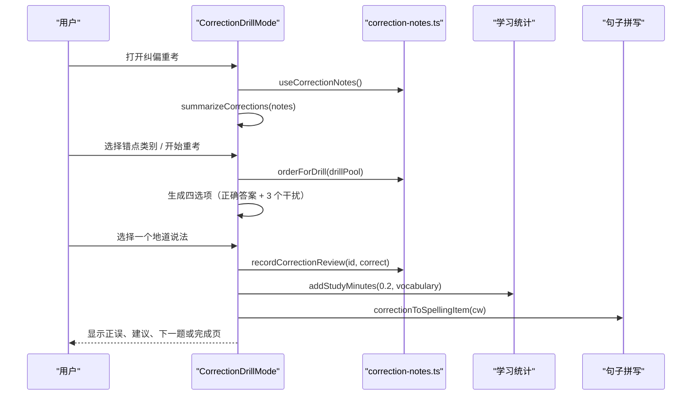
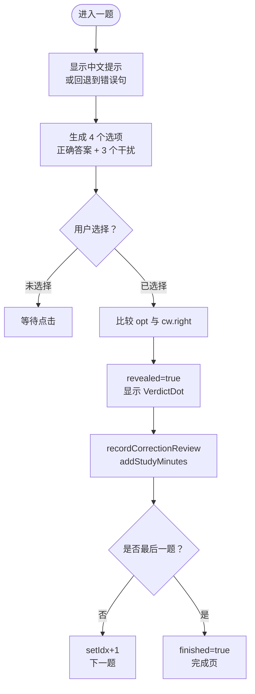
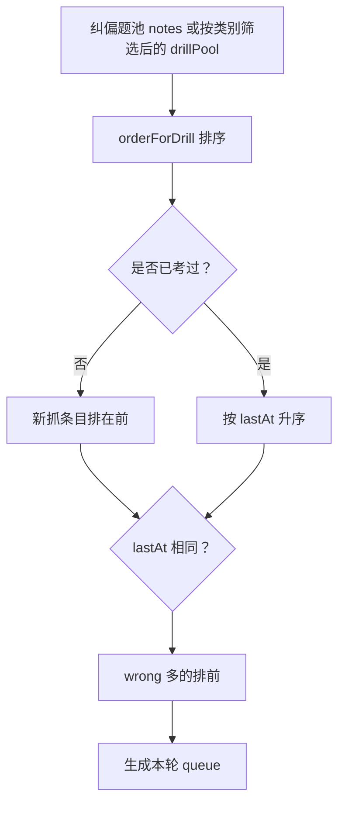
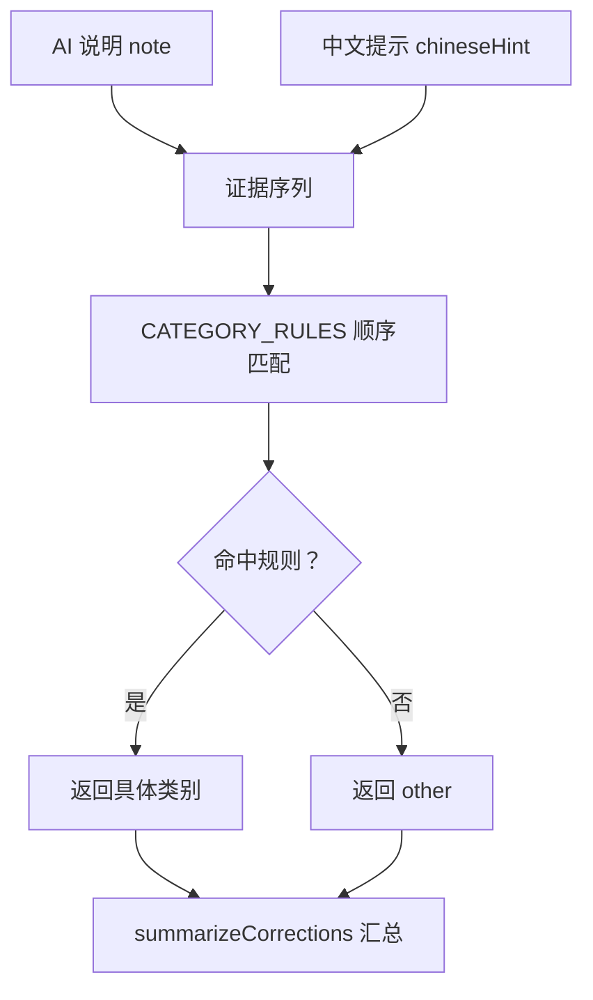
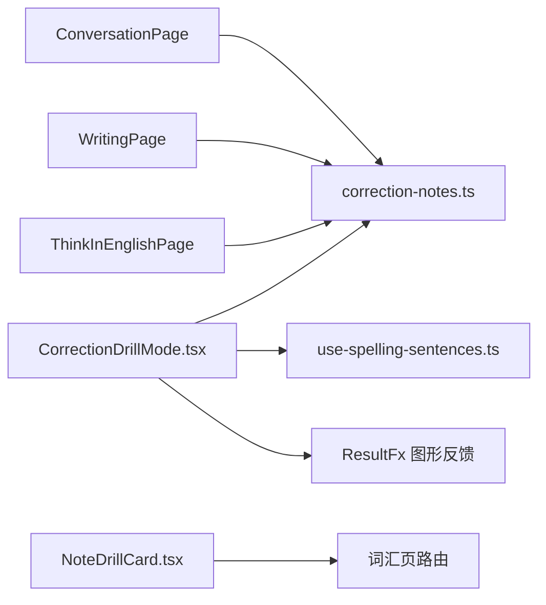

# 纠偏重考机制

<cite>
**本文引用的文件**   
- [correction-notes.ts](file://src/lib/correction-notes.ts)
- [CorrectionDrillMode.tsx](file://src/pages/DeepVocabularyPage/components/CorrectionDrillMode.tsx)
- [NoteDrillCard.tsx](file://src/pages/DashboardPage/NoteDrillCard.tsx)
- [verify-correction-notes.mjs](file://scripts/verify-correction-notes.mjs)
- [vocabulary.md](file://docs/modules/vocabulary.md)
- [dashboard-progress-favorites.md](file://docs/modules/dashboard-progress-favorites.md)
- [interaction-fx.md](file://docs/modules/interaction-fx.md)
</cite>

## 目录
1. [引言](#引言)
2. [项目结构定位](#项目结构定位)
3. [核心数据结构与存储逻辑](#核心数据结构与存储逻辑)
4. [纠偏重考组件实现](#纠偏重考组件实现)
5. [触发条件与复习计划](#触发条件与复习计划)
6. [结果统计与错点分析](#结果统计与错点分析)
7. [用户自定义纠正内容与个性化策略](#用户自定义纠正内容与个性化策略)
8. [依赖关系与集成点](#依赖关系与集成点)
9. [性能与用户体验优化](#性能与用户体验优化)
10. [故障排查指南](#故障排查指南)
11. [结论](#结论)

## 引言
NativeThink 的纠偏重考机制围绕“表达纠偏本”展开：当思维检测、写作批改或对话分析判定用户表达不地道时，系统自动抽取「错误表达 → 地道说法」对照并持久化；词汇页第 9 模式“纠偏重考”再把这些条目变成四选一练习，帮助用户从“认对哪句才是对的”逐步过渡到“能写得出地道句子”。

该机制的核心不在传统词书掌握度算法，而在“纠错笔记 + 纠偏重考队列 + 错点分类 + 句子拼写联动”这一闭环。它不写 SM-2 单词进度，而是维护自己的 `review` 统计字段，并通过排序函数控制下次优先出现的条目。

## 项目结构定位
纠偏重考涉及三个主要层次：
- 数据层：`src/lib/correction-notes.ts` 定义纠偏条目类型、Markdown 表格抽取、本地存储、重考记账与排序、错点分类。
- 交互层：`src/pages/DeepVocabularyPage/components/CorrectionDrillMode.tsx` 实现纠偏重考 UI 与答题流程。
- 入口层：`src/pages/DashboardPage/NoteDrillCard.tsx` 提供首页横幅入口，点击后跳转到词汇页纠偏重考。

**图表来源**
- [correction-notes.ts:1-200](file://src/lib/correction-notes.ts#L1-L200)
- [CorrectionDrillMode.tsx:1-200](file://src/pages/DeepVocabularyPage/components/CorrectionDrillMode.tsx#L1-L200)
- [NoteDrillCard.tsx:1-45](file://src/pages/DashboardPage/NoteDrillCard.tsx#L1-L45)

**章节来源**
- [correction-notes.ts:1-200](file://src/lib/correction-notes.ts#L1-L200)
- [CorrectionDrillMode.tsx:1-200](file://src/pages/DeepVocabularyPage/components/CorrectionDrillMode.tsx#L1-L200)
- [NoteDrillCard.tsx:1-45](file://src/pages/DashboardPage/NoteDrillCard.tsx#L1-L45)

## 核心数据结构与存储逻辑
### 纠偏条目模型
纠偏本以 `ICorrectionNote` 为基本单元，关键字段包括：
- `id`：唯一标识，由时间戳、序号和随机片段生成。
- `source`：来源，取值为“思维检测”“写作批改”“对话分析”。
- `wrong`：用户的中文式或错误表达。
- `right`：AI 给出的地道英文说法。
- `chineseHint`：中文提示，主要来自对话分析表；其它来源通常为空。
- `note`：AI 的原因说明，用于错点归类与反馈展示。
- `createdAt`：创建时间，用于新抓条目优先于已考过条目的排序。
- `review`：可选的重考统计对象，包含最近练习时间、累计正确数和累计错误数。

**图表来源**
- [correction-notes.ts:22-45](file://src/lib/correction-notes.ts#L22-L45)
- [correction-notes.ts:156-173](file://src/lib/correction-notes.ts#L156-L173)

### Markdown 表格抽取
系统把 AI 返回的 Markdown 表格解析为二维单元格数组，再按不同来源列序映射成纠偏条目：
- 思维检测：前两列为错误表达和地道说法，第三列为说明。
- 写作批改：前两列为原句和修改句，跳过原句等于修改句的噪声行。
- 对话分析：第四列为原因分析，第二列中文翻译进入 `chineseHint`。

解析过程是纯函数，不依赖 React；守卫脚本会直接转译执行这些函数，用真实 Markdown 表格验证表头、分隔行、加粗噪声等边界情况。

**图表来源**
- [correction-notes.ts:46-120](file://src/lib/correction-notes.ts#L46-L120)

**章节来源**
- [correction-notes.ts:22-120](file://src/lib/correction-notes.ts#L22-L120)
- [verify-correction-notes.mjs:28-120](file://scripts/verify-correction-notes.mjs#L28-L120)

### 本地存储与缓存
纠偏本使用模块级键名、事件广播和内存缓存：
- 键名固定为本地存储键。
- `read()` 从安全存储读取 JSON，过滤非法条目；失败时回退为空数组。
- `write()` 同步更新内存缓存、持久化 JSON，并向 `window` 派发变更事件。
- `useCorrectionNotes` Hook 订阅变更事件，云同步下行时也先清空缓存再重新加载。
- 最大条目数为 200；超过上限只拒绝新增，绝不裁剪已有记录。

**图表来源**
- [correction-notes.ts:121-155](file://src/lib/correction-notes.ts#L121-L155)
- [correction-notes.ts:270-290](file://src/lib/correction-notes.ts#L270-L290)

**章节来源**
- [correction-notes.ts:121-155](file://src/lib/correction-notes.ts#L121-L155)
- [correction-notes.ts:270-290](file://src/lib/correction-notes.ts#L270-L290)
- [verify-correction-notes.mjs:120-200](file://scripts/verify-correction-notes.mjs#L120-L200)

## 纠偏重考组件实现
### 组件职责
`CorrectionDrillMode` 是词汇页第 9 模式“纠偏重考”的完整交互实现，主要职责包括：
- 从 `useCorrectionNotes` 获取纠偏条目列表。
- 根据用户选择的错点类别筛选题池。
- 启动重考时按 `orderForDrill` 生成队列。
- 每题展示中文提示或原始错误句，并从整本纠偏条目的地道说法中抽取干扰项。
- 提交答案后调用 `recordCorrectionReview` 更新重考统计。
- 完成一轮后展示正确率与未识别错点类别。
- 支持将地道说法加入句子拼写库，形成“认错句 → 拼出句”的进阶路径。

**图表来源**
- [CorrectionDrillMode.tsx:1-120](file://src/pages/DeepVocabularyPage/components/CorrectionDrillMode.tsx#L1-L120)
- [correction-notes.ts:156-191](file://src/lib/correction-notes.ts#L156-L191)

### 四选一作答流程
纠偏重考不是拼写整句，而是从四个地道英文选项中选出对应的那一句：
- 题干优先展示 `chineseHint`；没有中文提示则回退展示用户原来的错误句。
- 正确答案是本次条目的 `right`。
- 干扰项来自整本纠偏条目的 `right`，去重后随机取 3 个；若按错点类别限定题池，仍从整本抽干扰项，避免某类只有 1 条时出现“必对卡”。
- 每个选项在揭晓前都不带判定色点；揭晓后正确答案绿色、错误选择红色、其他选项中性灰色。

**图表来源**
- [CorrectionDrillMode.tsx:121-200](file://src/pages/DeepVocabularyPage/components/CorrectionDrillMode.tsx#L121-L200)
- [CorrectionDrillMode.tsx:201-421](file://src/pages/DeepVocabularyPage/components/CorrectionDrillMode.tsx#L201-L421)

**章节来源**
- [CorrectionDrillMode.tsx:1-421](file://src/pages/DeepVocabularyPage/components/CorrectionDrillMode.tsx#L1-L421)

## 触发条件与复习计划
### 收集触发条件
纠偏条目由三处 AI 反馈完成点自动写入：
- 思维检测完成点：抽取“中式表达 → 自然英文”表格。
- 写作批改完成点：抽取“原句 → 修改句”表格。
- 对话分析完成点：抽取“我的表达 → 更地道的说法”表格。

这些写入点不会弹 toast，零提示口径由守卫脚本检查；真正可见的反馈集中在纠偏本计数、收藏页折叠列表、词汇页纠偏重考入口。

### 重考触发与队列顺序
纠偏重考的“触发”不是基于连续错误次数或掌握度阈值，而是基于两个简单事实：
- 纠偏本中有尚未被重认过的条目。
- 用户主动打开词汇页第 9 模式或点击首页横幅。

重考队列的优先级由 `orderForDrill` 决定，规则如下：
1. 没考过的优先于考过的。
2. 没考过的按创建时间早的优先。
3. 考过的按最近练习时间更早的优先。
4. 最近练习时间相同的情况下，答错过更多者优先。

**图表来源**
- [correction-notes.ts:180-191](file://src/lib/correction-notes.ts#L180-L191)
- [CorrectionDrillMode.tsx:90-120](file://src/pages/DeepVocabularyPage/components/CorrectionDrillMode.tsx#L90-L120)

### 掌握度与阈值
纠偏重考不使用 SM-2 掌握度，也不使用“连续错误次数达到 N 才重考”的硬阈值。其“掌握度”体现在 `review.correct` 与 `review.wrong` 的累计值上，并通过排序让“久未练习、错得多”的条目更容易再次出现。

文档明确强调：句子不是词书词条，因此不能混入词汇学习进度；纠偏本的复习语义是“表达还没认透”，而不是“单词还没掌握”。

**章节来源**
- [correction-notes.ts:156-191](file://src/lib/correction-notes.ts#L156-L191)
- [vocabulary.md:125-132](file://docs/modules/vocabulary.md#L125-L132)
- [verify-correction-notes.mjs:200-250](file://scripts/verify-correction-notes.mjs#L200-L250)

## 结果统计与错点分析
### 单题统计
每次提交都会：
- 更新对应条目的 `review.lastAt`。
- 累计 `correct` 或 `wrong`。
- 增加 0.2 分钟词汇域学习时长。
- 播放成功或失败音效。
- 在界面通过图形件显示正确率弧与选项判定点，而不是靠文字提示。

### 本轮完成页统计
完成页展示：
- 总题数与正确率百分比。
- 仍未认出的错点类别汇总，例如“时态 ×2、搭配 ×1”。
- 第一条未识别错点的针对性建议。
- 每道题的正确与否标记、地道说法、错误说法和错点类别标签。

### 错点分类机制
纠偏条目可归入以下十类：
- 时态 / 体
- 冠词 / 限定词
- 搭配 / 选词
- 介词
- 中式直译
- 单复数 / 可数性
- 主谓一致
- 词性混用
- 句法 / 语序
- 其它

分类规则按有序数组匹配，首个命中即定型；证据优先级是先看 `note`，再看 `chineseHint`，最后落到 `other`。这样避免把普通例句中的时间词误判为时态错误。

**图表来源**
- [correction-notes.ts:201-269](file://src/lib/correction-notes.ts#L201-L269)

**章节来源**
- [CorrectionDrillMode.tsx:201-330](file://src/pages/DeepVocabularyPage/components/CorrectionDrillMode.tsx#L201-L330)
- [correction-notes.ts:201-269](file://src/lib/correction-notes.ts#L201-L269)
- [interaction-fx.md:171-241](file://docs/modules/interaction-fx.md#L171-L241)

## 用户自定义纠正内容与个性化策略
### 用户参与点
当前纠偏本主要由 AI 反馈自动生成，但用户仍有以下参与方式：
- 删除误判条目：`removeCorrectionNote(id)` 允许清理错误的纠偏记录。
- 选择错点类别重考：用户可在纠偏重考起跑页按类别筛选，集中训练薄弱语法点。
- 送进句子拼写：在纠偏重考卡面可以把地道说法加入句子拼写库，进一步从“认对”升级到“写出”。

### 个性化配置选项
现有实现中没有独立的“纠偏重考设置页”或开关参数。个性化主要体现在：
- 错题类别筛选：用户可按类别缩小重考范围。
- 错点建议展示：每类错点都有 `CATEGORY_TIPS` 中的针对性建议。
- 纠偏本与收藏页、句子拼写、首页横幅之间的联动，让用户自行决定是否继续深入练习。

如果需要扩展配置，建议新增“纠偏重考偏好”，例如：
- 是否启用按类别重考。
- 是否自动将地道说法加入句子拼写。
- 是否隐藏来源标签或简化反馈。
但这些属于后续增强，不应替代当前已经实现的轻量闭环。

**章节来源**
- [correction-notes.ts:201-269](file://src/lib/correction-notes.ts#L201-L269)
- [CorrectionDrillMode.tsx:121-200](file://src/pages/DeepVocabularyPage/components/CorrectionDrillMode.tsx#L121-L200)
- [CorrectionDrillMode.tsx:330-421](file://src/pages/DeepVocabularyPage/components/CorrectionDrillMode.tsx#L330-L421)

## 依赖关系与集成点
### 组件与模块依赖
- `CorrectionDrillMode` 依赖：
  - `useCorrectionNotes`：获取纠偏条目、添加与删除接口。
  - `recordCorrectionReview`、`orderForDrill`：重考统计与队列排序。
  - `classifyCorrection`、`summarizeCorrections`、`CATEGORY_LABELS`、`CATEGORY_TIPS`：错点分类与展示。
  - `correctionToSpellingItem`、`normSentenceKey`：与句子拼写库对接。
  - `ScoreArc`、`VerdictDot`：图形化结果反馈。
- 入口依赖：
  - `NoteDrillCard` 渲染待重考数量，点击跳转 `/vocabulary?tab=correction`。
- 数据来源：
  - 思维检测、写作批改、对话分析在完成阶段调用 `addCorrectionNotes`。

**图表来源**
- [CorrectionDrillMode.tsx:1-25](file://src/pages/DeepVocabularyPage/components/CorrectionDrillMode.tsx#L1-L25)
- [NoteDrillCard.tsx:1-45](file://src/pages/DashboardPage/NoteDrillCard.tsx#L1-L45)

**章节来源**
- [correction-notes.ts:1-290](file://src/lib/correction-notes.ts#L1-L290)
- [CorrectionDrillMode.tsx:1-421](file://src/pages/DeepVocabularyPage/components/CorrectionDrillMode.tsx#L1-L421)
- [NoteDrillCard.tsx:1-45](file://src/pages/DashboardPage/NoteDrillCard.tsx#L1-L45)

## 性能与用户体验优化
### 已有优化
- 内存缓存：`_cache` 避免每次访问都解析 localStorage。
- 批量入库：一次收集多条时只写盘一次。
- 事件广播：写盘后广播 `nativethink-correction-notes-changed`，收藏页与重考页可刷新视图。
- 云同步下行：先清空模块缓存再重载，防止旧内存覆盖新数据。
- 零提示收集：AI 反馈完成点不弹 toast，避免打断练习流。
- 图形化反馈：正确率弧与判定点代替大量文字提示，符合“练习界面零提示”原则。
- 干扰项取自整本：避免按类别筛选时干扰项不足。

### 可进一步优化方向
- 大数据量下的排序开销：如果纠偏本接近 200 条，每次翻页或切换类别都重新计算排序仍可接受，但应避免在高频渲染路径中重复创建大数组。
- 本地存储读写合并：当前写盘频率较低，但如果未来引入更细粒度统计，应继续使用批量写入。
- 离线可用性：当前逻辑依赖本地存储与 DOM 事件，移动端应确保 `window` 事件与本地存储可用。
- 无障碍支持：键盘操作已支持 Enter、右箭头、Esc，可增加 aria-label 与焦点管理，使读屏用户能更好理解“纠偏重考”流程。
- 可配置性：如需开放更多个性化策略，应在不破坏现有 `correction-notes.ts` 契约的前提下，通过扩展 `CorrectionDrillMode` 的 props 或独立设置模块接入。

[本节为通用优化建议，不直接分析特定代码片段]

## 故障排查指南
### 常见问题与定位
- 纠偏本没有条目：
  - 检查思维检测、写作批改、对话分析的完成点是否正确调用 `addCorrectionNotes`。
  - 确认 AI 返回的 Markdown 表格是否符合解析约定。
- 纠偏本满 200 条后不再新增：
  - 这是预期行为；系统只拒绝新增，不裁剪已有条目。
  - 可通过删除误判条目释放空间。
- 写盘失败不可见：
  - 当前实现会在 `persistJson` 失败时调用 `warnStorageFull`，守卫脚本验证该行为。
- 重考计数不变化：
  - 确认用户确实完成了至少一题；横幅计数是“还没重认过的条数”，不是纠偏本总数。
- 重考页面点了没反应：
  - 检查词汇页第 9 模式的 MODES 注册与 TabsContent 挂载是否同时存在；守卫脚本会校验两者对齐。
- 干扰项只有一个：
  - 确认干扰项是从整本纠偏本抽取，而不是仅从当前题池抽取。

### 关键断言参考
- Markdown 表格解析真跑。
- 三个来源抽取函数真跑。
- 去重、记账、删除、上限、写失败警告、事件广播、云同步失效缓存。
- 重考排序四判据。
- 纠偏重考不写 SM-2、计时、干扰项取自整本、零 toast。
- 错点分类规则顺序与证据优先级。

**章节来源**
- [verify-correction-notes.mjs:1-200](file://scripts/verify-correction-notes.mjs#L1-L200)
- [correction-notes.ts:121-290](file://src/lib/correction-notes.ts#L121-L290)
- [vocabulary.md:125-132](file://docs/modules/vocabulary.md#L125-L132)

## 结论
NativeThink 的纠偏重考机制是一个面向“表达纠错”的轻量闭环：
- 数据层负责稳定收集、去重、持久化和排序。
- 交互层把纠偏条目转化为四选一重认练习，并连接句子拼写。
- 错点分类让用户看到“我老犯哪一类错误”，而不是只看孤立句子。
- 它不污染词书掌握度，也不依赖复杂间隔算法，而是用“没考过优先、久练优先、错多优先”的规则维持长期记忆。

对于后续演进，建议在保持现有契约的前提下，增加可观察的学习报告、更细粒度的个性化开关，以及更完整的无障碍与移动端适配，但不要改变“纠偏本只记纠偏、不写 SM-2”的核心设计。