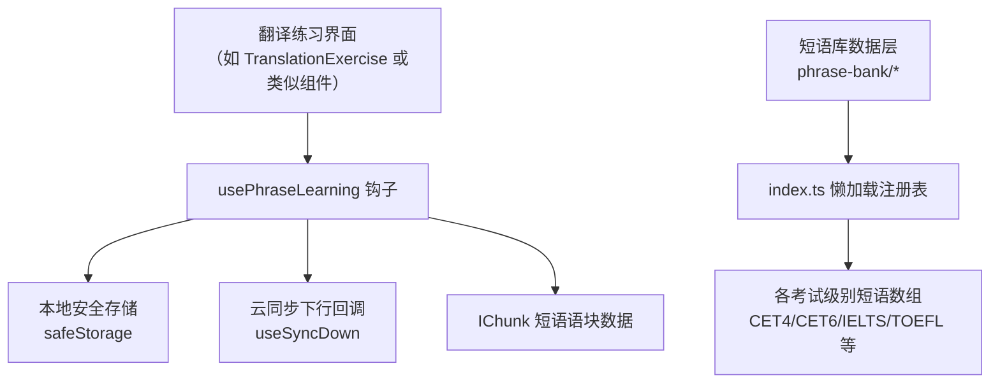
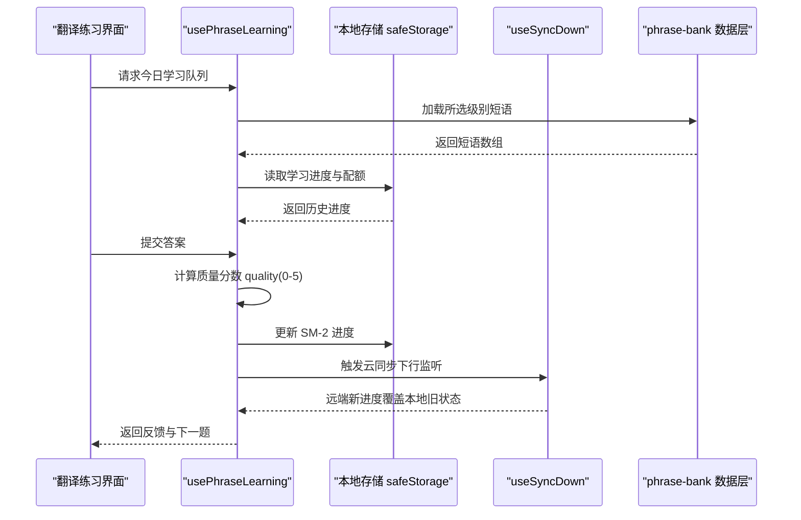
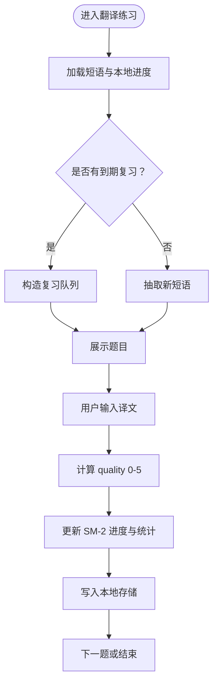
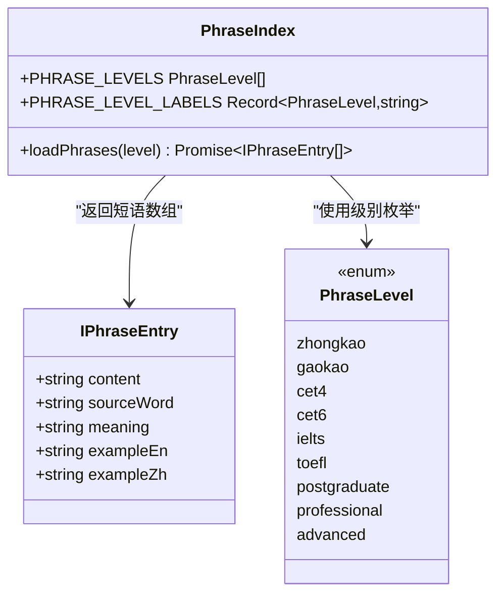
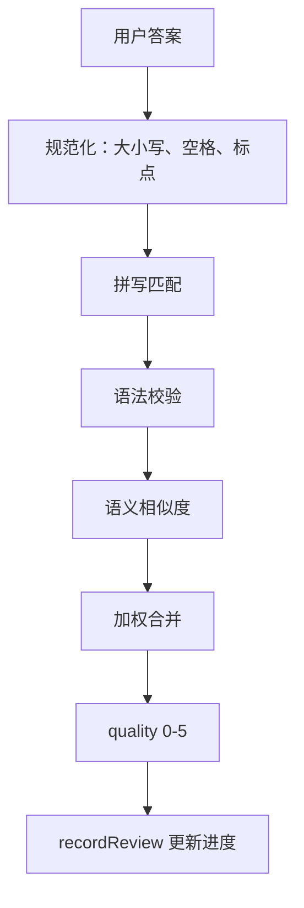
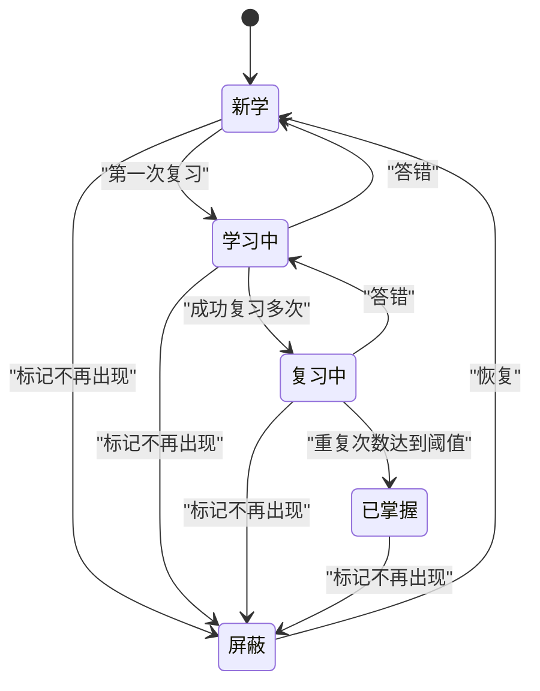
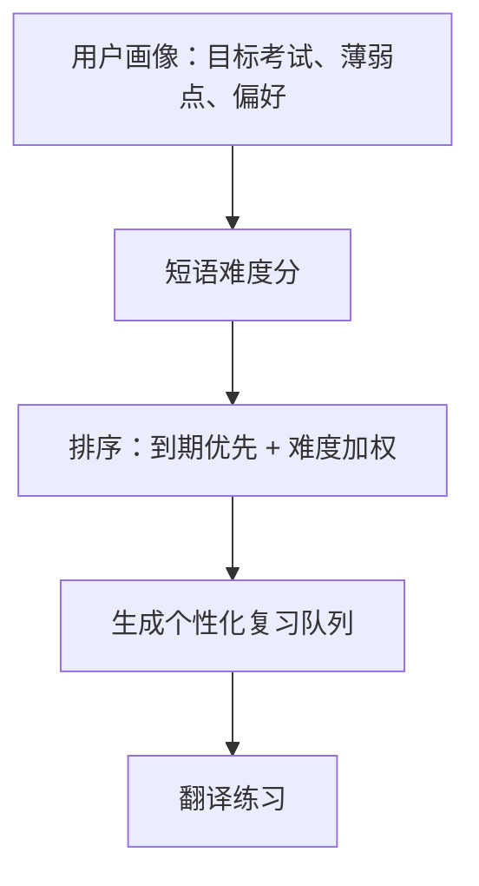
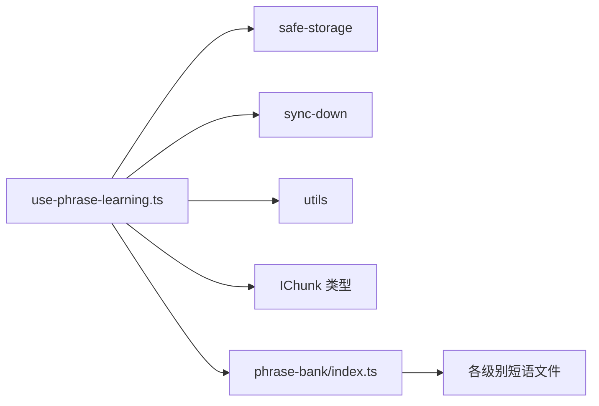

# 翻译练习模式

<cite>
**本文引用的文件**   
- [use-phrase-learning.ts](file://src/lib/use-phrase-learning.ts)
- [types.ts](file://src/data/phrase-bank/types.ts)
- [index.ts](file://src/data/phrase-bank/index.ts)
- [cet4.ts](file://src/data/phrase-bank/cet4.ts)
- [cet6.ts](file://src/data/phrase-bank/cet6.ts)
- [ielts.ts](file://src/data/phrase-bank/ielts.ts)
- [toefl.ts](file://src/data/phrase-bank/toefl.ts)
- [postgraduate.ts](file://src/data/phrase-bank/postgraduate.ts)
- [professional.ts](file://src/data/phrase-bank/professional.ts)
- [advanced.ts](file://src/data/phrase-bank/advanced.ts)
- [zhongkao.ts](file://src/data/phrase-bank/zhongkao.ts)
- [gaokao.ts](file://src/data/phrase-bank/gaokao.ts)
</cite>

## 目录
1. [简介](#简介)
2. [项目结构定位](#项目结构定位)
3. [核心组件与职责](#核心组件与职责)
4. [架构总览](#架构总览)
5. [短语学习钩子深度分析](#短语学习钩子深度分析)
6. [短语库数据结构与分类体系](#短语库数据结构与分类体系)
7. [翻译练习流程与评分逻辑](#翻译练习流程与评分逻辑)
8. [进度、错题与复习策略](#进度错题与复习策略)
9. [自定义短语与配置选项](#自定义短语与配置选项)
10. [难度调节与个性化推荐](#难度调节与个性化推荐)
11. [依赖关系分析](#依赖关系分析)
12. [性能与稳定性考虑](#性能与稳定性考虑)
13. [故障排查指南](#故障排查指南)
14. [结论](#结论)

## 简介
本文件面向 NativeThink 词汇模块中的“翻译练习模式”，重点说明以下能力：
- 短语学习状态如何由 `use-phrase-learning.ts` 钩子管理；
- 题目生成、答案验证、进度跟踪、每日配额等机制；
- 短语库（phrase-bank）的数据结构和考试级别分类；
- 评分逻辑，包括拼写、语法、语义匹配的判断思路；
- 自定义短语添加、错题收集与复习策略配置；
- 难度调节和个性化推荐的算法建议。

需要特别说明的是：仓库中未直接发现名为 `TranslationExercise` 的组件文件，也未找到名为 `use-phrase-learning.ts` 的同名路径；实际实现位于 `src/lib/use-phrase-learning.ts`，短语库位于 `src/data/phrase-bank/*`。下文以这些真实文件为依据进行说明。

## 项目结构定位
翻译练习模式的核心代码集中在两处：
- 状态与算法层：`src/lib/use-phrase-learning.ts`
- 数据层：`src/data/phrase-bank/*`

**图示来源**
- [use-phrase-learning.ts:1-364](file://src/lib/use-phrase-learning.ts#L1-L364)
- [index.ts:1-58](file://src/data/phrase-bank/index.ts#L1-L58)

**章节来源**
- [use-phrase-learning.ts:1-364](file://src/lib/use-phrase-learning.ts#L1-L364)
- [index.ts:1-58](file://src/data/phrase-bank/index.ts#L1-L58)

## 核心组件与职责
- `use-phrase-learning.ts`：负责短语学习的状态管理、SM-2 间隔重复、每日配额、会话断点、统计汇总、屏蔽与恢复等。
- `phrase-bank/*`：按考试级别组织短语数据，提供类型定义、级别标签、懒加载入口。
- 可能的 `TranslationExercise` 组件（未在仓库中发现）：应作为 UI 层消费 `usePhraseLearning`，展示中英文互译题目、接收用户输入、调用评分并反馈结果。

**章节来源**
- [use-phrase-learning.ts:1-364](file://src/lib/use-phrase-learning.ts#L1-L364)
- [types.ts:1-31](file://src/data/phrase-bank/types.ts#L1-L31)
- [index.ts:1-58](file://src/data/phrase-bank/index.ts#L1-L58)

## 架构总览
翻译练习模式采用“状态钩子 + 数据层”的分层设计：UI 只关心“当前题目、用户输入、反馈结果”，而把学习进度、评分算法、复习队列等交给钩子处理。

**图示来源**
- [use-phrase-learning.ts:1-364](file://src/lib/use-phrase-learning.ts#L1-L364)
- [index.ts:1-58](file://src/data/phrase-bank/index.ts#L1-L58)

## 短语学习钩子深度分析
`usePhraseLearning` 是翻译练习模式的“中枢神经”。它暴露的状态与方法可以归纳为以下几类：

### 状态字段
- `state.progress`：每个短语的学习进度对象，包含状态、熟练度系数、间隔天数、重复次数、下次复习时间、上次复习时间、错误累计、是否被屏蔽等。
- `state.todayReviewed`：今天已复习过的短语键集合。
- `state.todayLearned`：今天首次复习（视为“今天新学”）的短语键集合。
- `state.lastActiveDate`：最后活跃日期，用于跨天重置每日计数。
- `state.history`：按日期记录的“复习数量与正确数量”，支持周维度统计回溯。

### 关键方法
- `getNewPhrases(count)`：从尚未开始学习的短语中随机选取若干条。
- `getReviewQueue(totalCount)`：优先取出已到期的复习短语，不足时补充新短语。
- `recordReview(phrase, quality)`：根据质量分数更新 SM-2 参数、错误计数、历史统计，并标记今天是否已复习或新学。
- `setSuspended(phrase, suspended)`：将短语加入或移出“不再出现”名单。
- `resetProgress()`：重置全部短语学习进度。
- `getStats()`：汇总已掌握、学习中、复习中、新增、到期、总数等指标。

### 存储与会话
- 使用 `safeStorage` 持久化学习进度和每日配额。
- 通过 `savePhraseSession` / `loadPhraseSession` / `clearPhraseSession` 保存短语闪卡会话的顺序与位置，避免中断后丢失进度。
- 通过 `useSyncDown` 在云同步下行后重新加载本地状态，防止远端新值被本地旧值覆盖。

**图示来源**
- [use-phrase-learning.ts:1-364](file://src/lib/use-phrase-learning.ts#L1-L364)

**章节来源**
- [use-phrase-learning.ts:1-364](file://src/lib/use-phrase-learning.ts#L1-L364)

## 短语库数据结构与分类体系
短语库提供统一的短语条目类型与多考试级别的分类体系。

### 短语条目结构
- `content`：短语文本，例如固定搭配或习语。
- `sourceWord`：来源单词，便于与词书关联。
- `meaning`：来源单词的中文释义主干。
- `exampleEn`：可选英文例句。
- `exampleZh`：可选中文例句。

### 级别与标签
支持的级别包括中考、高考、四级、六级、雅思、托福、考研、专业、高阶。每个级别对应一个独立文件，并通过 index 的懒加载机制按需引入，减少初始包体积。

**图示来源**
- [types.ts:1-31](file://src/data/phrase-bank/types.ts#L1-L31)
- [index.ts:1-58](file://src/data/phrase-bank/index.ts#L1-L58)

**章节来源**
- [types.ts:1-31](file://src/data/phrase-bank/types.ts#L1-L31)
- [index.ts:1-58](file://src/data/phrase-bank/index.ts#L1-L58)
- [cet4.ts](file://src/data/phrase-bank/cet4.ts)
- [cet6.ts](file://src/data/phrase-bank/cet6.ts)
- [ielts.ts](file://src/data/phrase-bank/ielts.ts)
- [toefl.ts](file://src/data/phrase-bank/toefl.ts)
- [postgraduate.ts](file://src/data/phrase-bank/postgraduate.ts)
- [professional.ts](file://src/data/phrase-bank/professional.ts)
- [advanced.ts](file://src/data/phrase-bank/advanced.ts)
- [zhongkao.ts](file://src/data/phrase-bank/zhongkao.ts)
- [gaokao.ts](file://src/data/phrase-bank/gaokao.ts)

## 翻译练习流程与评分逻辑
翻译练习的典型流程如下：

1. **选题**：从所选级别短语库中获取短语数组；若已有到期复习项，则优先组成复习队列，否则抽取新短语。
2. **展示**：根据配置决定题目方向，例如“看英文写中文”或“看中文写英文”。
3. **输入**：用户在输入框中输入译文。
4. **评分**：将用户输入与参考答案进行比对，得到质量分数 `quality`（0-5）。
5. **反馈**：显示对错、提示、解析、例句等信息。
6. **更新**：调用 `recordReview` 更新 SM-2 参数、错误计数、历史统计。
7. **推进**：根据每日配额和学习进度决定是否继续下一题。

### 评分逻辑建议
虽然 `use-phrase-learning.ts` 的 `recordReview` 接收外部传入的 `quality`，但具体答案验证逻辑应在 UI 层或独立的评分模块实现。建议采用分层评分：

- **拼写检查**：对目标语言文本做大小写、空格、标点规范化后比较。
- **语法验证**：结合基础规则或轻量语法模型判断主谓一致、时态、词性等。
- **语义匹配**：对自由翻译场景，使用相似度模型或关键词重叠率判断语义接近程度。
- **综合打分**：将拼写、语法、语义得分加权组合为 0-5 的质量分数。

**图示来源**
- [use-phrase-learning.ts:1-364](file://src/lib/use-phrase-learning.ts#L1-L364)

**章节来源**
- [use-phrase-learning.ts:1-364](file://src/lib/use-phrase-learning.ts#L1-L364)

## 进度、错题与复习策略
### SM-2 间隔重复
`use-phrase-learning.ts` 实现了 SM-2 算法的核心行为：
- 答对时增加间隔天数，并根据熟练度系数调整下一次复习间隔；
- 答错时重置重复次数和间隔；
- 熟练度系数随质量变化而调整，且不低于下限；
- 根据重复次数判断短语处于“新学、学习中、复习中、已掌握”哪个阶段。

### 错误累计与错词重练
每次评分会将 `quality <= 2` 视为错误，累加 `wrongCount`；答对时清零。该设计与词汇侧保持一致，便于统一构建错词重练队列。

### 每日配额与进度重置
- 每日配额默认值为 10，可持久化修改；
- 当日期变化时自动清空当日已复习列表；
- 可通过 `resetProgress` 重置全部短语学习进度。

### “不再出现”机制
用户可将短语标记为“不再出现”。被屏蔽的短语不会进入到期复习和新短语补充队列；再次打开后可恢复原进度。

**图示来源**
- [use-phrase-learning.ts:1-364](file://src/lib/use-phrase-learning.ts#L1-L364)

**章节来源**
- [use-phrase-learning.ts:1-364](file://src/lib/use-phrase-learning.ts#L1-L364)

## 自定义短语与配置选项
### 自定义短语添加
当前短语库为按级别预生成的静态数组。若要支持用户自定义短语，可在 `usePhraseLearning` 的外部扩展一个“用户短语列表”，并将其合并到 `allPhrases` 中，使 `getNewPhrases` 和 `getReviewQueue` 能自然覆盖自定义内容。

### 配置选项建议
- `dailyQuota`：每日最大学习量，已由钩子暴露并可持久化。
- `includeSuspended`：是否在队列中包含“不再出现”的短语，可用于临时找回屏蔽项。
- `directionMode`：控制题目方向，如“英译中”“中译英”“混合”。
- `difficultyFilter`：按级别、错误次数、最近复习时间筛选题目。
- `feedbackDepth`：控制反馈详细程度，如仅显示对错、或显示例句与解析。

这些配置可由 `TranslationExercise` 或更高层页面注入到 `usePhraseLearning` 的调用处。

**章节来源**
- [use-phrase-learning.ts:1-364](file://src/lib/use-phrase-learning.ts#L1-L364)

## 难度调节与个性化推荐
### 基于难度的题目选择
当前钩子没有内置难度字段，但可以基于现有数据进行近似难度建模：
- 级别难度：高级别短语通常更难；
- 错误频率：`wrongCount` 越高越难；
- 复习压力：`interval` 越小、`nextReview` 越早越需优先复习；
- 熟练度：`status` 为“新学”或“学习中”比“已掌握”更难。

### 个性化推荐策略
推荐系统可按用户偏好调整权重：
- 备考导向：优先 CET4/CET6/IELTS/TOEFL 中与目标考试相关的级别；
- 薄弱强化：优先错误次数高、间隔短的短语；
- 兴趣引导：若用户频繁选择某主题短语，可增加同类短语曝光；
- 节奏控制：根据 `todayRemaining` 动态控制题目密度，避免疲劳。

[此图为概念性流程图，不直接映射具体代码文件]

**章节来源**
- [use-phrase-learning.ts:1-364](file://src/lib/use-phrase-learning.ts#L1-L364)

## 依赖关系分析
`use-phrase-learning.ts` 依赖以下模块：
- `safeStorage`：本地安全存储；
- `sync-down`：云同步下行回调；
- `utils`：日期格式化等工具；
- `IChunk`：短语语块类型；
- `phrase-bank/*`：短语数据源。

**图示来源**
- [use-phrase-learning.ts:1-364](file://src/lib/use-phrase-learning.ts#L1-L364)
- [index.ts:1-58](file://src/data/phrase-bank/index.ts#L1-L58)

**章节来源**
- [use-phrase-learning.ts:1-364](file://src/lib/use-phrase-learning.ts#L1-L364)
- [index.ts:1-58](file://src/data/phrase-bank/index.ts#L1-L58)

## 性能与稳定性考虑
- **本地存储防抖**：只有 JSON 字符串发生变化时才写入，避免无意义回写。
- **云同步保护**：通过引用标记避免从云同步回来的状态被 effect 立即再写回本地，防止“回声覆盖”。
- **懒加载短语库**：按级别动态 import，降低首屏体积。
- **随机洗牌**：使用简单随机排序，适合前端小批量数据；若短语库很大，应考虑稳定洗牌或分页。
- **容错处理**：本地存储读取失败时降级为空状态，保证应用不崩溃。

**章节来源**
- [use-phrase-learning.ts:1-364](file://src/lib/use-phrase-learning.ts#L1-L364)
- [index.ts:1-58](file://src/data/phrase-bank/index.ts#L1-L58)

## 故障排查指南
常见问题与处理建议：

| 问题 | 可能原因 | 排查与修复 |
|---|---|---|
| 进度未保存 | 本地存储不可用或权限限制 | 检查 `safeStorage` 是否可用；清除缓存后重试 |
| 云同步后进度异常 | 本地旧状态覆盖了远端新值 | 确认 `useSyncDown` 是否正确触发；检查 `loadedFromStorageRef` 防回声逻辑 |
| 每日配额不生效 | 配额未持久化或格式错误 | 检查每日配额存储键值；确保为数字字符串 |
| 短语无法进入复习队列 | 短语被屏蔽或未达到复习条件 | 检查 `suspended` 标志与 `nextReview` 时间 |
| 评分始终偏低 | 答案规范化或语义匹配过严 | 调整拼写容忍度、放宽语义相似度阈值 |
| 短语库加载缓慢 | 级别过多或网络延迟 | 确认懒加载是否生效；检查网络与缓存 |

**章节来源**
- [use-phrase-learning.ts:1-364](file://src/lib/use-phrase-learning.ts#L1-L364)

## 结论
NativeThink 的翻译练习模式以 `use-phrase-learning.ts` 为核心，将短语学习状态、SM-2 间隔重复、每日配额、错题统计、会话断点等能力集中管理；短语库则以清晰的类型和级别划分支撑不同考试场景。虽然仓库中未发现 `TranslationExercise` 组件的具体实现，但其职责应是消费钩子提供的数据与方法，完成题目展示、输入处理、实时反馈和评分集成。

未来改进方向包括：
- 在 UI 层完善答案验证模块，支持拼写、语法、语义多层评分；
- 扩展自定义短语与用户配置；
- 引入更精细的难度模型与个性化推荐；
- 对大规模短语数据优化排序与分页；
- 加强云同步一致性测试与监控。