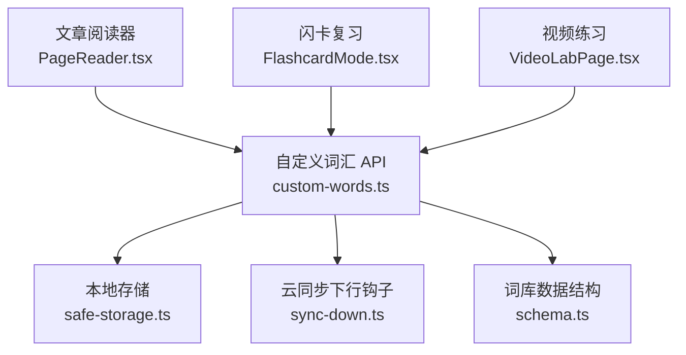
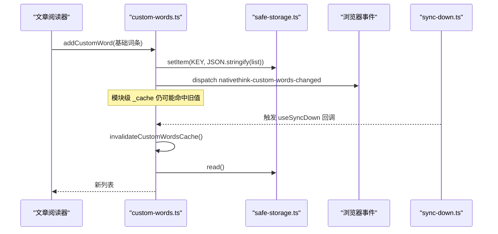
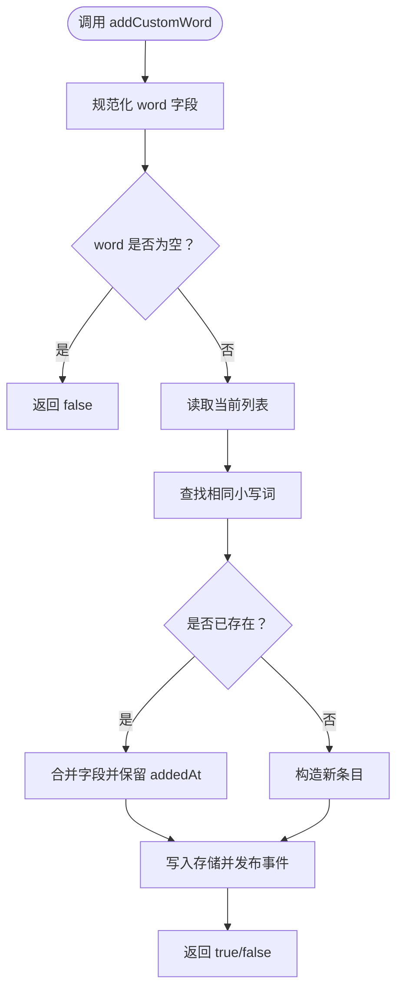
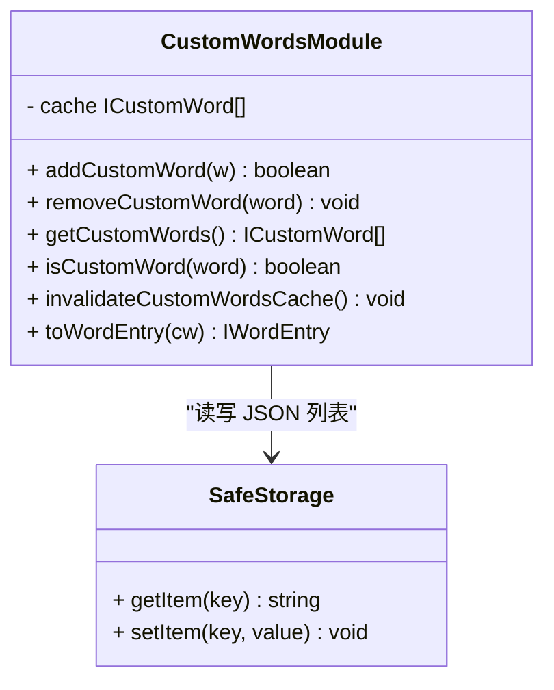
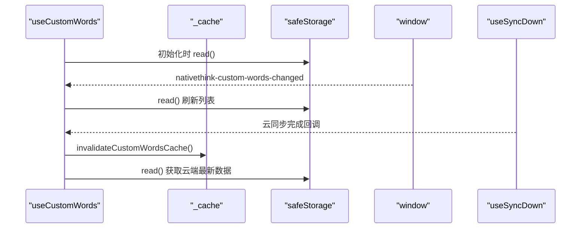
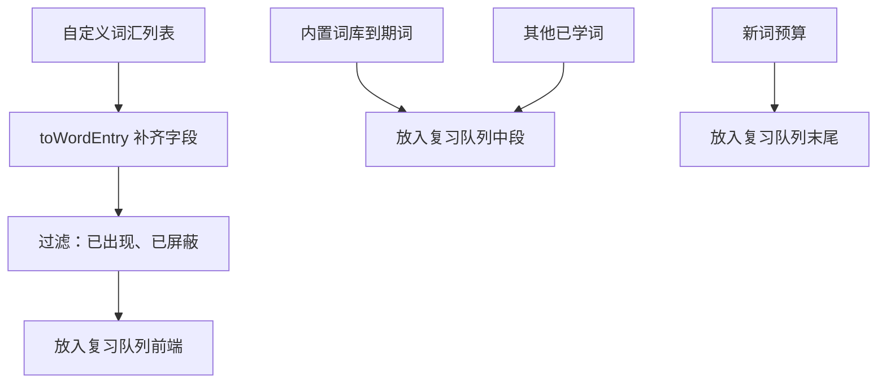
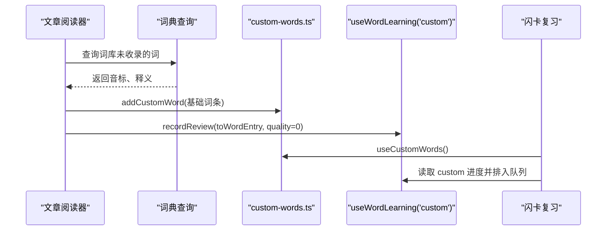
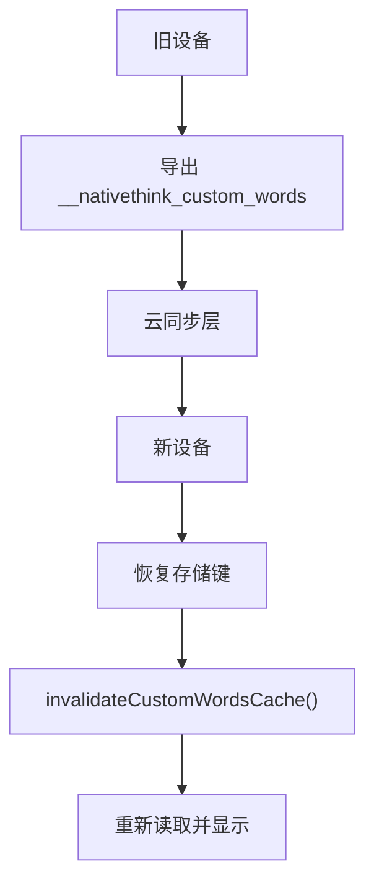
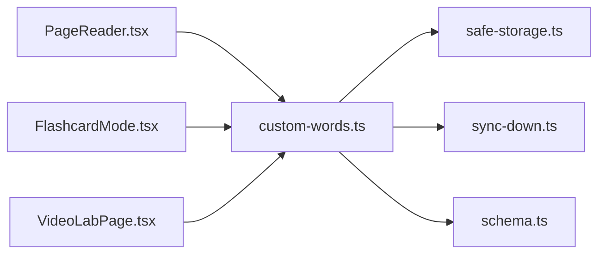

# 自定义词汇管理

<cite>
**本文引用的文件**   
- [custom-words.ts](file://src/lib/custom-words.ts)
- [FlashcardMode.tsx](file://src/pages/DeepVocabularyPage/components/FlashcardMode.tsx)
- [PageReader.tsx](file://src/pages/ArticlePage/components/PageReader.tsx)
- [VideoLabPage.tsx](file://src/pages/VideoLabPage/VideoLabPage.tsx)
- [schema.ts](file://src/data/wordbank/schema.ts)
- [safe-storage.ts](file://src/lib/safe-storage.ts)
- [sync-down.ts](file://src/lib/sync-down.ts)
</cite>

## 目录
1. [引言](#引言)
2. [项目结构定位](#项目结构定位)
3. [核心组件与职责](#核心组件与职责)
4. [架构总览](#架构总览)
5. [详细实现分析](#详细实现分析)
6. [依赖关系分析](#依赖关系分析)
7. [性能与一致性特征](#性能与一致性特征)
8. [故障排查指南](#故障排查指南)
9. [结论与扩展建议](#结论与扩展建议)

## 引言
本文件聚焦 NativeThink 词汇模块中的“自定义词汇”能力，说明 `custom-words.ts` 如何为阅读、视频和闪卡学习等场景提供生词本：用户可以在文章阅读时把词库未收录的词加入生词本，随后在复习检测中按独立优先级参与间隔重复训练。文档重点包括：
- 自定义词汇的增删查、状态订阅与缓存失效；
- 自定义词汇与内置词库的整合策略；
- 学习进度复用机制与优先级处理；
- 数据格式规范、验证规则与错误处理；
- 云同步下的缓存失效与跨设备迁移方案；
- 批量导入导出、搜索过滤、分类标签等 UI 能力的现状与建议。

## 项目结构定位
自定义词汇并非一个独立页面，而是作为共享层能力被多个页面复用：
- 逻辑层：`src/lib/custom-words.ts` 提供数据访问、缓存、事件与类型转换。
- 消费层：
  - 阅读器 `PageReader.tsx` 在“词库未收录”时调用 `addCustomWord` 并立即加入学习队列。
  - 闪卡模式 `FlashcardMode.tsx` 通过 `useCustomWords` 把生词优先排入复习队列。
  - 视频练习页 `VideoLabPage.tsx` 使用 `isCustomWord` 判断某词是否属于生词本。
- 数据模型：自定义词汇最终转为词库 schema 的 `IWordEntry`，并通过 `level: 'custom'` 进入独立学习进度。

**图表来源**
- [custom-words.ts:1-135](file://src/lib/custom-words.ts#L1-L135)
- [PageReader.tsx:100-130](file://src/pages/ArticlePage/components/PageReader.tsx#L100-L130)
- [FlashcardMode.tsx:160-180](file://src/pages/DeepVocabularyPage/components/FlashcardMode.tsx#L160-L180)
- [VideoLabPage.tsx:20-30](file://src/pages/VideoLabPage/VideoLabPage.tsx#L20-L30)

**章节来源**
- [custom-words.ts:1-135](file://src/lib/custom-words.ts#L1-L135)
- [schema.ts:1-61](file://src/data/wordbank/schema.ts#L1-L61)

## 核心组件与职责
| 名称 | 职责 | 关键行为 |
|---|---|---|
| `ICustomWord` | 自定义词汇的数据模型 | 包含单词、音标、词性、释义、来源、添加时间等字段 |
| `read/write` | 内存缓存 + 持久化读写 | 使用模块级 `_cache` 避免频繁解析 JSON；失败时回退为空数组 |
| `invalidateCustomWordsCache` | 使模块缓存失效 | 用于云同步后强制重新读取 |
| `addCustomWord` | 添加或更新自定义词汇 | 去重、保留原添加时间、返回是否新增 |
| `removeCustomWord` | 删除自定义词汇 | 按词去大小写匹配 |
| `getCustomWords` / `isCustomWord` | 查询列表与存在性 | 供 UI 渲染与条件判断 |
| `useCustomWords` | React Hook 订阅式读取 | 监听 `nativethink-custom-words-changed` 事件，并在云同步后刷新 |
| `toWordEntry` | 转换为词库词条 | 补齐必填字段，设置 `level: 'custom'` |

**章节来源**
- [custom-words.ts:1-135](file://src/lib/custom-words.ts#L1-L135)

## 架构总览
自定义词汇模块采用“轻量服务 + 事件订阅 + 缓存失效”的设计：

**图表来源**
- [custom-words.ts:18-135](file://src/lib/custom-words.ts#L18-L135)
- [PageReader.tsx:110-130](file://src/pages/ArticlePage/components/PageReader.tsx#L110-L130)
- [sync-down.ts](file://src/lib/sync-down.ts)

## 详细实现分析

### 数据模型与格式规范
自定义词汇由 `ICustomWord` 描述，关键字段如下：
- `word`：必需字符串，会被 trim 后再比较和存储。
- `phonetic`：可选音标。
- `partOfSpeech`：可选词性；缺失时在转成词库词条时补默认值。
- `meaning`：释义，应非空才有实际学习价值。
- `source`：来源说明，例如“阅读：《傲慢与偏见》”，便于回忆上下文。
- `addedAt`：添加时间戳，由 API 自动注入。

它不是完整词库词条，因此不能直接参与所有基于词库的查询。需要先用 `toWordEntry` 补齐：
- `level` 固定为 `'custom'`；
- `frequencyRank` 设为 0；
- `collocations`、`examples`、`synonyms`、`antonyms`、`wordFamily`、`topics` 等设为空集合；
- `register`、`emotion` 设为中性；
- `hasNoChineseEquivalent` 为假；
- `hasCollocations` 为假；
- `deepExplanation` 为空字符串。

该设计保证下游无需判空，同时让自定义词汇拥有与内置词相同的展示字段。

**章节来源**
- [custom-words.ts:14-40](file://src/lib/custom-words.ts#L14-L40)
- [custom-words.ts:106-135](file://src/lib/custom-words.ts#L106-L135)
- [schema.ts:1-30](file://src/data/wordbank/schema.ts#L1-L30)

### 增删改查与去重策略
#### 添加
`addCustomWord` 的执行顺序是：
1. 将输入词的 `word` 做小写规范化用于去重键。
2. 检查是否为空。
3. 从当前列表查找相同小写词。
4. 若已存在：合并字段但保留原 `addedAt`，写入存储并返回 `false`。
5. 若不存在：创建新条目并插入到列表头部，返回 `true`。

这意味着“重复加入”不会增加计数，而是更新释义等元信息，并把该词推到列表顶部，方便用户最近添加的词更容易找到。

#### 修改
模块没有独立的 `updateCustomWord`。语义上，再次 `addCustomWord` 就是“更新已有词条”。由于保留原 `addedAt`，添加时间不会被误刷为新时间。

#### 删除
`removeCustomWord` 按小写词过滤列表，不区分大小写。

#### 查询
- `getCustomWords` 返回当前列表快照。
- `isCustomWord` 用于快速判断某个词是否已在生词本中。

**图表来源**
- [custom-words.ts:41-82](file://src/lib/custom-words.ts#L41-L82)

**章节来源**
- [custom-words.ts:41-105](file://src/lib/custom-words.ts#L41-L105)

### 本地存储与缓存
- 存储键：`__nativethink_custom_words`。
- 存储介质：`safeStorage`，封装了底层安全存储 API。
- 内存缓存：模块级变量 `_cache`，首次读取后缓存结果，避免每次操作都解析 JSON。
- 事件：`nativethink-custom-words-changed`，供多组件同步 UI。

风险点在于：写入会发布事件，但 `_cache` 不会立刻失效。因此：
- 同进程内多个订阅者通过事件收到新列表；
- 云同步后必须显式调用 `invalidateCustomWordsCache()`，再重新读取。

**图表来源**
- [custom-words.ts:14-105](file://src/lib/custom-words.ts#L14-L105)
- [safe-storage.ts](file://src/lib/safe-storage.ts)

**章节来源**
- [custom-words.ts:14-56](file://src/lib/custom-words.ts#L14-L56)

### React Hook 与事件订阅
`useCustomWords` 提供两个返回值：
- `words`：当前自定义词汇列表。
- `remove`：删除指定词的函数。

其内部：
1. 用 `useState` 初始化读出的列表。
2. 在 `useEffect` 中注册 `nativethink-custom-words-changed` 监听器，收到事件后重新 `read()`。
3. 通过 `useSyncDown` 订阅云同步下行，先清空模块缓存，再刷新 state。
4. 返回的 `remove` 指向 `removeCustomWord`，保证删除操作与列表一致。

**图表来源**
- [custom-words.ts:58-105](file://src/lib/custom-words.ts#L58-L105)

**章节来源**
- [custom-words.ts:58-105](file://src/lib/custom-words.ts#L58-L105)

### 与内置词库的整合机制
自定义词汇并不是替换内置词库，而是“补充层”。整合体现在以下方面：

1. **统一词条形状**  
   `toWordEntry` 把自定义词汇补齐为 `IWordEntry`，使闪卡、收藏、笔记等通用能力可以消费。

2. **独立学习进度**  
   闪卡模式使用 `useWordLearning('custom')`，自定义词汇的学习进度与任何真实词书互不污染。

3. **优先级处理**  
   在构建复习队列时，代码先把自定义词汇映射为词条，再排除已屏蔽词和已出现词，然后放在到期词和其他已学词之前。这样能优先复习用户主动收集的高意愿词汇。

4. **冲突解决**  
   - 同一词多次加入：只保留一条，更新释义等字段。
   - 自定义词与内置词同名：两者并存，但学习进度各自维护；复习队列中自定义词优先，避免用户刚加的词被埋没。
   - 屏蔽状态：自定义词若标记为不再出现，也会被跳过。

5. **数据合并**  
   目前模块不直接合并内置词库数据；它只负责生成自定义侧的 `IWordEntry`，由上层消费层决定如何组合。

**图表来源**
- [custom-words.ts:106-135](file://src/lib/custom-words.ts#L106-L135)
- [FlashcardMode.tsx:160-180](file://src/pages/DeepVocabularyPage/components/FlashcardMode.tsx#L160-L180)

**章节来源**
- [FlashcardMode.tsx:150-190](file://src/pages/DeepVocabularyPage/components/FlashcardMode.tsx#L150-L190)
- [schema.ts:1-30](file://src/data/wordbank/schema.ts#L1-L30)

### 学习状态管理与间隔重复
自定义词汇的学习状态复用 `useWordLearning('custom')`，因此具备：
- 独立的 SM-2 相关进度；
- 错词重练；
- 屏蔽；
- 预测与每日配额；
- 会话保存与恢复。

关键流程：
1. 用户在阅读器点击“加入学习”时，如果词不在内置词库，则走词典兜底、存入生词本，并调用 `recordWordLearn(toWordEntry(...), 0)`。
2. 评分质量 0 表示“完全忘了”，这会立即把词推入复习队列。
3. 闪卡模式中，自定义词汇优先参与复习，且受屏蔽状态约束。

**图表来源**
- [PageReader.tsx:110-130](file://src/pages/ArticlePage/components/PageReader.tsx#L110-L130)
- [custom-words.ts:106-135](file://src/lib/custom-words.ts#L106-L135)
- [FlashcardMode.tsx:160-180](file://src/pages/DeepVocabularyPage/components/FlashcardMode.tsx#L160-L180)

**章节来源**
- [PageReader.tsx:100-130](file://src/pages/ArticlePage/components/PageReader.tsx#L100-L130)
- [FlashcardMode.tsx:150-190](file://src/pages/DeepVocabularyPage/components/FlashcardMode.tsx#L150-L190)

### 错误处理与容错
现有实现采取“尽量可用、静默降级”的策略：
- 解析失败：`JSON.parse` 异常时，缓存置为空数组。
- 存储失败：`setItem` 抛错时忽略，不影响后续逻辑。
- 事件分发失败：`window.dispatchEvent` 抛错时忽略。
- 空词：`addCustomWord` 对空词直接返回 `false`。
- 无效列表：`read` 在非数组情况下也回退为空数组。

这种设计的优点是鲁棒性强；缺点是出错时缺少可观测的错误码或用户提示。对于生产环境，建议至少把存储失败记录到诊断日志，以便排查存储空间不足或权限问题。

**章节来源**
- [custom-words.ts:22-56](file://src/lib/custom-words.ts#L22-L56)

### 同步备份与跨设备迁移
当前实现与云同步的关系是：
- 模块本身不直接上传下载自定义词汇。
- 云同步完成后，通过 `useSyncDown` 触发回调。
- 回调中调用 `invalidateCustomWordsCache()` 清除模块缓存，再重新读取本地存储。
- 这意味着真正的“自定义词汇同步负载”应由云同步层负责落盘到 `__nativethink_custom_words`，之后自定义词汇模块才会看到最新数据。

迁移建议：
- 备份：导出 `__nativethink_custom_words` 对应的 JSON 数组。
- 迁移：在新设备上先恢复该键，再触发一次云同步或手动刷新，确保 `_cache` 失效。
- 合并：如果两端都有新增，应在同步层做合并策略，而不是简单覆盖。

**图表来源**
- [custom-words.ts:58-105](file://src/lib/custom-words.ts#L58-L105)
- [sync-down.ts](file://src/lib/sync-down.ts)

**章节来源**
- [custom-words.ts:58-105](file://src/lib/custom-words.ts#L58-L105)

### 批量导入导出、搜索过滤与分类标签的现状
根据当前源码：
- **批量导入**：模块没有暴露批量导入接口，也没有导入校验流程。
- **批量导出**：模块没有导出函数，但可通过 `getCustomWords()` 获取列表。
- **搜索过滤**：模块只提供全量列表和存在性判断，没有按词、来源、日期等的筛选 API。
- **分类标签**：`ICustomWord` 有 `source` 字段，但没有结构化 `tags` 或 `category`。

因此，这些功能更适合放在 UI 层或扩展后的服务层：
- 批量导入：可在页面层解析 CSV/JSON，逐条调用 `addCustomWord`，并汇总成功失败数。
- 搜索过滤：在 `getCustomWords()` 返回后，由 UI 层按 `word`、`source`、`addedAt` 过滤。
- 分类标签：建议在 `ICustomWord` 扩展 `tags: string[]` 或 `category`，并在同步层支持字段迁移。

**章节来源**
- [custom-words.ts:14-105](file://src/lib/custom-words.ts#L14-L105)

## 依赖关系分析
自定义词汇模块依赖以下外部能力：
- `safeStorage`：安全存储抽象。
- `sync-down`：云同步下行事件。
- `IWordEntry`：词库词条 schema。
- 三个页面消费层：阅读器、闪卡、视频页。

**图表来源**
- [custom-words.ts:1-135](file://src/lib/custom-words.ts#L1-L135)
- [PageReader.tsx:20-30](file://src/pages/ArticlePage/components/PageReader.tsx#L20-L30)
- [FlashcardMode.tsx:20-30](file://src/pages/DeepVocabularyPage/components/FlashcardMode.tsx#L20-L30)
- [VideoLabPage.tsx:20-30](file://src/pages/VideoLabPage/VideoLabPage.tsx#L20-L30)

**章节来源**
- [custom-words.ts:1-135](file://src/lib/custom-words.ts#L1-L135)

## 性能与一致性特征
- 时间复杂度：
  - `addCustomWord`：O(n)，线性扫描列表去重。
  - `removeCustomWord`：O(n)，过滤重建列表。
  - `isCustomWord`：O(n)。
  - `useCustomWords` 初始化：O(n)。
- 空间复杂度：O(n)，存储一份内存缓存和 JSON 字符串。
- 优化机会：
  - 引入以 `word.toLowerCase()` 为键的索引对象，可将去重和查询降到 O(1)。
  - 对大批量导入使用批写接口，减少多次 JSON 序列化。
  - 对长列表搜索引入前缀索引或客户端分页。
- 一致性：
  - 多组件通过事件保持 UI 一致。
  - 云同步后必须清空缓存，否则 UI 可能继续显示旧列表。

[本节为通用性能讨论，不直接分析具体代码片段]

## 故障排查指南
| 现象 | 可能原因 | 排查建议 |
|---|---|---|
| 添加自定义词汇后列表不变 | 模块缓存未失效 | 确认是否调用 `invalidateCustomWordsCache()` |
| 云同步后自定义词汇仍是旧值 | 仅触发了事件，但未清空 `_cache` | 检查 `useSyncDown` 回调是否执行清理逻辑 |
| 重复添加没有新增计数 | 正常行为：重复词只更新字段 | 确认业务是否误判“未成功” |
| 删除无效 | 大小写不一致导致匹配失败 | 注意模块内部按小写匹配 |
| 自定义词未出现在复习队列 | 已被屏蔽或进度缺失 | 检查 `state.progress[key]` 是否存在且 `suspended` 为假 |
| 导入大量词后卡顿 | 频繁 JSON 序列化与 DOM 更新 | 分批导入、合并写入、延迟渲染 |
| 存储失败但无提示 | 写入异常被静默忽略 | 增加诊断日志，检查存储空间与权限 |

**章节来源**
- [custom-words.ts:22-105](file://src/lib/custom-words.ts#L22-L105)
- [FlashcardMode.tsx:160-180](file://src/pages/DeepVocabularyPage/components/FlashcardMode.tsx#L160-L180)

## 结论与扩展建议
当前自定义词汇模块已经实现了“阅读收集 → 独立学习进度 → 复习优先”的核心闭环，并与内置词库形成互补而非竞争关系。它的设计简洁、耦合低，适合继续扩展。

建议的演进方向：
1. 增加批量导入导出接口，并提供校验报告。
2. 为 `ICustomWord` 扩展结构化分类标签。
3. 引入词键索引，提升大规模数据下的去重与查询性能。
4. 明确自定义词汇的云同步协议，支持两端增量合并。
5. 增强错误可观测性，记录存储失败、解析失败和同步失败。
6. 在 UI 层实现搜索、排序、分页和批量操作，保持模块层专注数据契约。

[本节为总结与建议，不直接分析具体代码片段]