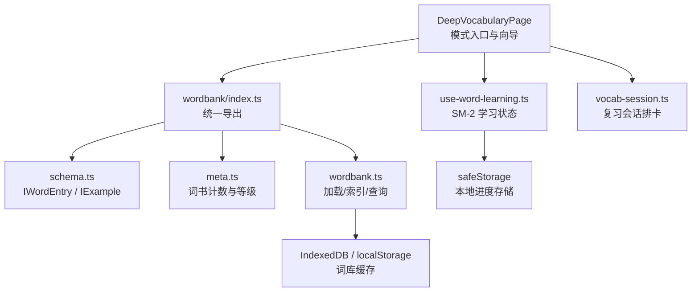
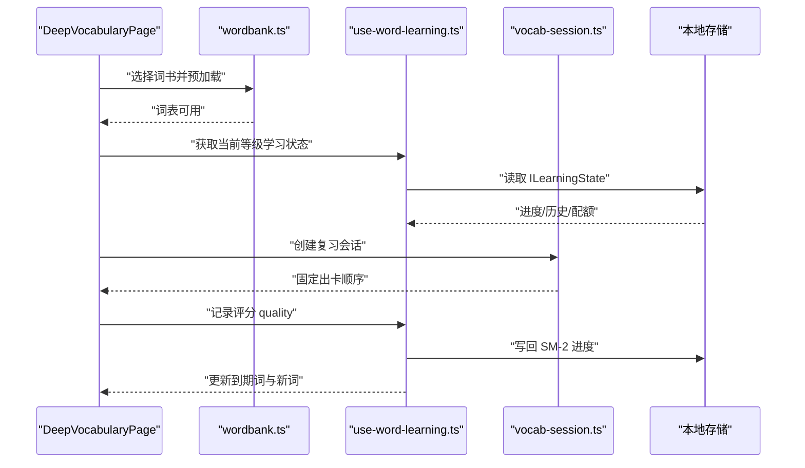
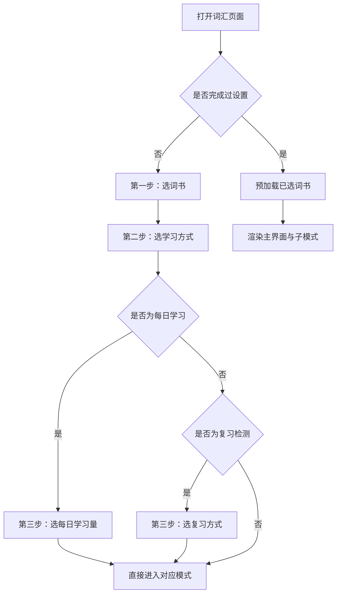
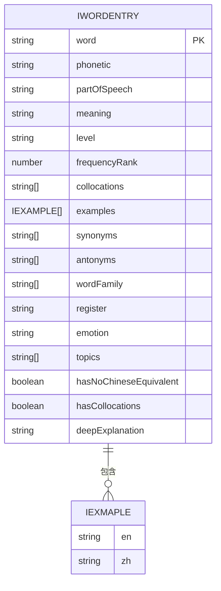
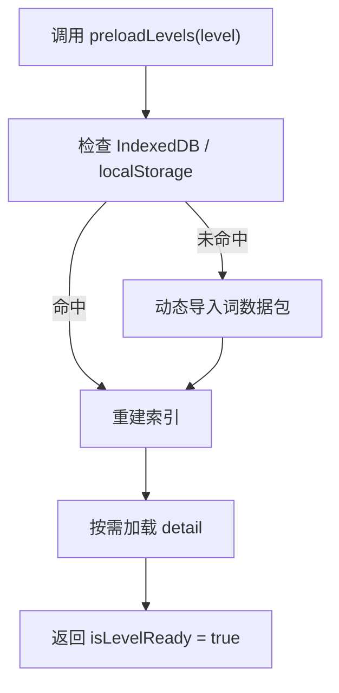
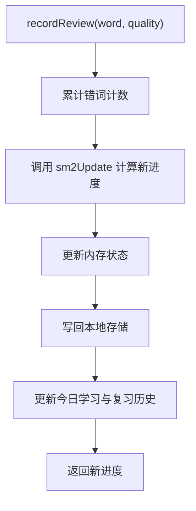
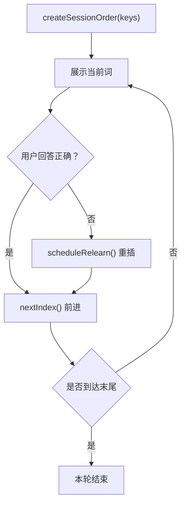
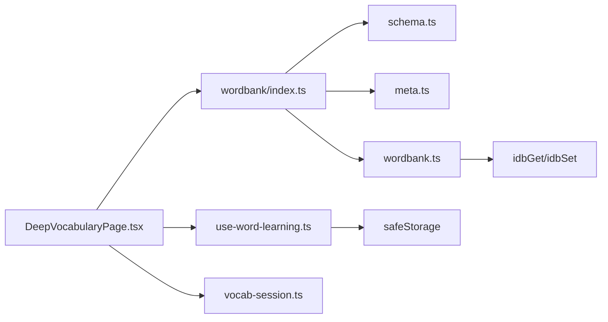

# 词汇模块概览

<cite>
**本文引用的文件**   
- [DeepVocabularyPage.tsx](file://src/pages/DeepVocabularyPage/DeepVocabularyPage.tsx)
- [schema.ts](file://src/data/wordbank/schema.ts)
- [meta.ts](file://src/data/wordbank/meta.ts)
- [wordbank.ts](file://src/data/wordbank/wordbank.ts)
- [index.ts](file://src/data/wordbank/index.ts)
- [use-word-learning.ts](file://src/lib/use-word-learning.ts)
- [vocab-session.ts](file://src/lib/vocab-session.ts)
</cite>

## 目录
1. [引言](#引言)
2. [项目结构](#项目结构)
3. [核心组件](#核心组件)
4. [架构总览](#架构总览)
5. [详细组件分析](#详细组件分析)
6. [依赖关系分析](#依赖关系分析)
7. [性能与扩展性](#性能与扩展性)
8. [故障排查指南](#故障排查指南)
9. [结论](#结论)

## 引言
本概览文档聚焦 NativeThink 的词汇深度模块，目标是用较低技术门槛解释以下问题：
- DeepVocabularyPage 主界面如何组织背单词、短语闪卡、中译英、纠偏重考、生词本等学习模式。
- wordbank schema 的数据模型设计，包括词汇卡片、掌握度字段和间隔重复状态。
- 从词库加载到学习会话再到持久化存储的整体数据流。
- SM-2 间隔重复算法在模块中的具体应用，以及如何通过掌握度和进度追踪实现个性化学习路径。
- 模块的扩展点与自定义配置选项。

该模块采用“前端页面 + 数据层 + 学习状态 Hook + 会话排卡逻辑”的分层架构：页面负责模式导航与展示，数据层负责词库查询与缓存，Hook 管理每个词的学习进度与每日配额，会话逻辑负责复习队列的即时重排。

## 项目结构
词汇模块主要分布在三个层次：
- 页面层：`src/pages/DeepVocabularyPage/DeepVocabularyPage.tsx` 提供入口、向导、模式选择和各子模式容器。
- 数据层：`src/data/wordbank/*` 提供词汇 schema、元数据、动态加载、索引、查询与随机抽样。
- 学习层：`src/lib/use-word-learning.ts` 与 `src/lib/vocab-session.ts` 分别负责 SM-2 进度与会话顺序。

**图示来源**
- [DeepVocabularyPage.tsx:1-120](file://src/pages/DeepVocabularyPage/DeepVocabularyPage.tsx#L1-L120)
- [index.ts:1-10](file://src/data/wordbank/index.ts#L1-L10)
- [schema.ts:1-61](file://src/data/wordbank/schema.ts#L1-L61)
- [meta.ts:1-94](file://src/data/wordbank/meta.ts#L1-L94)
- [wordbank.ts:1-120](file://src/data/wordbank/wordbank.ts#L1-L120)
- [use-word-learning.ts:1-80](file://src/lib/use-word-learning.ts#L1-L80)
- [vocab-session.ts:1-30](file://src/lib/vocab-session.ts#L1-L30)

**章节来源**
- [DeepVocabularyPage.tsx:1-200](file://src/pages/DeepVocabularyPage/DeepVocabularyPage.tsx#L1-L200)
- [index.ts:1-10](file://src/data/wordbank/index.ts#L1-L10)

## 核心组件
词汇模块的核心由五个部分组成：

| 组件 | 职责 | 关键行为 |
|---|---|---|
| DeepVocabularyPage | 主界面、词书向导、模式路由 | 选择词书、学习方式、每日学习量；渲染每日学习、快速闪卡、复习检测、短语闪卡、中译英、纠偏重考、浏览、搭配、词汇量测试等模式。 |
| wordbank schema | 词汇数据结构定义 | 定义 `IWordEntry`、`IExample`、`IWordDetail`、`IWordQuery`，描述词频、词性、语域、情感、主题、例句、搭配、深度解释等字段。 |
| wordbank engine | 词库加载与查询 | 按等级动态导入词数据，构建书内去重索引，提供 `queryWords`、`getRandomWords`、`preloadLevels`、`isLevelReady` 等 API。 |
| use-word-learning | 学习进度与 SM-2 | 维护 `ILearningState`，计算到期词、新词、每日配额，实现 `sm2Update`、`recordReview`、`markLearned`、`setSuspended` 等。 |
| vocab-session | 复习会话顺序 | 维护本轮出卡顺序、答错重插策略、未来七天预测，避免答题过程中队列漂移。 |

**章节来源**
- [DeepVocabularyPage.tsx:1-200](file://src/pages/DeepVocabularyPage/DeepVocabularyPage.tsx#L1-L200)
- [schema.ts:1-61](file://src/data/wordbank/schema.ts#L1-L61)
- [wordbank.ts:1-120](file://src/data/wordbank/wordbank.ts#L1-L120)
- [use-word-learning.ts:1-120](file://src/lib/use-word-learning.ts#L1-L120)
- [vocab-session.ts:1-30](file://src/lib/vocab-session.ts#L1-L30)

## 架构总览
词汇模块的整体数据流可分为四层：

1. **数据加载层**：`wordbank.ts` 根据所选等级从 IndexedDB 或 localStorage 命中缓存，否则动态导入对应词包；同时按需加载 detail（搭配、例句、深度解释）。
2. **查询与索引层**：为每本书构建“书内去重”的词表，并维护全局唯一词表；对外暴露 `queryWords` 与 `getRandomWords`。
3. **学习状态层**：`use-word-learning.ts` 按等级读取/写入本地存储，聚合 `all` 模式下的进度，计算到期词与新词，并通过 SM-2 更新掌握度。
4. **会话层**：`vocab-session.ts` 将到期词冻结为固定顺序，支持答错后重插，提供未来 N 天到期预测。

**图示来源**
- [DeepVocabularyPage.tsx:300-500](file://src/pages/DeepVocabularyPage/DeepVocabularyPage.tsx#L300-L500)
- [wordbank.ts:200-360](file://src/data/wordbank/wordbank.ts#L200-L360)
- [use-word-learning.ts:120-240](file://src/lib/use-word-learning.ts#L120-L240)
- [vocab-session.ts:10-77](file://src/lib/vocab-session.ts#L10-L77)

## 详细组件分析

### DeepVocabularyPage：主界面与模式组织
DeepVocabularyPage 是词汇模块的总入口。它不直接实现所有学习算法，而是作为“模式编排器”，把用户选择映射到不同子模式组件。

#### 词书与模式配置
页面定义了词书集合与学习方式集合，涵盖：
- 词书：中考、高考、四级、六级、四六级高频、四六级高分、雅思、托福、考研、专业、高阶，以及“全部”。
- 学习方式：每日学习、快速闪卡、复习检测、短语闪卡、中译英、纠偏重考、词库浏览、搭配学习、词汇量测试。

其中：
- “每日学习”走 `DailyLearningMode`，负责按每日配额抽取新词。
- “快速闪卡”走 `QuickCardMode`，只判断认识或不认识。
- “复习检测”走 `FlashcardMode`，使用 SM-2 安排复习。
- “短语闪卡”走 `PhraseFlashcardMode`，对短语库执行类似闪卡的间隔复习。
- “中译英”走 `ChineseToEnglishMode`，让用户主动拼写或选择英文。
- “纠偏重考”走 `CorrectionDrillMode`，针对 AI 判过的中式表达进行四选一重考。
- “词库浏览”走浏览列表，并可标记“已记住”，从而进入 SM-2 进度。

#### 首启向导
首次进入时显示三步向导：选词书 → 选学习方式 → 开始学习。换书时可一键切换并保持当前学习方式。向导完成后，页面才真正预加载所选词书数据，避免一打开就拉取全部 11 本书导致内存压力。

#### 模式选择流程

**图示来源**
- [DeepVocabularyPage.tsx:1-200](file://src/pages/DeepVocabularyPage/DeepVocabularyPage.tsx#L1-L200)
- [DeepVocabularyPage.tsx:201-478](file://src/pages/DeepVocabularyPage/DeepVocabularyPage.tsx#L201-L478)

#### 数据就绪控制
页面使用 `preloadLevels` 和 `isLevelReady` 控制加载状态：
- 未设置完成前不预加载任何词书。
- 设置完成后，按所选等级批量预加载。
- “全部”模式会等待 11 个等级全部就绪。
- 失败路径不会阻塞界面，子模式内部有空数据兜底。

**章节来源**
- [DeepVocabularyPage.tsx:1-200](file://src/pages/DeepVocabularyPage/DeepVocabularyPage.tsx#L1-L200)
- [DeepVocabularyPage.tsx:201-478](file://src/pages/DeepVocabularyPage/DeepVocabularyPage.tsx#L201-L478)

### wordbank schema：词汇数据模型
`schema.ts` 定义了词汇模块最基础的数据实体：

| 字段或类型 | 含义 | 设计要点 |
|---|---|---|
| `IWordEntry.word` | 英文原词 | 查询与去重的关键键值。 |
| `IWordEntry.phonetic` | 音标 | 辅助发音与朗读。 |
| `IWordEntry.partOfSpeech` | 词性 | 支持 adj、adv、n、v 等过滤。 |
| `IWordEntry.meaning` | 中文释义 | 基本学习内容。 |
| `IWordEntry.level` | 所属词书等级 | 支持中考、高考、四级、六级、四六级高频、四六级高分、雅思、托福、考研、专业、高阶、custom。 |
| `IWordEntry.frequencyRank` | COCA 词频排名 | 用于频率排序和难度估计。 |
| `IWordEntry.collocations` | 搭配 | 默认空数组，detail 加载后填充。 |
| `IWordEntry.examples` | 多条例句 | 含英文与中文。 |
| `IWordEntry.synonyms / antonyms` | 同义词 / 反义词 | 扩展词汇网络。 |
| `IWordEntry.wordFamily` | 词族派生词 | 帮助理解词根词缀。 |
| `IWordEntry.register` | 语域 | formal、neutral、informal。 |
| `IWordEntry.emotion` | 情感色彩 | positive、neutral、negative。 |
| `IWordEntry.topics` | 主题分类 | 可按主题筛选。 |
| `IWordEntry.hasNoChineseEquivalent` | 无中文对应概念 | 用于过滤特殊词条。 |
| `IWordEntry.hasCollocations` | 是否有搭配 | 便于在不加载 detail 时做快捷过滤。 |
| `IWordEntry.deepExplanation` | 深度解释 | detail 加载后填充。 |
| `IExample` | 例句对象 | en、zh 双语。 |
| `IWordDetail` | detail 片段 | collocations、examples、deepExplanation。 |
| `IWordDetailMap` | detail 映射表 | key 为小写词，value 为 detail 片段。 |
| `IWordQuery` | 查询参数 | level、topic、search、frequencyMin/Max、register、pos、sortBy、limit、offset。 |

**图示来源**
- [schema.ts:1-61](file://src/data/wordbank/schema.ts#L1-L61)

**章节来源**
- [schema.ts:1-61](file://src/data/wordbank/schema.ts#L1-L61)

### wordbank engine：词库加载、索引与查询
`wordbank.ts` 是词库运行时引擎，承担以下职责：

1. **缓存优先加载**：优先从 IndexedDB 读取等级词表，不可用时回退到 localStorage。
2. **动态导入词包**：首次访问时按等级动态 import 对应数据文件。
3. **按需加载 detail**：搭配、例句、深度解释单独缓存，避免一次加载全部大对象。
4. **两级去重索引**：
   - 书内去重：保证每本书池子大小与词书卡片一致。
   - 全局去重：“全部”模式下同一词只出现一次。
5. **公开查询接口**：`queryWords`、`getRandomWords`、`preloadLevels`、`isLevelReady`、`getWordCounts`、`getTotalLearnableCount` 等。

**图示来源**
- [wordbank.ts:1-120](file://src/data/wordbank/wordbank.ts#L1-L120)
- [wordbank.ts:200-360](file://src/data/wordbank/wordbank.ts#L200-L360)

**章节来源**
- [wordbank.ts:1-200](file://src/data/wordbank/wordbank.ts#L1-L200)
- [wordbank.ts:200-400](file://src/data/wordbank/wordbank.ts#L200-L400)

### use-word-learning：SM-2 进度与学习会话
`use-word-learning.ts` 是词汇模块的“学习大脑”。它管理以下核心概念：

- `IWordProgress`：单个词的 SM-2 进度，包括掌握状态、易度系数、间隔天数、重复次数、下次复习时间、上次复习时间、连续错误计数、屏蔽标记。
- `ILearningState`：一个等级的学习状态，包括所有词进度、今日新学、今日复习、最后活跃日期、每日历史。
- `SUB_LEVELS`：参与聚合与落盘的等级，包含真实词书等级与 `custom` 生词本。
- `sm2Update`：实现 SM-2 核心更新逻辑。
- `recordReview`：记录一次评分，更新记忆、每日统计、历史趋势。
- `markLearned`：浏览中标记“已记住”，让词进入 SM-2 复习队列。
- `setSuspended`：用户可主动让某词“不再出现”。

#### SM-2 算法实现
SM-2 在本模块中表现为：
- 质量评分 quality 范围 0–5。
- 答对时：首次间隔为 1 天，第二次为 3 天，之后按 `interval × easeFactor` 增长。
- 答错时：重复次数归零，间隔重置为 1 天。
- 易度系数按质量动态调整，最小值为 1.3。
- 根据 `repetitions` 决定状态：
  - 0 次成功：`learning`
  - 大于 0 且小于 5：`reviewing`
  - 5 次及以上：`mastered`

**图示来源**
- [use-word-learning.ts:120-240](file://src/lib/use-word-learning.ts#L120-L240)

**章节来源**
- [use-word-learning.ts:1-200](file://src/lib/use-word-learning.ts#L1-L200)
- [use-word-learning.ts:201-549](file://src/lib/use-word-learning.ts#L201-L549)

### vocab-session：复习会话顺序
`vocab-session.ts` 负责把待复习词冻结成固定顺序，解决两个关键问题：

1. **答错立即重排**：答错的词会在当前位置之后插入一张卡，便于即时巩固。
2. **防止队列漂移**：会话开始后不再重新计算队列，避免 React state 变化导致顺序变化。

关键常量与方法：
- `RELEARN_GAP`：答错后隔几张再出现。
- `MAX_RELEARN`：同一轮最多重排次数。
- `createSessionOrder`：创建会话顺序。
- `scheduleRelearn`：答错后重插。
- `nextIndex`：前进到下一张卡。
- `forecastByDay`：未来 N 天到期预测，用于“明天 N 个”提示。

**图示来源**
- [vocab-session.ts:1-77](file://src/lib/vocab-session.ts#L1-L77)

**章节来源**
- [vocab-session.ts:1-77](file://src/lib/vocab-session.ts#L1-L77)

## 依赖关系分析
词汇模块的依赖方向清晰：页面依赖数据层和学习层，数据层独立于 UI，学习层依赖本地存储，会话层只依赖纯函数逻辑。

**图示来源**
- [DeepVocabularyPage.tsx:1-120](file://src/pages/DeepVocabularyPage/DeepVocabularyPage.tsx#L1-L120)
- [index.ts:1-10](file://src/data/wordbank/index.ts#L1-L10)
- [wordbank.ts:1-120](file://src/data/wordbank/wordbank.ts#L1-L120)
- [use-word-learning.ts:1-80](file://src/lib/use-word-learning.ts#L1-L80)

### 耦合与内聚
- **高内聚**：`wordbank.ts` 集中处理词库缓存、索引、detail 加载；`use-word-learning.ts` 集中处理 SM-2 与每日配额；`vocab-session.ts` 专注会话顺序。
- **低耦合**：页面只消费 `queryWords`、`preloadLevels`、`useWordLearning`、`createSessionOrder` 等稳定接口，不直接操作 IndexedDB 或 JSON 结构。
- **潜在风险**：`all` 模式需要聚合多个等级的进度，若某个等级存储损坏可能影响聚合结果；代码已通过容错解析和字段校验降低风险。

**章节来源**
- [wordbank.ts:1-200](file://src/data/wordbank/wordbank.ts#L1-L200)
- [use-word-learning.ts:1-120](file://src/lib/use-word-learning.ts#L1-L120)
- [vocab-session.ts:1-30](file://src/lib/vocab-session.ts#L1-L30)

## 性能与扩展性

### 性能特征
- **懒加载**：只在用户选择词书后才预加载，避免首屏加载全部 11 本书。
- **两级缓存**：IndexedDB 为主，localStorage 为兜底；detail 单独缓存，避免核心词表过大。
- **索引延迟构建**：仅在首次查询或等级变更后重建索引。
- **去重优化**：书内去重保证词书卡片数字与实际出卡池一致；全局去重避免“全部”模式重复出卡。
- **存储防抖**：`use-word-learning.ts` 对字符串相等的状态跳过写盘，减少云端双写回声。
- **到期数缓存**：全局到期数带节流缓存，避免频繁评分导致全量解析卡顿。

### 可扩展点
| 扩展点 | 位置 | 说明 |
|---|---|---|
| 新增词书等级 | `meta.ts`、`wordbank.ts`、`DeepVocabularyPage.tsx` | 添加等级常量、动态导入分支、界面配置。 |
| 新增学习模式 | `DeepVocabularyPage.tsx` | 在 MODES 中添加新项，并引入对应组件。 |
| 调整 SM-2 参数 | `use-word-learning.ts` | 修改 `sm2Update` 的状态阈值、间隔倍数或易度系数。 |
| 调整会话重插策略 | `vocab-session.ts` | 修改 `RELEARN_GAP`、`MAX_RELEARN`。 |
| 扩展词汇字段 | `schema.ts` | 新增字段时需同步处理加载、缓存、查询与 UI 展示。 |
| 自定义每日配额 | `use-word-learning.ts` | 支持 per-level 配额，并可在向导或设置页暴露配置。 |

**章节来源**
- [meta.ts:1-94](file://src/data/wordbank/meta.ts#L1-L94)
- [wordbank.ts:120-200](file://src/data/wordbank/wordbank.ts#L120-L200)
- [use-word-learning.ts:120-240](file://src/lib/use-word-learning.ts#L120-L240)
- [vocab-session.ts:10-40](file://src/lib/vocab-session.ts#L10-L40)

## 故障排查指南

### 现象：复习检测为空，但角标显示有待复习
**原因**：角标统计的是全部词书的到期词，而复习检测只查看当前词书。
**定位**：`use-word-learning.ts` 提供 `getGlobalDueCount` 与 `getDueCountsByLevel` 两种口径。
**解决**：在空态提示中引导用户切换到有到期词的其他词书。

**章节来源**
- [use-word-learning.ts:80-160](file://src/lib/use-word-learning.ts#L80-L160)

### 现象：切书后复习进度消失
**原因**：旧版本存在 effect 竞态，导致旧等级的状态被写进新等级键。
**修复**：改为渲染期同步调整状态，persist effect 只做内容不变不写。
**定位**：`use-word-learning.ts` 中 `stateLevel` 与 `loadedFromStorageRef` 的设计。

**章节来源**
- [use-word-learning.ts:160-240](file://src/lib/use-word-learning.ts#L160-L240)

### 现象：打开词汇页面非常慢甚至崩溃
**原因**：首启向导期间预加载了全部词书，导致大量 chunk 一次性加载。
**修复**：向导未完成时不预加载；完成后再按需预加载所选词书。
**定位**：`DeepVocabularyPage.tsx` 的 `setupDone` 守卫与 `preloadLevels` 调用位置。

**章节来源**
- [DeepVocabularyPage.tsx:300-500](file://src/pages/DeepVocabularyPage/DeepVocabularyPage.tsx#L300-L500)

### 现象：词书卡片数字与实际出卡数量不一致
**原因**：旧实现用原始词条数作为分母，而实际出卡池是书内去重后的唯一词数。
**修复**：`meta.ts` 提供 `WORD_COUNTS`，`wordbank.ts` 提供 `getWordCounts`，统一以去重池大小为准。
**定位**：`meta.ts` 与 `wordbank.ts` 的索引构建逻辑。

**章节来源**
- [meta.ts:1-60](file://src/data/wordbank/meta.ts#L1-L60)
- [wordbank.ts:240-360](file://src/data/wordbank/wordbank.ts#L240-L360)

### 现象：收藏或进度写入静默失败
**原因**：localStorage 配额不足或隐私模式不可用。
**表现**：IDB 健康时清理旧镜像；IDB 不可用时保留 localStorage 兜底；写入失败时忽略异常。
**建议**：关注 `warnStorageFull` 提示，必要时清理旧缓存或使用更大容量存储。

**章节来源**
- [wordbank.ts:120-240](file://src/data/wordbank/wordbank.ts#L120-L240)

## 结论
NativeThink 词汇深度模块以清晰的层次分离实现了完整的词汇学习闭环：
- DeepVocabularyPage 提供直观的模式入口与向导，把背单词、短语闪卡、中译英、纠偏重考、生词本等能力组织在同一界面。
- wordbank schema 与 engine 提供了稳定、可扩展、可缓存的词汇数据模型与查询能力。
- `use-word-learning.ts` 将 SM-2 间隔重复算法落地为可追踪、可持久化的学习进度。
- `vocab-session.ts` 保证了复习体验的稳定性和即时巩固效果。

未来扩展应优先保持三层边界：新增词书改元数据与加载分支，新增模式改页面编排，调整记忆算法改学习 Hook，调整会话体验改会话逻辑。这样既能支持个性化学习路径，又能维持模块的可测试性与可维护性。