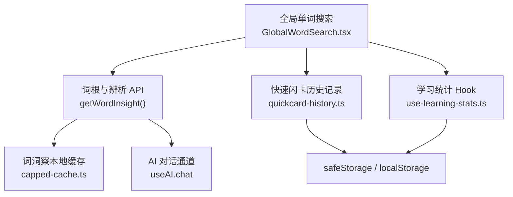
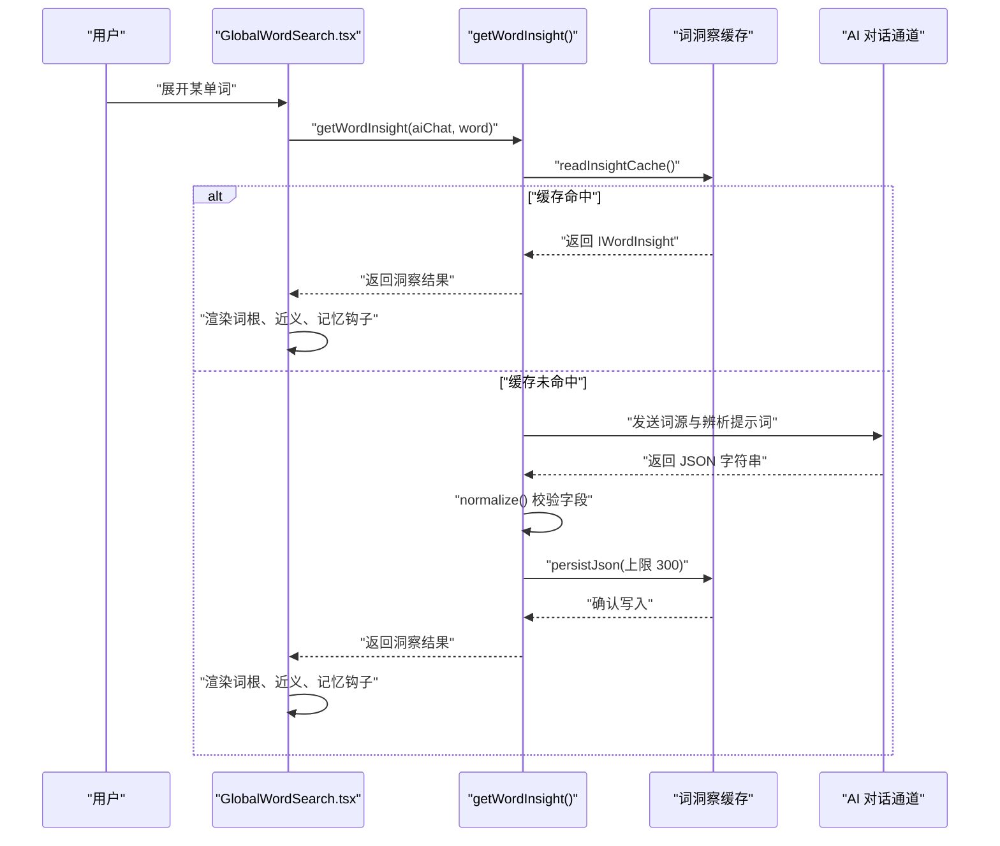
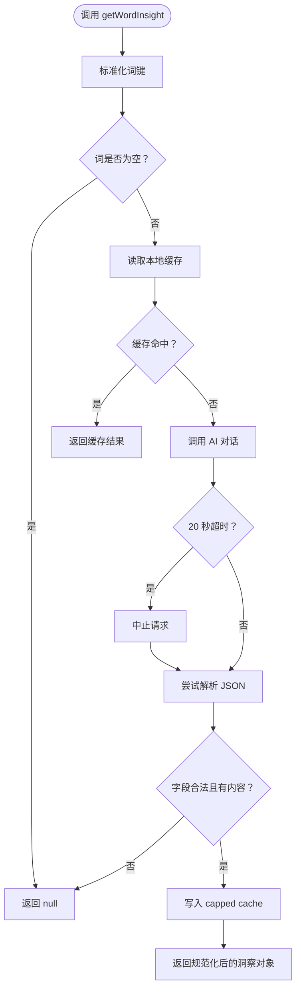
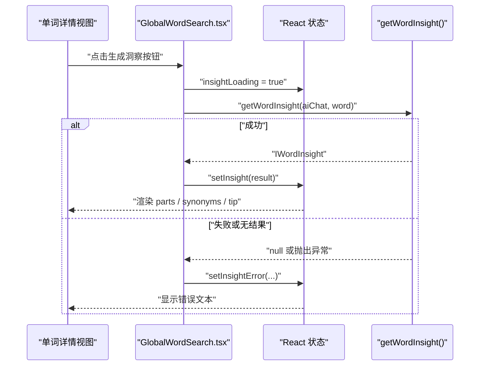
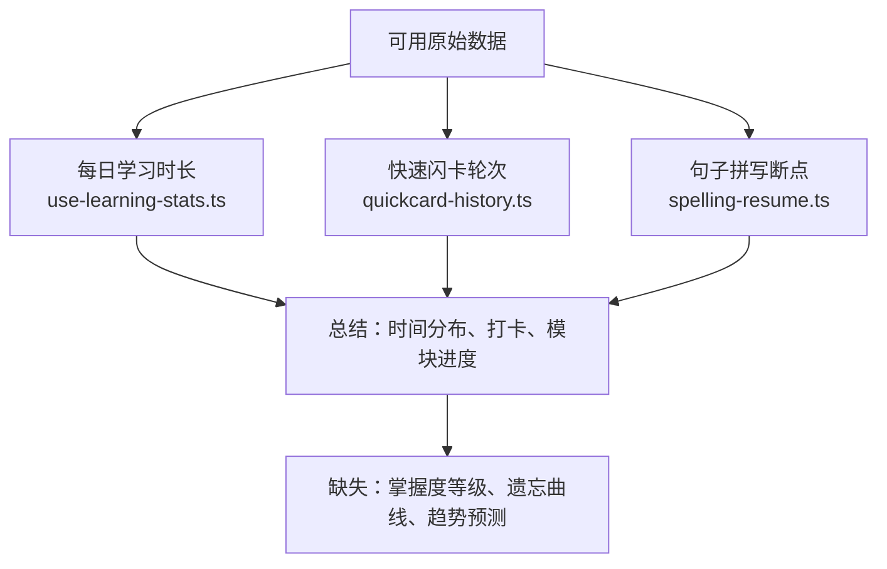
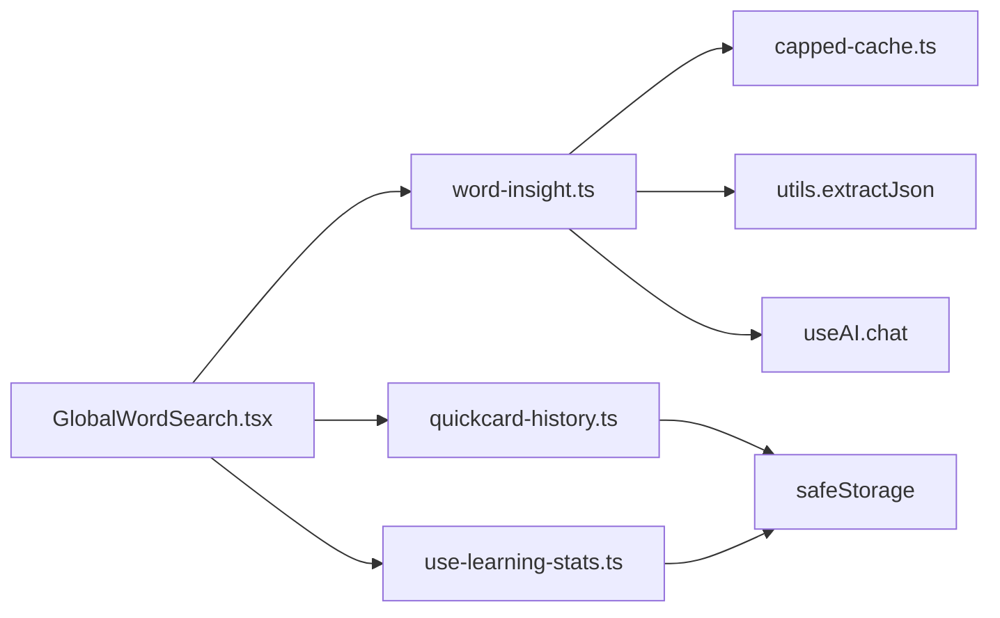

# 词汇洞察分析

<cite>
**本文引用的文件**   
- [word-insight.ts](file://src/lib/word-insight.ts)
- [GlobalWordSearch.tsx](file://src/components/GlobalWordSearch.tsx)
- [use-learning-stats.ts](file://src/lib/use-learning-stats.ts)
- [quickcard-history.ts](file://src/lib/quickcard-history.ts)
- [spelling-resume.ts](file://src/lib/spelling-resume.ts)
- [capped-cache.ts](file://src/lib/capped-cache.ts)
</cite>

## 目录
1. [引言](#引言)
2. [项目结构定位](#项目结构定位)
3. [核心组件与职责](#核心组件与职责)
4. [架构总览](#架构总览)
5. [详细组件分析](#详细组件分析)
6. [依赖关系分析](#依赖关系分析)
7. [性能与隐私考量](#性能与隐私考量)
8. [扩展与自定义统计指标接入方案](#扩展与自定义统计指标接入方案)
9. [故障排查](#故障排查)
10. [结论](#结论)

## 引言
本文聚焦 NativeThink 词汇模块中的“词汇洞察分析”能力，重点说明以下事实：
- `src/lib/word-insight.ts` 负责词根拆解、近义词辨析等 AI 派生数据的生成、校验与本地缓存。
- `src/components/GlobalWordSearch.tsx` 是 WordInsight 的 UI 入口，负责触发洞察加载、展示错误状态，并把洞察结果渲染到单词详情中。
- 学习统计由 `src/lib/use-learning-stats.ts` 管理，记录打卡、每日时长与各模块进度；快速闪卡历史由 `src/lib/quickcard-history.ts` 维护，包含每轮 learn/unknown 计数；句子拼写断点由 `src/lib/spelling-resume.ts` 管理。
- 当前仓库中没有实现传统意义上的“词频分布、掌握度等级、遗忘曲线拟合、趋势预测、智能复习提醒或目标设定”等高级统计模型；现有数据更适合作为后续扩展的基础。

因此，文档在如实描述现有实现的同时，明确指出哪些功能尚未实现，并给出可落地的扩展接口建议。

## 项目结构定位
词汇洞察相关代码分布在以下位置：
- 逻辑层：`src/lib/word-insight.ts`、`src/lib/use-learning-stats.ts`、`src/lib/quickcard-history.ts`、`src/lib/spelling-resume.ts`、`src/lib/capped-cache.ts`
- 表现层：`src/components/GlobalWordSearch.tsx`



**图示来源**
- [GlobalWordSearch.tsx:23-26](file://src/components/GlobalWordSearch.tsx#L23-L26)
- [GlobalWordSearch.tsx:70-72](file://src/components/GlobalWordSearch.tsx#L70-L72)
- [GlobalWordSearch.tsx:151-164](file://src/components/GlobalWordSearch.tsx#L151-L164)
- [word-insight.ts:1-89](file://src/lib/word-insight.ts#L1-L89)
- [use-learning-stats.ts:1-200](file://src/lib/use-learning-stats.ts#L1-L200)
- [quickcard-history.ts:1-200](file://src/lib/quickcard-history.ts#L1-L200)

**章节来源**
- [GlobalWordSearch.tsx:1-200](file://src/components/GlobalWordSearch.tsx#L1-L200)
- [word-insight.ts:1-89](file://src/lib/word-insight.ts#L1-L89)

## 核心组件与职责
| 组件 | 主要职责 | 是否实现“洞察分析” | 备注 |
|---|---|---|---|
| `IWordInsight` / `getWordInsight()` | 定义词洞察数据结构，调用 AI 返回词根拆解、近义词辨析、记忆钩子，并按词做 FIFO 本地缓存 | 已实现 | 不写入学习状态，不参与间隔重复算法 |
| `GlobalWordSearch` | 打开单词详情时触发洞察加载、处理 loading/error、渲染 parts/synonyms/rootMeaning/tip | 已实现 | 仅作为洞察结果的展示容器 |
| `useLearningStats` | 维护打卡天数、每日目标、各模块学习时长、日历记录 | 部分实现 | 未直接计算词汇掌握度或遗忘曲线 |
| `quickcard-history` | 记录每轮快速闪卡的已知/未知词表、指纹去重、滚动保留最近若干轮 | 部分实现 | 可用于事后回顾正确率，但不是实时掌握度模型 |
| `spelling-resume` | 按词书 level 保存句子拼写的断点索引和上次使用的词书 | 非洞察类 | 属于学习中断续学能力 |
| `capped-cache` | 提供带配额保护的 JSON 持久化读写 | 支撑层 | insight 缓存通过它写入 |

**章节来源**
- [word-insight.ts:1-89](file://src/lib/word-insight.ts#L1-L89)
- [GlobalWordSearch.tsx:60-164](file://src/components/GlobalWordSearch.tsx#L60-L164)
- [use-learning-stats.ts:1-200](file://src/lib/use-learning-stats.ts#L1-L200)
- [quickcard-history.ts:1-200](file://src/lib/quickcard-history.ts#L1-L200)
- [spelling-resume.ts:1-128](file://src/lib/spelling-resume.ts#L1-L128)
- [capped-cache.ts:1-50](file://src/lib/capped-cache.ts#L1-L50)

## 架构总览
词汇洞察分析在当前版本分为两条主线：

1. **词级洞察主线**  
   用户展开某个单词 → UI 调用 `getWordInsight` → 先从本地缓存读取 → 若命中则直接返回；否则向 AI 发起结构化解析请求 → 超时保护 → 解析并规范化响应 → 写回最多 300 条词的缓存。

2. **学习统计主线**  
   各学习页面写入学习时长、模块进度、日历记录；快速闪卡结束后保存本轮 known/unknown 词表；这些记录可用于事后统计，但当前没有统一聚合出“词汇洞察仪表盘”。



**图示来源**
- [GlobalWordSearch.tsx:151-164](file://src/components/GlobalWordSearch.tsx#L151-L164)
- [word-insight.ts:45-89](file://src/lib/word-insight.ts#L45-L89)

## 详细组件分析

### 词洞察数据结构与生成逻辑
`IWordInsight` 定义了词洞察的数据契约，包括：
- 原始词
- 词根/词缀拆解数组
- 词根核心含义
- 近义词及差异说明
- 中文记忆钩子

生成流程如下：



**图示来源**
- [word-insight.ts:12-89](file://src/lib/word-insight.ts#L12-L89)

关键行为说明：
- 输入词会转为小写并去除空白作为缓存 key。
- 如果 AI 返回为空、不是对象、parts 和 synonyms 都为空，则视为无效洞察。
- parts 最多取前 4 项，synonyms 最多取前 4 项。
- AI 提示词要求输出纯 JSON，字段包括 parts、rootMeaning、synonyms、tip。
- 缓存容量上限为 300 条，使用 FIFO 策略。
- 单次洞察生成最长等待 20 秒，避免界面长期停在“生成中”。

**章节来源**
- [word-insight.ts:12-89](file://src/lib/word-insight.ts#L12-L89)

### WordInsight 可视化展示
`GlobalWordSearch.tsx` 在单词详情区域中展示洞察结果：
- 当用户点击“AI 拆词根 / 辨析近义”时，触发 `handleLoadInsight`。
- 加载期间显示 loading 状态。
- 如果 AI 返回不可用结果，设置错误消息。
- 成功后渲染：
  - 词根拆解标签
  - 词根核心义
  - 近义词列表及其差异说明
  - 记忆钩子



**图示来源**
- [GlobalWordSearch.tsx:151-164](file://src/components/GlobalWordSearch.tsx#L151-L164)
- [GlobalWordSearch.tsx:519-560](file://src/components/GlobalWordSearch.tsx#L519-L560)

注意：当前 UI 只展示洞察文本内容，没有图表化绘制；也没有把洞察与学习统计合并成“词汇洞察仪表盘”。

**章节来源**
- [GlobalWordSearch.tsx:151-164](file://src/components/GlobalWordSearch.tsx#L151-L164)
- [GlobalWordSearch.tsx:519-560](file://src/components/GlobalWordSearch.tsx#L519-L560)

### 学习统计数据收集与分析现状
#### 学习时间分布
`use-learning-stats.ts` 维护：
- 连续打卡天数
- 每日目标分钟数
- 今日已学习分钟数
- 各模块学习进度，其中 vocabulary 模块键存在
- 累计学习天数
- 最近学习日期
- 日历记录，包含日期、是否打卡、分钟数、涉及模块

该 Hook 会：
- 从安全存储读取旧数据并进行合并校验。
- 初始化最近 30 天的空日历记录。
- 监听跨天变化，使“今日时长”在新一天归零。
- 通过事件广播通知其他实例刷新。

#### 正确率统计
目前仓库没有统一的“词汇正确率”指标。快速闪卡历史中每轮记录 known 和 unknown 数量，可作为事后计算正确率的依据，但没有自动聚合为全局正确率曲线。

#### 遗忘曲线拟合
当前实现没有遗忘曲线拟合函数。已有数据包括：
- 学习次数（可通过 quickcard runs 近似）
- 每轮已知/未知计数
- 学习日期
但这些并未被组合成 Ebbinghaus 曲线、Sigmoid 拟合或 SM-2 权重更新。



**图示来源**
- [use-learning-stats.ts:1-200](file://src/lib/use-learning-stats.ts#L1-L200)
- [quickcard-history.ts:1-200](file://src/lib/quickcard-history.ts#L1-L200)
- [spelling-resume.ts:1-128](file://src/lib/spelling-resume.ts#L1-L128)

**章节来源**
- [use-learning-stats.ts:1-200](file://src/lib/use-learning-stats.ts#L1-L200)
- [quickcard-history.ts:1-200](file://src/lib/quickcard-history.ts#L1-L200)
- [spelling-resume.ts:1-128](file://src/lib/spelling-resume.ts#L1-L128)

### 洞察报告生成机制
当前仓库没有“洞察报告”这一独立产物，也没有自动生成学习建议、复习提醒或目标设定的逻辑。现有能力更接近“单词级 AI 解释”，而不是“学习者级分析报告”。

可识别的相关要素：
- 词洞察提供记忆钩子和近义词差异，有助于理解词汇，但不等同于个性化复习建议。
- 学习统计提供基础行为数据，但不会自动转换为“建议明天复习 X 个词”“建议把目标从 30 分钟提升到 45 分钟”之类的智能推荐。
- 快速闪卡历史可支持“回头看刚才没记住的词”，但这属于历史回放，不是预测性复习提醒。

如果需要报告功能，应在现有 Hook 之上增加一个报告生成层，将 `ILearningStats`、`IQuickCardRun[]` 和词洞察缓存组合起来。

**章节来源**
- [word-insight.ts:1-89](file://src/lib/word-insight.ts#L1-L89)
- [use-learning-stats.ts:1-200](file://src/lib/use-learning-stats.ts#L1-L200)
- [quickcard-history.ts:1-200](file://src/lib/quickcard-history.ts#L1-L200)

## 依赖关系分析
词洞察链路依赖外部服务和本地缓存；学习统计依赖安全存储；快速闪卡历史与断点续学也依赖安全存储。



**图示来源**
- [GlobalWordSearch.tsx:23-26](file://src/components/GlobalWordSearch.tsx#L23-L26)
- [word-insight.ts:1-5](file://src/lib/word-insight.ts#L1-L5)
- [word-insight.ts:45-89](file://src/lib/word-insight.ts#L45-L89)
- [use-learning-stats.ts:1-200](file://src/lib/use-learning-stats.ts#L1-L200)
- [quickcard-history.ts:1-200](file://src/lib/quickcard-history.ts#L1-L200)

### 耦合与内聚
- `word-insight.ts` 内聚度高：只关心单个词的洞察数据，不负责学习进度。
- `GlobalWordSearch.tsx` 耦合了多个领域：搜索、词库预加载、TTS、收藏、AI 查询、词洞察。
- `use-learning-stats.ts` 与多模块共享统计键，适合扩展新的模块进度字段。
- `quickcard-history.ts` 内部缓存 runs 列表，云同步下行后需要失效缓存。

**章节来源**
- [word-insight.ts:1-89](file://src/lib/word-insight.ts#L1-L89)
- [GlobalWordSearch.tsx:1-200](file://src/components/GlobalWordSearch.tsx#L1-L200)
- [use-learning-stats.ts:1-200](file://src/lib/use-learning-stats.ts#L1-L200)
- [quickcard-history.ts:1-200](file://src/lib/quickcard-history.ts#L1-L200)

## 性能与隐私考量

### 性能特性
- 词洞察缓存最大 300 条，避免无限增长。
- 词洞察单次 AI 请求有 20 秒超时，防止 UI 长时间阻塞。
- 词洞察 normalize 阶段限制 parts 和 synonyms 数量，减少无用数据。
- 快速闪卡每轮最多保留 300 个词；历史轮次最多保留固定轮数，避免 localStorage 膨胀。
- 学习统计采用合并与白名单映射，兼容旧字段并忽略非法值。

### 数据隐私
- 所有本地数据通过 `safeStorage` 访问，便于在不同平台环境中隔离应用键。
- 词洞察数据是只读派生数据，不写入用户的学习进度，也不参与间隔重复算法。
- 快速闪卡历史只存词面和认识与否，不存释义快照，降低隐私暴露面。
- 句子拼断点按词书 level 分键，避免不同练习互相覆盖。

### 潜在风险
- 词洞察缓存容量较小，频繁切换单词可能频繁调用 AI。
- 词洞察缓存使用 FIFO，无法保证最近常用词一定保留。
- 快速闪卡历史轮数有限，早期记录会被淘汰。
- 学习统计未对非法 JSON 做强一致性恢复，异常分支会退化为默认值。

**章节来源**
- [word-insight.ts:12-89](file://src/lib/word-insight.ts#L12-L89)
- [quickcard-history.ts:1-200](file://src/lib/quickcard-history.ts#L1-L200)
- [use-learning-stats.ts:1-200](file://src/lib/use-learning-stats.ts#L1-L200)

## 扩展与自定义统计指标接入方案

### 现有可扩展点
1. **学习统计模块**  
   `use-learning-stats.ts` 中的 `moduleProgress` 是一个白名单对象，新增模块统计时可对齐该结构。
2. **快速闪卡历史**  
   `quickcard-history.ts` 已经暴露轮次、known/unknown、words、level、at 等字段，适合用于事后准确率统计。
3. **词洞察缓存**  
   `word-insight.ts` 的缓存 key 是词的小写形式，可按需扩展洞察维度，但应谨慎保持向后兼容。

### 建议的扩展接口设计

#### 1. 掌握度分布接口
可在现有数据上增加一个计算层，产出类似如下结构的汇总数据：

| 字段 | 含义 | 数据来源 | 复杂度说明 |
|---|---|---|---|
| `totalWords` | 可学习词总数 | 词库元数据 | 通常 O(1) 或 O(n) 聚合一次 |
| `masteredCount` | 高频出现且多次正确的词数 | 快速闪卡 known 计数 + 频次阈值 | O(r) 遍历 runs |
| `learningCount` | 近期学过但未稳定掌握的词数 | 快速闪卡 unknown 计数 + 频次阈值 | O(r) |
| `unseenCount` | 从未出现在 runs 中的词数 | 总词数减去出现过词数 | O(w + r) |
| `distribution` | 各掌握度桶占比 | 上述计数推导 | O(1) |

建议新增函数签名示例（概念接口，非现有代码）：
```ts
function computeMasteryDistribution({
  totalLearnable,
  quickCardRuns,
  frequencyThreshold,
}: {
  totalLearnable: number;
  quickCardRuns: IQuickCardRun[];
  frequencyThreshold: number;
}): MasteryDistribution
```

#### 2. 遗忘曲线拟合接口
基于快速闪卡历史中的词、时间戳和 known 状态，可以构建词级遗忘轨迹。建议接口：

```ts
interface ForgettingCurvePoint {
  word: string;
  hoursSinceFirstSeen: number;
  accuracy: number;
}

function buildForgettingCurves(
  quickCardRuns: IQuickCardRun[],
  windowHours?: number
): Record<string, ForgettingCurvePoint[]>
```

实际拟合可使用指数衰减或 Sigmoid 模型，但当前仓库未实现。

#### 3. 学习趋势预测接口
基于 `ILearningStats` 的每日分钟数和模块进度，可计算移动平均、趋势斜率，再结合用户目标预测完成时间：

```ts
interface StudyTrend {
  dailyMinutesSeries: number[];
  movingAverage: number[];
  trendSlope: number;
  estimatedDaysToGoal: number | null;
}

function analyzeStudyTrend(stats: ILearningStats): StudyTrend
```

#### 4. 洞察报告生成器
可将三类数据合并为一份报告：

```ts
interface InsightReport {
  masterySummary: MasteryDistribution;
  forgettingData: ForgettingCurvePoint[];
  studyTrend: StudyTrend;
  recommendations: Recommendation[];
}

function generateInsightReport(params: ReportParams): InsightReport
```

其中 `Recommendation` 可由规则引擎生成，例如：
- “本周词汇学习时长下降，建议提高每日目标。”
- “某批高频词正确率低于阈值，建议安排集中复习。”
- “词根 insight 可用，但遗忘曲线显示记忆衰退较快。”

#### 5. 自定义统计指标接入方案
- 新增指标应先定义为 TypeScript 类型，并放在独立的 stats 模块中。
- 对 localStorage 写入操作必须走 `safeStorage`，避免配额失败导致崩溃。
- 对大量计算应使用 `requestIdleCallback` 或分片处理，避免阻塞主线程。
- 对敏感数据不应上传云端，除非用户明确开启云同步。
- 所有新字段要兼容旧数据，采用 merge/default 策略。

**章节来源**
- [use-learning-stats.ts:1-200](file://src/lib/use-learning-stats.ts#L1-L200)
- [quickcard-history.ts:1-200](file://src/lib/quickcard-history.ts#L1-L200)
- [word-insight.ts:12-89](file://src/lib/word-insight.ts#L12-L89)

## 故障排查

### 词洞察始终显示“生成中”
可能原因：
- AI 服务不可用或网络异常。
- AI 返回不是合法的 JSON。
- 20 秒超时触发。
- 解析后 parts 和 synonyms 都为空，被视为无效洞察。

排查步骤：
1. 检查 `useAI.chat` 是否正常返回字符串。
2. 查看 `GlobalWordSearch.tsx` 中的 `insightError` 状态。
3. 检查 `word-insight.ts` 中 `extractJson` 是否能解析 AI 返回。
4. 确认缓存是否被清空或配额不足。

**章节来源**
- [word-insight.ts:45-89](file://src/lib/word-insight.ts#L45-L89)
- [GlobalWordSearch.tsx:151-164](file://src/components/GlobalWordSearch.tsx#L151-L164)

### 词洞察结果不显示
可能原因：
- AI 返回空字符串或空对象。
- normalize 过滤掉无效 parts 和 synonyms。
- 渲染条件要求至少有一个字段。

排查步骤：
1. 确认 AI 返回包含 parts 或 synonyms。
2. 检查 `IWordInsight` 字段是否满足最低有效要求。
3. 查看 `GlobalWordSearch.tsx` 中 insight 渲染分支。

**章节来源**
- [word-insight.ts:24-44](file://src/lib/word-insight.ts#L24-L44)
- [GlobalWordSearch.tsx:534-560](file://src/components/GlobalWordSearch.tsx#L534-L560)

### 快速闪卡历史丢失
可能原因：
- localStorage 配额已满。
- 浏览器隐私模式禁止写入。
- 云同步下行后未刷新 runs 缓存。
- 轮数超过保留上限。

排查步骤：
1. 检查 `safeStorage` 写入是否抛错。
2. 调用 `invalidateQuickCardRunsCache()` 后重新读取。
3. 确认 `MAX_RUNS` 和 `MAX_WORDS_PER_RUN` 限制是否符合预期。

**章节来源**
- [quickcard-history.ts:1-200](file://src/lib/quickcard-history.ts#L1-L200)

### 学习统计不更新
可能原因：
- 其他实例写入后未触发事件广播。
- 存储读取失败回退为默认值。
- 跨天检测未生效。

排查步骤：
1. 检查 `STATS_CHANGED_EVENT` 是否被监听。
2. 检查 `mergeStats` 是否把非法值归零。
3. 检查 `todayStr` 与格式化日期的跨天判断。

**章节来源**
- [use-learning-stats.ts:1-200](file://src/lib/use-learning-stats.ts#L1-L200)

## 结论
NativeThink 的“词汇洞察分析”在当前版本以两个层次存在：
- 词级洞察：由 `word-insight.ts` 和 `GlobalWordSearch.tsx` 实现，提供词根拆解、近义词辨析和记忆钩子，并通过本地缓存提升重复体验。
- 学习统计：由 `use-learning-stats.ts` 和 `quickcard-history.ts` 提供基础行为数据，包括学习时间、打卡、模块进度、快速闪卡轮次和已知/未知计数。

尚未实现的部分包括：
- 词频分布图
- 掌握度等级分布
- 遗忘曲线拟合
- 学习趋势预测
- 自动复习提醒
- 智能目标设定
- 图表化的洞察报告

扩展方向应优先补齐“统计聚合层”，复用现有数据结构，而不是重写底层存储；同时严格遵循 safeStorage、配额限制、向后兼容和隐私保护原则。