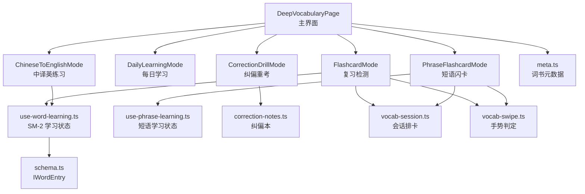
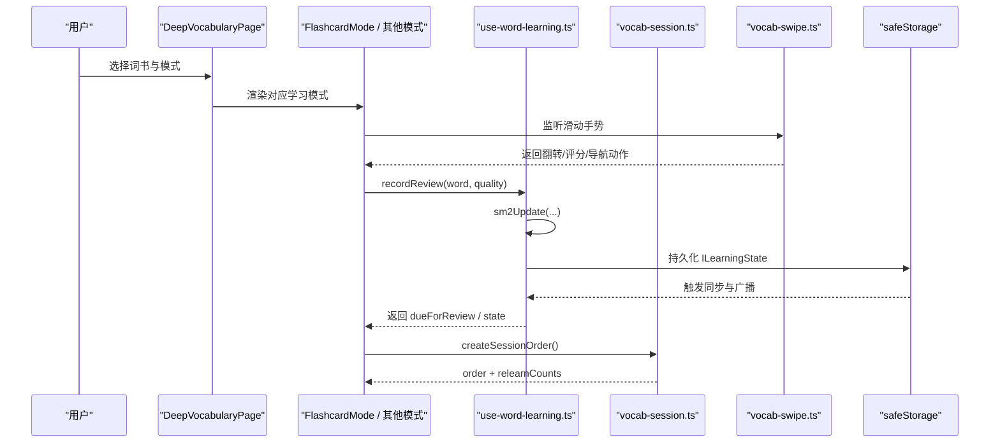
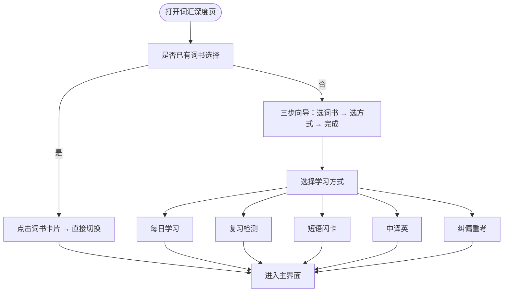
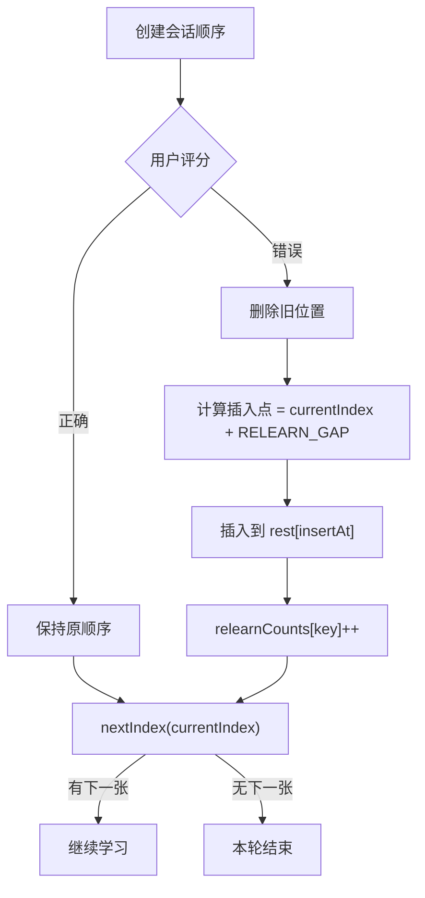
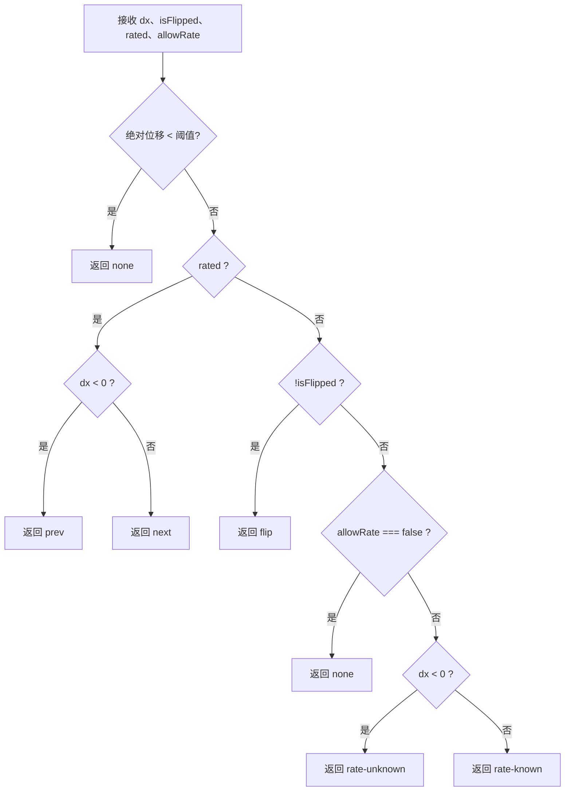
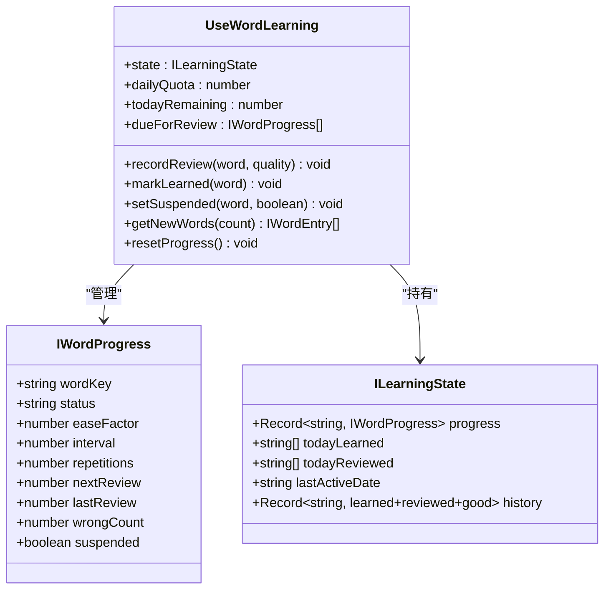
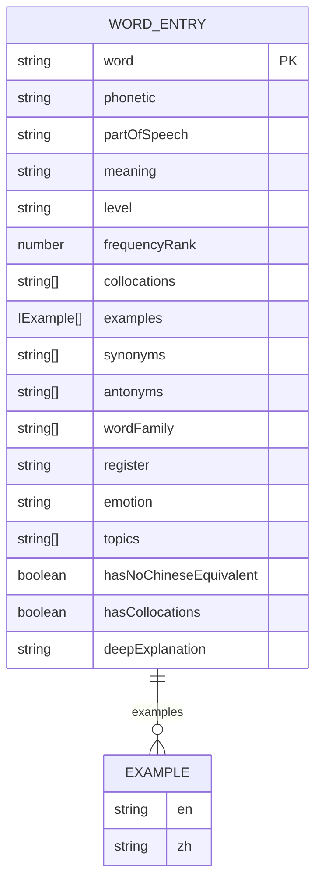
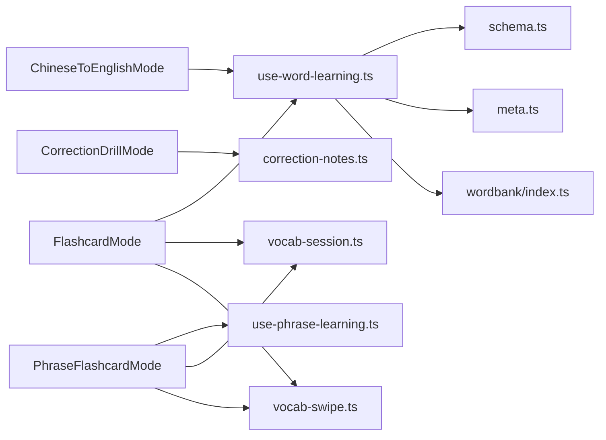
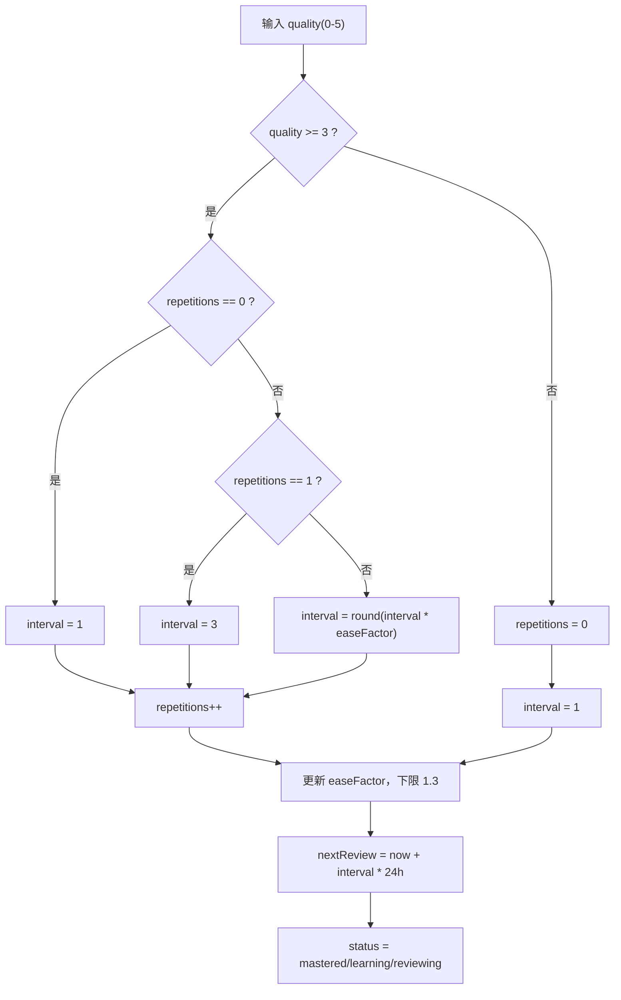
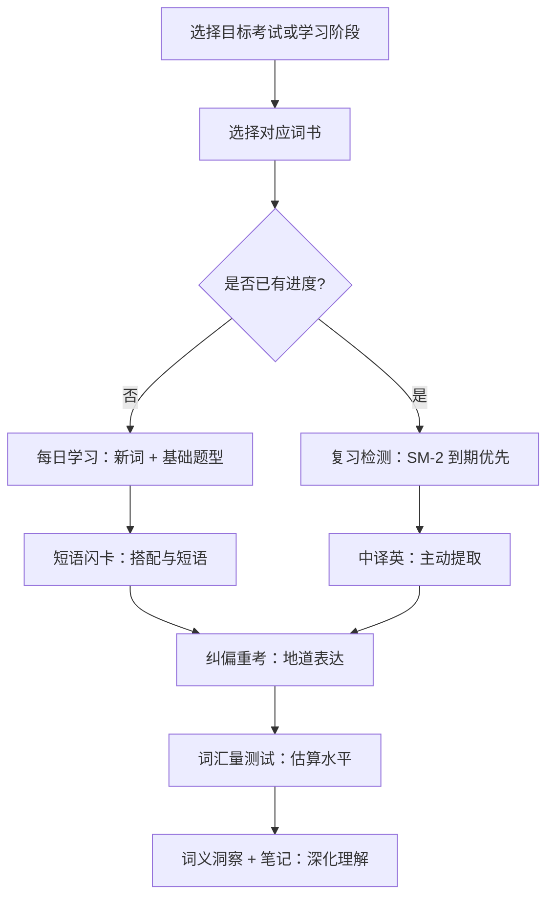

# 词汇深度模块

<cite>
**本文引用的文件**   
- [DeepVocabularyPage.tsx](file://src/pages/DeepVocabularyPage/DeepVocabularyPage.tsx)
- [vocab-session.ts](file://src/lib/vocab-session.ts)
- [vocab-swipe.ts](file://src/lib/vocab-swipe.ts)
- [use-word-learning.ts](file://src/lib/use-word-learning.ts)
- [schema.ts](file://src/data/wordbank/schema.ts)
- [index.ts](file://src/data/wordbank/index.ts)
- [meta.ts](file://src/data/wordbank/meta.ts)
- [FlashcardMode.tsx](file://src/pages/DeepVocabularyPage/components/FlashcardMode.tsx)
- [DailyLearningMode.tsx](file://src/pages/DeepVocabularyPage/components/DailyLearningMode.tsx)
- [PhraseFlashcardMode.tsx](file://src/pages/DeepVocabularyPage/components/PhraseFlashcardMode.tsx)
- [ChineseToEnglishMode.tsx](file://src/pages/DeepVocabularyPage/components/ChineseToEnglishMode.tsx)
- [CorrectionDrillMode.tsx](file://src/pages/DeepVocabularyPage/components/CorrectionDrillMode.tsx)
</cite>

## 目录
1. [引言](#引言)
2. [项目结构](#项目结构)
3. [核心组件](#核心组件)
4. [架构总览](#架构总览)
5. [详细组件分析](#详细组件分析)
6. [依赖关系分析](#依赖关系分析)
7. [性能与可扩展性](#性能与可扩展性)
8. [间隔重复算法参数调优](#间隔重复算法参数调优)
9. [个性化学习路径推荐](#个性化学习路径推荐)
10. [故障排查指南](#故障排查指南)
11. [结论](#结论)

## 引言
NativeThink 词汇深度模块围绕“背单词 + 学短语 + 主动输出 + 纠偏重考”构建，以 SM-2 间隔重复算法为核心调度器，把词频统计、掌握度评估、自定义生词、词义洞察和笔记能力串联成一条可配置的学习路径。主界面 `DeepVocabularyPage` 提供词书选择、模式切换、每日目标设置和复习入口；`use-word-learning.ts` 管理 SM-2 进度与每日配额；`vocab-session.ts` 冻结并调度本轮出卡顺序；`vocab-swipe.ts` 把滑动手势映射为翻面、评分或导航动作；数据模型由 `wordbank/schema.ts` 定义，词库元数据由 `meta.ts` 提供。

## 项目结构
词汇深度模块采用“页面 → 模式组件 → 状态钩子 → 纯函数工具 → 数据层”的分层组织：

**图表来源**
- [DeepVocabularyPage.tsx:1-120](file://src/pages/DeepVocabularyPage/DeepVocabularyPage.tsx#L1-L120)
- [FlashcardMode.tsx:1-60](file://src/pages/DeepVocabularyPage/components/FlashcardMode.tsx#L1-L60)
- [DailyLearningMode.tsx:1-40](file://src/pages/DeepVocabularyPage/components/DailyLearningMode.tsx#L1-L40)
- [PhraseFlashcardMode.tsx:1-40](file://src/pages/DeepVocabularyPage/components/PhraseFlashcardMode.tsx#L1-L40)
- [ChineseToEnglishMode.tsx:1-30](file://src/pages/DeepVocabularyPage/components/ChineseToEnglishMode.tsx#L1-L30)
- [CorrectionDrillMode.tsx:1-30](file://src/pages/DeepVocabularyPage/components/CorrectionDrillMode.tsx#L1-L30)
- [vocab-session.ts:1-30](file://src/lib/vocab-session.ts#L1-L30)
- [vocab-swipe.ts:1-30](file://src/lib/vocab-swipe.ts#L1-L30)
- [use-word-learning.ts:1-40](file://src/lib/use-word-learning.ts#L1-L40)
- [schema.ts:1-30](file://src/data/wordbank/schema.ts#L1-L30)
- [meta.ts:1-30](file://src/data/wordbank/meta.ts#L1-L30)

**章节来源**
- [DeepVocabularyPage.tsx:1-120](file://src/pages/DeepVocabularyPage/DeepVocabularyPage.tsx#L1-L120)
- [meta.ts:1-40](file://src/data/wordbank/meta.ts#L1-L40)

## 核心组件
- **DeepVocabularyPage**：聚合词书选择、模式路由、向导设置、全局待复习角标与浏览入口。它声明词书常量（中考到高阶）、模式常量（每日学习、快速闪卡、复习检测、短语闪卡、中译英、纠偏重考、词库浏览、搭配学习、词汇量测试），并提供设置向导，允许首次选择词书与学习方式，或已选过词书后直接换书。
- **use-word-learning.ts**：暴露每个词书的 SM-2 学习状态、每日配额、到期队列、新词抽样、记录复习、屏蔽“不再出现”、标记“已记”、重置进度等能力；同时提供全局到期数缓存与按词书拆分计数。
- **vocab-session.ts**：维护本轮出卡顺序数组与重排次数，实现答错延迟重排、下一张索引计算、未来 N 天到期预测。
- **vocab-swipe.ts**：把横向滑动位移转换为“不处理 / 翻面 / 不认识 / 认识 / 上一张 / 下一张”，并在复习检测模式下禁用滑动评分，避免误刷进度。
- **FlashcardMode / PhraseFlashcardMode**：分别承载单词与短语的 SM-2 闪卡交互，共享会话冻结、答错重排、自动发音、连击、断点续学等体验。
- **DailyLearningMode**：每日学习目标、多题型训练（闪卡、选择题、拼写、听力、匹配、填空）以及搭配翻译缓存。
- **ChineseToEnglishMode**：中译英主动提取，四选一与拼写两种作答形式，首答决定 SM-2 质量分。
- **CorrectionDrillMode**：从纠偏本抽取句子进行四选一重考，不污染词书 SM-2 进度，按错点类别筛选重考范围。

**章节来源**
- [DeepVocabularyPage.tsx:1-200](file://src/pages/DeepVocabularyPage/DeepVocabularyPage.tsx#L1-L200)
- [use-word-learning.ts:1-120](file://src/lib/use-word-learning.ts#L1-L120)
- [vocab-session.ts:1-77](file://src/lib/vocab-session.ts#L1-L77)
- [vocab-swipe.ts:1-46](file://src/lib/vocab-swipe.ts#L1-L46)
- [FlashcardMode.tsx:1-120](file://src/pages/DeepVocabularyPage/components/FlashcardMode.tsx#L1-L120)
- [DailyLearningMode.tsx:1-120](file://src/pages/DeepVocabularyPage/components/DailyLearningMode.tsx#L1-L120)
- [PhraseFlashcardMode.tsx:1-120](file://src/pages/DeepVocabularyPage/components/PhraseFlashcardMode.tsx#L1-L120)
- [ChineseToEnglishMode.tsx:1-120](file://src/pages/DeepVocabularyPage/components/ChineseToEnglishMode.tsx#L1-L120)
- [CorrectionDrillMode.tsx:1-120](file://src/pages/DeepVocabularyPage/components/CorrectionDrillMode.tsx#L1-L120)

## 架构总览
词汇深度模块的数据流可以概括为：**用户输入 → 模式组件 → 学习状态钩子 → SM-2 更新 → 本地存储 → 广播事件 → 其他 UI 刷新**。

**图表来源**
- [DeepVocabularyPage.tsx:1-120](file://src/pages/DeepVocabularyPage/DeepVocabularyPage.tsx#L1-L120)
- [FlashcardMode.tsx:1-120](file://src/pages/DeepVocabularyPage/components/FlashcardMode.tsx#L1-L120)
- [vocab-swipe.ts:1-46](file://src/lib/vocab-swipe.ts#L1-L46)
- [use-word-learning.ts:200-360](file://src/lib/use-word-learning.ts#L200-L360)
- [vocab-session.ts:1-77](file://src/lib/vocab-session.ts#L1-L77)

## 详细组件分析

### DeepVocabularyPage 主界面
主界面承担三件事：
1. **词书与模式枚举**：内置中考、高考、四级、六级、四六级高频、四六级高分、雅思、托福、考研、专业、高阶等词书，以及每日学习、快速闪卡、复习检测、短语闪卡、中译英、纠偏重考、词库浏览、搭配学习、词汇量测试等模式。
2. **设置向导**：支持三步向导（词书 → 方式 → 开始）与一键换书；当用户已经选过词书时，换书路径跳过向导并立即生效。
3. **入口聚合**：集成 `useGlobalDueCount` 显示全局待复习数量，提供每日学习、闪卡、短语、中译英、纠偏、浏览等入口。

**图表来源**
- [DeepVocabularyPage.tsx:1-200](file://src/pages/DeepVocabularyPage/DeepVocabularyPage.tsx#L1-L200)

**章节来源**
- [DeepVocabularyPage.tsx:1-200](file://src/pages/DeepVocabularyPage/DeepVocabularyPage.tsx#L1-L200)

### vocab-session.ts 学习会话管理
该模块将“本轮出卡顺序”从组件状态中抽离，保证会话一旦开始就不会因为每次评分都重新计算队列而漂移。关键能力包括：
- `createSessionOrder`：初始化顺序数组与重排计数器。
- `scheduleRelearn`：答错后把词插入当前位置之后固定间隔处，最多重排两次，防止队列无限膨胀。
- `nextIndex`：计算下一张下标，到达末尾返回空值，由调用方决定是否开启新一轮。
- `forecastByDay`：把 `nextReview` 按本地日期分桶，用于首页“明天 N 个”和负担条展示。

**图表来源**
- [vocab-session.ts:1-77](file://src/lib/vocab-session.ts#L1-L77)

**章节来源**
- [vocab-session.ts:1-77](file://src/lib/vocab-session.ts#L1-L77)

### vocab-swipe.ts 手势交互
手势决策表明确区分四种卡片状态：未翻面、已翻面未评分、已评分、以及复习检测下的“禁止滑动评分”。

| 条件 | 行为 |
|---|---|
| 横向位移小于阈值 | 视为点击，返回“不处理” |
| 卡片已评分 | 左滑=上一张，右滑=下一张 |
| 卡片未翻面 | 滑动=翻面 |
| 已翻面未评分且允许滑动评分 | 左滑=不认识，右滑=认识 |
| 已翻面未评分但禁用滑动评分 | 滑动=不处理 |

**图表来源**
- [vocab-swipe.ts:1-46](file://src/lib/vocab-swipe.ts#L1-L46)

**章节来源**
- [vocab-swipe.ts:1-46](file://src/lib/vocab-swipe.ts#L1-L46)

### use-word-learning.ts 学习状态钩子
这是词汇深度模块的核心状态层，负责：
- 加载和持久化每本词书的 `ILearningState`，包括 `progress`、`todayLearned`、`todayReviewed`、`lastActiveDate`、可选历史。
- 实现 SM-2 更新逻辑 `sm2Update`：根据 quality 调整 `easeFactor`、`interval`、`repetitions`，并计算 `nextReview`。
- 聚合全部等级进度供“all”视图使用，同时为全局待复习角标做 800ms 缓存。
- 提供每日配额、新词抽样、屏蔽词、标记已记、记录复习、重置进度等 API。
- 通过自定义事件 `nativethink-word-learning-changed` 通知其他组件刷新角标。

**图表来源**
- [use-word-learning.ts:1-120](file://src/lib/use-word-learning.ts#L1-L120)
- [use-word-learning.ts:200-549](file://src/lib/use-word-learning.ts#L200-L549)

**章节来源**
- [use-word-learning.ts:1-200](file://src/lib/use-word-learning.ts#L1-L200)
- [use-word-learning.ts:200-549](file://src/lib/use-word-learning.ts#L200-L549)

### wordbank schema 数据模型
`IWordEntry` 描述词库中的词条，包含基础信息、等级、词频排名、搭配、例句、同义词、反义词、词族、语域、情感色彩、主题分类、是否有中文等价概念、是否存在搭配、深度解释等字段。`IExample` 表示英中双语例句，`IWordDetail` 表示按需加载的搭配、例句和深度解释集合。查询接口 `IWordQuery` 支持按等级、主题、关键词、词频区间、语域、词性、排序和分页过滤。

**图表来源**
- [schema.ts:1-61](file://src/data/wordbank/schema.ts#L1-L61)

**章节来源**
- [schema.ts:1-61](file://src/data/wordbank/schema.ts#L1-L61)

### 词频统计、掌握度评估与词库元数据
词库元数据提供每本词书的“可学去重单词数”、原始词条数、唯一词总数、等级标签、等级颜色与等级顺序。`index.ts` 统一导出查询、随机抽样、预加载、词数统计、词库规模常量等能力，使主界面和各个模式不必直接依赖底层数据文件。

- **词频统计**：`frequencyRank` 越高频越小，`WORD_COUNTS` 给出各词书可学词数，`TOTAL_UNIQUE_WORDS` 给出跨书唯一词池大小。
- **掌握度评估**：`status` 取 `new` / `learning` / `reviewing` / `mastered`，由 `repetitions` 与 SM-2 更新结果决定；`suspended` 表示用户屏蔽，“不再出现”的词不参与复习和新词抽样。
- **词库元数据**：`LEVEL_LABELS`、`LEVEL_COLORS`、`ALL_LEVELS`、`LEVEL_ORDER` 为主界面词书选择和视觉呈现提供单一事实源。

**章节来源**
- [meta.ts:1-94](file://src/data/wordbank/meta.ts#L1-L94)
- [index.ts:1-10](file://src/data/wordbank/index.ts#L1-L10)
- [schema.ts:1-61](file://src/data/wordbank/schema.ts#L1-L61)

### 自定义词汇添加、词义洞察分析与笔记管理
- **自定义词汇**：`custom-words.ts` 提供 `ICustomWord` 列表、增删查、React hook、以及把自定义词转为 `IWordEntry` 的能力；复习检测会把自定义词映射为短语对象并纳入 SM-2 进度，键空间走 `custom` 等级。
- **词义洞察**：`word-insight.ts` 提供词义洞察的读取、规范化、异步获取接口，用于扩展词义解释、词根词族提示等。
- **笔记管理**：`word-notes.ts` 提供每条词的笔记读写、React hook、失效与计数能力，配合复习检测卡面的助记编辑区。

这些能力在复习检测、每日学习和短语闪卡中被组合使用，形成“看释义 → 加收藏 → 加笔记 → 加入生词本 → 进入间隔重复”的闭环。

**章节来源**
- [FlashcardMode.tsx:1-120](file://src/pages/DeepVocabularyPage/components/FlashcardMode.tsx#L1-L120)
- [PhraseFlashcardMode.tsx:1-120](file://src/pages/DeepVocabularyPage/components/PhraseFlashcardMode.tsx#L1-L120)

## 依赖关系分析
词汇深度模块内部耦合清晰：UI 模式组件依赖 `use-word-learning` 与 `use-phrase-learning`，两者再依赖本地存储、词库查询和 SM-2 更新；会话调度与手势判定被拆成纯函数，便于单测与复用。

**图表来源**
- [FlashcardMode.tsx:1-120](file://src/pages/DeepVocabularyPage/components/FlashcardMode.tsx#L1-L120)
- [PhraseFlashcardMode.tsx:1-120](file://src/pages/DeepVocabularyPage/components/PhraseFlashcardMode.tsx#L1-L120)
- [ChineseToEnglishMode.tsx:1-60](file://src/pages/DeepVocabularyPage/components/ChineseToEnglishMode.tsx#L1-L60)
- [CorrectionDrillMode.tsx:1-60](file://src/pages/DeepVocabularyPage/components/CorrectionDrillMode.tsx#L1-L60)
- [use-word-learning.ts:1-120](file://src/lib/use-word-learning.ts#L1-L120)
- [vocab-session.ts:1-77](file://src/lib/vocab-session.ts#L1-L77)
- [vocab-swipe.ts:1-46](file://src/lib/vocab-swipe.ts#L1-L46)
- [schema.ts:1-61](file://src/data/wordbank/schema.ts#L1-L61)
- [meta.ts:1-94](file://src/data/wordbank/meta.ts#L1-L94)
- [index.ts:1-10](file://src/data/wordbank/index.ts#L1-L10)

**章节来源**
- [FlashcardMode.tsx:1-120](file://src/pages/DeepVocabularyPage/components/FlashcardMode.tsx#L1-L120)
- [use-word-learning.ts:1-120](file://src/lib/use-word-learning.ts#L1-L120)
- [vocab-session.ts:1-77](file://src/lib/vocab-session.ts#L1-L77)
- [vocab-swipe.ts:1-46](file://src/lib/vocab-swipe.ts#L1-L46)

## 性能与可扩展性
- **会话顺序冻结**：避免每次评分都重建队列，解决“中途顺序漂移”问题。
- **全局到期数缓存**：`getGlobalDueCount` 对 10 个等级的状态反序列化结果做 800ms 缓存，避免每张卡评分都触发全量扫描。
- **按词书拆分状态**：不同词书独立存储键，避免“all”聚合模式覆盖具体词书进度。
- **字符串比对落盘**：`saveState` 在 JSON 字符串不变时跳过写入，减少安全存储双写和云同步回声。
- **对象引用判空**：`loadedFromStorageRef` 用引用一致性判断“刚从 storage 读入”，避免 StrictMode 双挂载导致的多余回写。
- **词库元数据与数据分离**：`meta.ts` 不导入任何词数据文件，仅用于词数、标签和颜色，降低冷启动体积。
- **短语库懒加载与去重**：短语闪卡按需加载短语库，并使用 `dedupeChunks` 去除重复条目。
- **搭配翻译批量缓存**：每日学习中的搭配翻译先走本地离线模型，再一次性请求 AI，并把结果合并进 `colloc-ai-cache`。

这些优化共同保障在移动端浏览器中，面对数万词库和多次评分操作时仍保持流畅。

**章节来源**
- [vocab-session.ts:1-77](file://src/lib/vocab-session.ts#L1-L77)
- [use-word-learning.ts:1-200](file://src/lib/use-word-learning.ts#L1-L200)
- [DailyLearningMode.tsx:1-120](file://src/pages/DeepVocabularyPage/components/DailyLearningMode.tsx#L1-L120)
- [PhraseFlashcardMode.tsx:1-120](file://src/pages/DeepVocabularyPage/components/PhraseFlashcardMode.tsx#L1-L120)
- [meta.ts:1-40](file://src/data/wordbank/meta.ts#L1-L40)

## 间隔重复算法参数调优
SM-2 在 `use-word-learning.ts` 中以 `quality` 0-5 作为输入，核心参数包括：

| 参数 | 含义 | 当前行为 | 调优建议 |
|---|---|---|---|
| `easeFactor` | 记忆难度弹性系数 | 初始 2.5，最小 1.3；按 `0.1 - (5-quality)*(0.08+(5-quality)*0.02)` 更新 | 想加快遗忘就降低更新增益；想强化长期记忆就提高低质量反馈惩罚 |
| `interval` | 下次复习间隔天数 | 首次成功 1 天，第二次 3 天，之后 `round(interval * easeFactor)`；错误重置为 1 天 | 新用户可设更高初始间隔；老用户可通过 `MAX_RELEARN` 控制一轮内重排强度 |
| `repetitions` | 连续成功次数 | 错误清零，≥5 进入 `mastered` | 想延长学习曲线可提高 `mastered` 阈值；想更快进入复习池可降低阈值 |
| `quality` | 自评质量 | 0-5，滑动评分默认 2/4，五档按钮可用完整语义 | 对用户更友好的场景可把“模糊记得”设为 3，减少过早进入复习 |
| `RELEARN_GAP` | 答错重排间隔 | 4 张 | 太小会立刻重复，太大会失去即时巩固意义；可根据用户错误率调整 |
| `MAX_RELEARN` | 一轮内最大重排次数 | 2 | 太高会让队列膨胀，太低会让错题错过本轮巩固 |

SM-2 的状态转换流程如下：

**图表来源**
- [use-word-learning.ts:200-280](file://src/lib/use-word-learning.ts#L200-L280)

个性化推荐建议：
- **新手用户**：初始 `easeFactor` 保持在 2.5，`interval` 按 1 → 3 → 指数增长；把滑动评分默认设为“认识 4 / 不认识 2”，降低误判。
- **高频学习者**：适当提高 `MAX_RELEARN`，让错题在本轮有更多巩固机会；同时限制每日复习上限（当前复习检测队列已限制到期支不超过 30）。
- **低频学习者**：降低 `interval` 增长速度，让复习更早到来；启用“补新到每日目标”，保证每次打开都有内容。
- **考试冲刺**：把 `mastered` 阈值降低，让词更快进入复习池；结合“四六级高频 / 高分”词书与“词汇量测试”定位薄弱等级。

**章节来源**
- [use-word-learning.ts:200-360](file://src/lib/use-word-learning.ts#L200-L360)
- [vocab-session.ts:1-77](file://src/lib/vocab-session.ts#L1-L77)
- [FlashcardMode.tsx:120-300](file://src/pages/DeepVocabularyPage/components/FlashcardMode.tsx#L120-L300)

## 个性化学习路径推荐
NativeThink 词汇深度模块已经提供了多条路径，可按用户目标组合：

| 用户类型 | 推荐路径 | 依据 |
|---|---|---|
| 初中生 | 中考词书 → 每日学习 → 复习检测 | `LEVEL_ORDER` 从中考起步，`WORD_COUNTS` 控制合理体量 |
| 高中生 | 高考词书 → 每日学习 → 中译英 → 纠偏重考 | 高考词量更大，需要主动输出和表达纠偏 |
| 四级考生 | 四级词书 → 短语闪卡 → 词汇量测试 | 四级搭配和短语是阅读关键，测试帮助估算水平 |
| 六级考生 | 六级词书 → 复习检测 → 中译英 | 六级拔高词需要更强间隔重复和主动回忆 |
| 雅思托福 | 雅思/托福词书 → 短语闪卡 → 纠偏重考 | 考试短语库与地道表达并重 |
| 考研 / 专业 / 高阶 | 对应词书 → 每日学习 → 搭配学习 | 高阶词需要搭配和语境理解 |
| 自定义学习者 | 生词本 → 复习检测 → 笔记管理 | 从真实阅读收集词，进入完整 SM-2 循环 |

推荐流程：

**图表来源**
- [DeepVocabularyPage.tsx:1-200](file://src/pages/DeepVocabularyPage/DeepVocabularyPage.tsx#L1-L200)
- [meta.ts:1-94](file://src/data/wordbank/meta.ts#L1-L94)
- [PhraseFlashcardMode.tsx:1-120](file://src/pages/DeepVocabularyPage/components/PhraseFlashcardMode.tsx#L1-L120)
- [ChineseToEnglishMode.tsx:1-120](file://src/pages/DeepVocabularyPage/components/ChineseToEnglishMode.tsx#L1-L120)
- [CorrectionDrillMode.tsx:1-120](file://src/pages/DeepVocabularyPage/components/CorrectionDrillMode.tsx#L1-L120)

**章节来源**
- [DeepVocabularyPage.tsx:1-200](file://src/pages/DeepVocabularyPage/DeepVocabularyPage.tsx#L1-L200)
- [meta.ts:1-94](file://src/data/wordbank/meta.ts#L1-L94)

## 故障排查指南
常见问题与定位线索：

| 现象 | 可能原因 | 排查位置 |
|---|---|---|
| 复习检测显示有空队列 | 到期词属于其他词书，当前词书没有已学进度 | `getDueCountsByLevel` 与 `FlashcardMode.queue` |
| 角标显示有待复习，点进去为空 | 全局角标扫所有词书，复习检测只扫当前词书 | `use-word-learning.ts` 的全局计数与按词书计数 |
| 答错后卡片“卡住”不动 | 答错重排后卡片处于正面回看态，旧手势表返回翻转而非导航 | `vocab-swipe.ts` 与 `FlashcardMode` 的 rated 分支 |
| 复习完再次开始还是同一批词 | 同日已评词不在复习队列，应走“错词重练” | `FlashcardMode.queue` 的同日已评过滤逻辑 |
| 自定义词无法复习 | 自定义词未解析为词库词，需走生词本映射 | `FlashcardMode` 的 custom 条目优先入队逻辑 |
| 云同步后进度被覆盖 | 下行后未重读状态，导致本地旧实例覆盖云端 | `useSyncDown` 回调与 `loadedFromStorageRef` |
| 每日目标无效 | 每日配额仍使用全局旧键或未迁移到按词书键 | `loadDailyQuota` 与 `dailyQuotaKey` |
| 短语闪卡加载失败 | 短语库懒加载或网络异常 | `PhraseFlashcardMode.loadPhrases` 与 `bankFailed` |

**章节来源**
- [use-word-learning.ts:120-200](file://src/lib/use-word-learning.ts#L120-L200)
- [use-word-learning.ts:360-549](file://src/lib/use-word-learning.ts#L360-L549)
- [FlashcardMode.tsx:120-300](file://src/pages/DeepVocabularyPage/components/FlashcardMode.tsx#L120-L300)
- [vocab-swipe.ts:1-46](file://src/lib/vocab-swipe.ts#L1-L46)
- [PhraseFlashcardMode.tsx:1-120](file://src/pages/DeepVocabularyPage/components/PhraseFlashcardMode.tsx#L1-L120)

## 结论
NativeThink 词汇深度模块把 SM-2 间隔重复算法、词库元数据、会话调度、手势交互和多模式学习整合成一个可配置的深度学习系统。`DeepVocabularyPage` 提供入口与设置，`use-word-learning.ts` 管理掌握度与每日配额，`vocab-session.ts` 保证出卡顺序稳定，`vocab-swipe.ts` 把物理手势转化为学习动作，而词频统计、自定义词汇、词义洞察和笔记则支撑个性化学习路径。对于后续扩展，建议在保持纯函数边界的前提下，进一步暴露 SM-2 参数配置、学习路径规则引擎和词义洞察生成策略，以便适配不同考试、不同水平和不同语言背景的用户。