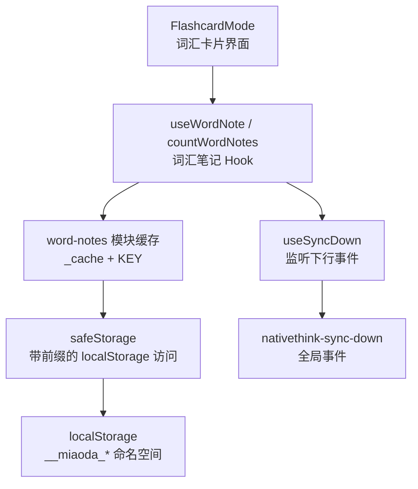
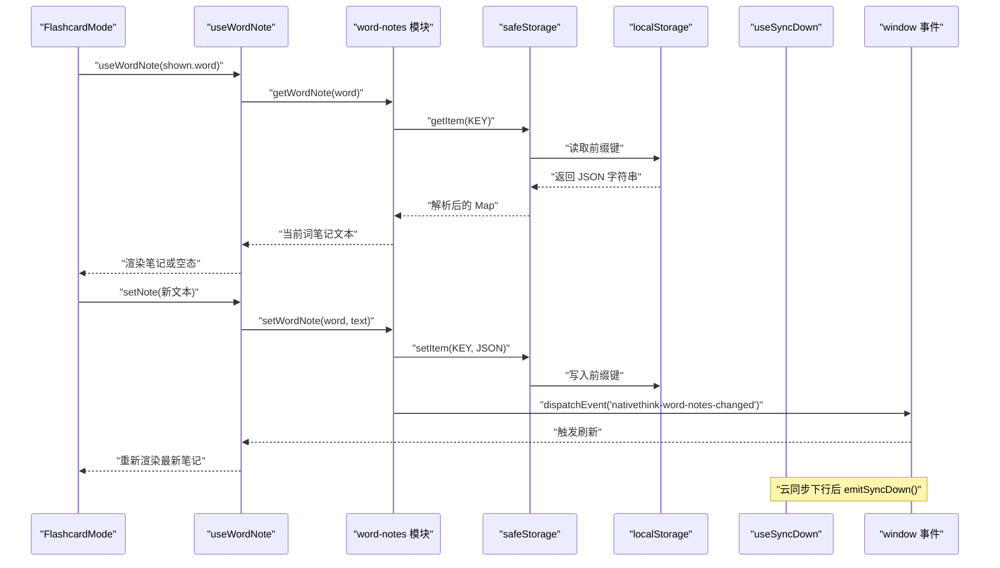
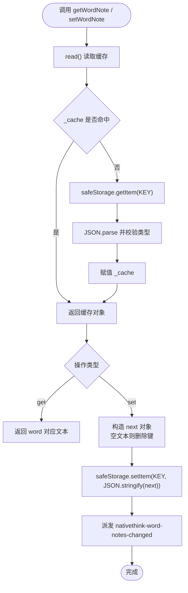
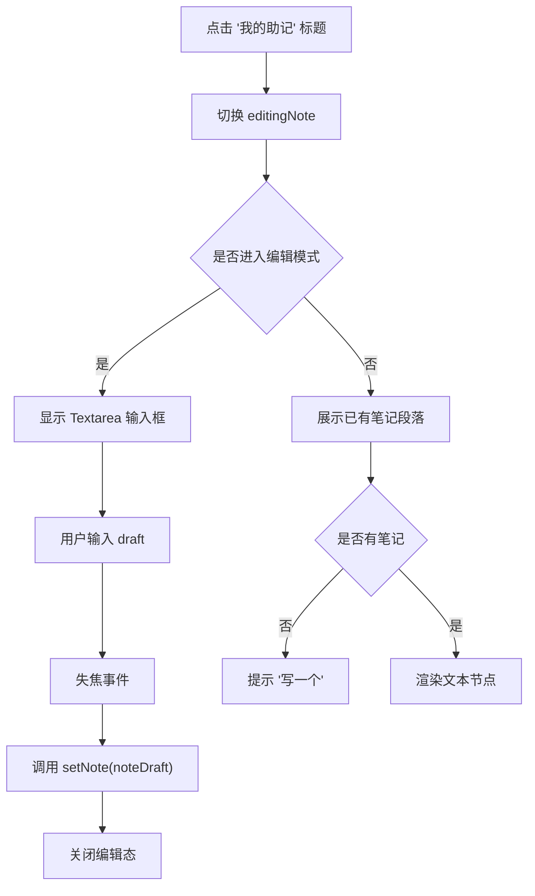
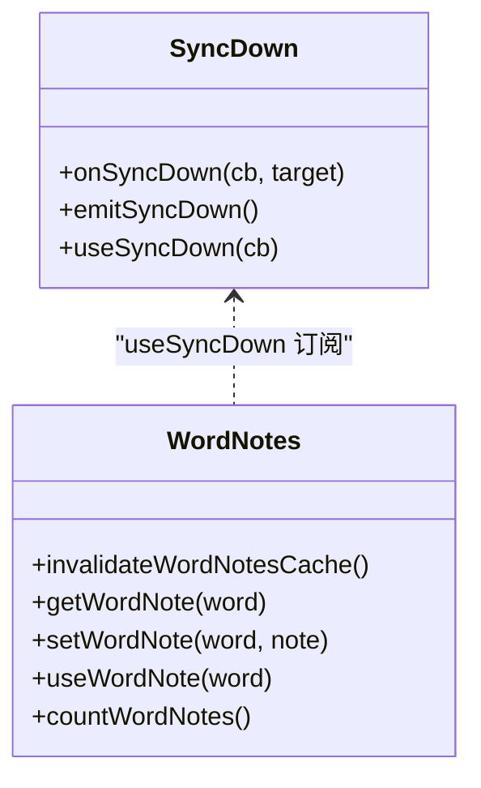
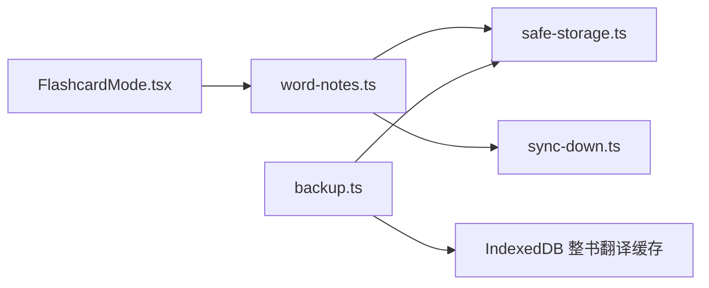

# 词汇笔记管理

<cite>
**本文引用的文件**   
- [word-notes.ts](file://src/lib/word-notes.ts)
- [FlashcardMode.tsx](file://src/pages/DeepVocabularyPage/components/FlashcardMode.tsx)
- [sync-down.ts](file://src/lib/sync-down.ts)
- [safe-storage.ts](file://src/lib/safe-storage.ts)
- [backup.ts](file://src/lib/backup.ts)
</cite>

## 目录
1. [引言](#引言)
2. [项目结构](#项目结构)
3. [核心组件](#核心组件)
4. [架构总览](#架构总览)
5. [详细组件分析](#详细组件分析)
6. [依赖关系分析](#依赖关系分析)
7. [性能与扩展性](#性能与扩展性)
8. [故障排查指南](#故障排查指南)
9. [结论](#结论)

## 引言
本文件面向 NativeThink 词汇模块中的“词汇笔记”能力，重点说明：
- 数据层 `word-notes.ts` 如何实现按词键的增删改查、跨组件订阅、云同步失效与计数。
- UI 层 FlashcardMode 如何暴露“我的助记”编辑器、预览展示与概览统计。
- 笔记与词汇的关联模型：当前以“词键到文本”的一对一映射为主；可扩展为多值索引。
- 持久化策略：基于安全存储前缀封装的 localStorage，以及备份恢复对应用级数据的覆盖范围。
- 同步机制：通过下行事件使笔记在多设备间可见。
- 导入导出现状与建议：当前实现未提供独立的 Markdown/JSON/CSV 笔记导出入口，但应用备份可间接包含笔记数据。

## 项目结构
词汇笔记相关代码主要分布在以下位置：
- 数据与状态：`src/lib/word-notes.ts`
- 用户界面：`src/pages/DeepVocabularyPage/components/FlashcardMode.tsx`
- 云同步下行广播：`src/lib/sync-down.ts`
- 本地安全存储封装：`src/lib/safe-storage.ts`
- 应用备份与恢复：`src/lib/backup.ts`

图示来源
- [word-notes.ts:1-82](file://src/lib/word-notes.ts#L1-L82)
- [FlashcardMode.tsx:28-29](file://src/pages/DeepVocabularyPage/components/FlashcardMode.tsx#L28-L29)
- [FlashcardMode.tsx:297-297](file://src/pages/DeepVocabularyPage/components/FlashcardMode.tsx#L297-L297)
- [sync-down.ts:1-49](file://src/lib/sync-down.ts#L1-L49)
- [safe-storage.ts:1-200](file://src/lib/safe-storage.ts#L1-L200)

章节来源
- [word-notes.ts:1-82](file://src/lib/word-notes.ts#L1-L82)
- [FlashcardMode.tsx:28-29](file://src/pages/DeepVocabularyPage/components/FlashcardMode.tsx#L28-L29)

## 核心组件
本节从职责角度梳理词汇笔记系统的关键构件。

- 词汇笔记数据层（`word-notes.ts`）
  - 维护一个进程内内存缓存 `_cache`，键为小写词键，值为纯文本笔记。
  - 对外暴露读取、写入、判断是否存在、计数等 API。
  - 提供一个 React Hook `useWordNote`，把单个词的笔记作为状态暴露给 UI，并在词变化或云同步后刷新。
  - 通过自定义事件通知同一页面其他订阅者刷新。

- 词汇卡片 UI（`FlashcardMode.tsx`）
  - 使用 `useWordNote(shown.word)` 绑定当前词的笔记状态。
  - 提供“我的助记”折叠面板：点击展开编辑区，失焦时保存；已有笔记则以段落形式展示。
  - 在概览区域显示本周学习量与“助记 N 个”的计数。

- 同步基础设施（`sync-down.ts`）
  - 定义统一的“下行落地”事件名和订阅钩子，避免各 hook 各自拼事件名。
  - 保证某个订阅失败不影响其他订阅者重读。

- 安全存储封装（`safe-storage.ts`）
  - 自动添加平台与应用隔离前缀，支持匿名 ID 自愈、旧前缀迁移。
  - 提供线程外安全的 getItem/setItem/removeItem，并可选对接云端双写处理器。

- 备份恢复（`backup.ts`）
  - 导出所有 safeStorage 作用域下的键值，以及 IndexedDB 中整书对照翻译缓存。
  - 恢复时覆盖同键数据，跳过非法条目。

章节来源
- [word-notes.ts:1-82](file://src/lib/word-notes.ts#L1-L82)
- [FlashcardMode.tsx:28-29](file://src/pages/DeepVocabularyPage/components/FlashcardMode.tsx#L28-L29)
- [FlashcardMode.tsx:297-297](file://src/pages/DeepVocabularyPage/components/FlashcardMode.tsx#L297-L297)
- [FlashcardMode.tsx:1304-1328](file://src/pages/DeepVocabularyPage/components/FlashcardMode.tsx#L1304-L1328)
- [sync-down.ts:1-49](file://src/lib/sync-down.ts#L1-L49)
- [safe-storage.ts:1-200](file://src/lib/safe-storage.ts#L1-L200)
- [backup.ts:1-105](file://src/lib/backup.ts#L1-L105)

## 架构总览
词汇笔记采用“轻量内存缓存 + 浏览器本地存储 + 事件订阅 + 云端同步”的分层设计。UI 不直接操作存储，而是通过 Hook 调用数据层；数据层负责缓存一致性、事件广播和持久化；云同步通过统一事件触发各模块失效并重读。

图示来源
- [word-notes.ts:1-82](file://src/lib/word-notes.ts#L1-L82)
- [sync-down.ts:1-49](file://src/lib/sync-down.ts#L1-L49)
- [safe-storage.ts:1-200](file://src/lib/safe-storage.ts#L1-L200)

## 详细组件分析

### 词汇笔记数据层：`word-notes.ts`
该模块是词汇笔记的核心逻辑所在，承担以下职责：
- 进程内缓存 `_cache`：首次读取时从 safeStorage 加载 JSON，之后复用，避免频繁磁盘 IO。
- 键规范：词键统一 trim 并转为小写，保证大小写无关的笔记查找。
- 增删改查：
  - 获取：`getWordNote(word)` 返回指定词笔记。
  - 写入：`setWordNote(word, note)` 将非空文本写入，清空时删除对应键。
  - 存在性：`hasWordNote(word)` 判断是否已存在非空笔记。
  - 计数：`countWordNotes()` 返回有笔记的词数量。
- 跨组件一致性：
  - 每次写入后派发 `nativethink-word-notes-changed` 事件。
  - `useWordNote` 订阅该事件，当同一词被多个组件引用时，任一修改都会让其它组件刷新。
- 云同步联动：
  - 提供 `invalidateWordNotesCache()` 清空模块缓存。
  - `useWordNote` 内部通过 `useSyncDown` 在云同步下行后主动失效缓存并重新读取，防止旧文本覆盖远端更新。

图示来源
- [word-notes.ts:1-82](file://src/lib/word-notes.ts#L1-L82)

章节来源
- [word-notes.ts:1-82](file://src/lib/word-notes.ts#L1-L82)

#### 复杂度与边界处理
- 时间复杂度
  - 读取：O(1) 缓存命中；首次 O(n) 遍历 JSON 键值构建内存对象。
  - 写入：O(n) 复制旧对象，再写入 JSON 字符串。
  - 计数：O(n) 遍历键。
- 空间复杂度
  - 与笔记总数线性相关，每个键值均为字符串。
- 边界情况
  - 词为空串时忽略写入。
  - JSON 损坏时回退为空对象，避免崩溃。
  - 存储配额不足时静默捕获异常，不影响主流程。

### 词汇卡片 UI：`FlashcardMode.tsx`
FlashcardMode 是词汇复习卡片的主视图，其中“我的助记”功能体现如下：

- 状态绑定
  - 使用 `useWordNote(shown.word)` 绑定当前词笔记。
  - 维护 `editingNote` 控制编辑器显隐，`noteDraft` 保留编辑草稿。
- 编辑器交互
  - 点击标题栏切换编辑模式。
  - 编辑器失焦时保存草稿并关闭编辑态。
  - 已有笔记以段落形式展示，支持换行。
- 概览统计
  - 通过 `countWordNotes()` 获取全站笔记数，并在“本周学习量”旁展示“助记 N 个”。

图示来源
- [FlashcardMode.tsx:114-116](file://src/pages/DeepVocabularyPage/components/FlashcardMode.tsx#L114-L116)
- [FlashcardMode.tsx:297-297](file://src/pages/DeepVocabularyPage/components/FlashcardMode.tsx#L297-L297)
- [FlashcardMode.tsx:1304-1328](file://src/pages/DeepVocabularyPage/components/FlashcardMode.tsx#L1304-L1328)

章节来源
- [FlashcardMode.tsx:28-29](file://src/pages/DeepVocabularyPage/components/FlashcardMode.tsx#L28-L29)
- [FlashcardMode.tsx:114-116](file://src/pages/DeepVocabularyPage/components/FlashcardMode.tsx#L114-L116)
- [FlashcardMode.tsx:297-297](file://src/pages/DeepVocabularyPage/components/FlashcardMode.tsx#L297-L297)
- [FlashcardMode.tsx:1304-1328](file://src/pages/DeepVocabularyPage/components/FlashcardMode.tsx#L1304-L1328)

### 同步机制：`sync-down.ts`
词汇笔记通过 `useSyncDown` 订阅云同步下行事件。其关键行为包括：
- 统一事件名：避免散落的字符串常量。
- 容错订阅：单个回调抛错不会影响后续订阅者。
- Hook 封装：用 ref 持有最新回调，只订阅一次，避免频繁 add/removeEventListener。
- 词汇笔记在订阅回调中执行缓存失效和本地重读，确保远端修改在本机可见。

图示来源
- [sync-down.ts:1-49](file://src/lib/sync-down.ts#L1-L49)
- [word-notes.ts:1-82](file://src/lib/word-notes.ts#L1-L82)

章节来源
- [sync-down.ts:1-49](file://src/lib/sync-down.ts#L1-L49)
- [word-notes.ts:1-82](file://src/lib/word-notes.ts#L1-L82)

### 持久化存储策略：`safe-storage.ts` 与 `backup.ts`
- safeStorage
  - 为 key 自动添加应用和用户隔离前缀，避免不同应用或用户之间互相污染。
  - 支持匿名 ID 自愈：如果引导键丢失，尝试从既有键恢复匿名 ID，降低“数据隐身”风险。
  - 提供旧前缀迁移逻辑，兼容历史数据。
  - setItem 返回布尔值，区分“真正写入成功”和“因配额不足等原因失败”，便于上层决策。
  - 可选注册云端双写处理器，使每次写入都能触发云同步。
- backup.ts
  - 导出所有 safeStorage 前缀下的键值，即涵盖 `__nativethink_word_notes` 对应的实际 localStorage 键。
  - 同时导出 IndexedDB 中的整书对照翻译缓存，用于快速重建阅读场景。
  - 恢复时覆盖同键数据，跳过非法键值。

章节来源
- [safe-storage.ts:1-200](file://src/lib/safe-storage.ts#L1-L200)
- [backup.ts:1-105](file://src/lib/backup.ts#L1-L105)

### 导入导出与团队协作扩展方案

#### 当前导入导出现状
- 词汇笔记本身没有独立的 Markdown、JSON、CSV 导出接口。
- 应用级备份可以导出 safeStorage 全部键值，因此词汇笔记数据会随备份一并导出。
- 恢复时，备份中的 safeStorage 键值会被覆盖式写回。

章节来源
- [backup.ts:1-105](file://src/lib/backup.ts#L1-L105)

#### 建议扩展方向
- 独立导出
  - 新增导出函数，遍历 `_cache`，输出结构化 JSON。
  - 支持 Markdown 表格（词、笔记、标签）、CSV（字段扩展如时间戳、版本）。
- 独立导入
  - 校验文件格式与字段，合并到现有 `_cache`，冲突时可保留旧值或选择覆盖。
  - 对 Markdown/CSV 增加解析器，转换为内部 `{wordKey: note}` 结构。
- 团队协作
  - 利用 safeStorage 的云端双写处理器，将笔记变更事件转发到后端。
  - 引入文档级版本控制与冲突解决策略，例如最后写入优先、字段级合并。
  - 支持共享词库与协作批注，将笔记从“个人助记”升级为“团队知识片段”。

[本节为扩展建议，不直接分析具体源码]

## 依赖关系分析
词汇笔记系统的依赖关系清晰且低耦合：

图示来源
- [FlashcardMode.tsx:28-29](file://src/pages/DeepVocabularyPage/components/FlashcardMode.tsx#L28-L29)
- [word-notes.ts:1-82](file://src/lib/word-notes.ts#L1-L82)
- [safe-storage.ts:1-200](file://src/lib/safe-storage.ts#L1-L200)
- [sync-down.ts:1-49](file://src/lib/sync-down.ts#L1-L49)
- [backup.ts:1-105](file://src/lib/backup.ts#L1-L105)

章节来源
- [FlashcardMode.tsx:28-29](file://src/pages/DeepVocabularyPage/components/FlashcardMode.tsx#L28-L29)
- [word-notes.ts:1-82](file://src/lib/word-notes.ts#L1-L82)
- [safe-storage.ts:1-200](file://src/lib/safe-storage.ts#L1-L200)
- [sync-down.ts:1-49](file://src/lib/sync-down.ts#L1-L49)
- [backup.ts:1-105](file://src/lib/backup.ts#L1-L105)

## 性能与扩展性

### 性能特性
- 内存缓存显著减少重复 JSON 解析和 localStorage 读写。
- 事件驱动刷新避免轮询。
- 单次写入仅序列化一次 JSON，适合移动端低频编辑场景。

### 潜在优化点
- 对超大词库，可按用户活跃词集裁剪 `_cache`，或实现懒加载分片。
- 批量写入时合并多次 setItem，减少序列化次数。
- 将 `_cache` 迁移为更高效的 Map 结构，提升大量键时的遍历性能。
- 为笔记内容增加富媒体支持时，应评估 base64 图片对 localStorage 体积的影响。

[本节为通用性能讨论，不直接分析具体源码]

## 故障排查指南

常见问题与定位思路：

- 修改笔记后其他组件未刷新
  - 检查是否触发了 `nativethink-word-notes-changed` 事件。
  - 确认 `useWordNote` 是否订阅了该事件。
  - 若云同步下行后仍显示旧文本，检查 `invalidateWordNotesCache()` 是否被执行。

- 笔记在重装或更新后消失
  - 确认备份是否包含 safeStorage 数据。
  - 使用应用备份恢复功能，覆盖式还原本地键值。
  - 检查 safeStorage 的前缀是否正确，避免匿名 ID 重建导致“数据隐身”。

- 云同步后本机被远端旧数据覆盖
  - 确认云同步流程是否在落地后调用 `emitSyncDown()`。
  - 确认 `useSyncDown` 订阅回调执行顺序，避免竞态。

章节来源
- [word-notes.ts:1-82](file://src/lib/word-notes.ts#L1-L82)
- [sync-down.ts:1-49](file://src/lib/sync-down.ts#L1-L49)
- [backup.ts:1-105](file://src/lib/backup.ts#L1-L105)

## 结论
NativeThink 词汇笔记模块以极简的数据模型和可靠的本地存储为基础，提供了：
- 按词键的笔记增删改查。
- 基于事件的跨组件同步。
- 与云同步下行一致的失效与重读机制。
- 与 FlashcardMode 的“我的助记”自然融合。

当前实现聚焦于个人助记文本，尚未提供独立的 Markdown/JSON/CSV 导入导出与富媒体支持。建议在保持现有低耦合架构的基础上，逐步扩展结构化导出、导入合并策略、富媒体存储方案以及团队协作能力。