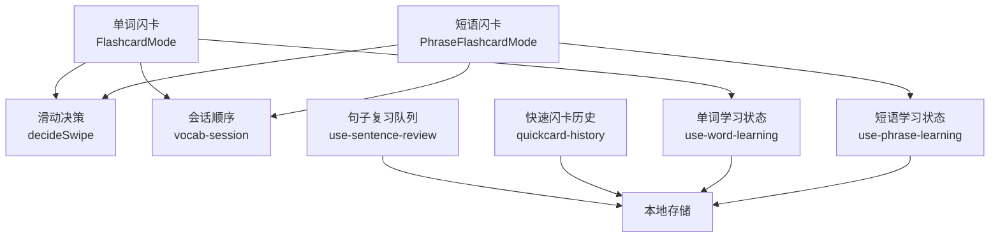
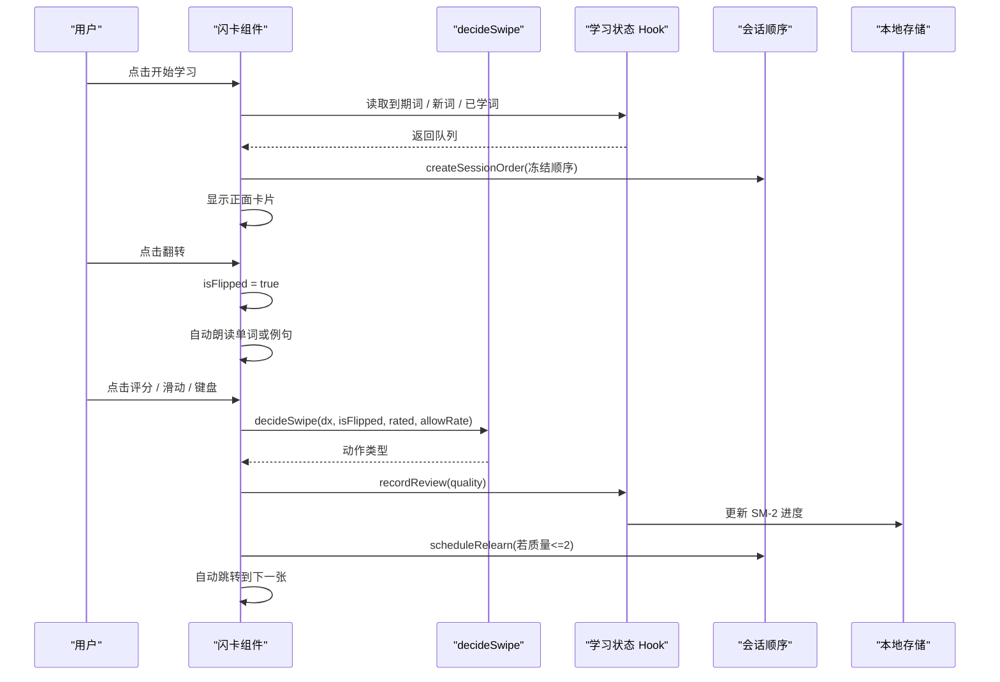
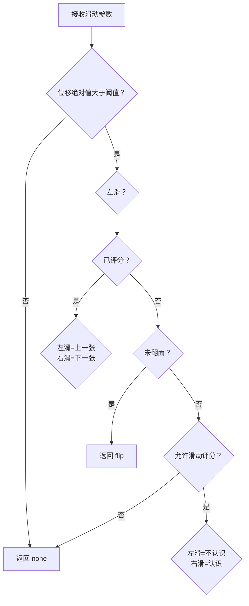
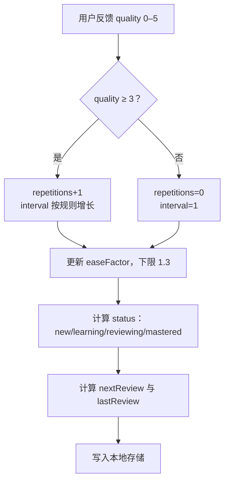

# 闪卡系统

<cite>
**本文引用的文件**
- [vocab-swipe.ts](file://src/lib/vocab-swipe.ts)
- [FlashcardMode.tsx](file://src/pages/DeepVocabularyPage/components/FlashcardMode.tsx)
- [PhraseFlashcardMode.tsx](file://src/pages/DeepVocabularyPage/components/PhraseFlashcardMode.tsx)
- [use-word-learning.ts](file://src/lib/use-word-learning.ts)
- [use-phrase-learning.ts](file://src/lib/use-phrase-learning.ts)
- [use-sentence-review.ts](file://src/lib/use-sentence-review.ts)
- [quickcard-history.ts](file://src/lib/quickcard-history.ts)
- [vocab-session.ts](file://src/lib/vocab-session.ts)
</cite>

## 目录
1. [引言](#引言)
2. [项目结构与定位](#项目结构与定位)
3. [核心组件总览](#核心组件总览)
4. [架构与数据流](#架构与数据流)
5. [详细组件分析](#详细组件分析)
6. [手势识别与交互状态](#手势识别与交互状态)
7. [SM-2 间隔重复集成](#sm-2-间隔重复集成)
8. [无障碍支持与移动端适配](#无障碍支持与移动端适配)
9. [样式定制与主题支持](#样式定制与主题支持)
10. [性能与可测性](#性能与可测性)
11. [故障排查](#故障排查)
12. [结论](#结论)

## 引言
NativeThink 的词汇模块通过“复习检测”和“短语闪卡”两个入口提供闪卡式学习体验：正面展示英文单词或短语，背面展示中文释义、例句、音标等扩展信息；用户通过评分按钮、键盘或滑动手势反馈“认识/不认识”，系统基于 SM-2 算法安排下一次复习时间。文档聚焦以下目标：

- 解释 `FlashcardMode`（单词）与 `PhraseFlashcardMode`（短语）两个闪卡组件的实现思路。
- 说明卡片渲染逻辑、翻转行为、自动发音、评分流程、完成页与断点续学。
- 解析 `vocab-swipe.ts` 中的滑动决策函数及其在两种闪卡模式中的不同语义。
- 梳理 SM-2 在单词、短语、句子复习三条路径上的实现差异。
- 总结手势交互、无障碍支持和移动端适配策略。
- 给出闪卡样式定制与主题支持的配置建议。

## 项目结构与定位
闪卡系统横跨三层：

| 层级 | 职责 | 主要文件 |
|---|---|---|
| UI 层 | 卡片展示、翻转动画、评分按钮、完成页、概览面板 | `FlashcardMode.tsx`、`PhraseFlashcardMode.tsx` |
| 交互层 | 滑动手势判定、键盘操作、自动跳转、连击统计 | `vocab-swipe.ts`、各组件内部事件处理 |
| 记忆层 | SM-2 进度、会话顺序、到期队列、历史统计 | `use-word-learning.ts`、`use-phrase-learning.ts`、`use-sentence-review.ts`、`vocab-session.ts`、`quickcard-history.ts` |

**图表来源**
- [FlashcardMode.tsx:1-200](file://src/pages/DeepVocabularyPage/components/FlashcardMode.tsx#L1-L200)
- [PhraseFlashcardMode.tsx:1-200](file://src/pages/DeepVocabularyPage/components/PhraseFlashcardMode.tsx#L1-L200)
- [vocab-swipe.ts:1-46](file://src/lib/vocab-swipe.ts#L1-L46)
- [vocab-session.ts:1-77](file://src/lib/vocab-session.ts#L1-L77)
- [use-word-learning.ts:1-200](file://src/lib/use-word-learning.ts#L1-L200)
- [use-phrase-learning.ts:1-200](file://src/lib/use-phrase-learning.ts#L1-L200)

**章节来源**
- [FlashcardMode.tsx:1-200](file://src/pages/DeepVocabularyPage/components/FlashcardMode.tsx#L1-L200)
- [PhraseFlashcardMode.tsx:1-200](file://src/pages/DeepVocabularyPage/components/PhraseFlashcardMode.tsx#L1-L200)
- [vocab-swipe.ts:1-46](file://src/lib/vocab-swipe.ts#L1-L46)

## 核心组件总览
### 单词闪卡：FlashcardMode
- 数据来源：词库 `IWordEntry`，按等级（如四级、六级、雅思、托福、考研、专业、进阶、生词本）组织。
- 核心状态：
  - `session`：冻结后的出卡顺序。
  - `currentIdx`：当前卡片下标。
  - `isFlipped`：是否翻到背面。
  - `ratedKeys`：本轮已评分的词集合。
  - `combo` / `bestCombo`：连对计数。
  - `dragX`：滑动位移。
  - `started` / `finished`：概览、学习中、完成页三态。
- 主要能力：
  - 构建复习队列：到期词 + 其他已学词 + 补新词。
  - 五档评分：0、2、3、4、5。
  - 答错重排：同一轮内延迟插入。
  - 自动朗读：正面读单词，背面先读单词再读例句。
  - 断点续学：恢复会话顺序、位置与已评状态。
  - 屏蔽词：不再出现，可从本轮移除并提供撤销。

**章节来源**
- [FlashcardMode.tsx:200-489](file://src/pages/DeepVocabularyPage/components/FlashcardMode.tsx#L200-L489)
- [FlashcardMode.tsx:489-765](file://src/pages/DeepVocabularyPage/components/FlashcardMode.tsx#L489-L765)

### 短语闪卡：PhraseFlashcardMode
- 数据来源：短语库映射为 `IChunk`，支持九个考试短语级别。
- 核心状态：与单词闪卡同构，但 key 是短语内容而非词面。
- 主要差异：
  - 空进度仍可开始一轮：短语闪卡是学习入口。
  - 没有“我的助记”概念，但保留“错词重练”。
  - 滑动评分默认启用：左滑=不认识，右滑=认识。
  - 自动发音拼成一次 speak，避免短语与例句互相打断。
  - “不再出现”带撤销提示。

**章节来源**
- [PhraseFlashcardMode.tsx:1-200](file://src/pages/DeepVocabularyPage/components/PhraseFlashcardMode.tsx#L1-L200)
- [PhraseFlashcardMode.tsx:200-520](file://src/pages/DeepVocabularyPage/components/PhraseFlashcardMode.tsx#L200-L520)
- [PhraseFlashcardMode.tsx:520-800](file://src/pages/DeepVocabularyPage/components/PhraseFlashcardMode.tsx#L520-L800)

## 架构与数据流
闪卡系统的典型请求流程如下：

**图表来源**
- [FlashcardMode.tsx:489-765](file://src/pages/DeepVocabularyPage/components/FlashcardMode.tsx#L489-L765)
- [PhraseFlashcardMode.tsx:520-800](file://src/pages/DeepVocabularyPage/components/PhraseFlashcardMode.tsx#L520-L800)
- [vocab-swipe.ts:1-46](file://src/lib/vocab-swipe.ts#L1-L46)
- [vocab-session.ts:1-77](file://src/lib/vocab-session.ts#L1-L77)
- [use-word-learning.ts:1-200](file://src/lib/use-word-learning.ts#L1-L200)
- [use-phrase-learning.ts:1-200](file://src/lib/use-phrase-learning.ts#L1-L200)

## 详细组件分析

### FlashcardMode：单词闪卡
#### 卡片内容与渲染
- 正面：单词、音量按钮、收藏按钮、评分按钮（未翻面且未评分时）。
- 背面：中文释义、搭配、例句、音标、深度解释、收藏与屏蔽出口、助记编辑区。
- 详情懒加载：进入卡片后预加载对应等级的 detail，补齐后再刷新显示。

#### 翻转与自动发音
- 正面：朗读单词，并预热下一张单词。
- 背面：将“单词 + 例句”拼接为一次 speak，保证顺序播放、不被后续翻面打断。
- 自动发音开关持久化：`__nativethink_vocab_autospeak`。

#### 评分与连击
- 评分值：0、2、3、4、5。
- 连续答对触发音效；每 5 连给一次奖励，达到 7 连触发庆祝动画。
- 答错累计清零，正确则累加。

#### 答错重排
- 质量 ≤ 2 时记录待重排词。
- 真正前进时才调用 `scheduleRelearn`，插入到当前位置之后固定间隔处。
- 重排次数上限：`MAX_RELEARN`；超过后不再插入，改由 SM-2 下次复习兜底。

#### 断点续学与完成页
- 断点保存：会话顺序、当前位置、已评词集合、已评数量、正确数量。
- 完成页显示总数、记得率、错误数、最佳连击，并提供“返回概览”和“回看本轮”。

**章节来源**
- [FlashcardMode.tsx:200-489](file://src/pages/DeepVocabularyPage/components/FlashcardMode.tsx#L200-L489)
- [FlashcardMode.tsx:489-765](file://src/pages/DeepVocabularyPage/components/FlashcardMode.tsx#L489-L765)

### PhraseFlashcardMode：短语闪卡
#### 短语数据加载
- 按短语级别懒加载短语库。
- 加载结果映射为 `IChunk`，去重后进入复习队列。
- 加载失败提供重试入口。

#### 队列构造
- 到期短语 + 已学未到期短语 + 补新短语。
- 补新受每日目标限制；已到期的最多取 30 条。
- 同日已评短语不回队，防止刚复习完又原样重来。

#### 评分与自动跳转
- 评分后根据质量设置停留时间：≥3 为 120ms，≤2 为 300ms。
- 自动跳转使用 `advanceRef`，避免定时器因回调重建反复重置。

#### 滑动评分
- 短语闪卡不传 `allowRate: false`，因此已翻面未评分时可滑动评分。
- 左滑=质量 2，右滑=质量 4。

**章节来源**
- [PhraseFlashcardMode.tsx:1-200](file://src/pages/DeepVocabularyPage/components/PhraseFlashcardMode.tsx#L1-L200)
- [PhraseFlashcardMode.tsx:200-520](file://src/pages/DeepVocabularyPage/components/PhraseFlashcardMode.tsx#L200-L520)
- [PhraseFlashcardMode.tsx:520-800](file://src/pages/DeepVocabularyPage/components/PhraseFlashcardMode.tsx#L520-L800)

## 手势识别与交互状态

### 滑动决策表
`decideSwipe` 是一个纯函数，输入包括水平位移、是否已翻面、是否已评分、是否允许滑动评分，输出为动作类型：

| 条件 | 动作 | 含义 |
|---|---|---|
| 位移小于阈值 | `none` | 视为点击或未操作 |
| 已评分 | `prev` 或 `next` | 左滑上一张，右滑下一张 |
| 未翻面 | `flip` | 滑动只翻面 |
| 已翻面且允许滑动评分 | `rate-unknown` 或 `rate-known` | 左滑不认识，右滑认识 |
| 已翻面且禁止滑动评分 | `none` | 方向手势不表达熟悉度 |

**图表来源**
- [vocab-swipe.ts:1-46](file://src/lib/vocab-swipe.ts#L1-L46)

### 单词闪卡的滑动语义
单词闪卡传入 `allowRate: false`，因此：

- 未翻面滑动 → 翻面。
- 已翻面未评分 → 滑动不评分，必须用评分按钮或数字键。
- 已评分 → 左右滑动直接导航。

这是为了遵循“熟悉程度不许用方向手势表达”的用户口径，避免用户把左滑当成“不认识”刷进度。

**章节来源**
- [FlashcardMode.tsx:489-765](file://src/pages/DeepVocabularyPage/components/FlashcardMode.tsx#L489-L765)
- [vocab-swipe.ts:1-46](file://src/lib/vocab-swipe.ts#L1-L46)

### 短语闪卡的滑动语义
短语闪卡未禁用滑动评分，因此：

- 未翻面滑动 → 翻面。
- 已翻面未评分 → 左滑=质量 2，右滑=质量 4。
- 已评分 → 左右滑动导航。

这与单词闪卡形成有意差异：短语闪卡更偏向“学习入口”，允许用滑动快速表达基本判断。

**章节来源**
- [PhraseFlashcardMode.tsx:520-800](file://src/pages/DeepVocabularyPage/components/PhraseFlashcardMode.tsx#L520-L800)
- [vocab-swipe.ts:1-46](file://src/lib/vocab-swipe.ts#L1-L46)

### 键盘交互
两个闪卡模式都支持键盘：

| 按键 | 单词闪卡 | 短语闪卡 |
|---|---|---|
| 空格 | 未翻面翻面；已翻面未评分默认好评；已评分继续 | 同上 |
| 1–5 | 评分 | 评分 |
| 右箭头 | 已评分时下一个 | 已评分时下一个 |
| S | 未翻面时切换自动发音 | 未翻面时切换自动发音 |
| Esc | 专注模式下退出 | 专注模式下退出 |

**章节来源**
- [FlashcardMode.tsx:489-765](file://src/pages/DeepVocabularyPage/components/FlashcardMode.tsx#L489-L765)
- [PhraseFlashcardMode.tsx:520-800](file://src/pages/DeepVocabularyPage/components/PhraseFlashcardMode.tsx#L520-L800)

## SM-2 间隔重复集成

### 单词学习状态
`use-word-learning.ts` 维护每个词的 SM-2 进度：

| 字段 | 含义 |
|---|---|
| `status` | new、learning、reviewing、mastered |
| `easeFactor` | 难度系数，默认 2.5，下限 1.3 |
| `interval` | 下次复习间隔天数 |
| `repetitions` | 成功复习次数 |
| `nextReview` | 下次复习时间戳 |
| `lastReview` | 上次复习时间戳 |
| `wrongCount` | 连续答错累计 |
| `suspended` | 不再出现 |

每日学习/复习计数按本地日期重置；历史按 YYYY-MM-DD 聚合，用于周报与正确率。

**章节来源**
- [use-word-learning.ts:1-200](file://src/lib/use-word-learning.ts#L1-L200)

### 短语学习状态
`use-phrase-learning.ts` 以短语内容为 key，提供与单词侧对齐的 SM-2 结构，并包含：

- 老格式迁移：旧字符串状态迁移为对象结构。
- 每日配额：短语闪卡的“每日目标”。
- 会话断点：按短语库隔离保存。
- SM-2 更新函数：质量 ≥ 3 推进间隔，质量 < 3 重置重复次数与间隔。

**章节来源**
- [use-phrase-learning.ts:1-200](file://src/lib/use-phrase-learning.ts#L1-L200)

### 句子复习队列
`use-sentence-review.ts` 用于拆句练习的间隔重复：

- 漏切、多切或主干选错被视为未掌握。
- 答错时 interval 设为 0，表示立即回到队列。
- 掌握条件：重复次数与间隔达到阈值后标记 mastered。

**章节来源**
- [use-sentence-review.ts:1-140](file://src/lib/use-sentence-review.ts#L1-L140)

### 会话顺序与重排
`vocab-session.ts` 负责一轮内的卡片顺序：

- `createSessionOrder`：冻结本轮顺序。
- `scheduleRelearn`：答错词插入当前位置之后固定间隔处。
- `nextIndex`：计算下一张下标。
- `forecastByDay`：未来 N 天到期预测。

**章节来源**
- [vocab-session.ts:1-77](file://src/lib/vocab-session.ts#L1-L77)

### SM-2 评分流程

**图表来源**
- [use-phrase-learning.ts:1-200](file://src/lib/use-phrase-learning.ts#L1-L200)
- [use-sentence-review.ts:1-140](file://src/lib/use-sentence-review.ts#L1-L140)

## 无障碍支持与移动端适配

### 无障碍现状
当前代码中可见的无障碍属性集中在非闪卡区域，例如设置按钮、全局搜索、阅读进度等使用 `aria-label`。闪卡组件本身更依赖视觉动效与快捷键，而不是大量 ARIA 标注。现有相关实践可作为参考：

- 设置项按钮使用 `aria-label` 描述功能。
- 主题切换按钮使用 `aria-pressed` 表达选中状态。
- 语块翻页按钮使用 `aria-label` 明确上一个、下一个。

这意味着闪卡组件在未来增强无障碍时，应重点补充：

- 评分按钮的 `aria-label`，区分“认识”“不认识”“完全忘了”。
- 翻转按钮或可点击区域的语义。
- 自动发音开关的状态描述。
- 完成页和概览面板的屏幕阅读器可读摘要。

**章节来源**
- [AISettings.tsx:195-199](file://src/components/AISettings.tsx#L195-L199)
- [AppSidebar.tsx:163-167](file://src/components/AppSidebar.tsx#L163-L167)
- [GlobalWordSearch.tsx:227-231](file://src/components/GlobalWordSearch.tsx#L227-L231)
- [ChunkTrainingPage.tsx:2556-2570](file://src/pages/ChunkTrainingPage/ChunkTrainingPage.tsx#L2556-L2570)

### 移动端适配要点
- 触摸拖动需避开文本框：单词闪卡会跳过 `textarea`、`input`、`contenteditable` 区域的拖拽，避免误评。
- 滑动阈值：默认 80px，不足视为点击。
- 自动发音预热：首张前 5 张卡片预合成语音，减少首次发音等待。
- 专注模式：ESC 退出，避免沉浸态下被键盘干扰。
- 断点续学：中途退出后可恢复顺序与位置，适合移动端随时中断的学习场景。

**章节来源**
- [FlashcardMode.tsx:489-765](file://src/pages/DeepVocabularyPage/components/FlashcardMode.tsx#L489-L765)
- [PhraseFlashcardMode.tsx:520-800](file://src/pages/DeepVocabularyPage/components/PhraseFlashcardMode.tsx#L520-L800)
- [vocab-swipe.ts:1-46](file://src/lib/vocab-swipe.ts#L1-L46)

## 样式定制与主题支持
闪卡组件使用 Tailwind 类名与 CSS 变量组合：

- 颜色采用 `var(--brand)`、`text-ink-teal`、`bg-card`、`border-border` 等语义化变量，便于深色主题与品牌色切换。
- 卡片容器使用圆角、阴影、边框和背景渐变，配合 Framer Motion 的入场动画。
- 统计面板、进度条、完成页均使用统一圆角和间距风格。
- 短语闪卡与单词闪卡在主色上有所区分：短语闪卡偏青绿色系，单词闪卡偏紫色系。

如需定制：

| 定制目标 | 推荐方式 |
|---|---|
| 调整卡片尺寸 | 修改外层容器的 padding、gap、grid 布局类 |
| 调整评分按钮布局 | 修改评分区 flex/grid 排列 |
| 更换主题色 | 通过全局主题变量替换 `--brand`、`text-ink-*`、`bg-*` |
| 调整动画时长 | 修改 MotionDiv 的 transition 参数，或组件内 tween 时间 |
| 自定义自动发音行为 | 复用 `__nativethink_vocab_autospeak` 开关逻辑，扩展 TTS 调用 |

**章节来源**
- [FlashcardMode.tsx:1-200](file://src/pages/DeepVocabularyPage/components/FlashcardMode.tsx#L1-L200)
- [PhraseFlashcardMode.tsx:1-200](file://src/pages/DeepVocabularyPage/components/PhraseFlashcardMode.tsx#L1-L200)

## 性能与可测性
### 性能优化
- 会话顺序冻结：避免每次评分都重算队列导致下标漂移。
- 批量切换下一张：合并 state 更新，减少 AnimatePresence 串行等待。
- 自动发音预热：提前合成下一张语音，降低首音延迟。
- 存储双写保护：相同 JSON 不重复写入，避免云同步回声。
- 到期数缓存：全局到期数计算带 800ms 缓存，避免频繁全量扫描。
- 快速闪卡历史截断：单轮最多存 300 个词，历史记录最多 20 轮。

### 可测性设计
- `decideSwipe`：纯函数，完整覆盖手势分支，适合单元测试。
- `vocab-session`：纯函数封装会话顺序、重排、预测，适合边界测试。
- SM-2 更新逻辑：集中在 hook 内部，便于验证间隔、难度系数、状态迁移。

**章节来源**
- [vocab-swipe.ts:1-46](file://src/lib/vocab-swipe.ts#L1-L46)
- [vocab-session.ts:1-77](file://src/lib/vocab-session.ts#L1-L77)
- [use-word-learning.ts:1-200](file://src/lib/use-word-learning.ts#L1-L200)
- [quickcard-history.ts:1-200](file://src/lib/quickcard-history.ts#L1-L200)

## 故障排查
| 现象 | 可能原因 | 处理建议 |
|---|---|---|
| 第一张卡片不朗读 | 新一轮未清空 `lastSpokenKey` | 检查 `startSession` 或 `resumeSession` 是否重置朗读记录 |
| 评分后卡死不动 | 同步重排导致 `justRated` 失效 | 确认重排在 `advance` 中执行，而非评分回调中 |
| 复习检测空但有到期词 | 当前词书无到期词，到期在其他词书 | 使用跨词书引导入口切换到有到期词的书 |
| 滑动没反应 | 位移不足或处于禁滑动评分模式 | 检查 `SWIPE_THRESHOLD` 与 `allowRate` |
| 断点续学进度清零 | 断点数据损坏或缺失 rated 字段 | 检查本地存储，必要时清除旧断点重新开始 |
| 短语库加载失败 | 网络或数据源异常 | 使用重试按钮重新加载 |
| 自动发音一直重复 | 同一卡片正反面 key 命中旧 ref | 确保新一轮清空 `lastSpokenKey` |

**章节来源**
- [FlashcardMode.tsx:489-765](file://src/pages/DeepVocabularyPage/components/FlashcardMode.tsx#L489-L765)
- [PhraseFlashcardMode.tsx:520-800](file://src/pages/DeepVocabularyPage/components/PhraseFlashcardMode.tsx#L520-L800)
- [vocab-swipe.ts:1-46](file://src/lib/vocab-swipe.ts#L1-L46)

## 结论
NativeThink 的闪卡系统以两个组件为核心：单词闪卡强调“复习检测”，短语闪卡强调“学习入口”；两者共享 SM-2 记忆理念、会话冻结、断点续学、自动发音与完成页体验。`vocab-swipe.ts` 将手势决策抽为纯函数，使交互逻辑可测且可在不同模式中差异化配置。SM-2 在单词、短语、句子三条路径上保持同构的数据模型，但在触发规则和即时巩固策略上略有差异。

未来改进建议：

1. 为评分按钮和翻转操作补充 `aria-label`、`role="button"`、`tabIndex`，提升屏幕阅读器可用性。
2. 为滑动操作增加方向提示的无障碍播报，帮助视障用户理解左滑/右滑语义。
3. 将 SM-2 更新函数进一步抽象为可注入的策略，便于实验不同间隔公式。
4. 为闪卡样式提供更明确的定制接口，比如主题对象、卡片尺寸配置、动画曲线配置。
5. 为移动端手势增加长按、双击等扩展交互的可配置入口，同时保持默认行为稳定。