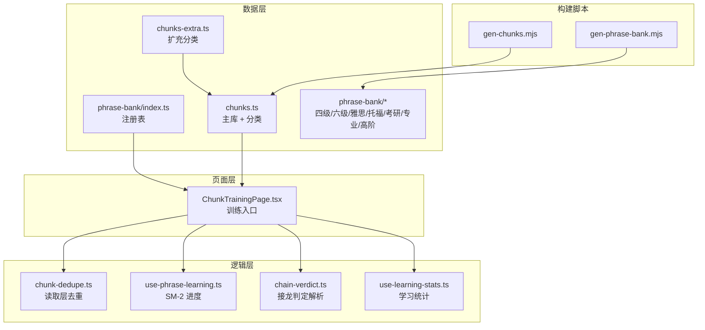
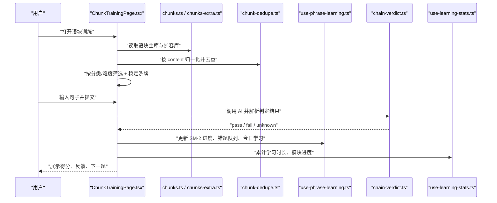
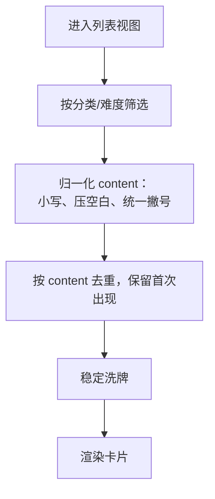
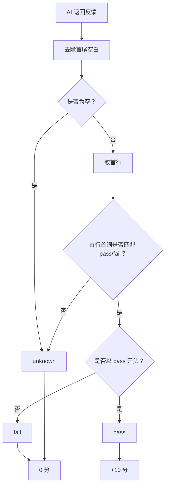
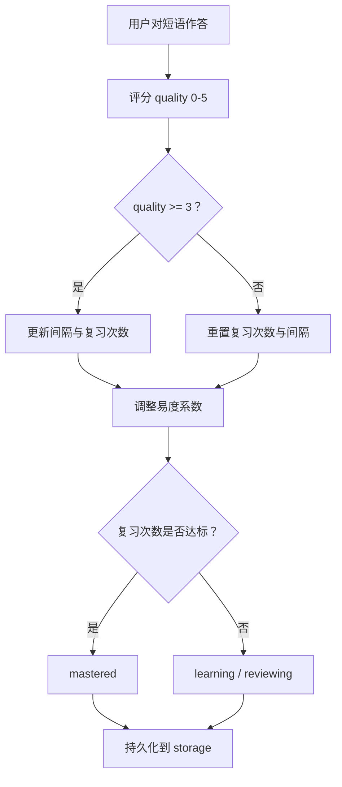
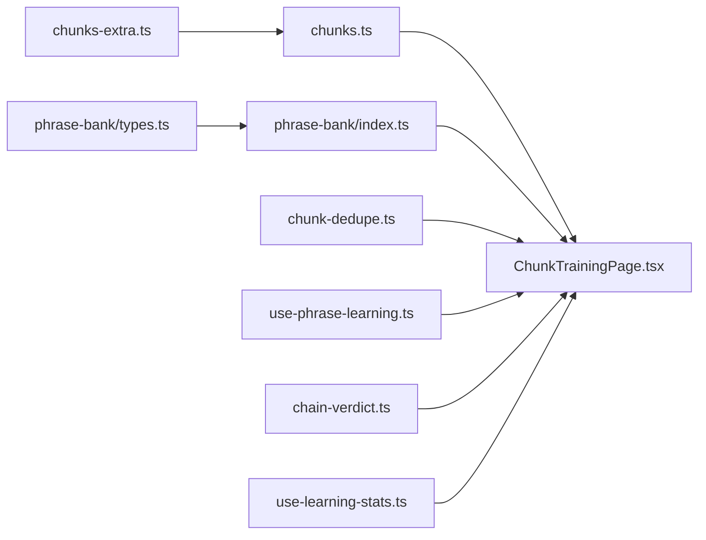

# 语块训练模块

<cite>
**本文引用的文件**   
- [src/data/chunks.ts](file://src/data/chunks.ts)
- [src/data/chunks-extra.ts](file://src/data/chunks-extra.ts)
- [src/pages/ChunkTrainingPage/ChunkTrainingPage.tsx](file://src/pages/ChunkTrainingPage/ChunkTrainingPage.tsx)
- [src/lib/chunk-dedupe.ts](file://src/lib/chunk-dedupe.ts)
- [src/lib/use-phrase-learning.ts](file://src/lib/use-phrase-learning.ts)
- [src/lib/chain-verdict.ts](file://src/lib/chain-verdict.ts)
- [src/lib/use-learning-stats.ts](file://src/lib/use-learning-stats.ts)
- [src/data/phrase-bank/index.ts](file://src/data/phrase-bank/index.ts)
- [src/data/phrase-bank/types.ts](file://src/data/phrase-bank/types.ts)
- [src/data/phrase-bank/cet4.ts](file://src/data/phrase-bank/cet4.ts)
- [src/data/phrase-bank/cet6.ts](file://src/data/phrase-bank/cet6.ts)
- [src/data/phrase-bank/ielts.ts](file://src/data/phrase-bank/ielts.ts)
- [src/data/phrase-bank/toefl.ts](file://src/data/phrase-bank/toefl.ts)
- [src/data/phrase-bank/postgraduate.ts](file://src/data/phrase-bank/postgraduate.ts)
- [src/data/phrase-bank/professional.ts](file://src/data/phrase-bank/professional.ts)
- [src/data/phrase-bank/advanced.ts](file://src/data/phrase-bank/advanced.ts)
- [scripts/gen-chunks.mjs](file://scripts/gen-chunks.mjs)
- [scripts/gen-phrase-bank.mjs](file://scripts/gen-phrase-bank.mjs)
</cite>

## 目录
1. [引言](#引言)
2. [项目结构](#项目结构)
3. [核心组件](#核心组件)
4. [架构总览](#架构总览)
5. [详细组件分析](#详细组件分析)
6. [依赖关系分析](#依赖关系分析)
7. [性能与扩展性](#性能与扩展性)
8. [排错指南](#排错指南)
9. [结论](#结论)
10. [附录：数据扩展与自定义短语库指南](#附录数据扩展与自定义短语库指南)

## 引言
NativeThink 的语块训练模块围绕两类数据展开：
- **语块库（chunks）**：约 963 条固定英文短语，用于接龙造句、替换练习、闪卡复习等。
- **短语词库（phrase-bank）**：从词书搭配自动提取的大规模短语集合，按中考、高考、四级、六级、雅思、托福、考研、专业英语、高阶分级组织，供短语闪卡和复习使用。

本模块的核心目标是让用户通过“输入句子 → AI 判定是否包含目标语块”完成训练，同时记录 SM-2 学习进度、错题重练、每日配额和跨天历史。

**章节来源**
- [src/data/chunks.ts:1-20](file://src/data/chunks.ts#L1-L20)
- [src/data/phrase-bank/index.ts:1-25](file://src/data/phrase-bank/index.ts#L1-L25)
- [src/pages/ChunkTrainingPage/ChunkTrainingPage.tsx:1-40](file://src/pages/ChunkTrainingPage/ChunkTrainingPage.tsx#L1-L40)

## 项目结构
语块训练模块涉及四层职责：
- **数据层**：`chunks.ts`、`chunks-extra.ts`、`phrase-bank/*`。
- **页面层**：`ChunkTrainingPage.tsx`。
- **逻辑层**：去重 `chunk-dedupe.ts`、SM-2 进度 `use-phrase-learning.ts`、接龙判定 `chain-verdict.ts`、学习统计 `use-learning-stats.ts`。
- **构建脚本**：`gen-chunks.mjs`、`gen-phrase-bank.mjs`。

**图表来源**
- [src/pages/ChunkTrainingPage/ChunkTrainingPage.tsx:1-60](file://src/pages/ChunkTrainingPage/ChunkTrainingPage.tsx#L1-L60)
- [src/data/chunks.ts:1-20](file://src/data/chunks.ts#L1-L20)
- [src/data/chunks-extra.ts:1-20](file://src/data/chunks-extra.ts#L1-L20)
- [src/data/phrase-bank/index.ts:1-25](file://src/data/phrase-bank/index.ts#L1-L25)
- [src/lib/chunk-dedupe.ts:1-20](file://src/lib/chunk-dedupe.ts#L1-L20)
- [src/lib/use-phrase-learning.ts:1-25](file://src/lib/use-phrase-learning.ts#L1-L25)
- [src/lib/chain-verdict.ts:1-20](file://src/lib/chain-verdict.ts#L1-L20)
- [src/lib/use-learning-stats.ts:1-25](file://src/lib/use-learning-stats.ts#L1-L25)
- [scripts/gen-chunks.mjs:1-15](file://scripts/gen-chunks.mjs#L1-L15)
- [scripts/gen-phrase-bank.mjs:1-25](file://scripts/gen-phrase-bank.mjs#L1-L25)

**章节来源**
- [src/data/chunks.ts:1-20](file://src/data/chunks.ts#L1-L20)
- [src/data/phrase-bank/index.ts:1-25](file://src/data/phrase-bank/index.ts#L1-L25)
- [src/pages/ChunkTrainingPage/ChunkTrainingPage.tsx:1-60](file://src/pages/ChunkTrainingPage/ChunkTrainingPage.tsx#L1-L60)

## 核心组件
### 语块接口与主库
语块统一由 `IChunk` 描述，字段包括：
- `id`：唯一标识。
- `content`：目标英文短语。
- `meaning`：中文释义。
- `category`：主题分类，如日常、职场、社交、情绪、旅行、学习、科技、美食、健康、购物、运动。
- `usage`：用法说明。
- `example` / `exampleZh`：例句及中文翻译。
- `introduction`：英文使用说明。
- `difficulty`：难度分级，初级、中级、高级。

主库 `MOCK_CHUNKS_BASE` 以数组形式定义大量条目；扩容库 `CHUNKS_EXTRA` 补齐 travel、study、tech、food、health、shopping、sports 七个空分类，并以 `cx*` 前缀 id 避免与主库冲突。两者合并后形成统一的 963 条训练池。

**章节来源**
- [src/data/chunks.ts:1-20](file://src/data/chunks.ts#L1-L20)
- [src/data/chunks.ts:21-98](file://src/data/chunks.ts#L21-L98)
- [src/data/chunks-extra.ts:1-20](file://src/data/chunks-extra.ts#L1-L20)
- [src/data/chunks-extra.ts:21-93](file://src/data/chunks-extra.ts#L21-L93)

### 短语词库分级体系
短语词库由 `IPhraseEntry` 描述，字段包括：
- `content`：短语文本。
- `sourceWord`：来源单词。
- `meaning`：来源单词的中文释义主干。
- `exampleEn` / `exampleZh`：预翻译例句。

级别类型 `PhraseLevel` 支持：
- 中考、高考、四级、六级、雅思、托福、考研、专业、高阶。

`index.ts` 提供懒加载注册表和内存缓存；每个级别一个文件，例如 `cet4.ts`、`ielts.ts`、`toefl.ts`、`postgraduate.ts`、`professional.ts`、`advanced.ts`。

**章节来源**
- [src/data/phrase-bank/types.ts:1-31](file://src/data/phrase-bank/types.ts#L1-L31)
- [src/data/phrase-bank/index.ts:1-58](file://src/data/phrase-bank/index.ts#L1-L58)
- [src/data/phrase-bank/cet4.ts:1-10](file://src/data/phrase-bank/cet4.ts#L1-L10)
- [src/data/phrase-bank/cet6.ts:1-10](file://src/data/phrase-bank/cet6.ts#L1-L10)
- [src/data/phrase-bank/ielts.ts:1-10](file://src/data/phrase-bank/ielts.ts#L1-L10)
- [src/data/phrase-bank/toefl.ts:1-10](file://src/data/phrase-bank/toefl.ts#L1-L10)
- [src/data/phrase-bank/postgraduate.ts:1-10](file://src/data/phrase-bank/postgraduate.ts#L1-L10)
- [src/data/phrase-bank/professional.ts:1-10](file://src/data/phrase-bank/professional.ts#L1-L10)
- [src/data/phrase-bank/advanced.ts:1-10](file://src/data/phrase-bank/advanced.ts#L1-L10)

### 训练页面与流程
`ChunkTrainingPage.tsx` 是训练入口，承担以下职责：
- 导入主库、去重工具、收藏夹、学习统计、短语学习进度、页面记忆、稳定洗牌、AI 服务、TTS、短语库类型与标签。
- 维护筛选条件：全部或具体分类、全部或初/中/高难度。
- 生成替换练习题：基于已稳定洗牌的语块序列，用确定性哈希选择干扰项和选项顺序。
- 控制 UI 状态：当前页签、滚动位置、分页、显示预览数量、自动发音开关。
- 与短语复习、闪卡、接龙、AI 生成例句等功能协作。

**章节来源**
- [src/pages/ChunkTrainingPage/ChunkTrainingPage.tsx:1-120](file://src/pages/ChunkTrainingPage/ChunkTrainingPage.tsx#L1-L120)

## 架构总览
语块训练的整体数据流如下：

**图表来源**
- [src/pages/ChunkTrainingPage/ChunkTrainingPage.tsx:1-120](file://src/pages/ChunkTrainingPage/ChunkTrainingPage.tsx#L1-L120)
- [src/data/chunks.ts:1-20](file://src/data/chunks.ts#L1-L20)
- [src/data/chunks-extra.ts:1-20](file://src/data/chunks-extra.ts#L1-L20)
- [src/lib/chunk-dedupe.ts:1-20](file://src/lib/chunk-dedupe.ts#L1-L20)
- [src/lib/use-phrase-learning.ts:1-25](file://src/lib/use-phrase-learning.ts#L1-L25)
- [src/lib/chain-verdict.ts:1-20](file://src/lib/chain-verdict.ts#L1-L20)
- [src/lib/use-learning-stats.ts:1-25](file://src/lib/use-learning-stats.ts#L1-L25)

## 详细组件分析

### 语块数据结构与分类管理
#### IChunk 模型
`IChunk` 是语块训练的核心实体。关键字段语义如下：
| 字段 | 含义 | 复杂度 |
| --- | --- | --- |
| `id` | 稳定唯一键，便于记忆状态、收藏、分组切换 | O(1) 查找 |
| `content` | 目标短语文本，用于匹配、去重、复习进度键 | O(n) 字符串操作 |
| `meaning` | 中文释义，用于展示 | O(1) |
| `category` | 主题分类，用于筛选和侧栏导航 | O(1) |
| `usage` | 用法说明 | O(1) |
| `example` / `exampleZh` | 例句 | O(1) |
| `introduction` | 英文说明 | O(1) |
| `difficulty` | 难度分级 | O(1) |

#### 分类体系
主库默认覆盖 daily、workplace、social、emotion、travel、study、tech、food、health、shopping、sports 等分类。扩容库补齐其中七个原本为空的分类，使训练池在主题维度更完整。

**章节来源**
- [src/data/chunks.ts:1-20](file://src/data/chunks.ts#L1-L20)
- [src/data/chunks-extra.ts:1-20](file://src/data/chunks-extra.ts#L1-L20)

#### 主库与扩容库合并策略
注释明确说明：主库 c1-c748 加上扩容库 cx* 条目合并导出。扩容库负责补齐缺失分类，并通过构建期校验保证与主库去重。

**章节来源**
- [src/data/chunks.ts:12-18](file://src/data/chunks.ts#L12-L18)
- [src/data/chunks-extra.ts:1-15](file://src/data/chunks-extra.ts#L1-L15)

### 短语词库数据组织
#### IPhraseEntry 模型
| 字段 | 含义 |
| --- | --- |
| `content` | 短语文本 |
| `sourceWord` | 来源单词 |
| `meaning` | 来源单词中文释义主干 |
| `exampleEn` | 预翻译英文例句 |
| `exampleZh` | 预翻译中文例句 |

#### 级别注册与懒加载
`loadPhrases(level)` 首次加载时动态 import 对应级别文件，随后写入内存缓存；后续同级别请求直接返回缓存结果。这降低首屏体积，也避免一次性加载所有短语库造成 DOM 和内存压力。

**章节来源**
- [src/data/phrase-bank/types.ts:1-31](file://src/data/phrase-bank/types.ts#L1-L31)
- [src/data/phrase-bank/index.ts:26-58](file://src/data/phrase-bank/index.ts#L26-L58)

### 语块去重机制
语块存在同一短语在不同分类重复登记的情况。例如某个短语既属于 daily 又属于 workplace。为避免删除真实数据导致：
1. 已记 id 失效；
2. 丢失另一条例句；
3. 分类筛选少一条；

系统采用**读取层去重**：先筛选，再分页或洗牌前按归一化后的 `content` 保留第一条。

**图表来源**
- [src/lib/chunk-dedupe.ts:1-25](file://src/lib/chunk-dedupe.ts#L1-L25)
- [src/pages/ChunkTrainingPage/ChunkTrainingPage.tsx:80-120](file://src/pages/ChunkTrainingPage/ChunkTrainingPage.tsx#L80-L120)

**章节来源**
- [src/lib/chunk-dedupe.ts:1-76](file://src/lib/chunk-dedupe.ts#L1-L76)

### 接龙判定逻辑
接龙判定由 `chain-verdict.ts` 提供统一解析点。AI 返回的原始回复必须满足格式约束：首行第一个字母串需匹配 PASS 或 FAIL 及其常见变形。

判定分为三档：
| 判定 | 行为 | 分数 |
| --- | --- | --- |
| `pass` | 计分并前进 | 10 |
| `fail` | 不计分，显示改进建议 | 0 |
| `unknown` | 不计分、不前进，展示模型原话让用户重试 | 0 |

旧实现曾把“非 FAIL 即通过”，导致模型未守格式或服务异常也被视为正确；新实现将未知判定隔离，避免假分和误伤学习成果。

**图表来源**
- [src/lib/chain-verdict.ts:1-48](file://src/lib/chain-verdict.ts#L1-L48)

**章节来源**
- [src/lib/chain-verdict.ts:1-48](file://src/lib/chain-verdict.ts#L1-L48)

### 难度分级策略
难度来自 `IChunk.difficulty`，取值 `beginner`、`intermediate`、`advanced`。训练页面提供“全部难度”“初级”“中级”“高级”筛选器，并在界面显示中文标签和缩写。

此外，短语词库本身按考试/专业维度分级，体现的是“语料来源难度”，而语块库的难度字段体现的是“单个短语的学习难度”。两者共同构成用户的难度体验：
- 语块库难度：控制接龙与替换练习的可选池。
- 短语词库级别：控制短语闪卡与复习的语料范围。

**章节来源**
- [src/data/chunks.ts:1-20](file://src/data/chunks.ts#L1-L20)
- [src/pages/ChunkTrainingPage/ChunkTrainingPage.tsx:40-80](file://src/pages/ChunkTrainingPage/ChunkTrainingPage.tsx#L40-L80)
- [src/data/phrase-bank/types.ts:18-31](file://src/data/phrase-bank/types.ts#L18-L31)

### 训练进度记录与错题本
短语学习进度由 `use-phrase-learning.ts` 统一管理，三个消费者共享：
1. 语块页“短语复习” tab。
2. 语块页“闪卡” tab。
3. 词汇深度页“短语闪卡”。

#### 核心数据结构
| 字段 | 含义 |
| --- | --- |
| `phraseKey` | 短语 key，通常是小写的 `content` |
| `status` | new、learning、reviewing、mastered |
| `easeFactor` | SM-2 易度系数，默认 2.5，下限 1.3 |
| `interval` | 下次复习间隔天数 |
| `repetitions` | 成功复习次数 |
| `nextReview` | 下次复习时间戳 |
| `lastReview` | 上次复习时间戳 |
| `wrongCount` | 答错累计，用于错题重练队列 |
| `suspended` | 用户主动不再出现，进度保留可恢复 |

#### SM-2 更新规则
- 质量分 ≥ 3：增加间隔或保持基础间隔，增加复习次数。
- 质量分 < 3：重置复习次数和间隔。
- 根据质量分调整易度系数。
- 当复习次数达到阈值后标记为 mastered。

#### 错题本机制
- 错误会累加 `wrongCount`，对应用户可见的错题重练队列。
- 答对后清零。
- 用户可选择 `suspended`，让该短语暂时退出复习和新学池，但进度仍保留。

#### 会话断点
每个短语库有独立的会话断点，记录顺序数组和当前位置，中途退出后可续学。

**图表来源**
- [src/lib/use-phrase-learning.ts:1-120](file://src/lib/use-phrase-learning.ts#L1-L120)
- [src/lib/use-phrase-learning.ts:120-200](file://src/lib/use-phrase-learning.ts#L120-L200)

**章节来源**
- [src/lib/use-phrase-learning.ts:1-200](file://src/lib/use-phrase-learning.ts#L1-L200)

### 学习统计与日历
`use-learning-stats.ts` 维护全局学习统计，包括：
- 连续打卡天数。
- 今日学习时长。
- 各模块学习进度，其中包含 `chunks`。
- 日历记录，按日期记录分钟数、模块集合。

语块训练页面通过 `addStudyMinutes` 累计时长，并通过模块进度参与仪表盘统计。

**章节来源**
- [src/lib/use-learning-stats.ts:1-120](file://src/lib/use-learning-stats.ts#L1-L120)
- [src/pages/ChunkTrainingPage/ChunkTrainingPage.tsx:1-40](file://src/pages/ChunkTrainingPage/ChunkTrainingPage.tsx#L1-L40)

### 替换练习与稳定性保证
替换练习由 `generateReplacementExercises` 生成。为保证同一入参输出一致，它不使用 `Math.random`，而是：
- 从上层 `useStableShuffle` 的稳定序列取前若干条。
- 用固定步长选取干扰项。
- 用内容哈希决定选项旋转位置。

这避免了因重渲染或语块池变化导致题目漂移。

**章节来源**
- [src/pages/ChunkTrainingPage/ChunkTrainingPage.tsx:60-120](file://src/pages/ChunkTrainingPage/ChunkTrainingPage.tsx#L60-L120)

## 依赖关系分析

**图表来源**
- [src/pages/ChunkTrainingPage/ChunkTrainingPage.tsx:1-60](file://src/pages/ChunkTrainingPage/ChunkTrainingPage.tsx#L1-L60)
- [src/data/chunks.ts:1-20](file://src/data/chunks.ts#L1-L20)
- [src/data/chunks-extra.ts:1-20](file://src/data/chunks-extra.ts#L1-L20)
- [src/data/phrase-bank/types.ts:1-31](file://src/data/phrase-bank/types.ts#L1-L31)
- [src/data/phrase-bank/index.ts:1-58](file://src/data/phrase-bank/index.ts#L1-L58)
- [src/lib/chunk-dedupe.ts:1-20](file://src/lib/chunk-dedupe.ts#L1-L20)
- [src/lib/use-phrase-learning.ts:1-25](file://src/lib/use-phrase-learning.ts#L1-L25)
- [src/lib/chain-verdict.ts:1-20](file://src/lib/chain-verdict.ts#L1-L20)
- [src/lib/use-learning-stats.ts:1-25](file://src/lib/use-learning-stats.ts#L1-L25)

**章节来源**
- [src/pages/ChunkTrainingPage/ChunkTrainingPage.tsx:1-120](file://src/pages/ChunkTrainingPage/ChunkTrainingPage.tsx#L1-L120)

## 性能与扩展性
### 性能特征
- **DOM 控制**：短语库按字母段默认只铺前 6 条，避免手机上一个滚动区承载过多节点。
- **懒加载**：短语词库按级别动态 import，仅加载用户选择的级别。
- **去重前置**：去重在筛选之后、分页之前执行，减少无效渲染。
- **稳定洗牌**：页面级洗牌一次，后续增删保持顺序稳定，避免题目漂移。
- **存储保护**：AI 派生例句缓存使用封顶策略，防止 localStorage 无限增长。

### 扩展性
- 新增语块分类：在 `chunks-extra.ts` 中补充对应分类条目，并确保 id 不与主库冲突。
- 新增短语级别：在 `gen-phrase-bank.mjs` 的级别列表中增加新级别，并在 `phrase-bank/index.ts` 注册懒加载器。
- 新增难度值：需同步修改 `IChunk.difficulty` 类型、页面筛选器与标签映射。

**章节来源**
- [src/pages/ChunkTrainingPage/ChunkTrainingPage.tsx:80-120](file://src/pages/ChunkTrainingPage/ChunkTrainingPage.tsx#L80-L120)
- [src/data/phrase-bank/index.ts:26-58](file://src/data/phrase-bank/index.ts#L26-L58)
- [scripts/gen-phrase-bank.mjs:15-25](file://scripts/gen-phrase-bank.mjs#L15-L25)

## 排错指南
### 接龙分数异常
如果接龙分数不按语块正确使用计数，优先检查 AI 返回是否符合 `parseChainVerdict` 的首行判定格式。若模型未给出 pass/fail，应视为 `unknown`，不应加分也不应前进。

**章节来源**
- [src/lib/chain-verdict.ts:1-48](file://src/lib/chain-verdict.ts#L1-L48)

### 同一短语反复出现
如果同一短语在一轮训练中多次出现，检查是否跳过读取层去重。确认筛选后、分页前调用了 `dedupeChunks`。

**章节来源**
- [src/lib/chunk-dedupe.ts:1-25](file://src/lib/chunk-dedupe.ts#L1-L25)

### 已记状态不一致
如果某个短语在 daily 视图中显示已记，但在 workplace 视图未显示，检查是否使用了 `expandMemorized` 和 `toggleMemorizedGroup`，确保兄弟 id 一起更新。

**章节来源**
- [src/lib/chunk-dedupe.ts:40-76](file://src/lib/chunk-dedupe.ts#L40-L76)

### 短语复习进度不同步
如果短语闪卡与语块复习进度不一致，检查 `use-phrase-learning.ts` 的存储键是否被多个模块共用，以及云同步下行后是否重新加载状态。

**章节来源**
- [src/lib/use-phrase-learning.ts:1-120](file://src/lib/use-phrase-learning.ts#L1-L120)

### 短语库加载缓慢
如果选择某级别短语库后加载慢，确认懒加载是否正确触发，以及浏览器是否频繁重复 import。缓存应在首次加载后生效。

**章节来源**
- [src/data/phrase-bank/index.ts:26-58](file://src/data/phrase-bank/index.ts#L26-L58)

## 结论
NativeThink 语块训练模块以 `IChunk` 为核心，结合扩容库补齐分类，形成约 963 条语块训练池；以 `IPhraseEntry` 为核心，按考试和专业维度组织大规模短语词库。训练流程从筛选、去重、洗牌到接龙判定、SM-2 进度、错题本和学习统计，形成闭环。通过懒加载、稳定洗牌、读取层去重和封顶缓存，系统在移动端具备较好的性能和稳定性。

## 附录：数据扩展与自定义短语库指南

### 添加新语块
1. 确定语块的 `id`、`content`、`meaning`、`category`、`usage`、`example`、`difficulty`。
2. 若属于已有分类且数量不足，可在 `chunks.ts` 追加；若属于 travel、study、tech、food、health、shopping、sports 等扩容分类，建议在 `chunks-extra.ts` 追加。
3. 确保 `id` 不重复；扩容库使用 `cx*` 前缀。
4. 如需新增分类，同步修改 `IChunk.category` 类型、页面分类常量、分类标签映射。

**章节来源**
- [src/data/chunks.ts:1-20](file://src/data/chunks.ts#L1-L20)
- [src/data/chunks-extra.ts:1-20](file://src/data/chunks-extra.ts#L1-L20)
- [src/pages/ChunkTrainingPage/ChunkTrainingPage.tsx:40-80](file://src/pages/ChunkTrainingPage/ChunkTrainingPage.tsx#L40-L80)

### 扩展短语词库级别
1. 在 `scripts/gen-phrase-bank.mjs` 的 `LEVELS` 数组中加入新级别。
2. 确保词书库数据源 `src/data/wordbank/data/<level>.detail.ts` 和 `<level>.ts` 存在。
3. 运行脚本生成 per-level 文件。
4. 在 `src/data/phrase-bank/index.ts` 中注册懒加载器，并更新 `PHRASE_LEVELS` 与 `PHRASE_LEVEL_LABELS`。
5. 在页面中暴露新级别的选择项。

**章节来源**
- [scripts/gen-phrase-bank.mjs:1-107](file://scripts/gen-phrase-bank.mjs#L1-L107)
- [src/data/phrase-bank/index.ts:1-58](file://src/data/phrase-bank/index.ts#L1-L58)

### 自定义短语库接入方式
如果希望引入外部短语库，推荐遵循现有 `IPhraseEntry` 结构：
- 将外部短语转换为 `{ content, sourceWord, meaning, exampleEn?, exampleZh? }`。
- 将其放入一个新级别的 `xxx_PHRASES` 数组。
- 在 `index.ts` 注册懒加载器。
- 在页面中添加对应级别选择。

这种方式复用现有的懒加载、缓存、进度和闪卡逻辑，无需重写底层能力。

**章节来源**
- [src/data/phrase-bank/types.ts:1-31](file://src/data/phrase-bank/types.ts#L1-L31)
- [src/data/phrase-bank/index.ts:26-58](file://src/data/phrase-bank/index.ts#L26-L58)