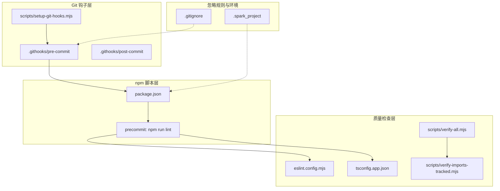
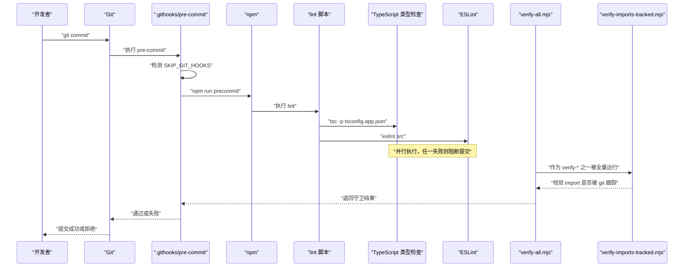
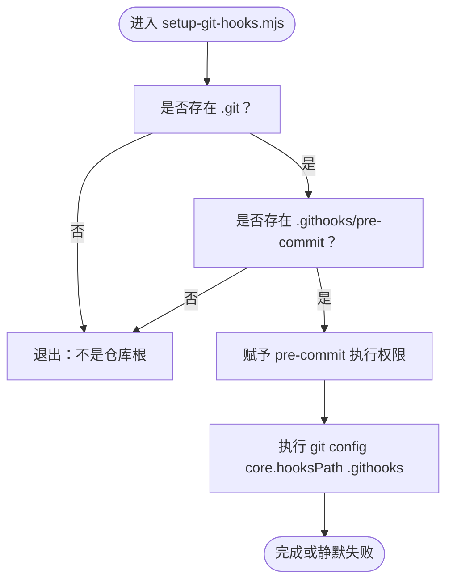
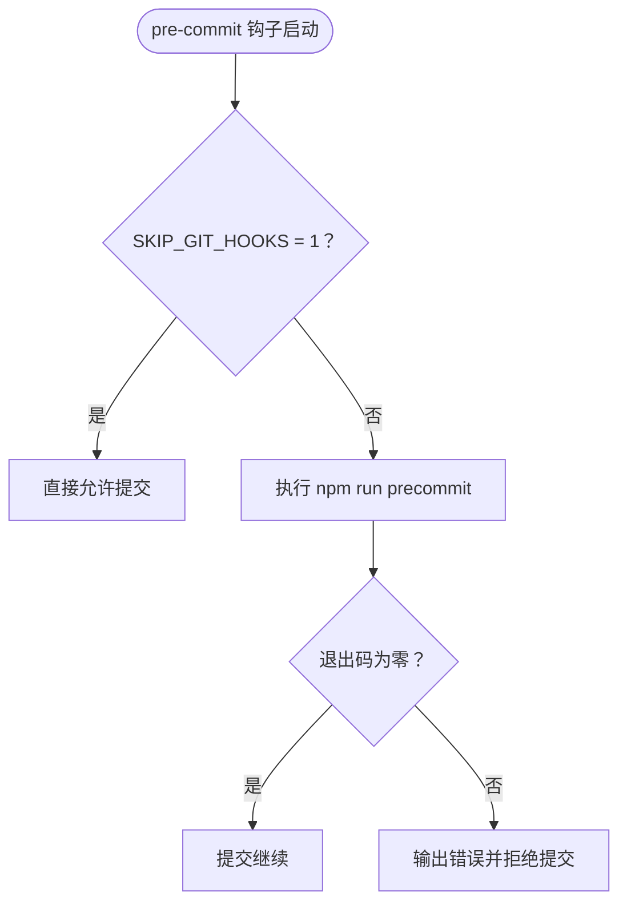
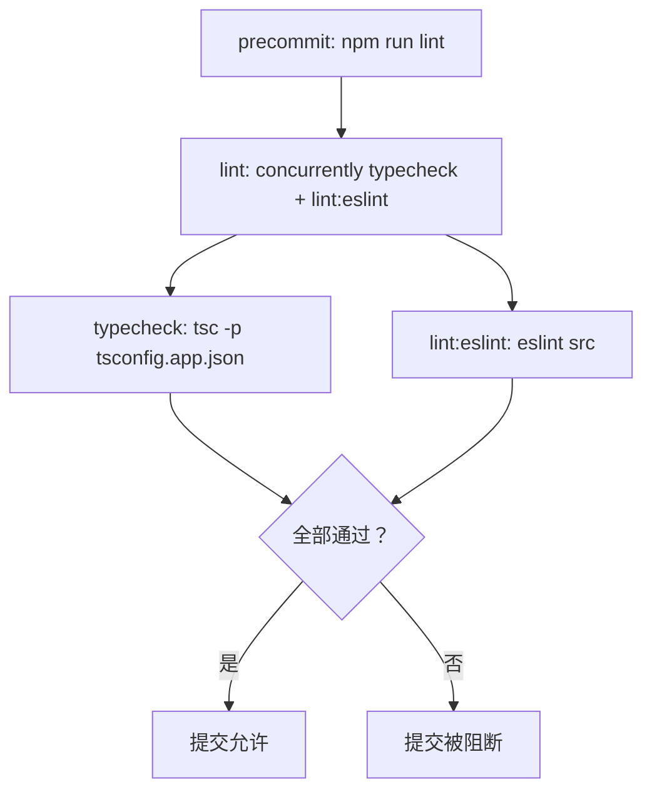
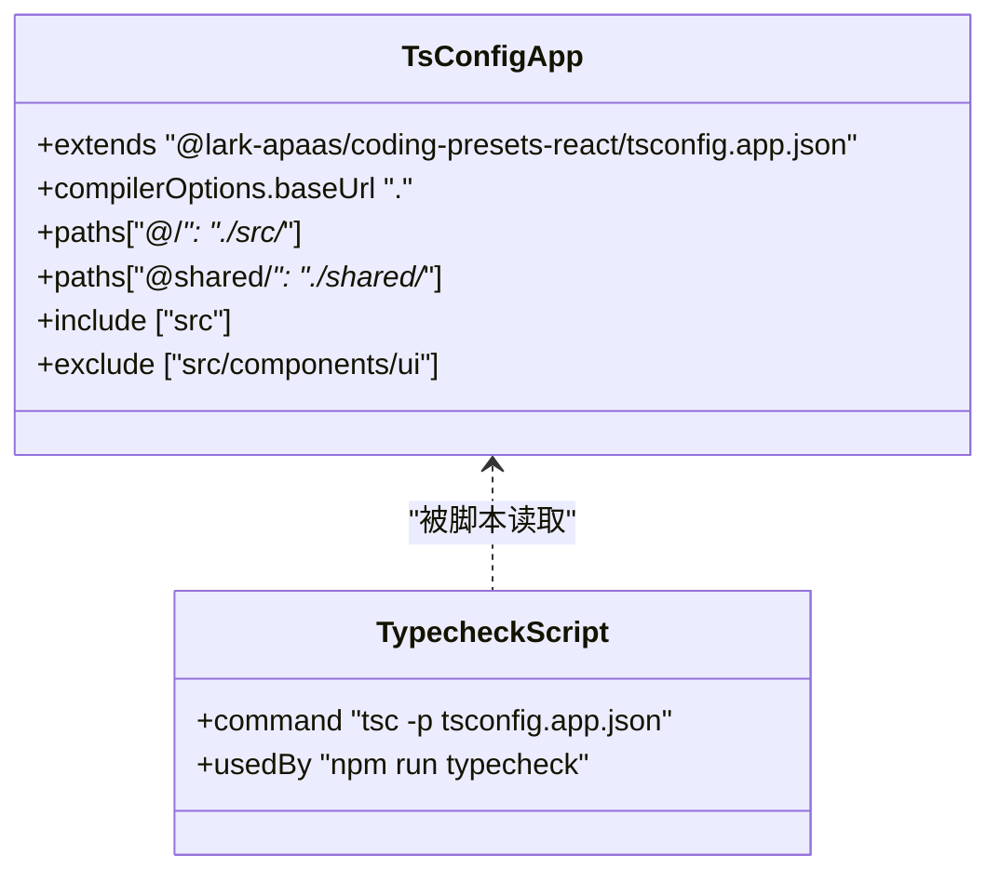
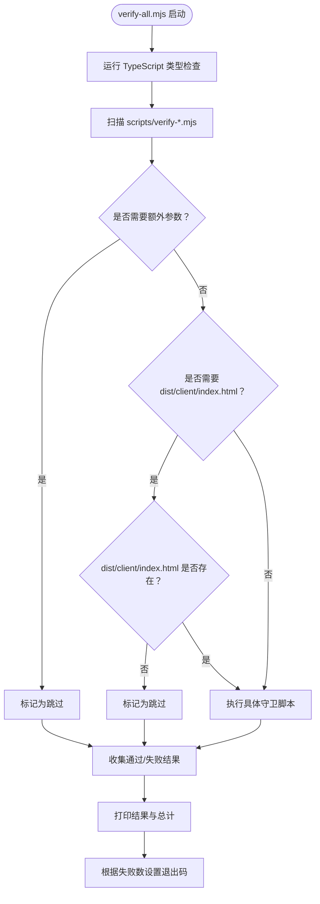
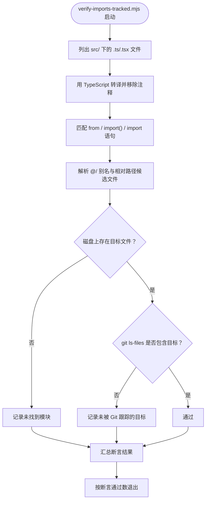
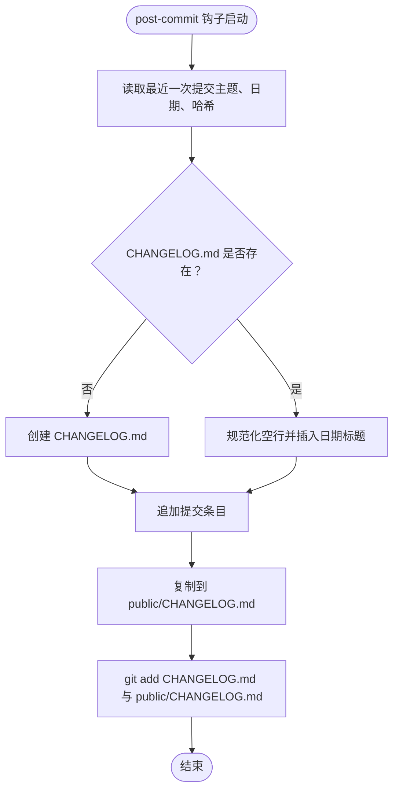
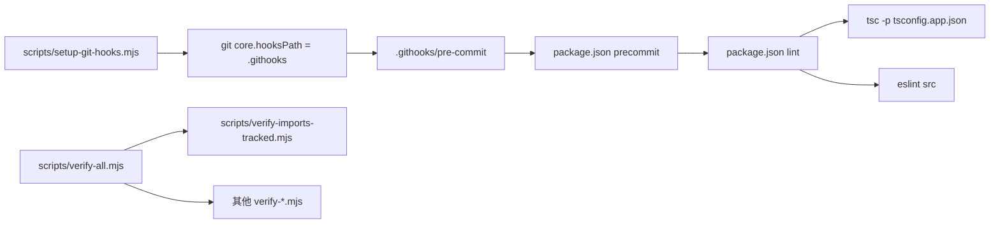

# Git 工作流与钩子

<cite>
**本文引用的文件**   
- [scripts/setup-git-hooks.mjs](file://scripts/setup-git-hooks.mjs)
- [.githooks/pre-commit](file://.githooks/pre-commit)
- [.githooks/post-commit](file://.githooks/post-commit)
- [.gitignore](file://.gitignore)
- [.spark_project](file://.spark_project)
- [package.json](file://package.json)
- [eslint.config.mjs](file://eslint.config.mjs)
- [tsconfig.app.json](file://tsconfig.app.json)
- [scripts/verify-all.mjs](file://scripts/verify-all.mjs)
- [scripts/verify-imports-tracked.mjs](file://scripts/verify-imports-tracked.mjs)
</cite>

## 目录
1. [引言](#引言)
2. [项目结构](#项目结构)
3. [核心组件](#核心组件)
4. [架构总览](#架构总览)
5. [详细组件分析](#详细组件分析)
6. [依赖关系分析](#依赖关系分析)
7. [性能考量](#性能考量)
8. [故障排查指南](#故障排查指南)
9. [团队协作规范](#团队协作规范)
10. [结论](#结论)

## 引言
本仓库采用“本地 Git Hooks + npm 脚本 + TypeScript/ESLint + 契约守卫”的组合方式，把代码质量检查前置到提交阶段。核心目标是：
- 通过 `setup-git-hooks.mjs` 在首次安装时自动启用 `.githooks` 下的 Git Hooks；
- 用 `pre-commit` 钩子串联 ESLint、TypeScript 类型检查以及 `verify-*` 契约守卫；
- 用 `.gitignore` 过滤构建产物和敏感配置；
- 用 `.spark_project` 对齐 Spark 开发环境；
- 形成可复现的分支命名、提交信息格式与代码审查流程。

## 项目结构
围绕 Git 工作流的关键文件和目录如下：

**图示来源**
- [scripts/setup-git-hooks.mjs:1-20](file://scripts/setup-git-hooks.mjs#L1-L20)
- [.githooks/pre-commit:1-9](file://.githooks/pre-commit#L1-L9)
- [.githooks/post-commit:1-57](file://.githooks/post-commit#L1-L57)
- [package.json:1-130](file://package.json#L1-L130)
- [eslint.config.mjs:1-7](file://eslint.config.mjs#L1-L7)
- [tsconfig.app.json:1-13](file://tsconfig.app.json#L1-L13)
- [scripts/verify-all.mjs:1-77](file://scripts/verify-all.mjs#L1-L77)
- [scripts/verify-imports-tracked.mjs:1-94](file://scripts/verify-imports-tracked.mjs#L1-L94)
- [.gitignore:1-36](file://.gitignore#L1-L36)
- [.spark_project:1-12](file://.spark_project#L1-L12)

**章节来源**
- [scripts/setup-git-hooks.mjs:1-20](file://scripts/setup-git-hooks.mjs#L1-L20)
- [.gitignore:1-36](file://.gitignore#L1-L36)
- [.spark_project:1-12](file://.spark_project#L1-L12)
- [package.json:1-130](file://package.json#L1-L130)

## 核心组件
- **Git Hooks 注册脚本**：`scripts/setup-git-hooks.mjs`，由 `prepare` 生命周期触发，设置 `core.hooksPath=.githooks`，并保证 `pre-commit` 具有执行权限。
- **pre-commit 钩子**：`.githooks/pre-commit`，统一入口，支持跳过变量，调用 `npm run precommit`。
- **post-commit 钩子**：`.githooks/post-commit`，提交后自动维护 `CHANGELOG.md`，并把变更同步到 `public/CHANGELOG.md`。
- **质量检查入口**：`package.json` 中的 `precommit` 脚本绑定 `npm run lint`，同时 `lint` 并行运行 TypeScript 类型检查和 ESLint。
- **契约守卫聚合器**：`scripts/verify-all.mjs`，汇总所有 `verify-*.mjs` 契约守卫，并提供需要构建产物的守卫跳过策略。
- **导入追踪守卫**：`scripts/verify-imports-tracked.mjs`，确保源码中解析出的 import 目标不仅存在，而且已被 Git 跟踪。

**章节来源**
- [scripts/setup-git-hooks.mjs:1-20](file://scripts/setup-git-hooks.mjs#L1-L20)
- [.githooks/pre-commit:1-9](file://.githooks/pre-commit#L1-L9)
- [.githooks/post-commit:1-57](file://.githooks/post-commit#L1-L57)
- [package.json:1-130](file://package.json#L1-L130)
- [scripts/verify-all.mjs:1-77](file://scripts/verify-all.mjs#L1-L77)
- [scripts/verify-imports-tracked.mjs:1-94](file://scripts/verify-imports-tracked.mjs#L1-L94)

## 架构总览
下图展示一次典型提交的完整控制流：从开发者发起提交，到 Git Hook 拦截、npm 脚本调度、类型检查与 ESLint 运行，再到契约守卫聚合器的扩展能力。

**图示来源**
- [.githooks/pre-commit:1-9](file://.githooks/pre-commit#L1-L9)
- [package.json:1-130](file://package.json#L1-L130)
- [scripts/verify-all.mjs:1-77](file://scripts/verify-all.mjs#L1-L77)
- [scripts/verify-imports-tracked.mjs:1-94](file://scripts/verify-imports-tracked.mjs#L1-L94)

## 详细组件分析

### Git Hooks 安装与管理：`scripts/setup-git-hooks.mjs`
该脚本的职责是“只在当前目录就是 Git 仓库根时，才把 `core.hooksPath` 指向 `.githooks`”，并且确保 `pre-commit` 文件可执行。关键点包括：
- 使用 `existsSync('.git')` 判断是否为仓库根；
- 若 `.githooks/pre-commit` 不存在，直接退出，不污染外层仓库；
- 使用 `chmodSync` 兜底修复缺失的执行权限；
- 通过 `execFileSync('git', ['config', 'core.hooksPath', '.githooks'])` 设置原生 Git Hooks 路径；
- 捕获异常并在非 Git 环境中静默跳过，避免 `npm install` 被阻断。

**图示来源**
- [scripts/setup-git-hooks.mjs:1-20](file://scripts/setup-git-hooks.mjs#L1-L20)

**章节来源**
- [scripts/setup-git-hooks.mjs:1-20](file://scripts/setup-git-hooks.mjs#L1-L20)

### pre-commit 钩子执行流程
`.githooks/pre-commit` 是一个通用 Shell 入口，主要逻辑为：
- 如果环境变量 `SKIP_GIT_HOOKS=1`，直接放行；
- 调用 `npm run precommit`；
- 若退出码非零，输出提示并返回非零值，阻止提交；
- 注释说明绕过方式：`git commit --no-verify` 或设置 `SKIP_GIT_HOOKS=1`。

**图示来源**
- [.githooks/pre-commit:1-9](file://.githooks/pre-commit#L1-L9)

**章节来源**
- [.githooks/pre-commit:1-9](file://.githooks/pre-commit#L1-L9)

### npm 预提交任务与质量检查链
`package.json` 定义了关键脚本：
- `precommit`：`npm run lint`；
- `lint`：`concurrently npm:typecheck npm:lint:eslint`；
- `typecheck`：`tsc -p tsconfig.app.json`；
- `lint:eslint`：`eslint src`；
- `prepare`：`node scripts/setup-git-hooks.mjs`。

这意味着一次失败的 ESLint 或 TypeScript 类型检查都会让 `precommit` 失败，进而让 `pre-commit` 钩子拒绝提交。

**图示来源**
- [package.json:1-130](file://package.json#L1-L130)

**章节来源**
- [package.json:1-130](file://package.json#L1-L130)

### ESLint 语法检查
ESLint 配置位于 `eslint.config.mjs`，其特点为：
- 忽略 `dist` 目录；
- 忽略 `src/components/ui/**`，因为 UI 组件库通常来自第三方或生成代码；
- 使用 `@lark-apaas/coding-presets-react` 提供的预设；
- 作为 `lint:eslint` 脚本的入口。

**章节来源**
- [eslint.config.mjs:1-7](file://eslint.config.mjs#L1-L7)
- [package.json:1-130](file://package.json#L1-L130)

### TypeScript 类型检查
TypeScript 配置位于 `tsconfig.app.json`，关键点包括：
- 继承 React 预设配置；
- 定义 `@/*` 映射到 `./src/*`；
- 定义 `@shared/*` 映射到 `./shared/*`；
- 包含 `src`，排除 `src/components/ui`；
- 使用 `tsBuildInfoFile` 缓存增量编译信息；
- 由 `typecheck` 脚本以 `tsconfig.app.json` 为入口执行。

**图示来源**
- [tsconfig.app.json:1-13](file://tsconfig.app.json#L1-L13)
- [package.json:1-130](file://package.json#L1-L130)

**章节来源**
- [tsconfig.app.json:1-13](file://tsconfig.app.json#L1-L13)
- [package.json:1-130](file://package.json#L1-L130)

### verify-* 契约守卫体系
`scripts/verify-all.mjs` 是契约守卫的聚合器，负责：
- 先运行 TypeScript 类型检查；
- 扫描 `scripts/verify-*.mjs`（排除自身）；
- 对需要浏览器构建产物的守卫（如 `verify-bundle-budget.mjs`）做产物存在性判断；
- 对需要外部参数的守卫（如 `verify-wordbank-split.mjs`）标记为跳过；
- 汇总每条守卫的通过情况，输出带符号的结果行；
- 根据失败数量决定退出码。

**图示来源**
- [scripts/verify-all.mjs:1-77](file://scripts/verify-all.mjs#L1-L77)

**章节来源**
- [scripts/verify-all.mjs:1-77](file://scripts/verify-all.mjs#L1-L77)

### 导入依赖追踪检查：`scripts/verify-imports-tracked.mjs`
该守卫解决一个常见但隐蔽的问题：本地磁盘上有文件，所以 TypeScript 和构建能跑通，但该文件未被 Git 跟踪，导致其他协作者或 CI 拉取后失败。

核心行为：
- 使用 TypeScript 编译器转译源码，剥离注释，避免误判 JSX 属性等字符串中的 `from`；
- 扫描 `src` 下 `.ts` 与 `.tsx` 文件；
- 匹配 `from`、动态 `import()`、静态 `import`；
- 处理 `@/` 别名和相对路径；
- 将 Windows 反斜杠归一化为正斜杠；
- 使用 `git ls-files` 获取已跟踪文件集合；
- 报告两类问题：
  - 找不到对应文件；
  - 文件存在于磁盘但未被 Git 跟踪。

**图示来源**
- [scripts/verify-imports-tracked.mjs:1-94](file://scripts/verify-imports-tracked.mjs#L1-L94)

**章节来源**
- [scripts/verify-imports-tracked.mjs:1-94](file://scripts/verify-imports-tracked.mjs#L1-L94)

### post-commit 钩子与更新日志维护
`.githooks/post-commit` 在每次成功后自动维护 `CHANGELOG.md`：
- 如果不存在则创建；
- 规范化连续空行；
- 按提交日期插入新标题；
- 追加提交主题与短哈希；
- 去重同一提交消息；
- 复制到 `public/CHANGELOG.md`；
- 将变更加入下一次提交暂存区。

**图示来源**
- [.githooks/post-commit:1-57](file://.githooks/post-commit#L1-L57)

**章节来源**
- [.githooks/post-commit:1-57](file://.githooks/post-commit#L1-L57)

### `.gitignore` 设计原则
`.gitignore` 主要忽略以下三类内容：
- 包管理器与构建产物：`node_modules/`、`dist/`、`.wrangler/`；
- Android 与二进制资源：`release/`、`models-bundled/`、`android/app/libs/*.aar`、`android/app/src/main/assets/piper/`、`android/app/src/main/assets/tts/`；
- 本地配置与一次性状态：`.env`、`scripts/.apikey`、`*.log`、`.v3-cache/`、`.local-data/`、`.books-clean.cjs`、`.split-chapters.cjs`、`.sentence-auto-state.json`、`.zcode/`、`.sentence-explain-state.json`、`scripts/.xfyun.json`、`/tmp/`。

保留原则：
- 保留源代码、配置文件、部署配置、文档与必要脚本；
- 不提交密钥、本地临时状态、大型模型与构建产物；
- 明确区分“应入库的数据”和“可由脚本重新生成的产物”。

**章节来源**
- [.gitignore:1-36](file://.gitignore#L1-L36)

### `.spark_project` 与 Spark 开发环境集成
`.spark_project` 定义了 Spark 开发环境的快捷命令与隐藏目录规则：
- `run`：`npm run dev`；
- `lint`：`npm run lint`；
- `deployment.build`：`npm run build`；
- `hidden`：隐藏 `.config`、`.git`、`scripts`、`node_modules`、`dist`、`.spark`、`.agent`、`.agents`、`.claude`、`tmp`、`.spark_project`、`.playwright-cli`；
- `files.restrict`：限制 `package.json`、`.spark_project`、`.spark/meta.json`、`.gitignore` 等关键文件的可见范围；
- `files.hidden`：重复声明隐藏模式，用于编辑器或工具侧过滤。

该配置使 Spark 环境能够识别项目的开发、构建与隐藏规则，从而减少无关文件干扰。

**章节来源**
- [.spark_project:1-12](file://.spark_project#L1-L12)
- [package.json:1-130](file://package.json#L1-L130)

## 依赖关系分析
Git Hooks、npm 脚本与质量检查之间的依赖关系如下：

**图示来源**
- [scripts/setup-git-hooks.mjs:1-20](file://scripts/setup-git-hooks.mjs#L1-L20)
- [.githooks/pre-commit:1-9](file://.githooks/pre-commit#L1-L9)
- [package.json:1-130](file://package.json#L1-L130)
- [scripts/verify-all.mjs:1-77](file://scripts/verify-all.mjs#L1-L77)
- [scripts/verify-imports-tracked.mjs:1-94](file://scripts/verify-imports-tracked.mjs#L1-L94)

**章节来源**
- [scripts/setup-git-hooks.mjs:1-20](file://scripts/setup-git-hooks.mjs#L1-L20)
- [.githooks/pre-commit:1-9](file://.githooks/pre-commit#L1-L9)
- [package.json:1-130](file://package.json#L1-L130)
- [scripts/verify-all.mjs:1-77](file://scripts/verify-all.mjs#L1-L77)

## 性能考量
- `pre-commit` 钩子本身非常轻量，主要开销在 `npm run lint`。
- `lint` 并行运行类型检查与 ESLint，适合现代多核机器；但如果网络或依赖初始化较慢，首次 `npm install` 后仍可能感知延迟。
- `verify-all.mjs` 会依次运行多个 `verify-*.mjs`，属于较重的工作负载，建议仅在提交前或本地收尾时使用，而不是放在每个极小改动都触发的细粒度钩子里。
- `verify-imports-tracked.mjs` 会遍历 `src` 下的源码并使用 TypeScript 转译，时间复杂度大致与源码文件数量和 import 数量线性相关。
- `post-commit` 钩子修改 `CHANGELOG.md`，会产生额外写入和后续 `git add`，但对一般提交频率影响有限。

优化建议：
- 对大型仓库，可在团队内约定仅对新增或修改过的模块运行局部验证；
- 对于 CI 环境，优先复用 `verify-all.mjs` 的全量断言，减少“本机绿、CI 红”的情况；
- 对频繁改动的 UI 组件目录，保持 `eslint.config.mjs` 中对 `src/components/ui` 的忽略，避免第三方组件库拖慢检查速度。

## 故障排查指南

### Hook 失效或不执行
常见原因：
- `core.hooksPath` 未被设置为 `.githooks`；
- 仓库根目录下没有 `.git`；
- `.githooks/pre-commit` 缺少执行权限；
- 在其他 Git 仓库根目录外执行了 `npm install`，脚本主动跳过；
- 使用了 `git commit --no-verify`；
- 设置了 `SKIP_GIT_HOOKS=1`。

排查步骤：
1. 确认当前目录存在 `.git`；
2. 执行 `git config core.hooksPath`，期望值为 `.githooks`；
3. 检查 `.githooks/pre-commit` 是否具有执行权限；
4. 手动运行 `npm run precommit`，观察 ESLint 和 TypeScript 输出；
5. 若怀疑环境变量影响，检查是否设置了 `SKIP_GIT_HOOKS=1`；
6. 确认没有使用 `git commit --no-verify`。

**章节来源**
- [scripts/setup-git-hooks.mjs:1-20](file://scripts/setup-git-hooks.mjs#L1-L20)
- [.githooks/pre-commit:1-9](file://.githooks/pre-commit#L1-L9)
- [package.json:1-130](file://package.json#L1-L130)

### 权限问题
- 在 Windows 或某些分发链路中，`.githooks/pre-commit` 可能丢失执行位；
- `setup-git-hooks.mjs` 会尝试用 `chmodSync` 修复，但部分平台或文件系统可能不支持；
- 若仍然失败，可手动赋予执行权限或检查打包发布流程是否正确保留可执行位。

**章节来源**
- [scripts/setup-git-hooks.mjs:1-20](file://scripts/setup-git-hooks.mjs#L1-L20)

### ESLint 或 TypeScript 报错导致提交失败
- 检查 `npm run lint` 的具体输出；
- 如果是 UI 组件库文件报错，确认该文件是否位于被忽略目录；
- 如果是类型错误，优先修复类型，而不是绕过钩子；
- 如果需要紧急提交，可使用 `git commit --no-verify`，但应随后修复并提交。

**章节来源**
- [eslint.config.mjs:1-7](file://eslint.config.mjs#L1-L7)
- [tsconfig.app.json:1-13](file://tsconfig.app.json#L1-L13)
- [package.json:1-130](file://package.json#L1-L130)

### 导入未被 Git 跟踪
现象：
- 本机可以编译和运行；
- 其他协作者或 CI 拉取后报模块不存在；
- `verify-imports-tracked.mjs` 报告某个 import 目标不在 `git ls-files` 中。

解决方法：
1. 确认新文件已添加到版本库；
2. 执行 `git add` 后再提交；
3. 使用 `git status` 检查是否还有未跟踪文件；
4. 如果确实不需要提交，考虑调整 import 路径或重构引入方式；
5. 运行 `node scripts/verify-imports-tracked.mjs` 定位具体问题。

**章节来源**
- [scripts/verify-imports-tracked.mjs:1-94](file://scripts/verify-imports-tracked.mjs#L1-L94)

### 构建产物缺失导致守卫跳过
- `verify-all.mjs` 会对需要 `dist/client/index.html` 的守卫做存在性判断；
- 如果没有构建产物，相关守卫会被标记为跳过；
- 如需强制检查，可先运行 `npm run build:web`，或使用 `--skip-build` 显式跳过特定守卫。

**章节来源**
- [scripts/verify-all.mjs:1-77](file://scripts/verify-all.mjs#L1-L77)

### 冲突解决
- 如果多人同时修改 `CHANGELOG.md`，`post-commit` 可能在合并后产生冲突；
- 建议先执行 `git merge` 或 `git rebase`，再按冲突提示编辑 `CHANGELOG.md`；
- 如果钩子因冲突无法自动追加条目，可手动修正后再次提交；
- 对重要变更，建议在提交前手动检查 `CHANGELOG.md` 的结构与日期标题。

**章节来源**
- [.githooks/post-commit:1-57](file://.githooks/post-commit#L1-L57)

## 团队协作规范

### 分支命名规范
虽然仓库中没有强制的分支命名脚本，但结合现有提交信息与功能演进，建议采用可读性强的分支命名方式：
- 功能分支：`feat/<简短描述>`；
- 修复分支：`fix/<问题描述>`；
- 文档分支：`docs/<文档主题>`；
- 重构分支：`refactor/<模块名>`；
- 实验分支：`exp/<实验名称>`。

这样便于在代码审查和历史追溯中快速理解分支用途。

### 提交信息格式约定
推荐遵循类似 Conventional Commits 的结构：
- 类型：`feat`、`fix`、`docs`、`chore`、`refactor`、`perf`、`test`、`build`、`ci`；
- 可选作用域：括号中的模块或子系统；
- 简短摘要：不超过一行，说明本次变更；
- 可选正文：解释动机、影响范围和迁移说明；
- 可选脚注：关联 Issue、破坏性变更说明。

示例格式：
- `feat(think): 加思维体检、迁移变式与单一焦点概览`
- `docs(shell): 路由与侧栏行号跟上删减`
- `chore(ui): 删除四六级备考入口`

这些示例可直接参考近期提交历史，帮助团队保持风格一致。

### 代码审查流程
建议流程：
1. 开发完成后，先运行 `npm run lint`；
2. 本地收尾时运行 `node scripts/verify-all.mjs`，确保契约守卫整体通过；
3. 推送分支后发起 Pull Request；
4. 审查者关注：
   - 类型是否正确；
   - ESLint 是否通过；
   - import 是否被 Git 跟踪；
   - 是否有未跟踪的新文件；
   - `CHANGELOG.md` 是否反映重要变更；
5. 审查通过后合并，避免使用 `--no-verify` 绕过质量门禁。

### 钩子绕过与风险控制
允许的绕过场景：
- 紧急热修复且已有后续修复计划；
- CI 或自动化脚本中明确禁用钩子；
- 测试 Hook 行为时需要隔离。

风险约束：
- 绕过提交必须附带修复承诺；
- 不得将绕过作为常规工作方式；
- 团队应定期回顾绕过提交，补上缺失的质量检查。

## 结论
NativeThink 的 Git 工作流以 `setup-git-hooks.mjs` 为起点，通过 `core.hooksPath` 把 Git Hooks 管理收敛到 `.githooks` 目录；`pre-commit` 钩子串联 `npm run lint`，实现 ESLint 与 TypeScript 类型检查的前置拦截；`verify-all.mjs` 与 `verify-imports-tracked.mjs` 进一步保障契约守卫和导入依赖的可追溯性；`.gitignore` 过滤构建产物与本地状态；`.spark_project` 对齐 Spark 开发环境。配合合理的分支命名、提交信息格式与代码审查流程，这套机制能够有效降低协作成本、减少“本机通过、他人失败”的问题，并提升长期可维护性。