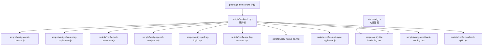
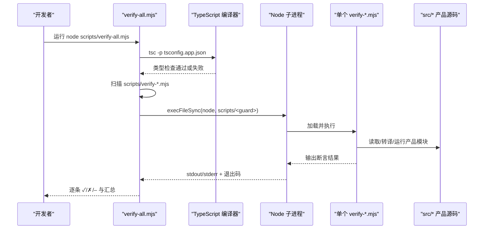
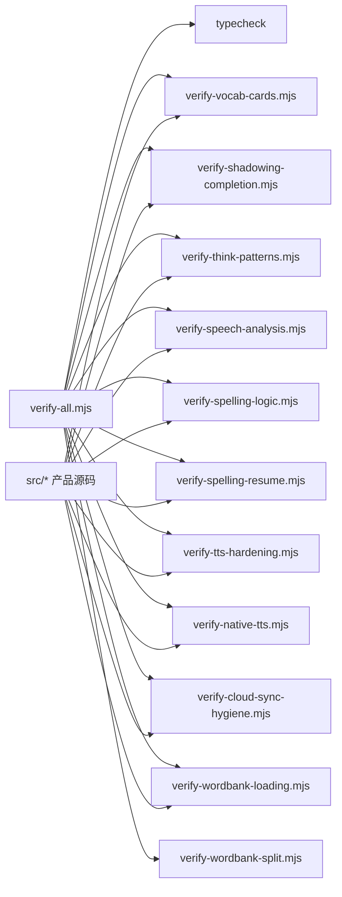

# 契约守卫体系

<cite>
**本文引用的文件**   
- [scripts/verify-all.mjs](file://scripts/verify-all.mjs)
- [package.json](file://package.json)
- [vite.config.ts](file://vite.config.ts)
- [scripts/verify-vocab-cards.mjs](file://scripts/verify-vocab-cards.mjs)
- [scripts/verify-shadowing-completion.mjs](file://scripts/verify-shadowing-completion.mjs)
- [scripts/verify-think-patterns.mjs](file://scripts/verify-think-patterns.mjs)
- [scripts/verify-speech-analysis.mjs](file://scripts/verify-speech-analysis.mjs)
- [scripts/verify-spelling-logic.mjs](file://scripts/verify-spelling-logic.mjs)
- [scripts/verify-spelling-resume.mjs](file://scripts/verify-spelling-resume.mjs)
- [scripts/verify-tts-hardening.mjs](file://scripts/verify-tts-hardening.mjs)
- [scripts/verify-native-tts.mjs](file://scripts/verify-native-tts.mjs)
- [scripts/verify-cloud-sync-hygiene.mjs](file://scripts/verify-cloud-sync-hygiene.mjs)
- [scripts/verify-wordbank-loading.mjs](file://scripts/verify-wordbank-loading.mjs)
- [scripts/verify-wordbank-split.mjs](file://scripts/verify-wordbank-split.mjs)
</cite>

## 目录

1. [引言](#引言)
2. [项目结构](#项目结构)
3. [核心组件](#核心组件)
4. [架构总览](#架构总览)
5. [详细组件分析](#详细组件分析)
6. [依赖关系分析](#依赖关系分析)
7. [性能与执行模型](#性能与执行模型)
8. [故障排查指南](#故障排查指南)
9. [自定义验证器开发指南](#自定义验证器开发指南)
10. [结论](#结论)

## 引言

NativeThink 的“契约守卫”是一组位于 `scripts/` 下的 Node.js 脚本，它们不是传统测试框架（如 Jest/Vitest）驱动的用例集合，而是围绕“产品真实源码 + TypeScript 转译 + Node 运行”构建的轻量回归防线。每个 `verify-*.mjs` 守护一个具体领域：词汇卡片、影子跟读、思维模式、语音分析、拼写逻辑、TTS 降级链、云同步卫生、词库加载与拆分等。

这套体系的核心思想是：**让断言直接钉住用户能感知到的行为契约，而不是只断言抽象 API**。例如：

- 词汇卡片不只是“手势函数返回某个值”，还要保证自动发音开关在多个页面共享同一持久化键、复习检测禁用滑动评分。
- 影子跟读不只是“完成数等于句数”，还要保证删除 AI 追加句后绿勾不会指错句子。
- TTS 加固不只是“合成成功”，还要证明并发请求只提交一次原生、首包不该等两次预取。
- 词库拆分不只是“数组长度对”，还要保证基线里标记与 detail 真值的分歧清单不被意外扩大。

`scripts/verify-all.mjs` 负责编排这些独立脚本，并强制跑全量。注释中明确记录了动机：改完一个模块只跑“自己那条”守卫，会让引用同一份源码的其他守卫悄悄失效；收尾跑全量是唯一能发现这种漂移的方式。

## 项目结构

契约守卫集中在 `scripts/` 目录中，按职责命名：

| 分类 | 脚本 | 守护目标 |
|---|---|---|
| 编排器 | `verify-all.mjs` | 收集所有 `verify-*.mjs`，统一输出通过/失败/跳过统计 |
| 词汇卡片 | `verify-vocab-cards.mjs` | 自动发音、懒加载 detail、背面信息层次、手势决策表、会话重排 |
| 影子跟读 | `verify-shadowing-completion.mjs` | 完成标记索引、删除 AI 追加句、AI 分析空串守卫、标注渲染 |
| 思维模式 | `verify-think-patterns.mjs` | 12 个模式、72 个内容项、答案均衡分布、体检题与选项说明 |
| 语音分析 | `verify-speech-analysis.mjs` | 意群边界、音量/爆音、停顿、基频、语速、页面接线 |
| 拼写逻辑 | `verify-spelling-logic.mjs` | 弯引号归一、token 切分、排队顺序、页面接线 |
| 拼写断点 | `verify-spelling-resume.mjs` | 按词书分键、旧键迁移、重置清理、自动朗读门控 |
| TTS 加固 | `verify-tts-hardening.mjs` | 原生线程池、JS 在途去重、预取顺序、设置面板网络卫生 |
| 原生 TTS | `verify-native-tts.mjs` | 插件代理挂死复现、超时兜底、英语音色选择、播放路径降级 |
| 云同步 | `verify-cloud-sync-hygiene.mjs` | 下行回声、订阅缓存失效、周期任务、双写处理器 |
| 词库加载 | `verify-wordbank-loading.mjs` | preloadLevels/map 陷阱、applyDetail 穿透、词书池子口径 |
| 词库拆分 | `verify-wordbank-split.mjs` | `--baseline` / `--check` 基线校验、标记与 detail 分歧清单 |



**图表来源**
- [scripts/verify-all.mjs:1-77](file://scripts/verify-all.mjs#L1-L77)
- [package.json:1-50](file://package.json#L1-L50)
- [vite.config.ts:1-120](file://vite.config.ts#L1-L120)

**章节来源**
- [scripts/verify-all.mjs:1-77](file://scripts/verify-all.mjs#L1-L77)
- [package.json:1-50](file://package.json#L1-L50)

## 核心组件

### 编排器：verify-all.mjs

`verify-all.mjs` 的职责很清晰：

1. 先跑 `tsc -p tsconfig.app.json` 做类型检查。
2. 扫描 `scripts/` 下所有以 `verify-` 开头、`.mjs` 结尾的文件，排除自身。
3. 对需要外部参数的脚本（目前只有 `verify-wordbank-split.mjs`）标记为跳过。
4. 对需要浏览器产物的脚本（目前只有 `verify-bundle-budget.mjs`）检查 `dist/client/index.html` 是否存在；不存在则跳过或根据 `--skip-build` 参数决定是否跳过。
5. 使用 `child_process.execFileSync` 逐个启动子进程运行脚本，捕获 stdout/stderr。
6. 用正则从输出中提取“通过”“失败”“✗”等关键行作为每条守卫的状态摘要。
7. 打印逐条结果和最终汇总，退出码 0 表示全部通过，否则为 1。

它不是并行执行器。当前实现是串行 for 循环，因为：

- 某些守卫会写入临时目录、修改模块缓存或依赖全局状态。
- 有些守卫本身已经内部并行（如 TTS 并发去重、云同步 3 秒防抖）。
- 错误报告需要稳定顺序，方便定位哪一条失败。

需要特别注意：**编排器并不真正并行调度 35+ 个脚本**；它是“一次性触发全部守卫”的统一入口，实际执行顺序由文件系统遍历排序决定。如果未来要引入并行，必须给每个守卫加隔离工作目录和互斥锁。

**章节来源**
- [scripts/verify-all.mjs:1-77](file://scripts/verify-all.mjs#L1-L77)
- [package.json:1-50](file://package.json#L1-L50)

## 架构总览



**图表来源**
- [scripts/verify-all.mjs:1-77](file://scripts/verify-all.mjs#L1-L77)

## 详细组件分析

### 词汇卡片验证器：verify-vocab-cards

该验证器守护背单词卡片和复习检测的交互契约，覆盖范围包括：

| 维度 | 断言要点 |
|---|---|
| 自动发音 | 定义持久化键、写入 safeStorage、默认开、localStorage 不可用时回退、多个页面共用同一键 |
| 懒加载 detail | 按 level 调用 preloadDetail，detail 到位后重新 findWord，依赖 detailTick 触发重渲染 |
| 背面信息层次 | 例句、搭配、近义、反义、词族、深度解释、语域、情感色彩、词频、主题标签 |
| 进度与正确率 | 按本轮会话计算、开始新会话清零已评数和正确数 |
| 手势决策 | 位移阈值、翻面、认识/不认识、已评分导航、复习检测禁用滑动评分 |
| 会话排卡 | 答错重排、RELEARN_GAP、MAX_RELEARN、下一张下标、按天预测 |

实现上，它用 TypeScript 编译器的 `transpileModule` 把纯函数源文件转成可执行 ESNext 模块，再动态 import 运行。这样测的是产品里那份实现，而不是用正则猜逻辑。

典型失败场景包括：

- 自动发音开关未接入某个页面，导致“共用此设置”是假话。
- 快速闪卡的自动朗读判断写在 tts.speak 之后，变成摆设。
- 复习检测仍允许左右滑动评分，违背用户反馈。
- 答错重排在评分瞬间插入队列，导致当前卡片位置被替换。
- 会话预测桶数量或边界处理不正确。

修复建议通常指向：

- 在所有相关页面统一读写 `__nativethink_vocab_autospeak`。
- 将自动朗读调用放在开关门控之后。
- 给复习检测传入 `allowRate: false`。
- 前进时再插回答错词，而不是评分时立即重排。
- 修正 `scheduleRelearn` 的插入点和最大重排次数。

**章节来源**
- [scripts/verify-vocab-cards.mjs:1-200](file://scripts/verify-vocab-cards.mjs#L1-L200)

### 影子跟读完成度验证器：verify-shadowing-completion

这个验证器针对一个非常具体的历史缺陷：完成键是 `${corpusId}-${合并索引}`，但删除按钮传的是 extras 的本地索引，删除路径又拿这个数字做合并索引位移，导致完成标记错位、100% 成就横幅永久消失。

验证器分为两段：

| 段落 | 职责 |
|---|---|
| A：真实纯函数行为 | 零依赖自检、键构造解析互逆、删除第一条追加句、删除中间追加句、跨语料隔离、清空当前语料、索引换算、非法键拒绝 |
| B：页面接线静态契约 | 删除传合并索引、不再传 extras 本地索引、完成键单点归属、AI 分析空串守卫、语音标注经 renderAnnotated、无 dangerouslySetInnerHTML |

它还有一个重要设计：**正对照**。比如，它会断言“若退回旧调用方式，100% 横幅确实会消失”。这比单纯断言“当前代码看起来正确”更有价值——它能区分“刚好计数碰巧相等”和“真正修好了语义”。

失败时常见的错误信息包括：

- 脚手架错误：shadowing-progress.ts 不再是零依赖模块。
- 删第一条追加句后完成数不等于新句数。
- 原句第 8 句标记丢失，标记整体错位。
- 页面仍手写模板键或传 extras 本地索引。
- AI 分析缺少空串前置守卫。
- 存在 dangerouslySetInnerHTML。

**章节来源**
- [scripts/verify-shadowing-completion.mjs:1-183](file://scripts/verify-shadowing-completion.mjs#L1-L183)

### 思维模式完整性验证器：verify-think-patterns

该验证器守护 `/think` 模式库的数据契约。规范定义了 12 个模式、四层元数据、每模式 3 道识别题 + 3 道迁移题，共 72 个内容项。验证器不仅检查数量，还检查：

- 模式 id 与预期完全一致，且唯一。
- 层 id 与预期完全一致，每层至少 2 个模式。
- 每个模式有名称、一句话原则、中英对比、线索。
- 每道识别题有题干、三个非空且不重复的选项、合法 answer、解释。
- 每道迁移题有 situation、rubricFocus、why、modelAnswer、thinkingSteps。
- 诊断题恰好 12 道，每个模式被抽到一次，choiceId 不重复。
- 固定顺序展示时，answer 下标 0/1/2 各 12 道，避免用户靠位置蒙对。
- 选项说明必须有 best/ok/off 三种 tone，且 best 只落在 answer。

实现上，它把 `src/data/think-patterns.ts` 用 `target: ES2022` 转译后动态导入，然后逐项断言。注释强调不能降到 ES5，因为展开/迭代会被静默替换成空替身。

失败时通常会列出缺失字段、重复 id、非法 layer、答案分布不均、选项说明 tone 不合法等问题。

**章节来源**
- [scripts/verify-think-patterns.mjs:1-200](file://scripts/verify-think-patterns.mjs#L1-L200)

### 语音分析逻辑验证器：verify-speech-analysis

该验证器守护离线跟读分析链路，包括：

| 子系统 | 断言 |
|---|---|
| 意群边界 | 逗号、分号、破折号、第一个连词、引号中的逗号、空句 |
| 音量与爆音 | 正常音量、太小、过载、全静音、dBFS 量级 |
| 停顿检测 | 20ms RMS 能量包络、0.4s 静音应检出、全静音不报停顿 |
| 基频检测 | 稳态中位频率、p10/p90 范围、上升趋势、尾段更高 |
| 综合分析 | 时长、语速、边界命中、空音频返回 null |
| 重采样与 WAV | 48kHz→16kHz、立体声混单声道、编码仍可用 |
| 页面接线 | SpeakBack 和 ShadowingPage 都走共享 analyzeBlob |

它通过拼接 speech-score、asr、wav、speech-analysis 的转译产物，构造一个可在 Node 中运行的模块，再用合成波形驱动断言。这样既能验证算法，又能验证页面是否还在各自维护第二份实现。

失败信息通常包含 JSON 化的实际结果，便于比较期望比例、停顿落点、语速标签等数值。

**章节来源**
- [scripts/verify-speech-analysis.mjs:1-186](file://scripts/verify-speech-analysis.mjs#L1-L186)

### 拼写功能逻辑验证器：verify-spelling-logic

该验证器守护句子拼写的词形归一、判分、排队和页面接线。历史缺陷包括：

1. 弯引号 U+2019 被 `[^\x20-\x7E]` 类剥掉，`It’s` 变成 `Its`。
2. `importDirty` effect 依赖每次都会换身份的 `rebuildSession`，导致每答一题重建队列。
3. `buildSessionQueue` 先 markServed 整池再由页面 slice，一本 6827 句的词书点一次排队就破坏排序。

验证器覆盖：

- `normalizeSpellingWord`、`spellingTokens`、`getSpellingWords`、`normalizeSpellingAnswer`、`shuffledCopy`。
- 弯引号归一、数字 token、省略号、重音字母、长破折号、所有格尾撇号。
- 排队顺序：到期最老优先 → 从未出过 → 出过最久未出。
- 轮次截断发生在纯函数内，而非页面 slice。
- 页面不再用旧的字符剥离正则，填空切分与 token 列表同源。
- 切换模式/切句时取消 TTS 和逐词串播定时器。
- 完成界面只保留完成页，不再同时显示练习卡。

**章节来源**
- [scripts/verify-spelling-logic.mjs:1-191](file://scripts/verify-spelling-logic.mjs#L1-L191)

### 拼写断点续学验证器：verify-spelling-resume

该验证器守护拼写断点的“按词书分键”设计。旧实现使用全局键 `__nativethink_spelling_resume`，只能记住一本书；A 书练到第 20 句，切 B 书练 3 句，回到 A 书位置丢失。

验证器覆盖：

| 场景 | 断言 |
|---|---|
| 读写往返 | persistResume 与 readResumeIndex 互逆 |
| 跨书互不覆盖 | cet4=20、gaokao=3 并存 |
| 旧全局键迁移 | activeLevel 搬到对应 level 的键，并删除旧键 |
| 迁移不覆盖已有新数据 | 新数据优先 |
| 坏 JSON 与非法下标 | 不抛错，按无断点处理 |
| 重置清理 | 按前缀枚举清干净，不留“上一本”指针 |
| 页面接线 | 只通过 spelling-resume 模块读写，200ms 防抖，fill 模式不自动朗读 |

它注入 Map 实现的忠实替身存储，避免依赖真实 safeStorage 或 localStorage。

**章节来源**
- [scripts/verify-spelling-resume.mjs:1-155](file://scripts/verify-spelling-resume.mjs#L1-L155)

### TTS 降级链验证器：verify-tts-hardening

该验证器守护 TTS 加固的两条不变量：

| 层面 | 不变量 |
|---|---|
| 原生侧 | 不再每次 `new Thread(...).start()`，改用有界线程池与队列上限，模型加载走独立 worker |
| JS 侧 | 相同文本并发合成只在途去重一次，命中缓存不重复提交原生 |

它还验证：

- 并发 5 次相同文本只提交原生 1 次。
- 重复调用命中缓存。
- 不同文本各自提交。
- 空闲时在途计数为 0。
- 设置面板只在桌面端请求 `/api/tts-voices`。
- piper 分支“本片先入队，预取排在后面”，避免首包等两次合成。
- 背压门槛用 `sherpaInFlightCount() <= 1`，不是 `=== 0`。

它通过替换 Capacitor、safeStorage、sonner、tts-voice-catalog 的 import，并用 globalThis 注入 fakePlugin，使 sherpa-tts 在 Node 中可运行。

**章节来源**
- [scripts/verify-tts-hardening.mjs:1-200](file://scripts/verify-tts-hardening.mjs#L1-L200)

### 原生 TTS 边界验证器：verify-native-tts

该验证器针对 Android 原生插件 Proxy 的一个隐蔽问题：`getNativeTts()` 是 async 函数，旧实现直接 `return (mod as any).TextToSpeech ?? null`，Proxy 对象满足 Promise 同化条件，于是 `plugin.then(resolve, reject)` 被当成原生方法调用，而原生没有 then，Promise 永久 pending。

验证器覆盖：

| 阶段 | 断言 |
|---|---|
| A：脚手架自证 | Proxy 任意属性都是函数，async 直接 return 对象会永久 pending |
| B：修复后模块真跑 | getNativeTts 1s 内 settle，listNativeVoices 返回 3 条，默认选本地英语音色 |
| C：超时兜底 | 原生装死后 listNativeVoices 由超时兜成空数组，后续恢复调用不受影响 |
| D：静态契约 | 不再直接 return 插件对象，调用点解构持有者，自检带超时 |
| E：hasEnglishVoice | 引擎装死时超时返回 false，空列表不钉死缓存，非空结果缓存复用 |
| F：播放路径降级 | 先看引擎有没有英语音色，再决定是否猜沉默；看门狗预算随句长放大 |

守卫自带 45 秒整体超时，防止实现回到“永久挂死”形状时把整个 verify:all 拖住。

**章节来源**
- [scripts/verify-native-tts.mjs:1-200](file://scripts/verify-native-tts.mjs#L1-L200)

### 云同步数据一致性验证器：verify-cloud-sync-hygiene

该验证器守护云同步三条不变量：

1. **下行回声**：syncDown 落地 safeStorage 后不应触发双写处理器 POST 回云端。
2. **失败全静默**：catch 块、syncing/lastSync 状态消费需符合预期。
3. **周期任务**：不应无条件每 5 分钟全量 syncUp。

后续又覆盖：

4. 模块级缓存库在 syncDown 订阅重读前先作废缓存。
5. 订阅者清单与全仓 useSyncDown 调用处动态比对，抓住漏登记和把定义算进去两类错误。
6. 两个无条件回写 effect 必须配完整回声守卫。

实现上，它把 `use-cloud-sync.ts`、`safe-storage.ts`、`sync-down.ts` 及相关库一起转译，替换 react、auth、api-client、sonner、safe-storage、sync-down 的外部依赖，然后在 Node 中驱动真实逻辑。

失败信息会指出哪些 POST 不应该发生、哪些订阅没收到事件、哪些缓存没有被作废。

**章节来源**
- [scripts/verify-cloud-sync-hygiene.mjs:1-200](file://scripts/verify-cloud-sync-hygiene.mjs#L1-L200)

### 词库加载验证器：verify-wordbank-loading

该验证器是运行时集成验证，补上数据层断言无法覆盖的链路：

| 链路 | 断言 |
|---|---|
| preloadCoreOnly | 不加载 detail，queryWords 返回词条 detail 为空占位 |
| preloadLevels | map 陷阱修复：第一个等级索引 0 也要加载 detail |
| applyDetail | 就地补齐穿透到 queryWords 返回的共享引用 |
| hasCollocations | detail 加载后恒等于 collocations.length > 0 |
| 加载失败 | 不向上抛错，isDetailReady 保持 false，核心查询仍可用 |
| 重试语义 | 失败模块被模块表缓存，UI 应给刷新页面而非原地重试 |
| 池子口径 | 每本书的唯一词数与 meta.WORD_COUNTS 同源，“全部”是跨书唯一词数 |

它桩掉 IndexedDB，补齐动态导入扩展名，并把所有 level 的 core/detail 数据一起转译运行。

**章节来源**
- [scripts/verify-wordbank-loading.mjs:1-200](file://scripts/verify-wordbank-loading.mjs#L1-L200)

### 词库拆分验证器：verify-wordbank-split

该验证器用于词库 detail 拆分前后的基线校验，支持两种模式：

| 模式 | 用法 | 作用 |
|---|---|---|
| 采集基线 | `node scripts/verify-wordbank-split.mjs --baseline <out.json>` | 拆分前记录条目数、顺序、hasCollocations、collocOnlyIds、divergences |
| 校验 | `node scripts/verify-wordbank-split.mjs --check <in.json>` | 逐项断言当前数据与基线一致 |

它特别重视“标记与 detail 真值的分歧清单”。对于重复词条，core 里逐条写标记，detail 里按词键只能留一份，两者必然存在有限且可解释的分歧。脚本把这些分歧也钉进基线，新增一条就是新坏数据。

失败信息会列出：

- 条目数变化。
- 词条顺序变化。
- hasCollocations 位置不一致。
- divergences 清单多出一条。
- 核心文件仍含真实 detail。
- 缺少 `.detail.ts`。
- collocOnly 结果集变化。

**章节来源**
- [scripts/verify-wordbank-split.mjs:1-200](file://scripts/verify-wordbank-split.mjs#L1-L200)

## 依赖关系分析



**图表来源**
- [scripts/verify-all.mjs:1-77](file://scripts/verify-all.mjs#L1-L77)

### 耦合与内聚

- 高内聚：每个 verify 脚本聚焦一个用户可感知的契约，失败信息通常能直接定位到具体缺陷。
- 低耦合：编排器不关心单个守卫的内部实现，只依赖其退出码和标准输出。
- 间接依赖：多数守卫依赖 TypeScript 编译器做源码转译，从而避免正则误匹配。
- 外部边界：所有需要浏览器/Native 能力的守卫都用桩替身隔离，确保能在 Node 中运行。

### 潜在循环依赖

当前守卫之间没有互相 import，因此不存在代码级循环依赖。但它们共同依赖同一份 `src/*` 源码，这正是 `verify-all.mjs` 要求全量运行的原因：局部运行可能漏掉跨守卫暴露的漂移。

**章节来源**
- [scripts/verify-all.mjs:1-77](file://scripts/verify-all.mjs#L1-L77)

## 性能与执行模型

### 串行执行

`verify-all.mjs` 使用 for 循环串行运行守卫，而不是并行。这对调试更友好，也能避免多个守卫同时写临时文件或竞争全局状态。

### 内部并行

部分守卫内部会使用并发策略：

- TTS 并发去重：5 个相同文本请求只提交原生一次。
- 云同步防抖：3 秒双写延迟。
- 原生 TTS 超时：45 秒守卫整体超时。

这些并发不在编排层控制，而在各自守卫内部模拟真实环境。

### 构建依赖

`NEEDS_BUILD` 列表目前只有 `verify-bundle-budget.mjs`，它会检查 dist/client 产物。其他守卫大多只需源码，不需要完整构建。

### Vite 构建流程中的集成

Vite 配置主要提供 dev server、代理、HTML 占位符替换和 chunk 拆分，并没有直接在构建钩子里挂载契约守卫。契约守卫通过 npm scripts 和 `verify-all.mjs` 独立运行，适合放在 CI 或手动收尾流程中。

不过，Vite 配置中关于 `CLIENT_BASE_PATH`、工厂 API Key、版本号、代理路径等信息，会影响某些守卫所依赖的产品行为，因此改动 vite.config.ts 时应配合运行相关守卫。

**章节来源**
- [scripts/verify-all.mjs:1-77](file://scripts/verify-all.mjs#L1-L77)
- [vite.config.ts:1-200](file://vite.config.ts#L1-L200)

## 故障排查指南

### verify-all 全部跳过

可能原因：

- 当前没有 dist/client 产物，且触发了 NEEDS_BUILD 守卫。
- 运行了 `--skip-build`，导致依赖构建的守卫被跳过。
- 没有安装 node_modules，`execFileSync` 找不到 typescript/bin/tsc。

排查步骤：

1. 确认 `node scripts/verify-all.mjs` 是否报错。
2. 若提示 bundle-budget 需要构建，先运行 `npm run build:web`。
3. 单独运行失败的守卫，查看其 stdout/stderr。

### 某守卫一直红

通用排查顺序：

1. 阅读该守卫开头的注释，理解它守护的具体历史缺陷。
2. 查看失败断言名称和 detail 输出。
3. 确认守卫是否依赖 Node 环境可用的 TypeScript、fs、path、url 等模块。
4. 检查守卫是否因“脚手架错误”提前退出（exit 2），这意味着替身替换失败，而不是产品逻辑失败。

### 脚手架错误 exit 2

常见原因：

- 未替换的 import 残留。
- 源文件 import 形状变化，桩替换匹配不到。
- 导出的函数名变了。
- 转译目标太旧，ESNext 语法被静默降级。

修复建议：

- 更新守卫中的字符串替换规则，使其匹配新的 import 形状。
- 不要为了过断言而删除必要的 import。
- 保持 target 为 ES2020 或 ES2022，避免展开/迭代退化。

### 云同步守卫慢

这是预期行为：它包含两次约 3 秒的防抖等待，总耗时约 10 秒。不要把它当成 hang。

### TTS 守卫卡死

verify-native-tts 自带 45 秒守卫超时，如果实现回到“永久 pending”形状，会主动退出并报告失败。若整个 verify:all 仍卡住，检查是否有其他守卫引入了同样形状的 Promise 同化问题。

**章节来源**
- [scripts/verify-all.mjs:1-77](file://scripts/verify-all.mjs#L1-L77)
- [scripts/verify-cloud-sync-hygiene.mjs:1-200](file://scripts/verify-cloud-sync-hygiene.mjs#L1-L200)
- [scripts/verify-native-tts.mjs:1-200](file://scripts/verify-native-tts.mjs#L1-L200)

## 自定义验证器开发指南

### 何时创建新守卫

当出现以下情况时，应考虑新增 `scripts/verify-xxx.mjs`：

1. 用户能感知到 bug，但静态类型检查抓不住。
2. 缺陷是多个页面共享同一状态或键造成的。
3. 修复涉及“接口看起来正确，但接线语义不对”。
4. 需要运行真实模块图，而不仅仅是单元测试纯函数。
5. 需要守护数据结构的不变量，例如 12 个模式、72 个内容项、跨书唯一词数。

### 基本结构

推荐结构：

```text
// 1. 文件头注释
//    - 守护目标
//    - 历史缺陷
//    - 用法
//    - 退出码约定

// 2. 初始化
//    - ROOT、TMP 目录
//    - results、ok 工具
//    - 临时目录清理

// 3. 替身/桩
//    - 替换浏览器 API、Capacitor、react、storage 等外部依赖
//    - 保留业务逻辑不变

// 4. 转译与加载
//    - ts.transpileModule(target: ES2020/ES2022)
//    - 动态 import(pathToFileURL)

// 5. 断言分组
//    - A 段：真实纯函数行为
//    - B 段：页面接线静态契约
//    - 每组带正对照

// 6. 汇总
//    - 输出失败列表
//    - process.exit(0 或 1)
```

### 最佳实践

| 实践 | 说明 |
|---|---|
| 用 transpileModule 真跑 | 比正则更安全，能捕获导出名、语法、类型注解带来的真实错误 |
| 目标版本设为 ES2020 或 ES2022 | 避免 ES5 下展开/迭代静默退化 |
| 始终清理临时目录 | 使用 `process.env.TEMP || '/tmp'`，并在开始前 rmSync |
| 保留正对照 | 证明守卫能区分“旧错误”和“新正确” |
| 区分脚手架错误与产品错误 | 脚手架错误用 exit 2，产品错误用 exit 1 |
| 不要吞掉异步异常 | 用 withDeadline 或 try/catch 明确失败语义 |
| 输出结构化失败信息 | name + detail，方便 grep 定位 |
| 避免污染全局状态 | 如需全局桩，显式 reset |
| 对外部依赖做最小桩 | 只替换必要 API，不重写业务逻辑 |
| 把数据契约写进注释 | 让维护者知道为什么 12 个模式、72 个内容项是硬约束 |

### 添加到 verify-all

新守卫默认会被 `verify-all.mjs` 发现，无需手动注册。但如果它需要：

- 外部参数：加入 `NEEDS_ARGS`。
- 构建产物：加入 `NEEDS_BUILD`。
- npm script：在 package.json 中添加 `verify:xxx`。

### 与 Vite 的关系

契约守卫不是 Vite 插件，也不依赖 Vite 运行时的 React/HMR。它们更像是“源码级集成回归脚本”。Vite 的作用主要是构建前端应用；契约守卫的作用是守护源码契约。二者互补：Vite 管“能不能打包”，契约守卫管“打包出来的东西是否符合用户契约”。

**章节来源**
- [scripts/verify-all.mjs:1-77](file://scripts/verify-all.mjs#L1-L77)
- [scripts/verify-shadowing-completion.mjs:1-183](file://scripts/verify-shadowing-completion.mjs#L1-L183)
- [scripts/verify-spelling-resume.mjs:1-155](file://scripts/verify-spelling-resume.mjs#L1-L155)
- [scripts/verify-native-tts.mjs:1-200](file://scripts/verify-native-tts.mjs#L1-L200)

## 结论

NativeThink 的契约守卫体系是一套以源码为中心、以用户契约为边界的轻量回归防线。它不追求测试覆盖率指标，而是追求“真实缺陷能被复现、修复能被证明、旧错误不会被悄悄恢复”。

`verify-all.mjs` 的价值在于强制全量运行，防止局部守卫绿但全局契约漂移。各个专项守卫的价值在于把模糊的用户体验转化为明确的断言：手势该不该评分、完成标记该不该位移、TTS 并发该不该去重、云同步该不该产生回声、词库池子该不该按书内唯一词数计算。

未来扩展时，建议继续遵循以下原则：

- 每个守卫守护一个可命名的契约。
- 每个失败断言都能指向具体修复方向。
- 每个守卫都能在没有浏览器/Native 环境的 Node 中运行。
- 每个复杂行为都有正对照，证明守卫不是恒真。
- 每个数据不变量都要写成断言，而不是只写文档。