# 开发辅助工具

<cite>
**本文引用的文件**
- [scripts/dev.mjs](file://scripts/dev.mjs)
- [vite.config.ts](file://vite.config.ts)
- [scripts/serve.cjs](file://scripts/serve.cjs)
- [server/local-server.mjs](file://server/local-server.mjs)
- [scripts/build.sh](file://scripts/build.sh)
- [scripts/pack-app.mjs](file://scripts/pack-app.mjs)
- [scripts/bump-android-version.cjs](file://scripts/bump-android-version.cjs)
- [android/version.properties](file://android/version.properties)
- [scripts/verify-bundle-budget.mjs](file://scripts/verify-bundle-budget.mjs)
- [scripts/verify-app-version.mjs](file://scripts/verify-app-version.mjs)
- [scripts/git-push-onto-remote.cjs](file://scripts/git-push-onto-remote.cjs)
- [scripts/git-push-via-api.mjs](file://scripts/git-push-via-api.mjs)
- [package.json](file://package.json)
</cite>

## 目录
1. [简介](#简介)
2. [项目结构](#项目结构)
3. [核心组件](#核心组件)
4. [架构总览](#架构总览)
5. [详细组件分析](#详细组件分析)
6. [依赖关系分析](#依赖关系分析)
7. [性能考量](#性能考量)
8. [故障排查指南](#故障排查指南)
9. [结论](#结论)

## 简介
NativeThink 的开发辅助工具围绕“本地开发体验、构建产物质量、多端打包、版本治理与远程推送”五个方面展开。核心目标包括：
- 提供带端口清理、日志聚合、子进程组管理的开发服务器增强入口。
- 通过 Vite 代理把 `/api/*` 请求转发到线上 Pages Functions，使本机调试行为与线上一致。
- 提供两类本地服务器：面向已构建产物的轻量静态服务器，以及面向 Electron 桌面端的完整本地 API 服务器。
- 统一构建流程，支持 Cloudflare Pages 与 Miaoda 双输出模式，并拆分 HTML、资源与静态数据。
- 生成 Windows 桌面应用包与 Capacitor Android APK，同时自动递增 Android 版本号。
- 用预算检查与版本一致性校验脚本守住首屏体积与版本链路质量。
- 在网络受限环境下通过 GitHub API 安全推送代码变更。

## 项目结构
开发相关脚本集中在 `scripts/`，Electron 主进程在 `electron/`，本地 API 服务在 `server/`，Vite 配置在根目录 `vite.config.ts`，Android 版本信息在 `android/version.properties`。

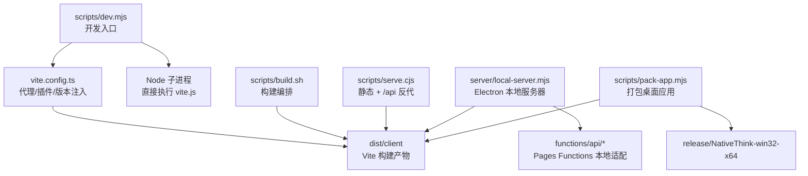

**图表来源**
- [scripts/dev.mjs:1-130](file://scripts/dev.mjs#L1-L130)
- [vite.config.ts:1-246](file://vite.config.ts#L1-L246)
- [scripts/build.sh:1-69](file://scripts/build.sh#L1-L69)
- [scripts/serve.cjs:1-74](file://scripts/serve.cjs#L1-L74)
- [server/local-server.mjs:1-731](file://server/local-server.mjs#L1-L731)
- [scripts/pack-app.mjs:1-108](file://scripts/pack-app.mjs#L1-L108)

**章节来源**
- [scripts/dev.mjs:1-130](file://scripts/dev.mjs#L1-L130)
- [scripts/build.sh:1-69](file://scripts/build.sh#L1-L69)
- [scripts/serve.cjs:1-74](file://scripts/serve.cjs#L1-L74)
- [server/local-server.mjs:1-731](file://server/local-server.mjs#L1-L731)
- [scripts/pack-app.mjs:1-108](file://scripts/pack-app.mjs#L1-L108)
- [vite.config.ts:1-246](file://vite.config.ts#L1-L246)
- [package.json:1-130](file://package.json#L1-L130)

## 核心组件
| 组件 | 作用 | 关键特性 |
|---|---|---|
| 开发入口 `scripts/dev.mjs` | 启动 Vite 开发服务器，管理子进程和端口孤儿 | 时间戳日志、端口占用清理、信号清理、进程组退出 |
| 构建编排 `scripts/build.sh` | 执行 Vite 构建并按部署平台拆分输出 | 环境变量驱动 base/CDN、Cloudflare Pages 模式、Miaoda 模式 |
| 静态服务器 `scripts/serve.cjs` | 提供已构建 SPA 的静态服务与 `/api/*` 反向代理 | 单文件 Node 实现、SPA fallback、上游错误处理 |
| 本地 API 服务器 `server/local-server.mjs` | Electron 桌面端本地后端 | 静态文件服务、Functions 路由适配、KV JSON 模拟、TTS、缓存与压缩 |
| 桌面打包脚本 `scripts/pack-app.mjs` | 生成 Windows 桌面应用 | 复用已有 web 构建、硬链接复制运行时、生产依赖收集 |
| Android 版本自增 `scripts/bump-android-version.cjs` | 每次打 APK 前递增 `versionCode` 与 `versionName.patch` | 语义化版本、保留 major/minor |
| Bundle 预算检查 `scripts/verify-bundle-budget.mjs` | 防止重依赖进入首屏 | 递归静态依赖图、gzip 预算、按需加载断言 |
| 应用版本验证 `scripts/verify-app-version.mjs` | 保证版本链单一载体且注入正确 | 源/注入/载体/消费端到端检查 |
| 远程推送工具 | 在远端 main 被推进时追加提交或走 API 推送 | 冲突保护、SHA 校验、dry-run 自检 |

**章节来源**
- [scripts/dev.mjs:1-130](file://scripts/dev.mjs#L1-L130)
- [scripts/build.sh:1-69](file://scripts/build.sh#L1-L69)
- [scripts/serve.cjs:1-74](file://scripts/serve.cjs#L1-L74)
- [server/local-server.mjs:1-731](file://server/local-server.mjs#L1-L731)
- [scripts/pack-app.mjs:1-108](file://scripts/pack-app.mjs#L1-L108)
- [scripts/bump-android-version.cjs:1-27](file://scripts/bump-android-version.cjs#L1-L27)
- [scripts/verify-bundle-budget.mjs:1-111](file://scripts/verify-bundle-budget.mjs#L1-L111)
- [scripts/verify-app-version.mjs:1-94](file://scripts/verify-app-version.mjs#L1-L94)

## 架构总览
NativeThink 的开发流水线分为四层：

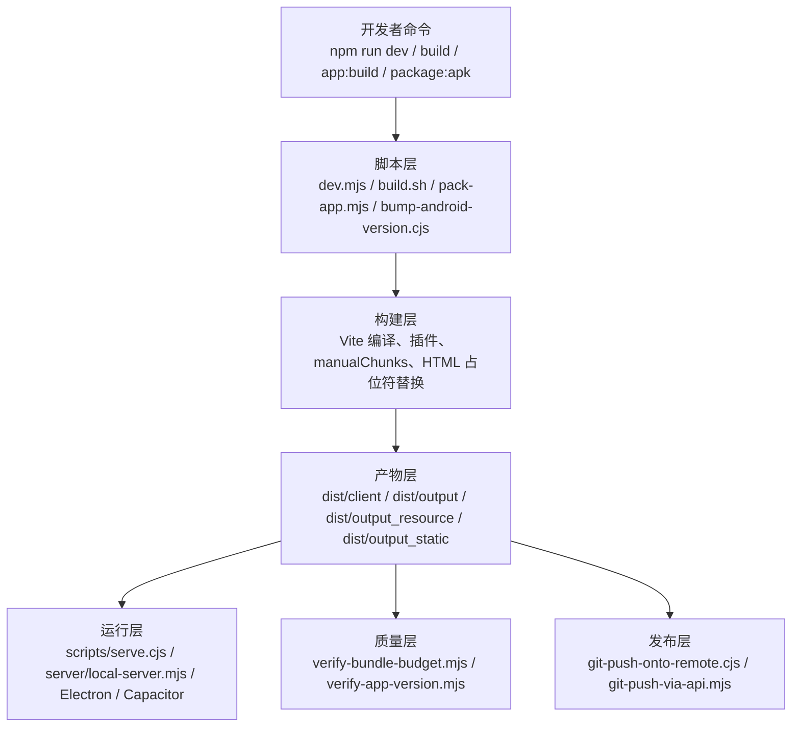

**图表来源**
- [package.json:1-130](file://package.json#L1-L130)
- [scripts/dev.mjs:1-130](file://scripts/dev.mjs#L1-L130)
- [scripts/build.sh:1-69](file://scripts/build.sh#L1-L69)
- [scripts/pack-app.mjs:1-108](file://scripts/pack-app.mjs#L1-L108)
- [scripts/verify-bundle-budget.mjs:1-111](file://scripts/verify-bundle-budget.mjs#L1-L111)
- [scripts/verify-app-version.mjs:1-94](file://scripts/verify-app-version.mjs#L1-L94)

## 详细组件分析

### 开发服务器增强功能：`scripts/dev.mjs` 与 `vite.config.ts`

`scripts/dev.mjs` 是 NativeThink 的本地开发入口。它不依赖 `npx`，而是直接用当前 Node 执行 `node_modules/vite/bin/vite.js`，从而避免 Windows 下 `npx.cmd` 导致的 ENOENT。它负责：
- 创建 `logs/` 目录，并为每个子进程写入带时间戳的日志。
- 启动 Vite 开发服务器，监听 `CLIENT_DEV_PORT`（默认 8001），绑定 `0.0.0.0`。
- 启动前扫描并杀掉占用端口的孤儿进程。
- 将 stdout/stderr 管道到控制台和日志文件。
- 处理 `SIGINT`、`SIGTERM`、`SIGHUP`，向子进程组发送终止信号，并在超时后强制杀死残留进程。
- 当任意子进程退出时触发清理。

`vite.config.ts` 在此基础上补充了开发期能力：
- **内置离线模型服务**：中间件把 `models-bundled/` 暴露为 `/models/`，供浏览器加载 transformers 所需的小模型。
- **工厂 API Key 注入**：从 `scripts/.apikey` 读取一行文本，作为 `__FACTORY_API_KEY__` 注入到客户端；文件不存在时允许空值。
- **虚拟模块 mock**：把 `virtual:capabilities` 解析为空对象，并在动态 import 处替换为 `Promise.resolve({ default: {} })`，用于非 Lark 平台构建。
- **HTML 占位符替换**：替换 `{{appName}}`、`{{appDescription}}`、`{{appAvatar}}`、`{{appVersion}}`，并移除平台专属监控与分析脚本。
- **应用版本读取**：优先读 `android/version.properties` 中的 `versionName`，否则抛出错误阻止构建；最终通过 `fixHtmlPlaceholders` 写入 `index.html` 的 `<meta name="app-version">`。
- **跨域隔离头**：设置 `Cross-Origin-Opener-Policy: same-origin` 与 `Cross-Origin-Embedder-Policy: credentialless`，启用多线程 WASM 并允许跨域图片/音频。
- **开发 watch 忽略**：忽略 `android/`、`release/`、`dist/`、`models-bundled/`、`logs/`、`.apk`，避免大目录与构建中文件导致 EBUSY 或 dev server 崩溃。
- **API 代理**：把 `/api/tts`、`/api/auth`、`/api/data`、`/api/ai`、`/api/word-image`、`/api/gutenberg`、`/api/wikipedia`、`/api/bilibili-*` 等代理到 `https://nativethink.pages.dev`，并开启 `changeOrigin`。

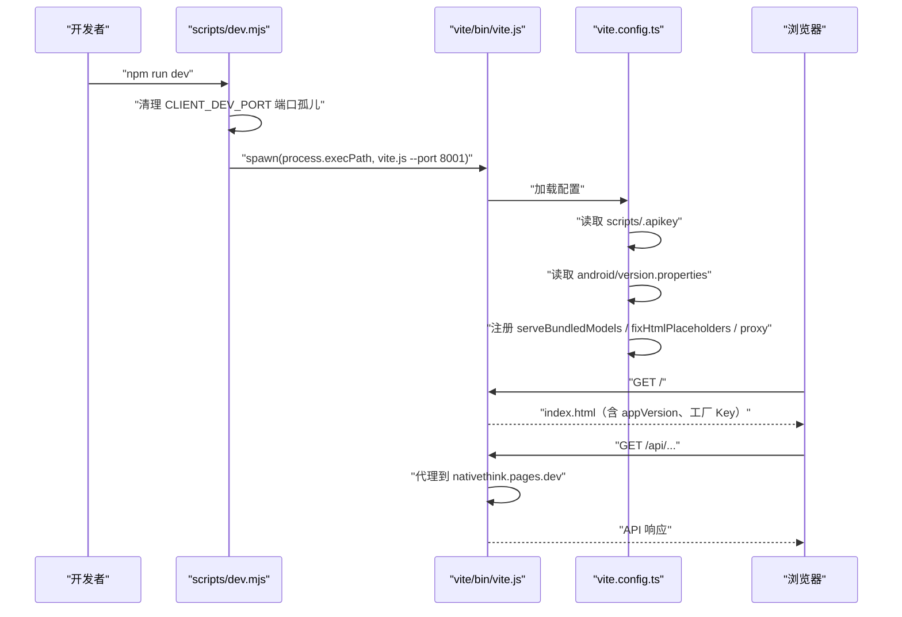

**图表来源**
- [scripts/dev.mjs:1-130](file://scripts/dev.mjs#L1-L130)
- [vite.config.ts:1-246](file://vite.config.ts#L1-L246)

**章节来源**
- [scripts/dev.mjs:1-130](file://scripts/dev.mjs#L1-L130)
- [vite.config.ts:1-246](file://vite.config.ts#L1-L246)

### 本地服务器：`scripts/serve.cjs` 与 `server/local-server.mjs`

两者都提供静态文件服务，但职责不同：

| 对比项 | `scripts/serve.cjs` | `server/local-server.mjs` |
|---|---|---|
| 定位 | 对已构建产物的轻量静态服务器 | Electron 桌面端完整本地服务器 |
| 静态路径 | `dist/client` | 可配置的 `distDir`，默认由 Electron 传入 |
| API 行为 | `/api/*` 反向代理到 `NT_API_ORIGIN`（默认 `https://nativethink.pages.dev`） | 把 `functions/api/**` 适配为 Node 可运行的 Pages Function，并模拟 KV、JWT、TTS、Wikipedia、B站等接口 |
| 错误处理 | 上游断流时检测 `headersSent`，避免写重复响应头 | 返回 404/403/502，并对 TTS 失败做 Edge→SAPI→远端 TTS 降级 |
| 缓存策略 | 无特殊缓存控制 | 哈希资源 `immutable`，HTML `no-cache`，可选 gzip 压缩 |
| WebSocket | 未实现 | 未显式实现 WebSocket，但可作为本地 API 宿主承载需要长连接的业务 |
| 适用场景 | 本机验收已构建 SPA 的静态访问与 API 调用 | Electron 桌面端零网络依赖运行全部前端 + 本地后端 |

#### `scripts/serve.cjs` 的行为
- 默认端口 8001，根目录 `dist/client`。
- `/api/*` 请求使用 `http`/`https` 模块原样转发到 `NT_API_ORIGIN`，并透传方法与头部。
- 非文件请求回退到 `index.html`，支持 SPA 路由。
- 上游代理错误时返回 502 JSON，避免破坏整个静态服务。

#### `server/local-server.mjs` 的关键能力
- **静态文件服务**：支持 HTML、JS、CSS、JSON、字体、图片、WASM、Map、TXT 等 MIME；对哈希文件名设置长期缓存。
- **路径穿越防护**：拒绝不在 `distDir` 下的路径。
- **Gzip 压缩**：对 JS/CSS/SVG/JSON/HTML/TXT/Map 且大于 1KB 的资源按客户端 `Accept-Encoding` 返回 gzip。
- **KV 模拟**：`LocalKV` 类基于 `dataDir/kv.json` 实现 get/put/delete/list，带写节流与 flush。
- **JWT 密钥**：自动生成 `dataDir/jwt-secret.txt`，权限 0o600。
- **函数路由表**：把 `/api/ai/chat`、`/api/auth/login`、`/api/auth/register`、`/api/auth/me`、`/api/data/sync`、`/api/tts`、`/api/wikipedia`、`/api/word-image`、`/api/gutenberg`、`/api/bilibili-*` 映射到 `functions/api/**`。
- **环境变量注入**：优先取 `process.env`，再回退 `dataDir/server-config.json`；支持 `SERVER_AI_KEY`、`FEISHU_WEBHOOK_URL`、`AI_KEY_DEEPSEEK`、`AI_KEY_DOUBAO`、`AI_KEY_QWEN`、`AI_KEY_GLM`、`AI_KEY_SILICONFLOW`、`AI_KEY_MOONSHOT`、`AI_KEY_GROQ`、`BILIBILI_COOKIE`。
- **系统代理**：可选通过 `undici.ProxyAgent` 转发出站请求，解决 Wikipedia/Google TTS 受限问题。
- **本地 TTS**：
  - Edge 在线语音：通过 `msedge-tts` 合成 MP3，按 voice 建立持久连接，出错重建。
  - Windows SAPI：通过 PowerShell 调用 System.Speech 合成 WAV。
  - 语音列表：枚举 SAPI 语音并与内置 Edge 语音合并排序。
  - 并发去重：相同 text/rate/voice 只合成一次，结果缓存到 `dataDir/tts-cache`。
  - 降级链：Edge 失败 → SAPI 本地 WAV → 远端 `/api/tts`。
- **离线小模型**：`/models/*` 优先从 `models-bundled/` 读取，不存在则 404，让前端回退远程。

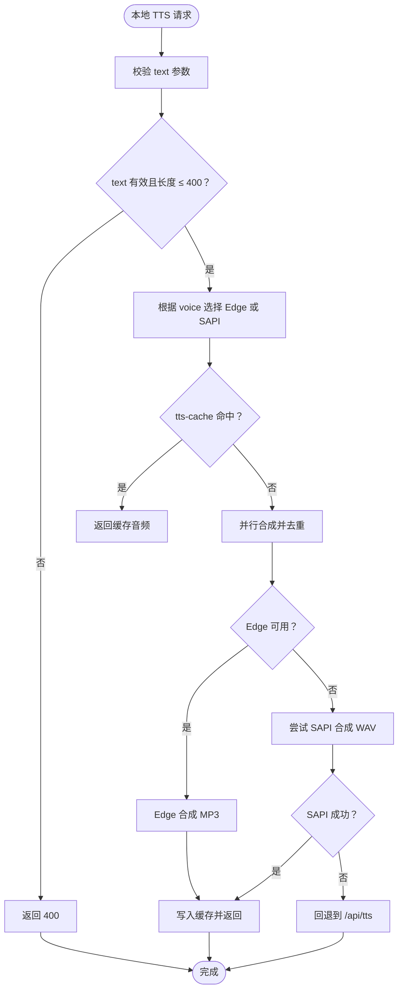

**图表来源**
- [server/local-server.mjs:201-731](file://server/local-server.mjs#L201-L731)

**章节来源**
- [scripts/serve.cjs:1-74](file://scripts/serve.cjs#L1-L74)
- [server/local-server.mjs:1-731](file://server/local-server.mjs#L1-L731)

### 构建脚本：`scripts/build.sh`

`scripts/build.sh` 是跨平台的构建编排脚本，主要步骤如下：

1. 设置 `MSYS_NO_PATHCONVERSION=1` 修复 Git Bash 路径转换。
2. 计算根目录、输出目录：`dist/output`、`dist/output_resource`、`dist/output_static`。
3. 导出环境变量：
   - `CLIENT_BASE_PATH`：如果存在 `MIAODA_APP_ID`，则设为 `/app/$MIAODA_APP_ID`。
   - `ASSETS_CDN_PATH`：默认 `/`，可由 `MIAODA_RESOURCE_CDN_PREFIX` 覆盖。
   - `STATIC_ASSETS_BASE_URL`：由 `MIAODA_STATIC_CDN_PREFIX` 提供。
   - `NODE_ENV`：默认 `production`。
4. 删除旧 `dist/`。
5. 执行 `npx vite build --outDir dist/client --emptyOutDir`，输出由 `vite.config.ts` 的 `base` 决定。
6. 复制 `index.html` 为 `404.html`，适配 Cloudflare Pages 与 Vercel 的 SPA fallback。
7. 如果 `CF_PAGES=1`，直接进入 Cloudflare Pages 模式，只输出 `dist/client/`。
8. 否则进入 Miaoda 模式：
   - HTML 与 `routes.json` 复制到 `dist/output/`。
   - `assets/` 复制到 `dist/output_resource/`。
   - `shared/static/` 同步到 `dist/output_static/`，排除 TS/TSX/JS/JSX。
   - `shared/capabilities/` 复制到 `dist/output_capabilities/`。

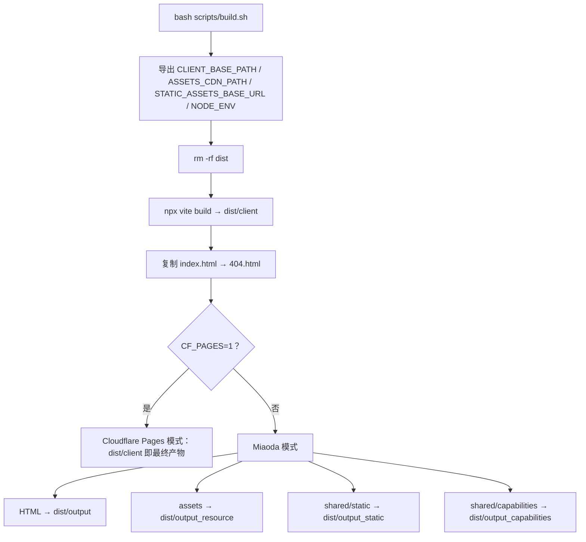

**图表来源**
- [scripts/build.sh:1-69](file://scripts/build.sh#L1-L69)

**章节来源**
- [scripts/build.sh:1-69](file://scripts/build.sh#L1-L69)
- [vite.config.ts:1-246](file://vite.config.ts#L1-L246)

### 打包工具：`scripts/pack-app.mjs`

该脚本生成 Windows 桌面应用 `release/NativeThink-win32-x64/NativeThink.exe`，流程如下：

1. 可选跳过 web 构建：传入 `--skip-web` 时复用已有 `dist/client`。
2. 清理并创建输出目录 `release/NativeThink-win32-x64/resources/app`。
3. 使用硬链接方式复制 Electron 运行时，并将 `electron.exe` 重命名为 `NativeThink.exe`。
4. 复制应用 bundle：`package.json`、可选 `icon.ico`、`electron/`、`server/`、`functions/`、`dist/client/`。
5. 如果存在 `models-bundled/`，则硬链接离线模型目录。
6. 收集生产依赖：从 `jose`、`undici`、`msedge-tts` 开始递归遍历 `dependencies`，只复制实际需要的包。
7. 输出最终可执行文件路径。

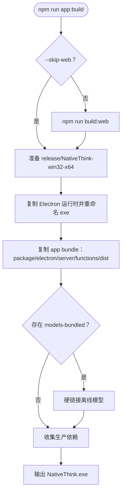

**图表来源**
- [scripts/pack-app.mjs:1-108](file://scripts/pack-app.mjs#L1-L108)

**章节来源**
- [scripts/pack-app.mjs:1-108](file://scripts/pack-app.mjs#L1-L108)

### Android 版本管理：`scripts/bump-android-version.cjs`

该脚本在每次打 APK 前修改 `android/version.properties`：
- `versionCode` 每次加 1。
- `versionName` 采用 `major.minor.patch`，每次构建 patch 加 1。
- 如果手动修改了 `major` 或 `minor`，脚本会沿用新值并继续递增 patch。
- 首次运行若文件不存在，默认写入 `versionCode=1`、`versionName=2.0.0`。

当前仓库中 `android/version.properties` 的值体现为 `versionCode=147`、`versionName=2.0.102`，说明已经历多次构建递增。

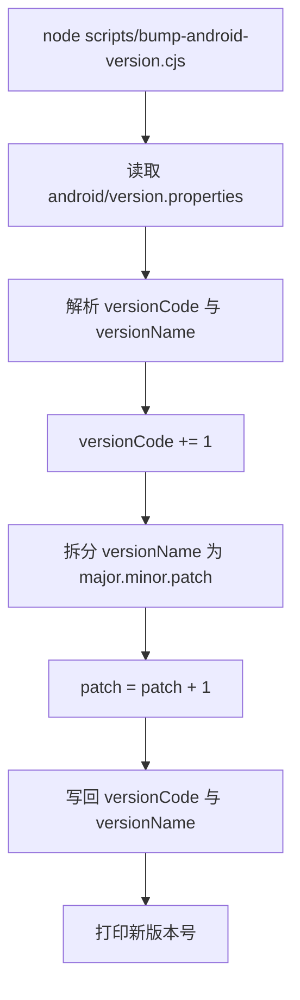

**图表来源**
- [scripts/bump-android-version.cjs:1-27](file://scripts/bump-android-version.cjs#L1-L27)
- [android/version.properties:1-2](file://android/version.properties#L1-L2)

**章节来源**
- [scripts/bump-android-version.cjs:1-27](file://scripts/bump-android-version.cjs#L1-L27)
- [android/version.properties:1-2](file://android/version.properties#L1-L2)

### 构建质量保证工具

#### Bundle 大小预算检查：`scripts/verify-bundle-budget.mjs`

该脚本在构建后运行，核心逻辑：
1. 确认 `dist/client/index.html` 存在，否则直接失败。
2. 从 HTML 中提取 `modulepreload` 列出的 JS 文件，找到以 `index-` 开头的入口 chunk。
3. 递归解析入口 chunk 的静态 `import`，得到“首屏必需集合”。
4. 对每个 chunk 计算 gzip 大小，统计首屏必需 JS 总量。
5. 断言以下规则：
   - 首屏不应包含图表库：匹配 `charts`、`ProgressCharts`、`recharts`、`d3-`。
   - 首屏不应包含 Markdown 渲染器：匹配 `markdown`、`micromark`、`mdast`、`unified`、`lib-`。
   - 首屏不应下载任何词书数据 chunk：如 `wordbank-cet4-*.js`、`cet4.detail-*.js` 等。
   - 首屏不应下载书正文或语料正文：匹配 `books-`、`scp`、`reading`。
   - 首屏必需 JS gzip 总量不超过 600KB。
6. 正向对照：确保图表库和 Markdown 渲染器仍在产物中，只是改为按需加载。
7. 源码级卫生检查：扫描 `src` 中是否静态 import `@lark-apaas/client-toolkit-lite`，只允许动态 import。

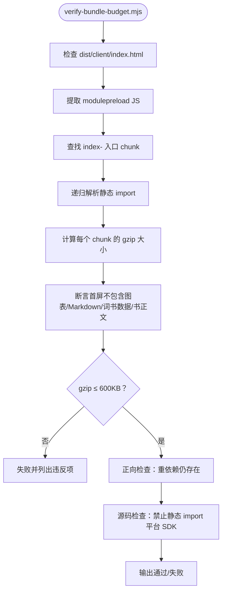

**图表来源**
- [scripts/verify-bundle-budget.mjs:1-111](file://scripts/verify-bundle-budget.mjs#L1-L111)

**章节来源**
- [scripts/verify-bundle-budget.mjs:1-111](file://scripts/verify-bundle-budget.mjs#L1-L111)

#### 应用版本一致性验证：`scripts/verify-app-version.mjs`

该脚本守护“版本号只有一个载体”的链路：

1. **源**：要求 `android/version.properties` 存在 `versionName=major.minor.patch` 与 `versionCode`。
2. **注入**：要求 `vite.config.ts` 读取 `android/version.properties`，并通过 `fixHtmlPlaceholders` 把 `{{appVersion}}` 替换成真实版本号。
3. **载体**：要求 `index.html` 包含 `<meta name="app-version" content="{{appVersion}}">`。
4. **消费**：要求 `scripts/ensure-web-build.mjs` 按 `app-version` meta 核对产物版本，不再引用旧的 `__APP_VERSION__`。
5. **单一载体**：扫描 `src`、`scripts`、`functions`、`electron`、`server` 下的代码，禁止出现 `__APP_VERSION__`。
6. **端到端**：如果 `dist/client/index.html` 存在，则检查产物中 `app-version` 不是空串也不是占位符，并且与 `version.properties` 一致；同时检查 `404.html` 的版本也一致。

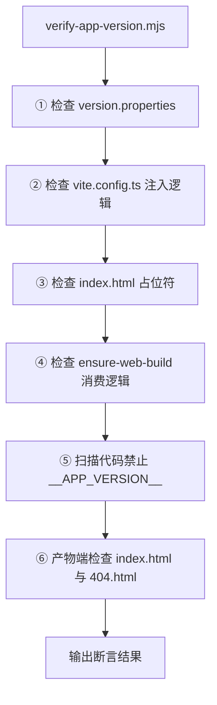

**图表来源**
- [scripts/verify-app-version.mjs:1-94](file://scripts/verify-app-version.mjs#L1-L94)

**章节来源**
- [scripts/verify-app-version.mjs:1-94](file://scripts/verify-app-version.mjs#L1-L94)

### 远程推送工具

#### `scripts/git-push-onto-remote.cjs`：追加式推送

适用场景：远端 `main` 已被其他工作流推进，本地与远端分叉。常规 `git push` 会被拒绝，也不应强推覆盖他人提交。

核心逻辑：
- 取指定提交的 SHA 及其父提交，获取改动文件列表。
- 查询远端 `main` 最新 commit 与 tree。
- 逐个比较远端 blob、本地 blob、父版本 blob：
  - 如果远端已经是我的版本，跳过。
  - 如果远端既有别人改动又不同于我父版本，跳过并报告冲突。
  - 否则把本地 blob 上传到 GitHub Blob API。
- 基于远端 tip 创建新 tree、commit，并 PATCH `refs/heads/main`。
- 推送后再次拉取远端 tree，校验推送文件是否与本地逐字节一致。
- 支持 `--dry-run`。

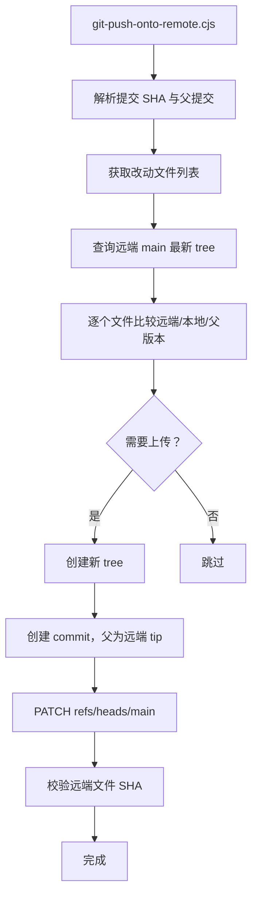

**图表来源**
- [scripts/git-push-onto-remote.cjs:1-94](file://scripts/git-push-onto-remote.cjs#L1-L94)

**章节来源**
- [scripts/git-push-onto-remote.cjs:1-94](file://scripts/git-push-onto-remote.cjs#L1-L94)

#### `scripts/git-push-via-api.mjs`：GitHub API 推送

适用场景：`github.com` 不可达但 `api.github.com` 可达时，通过 GitHub Git Data API 推送。

核心约束与保护：
- GitHub API 会规范化提交元数据（UTC 时间、去掉末尾换行），因此不能直接用本地 SHA 作为远端 SHA。
- 脚本先按 API 存储规则重建本地 commit 对象，比较两边 SHA；不一致则中止。
- 沿 HEAD 回溯，找出最早父提交正好是远端 main 的提交，最多回溯 50 个。
- 对每个待推送提交：
  - 计算 diff，新增/修改文件上传 blob，删除文件写入 null sha。
  - 暂不支持重命名/复制。
  - 上传后校验 blob、tree、commit SHA 是否与本地一致。
  - 校验远端分支未被其他人覆盖。
  - 更新分支指针。
- 推送完成后同步本地 ref，并比对本地与远端 SHA。
- 支持 `--selftest` 与 `--dry-run`。

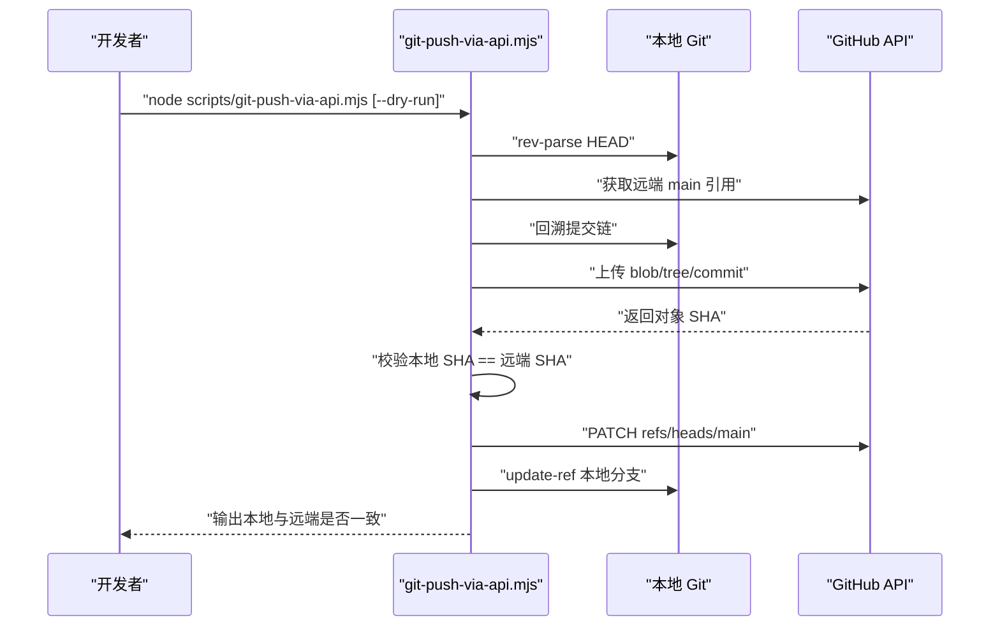

**图表来源**
- [scripts/git-push-via-api.mjs:1-173](file://scripts/git-push-via-api.mjs#L1-L173)

**章节来源**
- [scripts/git-push-via-api.mjs:1-173](file://scripts/git-push-via-api.mjs#L1-L173)

## 依赖关系分析

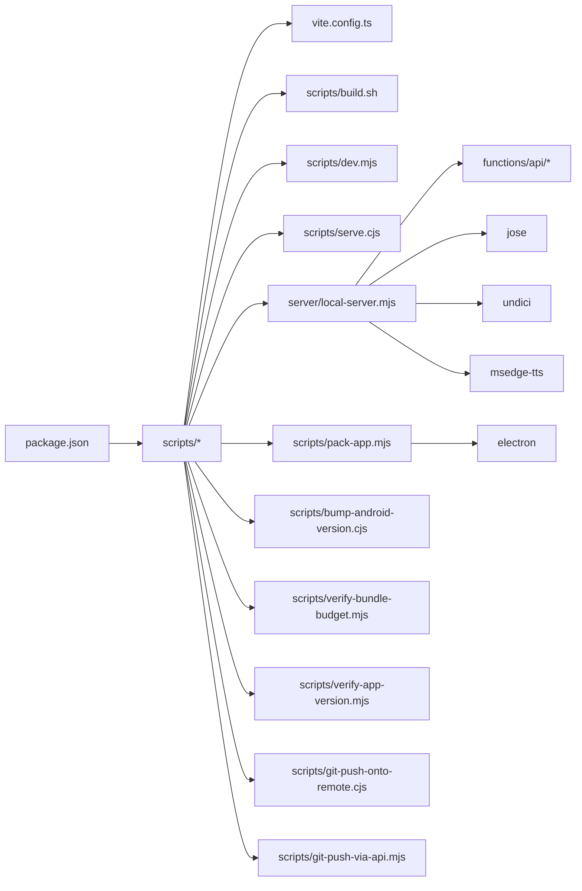

**图表来源**
- [package.json:1-130](file://package.json#L1-L130)
- [scripts/dev.mjs:1-130](file://scripts/dev.mjs#L1-L130)
- [scripts/build.sh:1-69](file://scripts/build.sh#L1-L69)
- [scripts/serve.cjs:1-74](file://scripts/serve.cjs#L1-L74)
- [server/local-server.mjs:1-731](file://server/local-server.mjs#L1-L731)
- [scripts/pack-app.mjs:1-108](file://scripts/pack-app.mjs#L1-L108)
- [scripts/bump-android-version.cjs:1-27](file://scripts/bump-android-version.cjs#L1-L27)
- [scripts/verify-bundle-budget.mjs:1-111](file://scripts/verify-bundle-budget.mjs#L1-L111)
- [scripts/verify-app-version.mjs:1-94](file://scripts/verify-app-version.mjs#L1-L94)
- [scripts/git-push-onto-remote.cjs:1-94](file://scripts/git-push-onto-remote.cjs#L1-L94)
- [scripts/git-push-via-api.mjs:1-173](file://scripts/git-push-via-api.mjs#L1-L173)

**章节来源**
- [package.json:1-130](file://package.json#L1-L130)

## 性能考量

1. **开发环境 WASM 加速**：`vite.config.ts` 与 `server/local-server.mjs` 都设置了 `Cross-Origin-Opener-Policy` 与 `Cross-Origin-Embedder-Policy`，使浏览器能启用 SharedArrayBuffer 和多线程 WASM，显著提升离线小模型加载与推理速度。
2. **开发 watch 忽略大目录**：忽略 `android/`、`release/`、`dist/`、`models-bundled/`、`logs/`，避免构建过程中 `.onnx` 文件被监听导致 EBUSY 和 dev server 崩溃。
3. **静态资源压缩**：`server/local-server.mjs` 对可压缩资源返回 gzip，减少冷启动首屏时间。
4. **构建产物缓存策略**：哈希文件名资源设置 `immutable`，HTML 设置 `no-cache`，平衡缓存命中与更新有效性。
5. **Bundle 预算守卫**：`verify-bundle-budget.mjs` 限制首屏必需 JS gzip 不超过 600KB，并禁止图表、Markdown、词书数据、书正文进入首屏。
6. **手动 chunk 优化**：`vite.config.ts` 对 React、React Router、Radix UI、Lucide、date-fns、Zod 等拆出 vendor chunk；刻意不给 recharts、react-markdown、framer-motion 强制 manualChunks，避免它们成为入口静态依赖。
7. **Electron 打包体积优化**：`pack-app.mjs` 使用硬链接复制 Electron 运行时与离线模型，并只收集 `jose`、`undici`、`msedge-tts` 的生产依赖树。

[本节为通用性能讨论，不直接分析具体代码片段]

## 故障排查指南

| 现象 | 可能原因 | 排查与解决 |
|---|---|---|
| 启动 `npm run dev` 后端口占用 | 上次 dev 进程未正常退出 | `scripts/dev.mjs` 会自动 kill 占用 `CLIENT_DEV_PORT` 的进程；也可手动释放端口后重试 |
| dev 服务器在构建后死亡 | Vite watch 监听到 `android/`、`dist/`、`models-bundled/` 中的大文件或正在写入的 `.onnx` | 检查 `vite.config.ts` 的 `server.watch.ignored`；必要时重新安装依赖或重启 dev |
| 本机 `/api/*` 返回 HTML 而非 JSON | 没有使用 `scripts/serve.cjs` 或 `vite.config.ts` 代理 | 开发时用 `npm run dev`；验收已构建产物时用 `node scripts/serve.cjs` |
| 本机 `/api/*` 代理失败 | 远端 `nativethink.pages.dev` 不可达或上游异常 | 检查 `NT_API_ORIGIN`、网络代理、防火墙；`serve.cjs` 会返回 502 JSON |
| Electron 本地 TTS 失败 | `msedge-tts` 未安装、Edge 语音不可用、PowerShell 调用失败 | 检查 `server/local-server.mjs` 日志；脚本会尝试 Edge→SAPI→远端 TTS 降级 |
| 桌面应用缺少运行时依赖 | `pack-app.mjs` 只复制 `jose`、`undici`、`msedge-tts` 及其依赖 | 如需更多运行时依赖，扩展 `collectDeps` 的 entries |
| Android 无法覆盖安装 | `versionCode` 未递增 | 使用 `npm run version:apk-bump` 或 `node scripts/bump-android-version.cjs` |
| 构建报版本链断裂 | 找不到 `android/version.properties` 或没有 `versionName` | 运行 `npm run version:apk-bump` 后再构建 |
| 产物中 `app-version` 仍是占位符 | `vite.config.ts` 的 `fixHtmlPlaceholders` 未执行或 `version.properties` 缺失 | 运行 `node scripts/verify-app-version.mjs` 检查链路 |
| 首屏体积超标 | 有人把图表、Markdown、词书数据改成静态 import | 运行 `node scripts/verify-bundle-budget.mjs`，并检查 `vite.config.ts` 的 `manualChunks` |
| `git push` 被拒绝 | 远端 main 已被其他提交推进 | 使用 `node scripts/git-push-onto-remote.cjs` 追加推送 |
| `github.com` 不可达但 `api.github.com` 可达 | 网络限制 | 使用 `node scripts/git-push-via-api.mjs`，可先跑 `--selftest` 校验规则 |
| API 推送后本地与远端 SHA 不一致 | GitHub API 元数据规范化规则变化 | 先运行 `--selftest`，确认两边 SHA 一致后再推送 |

**章节来源**
- [scripts/dev.mjs:1-130](file://scripts/dev.mjs#L1-L130)
- [vite.config.ts:1-246](file://vite.config.ts#L1-L246)
- [scripts/serve.cjs:1-74](file://scripts/serve.cjs#L1-L74)
- [server/local-server.mjs:1-731](file://server/local-server.mjs#L1-L731)
- [scripts/pack-app.mjs:1-108](file://scripts/pack-app.mjs#L1-L108)
- [scripts/bump-android-version.cjs:1-27](file://scripts/bump-android-version.cjs#L1-L27)
- [scripts/verify-bundle-budget.mjs:1-111](file://scripts/verify-bundle-budget.mjs#L1-L111)
- [scripts/verify-app-version.mjs:1-94](file://scripts/verify-app-version.mjs#L1-L94)
- [scripts/git-push-onto-remote.cjs:1-94](file://scripts/git-push-onto-remote.cjs#L1-L94)
- [scripts/git-push-via-api.mjs:1-173](file://scripts/git-push-via-api.mjs#L1-L173)

## 结论

NativeThink 的开发辅助工具是一套围绕“开发体验、构建质量、多端打包、版本治理、远程协作”形成的闭环体系：

- `scripts/dev.mjs` 与 `vite.config.ts` 提供稳定的开发入口、端口管理、日志聚合、API 代理、离线模型服务、工厂 Key 注入与应用版本注入。
- `scripts/build.sh` 统一 Vite 构建与部署输出，支持 Cloudflare Pages 与 Miaoda 双模式。
- `scripts/serve.cjs` 与 `server/local-server.mjs` 分别承担轻量静态验收与 Electron 桌面端完整本地后端职责。
- `scripts/pack-app.mjs` 与 `scripts/bump-android-version.cjs` 协同生成桌面应用与 Android APK，并保证版本号递增。
- `scripts/verify-bundle-budget.mjs` 与 `scripts/verify-app-version.mjs` 守住首屏体积与版本链路质量。
- `scripts/git-push-onto-remote.cjs` 与 `scripts/git-push-via-api.mjs` 提供安全的远程协作通道，避免覆盖他人提交并在网络受限时完成推送。

这套工具链的价值不仅在于自动化，更在于明确边界：开发服务器专注开发体验，构建脚本专注产物形态，本地服务器专注本地运行一致性，打包脚本专注分发体积，验证脚本专注质量门槛，推送工具专注协作安全。

[本节为总结性内容，不直接分析具体代码文件]