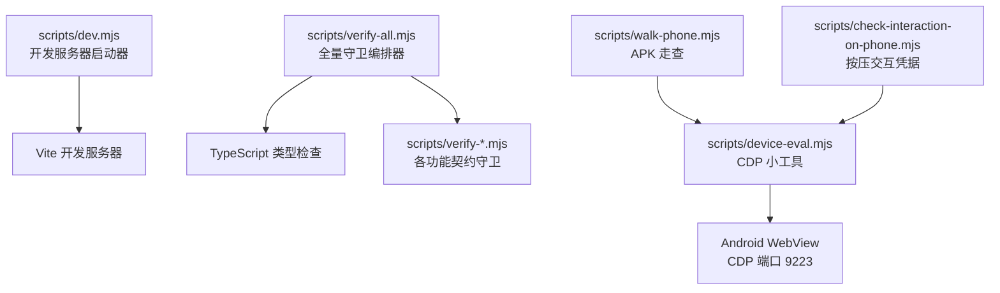
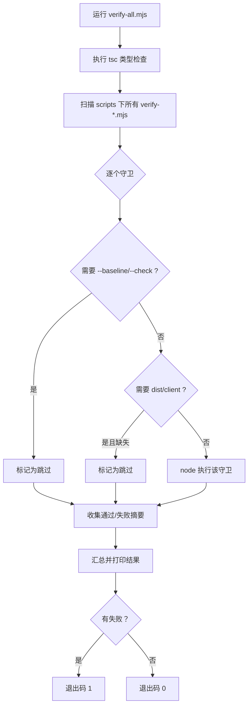
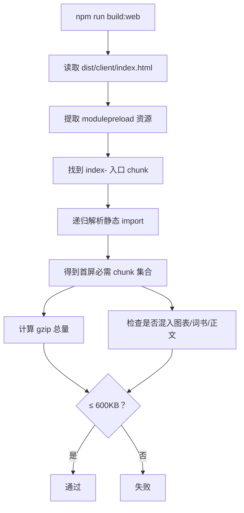
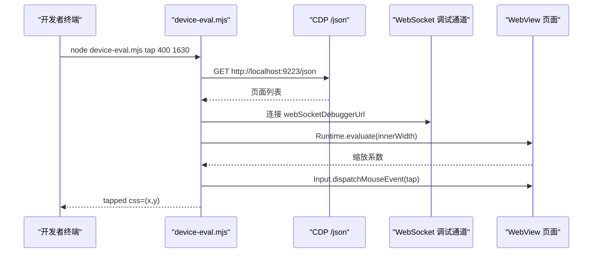
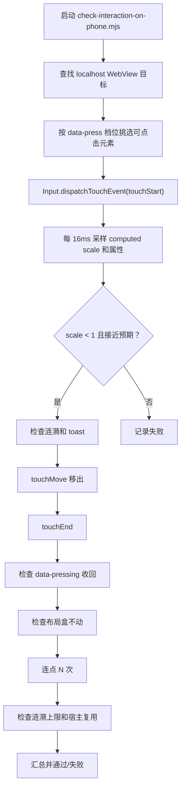
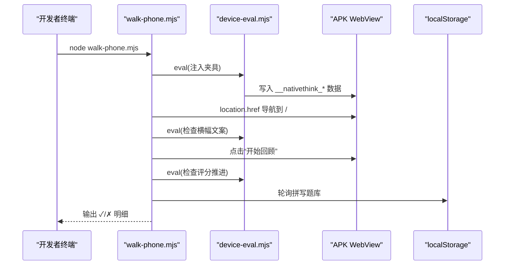
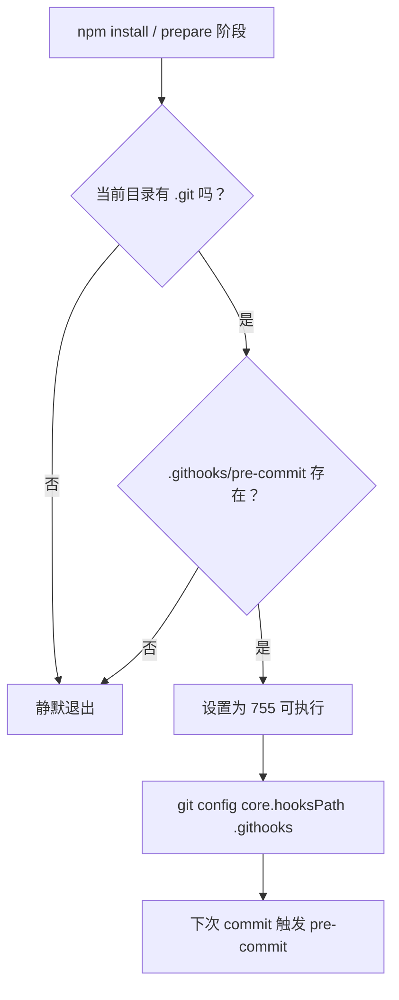
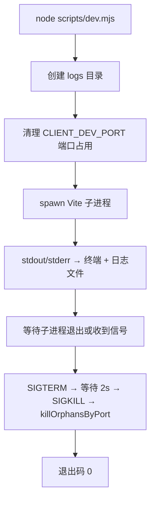
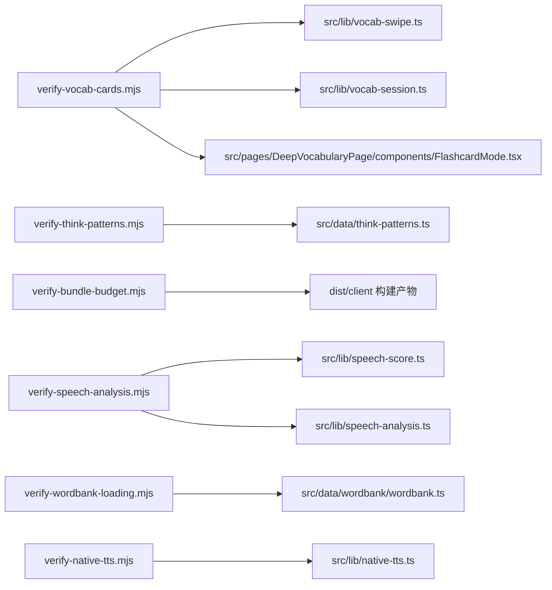

# 测试与开发工具

<cite>
**本文引用的文件**   
- [scripts/verify-all.mjs](file://scripts/verify-all.mjs)
- [scripts/setup-git-hooks.mjs](file://scripts/setup-git-hooks.mjs)
- [scripts/dev.mjs](file://scripts/dev.mjs)
- [scripts/device-eval.mjs](file://scripts/device-eval.mjs)
- [scripts/check-interaction-on-phone.mjs](file://scripts/check-interaction-on-phone.mjs)
- [scripts/walk-phone.mjs](file://scripts/walk-phone.mjs)
- [scripts/verify-vocab-cards.mjs](file://scripts/verify-vocab-cards.mjs)
- [scripts/verify-shadowing-completion.mjs](file://scripts/verify-shadowing-completion.mjs)
- [scripts/verify-think-patterns.mjs](file://scripts/verify-think-patterns.mjs)
- [scripts/verify-bundle-budget.mjs](file://scripts/verify-bundle-budget.mjs)
- [scripts/verify-rv-articles.mjs](file://scripts/verify-rv-articles.mjs)
- [scripts/verify-wordbank-loading.mjs](file://scripts/verify-wordbank-loading.mjs)
- [scripts/verify-chain-verdict.mjs](file://scripts/verify-chain-verdict.mjs)
- [scripts/verify-speech-analysis.mjs](file://scripts/verify-speech-analysis.mjs)
- [scripts/verify-spelling-resume.mjs](file://scripts/verify-spelling-resume.mjs)
- [scripts/verify-tts-hardening.mjs](file://scripts/verify-tts-hardening.mjs)
- [scripts/verify-native-tts.mjs](file://scripts/verify-native-tts.mjs)
- [package.json](file://package.json)
</cite>

## 目录

1. [引言](#引言)
2. [项目结构](#项目结构)
3. [契约守卫体系](#契约守卫体系)
4. [真机调试工具链](#真机调试工具链)
5. [Git Hooks 与提交前检查](#git-hooks-与提交前检查)
6. [开发辅助工具](#开发辅助工具)
7. [依赖关系分析](#依赖关系分析)
8. [性能与质量特征](#性能与质量特征)
9. [常见开发问题排查](#常见开发问题排查)
10. [结论](#结论)

## 引言

NativeThink 的测试与开发工具围绕一个核心思想：**用脚本把“真机上才看得出来的行为”变成可重复、可退出码化、能回归的契约**。项目没有引入大型前端测试框架，而是用 Node 脚本直接读取源码、调用 TypeScript 转译、在临时目录里运行被测纯函数，再对页面接线做静态断言。

这套体系可以分成三类：

| 类别 | 代表脚本 | 主要职责 |
|---|---|---|
| 契约守卫 | `verify-*` 系列 | 验证业务逻辑、数据模型、构建产物和页面接线的不变量 |
| 真机调试 | `device-eval`、`check-interaction-on-phone`、`walk-phone` | 通过 CDP 在 Android WebView 上执行求值、点击、截图和走查 |
| 开发流程 | `dev.mjs`、`setup-git-hooks.mjs`、`verify-all.mjs` | 启动开发服务器、安装 Git 钩子、一次跑完全部守卫 |

这些脚本的共同特点是：失败时打印具体断言名称和细节，非零退出码供 CI 或终端高亮；成功时输出类似“全部通过”的汇总行，被 `verify-all.mjs` 解析为绿标。

## 项目结构

测试与开发相关代码集中在仓库根下的 `scripts` 目录，关键入口如下：

**图表来源**
- [scripts/dev.mjs:1-130](file://scripts/dev.mjs#L1-L130)
- [scripts/verify-all.mjs:1-77](file://scripts/verify-all.mjs#L1-L77)
- [scripts/device-eval.mjs:1-83](file://scripts/device-eval.mjs#L1-L83)
- [scripts/check-interaction-on-phone.mjs:1-167](file://scripts/check-interaction-on-phone.mjs#L1-L167)
- [scripts/walk-phone.mjs:1-267](file://scripts/walk-phone.mjs#L1-L267)

从组织方式看，仓库采用**按职责分目录 + 按功能分脚本**的结构：

- `scripts/`：所有 Node 脚本集中放置，命名以动词开头，如 `verify-`、`walk-`、`check-`、`gen-`、`build-`。
- `src/`：应用源码，契约守卫通过读取源码路径进行静态校验。
- `android/`：Android 原生模块，TTS 加固等原生侧契约会直接扫描 Java 源码。
- `server/local-server.mjs`：桌面本地服务，是 TTS 声音列表等接口正对照的一部分。
- `package.json`：暴露 `verify:*` 命令，让开发者通过 npm 脚本触发守卫。

**章节来源**
- [scripts/dev.mjs:1-130](file://scripts/dev.mjs#L1-L130)
- [scripts/verify-all.mjs:1-77](file://scripts/verify-all.mjs#L1-L77)
- [package.json:9-45](file://package.json#L9-L45)

## 契约守卫体系

### 设计原则

每个 `verify-*` 脚本通常承担两个层面的验证：

1. **运行时纯函数验证**：用 `typescript` 包把目标模块转译为 ESNext，写入临时目录后动态 `import`，再用真实输入断言输出。
2. **源码级接线验证**：读取对应页面或库文件，用正则断言关键调用、常量、禁用写法和安全约束。

这种双轨模式既能发现“实现变了但正则没更新”的问题，也能发现“正则通过了但函数行为已经退化”的问题。

### 全量编排器

`scripts/verify-all.mjs` 是整个契约体系的入口。它做的事情很明确：

- 先执行 TypeScript 类型检查。
- 自动扫描 `scripts/verify-*.mjs`（排除自身）。
- 跳过需要外部参数的守卫，例如词库拆分守卫需要基线文件。
- 跳过依赖 Web 构建产物的守卫，除非已存在 `dist/client/index.html`。
- 支持 `--skip-build` 参数，让不需要构建的守卫继续运行。
- 收集每条守卫的输出，过滤出包含“通过”“passed”“全部”或“✗”的行作为结果摘要。
- 最后汇总红绿状态，并以非零退出码表示失败。

**图表来源**
- [scripts/verify-all.mjs:1-77](file://scripts/verify-all.mjs#L1-L77)

**章节来源**
- [scripts/verify-all.mjs:1-77](file://scripts/verify-all.mjs#L1-L77)

### 词汇卡片契约：`verify-vocab-cards`

这个守卫覆盖背单词复习检测的核心体验，包括：

| 检查项 | 说明 |
|---|---|
| 自动发音开关 | 必须持久化、默认开启、四个入口共用同一个键 |
| 详情懒加载 | detail 到位后要重新读词条，不能只渲染旧对象 |
| 背面信息层次 | 例句、搭配、近义、反义、词族、深度解释等字段都要展示 |
| 会话进度 | 本轮进度、正确率、评分计数要清零并冻结顺序 |
| 手势决策表 | 滑动阈值、翻面、评分、回看导航分支全部单测 |
| 复习检测禁用滑动评分 | 已翻面未评分的滑动返回 `none`，只保留五档按钮和数字键 |
| 答错重排 | 插入位置、上限、回看态导航、预测分桶都有边界用例 |

该脚本使用 TypeScript 编译器的 `transpileModule` 把 `vocab-swipe.ts` 和 `vocab-session.ts` 中的纯函数单独提取出来运行，因此即使组件改动，只要纯函数契约还在就能过。

**章节来源**
- [scripts/verify-vocab-cards.mjs:1-200](file://scripts/verify-vocab-cards.mjs#L1-L200)

### 影子跟读完成标记：`verify-shadowing-completion`

这个守卫针对一个非常具体的历史缺陷：删除 AI 追加句后，完成标记错位导致“再来一遍”横幅永久消失。它分为两段：

| 段落 | 内容 |
|---|---|
| A 段 | 真跑 `shadowing-progress.ts`，覆盖删除位移、语料隔离、索引换算、非法键处理 |
| B 段 | 静态检查 ShadowingPage 是否传合并索引、是否统一用 `shadowingCompletionKey`、是否禁止危险 HTML 注入 |

其中正对照非常重要：如果未来有人再次误传 extras 本地索引而不是合并索引，守卫会显式报告“完成数少 1、横幅消失”。

**章节来源**
- [scripts/verify-shadowing-completion.mjs:1-183](file://scripts/verify-shadowing-completion.mjs#L1-L183)

### 思维模式数据契约：`verify-think-patterns`

`verify-think-patterns.mjs` 不是 UI 行为测试，而是**内容数据契约守卫**。它验证 `/think` 模式库的数据结构：

- 恰好 12 个模式，按固定 id 顺序排列。
- 四层元数据：structure、verb、clarity、pragmatics。
- 每层至少 2 个模式。
- 每个模式有识别题和迁移题，合计 72 个内容项。
- 识别题选项语法成立、答案唯一、分布均衡。
- 诊断题覆盖全部 12 个模式且不重复。
- 选项说明必须逐条给出 tone 和 text。

由于数据会被用作 React key 和界面文案，守卫对 id 唯一性、空串、长度、答案下标都做了强约束。

**章节来源**
- [scripts/verify-think-patterns.mjs:1-200](file://scripts/verify-think-patterns.mjs#L1-L200)

### 首屏预算守卫：`verify-bundle-budget`

这个守卫不读源码，而是直接分析构建产物：

1. 要求 `dist/client/index.html` 存在。
2. 从 `modulepreload` 和入口 chunk 的静态 import 递归推导首屏必需集合。
3. 断言首屏不应包含图表库、Markdown 渲染器和词书数据 chunk。
4. 计算 gzip 总量，超过 600KB 即失败。
5. 反向确认图表库和 Markdown 渲染器仍在产物中，只是按需加载。
6. 扫描源码，禁止静态 import 平台 SDK。

**图表来源**
- [scripts/verify-bundle-budget.mjs:1-111](file://scripts/verify-bundle-budget.mjs#L1-L111)

**章节来源**
- [scripts/verify-bundle-budget.mjs:1-111](file://scripts/verify-bundle-budget.mjs#L1-L111)

### 复习词汇生成文章：`verify-rv-articles`

这个守卫关注“用复习词汇生成文章”的选词、切批和落盘链路：

- 现存文章的用词并集必须来自 `rvWords`。
- 到期词减去已用词保持原始顺序。
- 批量切分满足上限、余数处理和零上限边界。
- 生成成功才消费词，失败或空响应不能算完成。
- 文章保存和历史记录带 `aiId`，支持重新打开。
- 收藏判重按 article 类型，不是 word。

它特别强调：不能用 `slice(0, 10)` 写死取前 10 个词，也不能在保存前先加成功计数。

**章节来源**
- [scripts/verify-rv-articles.mjs:1-200](file://scripts/verify-rv-articles.mjs#L1-L200)

### 词库加载集成：`verify-wordbank-loading`

这是运行时级集成验证，目标是补上纯函数断言覆盖不到的两条关键链路：

1. `preloadLevels` 对第一个等级也要加载 detail。
2. `applyDetail` 的就地补齐要穿透到 `queryWords` 返回的对象。

脚本会把真实模块图整体转译到临时目录，桩掉 IndexedDB，补全动态导入扩展名，然后驱动 `loadCore`、`loadLevel`、`loadDetail`、`applyDetail`。它还验证：

- 仅核心加载时 detail 为空占位。
- detail 加载失败不污染状态。
- 失败模块被 JS 模块表缓存，UI 应提示刷新页面而非原地重试。
- 池子数字与数据文件中唯一词数同源。
- “全部”模式不等于各本相加。

**章节来源**
- [scripts/verify-wordbank-loading.mjs:1-200](file://scripts/verify-wordbank-loading.mjs#L1-L200)

### 其他重要守卫

| 脚本 | 核心契约 |
|---|---|
| `verify-chain-verdict.mjs` | 语块接龙判定必须是 pass/fail/unknown 三档，未判定不得分 |
| `verify-speech-analysis.mjs` | 离线跟读分析在合成波形上验证意群边界、音量、停顿、音高和语速 |
| `verify-spelling-resume.mjs` | 句子拼写断点按词书分键，旧全局键可迁移，重置清理干净 |
| `verify-tts-hardening.mjs` | TTS 并发去重、线程池、队列上限和本页先于预取的入队顺序 |
| `verify-native-tts.mjs` | 原生插件代理不会造成 Promise 永久 pending，超时兜住，英语音色判断有界返回 |

这些守卫大多遵循相同模式：先用替身复现真实缺陷，再验证修复后的不变量，最后用源码正则锁住关键实现形态。

**章节来源**
- [scripts/verify-chain-verdict.mjs:1-127](file://scripts/verify-chain-verdict.mjs#L1-L127)
- [scripts/verify-speech-analysis.mjs:1-186](file://scripts/verify-speech-analysis.mjs#L1-L186)
- [scripts/verify-spelling-resume.mjs:1-155](file://scripts/verify-spelling-resume.mjs#L1-L155)
- [scripts/verify-tts-hardening.mjs:1-200](file://scripts/verify-tts-hardening.mjs#L1-L200)
- [scripts/verify-native-tts.mjs:1-200](file://scripts/verify-native-tts.mjs#L1-L200)

## 真机调试工具链

### 设备求值工具：`device-eval`

`scripts/device-eval.mjs` 是一个小型 CDP 客户端，用于在 Android WebView 上执行以下操作：

| 命令 | 用途 |
|---|---|
| `eval <表达式>` | 在 WebView Runtime 中求值 |
| `tap <x> <y>` | 发送物理像素坐标的鼠标点击事件 |
| `shot <文件名>` | 截取 PNG 屏幕 |
| `back` | 调用 `history.back()` |

它通过 `adb forward tcp:9223 localabstract:webview_devtools_remote_<pid>` 建立通道，然后在 CDP WebSocket 上发请求。坐标系统以物理像素为准，内部根据 `window.innerWidth` 折算 CSS 像素。

**图表来源**
- [scripts/device-eval.mjs:1-83](file://scripts/device-eval.mjs#L1-L83)

**章节来源**
- [scripts/device-eval.mjs:1-83](file://scripts/device-eval.mjs#L1-L83)

### 按压交互凭据：`check-interaction-on-phone`

这个脚本专门验证“按压词汇在真机或模拟器 WebView 上的凭据”。它发现一个重要事实：在某些 Android WebView 上，CDP 的设备级触摸并不进入 `:active`，所以不能只依赖伪类，而要看 `data-pressing` 属性和 computed scale。

它的主要检查点：

1. 挑到一个真正点得到的参与者。
2. 真触摸按下时挂上 `data-pressing`。
3. computed scale 降到档位预期值。
4. 按下到形变在 150ms 内可见。
5. 涟漪节点已创建。
6. 按下过程没有意外 toast。
7. 移开再抬手后收回按压态。
8. 抬手后回到“不缩”状态。
9. 布局盒不动，只有视觉位移。
10. 连点涟漪有上限，宿主复用不堆叠。
11. 涟漪播完后自清。

**图表来源**
- [scripts/check-interaction-on-phone.mjs:1-167](file://scripts/check-interaction-on-phone.mjs#L1-L167)

**章节来源**
- [scripts/check-interaction-on-phone.mjs:1-167](file://scripts/check-interaction-on-phone.mjs#L1-L167)

### APK 走查：`walk-phone`

`scripts/walk-phone.mjs` 是 APK 装机后的四条自动化走查，适用于模拟器或真机。它的核心思路是：

- 通过 `device-eval.mjs` 在 WebView 中求值。
- 用 `localStorage` 注入夹具数据。
- 通过导航和文本匹配模拟用户操作。
- 用 UI 上“真的出现了什么”作为判断依据，而不是只看存储。

五条典型走查包括：

| 编号 | 场景 | 判断依据 |
|---|---|---|
| ④ | 首页“待重认”横幅 | 文案出现且计数等于未重考条数 |
| ① | 收藏页“开始回顾”不再整页崩溃 | 无错误卡，认识/不认识界面出现 |
| ③ | 纠偏条目送进句子拼写“纠偏表达”桶 | 落库、按钮 title 翻转、词库下拉显示 |
| ② | 纠偏重考按类筛选 | 类别 chip 限制题数，完成页汇总正确 |
| ⑤ | 结果图形件真的画出来 | SVG 弧、色点、描边、周长都有尺寸 |
| ⑥ | 默认可点层覆盖 | 裸按钮也有按压态和涟漪 |

**图表来源**
- [scripts/walk-phone.mjs:1-267](file://scripts/walk-phone.mjs#L1-L267)
- [scripts/device-eval.mjs:1-83](file://scripts/device-eval.mjs#L1-L83)

**章节来源**
- [scripts/walk-phone.mjs:1-267](file://scripts/walk-phone.mjs#L1-L267)

## Git Hooks 与提交前检查

### 钩子注册机制

`scripts/setup-git-hooks.mjs` 的职责很简单：当当前目录是 git 仓库根且 `.githooks/pre-commit` 存在时，设置 `core.hooksPath=.githooks`，并把 pre-commit 脚本设为可执行。

它有几个关键安全特性：

- 只在当前目录有 `.git` 时才注册，避免污染外层仓库。
- 只在 `.githooks/pre-commit` 存在时才执行，不会凭空创建钩子。
- 捕获异常，防止 git 未安装或权限问题阻断 `npm install`。
- 通过 `chmodSync` 兜底任何分发链路丢失可执行位的场景。

**图表来源**
- [scripts/setup-git-hooks.mjs:1-20](file://scripts/setup-git-hooks.mjs#L1-L20)

### 开发流程建议

结合现有工具，推荐以下提交规范：

| 阶段 | 命令 | 目的 |
|---|---|---|
| 日常开发 | `npm run dev` | 启动带时间戳日志的开发服务器 |
| 修改业务逻辑 | 单独跑对应 `npm run verify:<name>` | 快速定位影响范围 |
| 提交前 | `npm run verify:all` | 全量守卫 + 类型检查 |
| 真机问题 | `node scripts/walk-phone.mjs` | 在 APK 上跑完整走查 |
| 按压交互问题 | `node scripts/check-interaction-on-phone.mjs` | 真机按压态凭据 |
| 打包发布前 | 先 `npm run build:web`，再 `node scripts/verify-bundle-budget.mjs` | 确保首屏体积可控 |

**章节来源**
- [scripts/setup-git-hooks.mjs:1-20](file://scripts/setup-git-hooks.mjs#L1-L20)
- [package.json:9-45](file://package.json#L9-L45)

## 开发辅助工具

### 开发服务器增强：`dev.mjs`

`scripts/dev.mjs` 不是简单的 `vite` 包装，而是一个进程管理工具：

- 启动 Vite 开发服务器，端口由 `CLIENT_DEV_PORT` 控制，默认 8001。
- 给 stdout/stderr 加时间戳前缀，同时输出到终端和 `logs/<name>.std.log`。
- 使用子进程组管理，父进程退出时向子进程发送 SIGTERM，2 秒后强制 SIGKILL。
- 启动前清理占用端口的孤儿进程。
- 处理 SIGINT、SIGTERM、SIGHUP，避免 pkill 父进程后 Node 不执行清理。

**图表来源**
- [scripts/dev.mjs:1-130](file://scripts/dev.mjs#L1-L130)

**章节来源**
- [scripts/dev.mjs:1-130](file://scripts/dev.mjs#L1-L130)

### 数据生成与构建脚本

仓库中还有大量数据生成和维护脚本，常见用途包括：

| 脚本 | 用途 |
|---|---|
| `gen-vocab.mjs`、`final-vocab.mjs` | 生成或整理词汇数据 |
| `gen-wordbank.mjs`、`generate-wordbank.ts` | 生成词库数据 |
| `build-dictionary.cjs` | 构建词典 |
| `rebuild-all.mjs` | 重建全部数据 |
| `ensure-web-build.mjs` | 保证 Web 构建产物存在 |
| `pack-app.mjs` | 打包应用 |
| `bump-android-version.cjs` | 提升 Android 版本号 |
| `report-apk-size.cjs` | 报告 APK 大小 |

这些脚本适合在数据变更或发布前单独运行，不适合放在每次提交的前置钩子里，因为它们可能耗时较长且依赖外部数据源。

**章节来源**
- [package.json:22-45](file://package.json#L22-L45)

## 依赖关系分析

### 守卫与被测模块的关系

契约守卫和被测模块之间是**单向依赖**：守卫读取源码或临时转译产物，被测模块本身不感知守卫的存在。这保证了守卫属于“观察层”，不影响产品运行时行为。

**图表来源**
- [scripts/verify-vocab-cards.mjs:1-200](file://scripts/verify-vocab-cards.mjs#L1-L200)
- [scripts/verify-think-patterns.mjs:1-200](file://scripts/verify-think-patterns.mjs#L1-L200)
- [scripts/verify-bundle-budget.mjs:1-111](file://scripts/verify-bundle-budget.mjs#L1-L111)
- [scripts/verify-speech-analysis.mjs:1-186](file://scripts/verify-speech-analysis.mjs#L1-L186)
- [scripts/verify-wordbank-loading.mjs:1-200](file://scripts/verify-wordbank-loading.mjs#L1-L200)
- [scripts/verify-native-tts.mjs:1-200](file://scripts/verify-native-tts.mjs#L1-L200)

### 真机调试链路的耦合点

真机调试工具之间的耦合点是 CDP 通道和端口：

| 组件 | 依赖 |
|---|---|
| `device-eval.mjs` | CDP JSON API、WebSocket 调试地址 |
| `check-interaction-on-phone.mjs` | CDP JSON list、Runtime、Input、Page 协议 |
| `walk-phone.mjs` | `device-eval.mjs` 子进程、`localStorage`、URL 路由 |

如果 CDP 端口转发失效，三者都会失败，但失败原因不同：

- `device-eval` 报 no page target 或 CDP 超时。
- `check-interaction-on-phone` 报端口上没有 WebView target。
- `walk-phone` 报导航或文案找不到。

**章节来源**
- [scripts/device-eval.mjs:1-83](file://scripts/device-eval.mjs#L1-L83)
- [scripts/check-interaction-on-phone.mjs:1-167](file://scripts/check-interaction-on-phone.mjs#L1-L167)
- [scripts/walk-phone.mjs:1-267](file://scripts/walk-phone.mjs#L1-L267)

## 性能与质量特征

### 守卫的执行成本

| 类别 | 典型耗时 | 是否适合 CI |
|---|---|---|
| 纯函数守卫 | 几百毫秒到几秒 | 适合 |
| 源码正则守卫 | 几十毫秒 | 适合 |
| 构建产物守卫 | 需要先 `build:web` | 适合独立任务 |
| 真机守卫 | 依赖设备和网络 | 适合手动或专用环境 |
| 全量守卫 | 随守卫数量线性增长 | 适合主分支保护 |

`verify-all.mjs` 的设计已经考虑了部分性能问题：

- 跳过需要外部参数的守卫。
- 跳过缺少构建产物的守卫。
- 使用 `execFileSync` 同步执行子进程，便于汇总结果。
- 对超时和异常输出做简单解析，避免一条守卫的噪声淹没其他结果。

### 代码质量保障

契约守卫本质上是一种**轻量契约测试**，它弥补了传统单元测试难以覆盖的场景：

- 真机手势和动画效果。
- 构建产物依赖图。
- 原生插件异步边界。
- 词库数据完整性。
- 页面与纯函数的接线一致性。

与传统单元测试相比，它更贴近真实运行环境；与端到端测试相比，它更快、更稳定、更容易理解失败原因。

[本节为通用指导，不直接分析具体文件]

## 常见开发问题排查

### 全量守卫全部跳过

**现象**：`verify-all.mjs` 输出大量“跳过”。

**可能原因**：

- 没有先运行 `npm run build:web`，导致 `verify-bundle-budget.mjs` 跳过。
- 某些守卫需要额外参数，例如词库拆分守卫需要基线文件。
- 正在非 git 环境中运行。

**解决步骤**：

1. 先执行 `npm run build:web`。
2. 单独运行失败的守卫，不要只看全量输出。
3. 阅读守卫开头的注释，确认是否需要外部参数或真机环境。

**章节来源**
- [scripts/verify-all.mjs:1-77](file://scripts/verify-all.mjs#L1-L77)

### 真机调试连不上

**现象**：`device-eval.mjs` 报 no page target，或 CDP 超时。

**可能原因**：

- 没有执行 `adb forward tcp:9223 localabstract:webview_devtools_remote_<pid>`。
- WebView 进程 pid 变化，socket 名不对。
- 页面被后台冻结，CDP 请求 6 秒超时。
- 端口被其他进程占用。

**解决步骤**：

1. 在手机上查看可用 socket：`adb shell cat /proc/net/unix | grep webview_devtools_remote`。
2. 重新建立 adb forward。
3. 把 App 切到前台。
4. 如果是端口占用，让 `dev.mjs` 自动清理或手动释放端口。

**章节来源**
- [scripts/device-eval.mjs:1-83](file://scripts/device-eval.mjs#L1-L83)
- [scripts/dev.mjs:1-130](file://scripts/dev.mjs#L1-L130)

### 按压交互在设备上假绿

**现象**：`dispatchEvent(new PointerEvent(...))` 在浏览器里看起来正常，但在 Android WebView 上 `:active` 恒为 false。

**原因**：这台 WebView 上 CDP 设备级真触摸也不进入 `:active`，压感机制改用 `pointerdown` 挂 `data-pressing`。

**解决步骤**：

1. 不要只断言 `:active`。
2. 检查 `data-pressing` 属性是否存在。
3. 检查 computed scale 是否下降。
4. 用 `check-interaction-on-phone.mjs` 跑真实触摸凭据。
5. 用 `elementFromPoint().closest('[data-press]')` 取宿主，避免 DOM 变化导致索引错位。

**章节来源**
- [scripts/check-interaction-on-phone.mjs:1-167](file://scripts/check-interaction-on-phone.mjs#L1-L167)

### TTS 并发导致应用闪退

**现象**：频繁朗读后出现内存不足、线程耗尽，整个 App 闪退。

**原因**：原生侧曾经每次调用新建线程，JS 侧并发请求各自占栈空间，阻塞在串行锁上。

**解决步骤**：

1. 运行 `verify-tts-hardening.mjs`。
2. 确认原生侧使用线程池和有界队列。
3. 确认 JS 侧相同文本并发只提交一次。
4. 确认本页先入队、预取排在后面。
5. 确认在途计数空闲时为 0。

**章节来源**
- [scripts/verify-tts-hardening.mjs:1-200](file://scripts/verify-tts-hardening.mjs#L1-L200)

### 原生语音引擎永远“读取中”

**现象**：设置页的系统语音引擎一直加载中，自检也卡住。

**原因**：旧实现直接 return Capacitor 插件对象，Proxy 的 `then` 被 Promise 同化，原生没有 `then` 方法，Promise 永久 pending。

**解决步骤**：

1. 运行 `verify-native-tts.mjs`。
2. 确认 `getNativeTts` 不在 1 秒内 settle。
3. 确认 `listNativeVoices` 有超时兜底。
4. 确认 `hasEnglishVoice` 引擎装死时返回 false，恢复后可改判 true。
5. 确认没有退回“直接 return 插件对象”的实现。

**章节来源**
- [scripts/verify-native-tts.mjs:1-200](file://scripts/verify-native-tts.mjs#L1-L200)

### 首屏包体突然变大

**现象**：构建后首屏下载过多资源，用户打开慢。

**可能原因**：

- 某个大依赖被改成静态 import。
- manualChunks 配置把按需模块拉进了入口。
- 平台 SDK 被同步 require 或静态 import。

**解决步骤**：

1. 先 `npm run build:web`。
2. 运行 `node scripts/verify-bundle-budget.mjs`。
3. 查看输出中哪个 chunk 进入了首屏必需集合。
4. 把平台 SDK 改为动态 `import()`。
5. 重新运行全量守卫。

**章节来源**
- [scripts/verify-bundle-budget.mjs:1-111](file://scripts/verify-bundle-budget.mjs#L1-L111)

## 结论

NativeThink 的测试与开发工具是一套面向真实移动端行为的轻量契约体系。它没有追求形式化的测试覆盖率，而是抓住那些“改了代码却不容易在真机上立刻发现”的关键不变量：

- 词汇卡片的手势决策和自动发音开关。
- 影子跟读的完成标记与删除索引。
- 思维模式数据的数量和结构。
- 首屏构建产物是否混入重依赖。
- 复习词汇文章的用词派生和落盘顺序。
- 词库加载的 detail 补齐和池子口径。
- 语音分析的合成波形行为。
- 句子拼写的断点分键。
- TTS 的并发去重和原生线程安全。
- 原生插件的异步边界和超时兜底。
- 真机按压交互的 `data-pressing`、scale 和涟漪。
- APK 走查中的收藏回顾、纠偏重考和拼写桶。

对于新加入项目的开发者，建议优先掌握三个入口：

1. `npm run verify:all`：提交前的全量健康检查。
2. `node scripts/dev.mjs`：本地开发服务器。
3. `node scripts/walk-phone.mjs`：APK 装机后的自动化走查。

当某个功能在网页版没问题、真机有问题时，优先考虑添加一条专门的 `verify-*` 守卫，而不是只靠人肉复现。这样未来的修改就不会悄悄破坏已经在真机上验证过的契约。