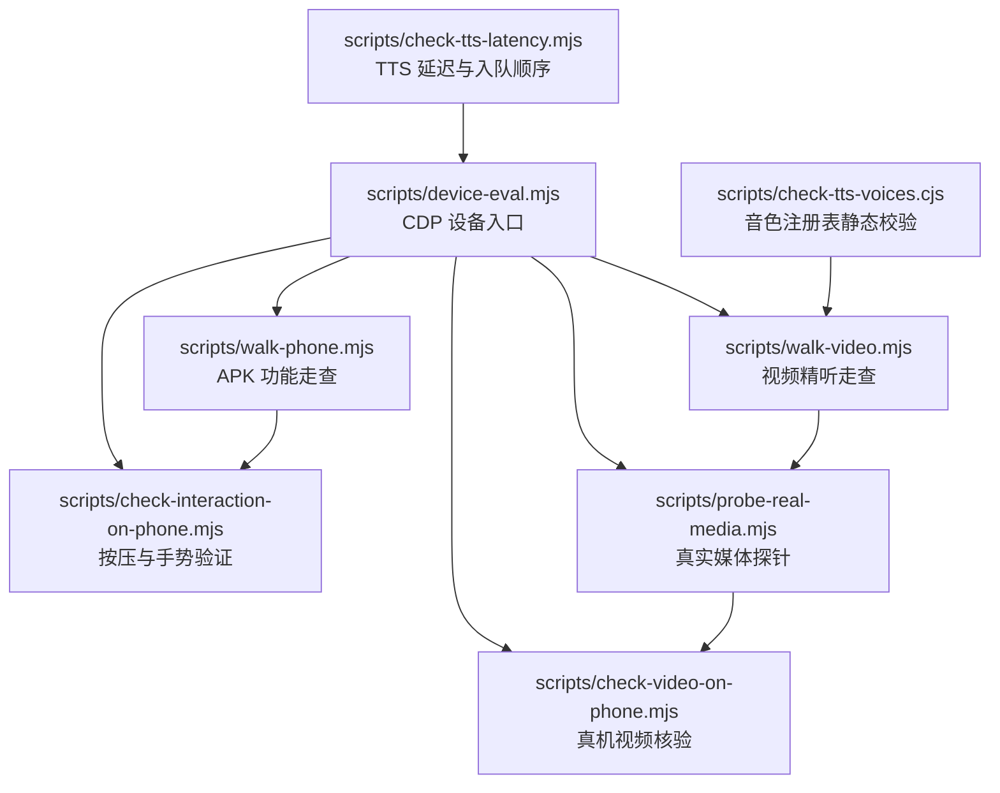
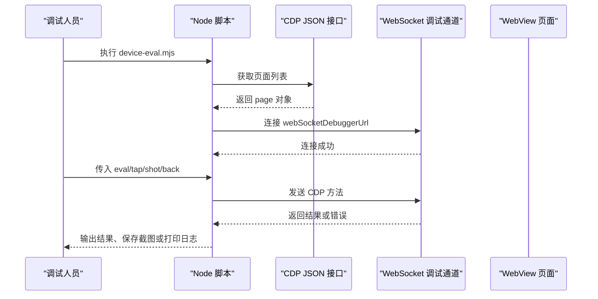
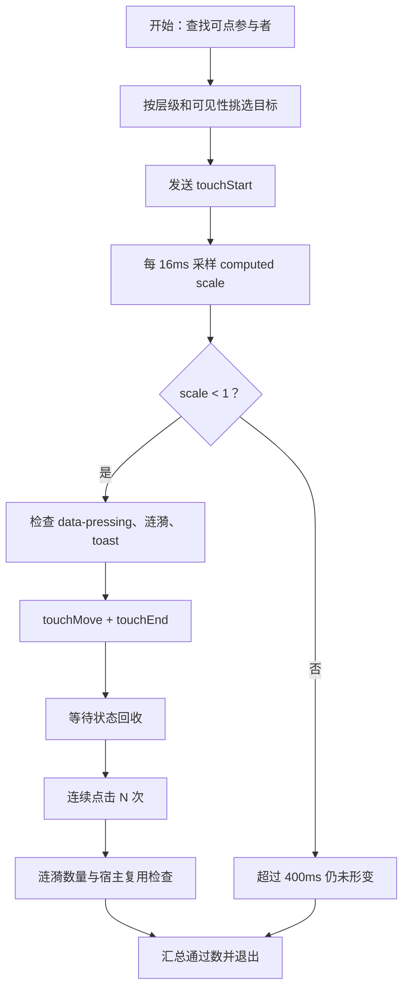
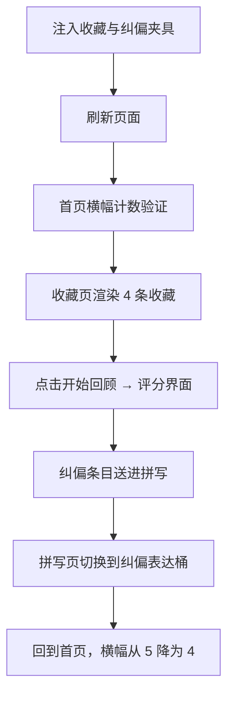
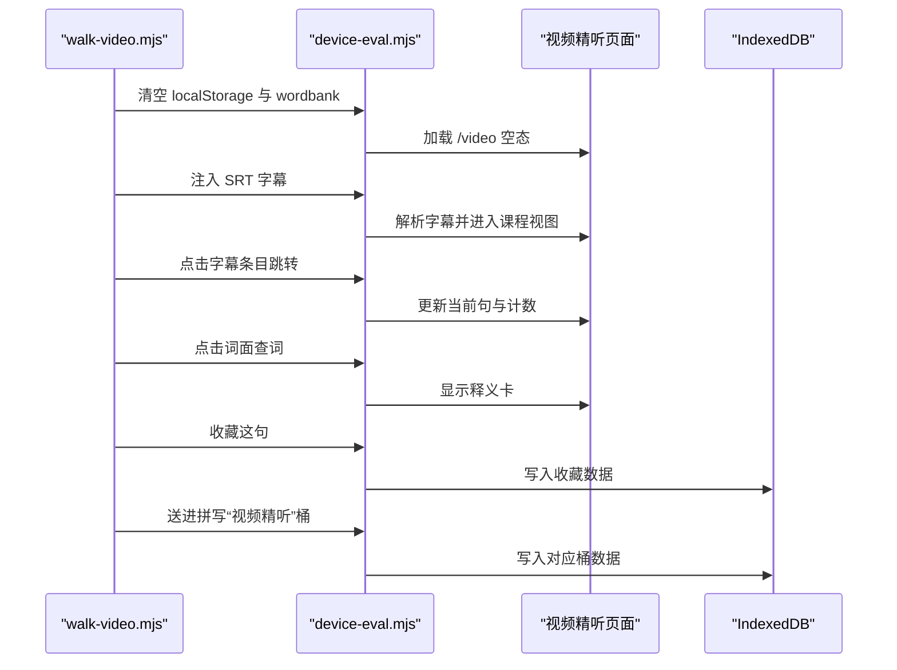
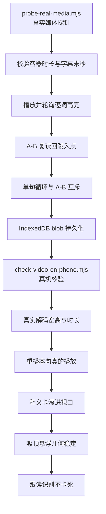
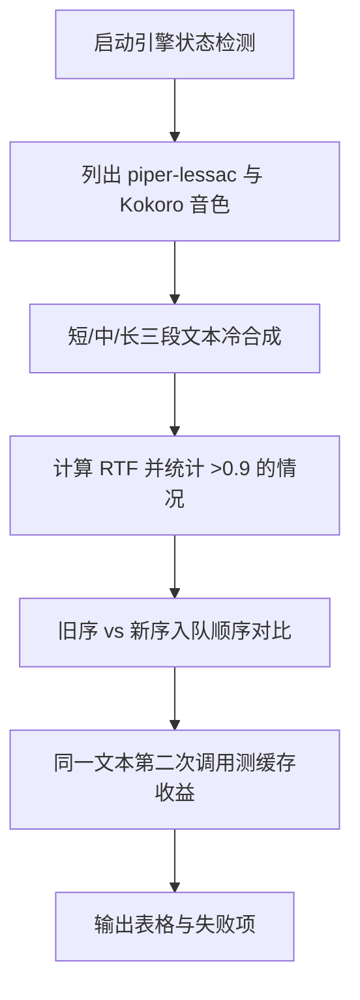
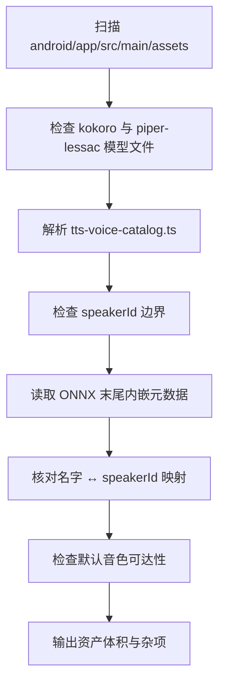
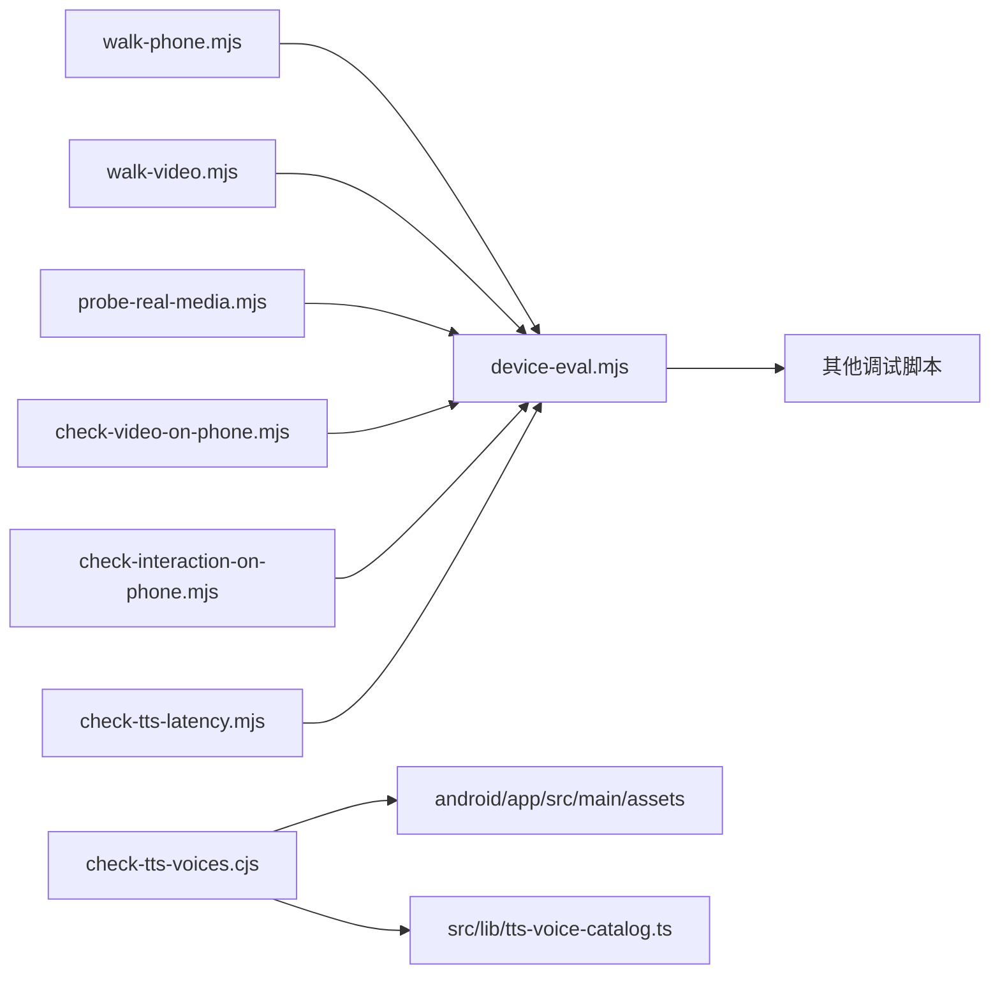

# 真机调试工具

<cite>
**本文引用的文件**   
- [scripts/device-eval.mjs](file://scripts/device-eval.mjs)
- [scripts/check-interaction-on-phone.mjs](file://scripts/check-interaction-on-phone.mjs)
- [scripts/walk-phone.mjs](file://scripts/walk-phone.mjs)
- [scripts/walk-video.mjs](file://scripts/walk-video.mjs)
- [scripts/probe-real-media.mjs](file://scripts/probe-real-media.mjs)
- [scripts/check-video-on-phone.mjs](file://scripts/check-video-on-phone.mjs)
- [scripts/check-tts-latency.mjs](file://scripts/check-tts-latency.mjs)
- [scripts/check-tts-voices.cjs](file://scripts/check-tts-voices.cjs)
</cite>

## 目录
1. [引言](#引言)
2. [项目结构与工具总览](#项目结构与工具总览)
3. [核心能力评估与设备入口：device-eval.mjs](#核心能力评估与设备入口device-evalmjs)
4. [移动端交互验证：check-interaction-on-phone.mjs](#移动端交互验证check-interaction-on-phonemjs)
5. [APK 功能走查：walk-phone.mjs](#apk-功能走查walk-phonemjs)
6. [视频精听走查：walk-video.mjs](#视频精听走查walk-videomjs)
7. [真实媒体探测：probe-real-media.mjs 与 check-video-on-phone.mjs](#真实媒体探测probe-real-mediamjs-与-check-video-on-phonemjs)
8. [TTS 性能与音色校验：check-tts-latency.mjs、check-tts-voices.cjs](#tts-性能与音色校验check-tts-latencymjscheck-tts-voicescjs)
9. [真机调试完整工作流](#真机调试完整工作流)
10. [依赖关系分析](#依赖关系分析)
11. [常见问题排查](#常见问题排查)
12. [结论](#结论)

## 引言
NativeThink 的真机调试工具链围绕 Android WebView 上的运行时行为展开，覆盖五类关键问题：
- 设备与 WebView 基础能力。
- 触摸、长按、滑动等手势与视觉反馈。
- APK 页面导航、收藏、纠偏重考、拼写桶等端到端流程。
- 视频精听页的媒体、字幕、播放器、吸顶悬浮、跟读识别等运行态。
- 离线 TTS 合成延迟、首包顺序、音色注册表一致性。

这些脚本统一通过 Chrome DevTools Protocol（CDP）或 `adb forward` 转发后的 WebSocket 通道控制 WebView，从而绕过无线 adb 无法注入事件的限制。

## 项目结构与工具总览
所有工具位于 `scripts/` 目录下，按职责分为四类：

| 类别 | 脚本 | 主要目标 |
|---|---|---|
| CDP 底层设备工具 | `device-eval.mjs` | 连接 WebView、执行表达式、模拟点击、截图、后退 |
| 交互测试 | `check-interaction-on-phone.mjs` | 验证按压缩放、涟漪、active 态、连点、属性回收 |
| APK 功能走查 | `walk-phone.mjs` | 收藏回顾、纠偏重考、拼写桶、默认可点层 |
| 视频模块走查 | `walk-video.mjs`、`probe-real-media.mjs`、`check-video-on-phone.mjs` | 字幕导入、播放、逐词高亮、A-B 复读、吸顶、跟读 |
| TTS 诊断 | `check-tts-latency.mjs`、`check-tts-voices.cjs` | RTF、首包顺序、缓存命中、音色注册表与模型元数据 |



**图表来源**
- [scripts/device-eval.mjs:1-83](file://scripts/device-eval.mjs#L1-L83)
- [scripts/check-interaction-on-phone.mjs:1-167](file://scripts/check-interaction-on-phone.mjs#L1-L167)
- [scripts/walk-phone.mjs:1-267](file://scripts/walk-phone.mjs#L1-L267)
- [scripts/walk-video.mjs:1-383](file://scripts/walk-video.mjs#L1-L383)
- [scripts/probe-real-media.mjs:1-285](file://scripts/probe-real-media.mjs#L1-L285)
- [scripts/check-video-on-phone.mjs:1-170](file://scripts/check-video-on-phone.mjs#L1-L170)
- [scripts/check-tts-latency.mjs:1-149](file://scripts/check-tts-latency.mjs#L1-L149)
- [scripts/check-tts-voices.cjs:1-253](file://scripts/check-tts-voices.cjs#L1-L253)

**章节来源**
- [scripts/device-eval.mjs:1-83](file://scripts/device-eval.mjs#L1-L83)
- [scripts/check-interaction-on-phone.mjs:1-167](file://scripts/check-interaction-on-phone.mjs#L1-L167)
- [scripts/walk-phone.mjs:1-267](file://scripts/walk-phone.mjs#L1-L267)
- [scripts/walk-video.mjs:1-383](file://scripts/walk-video.mjs#L1-L383)
- [scripts/probe-real-media.mjs:1-285](file://scripts/probe-real-media.mjs#L1-L285)
- [scripts/check-video-on-phone.mjs:1-170](file://scripts/check-video-on-phone.mjs#L1-L170)
- [scripts/check-tts-latency.mjs:1-149](file://scripts/check-tts-latency.mjs#L1-L149)
- [scripts/check-tts-voices.cjs:1-253](file://scripts/check-tts-voices.cjs#L1-L253)

## 核心能力评估与设备入口：device-eval.mjs
`device-eval.mjs` 是所有真机调试脚本的公共底座。它负责：
- 从本地 CDP JSON 接口枚举目标页面。
- 建立 WebSocket 到页面的调试器地址。
- 将 CDP 调用封装为 Promise，并带 6 秒超时保护。
- 支持四种命令：`eval`、`tap`、`shot`、`back`。
- 把物理像素坐标折算为 CSS 像素，以匹配 WebView innerWidth。

### 关键能力说明
| 能力 | 实现方式 | 注意事项 |
|---|---|---|
| 连接 WebView | 读取 `http://localhost:${PORT}/json`，筛选 `type === 'page'` | 端口默认 `9223`，可通过环境变量 `CDP_PORT` 覆盖 |
| 执行表达式 | `Runtime.evaluate`，返回结构化结果 | 长任务建议通过外部轮询，避免 6 秒超时 |
| 模拟点击 | `Input.dispatchMouseEvent`，先按下再释放 | 输入是物理像素，内部按 `innerWidth / 1280` 折算 |
| 截图 | `Page.captureScreenshot`，base64 写入文件 | 用于定位 UI 渲染异常 |
| 后退 | 在页面内执行 `history.back()` | 适合走查中切换页面 |



**图表来源**
- [scripts/device-eval.mjs:12-37](file://scripts/device-eval.mjs#L12-L37)
- [scripts/device-eval.mjs:39-83](file://scripts/device-eval.mjs#L39-L83)

**章节来源**
- [scripts/device-eval.mjs:1-83](file://scripts/device-eval.mjs#L1-L83)

## 移动端交互验证：check-interaction-on-phone.mjs
这个脚本专门验证 NativeThink 在 Android WebView 上的按压交互机制。它不只看 CSS 选择器是否选中元素，还要确认：
- 按下时是否挂上 `data-pressing`。
- `computed style` 的 `scale` 是否降到预期档位。
- 涟漪节点是否创建。
- 移开手指后状态是否清理。
- 布局盒是否保持不变。
- 连续点击是否复用宿主而不堆叠。

### 判定要点
| 断言编号 | 含义 | 失败常见原因 |
|---|---|---|
| ① | 目标确实在屏幕上且可被 `elementFromPoint` 命中 | 弹窗遮罩、`pointer-events: none`、元素不可见 |
| ② | 真触摸按下时 `data-pressing` 存在 | 未按压态机制挂载 |
| ③ | `scale` 达到强档弱档预期值 | 档位配置或样式计算错误 |
| ④ | 按下到形变响应时间 ≤ 150ms | 动画过慢或事件链路阻塞 |
| ⑤ | 涟漪节点已创建 | 涟漪未触发或未插入 DOM |
| ⑥ | 按下过程没有误弹出 toast | 提示逻辑被动画副作用污染 |
| ⑦⑧ | 移开并抬起后按压态收回 | 残留 `data-pressing` 或 scale 停在缩略态 |
| ⑨ | 缩放不改变布局位置 | 使用 transform 缩放而不是占位变化 |
| ⑩ | 连点涟漪有上限、宿主复用 | 重复创建节点导致 DOM 膨胀 |
| ⑪ | 涟漪播完后自清 | 动画结束未移除节点 |



**图表来源**
- [scripts/check-interaction-on-phone.mjs:33-167](file://scripts/check-interaction-on-phone.mjs#L33-L167)

**章节来源**
- [scripts/check-interaction-on-phone.mjs:1-167](file://scripts/check-interaction-on-phone.mjs#L1-L167)

## APK 功能走查：walk-phone.mjs
`walk-phone.mjs` 面向 APK 安装后的四条核心走查路径，并通过子进程反复调用 `device-eval.mjs` 在 WebView 里执行表达式。

### 走查用例
| 编号 | 场景 | 关键判据 |
|---|---|---|
| ① | 收藏页“开始回顾”不再整页崩溃 | 出现认识/不认识评分界面，无“页面出错” |
| ② | 纠偏本错点归纳 + 按类重考 + 图形件渲染 | 正确率弧、判定色点、建议文案、完成页均存在 |
| ③ | 纠偏条目送进句子拼写“纠偏表达”桶 | IndexedDB 落库、下拉选项、题池过滤 |
| ④ | 首页“待重认”横幅计数与深链 | 初始 5 条，重考一条后变为 4 |
| ⑥ | 批 2 默认可点层覆盖裸按钮 | 无 `data-press` 的元素也有按压态与涟漪 |

### 夹具与数据策略
- 通过 `localStorage` 注入收藏、纠偏笔记、匿名 ID 前缀。
- 对存储键名采用动态反推，不手拼安全前缀。
- 对 React 异步落库采用轮询，而非固定延时。
- 对 Radix 下拉菜单使用 `pointerdown` + `pointerup` + `click`，因为 `.click()` 无法打开某些组件。



**图表来源**
- [scripts/walk-phone.mjs:39-120](file://scripts/walk-phone.mjs#L39-L120)
- [scripts/walk-phone.mjs:121-267](file://scripts/walk-phone.mjs#L121-L267)

**章节来源**
- [scripts/walk-phone.mjs:1-267](file://scripts/walk-phone.mjs#L1-L267)

## 视频精听走查：walk-video.mjs
`walk-video.mjs` 在无头 Chrome + CDP 环境下走查视频精听页，重点覆盖：
- 空态导入区。
- SRT 字幕注入与课程视图。
- 字幕窗口化渲染。
- 点句跳转。
- 查词与生词本。
- 收藏进入收藏页。
- 送进拼写“视频精听”桶。
- 双语字幕翻译进度。
- 跟读识别的错误处理。
- 拖拽导入、删除课程、IDB 清理。
- 释义卡滚进视口。

### 关键验证维度
| 维度 | 验证内容 |
|---|---|
| 字幕解析 | 多行、内联标记、当前句、计数 |
| 播放器 | `<video>` 存在、时长合理、readyState 就绪 |
| 字幕窗口 | 默认只渲染一部分，“展开全部”能扩大 |
| 查词 | 词级 span 可点击，释义卡出现 |
| 收藏 | 图标按钮可点，收藏状态变化 |
| 拼写桶 | “视频精听”桶出现在下拉菜单 |
| 翻译 | 按钮禁用、进行中、边翻边上屏、最终状态 |
| 跟读 | 不卡在“正在听…”，给出分数或原因 |
| 删除 | 两次确认、清空媒体/字幕/译文 |



**图表来源**
- [scripts/walk-video.mjs:23-120](file://scripts/walk-video.mjs#L23-L120)
- [scripts/walk-video.mjs:121-383](file://scripts/walk-video.mjs#L121-L383)

**章节来源**
- [scripts/walk-video.mjs:1-383](file://scripts/walk-video.mjs#L1-L383)

## 真实媒体探测：probe-real-media.mjs 与 check-video-on-phone.mjs
这两个脚本共同覆盖“真实媒体 + 真实字幕”的路径，但侧重点不同：

| 脚本 | 运行环境 | 主要职责 |
|---|---|---|
| `probe-real-media.mjs` | 本机构建产物 + 无头 Chrome + CDP | 用真实 MP4 与词级转录 JSON 做正负对照 |
| `check-video-on-phone.mjs` | 真机 WebView | 验证真实解码、重播、释义卡可视、吸顶、跟读 |

### probe-real-media.mjs 的核心对照
- A 遍：课包自带媒体 + 对应字幕，应正常解码、逐词高亮、不报“时长元数据不可靠”。
- B 遍：同一段媒体配短字幕，应明确报告假时长。
- 时长期望来自 `ffprobe` 与字幕 JSON，不硬编码。
- 播放后轮询词级高亮，避免竞态误判。
- A-B 复读越过出点应回跳到入点。
- 单句循环与 A-B 复读互斥。
- 学习时长按新句去重。
- 切页再回来应从 IndexedDB blob 恢复。

### check-video-on-phone.mjs 的真机补充
- 从列表打开已有课程，确认 `<video>` 的 blob 源、宽高、时长。
- “已听 x/y 句”必须显示。
- 暂停态点“重播本句”要真正调用 `play()` 并回到句首。
- 点词后释义卡必须整张落在视口内。
- 单句循环与 A-B 复读互斥。
- IndexedDB 中媒体键数与索引一致。
- 吸顶悬浮几何必须稳定，滚动框必须是容器而非文档。
- 跟读识别不能永久卡在“正在听…”，必须有原因或分数。



**图表来源**
- [scripts/probe-real-media.mjs:1-285](file://scripts/probe-real-media.mjs#L1-L285)
- [scripts/check-video-on-phone.mjs:1-170](file://scripts/check-video-on-phone.mjs#L1-L170)

**章节来源**
- [scripts/probe-real-media.mjs:1-285](file://scripts/probe-real-media.mjs#L1-L285)
- [scripts/check-video-on-phone.mjs:1-170](file://scripts/check-video-on-phone.mjs#L1-L170)

## TTS 性能与音色校验：check-tts-latency.mjs、check-tts-voices.cjs

### check-tts-latency.mjs：离线朗读实测台账
该脚本直连原生插件 `window.Capacitor.Plugins.SherpaTts`，绕开 JS 缓存层，测量冷合成耗时、首包延迟、预取顺序影响与缓存收益。

| 指标 | 含义 |
|---|---|
| 插件毫秒 | 原生合成耗时 |
| 音频毫秒 | 生成音频的时长 |
| RTF | 合成耗时 ÷ 音频时长，大于 1 表示合成追不上播放 |
| 首包顺序 | 旧序先预取下一片再送本片，新序相反 |
| 缓存命中 | 同一文本第二次调用是否命中原生缓存 |

#### 关键流程


**图表来源**
- [scripts/check-tts-latency.mjs:1-149](file://scripts/check-tts-latency.mjs#L1-L149)

### check-tts-voices.cjs：音色注册表静态校验
该脚本在打包前检查：
- 模型目录是否存在。
- ONNX、voices.bin、tokens.txt、lexicon 等文件是否齐全。
- espeak-ng-data 是否完整。
- `KOKORO_VOICES` 中每个音色的 `speakerId` 是否越界。
- Kokoro 模型内嵌元数据中的 `n_speakers` 与 `speaker2id` 是否与注册表一致。
- 默认音色是否在用户可选集合中。
- 兜底音色是否存在。
- Kokoro 资产体积是否异常。



**图表来源**
- [scripts/check-tts-voices.cjs:1-253](file://scripts/check-tts-voices.cjs#L1-L253)

**章节来源**
- [scripts/check-tts-latency.mjs:1-149](file://scripts/check-tts-latency.mjs#L1-L149)
- [scripts/check-tts-voices.cjs:1-253](file://scripts/check-tts-voices.cjs#L1-L253)

## 真机调试完整工作流

### 阶段一：准备设备与 CDP 通道
1. 确保 Android 设备已连接。
2. 使用 `adb forward` 将本地端口转发到 WebView 远程调试 socket：
   - 真机：`adb forward tcp:9223 localabstract:webview_devtools_remote_<pid>`
   - 模拟器：使用项目提供的模拟器 CDP 转发方式。
3. 启动 App 并停留在目标页面。

### 阶段二：基础能力验证
1. 运行 `node scripts/device-eval.mjs eval "document.title"`，确认 WebView 页面可访问。
2. 运行 `node scripts/device-eval.mjs shot .screen.png`，保存截图辅助定位。
3. 如需点击，使用 `node scripts/device-eval.mjs tap <物理X> <物理Y>`。

### 阶段三：交互兼容性测试
运行：
```bash
node scripts/check-interaction-on-phone.mjs [--port 9223] [--tier strong] [--nth 6]
```
关注：
- 是否能挑到真实可点的元素。
- `data-pressing` 与 `scale` 是否正常。
- 涟漪是否创建并自动清理。
- 布局是否不被缩放推动。
- 连点是否产生有限涟漪且不堆叠宿主。

### 阶段四：APK 功能走查
运行：
```bash
node scripts/walk-phone.mjs [--port 9226] [--base https://localhost]
```
关注：
- 收藏回顾不崩溃。
- 纠偏重考按类筛选、图形件渲染。
- 纠偏条目进入拼写“纠偏表达”桶。
- 首页横幅计数随重考减少。
- 默认可点层具备按压手感。

### 阶段五：视频精听走查
本机浏览器走查：
```bash
npm run build:web
node scripts/serve.cjs 8001
# 启动带 --remote-debugging-port 的 Chrome
node scripts/walk-video.mjs [--port 9222] [--base http://127.0.0.1:8001]
```
真机媒体核验：
```bash
node scripts/check-video-on-phone.mjs [--port 9223] [课名关键字]
```

### 阶段六：真实媒体探测
运行：
```bash
node scripts/probe-real-media.mjs \
  --media "B:/nt-materials/video-lab/.../birthday-gift.mp4" \
  --subs "B:/nt-materials/video-lab/.../birthday-gift.json" \
  --short-subs "B:/nt-materials/video-lab/.../daily-listening-demo.json"
```
重点关注：
- 真实媒体解码。
- 字幕区间与播放器时长一致性。
- 逐词高亮。
- A-B 复读回跳。
- 吸顶悬浮几何。
- IndexedDB 中媒体与字幕键的一致性。

### 阶段七：TTS 诊断
延迟测试：
```bash
node scripts/check-tts-latency.mjs [--port 9226] [--speed 0.9] [--quick]
```
音色注册表校验：
```bash
node scripts/check-tts-voices.cjs
```
关注：
- RTF 是否接近或小于 1。
- 首包顺序优化是否生效。
- 缓存是否命中。
- 音色 `speakerId` 是否越界或与模型元数据不一致。
- 默认音色是否对用户可见。

### 阶段八：生成调试报告
每个脚本都会输出带 `✓` 或 `✗` 的检查结果，并在结束时统计通过率。若有任何失败，退出码非 0，可用于 CI 或人工快速定位红项。典型报告结构如下：

| 部分 | 内容 |
|---|---|
| 设备信息 | WebView title、视口宽度、DPR、当前路径 |
| 交互结果 | 按压态、scale、涟漪、布局、连点 |
| APK 走查 | 收藏、纠偏、拼写桶、横幅计数 |
| 视频走查 | 字幕、播放器、收藏、拼写桶、翻译、跟读 |
| 真实媒体 | 时长、高亮、A-B 复读、吸顶、存储 |
| TTS | RTF、首包顺序、缓存、音色注册表 |

**章节来源**
- [scripts/device-eval.mjs:1-83](file://scripts/device-eval.mjs#L1-L83)
- [scripts/check-interaction-on-phone.mjs:1-167](file://scripts/check-interaction-on-phone.mjs#L1-L167)
- [scripts/walk-phone.mjs:1-267](file://scripts/walk-phone.mjs#L1-L267)
- [scripts/walk-video.mjs:1-383](file://scripts/walk-video.mjs#L1-L383)
- [scripts/probe-real-media.mjs:1-285](file://scripts/probe-real-media.mjs#L1-L285)
- [scripts/check-video-on-phone.mjs:1-170](file://scripts/check-video-on-phone.mjs#L1-L170)
- [scripts/check-tts-latency.mjs:1-149](file://scripts/check-tts-latency.mjs#L1-L149)
- [scripts/check-tts-voices.cjs:1-253](file://scripts/check-tts-voices.cjs#L1-L253)

## 依赖关系分析



**图表来源**
- [scripts/device-eval.mjs:1-83](file://scripts/device-eval.mjs#L1-L83)
- [scripts/check-tts-voices.cjs:1-60](file://scripts/check-tts-voices.cjs#L1-L60)

### 耦合与边界
- 所有 CDP 相关脚本都依赖 `device-eval.mjs`，形成单一入口，降低重复代码。
- `check-tts-voices.cjs` 直接读取 Android 资源与 TypeScript 注册表，属于打包前静态检查。
- `probe-real-media.mjs` 依赖 `ffprobe`，因此需要安装 FFmpeg 工具链。
- `walk-video.mjs` 与 `probe-real-media.mjs` 都假设本地服务可用，端口需与 Chrome CDP 端口一致。
- `check-interaction-on-phone.mjs` 对特定 WebView 的行为非常敏感，例如 `:active` 恒 false，因此不能仅凭 CSS 选择器断言。

**章节来源**
- [scripts/device-eval.mjs:1-83](file://scripts/device-eval.mjs#L1-L83)
- [scripts/check-tts-voices.cjs:1-253](file://scripts/check-tts-voices.cjs#L1-L253)
- [scripts/probe-real-media.mjs:1-40](file://scripts/probe-real-media.mjs#L1-L40)

## 常见问题排查

| 现象 | 可能原因 | 排查步骤 |
|---|---|---|
| `no page target` | CDP 未转发或 App 不在前台 | 检查 `adb forward`、确认端口、重新连接 |
| CDP 方法超时 | 页面后台冻结或长任务阻塞 | 把 App 调到前台；改用外部轮询模式 |
| 点击无效 | 坐标是物理像素但传错、或被弹窗遮挡 | 先用 `shot` 截图，再用 `tap` 在图上标坐标 |
| 按压不缩 | 不是真触摸、或样式未挂 `data-pressing` | 使用 `check-interaction-on-phone.mjs` 的 `--tier strong` |
| 收藏回顾崩溃 | APK 专属分支问题 | 运行 `walk-phone.mjs`，查看第①条结果 |
| 视频页空白 | 字幕解析失败或媒体不可用 | 运行 `walk-video.mjs` 与 `probe-real-media.mjs` |
| 真实媒体时长不对 | faststart mp4 或字幕区间不匹配 | 使用 probe 的正负对照判断是否报“时长元数据不可靠” |
| 跟读卡住 | 原生桥回调缺失或权限问题 | 检查是否给出 amber 原因段或分数 |
| TTS 长文断断续续 | RTF > 1 或预取顺序错误 | 查看 `check-tts-latency.mjs` 的 RTF 与 A/B 结果 |
| 音色声音奇怪 | `speakerId` 与模型元数据不一致 | 运行 `check-tts-voices.cjs` 检查注册表 |

**章节来源**
- [scripts/device-eval.mjs:12-37](file://scripts/device-eval.mjs#L12-L37)
- [scripts/check-interaction-on-phone.mjs:33-167](file://scripts/check-interaction-on-phone.mjs#L33-L167)
- [scripts/walk-phone.mjs:39-267](file://scripts/walk-phone.mjs#L39-L267)
- [scripts/walk-video.mjs:201-383](file://scripts/walk-video.mjs#L201-L383)
- [scripts/probe-real-media.mjs:1-285](file://scripts/probe-real-media.mjs#L1-L285)
- [scripts/check-video-on-phone.mjs:1-170](file://scripts/check-video-on-phone.mjs#L1-L170)
- [scripts/check-tts-latency.mjs:1-149](file://scripts/check-tts-latency.mjs#L1-L149)
- [scripts/check-tts-voices.cjs:1-253](file://scripts/check-tts-voices.cjs#L1-L253)

## 结论
NativeThink 的真机调试工具链是一个分层清晰、逐步收敛的验证体系：
- `device-eval.mjs` 提供统一的 CDP 设备能力。
- `check-interaction-on-phone.mjs` 锁定 WebView 上真实的按压交互语义。
- `walk-phone.mjs` 覆盖 APK 独有业务路径。
- `walk-video.mjs`、`probe-real-media.mjs`、`check-video-on-phone.mjs` 共同保证视频精听在浏览器、本机构建产物和真机上都能稳定工作。
- `check-tts-latency.mjs` 与 `check-tts-voices.cjs` 分别解决性能指标与资产一致性两个容易在真机才暴露的问题。

这套工具的价值不在于一次性通过，而在于每次改动后都能快速回答：
- 设备上能不能点到？
- 点下去有没有视觉反馈？
- 页面会不会崩？
- 媒体能不能真解码？
- 字幕能不能对应到词？
- TTS 能不能追上播放？
- 音色是不是正确的下标？

只要这些问题都有自动化凭据，NativeThink 的真机回归就不再依赖纯人肉操作。