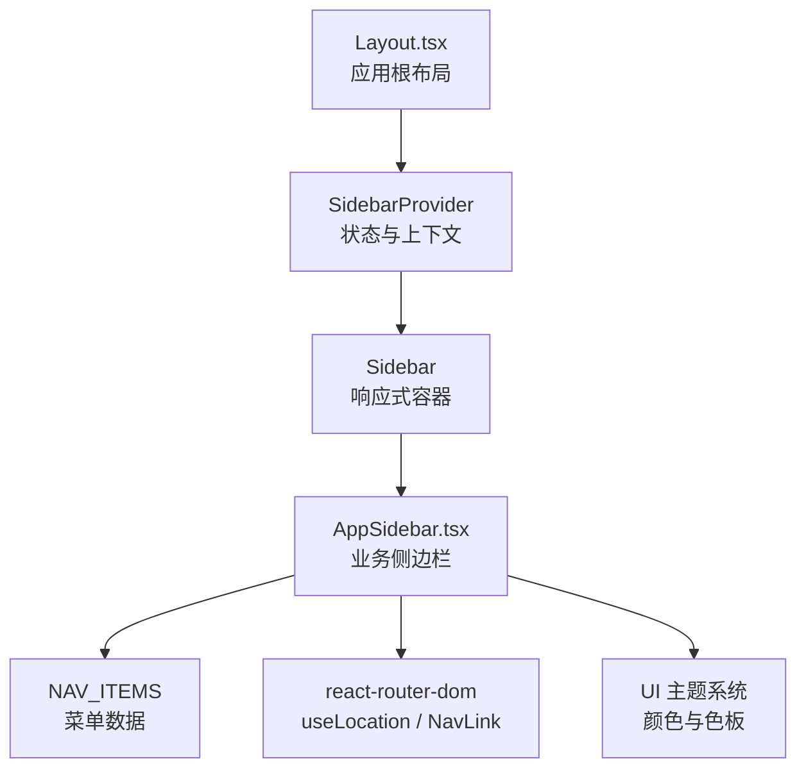
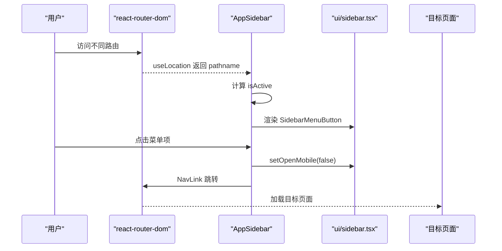
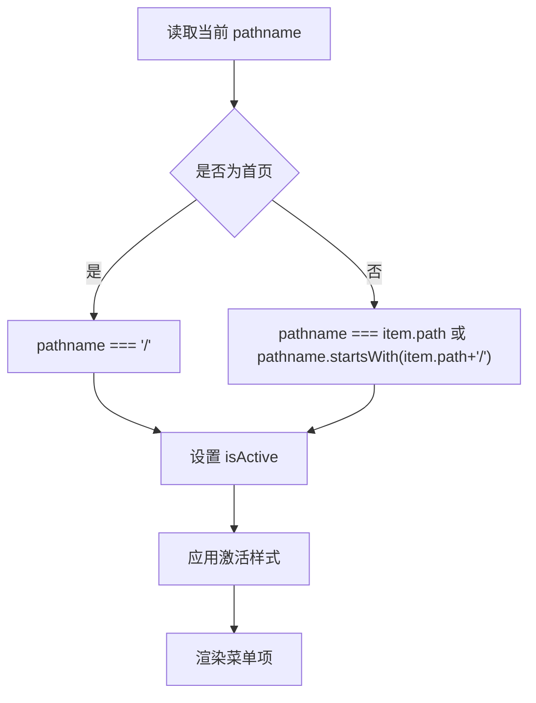
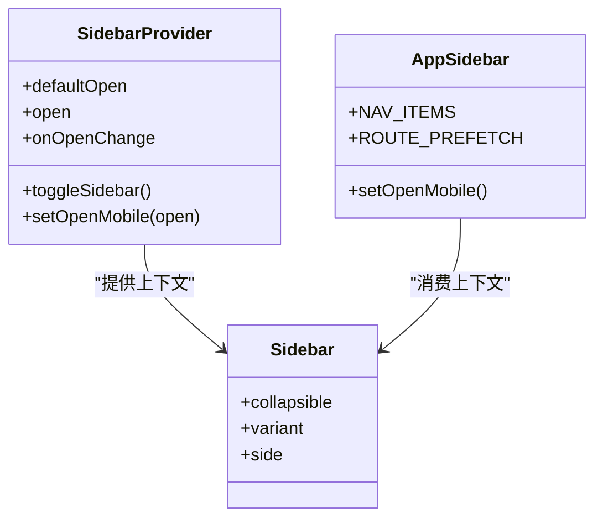

# 侧边栏导航

<cite>
**本文引用的文件**
- [AppSidebar.tsx](file://src/components/AppSidebar.tsx)
- [sidebar.tsx](file://src/components/ui/sidebar.tsx)
- [Layout.tsx](file://src/components/Layout.tsx)
</cite>

## 目录
1. [简介](#简介)
2. [项目结构定位](#项目结构定位)
3. [核心组件总览](#核心组件总览)
4. [架构与数据流](#架构与数据流)
5. [动态菜单生成逻辑](#动态菜单生成逻辑)
6. [活动状态与路由高亮机制](#活动状态与路由高亮机制)
7. [响应式折叠与移动端适配](#响应式折叠与移动端适配)
8. [图标集成与自定义图标支持](#图标集成与自定义图标支持)
9. [分组、层级与扩展点](#分组层级与扩展点)
10. [点击事件处理与路由跳转](#点击事件处理与路由跳转)
11. [菜单配置指南](#菜单配置指南)
12. [状态持久化与用户偏好](#状态持久化与用户偏好)
13. [样式定制与主题适配](#样式定制与主题适配)
14. [性能与预加载策略](#性能与预加载策略)
15. [故障排查](#故障排查)
16. [结论](#结论)

## 简介
本文件为 NativeThink 应用的侧边栏导航组件 AppSidebar 的完整技术文档。它聚焦于以下目标：
- 说明动态菜单的数据结构与渲染流程；
- 解释基于当前路由的活动状态判断与高亮行为；
- 描述桌面端与移动端的响应式折叠策略；
- 说明图标来源、集成方式与自定义能力；
- 说明菜单分组、层级结构与扩展点；
- 解释菜单项点击后的路由跳转和交互细节；
- 提供添加、排序、隐藏菜单以及主题、样式的可操作指南；
- 说明侧边栏状态持久化和用户偏好设置。

该组件以 React + TypeScript 实现，依赖 react-router-dom 进行路由，使用自维护的 UI 侧边栏基础组件完成响应式布局、折叠态、移动端抽屉、快捷键切换、Cookie 持久化等能力。

## 项目结构定位
AppSidebar 是页面级布局中的常驻导航容器，位于应用根布局 Layout 内部，由 SidebarProvider 包裹，并配合 SidebarInset 形成“侧边栏 + 内容区”的经典布局。其职责包括：
- 定义静态菜单数据 NAV_ITEMS；
- 根据当前路由计算活动状态；
- 渲染每个菜单项，包含图标、标签、待复习角标；
- 在悬停或触摸时触发目标页面的懒加载预取；
- 在移动端点击后关闭抽屉；
- 提供外观主题色盘选择入口。



图表来源
- [Layout.tsx:100-155](file://src/components/Layout.tsx#L100-L155)
- [sidebar.tsx:1-120](file://src/components/ui/sidebar.tsx#L1-L120)
- [AppSidebar.tsx:1-179](file://src/components/AppSidebar.tsx#L1-L179)

章节来源
- [Layout.tsx:100-155](file://src/components/Layout.tsx#L100-L155)
- [sidebar.tsx:1-120](file://src/components/ui/sidebar.tsx#L1-L120)
- [AppSidebar.tsx:1-179](file://src/components/AppSidebar.tsx#L1-L179)

## 核心组件总览
- AppSidebar：业务侧边栏，负责菜单数据、路由高亮、预取、移动端交互、主题选择。
- ui/sidebar.tsx：通用侧边栏基础组件，提供 Provider、Sidebar、SidebarContent、SidebarMenu、SidebarMenuItem、SidebarMenuButton、useSidebar、SidebarRail、SidebarTrigger、Sheet 移动端模式、Cookie 持久化等。
- Layout：应用根布局，注入 SidebarProvider、Header、MobileBottomNav、模块强调色、页面滚动重置与错误边界。

关键职责划分：
- AppSidebar 不关心侧边栏如何展开、折叠、显示为抽屉，只关注菜单项渲染和交互。
- ui/sidebar.tsx 提供响应式容器、上下文状态、快捷键、拖拽轨道、Tooltip 行为。
- Layout 决定何时显示 AppSidebar，并管理整体页面结构。

章节来源
- [AppSidebar.tsx:1-179](file://src/components/AppSidebar.tsx#L1-L179)
- [sidebar.tsx:1-731](file://src/components/ui/sidebar.tsx#L1-L731)
- [Layout.tsx:1-155](file://src/components/Layout.tsx#L1-L155)

## 架构与数据流
侧边栏导航的整体数据流如下：



图表来源
- [AppSidebar.tsx:1-179](file://src/components/AppSidebar.tsx#L1-L179)
- [sidebar.tsx:1-200](file://src/components/ui/sidebar.tsx#L1-L200)
- [Layout.tsx:100-155](file://src/components/Layout.tsx#L100-L155)

章节来源
- [AppSidebar.tsx:1-179](file://src/components/AppSidebar.tsx#L1-L179)
- [sidebar.tsx:1-200](file://src/components/ui/sidebar.tsx#L1-L200)
- [Layout.tsx:100-155](file://src/components/Layout.tsx#L100-L155)

## 动态菜单生成逻辑
菜单数据以常量数组形式集中声明，每个菜单项包含路径、显示文本和图标。渲染时使用 map 遍历生成 SidebarMenuItem，并通过 SidebarMenuButton 包裹 NavLink，实现可访问性、Tooltip、激活态样式。

数据结构要点：
- 每条菜单项包含：
  - path：路由路径；
  - label：中文显示文本；
  - icon：lucide-react 图标组件。

渲染流程要点：
- 遍历 NAV_ITEMS；
- 解析 Icon 组件；
- 计算 isActive；
- 绑定 onMouseEnter 与 onTouchStart 预取；
- 渲染 NavLink 与标签；
- 对特定路径渲染待复习角标；
- 通过 cn 组合 Tailwind 类名。

复杂度分析：
- 时间复杂度 O(N)，N 为菜单项数量；
- 空间复杂度 O(1)，仅复用少量局部变量。

优化建议：
- 如果菜单数据需要后端下发，可将 NAV_ITEMS 改为可配置的函数返回值；
- 对超大规模菜单，考虑虚拟列表或分页分组。

章节来源
- [AppSidebar.tsx:15-55](file://src/components/AppSidebar.tsx#L15-L55)
- [AppSidebar.tsx:56-179](file://src/components/AppSidebar.tsx#L56-L179)

## 活动状态与路由高亮机制
活动状态判断逻辑按以下规则执行：
- 首页路径 `/` 精确匹配 pathname；
- 其他路径匹配 pathname 完全等于 item.path，或以 item.path/ 开头；
- 通过 SidebarMenuButton 的 isActive 属性驱动 data-active 状态；
- 通过 Tailwind 类名切换背景、文字颜色、图标粗细；
- 折叠状态下，文本自动隐藏，仅保留图标与 Tooltip。



图表来源
- [AppSidebar.tsx:80-140](file://src/components/AppSidebar.tsx#L80-L140)

章节来源
- [AppSidebar.tsx:70-150](file://src/components/AppSidebar.tsx#L70-L150)

## 响应式折叠与移动端适配
侧边栏基础组件 ui/sidebar.tsx 负责设备检测与呈现模式切换：
- 桌面端：Sidebar 作为固定侧边栏，支持展开、折叠、offcanvas、icon 三种折叠模式；
- 移动端：使用 Sheet 抽屉展示侧边栏；
- 提供键盘快捷键 Ctrl/Cmd+B 切换；
- 提供 SidebarRail 拖拽把手调整宽度；
- 使用 Cookie 持久化展开状态。

AppSidebar 的适配策略：
- 将 collapsible 设为 icon，使桌面端支持图标模式折叠；
- 在移动端点击菜单项时调用 setOpenMobile(false) 关闭抽屉；
- 折叠时隐藏文本，保留图标与 Tooltip；
- 通过 group-data-[state=collapsed] 控制布局变化。



图表来源
- [sidebar.tsx:1-120](file://src/components/ui/sidebar.tsx#L1-L120)
- [sidebar.tsx:200-350](file://src/components/ui/sidebar.tsx#L200-L350)
- [AppSidebar.tsx:100-179](file://src/components/AppSidebar.tsx#L100-L179)

章节来源
- [sidebar.tsx:1-120](file://src/components/ui/sidebar.tsx#L1-L120)
- [sidebar.tsx:200-350](file://src/components/ui/sidebar.tsx#L200-L350)
- [AppSidebar.tsx:100-179](file://src/components/AppSidebar.tsx#L100-L179)

## 图标集成与自定义图标支持
图标来源：
- 所有菜单图标来自 lucide-react；
- 每个菜单项携带一个图标组件引用；
- 渲染时直接实例化 Icon 组件。

自定义图标支持：
- 新增菜单时，只需传入任意 lucide-react 图标组件；
- 如需自定义图标库，可将 icon 字段改为更通用的类型，例如字符串标识符加映射表；
- 当前实现中，图标大小、颜色、描边宽度由 Tailwind 与 isActive 条件控制。

注意事项：
- 图标尺寸统一为固定像素大小；
- 激活状态下图标颜色与描边更粗，突出视觉重点；
- 非激活状态图标透明度较低，避免喧宾夺主。

章节来源
- [AppSidebar.tsx:1-15](file://src/components/AppSidebar.tsx#L1-L15)
- [AppSidebar.tsx:56-140](file://src/components/AppSidebar.tsx#L56-L140)

## 分组、层级与扩展点
当前菜单结构为扁平列表，没有显式分组标题或子菜单。但基础组件已提供分组与子菜单相关组件：
- SidebarGroup：用于分组容器；
- SidebarGroupLabel：分组标题；
- SidebarMenuSub：子菜单列表；
- SidebarMenuSubItem：子菜单项；
- SidebarMenuSubButton：子菜单按钮；
- SidebarSeparator：分隔线。

这意味着可以在 AppSidebar 中扩展分组与层级：
- 将 NAV_ITEMS 拆分为多个分组数组；
- 使用 SidebarGroup 包裹每组菜单；
- 为二级功能使用 SidebarMenuSub；
- 保持路由判断逻辑一致。

扩展建议：
- 若菜单项过多，可按功能域分组，例如学习工具、练习模块、系统设置；
- 对高频模块放在顶部，低频模块放入分组或二级菜单；
- 对需要权限控制的菜单，可在渲染前过滤。

章节来源
- [AppSidebar.tsx:56-179](file://src/components/AppSidebar.tsx#L56-L179)
- [sidebar.tsx:350-731](file://src/components/ui/sidebar.tsx#L350-L731)

## 点击事件处理与路由跳转
菜单项点击流程：
1. 用户点击 SidebarMenuButton 包裹的 NavLink；
2. AppSidebar 先调用 setOpenMobile(false) 关闭移动端抽屉；
3. react-router-dom 的 NavLink 执行路由跳转；
4. Layout 更新 Outlet，渲染目标页面；
5. 如果目标是词汇页，同时显示待复习角标。

```mermaid
sequenceDiagram
  participant User as "用户"
  participant Button as "SidebarMenuButton"
  participant Link as "NavLink"
  participant SidebarCtx as "useSidebar"
  participant Router as "react-router-dom"

  User->>Button: 点击
  Button->>SidebarCtx: setOpenMobile(false)
  Button->>Link: 触发 onClick
  Link->>Router: 跳转至 item.path
  Router-->>Layout: 更新页面
```

图表来源
- [AppSidebar.tsx:100-160](file://src/components/AppSidebar.tsx#L100-L160)
- [sidebar.tsx:1-120](file://src/components/ui/sidebar.tsx#L1-L120)

章节来源
- [AppSidebar.tsx:100-160](file://src/components/AppSidebar.tsx#L100-L160)

## 菜单配置指南
### 添加新菜单项
步骤：
1. 在 NAV_ITEMS 中添加一条记录；
2. 指定 path、label、icon；
3. 在 ROUTE_PREFETCH 中添加对应路径的懒加载导入；
4. 确保目标页面已在路由系统中注册；
5. 如需待复习角标或其他特殊逻辑，按需扩展。

### 修改菜单顺序
直接调整 NAV_ITEMS 数组顺序即可，因为渲染使用稳定 key 且按数组顺序输出。

### 隐藏特定菜单
推荐方式：
- 条件过滤：将 NAV_ITEMS 改为可计算的数组，根据用户角色、功能开关、环境参数过滤；
- 配置字段：为菜单项增加 visible 或 disabled 字段，并在渲染时跳过或禁用；
- 权限控制：结合认证状态隐藏敏感功能。

注意：
- 不要简单删除菜单项而不清理 ROUTE_PREFETCH，否则可能留下未使用的预取逻辑；
- 如果菜单项被隐藏但仍存在路由，请确保不影响安全或体验。

章节来源
- [AppSidebar.tsx:15-55](file://src/components/AppSidebar.tsx#L15-L55)
- [AppSidebar.tsx:56-179](file://src/components/AppSidebar.tsx#L56-L179)

## 状态持久化与用户偏好
侧边栏展开状态持久化：
- 使用 Cookie 保存侧边栏展开状态；
- Cookie 名称由基础组件定义；
- 最大有效期为 7 天；
- 当用户通过 toggleSidebar、快捷键或拖拽改变状态时，会写入 Cookie；
- 同一 Cookie 也影响移动端抽屉 openMobile 与桌面端 open 的统一切换逻辑。

用户偏好设置：
- 主题选择：侧边栏底部提供主题色盘，点击后调用 setUiTheme；
- 主题 ID 与色板来自 UI 主题系统；
- 当前选中主题通过 aria-pressed 提供可访问性语义；
- 主题切换会影响侧边栏和全局 UI 的颜色表现。

章节来源
- [sidebar.tsx:1-120](file://src/components/ui/sidebar.tsx#L1-L120)
- [AppSidebar.tsx:140-179](file://src/components/AppSidebar.tsx#L140-L179)

## 样式定制与主题适配
样式定制维度：
- 容器边框：通过 className 覆盖 border-r-0 等基础样式；
- 头部样式：SidebarHeader 内自定义 Logo、品牌文案、间距；
- 菜单项样式：通过 cn 组合 Tailwind 类名，覆盖激活态与非激活态；
- 图标样式：通过 size、strokeWidth、颜色类控制；
- 角标样式：待复习角标可通过类名覆盖背景、文字、圆角；
- 折叠态：使用 group-data-[state=collapsed] 控制文本隐藏；
- 主题色：通过 CSS 变量与 UI 主题系统联动。

主题适配方案：
- 使用 var(--nav-bg)、var(--nav-fg)、var(--lime) 等变量；
- 主题色盘通过 linear-gradient 渲染预览；
- 激活图标颜色使用固定强调色，非激活图标使用半透明白色；
- 折叠模式下 Tooltip 仅在非移动端且折叠时显示。

章节来源
- [AppSidebar.tsx:60-179](file://src/components/AppSidebar.tsx#L60-L179)
- [sidebar.tsx:450-731](file://src/components/ui/sidebar.tsx#L450-L731)

## 性能与预加载策略
预加载机制：
- 定义 ROUTE_PREFETCH 映射表；
- 在 onMouseEnter 与 onTouchStart 触发目标路由的动态 import；
- 对词汇页额外触发词库核心预加载；
- 预加载发生在用户交互阶段，避免首屏阻塞；
- 使用懒加载降低初始包体积。

性能建议：
- 对低频页面谨慎预加载，避免浪费带宽；
- 对热点页面优先预加载；
- 可对预加载结果做去重，避免重复 import；
- 对移动端可减少预加载范围，节省流量；
- 对弱网环境可延迟或取消预加载。

章节来源
- [AppSidebar.tsx:15-55](file://src/components/AppSidebar.tsx#L15-L55)
- [AppSidebar.tsx:100-130](file://src/components/AppSidebar.tsx#L100-L130)

## 故障排查
常见问题与解决思路：
- 菜单不高亮：
  - 检查 pathname 是否与 item.path 或前缀匹配；
  - 检查首页 end 属性是否正确；
  - 确认路由路径是否包含子路径前缀。
- 移动端点击后抽屉未关闭：
  - 确认 onClick 调用了 setOpenMobile(false)；
  - 检查是否有其他遮罩层拦截点击。
- 预加载无效：
  - 检查 ROUTE_PREFETCH 是否包含目标路径；
  - 检查目标页面是否存在；
  - 检查网络与缓存策略。
- 主题切换无效果：
  - 检查 setUiTheme 是否被调用；
  - 检查 CSS 变量是否生效；
  - 检查主题系统是否初始化。
- 侧边栏状态丢失：
  - 检查 Cookie 是否被浏览器策略限制；
  - 检查多 Tab 下状态同步是否符合预期；
  - 检查 defaultOpen 与外部 open 控制冲突。

章节来源
- [AppSidebar.tsx:70-179](file://src/components/AppSidebar.tsx#L70-L179)
- [sidebar.tsx:1-120](file://src/components/ui/sidebar.tsx#L1-L120)

## 结论
AppSidebar 是一个结构清晰、职责明确的业务侧边栏组件。它以静态菜单数据为基础，结合 react-router-dom 的路由能力实现活动高亮与跳转，并借助 ui/sidebar.tsx 提供的响应式容器完成桌面与移动端适配。其设计优点在于：
- 菜单数据集中、可读性强；
- 路由高亮逻辑简单可靠；
- 预加载策略提升用户体验；
- 基础组件封装了复杂的状态、持久化与响应式逻辑；
- 主题系统与样式变量便于定制。

未来可扩展方向包括：
- 引入分组与子菜单；
- 支持动态菜单与权限控制；
- 增强预加载去重与失败重试；
- 提供更丰富的菜单动作与右键菜单；
- 将更多用户偏好纳入统一设置中心。